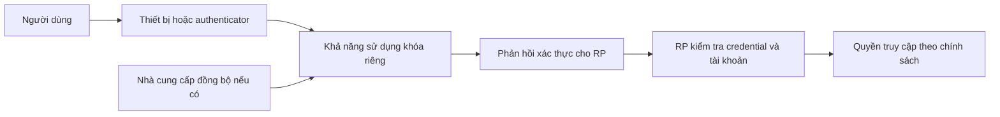
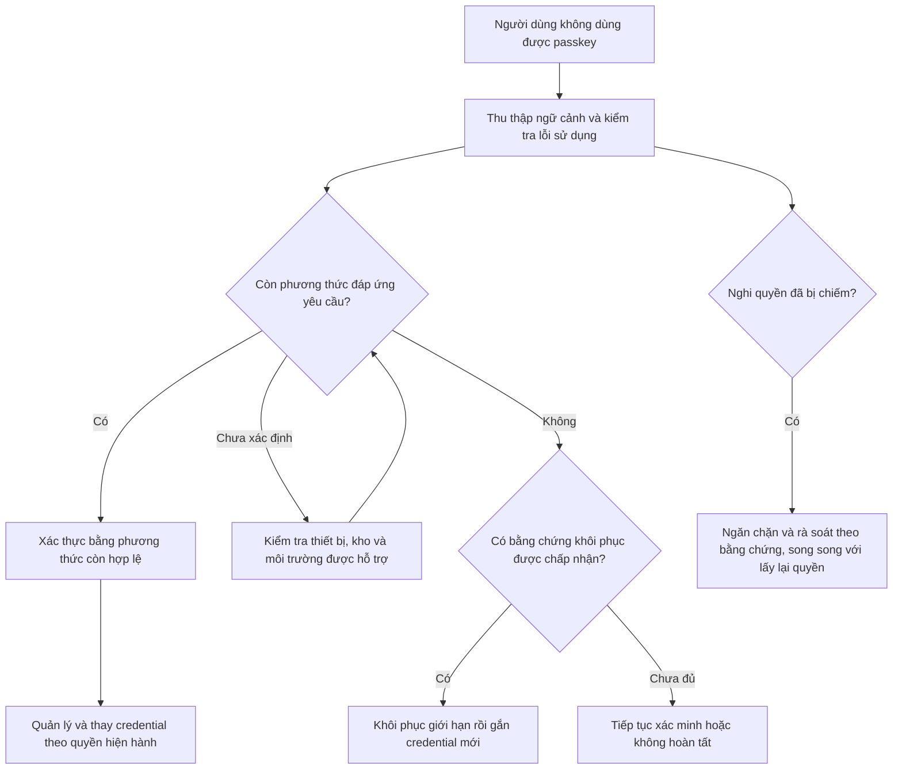

# Các tình huống mất quyền truy cập passkey

## 1. Mất thiết bị không luôn có nghĩa đã mất mọi passkey

Trong chương **Passkey Recovery**, **Passkey loss scenarios** là việc nhận diện những tình huống khiến người dùng không còn sử dụng được passkey đã đăng ký, rồi chọn đường xử lý phù hợp. Cùng một thông báo “Tôi mất passkey” có thể là mất điện thoại, mất khóa bảo mật, không mở được trình quản lý passkey, quên cách mở khóa cục bộ hoặc chỉ là trình duyệt chưa hiển thị credential.

Trong phạm vi `SECURITY_AUTHENTICATION_ACCOUNT_RECOVERY`, việc phân loại này giúp bảo vệ người dùng mất mật khẩu, MFA, passkey hoặc thiết bị xác thực mà không tạo một đường khôi phục dễ bị chiếm đoạt. Quyết định phải xét bằng chứng tài khoản, nguy cơ xâm phạm, quyền của mã khôi phục và những phiên còn hoạt động.

Ví dụ, Hà và Dũng cùng mất điện thoại:

- Hà còn dùng được passkey đã đồng bộ trên máy tính an toàn. Nếu dịch vụ vẫn chấp nhận credential đó và yêu cầu xác thực được đáp ứng, Hà có thể đăng nhập bằng passkey còn dùng được.
- Dũng chỉ có một passkey gắn với chiếc điện thoại đã mất, không còn phương thức đăng nhập đáp ứng chính sách. Dũng cần một đường khôi phục tài khoản được thiết kế cho việc mất phương thức.

Hai người có cùng sự cố phần cứng nhưng khác trạng thái xác thực. Không nên ép cả hai qua một nút “reset passkey bằng email”, cũng không hứa rằng mua máy mới sẽ tự khôi phục được mọi passkey.

Mục tiêu của bài là xác định **đang mất khả năng nào, còn bằng chứng nào và quyền nào có thể đã bị người khác giữ**. Những luồng và ví dụ dưới đây là thiết kế tham khảo, không phải cam kết về khả năng khôi phục của một nhà cung cấp cụ thể.

## 2. Ba lớp cần phân biệt trước khi đánh giá mất mát

### 2.1. Credential tại dịch vụ và khóa do authenticator quản lý

Một passkey dùng cặp khóa mật mã để xác thực. Dịch vụ, hay relying party (RP), lưu bản ghi credential và khóa công khai; authenticator hoặc hệ thống quản lý credential giữ khả năng sử dụng khóa riêng.

`credential_id` giúp RP nhận diện credential đã gắn với tài khoản. Nó không phải khóa riêng và không tự chứng minh quyền đăng nhập. Đặt lại tên passkey, biết email tài khoản hoặc gửi lại credential ID cho người dùng không tái tạo được khả năng ký bằng khóa riêng đã mất.

Trong mô hình passkey thông thường, RP không thể suy ra khóa riêng từ khóa công khai để “gửi lại passkey”. Một luồng khôi phục tại dịch vụ thường cấp quyền gắn **credential mới** sau khi xác minh tài khoản, thay vì lấy khóa riêng cũ từ cơ sở dữ liệu của RP.

### 2.2. Passkey gắn thiết bị và passkey đồng bộ

FIDO phân biệt passkey gắn với một thiết bị với passkey được đồng bộ qua nhà cung cấp. Khác biệt này quyết định mất một thiết bị có thể ảnh hưởng khả năng dùng credential ra sao. [FIDO Alliance — Passkeys](https://fidoalliance.org/passkeys/).

| Loại | Khi mất một thiết bị | Điều cần kiểm tra thêm |
|---|---|---|
| Passkey gắn thiết bị | Khả năng dùng credential có thể mất cùng thiết bị đó | Còn credential khác đã đăng ký hoặc đường khôi phục không? |
| Passkey đồng bộ | Credential có thể còn dùng được trên thiết bị khác hoặc được phục hồi qua nhà cung cấp | Người dùng còn quyền truy cập hệ thống đồng bộ và thỏa điều kiện phục hồi không? |
| Chưa xác định được | Không đủ cơ sở chọn đường xử lý chỉ từ tên máy | Có dữ liệu đã được xác minh và một lần đăng nhập hợp lệ để đối chiếu không? |

Một tài khoản có thể đăng ký nhiều passkey thuộc các loại khác nhau. Không nên gắn toàn tài khoản với một nhãn duy nhất như “tài khoản dùng passkey đồng bộ”.

### 2.3. Nhà cung cấp passkey và tài khoản tại RP

Nhà cung cấp passkey có thể quản lý việc đồng bộ, mở khóa kho hoặc phục hồi khả năng sử dụng credential. RP quyết định credential nào được chấp nhận cho tài khoản của mình.



Lấy lại tài khoản nhà cung cấp không tự cấp quyền tại mọi RP. RP vẫn phải nhận và kiểm tra một phản hồi hợp lệ từ credential còn được cho phép. Ngược lại, khôi phục tài khoản tại một RP không tự mở lại kho passkey của nhà cung cấp.

## 3. Phân biệt ba loại hành động xử lý

### 3.1. Sử dụng lại credential còn truy cập được

Nếu người dùng vẫn dùng được một passkey được chấp nhận, kể cả qua thiết bị khác hoặc sau phục hồi đồng bộ, đây có thể vẫn là đăng nhập bằng credential hiện hành.

Hệ thống không được bỏ bước xác minh chữ ký và trạng thái credential chỉ vì người dùng khai đã phục hồi kho. Credential đã bị RP thu hồi cũng không tự được chấp nhận lại khi một bản sao xuất hiện trên máy mới.

### 3.2. Gắn thêm hoặc thay credential sau xác thực đủ quyền

Nếu người dùng còn phương thức đã đăng ký đáp ứng yêu cầu cho hành động quản lý passkey, có thể xác minh lại rồi gắn một credential mới. Không nhất thiết phải đi qua toàn bộ đường khôi phục mất mọi phương thức.

Tuy nhiên, “còn đăng nhập” và “đủ quyền thêm passkey” là hai kết luận khác nhau. Một phiên cũ, phiên có mức xác thực thấp hoặc phiên có dấu hiệu bị chiếm có thể cần bằng chứng bổ sung.

### 3.3. Khôi phục tài khoản khi không còn khả năng xác thực cần thiết

NIST mô tả account recovery là việc lấy lại khả năng truy cập sau khi mất quyền kiểm soát những authenticator cần thiết cho mức xác thực mong muốn; sau đó người dùng có thể gắn authenticator mới. [NIST — Account recovery](https://pages.nist.gov/800-63-4/sp800-63b.html#account-recovery).

Đường khôi phục cần bằng chứng đã được chính sách chấp nhận, chẳng hạn phối hợp mã khôi phục, phương thức còn lại, liên hệ khôi phục đã thiết lập hoặc đối chiếu danh tính phù hợp với hồ sơ ban đầu. Một mã đơn lẻ không mặc nhiên đủ cho mọi tài khoản.

Ngoài ba loại hành động trên còn có **ứng phó sự cố**: ngăn quyền đang bị đối thủ giữ và rà soát thay đổi trái phép. Người dùng có thể cần vừa đăng nhập hoặc khôi phục, vừa thực hiện ngăn chặn; một việc không thay thế việc còn lại.

## 4. Thu thập đủ ngữ cảnh mà không tin ngay lời khai

### 4.1. Các câu hỏi phân loại

| Nhóm thông tin | Điều cần xác định | Giới hạn của dữ liệu |
|---|---|---|
| Sự kiện | Mất, hỏng, đổi máy, xóa credential, không mở khóa được hay nghi bị chiếm? | Lời khai định hướng hỗ trợ, chưa cấp quyền |
| Nơi giữ credential | Thiết bị, khóa bảo mật hay nhà cung cấp đồng bộ nào? | Tên hiển thị có thể do người dùng tự đặt |
| Khả năng còn lại | Còn thiết bị, passkey hoặc phương thức nào dùng được? | Phải xác thực thật, không chỉ hỏi người dùng có hay không |
| Nhà cung cấp đồng bộ | Còn mở được kho hoặc đường phục hồi của nhà cung cấp không? | Không yêu cầu mật khẩu hay mã mở khóa của nhà cung cấp gửi về RP |
| Phiên hiện hành | Còn phiên nào, được xác thực khi nào và bằng cách nào? | Có phiên không chứng minh thiết bị an toàn |
| Rủi ro | Máy bị lấy cắp, email bị đổi, xuất hiện credential lạ hay phiên lạ? | Không phát hiện tín hiệu không có nghĩa chắc chắn không bị chiếm |
| Bằng chứng khôi phục | Còn mã dự phòng hoặc bằng chứng độc lập đã thiết lập không? | Không biến email hay số mới tự nhập thành bằng chứng lịch sử |

Không hỏi người dùng gửi ảnh khóa riêng, mã khôi phục, mã PIN authenticator hoặc mật khẩu kho passkey qua ticket hỗ trợ. Các bí mật chỉ được trình qua luồng kiểm tra được thiết kế đúng mục đích.

### 4.2. BE và BS không phải danh sách bản sao đang tồn tại

WebAuthn dùng backup eligibility (BE) và backup state (BS) để mô tả khả năng sao lưu và trạng thái sao lưu của credential. BE không thay đổi sau khi tạo credential, còn BS có thể thay đổi. [W3C WebAuthn — Credential backup state](https://www.w3.org/TR/webauthn-3/#sctn-credential-backup).

Những giá trị đã được RP ghi nhận có thể hỗ trợ phân loại, nhưng không chứng minh hiện tại người dùng còn mở được tài khoản đồng bộ, còn máy an toàn hoặc còn một bản sao có thể dùng. Cũng không được tin một trường `backedUp=true` do phía khách tự khai ngoài kết quả xác minh giao thức.

### 4.3. Không dùng lỗi giao diện để kết luận mất credential

Một hộp chọn passkey không hiện, một timeout hoặc `NotAllowedError` có thể xuất hiện trong nhiều hoàn cảnh. Nó không tự chứng minh khóa riêng đã bị xóa hoặc tài khoản không có passkey.

Nếu thông tin chưa đủ, giữ trạng thái chưa xác định và đưa ra bước kiểm tra an toàn. Không tự thu hồi mọi credential sau một lần người dùng bấm hủy hộp thoại.

## 5. Mất thiết bị nhưng còn đường xác thực phù hợp

### 5.1. Tình huống A: mất thiết bị chứa passkey gắn thiết bị, còn passkey khác

Hải mất máy tính D1, nơi lưu credential C1. Tài khoản còn C2 trên một khóa bảo mật được cất riêng và C2 vẫn được dịch vụ cho phép.

Hướng xử lý có thể là:

1. Hải đăng nhập bằng C2 theo đúng yêu cầu xác thực của tài khoản.
2. Hệ thống kiểm tra quyền quản lý passkey và mức rủi ro trước khi cho thêm credential mới.
3. C1 được đình chỉ hoặc thu hồi theo đánh giá mất thiết bị, cùng những phiên và quyền liên quan cần xử lý.
4. Hải đăng ký C3 trên thiết bị mới và kiểm tra có thể dùng C3 qua một lần xác thực mới.

Đây không phải việc sao chép C1 từ máy chủ sang máy mới. C3 là một liên kết xác thực mới. Tên “khóa dự phòng” chỉ có ý nghĩa nếu credential trên khóa đó đã được đăng ký và còn có thể sử dụng cho đúng tài khoản.

Không nên buộc Hải dùng email reset rồi xóa C2 đang an toàn chỉ vì đã báo mất D1. Ngược lại, nếu D1 bị lấy cắp, việc C2 vẫn dùng được không loại bỏ nhu cầu ngăn quyền của D1.

### 5.2. Tình huống B: mất một máy, passkey đồng bộ còn dùng được trên máy khác

Linh mất điện thoại D1 nhưng passkey C vẫn dùng được trên máy tính D2 đã đồng bộ trước đó. D2 gửi một assertion hợp lệ và RP xác nhận C còn hoạt động.

Linh có thể tiếp tục theo đường đăng nhập bình thường nếu đáp ứng chính sách. Sau đó cần đánh giá sự cố D1, rà soát phiên và cân nhắc phạm vi thu hồi credential.

Nếu C là cùng một credential được đồng bộ trên cả D1 và D2, thu hồi C tại RP có thể làm C không còn dùng được trên D2. Không gọi thao tác đó là “chỉ xóa bản sao ở D1” khi RP không có cơ chế phân biệt từng bản sao.

Trong trường hợp cần thay C vì rủi ro xâm phạm, hãy chuẩn bị một credential hoặc đường truy cập thay thế được cấp quyền phù hợp, đồng thời không trì hoãn ngăn chặn một quyền đã được xác định là nguy hiểm chỉ để giữ tiện dụng.

### 5.3. Tình huống C: chỉ còn một phiên đang hoạt động

Thảo không dùng được passkey nhưng trình duyệt trên máy khác vẫn còn phiên đăng nhập. Phiên này có thể giúp Thảo vào trang hỗ trợ hoặc bắt đầu quản lý, song chưa chắc đủ để gắn một passkey mới.

Một đối thủ lấy được cookie cũng có thể ở trạng thái tương tự. Nếu endpoint “thêm passkey” chỉ cần một phiên bất kỳ, đối thủ có thể tạo credential của mình rồi duy trì truy cập sau khi cookie bị thu hồi.

Hệ thống cần đánh giá độ mới, phương thức xác thực và trạng thái rủi ro của phiên, sau đó yêu cầu bằng chứng bổ sung hoặc đường khôi phục phù hợp. Không gắn nhãn “thiết bị tin cậy” như một ngoại lệ tự động cho mọi hành động nhạy cảm.

## 6. Passkey đồng bộ nhưng không phục hồi được khả năng sử dụng

### 6.1. Tình huống D: mất mọi thiết bị và không vào được nhà cung cấp

Nam dùng passkey đồng bộ nhưng điện thoại, máy tính và phương thức mở tài khoản nhà cung cấp đều không còn truy cập được. Email, SMS và kho mã khôi phục của Nam cũng nằm trên cùng chiếc điện thoại bị mất.

Đồng bộ giúp giảm một số dạng mất thiết bị, nhưng khả năng phục hồi còn phụ thuộc việc truy cập nhà cung cấp và điều kiện của hệ thống đó. FIDO cũng nêu các tình huống mất quyền vào nhà cung cấp hoặc chuyển sang môi trường không hỗ trợ như những lý do vẫn cần đường thay thế. [FIDO Alliance — Synced passkey deployment, mục 2.2](https://fidoalliance.org/wp-content/uploads/2024/05/Synced-Passkey-Deployment_-Emerging-Practices-for-Consumer-Use-Cases_2024-Final.pdf#page=6).

Có hai nhánh riêng:

- Nếu Nam phục hồi được quyền sử dụng credential qua nhà cung cấp, RP vẫn thực hiện xác thực bình thường và kiểm tra credential còn được chấp nhận.
- Nếu Nam không phục hồi được nhưng có bằng chứng khôi phục tài khoản tại RP, Nam đi qua đường đó để được phép gắn credential mới.

RP không yêu cầu Nam cung cấp mã mở khóa kho cho nhân viên của RP. Cũng không công nhận một email “đã lấy lại tài khoản đồng bộ” như bằng chứng thay thế cho assertion hoặc bằng chứng khôi phục đã quy định.

### 6.2. Tình huống E: đổi hệ sinh thái hoặc đổi trình quản lý passkey

Quỳnh còn máy cũ nhưng chuyển sang thiết bị mới chưa sử dụng được nhà cung cấp đã lưu passkey. Việc giao diện máy mới không có C không đồng nghĩa C đã bị phá hủy.

Nếu credential trên máy cũ vẫn dùng được và môi trường hỗ trợ, có thể đăng nhập từ thiết bị khác rồi đăng ký credential mới tại nhà cung cấp phù hợp. FIDO mô tả cross-device authentication như một cách sử dụng credential ở thiết bị khác để đăng nhập, không yêu cầu RP giữ khóa riêng. [FIDO Alliance — Cross-device authentication](https://fidoalliance.org/passkeys/).

Luồng đó cần thiết bị giữ credential còn khả dụng và các điều kiện hỗ trợ thực tế. Không đưa hướng dẫn “quét mã bằng điện thoại cũ” cho người vừa mất chính điện thoại đó như một đường giải quyết duy nhất.

Việc chuyển hoặc xuất credential giữa nhà cung cấp phụ thuộc khả năng được hỗ trợ. Không hứa mọi passkey tự di chuyển khi đổi máy, và không yêu cầu người dùng xuất khóa riêng ra file tùy ý hoặc gửi cho bộ phận hỗ trợ.

### 6.3. Tình huống F: nghi nhà cung cấp đồng bộ bị chiếm

Nếu có bằng chứng tài khoản đồng bộ bị người khác kiểm soát, việc người dùng vừa phục hồi được một bản sao không đủ để kết luận sự cố đã kết thúc. Cần đánh giá các credential có thể bị ảnh hưởng và những phiên được tạo từ chúng.

Nếu quyết định thay credential, nguồn và đường đăng ký mới cũng phải được xem xét. Tạo ngay một passkey mới vào cùng môi trường còn bị đối thủ kiểm soát có thể duy trì đường truy cập cho đối thủ.

Phạm vi của RP là quản lý credential và quyền tại dịch vụ của mình. Việc ngăn truy cập ở nhà cung cấp, loại thiết bị khỏi kho đồng bộ và xử lý những RP khác là các trách nhiệm riêng, không tự hoàn tất sau một lần khôi phục ở RP này.

## 7. Credential còn đó nhưng không mở khóa hoặc không sử dụng được

### 7.1. Tình huống G: quên PIN, không dùng được sinh trắc học hoặc authenticator bị khóa

Một người dùng có thể còn giữ thiết bị nhưng không hoàn tất được bước mở khóa cục bộ. Mã PIN của authenticator, mật khẩu mở kho và mật khẩu tài khoản tại RP có thể là những bí mật khác nhau.

RP không xác minh quyền tài khoản bằng cách hỏi người dùng gửi PIN hoặc ảnh sinh trắc học. Cần hướng dẫn tới quy trình chính thức của thiết bị hoặc nhà cung cấp, đồng thời cung cấp phương thức đã đăng ký khác nếu có.

Không khuyến nghị reset authenticator hay xóa dữ liệu kho như một bước thử đầu tiên. Tùy môi trường, thao tác đó có thể làm mất credential đang còn hoặc ảnh hưởng nhiều tài khoản khác.

Nếu không thể mở khóa bằng đường được hỗ trợ và không còn phương thức đáp ứng yêu cầu, người dùng cần được phân loại như mất khả năng sử dụng phương thức, dù phần cứng vẫn nằm trong tay họ.

### 7.2. Tình huống H: xóa credential, đặt lại máy hoặc cài lại môi trường

Một bản ghi tại RP có thể vẫn tồn tại trong khi người dùng đã xóa credential khỏi nơi lưu. Ngược lại, một mục vẫn xuất hiện trong trình quản lý passkey có thể tham chiếu credential đã bị RP thu hồi.

Hai phía có vòng đời liên quan nhưng không được giả định luôn tự đồng bộ hoàn toàn mọi thao tác. Việc mục vẫn xuất hiện không chứng minh đăng nhập sẽ thành công; việc RP còn giữ public key cũng không phục hồi được private key đã không còn truy cập được.

Người dùng cần xác thực bằng đường còn hợp lệ hoặc hoàn thành khôi phục để tạo credential mới. Không sửa public key của bản ghi cũ bằng dữ liệu client gửi lên chỉ để làm tên passkey trên giao diện khớp lại.

Đối với đổi máy có kế hoạch, nên kiểm tra đường đăng nhập trên môi trường mới trước khi xóa môi trường cũ. Đối với nghi bị chiếm, quyết định ngăn chặn vẫn phải ưu tiên theo rủi ro, không chờ người dùng hoàn thành mọi thao tác tiện dụng.

### 7.3. Tình huống I: không hiện passkey do ngữ cảnh hoặc lỗi tích hợp

Người dùng có thể đang chọn sai tài khoản trong trình quản lý, dùng hồ sơ trình duyệt khác, mở trang không đúng ngữ cảnh RP hoặc gặp lỗi cấu hình của dịch vụ. Thiếu khả năng hỗ trợ của client cũng có thể làm một đường xác thực không dùng được.

Đây là lý do cần tách **không tìm thấy trên giao diện** với **không còn credential dùng được**. Bước hỗ trợ ban đầu có thể kiểm tra miền chính thức, tài khoản và nhà cung cấp đang chọn, cũng như khả năng của môi trường theo tài liệu hiện hành.

Không làm yếu việc kiểm tra origin hoặc RP ID để “giúp người dùng lấy lại passkey”. Nếu nhiều tài khoản đồng thời không đăng nhập được sau một đợt triển khai, cần xem xét sự cố dịch vụ thay vì yêu cầu mọi người tự xóa credential và khôi phục danh tính.

Thông báo lỗi công khai phải tránh tiết lộ tài khoản cụ thể đã có những passkey nào. Dữ liệu chẩn đoán chi tiết chỉ nên xuất hiện ở ngữ cảnh người dùng đã được cấp quyền hoặc công cụ vận hành phù hợp.

## 8. Mất phần cứng xác thực hoặc nghi có người khác sử dụng

### 8.1. Tình huống J: mất khóa bảo mật rời

Một passkey trên khóa bảo mật gắn thiết bị có thể không còn dùng được nếu mất hoặc hỏng khóa đó. Việc mua một khóa cùng mẫu không tạo lại những credential đã được sinh trên khóa cũ.

Nếu người dùng có khóa dự phòng, cần kiểm tra khóa dự phòng đã đăng ký credential riêng cho đúng tài khoản chưa. Hai khóa cùng nhãn sản phẩm không tự là hai đường xác thực đã được RP chấp nhận.

Nếu không còn đường khác đáp ứng yêu cầu, người dùng cần khôi phục theo chính sách. Trong tổ chức có yêu cầu về loại authenticator hoặc thiết bị quản lý, credential thay thế cũng phải đáp ứng các yêu cầu tương ứng; hỗ trợ không được bỏ chính sách chỉ vì khóa cũ đã mất.

### 8.2. Tình huống K: thiết bị bị lấy cắp hoặc đã bị mở khóa trái phép

Mất một thiết bị không chứng minh đối thủ đã dùng được mọi passkey trong đó, nhưng cũng không thể kết luận an toàn chỉ vì thiết bị có PIN hoặc sinh trắc học. Đối thủ có thể biết cách mở khóa hoặc đang giữ một phiên đã đăng nhập, không cần thực hiện passkey assertion mới.

Hệ thống cần đánh giá riêng:

- Credential nào có thể bị sử dụng và phạm vi thu hồi của chúng.
- Phiên, refresh token, dấu ghi nhớ MFA và quyền phê duyệt nào còn hiệu lực.
- Kênh email, số điện thoại hoặc kho đồng bộ nào có thể cũng đã bị chiếm.
- Có credential, kênh khôi phục hoặc grant mới nào vừa được thêm trái phép không.

Thu hồi credential chặn những lần xác thực tiếp theo bằng credential đó theo cơ chế thực thi của RP. Nó không tự hủy mọi phiên đã được cấp trước đó, xóa dữ liệu đã tải hoặc thu hồi mọi grant tại dịch vụ khác.

### 8.3. Tình huống L: credential đã bị người khác xóa hoặc thay

Người dùng báo “passkey của tôi biến mất” nhưng nguyên nhân có thể là đối thủ đã có một phiên rồi xóa credential của họ và thêm credential của đối thủ. Đây là tình huống khôi phục sau nghi ngờ chiếm đoạt, không chỉ là đăng ký thêm một passkey cho tiện.

Sau khi xác minh chủ tài khoản, cần rà soát những thay đổi bảo mật và quyền tồn dư. Đường khôi phục không nên chỉ dựa vào email hoặc số vừa bị thay trong cùng chuỗi sự kiện.

Một passkey mới được đăng ký thành công cho người dùng không khiến credential của đối thủ tự mất hiệu lực. Quyết định loại bỏ quyền trái phép phải được thực hiện và ghi nhận riêng trong cùng kế hoạch ứng phó phù hợp.

## 9. Không còn passkey hoặc bằng chứng thay thế đủ tin cậy

### 9.1. Tình huống M: mất mọi phương thức cần thiết

Ngọc mất passkey duy nhất, không có mật khẩu đáp ứng chính sách, không còn kênh khôi phục đã thiết lập và cũng không giữ được mã khôi phục. Tài khoản trước đó có thể chưa từng được gắn với một danh tính ngoài đời đã xác minh.

Trong tình huống này, hệ thống không thể hứa chắc lấy lại được tài khoản. Một địa chỉ email mới, số điện thoại mới hoặc giấy tờ gửi lần đầu chưa tự tạo được liên kết đáng tin với chủ thể đã sở hữu tài khoản từ trước.

Nếu có quy trình đối chiếu danh tính phù hợp với mô hình và dữ liệu ban đầu, có thể thực hiện theo chính sách. Nếu không có bằng chứng đủ để ra quyết định, kết quả hợp lệ có thể là chưa thể hoặc không thể hoàn tất khôi phục.

Không tạo câu hỏi bí mật, bỏ xác minh hoặc chọn người kể câu chuyện thuyết phục hơn để giải quyết thiếu bằng chứng. Kết quả cần được giải thích rõ mà không tiết lộ dữ liệu tài khoản cho người chưa được xác minh.

### 9.2. Có fallback không đồng nghĩa được bỏ mọi bảo đảm

Một tài khoản trước đây không dùng mật khẩu không nên tự có một mật khẩu mới do nhân viên hỗ trợ đặt chỉ vì passkey không dùng được. Một liên kết email hoặc mã SMS cũng chỉ có quyền theo chính sách đã xác định, không mặc nhiên thay cho mọi yêu cầu khôi phục.

OWASP nhấn mạnh các đường reset hoặc thay yếu tố có thể trở thành cách vượt qua MFA nếu thiết kế yếu; phương pháp phù hợp phải xét bối cảnh và rủi ro của ứng dụng. [OWASP — Resetting MFA](https://cheatsheetseries.owasp.org/cheatsheets/Multifactor_Authentication_Cheat_Sheet.html#resetting-mfa).

Không được chỉ đổi tên một luồng email reset thành “khôi phục passkey an toàn” rồi coi nó có cùng khả năng chống phishing như một lần xác thực passkey hợp lệ. Cần đánh giá độ tin cậy và quyền mà đường khôi phục thực sự cấp.

## 10. Sơ đồ chọn đường xử lý

### 10.1. Phân loại khả năng và rủi ro độc lập với nhau



Nhánh phục hồi qua nhà cung cấp có thể kết thúc bằng một credential dùng được, rồi quay lại đường xác thực bình thường. Nó không phải một kết quả phía client cho phép bỏ kiểm tra của RP.

Sơ đồ không yêu cầu đợi xử lý xong lỗi trình duyệt mới ngăn chặn một credential đã có bằng chứng bị xâm phạm. Trình tự thực tế cần xét mức khẩn cấp và quyền đã được xác minh.

### 10.2. Quy tắc định tuyến phía máy chủ

```text
choosePasskeyLossRoute(verifiedAccountContext, observations):
    assessCompromiseAndStartAuthorizedContainmentIfRequired()

    if a current ceremony satisfies the required authentication policy:
        return AUTHENTICATE_AND_MANAGE_CREDENTIALS

    if observations only indicate unsupported client or incomplete selection:
        return SAFE_DIAGNOSTICS_WITHOUT_RESETTING_CREDENTIALS

    if accepted recovery evidence satisfies this account's recovery policy:
        return LIMITED_RECOVERY_AND_NEW_CREDENTIAL_BINDING

    return MORE_EVIDENCE_OR_NO_RECOVERY
```

`observations` không được tự cấp quyền. Trường do người dùng khai như `lostDevice=true`, `synced=true` hoặc `providerRecovered=true` chỉ giúp chọn câu hướng dẫn, không thay một ceremony hoặc bộ bằng chứng được máy chủ chấp nhận.

## 11. Từ khôi phục sang gắn passkey mới

### 11.1. Dùng một quyền khôi phục có giới hạn

Sau khi đủ bằng chứng, hệ thống có thể cấp một trạng thái khôi phục nội bộ hoặc grant có phạm vi hẹp. Ví dụ:

```text
passkey_recovery_grant:
  grant_id
  account_id
  identity_scope
  recovery_transaction_id
  purpose = ENROLL_REPLACEMENT_PASSKEY
  accepted_evidence_reference
  expected_security_version
  expires_at
  consumed_at
```

Grant này không tự là phiên đầy đủ để xem mọi dữ liệu, chuyển tiền, đổi email tùy ý hoặc xóa mọi credential. Hành động được phép cần phù hợp với bằng chứng đã thu thập.

Token nếu được trình qua client phải có cơ chế chống đoán, giới hạn thời gian, mục đích rõ và chống sử dụng lại. Biết mã giao dịch hỗ trợ không đồng nghĩa sở hữu quyền khôi phục.

### 11.2. Gắn đúng credential vào đúng tài khoản

Đăng ký passkey mới cần một ngữ cảnh tài khoản được cấp quyền và kiểm tra phía máy chủ. OWASP khuyến nghị ràng buộc đăng ký với tài khoản dự định, yêu cầu xác thực phù hợp trước khi thay passkey và dùng thư viện WebAuthn được duy trì. [OWASP — Secure passkey registration](https://cheatsheetseries.owasp.org/cheatsheets/Passkey_Security_Cheat_Sheet.html#secure-passkey-registration).

Không lấy tài khoản đích từ một email mới do client vừa nhập trong bước đăng ký. Cũng không sửa liên kết của credential đã thuộc tài khoản khác để giải quyết lỗi trùng hoặc lựa chọn nhầm tài khoản.

Máy chủ cần kiểm tra challenge, origin, RP ID, loại phản hồi và các điều kiện UP/UV theo chính sách; UP và UV có ý nghĩa khác nhau. Việc authenticator hỗ trợ UV không thay cho việc RP yêu cầu và kiểm tra điều kiện cần thiết. [W3C WebAuthn — Relying party operations](https://www.w3.org/TR/webauthn-3/#sctn-rp-operations).

### 11.3. Kiểm tra trạng thái cuối và chống cuộc đua

Khi credential mới được ghi, cần kiểm tra grant vẫn còn hạn, chưa dùng, đúng tài khoản và đúng phiên bản bảo mật. Một yêu cầu đã bị hủy hoặc quyền nguồn đã bị thu hồi không được hoàn tất chỉ vì challenge đăng ký chưa hết hạn.

Việc tiêu thụ quyền khôi phục, gắn credential mới và ghi sự kiện phải có ranh giới nhất quán. Retry sau khi mất response không được tạo thêm một quyền khôi phục hoặc nhiều liên kết ngoài chính sách.

Nếu người dùng muốn dùng credential mới cho đăng nhập tiếp theo, có thể yêu cầu một assertion mới để kiểm tra khả năng sử dụng. Đăng ký thành công không tự chứng minh mọi trình duyệt hoặc thiết bị dự định đều đã nhận được bản sao.

## 12. Rà soát tài khoản sau mất hoặc nghi bị chiếm

### 12.1. Tách credential bị mất khỏi credential vẫn an toàn

Một lần mất thiết bị không luôn yêu cầu xóa mọi passkey, nhưng cần đánh giá và xử lý những credential được xác định là không còn an toàn. Phạm vi thu hồi phải rõ, đặc biệt khi một credential có nhiều bản sao đồng bộ.

Không giữ credential bị xác định là xâm phạm chỉ để người dùng tránh gián đoạn. Đồng thời, không xóa credential an toàn không liên quan chỉ vì giao diện không phân biệt được tên hai máy.

### 12.2. Rà soát phiên và kênh khôi phục

Các phiên và refresh token tạo trước sự cố có vòng đời riêng. Tùy kết luận rủi ro, cần thu hồi những quyền liên quan hoặc mở rộng xử lý toàn tài khoản, rồi kiểm tra email, số điện thoại, mã dự phòng và phương thức mới được thêm.

Những proof hoặc liên kết khôi phục đang chờ cũng có thể bị đối thủ giữ. Chúng cần bị vô hiệu hóa theo trạng thái bảo mật hiện hành, không chỉ chờ hết hạn tự nhiên trong mọi tình huống.

OWASP khuyến nghị khi nghi tài khoản bị chiếm phải dùng bằng chứng độc lập đã thiết lập, rà soát thay đổi trái phép và xử lý phiên cũng như quyền khôi phục còn tồn tại. [OWASP — Account recovery after suspected compromise](https://cheatsheetseries.owasp.org/cheatsheets/Forgot_Password_Cheat_Sheet.html#account-recovery-after-suspected-compromise).

### 12.3. Thông báo đúng sự kiện

Thông báo cần phản ánh điều đã xảy ra: đăng ký credential mới, thu hồi credential cụ thể, hoàn tất khôi phục hay đang rà soát. Không gửi một mẫu “mọi thiết bị đã an toàn” chỉ vì tạo được passkey mới.

Kênh nhận thông báo được chọn theo chính sách và điều kiện còn phù hợp. Không gửi bí mật, mã khôi phục hoặc đường tự gỡ mọi bảo vệ trong thông báo; người đọc một hộp thư bị chiếm không nên nhận thêm quyền tài khoản.

## 13. Không xem nhiều bản sao là nhiều đường dự phòng độc lập

### 13.1. Đếm các phụ thuộc thay vì chỉ đếm thiết bị

Ba thiết bị cùng dùng một kho đồng bộ có thể giúp khi một máy hỏng, nhưng vẫn cùng phụ thuộc vào quyền truy cập một tài khoản nhà cung cấp. Email, SMS, mã khôi phục và passkey đều lưu trên cùng điện thoại cũng có thể mất khả dụng cùng lúc.

| Cấu hình dự phòng | Có thể hỗ trợ | Điểm tập trung còn lại |
|---|---|---|
| Một credential đồng bộ trên hai máy | Một máy hỏng hoặc mất | Tài khoản và chính sách kho đồng bộ |
| Hai credential riêng nhưng cùng nằm trên một máy | Một số lỗi liên kết credential | Mất hoặc xâm phạm chính máy đó |
| Khóa bảo mật đã đăng ký và cất riêng | Mất thiết bị thường dùng | Tính khả dụng và cách bảo quản khóa dự phòng |
| Mã khôi phục đã lưu ngoài thiết bị chính | Mất thiết bị và một số kênh truy cập | Bí mật bị lộ, bị mất hoặc chưa đáp ứng đủ chính sách |
| Một email chỉ mở được bằng cùng passkey đang mất | Không tạo đường độc lập khi bị khóa cả chuỗi | Vòng phụ thuộc giữa email và passkey |

Số lượng không tự tạo mức bảo đảm. Cần xem các đường có cùng chịu một sự kiện mất, cùng bị chiếm hoặc cùng cần một bí mật để mở hay không.

### 13.2. Chuẩn bị từ trước khi sự cố xảy ra

Sản phẩm có thể hỗ trợ đăng ký nhiều credential, giải thích loại phụ thuộc, cung cấp phương thức khôi phục được chấp nhận và cho người dùng kiểm tra đường dự phòng. Không cần bắt mọi người dùng cùng một cấu hình, nhưng cần giúp họ hiểu kết quả khi mất thiết bị chính.

Mã dự phòng cần được lưu và sử dụng qua luồng phù hợp, không yêu cầu sao chép vào ticket hoặc kho phân tích. Nếu mã được dùng một lần, hệ thống phải tiêu thụ nó nguyên tử và xử lý việc cấp lại theo chính sách.

Hướng dẫn phòng ngừa không phải điều kiện để đổ trách nhiệm hoặc bỏ hỗ trợ khi người dùng đã mất phương thức. Đường xử lý vẫn phải dựa trên bằng chứng còn lại và giới hạn thực tế của hệ thống.

## 14. Giao diện, hỗ trợ và dữ liệu vận hành

### 14.1. Hỏi về khả năng, không bắt người dùng hiểu thuật ngữ mật mã

Có thể hỏi “Bạn còn đăng nhập được bằng passkey trên thiết bị khác không?” hoặc “Bạn còn mở được nơi lưu passkey không?” thay vì yêu cầu người dùng tự xác định BE, BS hoặc loại authenticator.

Các lựa chọn hỗ trợ phải phản ánh khả năng thực tế. Nếu người dùng chọn không còn thiết bị nào, tránh lặp lại một hướng dẫn bắt buộc dùng thiết bị cũ mà không cung cấp nhánh tiếp theo.

Không yêu cầu xóa credential, đăng xuất mọi nơi hoặc reset kho trước khi phân loại, vì thao tác đó có thể làm mất bằng chứng còn dùng được. Nếu cần thu hồi khẩn cấp vì nghi xâm phạm, phải giải thích và thực hiện bằng quyền phù hợp.

### 14.2. Không tạo công cụ dò tài khoản qua hỗ trợ passkey

Điểm vào công khai nên tránh tiết lộ người dùng cụ thể có passkey nào, nhà cung cấp nào hoặc phương thức dự phòng nào. Một thông điệp như “email này có hai passkey đồng bộ” có thể cung cấp dữ liệu cho đối thủ.

Giới hạn yêu cầu khôi phục, gửi mã và thử bằng chứng theo nhiều chiều phù hợp. Không cho thao tác “tôi mất passkey” chưa được xác minh tự xóa credential hoặc khóa vô hạn tài khoản khác.

Nhân viên hỗ trợ cần quyền giới hạn và quy trình ghi nhận bằng chứng. Một câu chuyện thuyết phục, vị trí quen thuộc hoặc tên thiết bị cũ chỉ là dữ liệu hỗ trợ, không thay cho điều kiện cấp quyền.

### 14.3. Ghi nhận sự kiện mà không thu thập bí mật

Một hồ sơ có thể gồm định danh yêu cầu, tài khoản nội bộ khi đã xác định đúng, loại tình huống, phương thức còn dùng được, nguồn bằng chứng đã kiểm tra, kết luận rủi ro và các quyền bị thay đổi.

Không lưu private key, PIN, OTP, mã khôi phục rõ hoặc cookie phiên trong log. Thông tin về nhà cung cấp và lịch sử thiết bị cũng cần phạm vi truy cập và thời hạn giữ phù hợp.

Các chỉ số có thể phân biệt lỗi sử dụng với mất phương thức thật, đường khôi phục đã dùng, kết quả không đủ bằng chứng và sự cố sau khôi phục. Không tối ưu tỷ lệ hoàn tất bằng cách tự làm yếu điều kiện xác minh.

## 15. Ba ví dụ so sánh quyết định

### 15.1. Đổi máy có kế hoạch

Vy còn máy cũ và dùng được credential C1. Máy mới không hiển thị C1 vì chưa dùng được nhà cung cấp hiện tại.

Vy kiểm tra đường được hỗ trợ để đăng nhập bằng C1, xác minh quyền quản lý rồi đăng ký C2 cho đúng tài khoản trên môi trường mới. Sau khi kiểm tra C2 và đánh giá phạm vi cần giữ, Vy xử lý credential và phiên ở máy cũ theo chính sách.

Không cần tạo sự kiện mất mọi phương thức chỉ vì máy mới chưa có credential. Cũng không gọi việc thêm C2 là khôi phục khóa riêng C1.

### 15.2. Mất điện thoại đồng bộ nhưng còn máy an toàn

Hà mất D1, còn C trên D2. Hà đăng nhập được, song có dấu hiệu D1 đã bị mở khóa trái phép.

Hệ thống dùng quyền đã xác minh để ngăn những phiên và phương thức bị ảnh hưởng. Nếu cần thu hồi C, hệ thống giải thích việc đó có thể làm C ngừng hoạt động cả trên D2, rồi phối hợp đăng ký credential thay thế bằng môi trường còn an toàn theo chính sách.

Có khả năng đăng nhập lại không đủ để tuyên bố đã xử lý xong sự cố mất máy.

### 15.3. Mất passkey duy nhất và mọi đường khôi phục tập trung cùng chỗ

Dũng chỉ có C1 trên điện thoại, còn email và mã dự phòng cũng chỉ truy cập được từ điện thoại đó. Máy bị mất, không có bằng chứng độc lập khác đáp ứng chính sách tại RP.

Hệ thống có thể hướng dẫn Dũng thử đường phục hồi chính thức của nhà cung cấp nếu phù hợp, hoặc tiếp tục quy trình chứng minh tài khoản đã được thiết kế. Một email mới của Dũng chưa đủ để gắn ngay C2 vào tài khoản cũ.

Nếu không có liên kết danh tính hoặc bằng chứng đủ tin cậy, hệ thống thông báo chưa thể hoàn tất. Không tồn tại một bản private key do RP giữ để hỗ trợ gửi lại trong mô hình này.

## 16. Tiêu chí hành vi để người triển khai kiểm chứng

| Tình huống | Hành vi mong đợi |
|---|---|
| Mất một máy nhưng passkey còn dùng được ở máy an toàn | Cho xác thực theo chính sách, không tự buộc reset toàn tài khoản |
| Passkey gắn thiết bị duy nhất không còn truy cập được | Dùng đường thay thế hoặc khôi phục, không hứa lấy lại private key từ RP |
| Credential được đồng bộ nhưng không mở được nhà cung cấp | Không mặc định người dùng chắc chắn phục hồi được |
| Có nhiều bản sao trong cùng kho | Không coi là nhiều đường khôi phục độc lập |
| Chỉ còn phiên cũ | Kiểm tra quyền thêm credential, không mặc định phiên đủ cho mọi thao tác |
| Quên PIN hoặc không dùng được sinh trắc học | Không thu thập bí mật cục bộ qua hỗ trợ hoặc reset phá hủy như bước đầu tùy ý |
| Không hiện passkey hoặc có `NotAllowedError` | Không tự kết luận mất credential và thu hồi toàn bộ |
| Credential còn trong trình quản lý nhưng RP đã thu hồi | Không chấp nhận lại chỉ vì một bản sao xuất hiện |
| RP còn public key nhưng khóa riêng không còn truy cập được | Không diễn giải bản ghi đó là bản sao lưu private key |
| Đổi nhà cung cấp hoặc hệ sinh thái | Xét khả năng hỗ trợ thực tế, không hứa mọi credential tự chuyển |
| Mất khóa bảo mật | Khóa cùng mẫu không tự thay thế credential đã mất |
| Thiết bị bị lấy cắp | Rà soát credential, phiên và quyền liên quan theo rủi ro |
| Một credential đồng bộ bị thu hồi | Giải thích phạm vi ảnh hưởng tới các bản sao cùng credential |
| Kênh khôi phục vừa bị thay trong sự cố | Không dùng nó làm bằng chứng lịch sử duy nhất |
| Nhận được OTP tại email hoặc số mới tự nhập | Không tự cấp quyền thay passkey của tài khoản cũ |
| Không đủ bằng chứng với tài khoản không có liên kết danh tính phù hợp | Không hứa chắc hỗ trợ có thể mở khóa |
| Grant khôi phục hết hạn, đã dùng hoặc sai tài khoản | Không cho gắn credential mới |
| Phản hồi đăng ký đúng giao thức nhưng không có quyền tài khoản | Không ghi liên kết credential |
| Hai request hoàn tất khôi phục chạy đồng thời | Không tiêu thụ một quyền nhiều lần hoặc tạo tác động ngoài chính sách |
| Đã tạo passkey mới sau sự cố | Không tự coi mọi phiên và credential của đối thủ đã bị thu hồi |

Đây là tiêu chí thiết kế và kiểm chứng cho một hệ thống triển khai, không phải kết quả thử nghiệm của một sản phẩm cụ thể.

Hồ sơ quyết định cho mỗi trường hợp cần mô tả tài nguyên không còn truy cập được, khả năng xác thực còn lại, phụ thuộc đồng bộ, bằng chứng khôi phục, mức nghi ngờ xâm phạm và quyền phải thay đổi. Phân loại đủ chính xác giúp người dùng đi tới đường xử lý phù hợp, đồng thời ngăn việc khai mất passkey trở thành cách bỏ qua chính những bảo vệ mà passkey được dùng để cung cấp.
