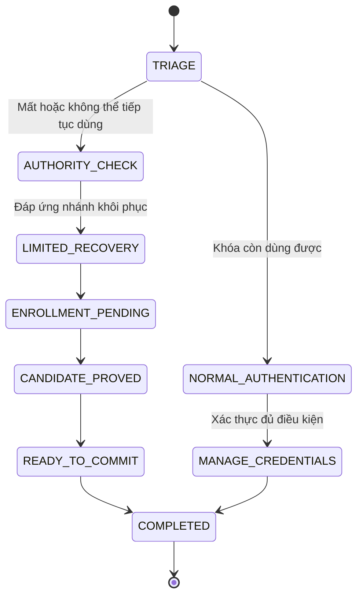
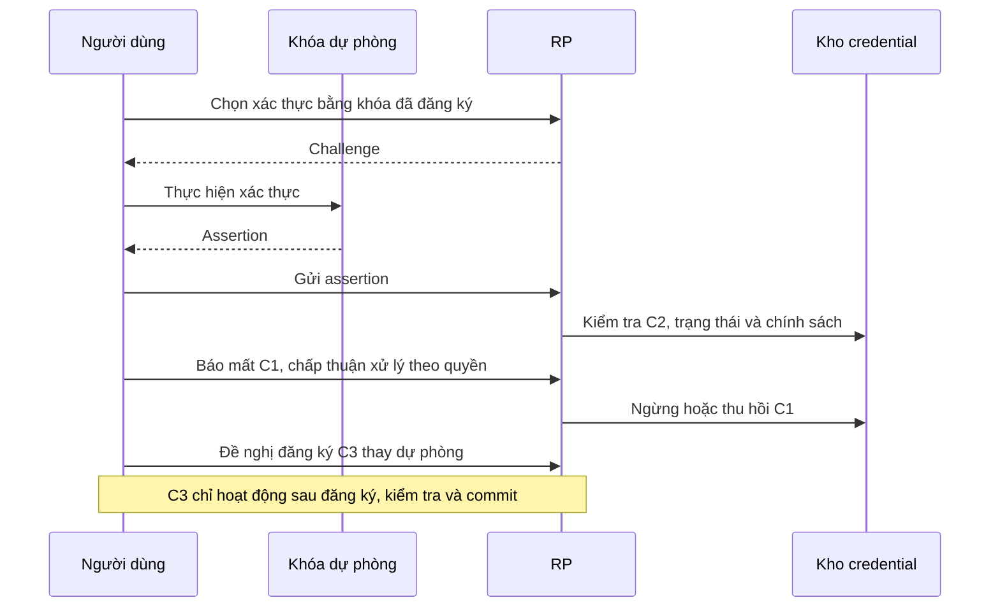

# Roaming authenticator recovery — Khôi phục quyền truy cập khi mất bộ xác thực rời

## 1. Mục tiêu và phạm vi

Trong chương **Passkey Recovery** của module **SECURITY_AUTHENTICATION_ACCOUNT_RECOVERY**, roaming authenticator là phương tiện xác thực có thể kết nối với nhiều thiết bị client. Ví dụ thường gặp là khóa bảo mật FIDO2 dùng qua USB hoặc NFC. Mất khóa này có thể khiến người dùng không đăng nhập được dù họ vẫn nhớ mật khẩu, còn máy tính và chưa mất tài khoản email.

Bài học tập trung vào **roaming authenticator recovery**: duy trì hoặc lấy lại quyền truy cập khi bộ xác thực rời không còn dùng được, đồng thời hạn chế khả năng kẻ nhặt được khóa hoặc người lạm dụng quy trình hỗ trợ chiếm tài khoản.

Mục tiêu gồm:

- Phân biệt mất authenticator với lỗi kết nối hoặc mất client.
- Hiểu vai trò của khóa dự phòng đã đăng ký từ trước.
- Thiết kế nhánh khôi phục khi không còn khóa sử dụng được.
- Đăng ký và kiểm tra phương tiện thay thế qua quyền được cấp rõ ràng.
- Thu hồi credential của khóa mất, xử lý session và tránh phục hồi quyền cũ ngoài ý định.

Các trạng thái, API, tùy chọn và thời hạn dưới đây là thiết kế minh họa. Chúng cần được điều chỉnh theo giao thức, loại tài khoản và mức bảo đảm của sản phẩm, không tự xác lập một mức AAL cụ thể.

## 2. Roaming authenticator là gì?

### 2.1. Authenticator và client là hai thành phần khác nhau

Trong một lượt xác thực WebAuthn:

- **Relying Party, RP** là dịch vụ cần xác thực người dùng.
- **Client** thường là trình duyệt và hệ điều hành trên máy tính hoặc điện thoại.
- **Authenticator** tạo hoặc sử dụng credential để thực hiện phép chứng minh mật mã.

Một roaming authenticator có thể kết nối với client qua phương thức mà hai bên hỗ trợ. Người dùng có thể mang cùng một khóa bảo mật đến một máy tính khác để đăng nhập, nếu credential đã được đăng ký cho đúng dịch vụ và các điều kiện xác thực được đáp ứng.

WebAuthn tách các đặc tính như attachment modality, khả năng user verification và khả năng dùng discoverable credential. Vì vậy, nhãn “roaming” hoặc lựa chọn `cross-platform` không tự nói rằng khóa hỗ trợ đăng nhập không mật khẩu hay xác minh người dùng. [W3C WebAuthn, Authenticator Types](https://www.w3.org/TR/webauthn-3/)

### 2.2. Không phải mọi khóa rời đều đóng cùng vai trò

| Trường hợp | Vai trò của khóa | Điều còn phải đáp ứng |
| --- | --- | --- |
| Khóa chỉ dùng làm yếu tố thứ hai | Chứng minh quyền giữ credential sau bước xác thực khác | Ví dụ mật khẩu và chính sách MFA tương ứng |
| Khóa chứa passkey có user verification | Có thể tham gia đăng nhập bằng passkey | Verifier phải kiểm tra các yêu cầu thực tế |
| Khóa hỗ trợ nhiều giao thức | Có thể chứa FIDO, OTP, chứng thư hoặc chức năng khác | Mỗi ứng dụng có vòng đời và quy trình riêng |
| Điện thoại làm authenticator cho client khác | Có thể xác thực qua luồng cross-device được hỗ trợ | Credential phải đã được thiết lập, không tự được cấp quyền từ QR |

Nút chạm trên khóa có thể chỉ thể hiện **user presence**, tức có thao tác hiện diện. Nó không tự tương đương **user verification**, chẳng hạn xác minh bằng PIN hoặc sinh trắc học theo giao thức.

Vì vậy, không được tuyên bố “có khóa rời là đủ mọi yếu tố” hoặc tự bỏ mật khẩu trong một tài khoản vốn đăng ký khóa làm yếu tố thứ hai.

### 2.3. Phân biệt với passkey đồng bộ

Khóa bảo mật có thể giữ credential gắn với authenticator và không cung cấp cơ chế xuất hoặc đồng bộ khóa đó. Khi authenticator mất, dịch vụ không có private key để tải lại cho người dùng.

Passkey đồng bộ có cơ chế phục hồi qua hệ sinh thái quản lý riêng. Một bản sao được khôi phục từ nhà cung cấp passkey không phải tự động là một credential mới.

Không suy luận rằng mọi phương tiện dùng `cross-platform` đều không đồng bộ, hoặc mọi passkey đều có thể lấy lại từ cloud. Cần biết loại credential và chính sách thực tế.

## 3. Phân loại sự cố trước khi mở nhánh khôi phục

### 3.1. Mất client nhưng còn khóa rời

Người dùng mất điện thoại hoặc máy tính nhưng vẫn giữ khóa bảo mật đã đăng ký. Họ có thể dùng khóa đó trên một client tin cậy và tương thích.

Đây có thể là một lượt xác thực bình thường bằng credential hiện có, không cần reset khóa hoặc cấp lại private key. Nếu còn đủ phương tiện đáp ứng yêu cầu, ưu tiên xác thực theo cơ chế đã thiết lập.

Tuy nhiên, client mất có thể còn session, email hoặc passkey khác. Việc khóa rời vẫn dùng được không tự xử lý các quyền nằm trên client mất.

### 3.2. Còn khóa nhưng không kết nối được

Các nguyên nhân có thể là:

- Cổng USB, đầu chuyển hoặc đầu đọc không phù hợp.
- Client hiện tại không hỗ trợ transport cần dùng.
- NFC chưa sẵn sàng hoặc thao tác đặt khóa chưa đúng.
- Trình duyệt, hệ điều hành hoặc chính sách tổ chức chặn thao tác.
- Người dùng đang chọn sai phương thức trong giao diện.
- Credential thuộc RP khác hoặc một tài khoản khác.
- Khóa không hỗ trợ yêu cầu của ceremony hiện tại.

Một timeout hoặc thao tác bị hủy không chứng minh private key đã mất hoặc có tấn công. Giao diện nên hỗ trợ thử một kết nối phù hợp trên client tin cậy trước khi hướng người dùng vào quy trình khôi phục tài khoản.

Không tự xóa binding hoặc hạ chính sách xác thực chỉ vì một lượt kết nối thất bại.

### 3.3. Quên PIN hoặc khóa bị chặn

PIN của authenticator không phải mật khẩu của tài khoản tại RP. Dịch vụ không biết PIN và không nên yêu cầu người dùng nhập PIN vào form hỗ trợ để kiểm tra.

Cần phân biệt đổi PIN khi còn biết PIN, xử lý trạng thái khóa tạm thời và reset ứng dụng FIDO theo tài liệu thiết bị. Không cố đoán PIN liên tục để “thử cho đến khi được”.

Ví dụ, tài liệu Yubico cho biết reset ứng dụng FIDO2 xóa các credential liên quan và đưa ứng dụng về trạng thái chưa có PIN. Đây là hành động có thể làm mất khả năng sử dụng các credential cũ, không phải chỉ thay một PIN của một website. [Yubico, FIDO2 Reset](https://docs.yubico.com/yesdk/users-manual/application-fido2/fido2-reset.html)

Quy trình cụ thể phụ thuộc thiết bị. Bài học không thực hiện reset và không coi reset là bước mặc định khi người dùng không đăng nhập được.

### 3.4. Mất hoặc bị đánh cắp khóa

Nếu khóa thực sự mất, người dùng cần xử lý credential có thể bị sử dụng bởi người khác. Không giả định khóa luôn an toàn chỉ vì có PIN: khả năng bảo vệ phụ thuộc loại credential, yêu cầu xác thực và điều kiện sự cố.

NIST SP 800-63B-4 yêu cầu xử lý kịp thời authenticator bị mất, bị đánh cắp hoặc nghi bị sao chép bằng các biện pháp ngừng hay vô hiệu hóa phù hợp. Việc phản ứng với báo mất có căn cứ không nên chờ đến khi đăng ký khóa thay thế xong. [NIST SP 800-63B-4, mục 4.3](https://pages.nist.gov/800-63-4/sp800-63b.html#loss-theft-damage-and-compromise)

Báo mất cũng cần được xác thực theo quy trình thích hợp. Một người ngoài chỉ biết tên đăng nhập không được quyền thu hồi tất cả credential của nạn nhân.

### 3.5. Không còn phương tiện nào đáp ứng yêu cầu

Nếu không còn khóa chính, khóa dự phòng, passkey khác hoặc bằng chứng đáp ứng nhánh được hỗ trợ, người dùng phải đi qua quy trình khôi phục tài khoản riêng.

Không có cơ sở để hứa rằng bộ phận hỗ trợ luôn có thể khôi phục mọi tài khoản. Một số tài khoản có chính sách bảo vệ cao có thể không hỗ trợ đường lấy lại quyền nếu mọi phương tiện đã thiết lập đều mất.

## 4. Khóa dự phòng phải được đăng ký trước sự cố

### 4.1. Có hai khóa vật lý chưa có nghĩa có hai phương tiện truy cập

Một khóa dự phòng chưa được đăng ký cho RP không biết cách xác thực vào tài khoản tại RP đó.

Ví dụ:

```text
Tài khoản A tại RP R:
    C1 -> khóa vật lý K1
    C2 -> khóa vật lý K2

C1 và C2 là hai credential riêng.
K2 không phải bản sao private key của K1.
```

Nếu người dùng chỉ mua K2 và cất đi nhưng chưa đăng ký, K2 không tự trở thành phương thức khôi phục khi K1 mất. Họ vẫn cần quyền đăng ký K2 bằng một cơ chế đã được chấp nhận.

FIDO Alliance mô tả security key như một phương tiện có thể dùng cho khôi phục khi người dùng mất quyền tiếp cận các thiết bị chứa passkey khác. Trong thiết kế sản phẩm, khả năng đó cần được hiện thực bằng việc đăng ký credential và cấp quyền tương ứng từ trước. [FIDO Alliance, Passkeys](https://fidoalliance.org/passkeys/)

### 4.2. Đăng ký độc lập tại từng RP

Một khóa có thể dùng với nhiều dịch vụ nhưng liên kết tại từng RP là riêng biệt. Thêm K2 ở dịch vụ X không tự thêm K2 ở dịch vụ Y.

Tương tự, đăng ký cùng khóa cho hai tài khoản trong cùng dịch vụ thường tạo các credential riêng theo từng tài khoản. Không được chuyển một credential đã thuộc A sang B chỉ vì người dùng đang cầm cùng một thiết bị vật lý.

### 4.3. Kiểm tra dự phòng bằng một lượt xác thực

Sau đăng ký, nên kiểm tra khóa dự phòng bằng một lượt xác thực thực tế trong điều kiện được kiểm soát:

1. Đảm bảo phương tiện chính hoặc đường truy cập hợp lệ vẫn còn.
2. Chọn đúng tài khoản và RP.
3. Thử credential của khóa dự phòng.
4. Xác minh phía server rằng lượt xác thực đáp ứng chính sách.
5. Ghi nhận phương tiện dự phòng đã được kiểm tra.

Không xóa khóa chính chỉ để thử khóa dự phòng. Một bản ghi “đăng ký thành công” chưa giải quyết mọi lỗi tương thích hoặc khả năng sử dụng sau này.

### 4.4. Độc lập cả về lưu giữ

Hai khóa để cùng chùm chìa khóa, cùng túi hoặc cùng két có thể bị mất trong một sự kiện. Recovery code cất trong túi cùng khóa chính cũng chịu cùng rủi ro vật lý.

Độc lập về credential và độc lập về điều kiện lưu giữ là hai khía cạnh khác nhau. Chính sách nên hướng dẫn cất giữ và kiểm tra phương tiện dự phòng mà không yêu cầu người dùng tiết lộ vị trí cất giữ nhạy cảm cho dịch vụ.

## 5. Chọn nhánh xử lý phù hợp

| Phương tiện còn lại | Nhánh có thể dùng | Điều kiện không được bỏ qua |
| --- | --- | --- |
| Khóa chính còn dùng được, chỉ đổi client | Đăng nhập bình thường | Client tin cậy, yêu cầu xác thực vẫn đáp ứng |
| Khóa dự phòng đã đăng ký | Xác thực lại rồi quản lý credential mất | Khóa dự phòng phải đáp ứng vai trò đã được cấp |
| Passkey khác đã thiết lập | Xác thực theo chính sách tài khoản | Không mặc định mọi passkey đều đạt cùng mức bảo đảm |
| Recovery code hoặc recovery contact hợp lệ | Nhánh khôi phục tương ứng | Đúng tổ hợp, thời hạn, phạm vi và chống dùng lại |
| Chỉ còn session đang hoạt động | Có thể dùng để tiếp tục bước được phép | Session không tự đủ để thêm khóa hoặc xóa MFA |
| Chỉ xác nhận được email hoặc số mới tự khai | Chỉ chứng minh quyền tiếp cận kênh mới | Chưa chứng minh quyền với tài khoản |
| Không có bằng chứng được hỗ trợ | Xem xét hoặc kết thúc theo chính sách | Không tự hạ chuẩn vì người dùng có câu chuyện hợp lý |

Đối với một khóa chỉ cung cấp yếu tố thứ hai, xác thực bằng khóa đó có thể vẫn cần bước mật khẩu. Với một passkey có user verification phù hợp, nhánh xác thực có thể khác. Quyết định phải dựa trên kết quả verifier và chính sách, không dựa vào hình dạng hoặc nhãn thương mại của khóa.

Nếu quy trình khôi phục đặt điều kiện quá yếu, hệ thống có thể bị chiếm qua đường khôi phục dù WebAuthn chống phishing tốt ở đường đăng nhập. Đây là rủi ro cấp quyền trong luồng khôi phục, không phải bằng chứng giao thức WebAuthn bị phá vỡ.

## 6. Những bất biến cần giữ

1. **Khóa mới chưa đăng ký không tự có quyền với tài khoản.**
2. **Không yêu cầu private key, PIN hoặc recovery code thô qua nhân viên hỗ trợ.**
3. **Credential được quản lý trong đúng phạm vi RP và chủ tài khoản.**
4. **Tên khóa, hình dạng, transport hoặc model không thay thế xác minh mật mã.**
5. **Quyền báo mất và quyền thêm credential được kiểm tra riêng.**
6. **Credential bị ngừng hoặc thu hồi không được phê duyệt một thay đổi mới trái chính sách.**
7. **Khóa thay thế chỉ hoạt động sau khi được xác minh và commit.**
8. **Mỗi challenge thuộc đúng hồ sơ, tài khoản, mục đích và phiên bản.**
9. **Hủy enrollment không tự bật lại credential đã được báo mất và xử lý.**
10. **Thu hồi tại một RP không được mô tả như reset toàn bộ khóa vật lý.**
11. **Thu hồi credential không tự chấm dứt session đã phát hành.**
12. **Người tìm lại khóa không tự phục hồi quyền của credential đã thu hồi.**

Các bất biến phải được áp dụng cho cả API người dùng, công cụ hỗ trợ và tác vụ quản trị.

## 7. Thiết kế hồ sơ khôi phục

### 7.1. Không dùng một cờ “lost device” chung cho tất cả

Một tài khoản có thể có nhiều credential trên nhiều phương tiện. Hồ sơ nên ghi cụ thể:

```text
recovery_case_id
account_id
rp_scope
reported_problem
affected_credential_refs
remaining_authentication_evidence
allowed_actions
candidate_revision
expected_security_version
policy_version
expires_at
status
```

`reported_problem` có thể phân biệt không kết nối được, quên PIN, mất khóa hoặc nghi bị chiếm. Tuy nhiên, lời khai của người dùng là đầu vào để đánh giá, không tự quyết định quyền.

`affected_credential_refs` được xác định từ dữ liệu server và phạm vi được xác minh. Không cho client gửi một danh sách ID tùy ý rồi thu hồi toàn bộ mà không kiểm tra.

### 7.2. Bản ghi credential

Những dữ liệu có thể cần:

| Trường | Ý nghĩa |
| --- | --- |
| Credential ID | Định danh credential trong phạm vi giao thức |
| Account ID và RP scope | Chủ thể và miền chấp nhận |
| Public key và thuật toán | Dữ liệu xác minh theo giao thức |
| Trạng thái và version | Quyền hiện tại và chống quyết định cũ |
| Ngày đăng ký, lần sử dụng gần nhất | Bối cảnh vận hành |
| Yêu cầu hoặc kết quả UV phù hợp | Thông tin cần cho chính sách |
| Transport hints | Hỗ trợ chọn cách kết nối |
| Metadata đã kiểm chứng nếu có | Hỗ trợ chính sách authenticator |
| Nhãn người dùng đặt | Hỗ trợ nhận biết, không phải bằng chứng |

AAGUID chủ yếu giúp nhận biết loại hoặc model theo hệ sinh thái metadata; không được dùng như số sê-ri duy nhất của một cá nhân hoặc một khóa. Hai authenticator cùng model có thể có cùng AAGUID.

Nếu không có liên kết thiết bị đáng tin cậy, server không thể tự biết mọi credential nào ở nhiều tài khoản đều nằm trên cùng khóa vật lý. Việc thu hồi cần dựa trên dữ liệu và quyền thực tế, không quét theo model để xóa hàng loạt.

### 7.3. Vòng đời chính



Hồ sơ chưa hoàn tất còn có thể bị giữ để xem xét, từ chối, hủy hoặc hết hạn. Trạng thái ngừng credential mất là một quyết định riêng, không bị đảo ngược tự động theo trạng thái enrollment.

## 8. Luồng khi còn khóa dự phòng đã đăng ký

### Bước 1: Sử dụng client phù hợp và tin cậy

Người dùng mở đúng dịch vụ trên một client hỗ trợ transport của khóa dự phòng. Không hướng họ đến một trang do người lạ gửi để nhập PIN hoặc “đồng bộ khóa”.

Nếu client chỉ hỗ trợ NFC còn khóa chỉ hỗ trợ USB, cần phương tiện kết nối phù hợp hoặc một nhánh xác thực khác đã có. Không giảm yêu cầu user verification để bù cho thiếu tương thích.

### Bước 2: Xác thực bằng credential dự phòng

Server tạo challenge cho lượt xác thực và kiểm tra phản hồi theo WebAuthn. Nhánh nghiệp vụ cần biết bằng chứng đến từ credential nào, thuộc tài khoản nào và còn được phép dùng không.

Một assertion hợp lệ của credential C2 không có nghĩa C1 còn an toàn. Nó chỉ giúp xác minh quyền theo vai trò của C2 và chính sách.

### Bước 3: Xác nhận phạm vi khóa mất

Giao diện hiển thị thông tin có ích như nhãn người dùng đã đặt, ngày đăng ký và lần dùng gần nhất. Tránh cam kết rằng nhãn đó xác định chắc chắn thiết bị vật lý.

Người dùng lựa chọn credential cần xử lý trong phạm vi đã được cấp. Nếu họ không nhận biết được, có thể cần nhánh hỗ trợ hoặc kiểm soát rộng hơn theo chính sách.

### Bước 4: Ngừng hoặc thu hồi credential bị mất

Thực hiện theo quyết định có quyền, tăng version và chặn tại mọi đường xác thực. Không chỉ xóa dòng khỏi giao diện.

Nếu khóa mất có credential tại nhiều RP, người dùng cần xử lý riêng tại các dịch vụ liên quan. Một RP không có quyền thu hồi credential ở những RP khác.

### Bước 5: Thiết lập lại dự phòng

Sau khi xử lý khóa mất, người dùng có thể chỉ còn một phương tiện. Đăng ký một phương tiện thay thế và kiểm tra nó giúp khôi phục khả năng dự phòng.

Việc thêm khóa mới vẫn là hành động nhạy cảm. Có thể cần xác thực lại hoặc một chấp thuận ràng buộc giao dịch dù người dùng vừa đăng nhập.



## 9. Luồng khi không còn khóa nào sử dụng được

### 9.1. Cấp recovery capability giới hạn

Sau khi vượt qua nhánh khôi phục được chấp nhận, người dùng nhận quyền giới hạn, chẳng hạn:

```json
{
  "caseId": "rr_opaque",
  "accountId": "acc_42",
  "allowedActions": [
    "ENROLL_REPLACEMENT_AUTHENTICATOR",
    "REVOKE_APPROVED_LOST_CREDENTIALS"
  ],
  "affectedCredentialRefs": ["credential_1"],
  "policyVersion": "roaming-recovery-v3",
  "expiresAt": "2026-11-23T06:15:00Z"
}
```

Đây là dữ liệu do server tạo. Nó không phải một request cho client tự chọn quyền.

Recovery capability không nên cho phép đọc mọi dữ liệu tài khoản, chuyển tài sản, thay email, thay số điện thoại hoặc xóa các yếu tố khác ngoài phạm vi đã được phê duyệt.

### 9.2. Bằng chứng không được tạo thành vòng tin cậy

Nhánh nguy hiểm:

```text
Người yêu cầu tự nhập email mới
    -> nhận mã ở email mới
    -> được đăng ký khóa của họ vào tài khoản nạn nhân
```

Mã ở kênh mới chỉ chứng minh quyền tiếp cận kênh mới. Khóa mới chỉ chứng minh khả năng dùng khóa mới. Cả hai chưa tạo được mối liên hệ với tài khoản cũ.

Nhánh khôi phục phải dựa trên những bằng chứng và tổ hợp được chính sách chấp nhận. Mức yêu cầu phụ thuộc tài khoản và cách thiết lập danh tính từ trước.

### 9.3. Không buộc khóa mất tham gia phê duyệt

Nếu quy trình luôn đòi chữ ký của chính C1 đã mất để đăng ký C3, người dùng không thể hoàn tất. Cần có nhánh khôi phục độc lập được thiết kế trước.

Ngược lại, không để một session phát sinh từ C1 sau thời điểm bị ngừng tự phê duyệt C3. Trạng thái credential và quyền của session liên quan phải được xét theo chính sách sự cố.

### 9.4. Thời gian chờ và hỗ trợ

Có thể cần thời gian chờ hoặc reviewer với tài khoản rủi ro cao. Thời gian chờ không tự biến bằng chứng thiếu thành đủ. Reviewer không được dùng ảnh chụp khóa, mã đơn hàng hoặc số sê-ri làm bằng chứng duy nhất cho quyền với tài khoản.

Một thiết bị mới có attestation hợp lệ cũng chưa chứng minh người cầm nó là chủ tài khoản. Attestation phục vụ kết luận về authenticator theo mô hình tin cậy, không tự cấp quyền khôi phục.

## 10. Đăng ký phương tiện thay thế

### 10.1. Chọn đúng chính sách

Nếu sản phẩm muốn đăng ký passkey trên khóa rời, một phần tùy chọn minh họa có thể là:

```json
{
  "authenticatorSelection": {
    "authenticatorAttachment": "cross-platform",
    "residentKey": "required",
    "userVerification": "required"
  },
  "attestation": "none"
}
```

Đây chỉ là phần tùy chọn, không phải một request WebAuthn hoàn chỉnh. Server vẫn cần tạo RP, user handle, challenge, thuật toán được chấp nhận và các trường phù hợp.

Trong ví dụ này:

- Sản phẩm yêu cầu credential có khả năng dùng như passkey và có user verification.
- Khóa không đáp ứng yêu cầu cần được thay bằng phương tiện phù hợp hoặc một nhánh đã được phê duyệt.
- Không tự đổi `required` thành `discouraged` chỉ để enrollment hoàn tất.
- Lựa chọn `cross-platform` hỗ trợ chọn cách gắn authenticator, không phải chứng nhận private key không thể xuất.
- `attestation: none` trong ví dụ không cung cấp căn cứ để khẳng định model phần cứng hoặc đáp ứng một chính sách chỉ chấp nhận thiết bị đã chứng thực.

Nếu sản phẩm hỗ trợ khóa làm yếu tố thứ hai, tùy chọn và luồng có thể khác. Không gọi mọi credential được tạo trên khóa rời là cùng một loại passkey có cùng khả năng.

### 10.2. Khóa mới phải được gắn qua quyền hợp lệ

Server kiểm tra phản hồi đăng ký bằng verifier đúng giao thức và gắn nó với:

```text
account_id
rp_scope
recovery_case_id
purpose = REGISTER_REPLACEMENT_ROAMING_CREDENTIAL
candidate_revision
challenge_id
expires_at
```

Mục đích trên là trạng thái nghiệp vụ phía server; không thay đổi các giá trị chuẩn của WebAuthn như loại ceremony trong client data.

Credential ID không được ghi đè một binding của tài khoản khác hoặc phục hồi credential đã thu hồi bằng một đường vòng. Dữ liệu server và ràng buộc duy nhất trong phạm vi phù hợp phải bảo vệ điều đó.

### 10.3. Transport là gợi ý kết nối

Các transport đã thu được có thể giúp client biết cách tìm authenticator trong lượt sau. Tuy nhiên:

- Không dùng transport như chứng minh danh tính hoặc quyền.
- Không suy ra credential của hai tài khoản là cùng một người vì đều dùng NFC.
- Không coi thiếu một transport hint là bằng chứng credential giả.
- Không coi việc người dùng chuyển từ USB sang NFC là tạo một credential mới.

Các tùy chọn và kết quả phải được mã hóa, giải mã theo giao thức; bản JSON truyền qua HTTP không tự tương đương cấu trúc dữ liệu nhị phân mà browser API sử dụng.

### 10.4. Kiểm tra khả năng dùng credential mới

Thiết kế minh họa lưu credential mới ở trạng thái chờ rồi yêu cầu một assertion riêng bằng chính credential đó.

Server xác minh ceremony theo đặc tả, bao gồm challenge, origin, RP ID, chữ ký và yêu cầu user verification phù hợp. Không tin một cờ frontend gửi rằng người dùng đã chạm hoặc đã nhập PIN. [W3C WebAuthn, Verifying an Authentication Assertion](https://www.w3.org/TR/webauthn-3/#sctn-verifying-assertion)

Endpoint kích hoạt chỉ được dùng bởi recovery context có quyền trên candidate. Credential đang chờ không tham gia đường đăng nhập bình thường.

Bước thử này là lựa chọn thiết kế để kiểm tra khả năng sử dụng. Nó không thay thế việc xác minh quyền khôi phục và không tuyên bố mọi sản phẩm phải có cùng cách chia endpoint.

## 11. Commit, chống replay và xử lý cạnh tranh

### 11.1. Trạng thái cần kiểm tra lại

Quyết định hoàn tất phải ràng buộc:

- Đúng tài khoản và RP scope.
- Đúng hồ sơ còn hiệu lực.
- Đúng credential bị ảnh hưởng và version.
- Đúng candidate, public key và revision.
- Đúng bằng chứng cấp quyền còn được chấp nhận.
- Đúng phiên bản chính sách hoặc quy tắc xử lý thay đổi chính sách.
- Không có hold có thẩm quyền hoặc hồ sơ cạnh tranh đã hoàn tất.

Không chỉ kiểm tra `approved = true`.

### 11.2. Transaction minh họa

```text
BEGIN

Khóa account
Khóa recovery case và decision
Khóa các credential bị ảnh hưởng theo thứ tự thống nhất
Khóa candidate và proof của candidate

Kiểm tra:
    caller có recovery capability phù hợp
    decision đúng action, scope, account và case
    case/decision/proof chưa hết hạn
    candidate revision và public key không thay đổi
    candidate có proof sử dụng thành công theo chính sách
    evidence và trạng thái bảo mật vẫn phù hợp
    credential cũ đúng ID, version và phạm vi được xử lý
    credential mới không xung đột binding khác

Kích hoạt credential mới
Thu hồi các credential cũ thuộc quyết định
Tăng security/session version theo phạm vi được cấp
Tiêu thụ decision và đóng case
Thu hồi challenge và recovery capability không còn dùng
Ghi audit và outbox

COMMIT
```

Việc ngừng credential mất có thể đã được thực hiện trước transaction này. Nếu enrollment thất bại, không tự rollback quyết định báo mất đã được thực thi.

### 11.3. Tiêu thụ token dùng một lần

Challenge đăng ký, challenge kích hoạt và recovery token có vai trò khác nhau. Mỗi loại cần thời hạn, phạm vi và trạng thái chống dùng lại tương ứng.

Nếu recovery code được dùng làm bằng chứng, tiêu thụ code và ghi kết quả xác minh trong một thao tác có bảo đảm nguyên tử. Không yêu cầu dùng lại code đã tiêu thụ ở bước commit; dùng kết quả đã ghi cho chính hồ sơ đó nếu còn hiệu lực.

Hai request trình cùng mã hoặc hai hồ sơ thay cùng credential không được cùng tạo hai quyền độc lập ngoài ý định. Khóa hàng, optimistic locking và các ràng buộc dữ liệu cần được áp dụng phù hợp.

### 11.4. Retry sau khi mất response

Nếu server đã commit nhưng client không nhận response, retry nên trả trạng thái đã lưu hoặc kết quả theo idempotency key có phạm vi đúng.

Không tạo thêm credential, không phát sinh quyết định mới và không bật lại khóa cũ chỉ vì người dùng bấm thử lại.

Nếu ứng dụng chưa cấp session mới sau commit, người dùng có thể đăng nhập bằng credential đã kích hoạt theo luồng bình thường. Không cần khôi phục credential mất để giải quyết lỗi response.

## 12. Thu hồi tại RP khác với reset khóa vật lý

### 12.1. Thu hồi một credential

Thu hồi tại RP làm liên kết credential không còn được chấp nhận ở RP đó. Private key có thể vẫn còn trên authenticator nếu thiết bị chưa bị reset hoặc xóa.

Một chữ ký đúng từ credential đã thu hồi vẫn phải bị từ chối. Verifier mật mã không thay thế kiểm tra trạng thái binding.

### 12.2. Reset authenticator

Reset là thao tác trên authenticator hoặc một ứng dụng của thiết bị theo tài liệu nhà sản xuất. Nó có thể ảnh hưởng credential của nhiều website, không chỉ tài khoản đang khôi phục.

Vì vậy, khi người dùng còn khóa nhưng quên PIN:

1. Xác định đúng loại khóa và vấn đề.
2. Kiểm tra đường truy cập thay thế cho các tài khoản quan trọng.
3. Hiểu phạm vi dữ liệu sẽ mất theo tài liệu thiết bị.
4. Chỉ thực hiện reset trong quy trình phù hợp.
5. Đăng ký lại credential cho các RP cần dùng.

Bài học không cung cấp một lệnh reset chung vì thiết bị và ứng dụng có hành vi khác nhau. Dịch vụ cũng không thể reset từ xa một khóa đã mất chỉ bằng cách xóa public key.

### 12.3. Khóa được tìm lại

Nếu credential đã bị thu hồi, cắm lại khóa không tự khôi phục quyền. Người dùng có thể cần đăng ký credential mới bằng một đường được cấp quyền, nếu sản phẩm cho phép.

Nếu trạng thái chỉ tạm ngừng, việc phục hồi phải qua nhánh riêng có kiểm tra phù hợp. Không chuyển sang active chỉ vì một assertion hợp lệ bất ngờ xuất hiện.

Đối với khóa từng nằm ngoài kiểm soát trong một khoảng thời gian, quyết định có tiếp tục sử dụng thiết bị hay không cần theo chính sách rủi ro và loại authenticator; không mặc định tìm thấy là sự cố đã kết thúc.

## 13. Session và các quyền phát sinh

### 13.1. Khóa mất không nhất thiết chứa session của client

Khóa rời thường thực hiện phép xác thực, còn session nằm ở trình duyệt hoặc ứng dụng. Nếu chỉ mất một khóa vật lý độc lập, không thể tự kết luận mọi session trên client đều đã bị đánh cắp.

Ngược lại, nếu mất cả túi có khóa và laptop đang đăng nhập, phạm vi sự cố rộng hơn. Hệ thống cần xử lý session và các bí mật trên client, không chỉ credential của khóa.

### 13.2. Thu hồi theo bằng chứng và chính sách

Các phạm vi có thể xét:

| Đối tượng | Điều cần kiểm tra |
| --- | --- |
| Session tạo bằng credential mất | Có cần thu hồi hoặc xác thực lại theo chính sách không |
| Session trên client bị mất | Có thể nhận diện và thu hồi đến mức nào |
| Refresh token | Có bị vô hiệu hóa thật sự hay chỉ xóa hiển thị thiết bị |
| Recovery session | Chỉ còn quyền giới hạn và phải kết thúc sau sử dụng |
| Token đặt lại mật khẩu hoặc enrollment khác | Có còn mở đường truy cập ngoài ý định không |
| Kênh thông báo | Có còn tin cậy nếu client chứa email cũng mất không |

Không cần tự đăng xuất toàn bộ tài khoản chỉ vì có một yêu cầu báo mất chưa được xác minh. Một quyết định sự cố có căn cứ có thể yêu cầu phạm vi rộng hơn.

### 13.3. Hiệu lực thu hồi trong hệ thống phân tán

Cache public key hoặc trạng thái credential cần nhận được thay đổi. Sự kiện nên mang credential ID, version và thời điểm hiệu lực; consumer xử lý idempotent và không để sự kiện cũ phục hồi quyền.

Với access token được xác minh ngoại tuyến, thu hồi credential không tự làm token đã cấp hết hiệu lực ngay. Cần cơ chế session version, revocation, introspection hoặc thời gian sống phù hợp.

Nếu độ trễ chưa được loại bỏ, tài liệu và giao diện phải phản ánh đúng giới hạn. Không tuyên bố mọi quyền trên thiết bị mất đã biến mất chỉ vì một hàng credential đã chuyển trạng thái.

## 14. Chống lạm dụng, quyền riêng tư và hỗ trợ

### 14.1. Tấn công qua nhánh khôi phục

| Rủi ro | Kiểm soát cần có |
| --- | --- |
| Kẻ ngoài báo mất để khóa nạn nhân | Xác minh quyền báo mất, hạn mức và phạm vi tác động |
| Session bị đánh cắp đăng ký khóa của đối tượng tấn công | Xác thực lại hoặc bằng chứng khôi phục phù hợp |
| Hỗ trợ tin ảnh chụp khóa hoặc số sê-ri | Kiểm tra bằng chứng quyền với tài khoản theo chính sách |
| Trình một khóa mới có attestation để xin tài khoản | Tách thuộc tính authenticator khỏi quyền khôi phục |
| Phát lại registration hoặc activation result | Challenge một lần, gắn case và candidate revision |
| Dùng khóa đã thu hồi để phê duyệt khóa mới | Kiểm tra trạng thái hiện tại ở mọi đường xác thực |
| Hạ UV hoặc bỏ MFA để vượt lỗi tương thích | Dùng nhánh được phê duyệt, không tự thay chính sách |
| Tạo vô hạn hồ sơ hoặc challenge | Hạn mức theo account, hồ sơ, nguồn và chi phí |
| Dùng link hoặc QR của phiên khác | Capability có phạm vi, thời hạn và kiểm tra chấp thuận |
| Hồ sơ cũ hoàn tất sau một thay đổi bảo mật | Kiểm tra version và đánh giá lại |

IP, vị trí, User-Agent và model khóa có thể là tín hiệu rủi ro. Chúng không thay thế bằng chứng quyền. Việc chuyển sang máy tính khác là hành vi bình thường của roaming authenticator nên không tự là dấu hiệu gian lận.

### 14.2. Dữ liệu không nên yêu cầu hoặc làm lộ

Không yêu cầu:

- Private key hoặc bản sao bí mật từ khóa.
- PIN của authenticator qua chat, email hoặc điện thoại hỗ trợ.
- Recovery code thô để nhân viên ghi vào ticket.
- Liệt kê mọi tài khoản dùng khóa trong một API công khai.
- Ảnh hoặc dữ liệu cá nhân không giải quyết kết luận còn thiếu.

Trước khi người gọi có quyền, không hiển thị đầy đủ danh sách credential, tên thiết bị hoặc metadata nhạy cảm của tài khoản chỉ từ một tên đăng nhập.

### 14.3. Nhật ký và quyền tác nghiệp

Sự kiện minh họa:

```text
ROAMING_AUTHENTICATOR_ISSUE_REPORTED
ROAMING_CREDENTIAL_SUSPENDED
BACKUP_AUTHENTICATOR_VERIFIED
ROAMING_RECOVERY_AUTHORIZED
REPLACEMENT_CREDENTIAL_REGISTERED
REPLACEMENT_CREDENTIAL_PROVED
ROAMING_CREDENTIAL_REVOKED
ROAMING_RECOVERY_COMPLETED
RELATED_SESSIONS_REVOKED
```

Ghi case ID, credential ref, verifier hoặc reviewer, policy version, version trước/sau và reason code theo quyền truy cập. Không ghi PIN, session cookie hoặc token khôi phục.

Reviewer phải thấy rõ hành động nào được phép và bằng chứng nào còn thiếu. Nếu có ngoại lệ, dùng nhánh có thẩm quyền và audit; không có nút force approve vô điều kiện.

Hai người xem cùng ảnh chụp khóa không tạo thành hai bằng chứng độc lập về danh tính. Kiểm soát nhiều người chủ yếu giảm lạm quyền và bỏ qua quy trình, không biến dữ liệu yếu thành dữ liệu mạnh.

## 15. Ví dụ xuyên suốt

### 15.1. Còn khóa dự phòng

Minh đã đăng ký K1 và K2 tại dịch vụ R. Mỗi khóa có credential riêng; K2 được lưu giữ tách khỏi K1.

1. Minh mất K1 nhưng còn K2.
2. Minh dùng K2 trên một client tin cậy, đáp ứng đầy đủ yêu cầu xác thực.
3. Server ghi nhận bằng chứng từ credential C2.
4. Minh chọn C1 tương ứng khóa mất và chấp thuận xử lý theo quyền.
5. Server ngừng hoặc thu hồi C1, kiểm tra các session liên quan theo chính sách.
6. Minh đăng ký K3 để phục hồi dự phòng.
7. Server kiểm tra đăng ký, thử xác thực C3 và chỉ kích hoạt sau commit.
8. C2 vẫn là credential độc lập đang được chấp nhận.

K3 không nhận private key của K1. Minh không cần cung cấp PIN K2 cho dịch vụ.

### 15.2. Có khóa mới nhưng chưa đăng ký

Lan mất khóa duy nhất và mua một khóa mới cùng model.

Khóa mới có cùng hình dạng hoặc AAGUID không giúp Lan đăng nhập. Lan phải dùng phương thức khôi phục đã được hỗ trợ để lấy quyền đăng ký credential mới. Nếu không còn bằng chứng đủ, có thể chưa khôi phục được tài khoản.

Điều này giải thích vì sao đăng ký phương tiện dự phòng trước sự cố có giá trị hơn việc chỉ giữ một thiết bị chưa thiết lập.

### 15.3. Không phải mất authenticator

Hà đổi sang một điện thoại không có cổng USB phù hợp và nghĩ khóa đã hỏng. Sau khi dùng client tương thích hoặc transport đã được khóa hỗ trợ, credential cũ xác thực bình thường.

Không có lý do tự động xóa credential hoặc reset authenticator trong trường hợp này. Nếu điện thoại cũ bị mất, các session trên điện thoại cũ vẫn cần được xử lý riêng.

### 15.4. Reset do quên PIN

Phúc còn khóa nhưng không dùng được vì vấn đề PIN. Nếu cần reset theo tài liệu thiết bị, Phúc phải hiểu các credential liên quan có thể mất khả năng sử dụng và cần đăng ký lại.

Việc đặt PIN mới sau reset không làm các public key cũ phía server tự nhận một private key mới. Các liên kết cũ phải được xử lý và credential mới được đăng ký qua quyền phù hợp.

## 16. Các tình huống cần kiểm chứng khi triển khai

| Tình huống | Kết quả mong đợi |
| --- | --- |
| Mất client nhưng khóa đã đăng ký vẫn còn | Có thể dùng client tương thích theo luồng xác thực bình thường |
| Lỗi USB hoặc timeout | Không tự thu hồi credential hoặc hạ yêu cầu xác thực |
| Khóa chỉ hỗ trợ vai trò yếu tố thứ hai | Không tự coi là passkey đủ mọi điều kiện |
| Chạm khóa nhưng UV không đạt khi chính sách yêu cầu | Không chấp nhận như user verification |
| Khóa dự phòng đã đăng ký và đủ điều kiện | Có thể cấp quyền quản lý theo chính sách |
| Khóa mới cùng model nhưng chưa đăng ký | Không cấp quyền tài khoản |
| Một credential khác tài khoản có assertion hợp lệ | Không gắn vào tài khoản đích |
| Session cũ muốn xóa MFA hoặc thêm khóa | Vẫn kiểm tra điều kiện nhạy cảm, không tin session đơn lẻ |
| Chỉ xác nhận email mới do người yêu cầu tự nhập | Không đủ quyền khôi phục tài khoản cũ |
| Registration result bị phát lại | Không tạo candidate hoặc binding lần hai |
| Candidate chưa thử thành công | Không xuất hiện trong đường đăng nhập thông thường |
| Candidate thay đổi sau phê duyệt | Proof và quyết định không đúng revision bị vô hiệu |
| Hai hồ sơ cùng xử lý credential mất | Phát hiện version thay đổi và đánh giá lại |
| Enrollment lỗi sau khi C1 đã bị ngừng | C1 không tự hoạt động trở lại |
| Credential đã thu hồi vẫn tạo chữ ký đúng | Bị từ chối vì trạng thái binding |
| Khóa được tìm lại sau khi thu hồi | Không tự phục hồi quyền |
| Reset khóa vật lý | Không coi đó chỉ là đổi PIN tại một website |
| Thu hồi tại RP R | Không tuyên bố đã xóa credential ở mọi RP |
| Access token cũ còn hạn | Áp dụng cơ chế thu hồi hoặc giới hạn thực tế của kiến trúc |
| Response commit bị mất | Retry trả kết quả đã lưu, không đăng ký credential thêm lần nữa |
| Sự kiện cũ đến sau revocation | Không phục hồi trạng thái active |
| Reviewer gặp bằng chứng không đủ | Không tự cấp quyền vì người dùng mô tả khẩn cấp |
| Kiểm tra log và ticket | Không có PIN, private key hoặc token nhạy cảm |
| Dịch vụ xác minh bắt buộc đang lỗi | Giữ trạng thái chưa đủ hoặc chờ, không tự bỏ kiểm tra |

Khôi phục roaming authenticator đạt yêu cầu khi người dùng có một phương tiện được chấp nhận để xác thực, credential mất đã được xử lý đúng phạm vi và các quyền tồn tại sau sự cố được kiểm soát. Khả năng mang một khóa sang client khác giúp duy trì truy cập; quyền khôi phục tài khoản vẫn phải đến từ những bằng chứng và quyết định được thiết lập rõ ràng.
