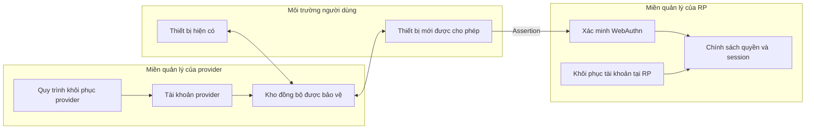

# Passkey synchronization trust

## 1. Đồng bộ passkey thay đổi bài toán khôi phục như thế nào?

Một người dùng làm mất điện thoại nhưng vẫn đăng nhập được trên điện thoại mới nhờ passkey được đồng bộ. Với họ, đây là một lần khôi phục thành công. Với ứng dụng, sự kiện quan sát được có thể chỉ là một lần đăng nhập bằng credential đã đăng ký trước đó.

Đó là vấn đề trung tâm của **passkey synchronization trust**: ứng dụng phải quyết định tin cậy đến đâu vào cơ chế lưu trữ, đồng bộ và khôi phục passkey do một bên khác quản lý.

Trong thiết kế khôi phục tài khoản an toàn, đồng bộ giúp giảm số lần người dùng phải nhờ hỗ trợ khi mất thiết bị. Tuy nhiên, nhóm thiết kế vẫn cần trả lời: ai có thể đưa khóa sang thiết bị mới, bằng chứng nào cho phép việc đó và ứng dụng còn kiểm soát được gì nếu tài khoản đồng bộ bị xâm phạm?

Bài này đặt các câu hỏi đó trong phạm vi khôi phục tài khoản khi mất mật khẩu, MFA, passkey hoặc thiết bị xác thực. Trọng tâm là giữ đúng mức tin cậy khi người dùng lấy lại khả năng sử dụng passkey và ngăn việc lấy lại quyền truy cập trở thành đường chiếm đoạt tài khoản.

Sau bài học, người học cần có khả năng:

- Phân biệt đồng bộ credential với khôi phục tài khoản của ứng dụng.
- Xác định các ranh giới tin cậy và điểm lỗi chung giữa các phương thức dự phòng.
- Sử dụng tín hiệu WebAuthn trong đúng giới hạn quan sát của máy chủ.
- Thiết kế quyền sau đăng nhập, bằng chứng bổ sung và phản ứng sự cố phù hợp với rủi ro.

## 2. Phân biệt bốn hoạt động dễ bị gộp chung

**Relying Party (RP)** là ứng dụng hoặc dịch vụ chấp nhận đăng nhập bằng passkey. **Passkey provider** là bên quản lý passkey cho người dùng. **Sync fabric** là cơ chế đưa dữ liệu credential đến các thiết bị được phép.

| Hoạt động | Điều đang xảy ra | Câu hỏi RP cần xử lý |
|---|---|---|
| Đồng bộ passkey | Credential có thể sử dụng trong một môi trường khác thông qua cơ chế của provider | Chính sách của ứng dụng có chấp nhận loại credential này không? |
| Khôi phục tại provider | Người dùng lấy lại khả năng truy cập tài khoản hoặc kho credential của provider | Quy trình bên ngoài này có tạo thêm đường tấn công không? |
| Khôi phục tại RP | Ứng dụng chấp nhận bằng chứng thay thế và cho phép thiết lập lại quyền truy cập | Bằng chứng đã đủ để liên kết lại danh tính và cấp quyền chưa? |
| Đăng nhập xuyên thiết bị | Một thiết bị hỗ trợ xác thực cho lần đăng nhập trên thiết bị khác | Thiết bị đang hiển thị ứng dụng có thực sự nhận một bản sao khóa không? |

FIDO mô tả cross-device authentication như việc dùng passkey trên một thiết bị để đăng nhập trên thiết bị khác. Vì vậy, việc người dùng quét QR bằng điện thoại không tự nó chứng minh passkey đã được đồng bộ sang máy tính. [Nguồn: FIDO Alliance — Passkeys](https://fidoalliance.org/passkeys/).

Ví dụ, Lan có thể dùng điện thoại để đăng nhập trên máy tính mượn rồi đăng xuất. Thiết kế sản phẩm không nên tự đặt tên máy tính đó là “thiết bị lưu passkey”, cũng không nên mặc định đưa máy tính vào danh sách thiết bị đáng tin cậy lâu dài.

## 3. Ranh giới tin cậy mở rộng ra ngoài ứng dụng

Sơ đồ sau là mô hình khái niệm. Mũi tên từ kho đồng bộ đến thiết bị biểu diễn việc cung cấp dữ liệu đã được bảo vệ theo thiết kế của provider, không biểu diễn gửi khóa riêng cho RP.



Có thể phân tích rủi ro của mô hình này bằng ba lớp câu hỏi:

1. **Ai có thể sử dụng credential?** Xem xét việc mở khóa thiết bị, bảo vệ kho credential và quyền truy cập của phần mềm trên thiết bị.
2. **Ai có thể đưa credential đến môi trường khác?** Xem xét thêm thiết bị, chia sẻ, nhập hoặc xuất nếu sản phẩm có hỗ trợ, cùng những đường khôi phục liên quan.
3. **Người đã xác thực được phép làm gì?** Xem xét quyền trong session, thao tác bảo mật nhạy cảm và khả năng đảo ngược thay đổi.

Một hệ thống chỉ tập trung vào lớp thứ nhất sẽ bỏ sót việc kẻ tấn công lấy credential qua quy trình phục hồi. Một hệ thống chỉ tập trung vào provider sẽ bỏ sót việc kẻ tấn công dùng session có sẵn để thêm credential của chính mình.

Đây là mô hình phân tích của bài học. Nó giúp tìm các đường dẫn đến cùng một quyền, thay vì gán một nhãn “an toàn” cho toàn bộ hệ sinh thái.

## 4. Mã hóa kho đồng bộ và khôi phục quyền giải mã

Khi đánh giá provider, cần tách hai câu hỏi: dữ liệu được bảo vệ như thế nào khi lưu trữ và điều kiện nào cho phép một thiết bị mới sử dụng dữ liệu đó.

Ví dụ, Apple mô tả iCloud Keychain dùng mã hóa đầu cuối; thiết bị mới có thể tham gia thông qua thiết bị hiện có hoặc keychain recovery. Google mô tả việc giải mã passkey đồng bộ trong môi trường mới cần đăng nhập tài khoản Google và cung cấp khóa màn hình Android hoặc Google Password Manager PIN. Đây là các cơ chế cụ thể của từng sản phẩm, cần kiểm tra lại khi triển khai. [Nguồn: Apple — About the security of passkeys](https://support.apple.com/en-ie/102195), [Google — Passkey support on Android and Chrome](https://developers.google.com/identity/passkeys/supported-environments).

Từ các ví dụ đó, cần tránh hai kết luận quá rộng:

- “Biết mật khẩu cloud là chắc chắn lấy được mọi passkey.” Kết luận này bỏ qua những lớp bảo vệ bổ sung.
- “Có mã hóa đầu cuối thì quy trình khôi phục không thể bị lợi dụng.” Kết luận này bỏ qua điều kiện cấp lại quyền giải mã và độ an toàn của thiết bị đầu cuối.

Bảng dưới đây là bộ câu hỏi thiết kế để đánh giá phụ thuộc vào provider. RP không nhất thiết có khả năng kiểm chứng từng mục trong một lần đăng nhập.

| Điểm cần đánh giá | Câu hỏi cụ thể | Ý nghĩa với luồng recovery |
|---|---|---|
| Thêm thiết bị | Cần thiết bị cũ, bí mật bổ sung hay hình thức phê duyệt nào? | Xác định đường đưa credential đến người khác |
| Mất toàn bộ thiết bị | Người dùng còn bằng chứng nào để lấy lại kho credential? | Xác định đường khôi phục cuối cùng |
| Thay đổi bằng chứng khôi phục | Ai được đổi PIN, recovery contact hoặc phương thức liên quan? | Phát hiện khả năng kẻ tấn công củng cố quyền kiểm soát |
| Chia sẻ và chuyển credential | Có thể cấp quyền cho ai khác, bằng cách nào? | Đánh giá phạm vi người có thể xác thực |
| Thu hồi thiết bị | Chặn đồng bộ mới và xử lý dữ liệu đã có khác nhau ra sao? | Tránh hứa hẹn thu hồi vượt khả năng thực tế |
| Mất dịch vụ hoặc mất tài khoản | Có phương án truy cập khác đã chuẩn bị không? | Giảm khóa tài khoản khi provider không khả dụng |

Trong môi trường doanh nghiệp, nên ghi rõ bằng chứng đánh giá, chủ sở hữu quyết định và thời điểm xem xét lại. Với ứng dụng công khai, nơi người dùng tự chọn provider, nên thiết kế chính sách chịu được việc thiếu thông tin chi tiết về bên lưu credential.

## 5. Tín hiệu backup trong WebAuthn

Trong authenticator data, **BE — Backup Eligibility** biểu diễn khả năng được backup, cố định với credential; **BS — Backup State** biểu diễn trạng thái backup do authenticator báo, có thể đổi. [Nguồn: W3C WebAuthn — Credential Backup State](https://www.w3.org/TR/webauthn-3/#sctn-credential-backup).

| BE | BS | Diễn giải |
|---|---|---|
| 0 | 0 | Không đủ điều kiện backup |
| 1 | 0 | Đủ điều kiện, chưa báo đã backup |
| 1 | 1 | Đủ điều kiện, báo đã backup |
| 0 | 1 | Tổ hợp không hợp lệ |

Các cờ này không phải danh sách thiết bị giữ khóa, tên tài khoản cloud hay bằng chứng về một lần khôi phục cụ thể. Chỉ dùng giá trị qua xác minh giao thức; không tin trường JSON tự khai. [Nguồn: W3C WebAuthn — Verifying an Authentication Assertion](https://www.w3.org/TR/webauthn-3/#sctn-verifying-assertion).

**Hệ quả thiết kế:** RP nên tránh đặt thuộc tính `safeToRecover=true` chỉ từ trạng thái backup. Một bit trạng thái không thể đại diện cho cả quyết định nghiệp vụ về việc ai đang kiểm soát tài khoản.

Tương tự, tên thiết bị do người dùng nhập như “Điện thoại của tôi” nên được coi là nhãn giao diện. Nếu cần bằng chứng thiết bị được tổ chức quản lý, hãy yêu cầu bằng chứng riêng phù hợp với hệ thống quản lý thiết bị.

## 6. Những điều RP không nên suy ra từ lần đăng nhập

FIDO lưu ý rằng việc phục hồi passkey tại provider không được RP biết qua luồng xác thực thông thường. Tài liệu doanh nghiệp cũng đề nghị đánh giá cơ chế bảo vệ và recovery của bên quản lý credential. [Nguồn: FIDO Alliance — High Assurance Enterprise FIDO Authentication, mục 2.3](https://fidoalliance.org/wp-content/uploads/2023/06/FIDO-EDWG-Spring-2023_Paper-5_High-Assurance-Enterprise-FINAL5.docx-1.pdf).

Vì vậy, cần phân biệt rõ trong mô hình dữ liệu:

| Thông tin | Cách xử lý trong thiết kế |
|---|---|
| RP vừa hoàn tất recovery của chính mình | Ghi sự kiện xác định, liên kết với hồ sơ recovery |
| Có tín hiệu đăng nhập khác thường | Ghi quan sát rủi ro kèm nguồn và độ chắc chắn |
| Người dùng nói vừa khôi phục tài khoản cloud | Ghi khai báo của người dùng; chưa coi là bằng chứng độc lập |
| Không có dữ liệu recovery từ provider | Ghi nhận là không biết |

Ví dụ, đặt tên trường `providerRecoveryDetected` chỉ vì xuất hiện trình duyệt mới sẽ khiến đội vận hành hiểu sai bằng chứng. Tên như `newBrowserContextObserved` mô tả đúng hơn điều hệ thống thực sự quan sát.

Một địa chỉ IP lạ có thể xuất hiện khi người dùng đổi mạng. Một địa chỉ IP quen cũng có thể đến từ kẻ tấn công đang sử dụng môi trường của nạn nhân. Những tín hiệu này hữu ích để chọn bước xử lý tiếp theo, nhưng không nên thay thế bằng chứng xác thực.

### Giới hạn của signature counter

Một số authenticator trả counter bằng 0; counter cũng không phải cách đáng tin cậy để đếm thiết bị giữ một credential đồng bộ. Hãy lưu và xử lý counter theo thư viện WebAuthn đang dùng, đồng thời xem xét cảnh báo trong ngữ cảnh. [Nguồn: SimpleWebAuthn — Server, phần counter](https://simplewebauthn.dev/docs/packages/server).

Không nên chữa lỗi tương thích bằng cách bỏ kiểm tra chữ ký, origin hay challenge. Nếu thư viện từ chối một loại credential, cần hiểu nguyên nhân và cấu hình được hỗ trợ trước khi thay đổi chính sách.

## 7. Chọn mức đảm bảo theo loại quyền

NIST SP 800-63B-4 cho phép syncable authenticator hỗ trợ AAL2 khi đáp ứng các điều kiện tương ứng, bao gồm bảo vệ truy cập sync fabric. Khả năng xuất khóa của đồng bộ không đáp ứng yêu cầu không xuất được khóa tại AAL3. Không thể suy ra mức AAL chỉ từ nhãn “passkey”. [Nguồn: NIST — Syncable Authenticators](https://pages.nist.gov/800-63-4/sp800-63b/syncable/).

Đây là tiêu chuẩn tham chiếu trong phạm vi áp dụng của NIST, không phải tuyên bố rằng mọi ứng dụng đều phải áp dụng cùng chính sách. Với một sản phẩm cụ thể, hãy bắt đầu từ thiệt hại có thể xảy ra nếu quyền bị trao sai.

| Quyền minh họa | Chính sách có thể lựa chọn | Lý do |
|---|---|---|
| Đọc nội dung học tập cá nhân | Chấp nhận passkey đồng bộ theo chính sách đăng nhập thông thường | Hạn chế gây khóa tài khoản không cần thiết |
| Đổi email khôi phục | Yêu cầu xác thực gần đây và kiểm tra điều kiện thay đổi | Đây là thay đổi ảnh hưởng đường lấy lại tài khoản |
| Thêm passkey sau recovery của RP | Chỉ cho phép bằng grant recovery đúng mục đích | Tránh biến session tạm thành quyền quản trị bảo mật |
| Quản trị hạ tầng trọng yếu | Có thể yêu cầu credential và thiết bị thuộc quản lý tổ chức | Cần kiểm soát vòng đời và phạm vi sử dụng chặt hơn |

Các dòng trên là ví dụ chính sách của bài học. Việc lựa chọn cần phù hợp với đối tượng người dùng, yêu cầu thực tế và khả năng hỗ trợ khi họ mất thiết bị.

Đừng thêm SMS vào mọi lần dùng passkey rồi mặc định tổng thể sẽ an toàn hơn. Cần đánh giá cả khả năng lừa người dùng, điểm lỗi chung và tác động khiến họ chuyển sang con đường recovery dễ bị tấn công hơn.

## 8. Bằng chứng dự phòng phải được xét theo miền phụ thuộc

Hai phương thức có giao diện khác nhau chưa chắc là hai bằng chứng độc lập.

Giả sử Minh có:

- Passkey của ứng dụng trong một kho đồng bộ.
- Mật khẩu email khôi phục trong cùng kho đó.
- TOTP của ứng dụng trong cùng trình quản lý.
- Bản chụp recovery code trong cloud mà cùng tài khoản có thể truy cập.

Nếu một sự cố làm lộ toàn bộ miền này, cả bốn phương thức có thể cùng bị ảnh hưởng. Đếm số phương thức sẽ đánh giá quá cao khả năng chống chiếm đoạt.

Một cách lập kế hoạch là vẽ đồ thị phụ thuộc:

```text
Tài khoản đồng bộ A
  ├── Passkey ứng dụng
  ├── Mật khẩu email
  ├── TOTP
  └── Bản sao recovery code

Khóa bảo mật dự phòng B, cất riêng
  └── Credential ứng dụng đã đăng ký từ trước
```

Trong ví dụ này, B có khả năng tạo thêm miền dự phòng nếu việc sử dụng hoặc khôi phục B không quay lại phụ thuộc vào A. Đây là phân tích cho tình huống giả định, không phải kết luận mọi security key đều có cùng đặc tính.

Đặc biệt cần tránh vòng lặp:

```text
Muốn khôi phục kho passkey → phải mở email.
Muốn mở email → phải dùng passkey trong kho vừa mất.
```

Vòng lặp này gây khóa tài khoản dù từng phương thức riêng lẻ có vẻ mạnh. Khi hướng dẫn người dùng chuẩn bị dự phòng, nên kiểm tra cả khả năng sử dụng trong tình huống mất toàn bộ thiết bị thường ngày.

Nếu RP không xác minh được một phương thức thuộc miền độc lập nào, hãy thể hiện sự không chắc chắn đó. Không tự cấp mức tin cậy cao chỉ vì hai credential có ID khác nhau hoặc hai thiết bị có tên khác nhau.

## 9. Thiết kế ba nhánh xử lý truy cập

### 9.1. Passkey cũ vẫn dùng được, không có dấu hiệu sự cố đáng kể

Khi người dùng có passkey hợp lệ trên môi trường mới, ứng dụng có thể xử lý như đăng nhập theo chính sách đã công bố. Không nên bắt họ tạo recovery request chỉ vì họ vừa đổi điện thoại.

Đối với xác minh máy chủ, các kiểm tra nền tảng gồm challenge, RP ID, origin, chữ ký và các yêu cầu hiện diện hoặc xác minh người dùng. Challenge cần ngẫu nhiên, giới hạn thời gian và không chấp nhận lại. Nếu chính sách yêu cầu user verification, máy chủ phải kiểm tra kết quả tương ứng. [Nguồn: Google — Server-side passkey authentication](https://developers.google.com/identity/passkeys/developer-guides/server-authentication).

Ở tầng ứng dụng, một thiết kế có thể:

1. Tạo ngữ cảnh đăng nhập riêng cho từng lần thử, tránh việc hai tab ghi đè trạng thái lẫn nhau.
2. Ràng buộc ngữ cảnh với session hoặc giao dịch xác thực đang xử lý.
3. Đánh giá rủi ro theo hành động đích, không chỉ theo kết quả đăng nhập.
4. Cấp session mới theo chính sách và ghi nhận phương thức xác thực.
5. Yêu cầu kiểm tra riêng khi người dùng thay đổi cấu hình recovery.

### 9.2. Passkey hợp lệ nhưng có dấu hiệu bị xâm phạm

Ví dụ: người dùng đã báo mất thiết bị trong trạng thái đang mở khóa, rồi tài khoản có chuỗi yêu cầu đổi email và xóa phương thức dự phòng.

Chữ ký hợp lệ vẫn là bằng chứng có giá trị, nhưng chính sách cần xét khả năng người khác đang sử dụng credential. Có thể tạm hạn chế thao tác bảo mật, yêu cầu bằng chứng từ miền đã đăng ký độc lập hoặc chuyển sang xử lý sự cố.

Không nên yêu cầu ký lại bằng đúng credential đó rồi coi đây là bằng chứng thứ hai độc lập. Một lần xác thực mới có thể đáp ứng yêu cầu độ mới, nhưng không tự giải quyết nghi ngờ quyền kiểm soát credential.

### 9.3. Không còn passkey hoặc phương thức xác thực được chấp nhận

Lúc này cần đi vào recovery của RP. Một thiết kế tham khảo gồm:

1. Khởi tạo hồ sơ recovery có giới hạn tốc độ, phản hồi không làm lộ tài khoản và bằng chứng được thu thập có mục đích.
2. Chấp nhận recovery code dùng một lần, bằng chứng đã đăng ký trước hoặc quy trình xác minh phù hợp mức rủi ro.
3. Chỉ cấp grant hẹp cho thao tác đăng ký credential thay thế, với thời hạn ngắn và ràng buộc hồ sơ recovery.
4. Xác minh đăng ký credential mới; chỉ khi thành công mới chuyển bước theo chính sách.
5. Xử lý credential, session và token cũ theo kết quả đánh giá sự cố; thông báo qua kênh đã có từ trước.

Nếu dùng token recovery, có thể lưu giá trị băm của bí mật ngẫu nhiên, gắn với người dùng, mục đích và hạn dùng, rồi tiêu thụ nguyên tử. Không ghi token vào log hoặc để lộ qua URL chuyển tiếp và công cụ phân tích. Đây là đề xuất triển khai của bài học, không phải cơ chế đồng bộ passkey.

## 10. Minh họa tách xác thực và cấp quyền trong Java

Đoạn mã sau là **mã giả cho tầng quyết định quyền**, không phải WebAuthn verifier hoặc API của một thư viện cụ thể. Đầu vào `VerifiedContext` chỉ được backend tạo sau khi thư viện hoàn tất xác minh, kiểm tra account binding, trạng thái credential và điều kiện giao dịch. Không deserialize trực tiếp kiểu này từ request.

```java
enum Action {
    READ_PROFILE,
    CHANGE_RECOVERY_EMAIL,
    ENROLL_REPLACEMENT_PASSKEY
}

enum Decision {
    ALLOW,
    REQUIRE_FRESH_AUTHENTICATION,
    REQUIRE_INDEPENDENT_EVIDENCE,
    REQUIRE_RECOVERY_GRANT,
    HOLD_FOR_INCIDENT_RESPONSE
}

record VerifiedContext(
    boolean unresolvedCompromise,
    boolean independentEvidenceAccepted,
    boolean rpRecoveryInProgress,
    boolean replacementEnrollmentGrantValid,
    boolean freshAuthenticationMeetsPolicy
) {}

Decision authorize(Action action, VerifiedContext context) {
    if (context.unresolvedCompromise()
            && !context.independentEvidenceAccepted()) {
        return Decision.HOLD_FOR_INCIDENT_RESPONSE;
    }

    if (context.rpRecoveryInProgress()) {
        if (action == Action.ENROLL_REPLACEMENT_PASSKEY
                && context.replacementEnrollmentGrantValid()) {
            return Decision.ALLOW;
        }
        return Decision.REQUIRE_RECOVERY_GRANT;
    }

    if (action == Action.READ_PROFILE) {
        return Decision.ALLOW;
    }

    if (!context.freshAuthenticationMeetsPolicy()) {
        return Decision.REQUIRE_FRESH_AUTHENTICATION;
    }

    if (!context.independentEvidenceAccepted()) {
        return Decision.REQUIRE_INDEPENDENT_EVIDENCE;
    }

    return Decision.ALLOW;
}
```

Ví dụ này cố ý chọn chính sách chặt cho thay đổi bảo mật. Không phải mọi ứng dụng đều cần bằng chứng độc lập cho mọi lần thêm passkey. Điểm cần học là mỗi quyết định phải có đầu vào rõ ràng, cùng đường xử lý khi người dùng không đáp ứng được.

Các điều kiện để tích hợp mã giả an toàn:

- `independentEvidenceAccepted` là kết quả xác minh của backend theo mô hình phụ thuộc đã xác định, không phải lựa chọn người dùng tự đánh dấu.
- `freshAuthenticationMeetsPolicy` phản ánh cả thời điểm, phương thức và mức đảm bảo đã thiết lập; chỉ kiểm tra timestamp là chưa đủ.
- Grant đăng ký thay thế phải khớp người dùng, hồ sơ recovery và thao tác. Endpoint thực hiện phải kiểm tra lại và tiêu thụ grant nguyên tử cùng thay đổi trạng thái cần thiết.
- `ALLOW` cho đăng ký chỉ cho phép bắt đầu hoặc hoàn tất ceremony hợp lệ theo endpoint; không có nghĩa nhận bất kỳ public key nào client gửi lên.
- Yêu cầu mới phải kiểm tra trạng thái thu hồi hiện tại. Không giữ nguyên quyền trong cache sau khi hồ sơ sự cố đã khóa tài khoản.

Không có điều kiện `if (backedUp) return ALLOW`. Thông tin backup có thể phục vụ một chính sách credential riêng, nhưng không thay thế các kiểm tra về recovery, sự cố và quyền thao tác.

## 11. Thu hồi khi nghi ngờ kho đồng bộ bị lộ

Cần phân biệt sự cố mất thiết bị, lộ session và lộ miền lưu credential. Chúng có thể đòi hỏi phạm vi xử lý khác nhau.

Một kế hoạch ứng phó cho tình huống nghi ngờ miền lưu credential bị xâm phạm có thể gồm:

1. Xác lập đường trao đổi và bằng chứng độc lập trước khi trao quyền thay đổi bảo mật.
2. Chặn credential bị ảnh hưởng tại RP, đồng thời xử lý refresh token và session liên quan theo mức độ sự cố.
3. Rà soát passkey, email, số điện thoại hoặc ứng dụng được cấp quyền đã thêm trong khoảng thời gian nghi vấn.
4. Đăng ký credential thay thế trong môi trường đã được xử lý an toàn.
5. Phát hành lại recovery code khi cần và vô hiệu các grant recovery còn hiệu lực thuộc sự cố.
6. Kiểm tra hoạt động nhạy cảm sau lần xâm nhập có thể xảy ra.

Nếu nhiều bản sao dùng cùng credential đã bị RP thu hồi, RP phải từ chối việc dùng credential đó. Việc chặn tại ứng dụng không đồng nghĩa đã xóa khóa trên mọi thiết bị của provider. Giao diện nên mô tả đúng phạm vi: “Phương thức này không còn được chấp nhận để đăng nhập ứng dụng”.

Đăng ký lại passkey ngay vào cùng môi trường đang bị nghi ngờ mà chưa xử lý quyền truy cập của kẻ tấn công có thể tái tạo sự cố. Trình tự thay thế cần xét đồng thời khả năng bảo vệ tài khoản và nguy cơ khóa người dùng hợp pháp; không có một thứ tự thu hồi áp dụng tốt cho mọi tình huống.

## 12. Trải nghiệm người dùng và quan sát vận hành

### 12.1. Hướng dẫn theo điều người dùng còn giữ

Một màn hình hỗ trợ có thể dẫn người dùng qua các lựa chọn:

- “Tôi vẫn dùng được passkey trên thiết bị khác.”
- “Tôi có khóa bảo mật hoặc recovery code đã chuẩn bị.”
- “Tôi không còn phương thức nào có thể sử dụng.”
- “Tôi nghi ngờ người khác đang dùng tài khoản.”

Các lựa chọn này giúp chọn luồng phù hợp mà không đòi người dùng hiểu BE, BS hoặc tên giao thức. Cũng không nên yêu cầu họ gửi PIN mở khóa, mật khẩu provider hay bản sao kho credential cho nhân viên hỗ trợ.

Nếu gợi ý người dùng khôi phục kho credential tại provider, hãy giải thích rằng điều đó không đảm bảo thành công và không thay thế quy trình bảo vệ tài khoản ứng dụng khi có dấu hiệu xâm phạm.

### 12.2. Log phải phản ánh bằng chứng thực có

Ví dụ sự kiện dưới đây là mô hình riêng cho ứng dụng:

```json
{
  "eventType": "SECURITY_CHANGE_HELD",
  "accountRef": "internal-account-reference",
  "credentialRef": "internal-credential-reference",
  "targetAction": "CHANGE_RECOVERY_EMAIL",
  "rpRecoveryInProgress": false,
  "providerRecoveryKnowledge": "UNKNOWN",
  "riskReason": "UNRESOLVED_ACCOUNT_COMPROMISE",
  "decision": "REQUIRE_INDEPENDENT_EVIDENCE",
  "policyVersion": "example-v1"
}
```

Nên ghi đủ để giải thích quyết định và điều tra, đồng thời giới hạn quyền đọc và thời gian lưu. Không ghi bí mật recovery, cookie, refresh token hoặc toàn bộ thông tin cá nhân không cần thiết.

Một số chỉ số hữu ích để vận hành chính sách:

| Chỉ số | Câu hỏi cần trả lời |
|---|---|
| Tỷ lệ phải vào recovery của RP | Đồng bộ và phương thức dự phòng có giảm khóa tài khoản không? |
| Tỷ lệ hoàn tất sau yêu cầu bằng chứng bổ sung | Chính sách có khả thi với người dùng hợp pháp không? |
| Thay đổi bảo mật ngay sau recovery | Có xuất hiện hành vi củng cố quyền kiểm soát bất thường không? |
| Khiếu nại về thao tác không được phép | Những nhánh nào đang trao quyền quá dễ? |
| Thời gian xử lý sự cố | Đội hỗ trợ có đủ thông tin và quyền phù hợp không? |

Các chỉ số cần được đọc cùng loại tài khoản và mức thiệt hại. Tỷ lệ hoàn tất cao nhưng tăng chiếm đoạt tài khoản không phải kết quả tốt.

## 13. Ba tình huống thiết kế

### Tình huống A — Đổi điện thoại, credential vẫn sử dụng được

Hà đổi điện thoại. Passkey có sẵn sau khi Hà hoàn tất thiết lập của provider. Ứng dụng nhận xác thực hợp lệ, không có hồ sơ sự cố và người dùng chỉ muốn tiếp tục học.

Thiết kế hợp lý có thể cho đăng nhập theo chính sách thông thường, giữ kiểm tra riêng cho thao tác đổi cấu hình bảo mật. Không cần phát token recovery của RP hoặc bắt Hà xác minh lại danh tính chỉ vì đổi thiết bị.

### Tình huống B — Kẻ tấn công lấy được quyền sử dụng kho credential

Giả sử kẻ tấn công đã vượt qua những lớp bảo vệ cần thiết của provider và có thể sử dụng passkey của nạn nhân. Hắn đăng nhập rồi yêu cầu đổi email khôi phục.

Trong giả định này, yêu cầu ký lại bằng cùng passkey không tạo ra miền bằng chứng mới. Một chính sách thích hợp với tài khoản có giá trị cao có thể giữ thay đổi, yêu cầu phương thức độc lập đã đăng ký trước và thông báo qua kênh cũ. Cần chặn cả API thực hiện thay đổi, thay vì chỉ ẩn nút trên giao diện.

Tình huống không giả định rằng chỉ cần biết mật khẩu cloud là đủ để thực hiện cuộc tấn công.

### Tình huống C — Mất cả thiết bị và quyền truy cập provider

Tuấn không còn dùng được passkey ở bất kỳ đâu và cũng không khôi phục được kho đồng bộ. Tuấn vẫn giữ recovery code ngoại tuyến đã phát hành trước đó.

RP có thể kiểm tra recovery code theo chính sách, tiêu thụ nó một lần và cấp grant đăng ký credential thay thế. Session của bước này cần giới hạn đúng mục đích; không đồng thời cho đổi email, xuất dữ liệu hoặc xóa mọi bằng chứng cũ.

Nếu Tuấn cũng mất recovery code, hệ thống phải có bước xử lý tiếp theo đã thiết kế sẵn: xác minh bổ sung phù hợp hoặc hỗ trợ có kiểm soát. Việc người dùng biết nhiều thông tin công khai về tài khoản không tự trở thành bằng chứng đủ mạnh.

## 14. Câu hỏi tự đánh giá thiết kế

1. Nếu provider cho một thiết bị mới sử dụng credential, RP có đang suy ra điều gì vượt dữ liệu nhận được không?
2. Nếu người dùng mất cả tài khoản đồng bộ, các phương thức dự phòng còn thực sự truy cập được không?
3. Bằng chứng dùng để đổi cấu hình recovery có cùng điểm lỗi với passkey đang bị nghi ngờ không?
4. Grant recovery có bị dùng lại, dùng sai tài khoản hoặc dùng để gọi endpoint ngoài phạm vi không?
5. Sau khi thu hồi credential, những session và refresh token nào vẫn còn quyền?
6. Người dùng có thể tiếp tục sử dụng ứng dụng cho nhu cầu ít rủi ro mà không được trao ngay quyền thay đổi bảo mật hay không?
7. Đội hỗ trợ có phân biệt được điều quan sát, điều người dùng khai báo và điều chưa biết không?

Một thiết kế tốt phải trả lời được cả việc giúp người dùng hợp pháp quay lại và việc ngăn kẻ đang kiểm soát một miền credential củng cố quyền truy cập. Đồng bộ passkey là một phần của câu trả lời; quyết định khôi phục và cấp quyền vẫn cần được thiết kế ở cấp tài khoản.
