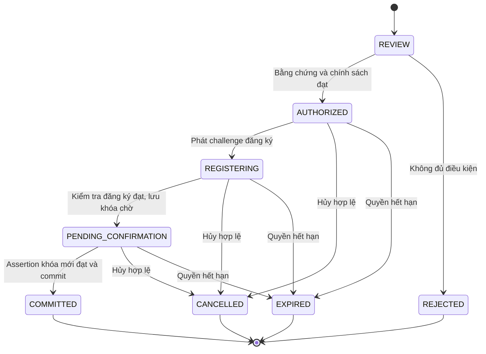
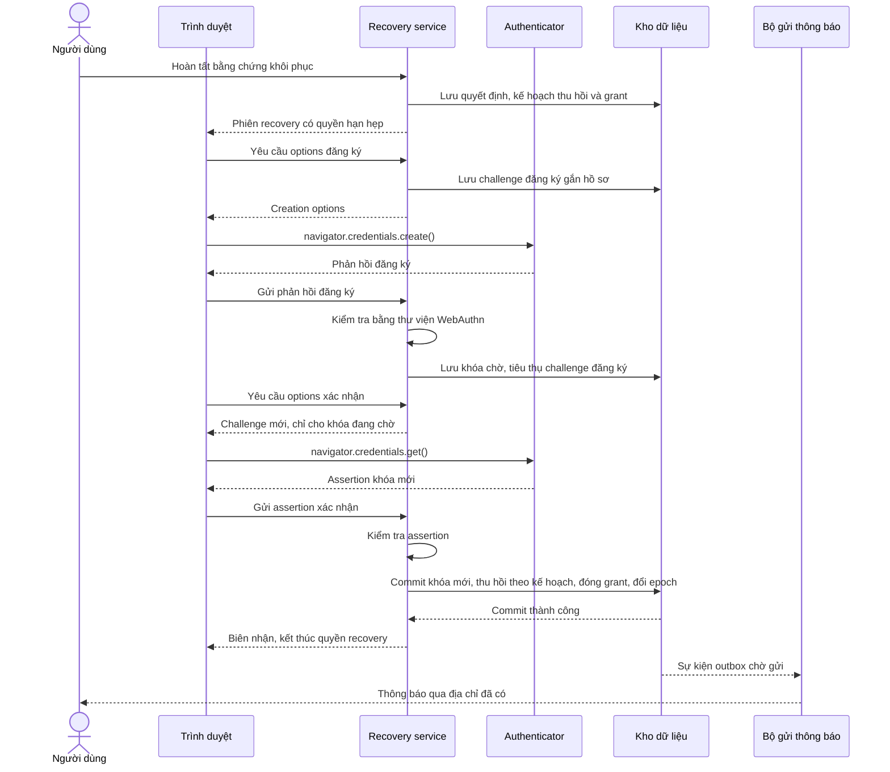

# Credential replacement ceremony — Quy trình thay thế passkey an toàn

## 1. Thay credential là thay một quan hệ tin cậy

Khi người dùng mất điện thoại, hỏng khóa bảo mật hoặc không còn truy cập được passkey, hệ thống không chỉ cần giúp họ đăng nhập lại. Hệ thống phải quyết định ai được gắn một khóa công khai mới vào tài khoản, khóa nào cần bị thu hồi và những phiên đang tồn tại còn được phép làm gì. Sai sót ở một trong các quyết định này có thể khiến kẻ tấn công biến một lần khôi phục thành quyền truy cập lâu dài.

**Credential replacement ceremony** là toàn bộ quy trình có kiểm soát để thay credential xác thực: xác lập quyền thay thế, tạo credential mới, kiểm tra khả năng sử dụng, cập nhật quan hệ tin cậy và kết thúc quyền khôi phục. Trong chương **Passkey Recovery**, bài học này tập trung vào phần chuyển tiếp từ một hồ sơ khôi phục đã được đánh giá sang trạng thái tài khoản sử dụng passkey mới.

Đặt bài toán trong dịch vụ `SECURITY_AUTHENTICATION_ACCOUNT_RECOVERY`: cùng một người có thể mất mật khẩu, MFA, passkey hoặc thiết bị xác thực. Các bằng chứng còn lại khác nhau, nhưng thao tác gắn passkey mới luôn cần đi qua một quyết định cấp quyền rõ ràng. Một cookie đăng nhập cũ, một đường dẫn email hay một cuộc gọi hỗ trợ không tự động trở thành quyền thay toàn bộ phương thức xác thực.

Sau bài học, người học cần có khả năng:

- Phân biệt khôi phục tài khoản, bổ sung passkey và thay credential bị mất hoặc nghi lộ.
- Thiết kế quyền khôi phục có phạm vi hẹp, thời hạn và trạng thái sử dụng một lần.
- Kết hợp đăng ký WebAuthn với bước xác nhận khóa mới trước khi kích hoạt.
- Xử lý thu hồi credential, phiên đăng nhập, yêu cầu đồng thời và lỗi giữa chừng.
- Xác định dữ liệu cần ghi nhận để phát hiện và điều tra việc chiếm đoạt tài khoản.

Các trạng thái, API, thời hạn và mã giả dưới đây là **một thiết kế tham khảo cho ứng dụng**, không phải một giao thức thay thế do WebAuthn định nghĩa. Các yêu cầu giao thức được dẫn nguồn riêng; việc đáp ứng một mức bảo đảm xác thực cần đánh giá đầy đủ hệ thống.

## 2. Phân loại tình huống trước khi cho phép thay thế

### 2.1. Ba thao tác có đầu ra khác nhau

| Tình huống | Quyền đầu vào cần xem xét | Cách xử lý credential đang có |
|---|---|---|
| Người dùng còn khóa tin cậy và muốn thêm passkey | Xác thực lại gần thời điểm thao tác bằng phương thức phù hợp | Giữ các credential hiện tại nếu không có dấu hiệu lộ |
| Đổi thiết bị theo kế hoạch | Xác thực lại và xác nhận kế hoạch chuyển đổi | Có thể giữ khóa cũ đến khi khóa mới được xác nhận |
| Mất mọi phương thức cần thiết hoặc nghi bị chiếm tài khoản | Hoàn tất chính sách khôi phục và đánh giá rủi ro | Đình chỉ hoặc thu hồi khóa nghi lộ; thay đổi quyền của các phiên |

NIST phân biệt việc gắn thêm authenticator với account recovery khi người dùng mất khả năng xác thực ở mức cần thiết. NIST cũng yêu cầu thông báo khi khôi phục; authenticator bị xâm phạm cần được xử lý kịp thời. Đây là cơ sở để tách chuyển đổi có kế hoạch khỏi ứng phó mất khóa. Xem [NIST SP 800-63B-4 — Authenticator Event Management](https://pages.nist.gov/800-63-4/sp800-63b/events/).

Không dùng cùng một chính sách “xóa khóa cũ sau khi khóa mới hoạt động” cho mọi trường hợp. Cách đó giúp tránh khóa tài khoản khi đổi thiết bị bình thường, nhưng kéo dài cửa sổ tấn công nếu khóa cũ đã bị đánh cắp.

### 2.2. Bảng quyết định tối thiểu

| Dữ kiện đã được hệ thống xác minh | Hướng xử lý đề xuất trong thiết kế này |
|---|---|
| Có passkey dự phòng còn tin cậy | Xác thực lại bằng khóa dự phòng rồi cấp quyền thay thế có phạm vi |
| Còn phiên đăng nhập nhưng không còn phương thức xác thực phù hợp | Cho mở hồ sơ; yêu cầu bằng chứng bổ sung trước khi cấp quyền |
| Chỉ kiểm soát email trong khi tài khoản có yêu cầu bảo vệ cao | Chuyển qua chính sách xác minh mạnh hơn hoặc xét duyệt; chưa cấp quyền thay khóa |
| Báo mất khóa đã được xác thực theo chính sách báo sự cố | Đình chỉ hoặc thu hồi khóa liên quan ngay, độc lập với tiến độ tạo khóa mới |
| Tài khoản đồng bộ passkey cũng nghi bị chiếm | Yêu cầu môi trường tạo khóa mới đáp ứng chính sách ứng phó sự cố |
| Bằng chứng không đủ để nối người yêu cầu với tài khoản | Giữ hồ sơ ở trạng thái chờ hoặc từ chối; chưa phát hành quyền thay thế |

Chính sách phải phân biệt **bằng chứng về chủ tài khoản** với **tín hiệu rủi ro**. IP quen thuộc và tên thiết bị có thể hỗ trợ đánh giá nhưng không thay thế được bằng chứng sở hữu phương thức xác thực hay quy trình xác minh đã định nghĩa.

## 3. Các thành phần và ranh giới tin cậy

### 3.1. Những đối tượng không nên dùng thay cho nhau

| Đối tượng | Vai trò | Không được hiểu thành |
|---|---|---|
| Recovery case | Hồ sơ chứa tài khoản đích, bằng chứng, quyết định và lịch sử | Quyền đăng nhập hoặc bí mật xác thực |
| Recovery grant | Quyền hạn hẹp để thực hiện một lần thay credential | Access token toàn quyền |
| Registration challenge | Thử thách cho một lần đăng ký khóa mới | Bằng chứng người thao tác là chủ tài khoản |
| Credential ở trạng thái chờ | Khóa công khai đã qua kiểm tra đăng ký, chưa được dùng đăng nhập thường | Credential đã hoạt động |
| Confirmation assertion | Phản hồi xác thực bằng khóa vừa đăng ký | Bằng chứng mới về danh tính pháp lý của người yêu cầu |
| Completion receipt | Biên nhận kết quả để xử lý tải lại trang hoặc mất phản hồi | Token để tiếp tục thay credential hoặc cấp phiên |

Một đăng ký passkey hợp lệ chỉ giải quyết phần giao thức tạo credential. Nếu máy chủ gắn khóa đó vào sai tài khoản hoặc cấp quyền thay thế cho người không đủ bằng chứng, giao thức vẫn có thể chạy đúng mà tài khoản vẫn bị chiếm.

### 3.2. Các điều kiện bất biến của thiết kế

1. Tài khoản đích và tenant được lấy từ hồ sơ phía máy chủ; request không được tự đổi chủ thể.
2. Mỗi grant chỉ phục vụ một hồ sơ và một lần hoàn tất thay credential.
3. Challenge đăng ký và challenge xác nhận có giá trị riêng, gắn với từng giai đoạn.
4. Credential đang chờ chỉ được sử dụng tại endpoint xác nhận của hồ sơ tương ứng.
5. Kích hoạt khóa mới, thu hồi theo kế hoạch, tiêu thụ quyền khôi phục và cập nhật phiên tạo thành một quyết định nhất quán.
6. Mọi thao tác thay đổi bảo mật liên quan phải làm hồ sơ cũ được đánh giá lại hoặc mất hiệu lực.
7. Kết quả xác nhận khóa mới không được xóa dấu vết rằng quyền thay khóa xuất phát từ recovery.

## 4. Cấp recovery grant đúng mục đích

Giả sử bộ phận đánh giá đã xác định người yêu cầu đủ điều kiện tiếp tục. Máy chủ tạo một grant ngẫu nhiên và lưu liên kết tới hồ sơ, thay vì đặt cờ `recovered=true` trong session thông thường.

Một grant trong thiết kế này có thể có các thuộc tính:

```text
caseId                 = rc_91
accountId              = u_42
tenantId               = tenant_a
purpose                = REPLACE_PASSKEY
scope                  = replacement:register, replacement:confirm
proofRef               = proof_308
proofVerifiedAt        = thời điểm xác minh bằng chứng
expectedSecurityVersion = 12
browserSessionBinding  = tham chiếu phiên recovery do máy chủ cấp
expiresAt              = thời điểm hết quyền thay thế
consumedAt             = null
revokedAt              = null
```

`proofRef` chỉ tham chiếu bằng chứng được bảo vệ ở nơi phù hợp. Không nhét ảnh giấy tờ, mã khôi phục hoặc dữ liệu nhạy cảm vào token phía trình duyệt.

Trong mô hình opaque token, có thể sinh grant bằng 32 byte ngẫu nhiên mật mã, gửi giá trị bí mật qua kênh được bảo vệ và chỉ lưu giá trị băm phía máy chủ. Đây là lựa chọn minh họa, không phải độ dài bắt buộc cho mọi hệ thống. So sánh bí mật bằng cơ chế phù hợp và giới hạn số lần thử. Những nguyên tắc token ngẫu nhiên, có hạn và dùng một lần được OWASP trình bày trong [Forgot Password Cheat Sheet](https://cheatsheetseries.owasp.org/cheatsheets/Forgot_Password_Cheat_Sheet.html).

Nếu grant được chuyển bằng cookie, dùng HTTPS, `Secure`, `HttpOnly`, chính sách `SameSite` phù hợp và bảo vệ CSRF cho thao tác thay đổi trạng thái. Không coi `HttpOnly` là biện pháp ngăn hoàn toàn JavaScript độc hại thực hiện thao tác qua trình duyệt đã nhiễm.

**Dùng một lần** ở đây nghĩa là grant chỉ có thể dẫn tới một kết quả thay thế được commit. Nó vẫn có thể cho phép gọi các bước đăng ký và xác nhận trong cùng hồ sơ. Số challenge, số lần thử và lần đăng ký đang có hiệu lực phải được giới hạn; không được dùng grant để đăng ký tùy ý nhiều credential.

Nếu quy trình có thời gian chờ xét duyệt, chỉ cấp grant thực thi sau khi điều kiện chờ đã hoàn tất. Một timer kết thúc không tự bổ sung độ tin cậy cho bằng chứng yếu.

## 5. Mô hình trạng thái của ceremony



Trong lúc `REGISTERING`, người dùng có thể đóng hộp thoại hoặc bị timeout. Máy chủ có thể cho thử lại trong giới hạn của grant. Khi phát challenge mới, challenge trước phải mất hiệu lực; một phản hồi cũ không được hoàn tất lần thử mới.

Không dùng việc trình duyệt đã trả về object `PublicKeyCredential` làm điều kiện chuyển trạng thái. Chỉ máy chủ mới được chuyển sang `PENDING_CONFIRMATION` sau khi kiểm tra đăng ký thành công và ghi dữ liệu nhất quán.

Trạng thái hết hạn phải được kiểm tra ngay trên đường xử lý request. Tác vụ dọn dẹp chạy nền chỉ giải phóng dữ liệu; nếu tác vụ đó trễ, grant và challenge hết hạn vẫn phải bị từ chối.

### 5.1. Credential có vòng đời riêng

```text
PENDING_CONFIRMATION -> ACTIVE -> REVOKED
PENDING_CONFIRMATION -> ABANDONED
ACTIVE               -> SUSPENDED -> REVOKED
```

`SUSPENDED` không được chấp nhận để đăng nhập. Khôi phục credential từ trạng thái này, nếu sản phẩm hỗ trợ, phải là một thao tác bảo mật có cấp quyền riêng.

Credential đang chờ bị bỏ dở không được tự trở thành `ACTIVE` khi hồ sơ hết hạn. Một credential đã `REVOKED` cũng không được tự hoạt động lại do rollback giao diện, gửi email lỗi hoặc yêu cầu retry.

## 6. Luồng từ cấp quyền đến hoàn tất



Nếu khóa cũ nghi bị lộ, bước đình chỉ và vô hiệu hóa phiên nguy hiểm xảy ra trong quy trình báo sự cố đã được xác thực, trước hoặc độc lập với luồng trên. Ceremony không được trì hoãn biện pháp đó để chờ người dùng mua thiết bị mới.

### 6.1. Chốt kế hoạch thay thế trước khi tạo options

Hồ sơ phải xác định rõ đang thay khóa nào. Ví dụ, “thay passkey trên điện thoại bị mất, giữ khóa bảo mật dự phòng” khác với “mọi credential thuộc miền đồng bộ nghi bị chiếm đều cần thu hồi”.

Client có thể đề nghị một credential từ danh sách đã được phép xem, nhưng máy chủ phải kiểm tra quyền sở hữu và quyết định tập thu hồi. Không nhận một mảng credential ID rồi xóa trực tiếp theo request. Với hệ thống nhiều tenant, mọi tra cứu và unique constraint cần xét đúng miền RP và quyền truy cập tenant.

Các địa chỉ thông báo và kênh phản đối cũng phải được chọn từ trạng thái tài khoản đã được xác lập. Không cho phép người vừa yêu cầu recovery đổi địa chỉ nhận cảnh báo rồi sử dụng địa chỉ mới làm bằng chứng độc lập cho cùng hồ sơ.

### 6.2. Phát options đăng ký

Trước khi phát options, máy chủ kiểm tra grant, phiên recovery, trạng thái hồ sơ, thời hạn, phiên bản bảo mật và giới hạn thử. Sau đó lưu challenge cùng policy và tài khoản đích.

Ví dụ options sau là **dạng JSON để vận chuyển**; các giá trị trong dấu `<...>` là chỗ giữ chỗ:

```json
{
  "rp": {
    "id": "learn.example",
    "name": "Learning Platform"
  },
  "user": {
    "id": "<base64url-user-handle-da-co>",
    "name": "<ten-hien-thi-tai-khoan>",
    "displayName": "<ten-nguoi-dung>"
  },
  "challenge": "<base64url-challenge-moi>",
  "pubKeyCredParams": [
    { "type": "public-key", "alg": -7 },
    { "type": "public-key", "alg": -257 }
  ],
  "authenticatorSelection": {
    "residentKey": "required",
    "userVerification": "required"
  },
  "attestation": "none",
  "excludeCredentials": [
    { "type": "public-key", "id": "<base64url-credential-id-da-biet>" }
  ],
  "timeout": 120000
}
```

Thư viện client phải chuyển các trường nhị phân từ base64url sang kiểu phù hợp trước khi gọi `navigator.credentials.create()`, đồng thời serialize phản hồi đúng định dạng. Đừng đưa nguyên object JSON vận chuyển vào API rồi giả định chuỗi sẽ được hiểu là byte.

Giữ `user.id` ổn định cho cùng tài khoản; chọn yêu cầu discoverable credential và UV theo chính sách passkey. `userVerification: required` khác `preferred`: tùy chọn sau vẫn có thể cho phép tạo khóa khi không thực hiện UV. Tham khảo [Yubico — Passkey registration requests](https://developers.yubico.com/Passkeys/Passkey_relying_party_implementation_guidance/Passkey_registration_requests.html).

Trong ví dụ, hai thuật toán là lựa chọn minh họa của ứng dụng; chỉ quảng bá thuật toán mà máy chủ thực sự hỗ trợ và cho phép. `timeout` hướng dẫn trải nghiệm client; thời điểm hết hạn có hiệu lực do máy chủ kiểm tra.

`excludeCredentials` giúp tránh đăng ký trùng các ID đã biết, nhưng quyết định uniqueness và quyền sở hữu vẫn nằm ở máy chủ. Danh sách này không phải cơ chế thu hồi và không chứng minh credential mới nằm trên một thiết bị vật lý khác.

### 6.3. Kiểm tra đăng ký phía máy chủ

Sử dụng thư viện triển khai đầy đủ quy trình WebAuthn. Bảng sau chỉ là bản đồ các điểm cần cấu hình và đối chiếu, không phải thuật toán xác minh thay thế:

| Nhóm kiểm tra | Điều kiện đối chiếu |
|---|---|
| Client data | `type=webauthn.create`, challenge khớp |
| Nguồn gọi | Origin hợp lệ; xử lý `crossOrigin`/`topOrigin` |
| RP | `rpIdHash` khớp RP dự kiến |
| Tương tác | UP và UV theo ceremony đã yêu cầu |
| Dữ liệu khóa | COSE key, thuật toán, credential ID hợp lệ |
| Attestation | Xác minh theo format và chính sách tin cậy |
| Metadata | Xử lý extensions và cờ backup nhất quán |

Xem thủ tục đầy đủ tại [W3C WebAuthn — Registering a New Credential](https://www.w3.org/TR/webauthn-3/#sctn-registering-a-new-credential).

Sau phần kiểm tra giao thức, ứng dụng còn phải kiểm tra quyền thay thế: grant chưa bị thu hồi, hồ sơ đúng tài khoản, challenge chưa dùng, không có thay đổi bảo mật làm hồ sơ lỗi thời và credential ID chưa được gắn trước đó trong RP. Không cập nhật chủ sở hữu bằng một lệnh upsert khi gặp ID đã tồn tại.

Lưu khóa mới ở `PENDING_CONFIRMATION`, gắn với `caseId`. Việc lưu khóa chờ và đánh dấu challenge đăng ký đã dùng cần được thực hiện nhất quán. Đường đăng nhập thông thường chỉ truy vấn credential đang `ACTIVE`.

### 6.4. Xác nhận khả năng sử dụng khóa mới

Trong thiết kế này, hệ thống phát một authentication challenge khác và chỉ cho phép credential vừa lưu:

```json
{
  "challenge": "<base64url-challenge-xac-nhan-moi>",
  "rpId": "learn.example",
  "allowCredentials": [
    { "type": "public-key", "id": "<base64url-pending-credential-id>" }
  ],
  "userVerification": "required",
  "timeout": 120000
}
```

Máy chủ xác minh assertion bằng public key đang chờ; kiểm tra `webauthn.get`, challenge, origin, RP, credential, chữ ký, UP/UV và user handle khi có. Counter và trạng thái backup được xử lý theo chính sách phù hợp. Xem [W3C WebAuthn — Verifying an Authentication Assertion](https://www.w3.org/TR/webauthn-3/#sctn-verifying-assertion).

Bước xác nhận này là lựa chọn của ứng dụng nhằm chứng minh khóa vừa đăng ký sử dụng được trước khi thay đổi cuối cùng. Nó hữu ích khi đăng ký không cung cấp attestation đủ để chứng minh nguồn gốc khóa, nhưng không thay thế chính sách attestation bắt buộc của doanh nghiệp.

Một attacker đã được cấp grant sai cũng có thể tạo khóa và thực hiện assertion thành công. Vì vậy, bước này chỉ chứng minh quyền kiểm soát khóa mới; nó không sửa được sai sót ở bước xác minh chủ tài khoản và không tự nâng mức tin cậy của recovery.

### 6.5. Commit thay đổi

Sau khi assertion đạt, trong một transaction hoặc cơ chế nhất quán tương đương, máy chủ:

1. Khóa hoặc kiểm tra phiên bản tài khoản và hồ sơ; đọc lại grant, challenge và credential đang chờ.
2. Kiểm tra lại thời hạn, trạng thái, phiên recovery và quyết định bảo mật còn hiệu lực.
3. Tiêu thụ challenge xác nhận và chuyển credential mới thành `ACTIVE`.
4. Thu hồi đúng tập credential đã được máy chủ phê duyệt; credential nghi lộ có thể đã bị đình chỉ trước đó.
5. Tiêu thụ grant và kết thúc mọi quyền recovery gắn với hồ sơ.
6. Tăng phiên bản bảo mật và epoch phiên; lưu hồ sơ `COMMITTED` cùng biên nhận.
7. Ghi sự kiện audit và outbox cho thông báo trong cùng transaction.

Client chỉ nhận kết quả hoàn tất sau khi commit thành công. Nếu mất kết nối sau commit, client đọc biên nhận bằng endpoint trạng thái đã được bảo vệ; việc đó không tạo thêm credential, phát lại grant hay trả lại token phiên bí mật.

## 7. Thu hồi credential không đồng nghĩa xóa khóa trên thiết bị

Ở phía relying party, thu hồi có nghĩa là máy chủ ngừng chấp nhận credential. Khóa riêng hoặc bản ghi passkey có thể vẫn xuất hiện trong trình quản lý credential của người dùng. Giao diện nên giải thích rằng họ có thể cần dọn bản ghi cũ, nhưng tính an toàn không được phụ thuộc vào việc họ đã xóa nó hay chưa.

Một credential đồng bộ có thể xuất hiện trên nhiều thiết bị. Nếu các thiết bị đang dùng cùng một credential ID, thu hồi ID đó phía RP sẽ làm các bản sao tương ứng không còn được chấp nhận. Không hứa rằng có thể chỉ vô hiệu hóa “bản trên điện thoại bị mất” nếu mô hình dữ liệu không phân biệt được các bản sao đó.

Các cờ backup eligibility và backup state hỗ trợ đánh giá chính sách, không xác nhận nhà cung cấp đồng bộ hay độ tin cậy của một thiết bị. Khả năng bảo vệ tài khoản đồng bộ ảnh hưởng đến rủi ro của passkey đồng bộ. Tham khảo [OWASP — Synced and Device-Bound Credentials](https://cheatsheetseries.owasp.org/cheatsheets/Passkey_Security_Cheat_Sheet.html#synced-and-device-bound-credentials).

Nếu miền đồng bộ đã bị xâm phạm, tạo passkey mới trong cùng miền có thể chưa cắt được quyền kiểm soát của attacker. Kế hoạch phục hồi cần chỉ rõ cách bảo vệ lại miền đó hoặc chuyển sang môi trường tạo khóa được chấp nhận. Không suy luận môi trường an toàn chỉ từ tên credential do người dùng nhập.

Attestation có thể hỗ trợ xác minh đặc tính hoặc nguồn gốc authenticator theo chính sách. Muốn dùng nó làm điều kiện, hệ thống cần định nghĩa trust anchors, metadata và cách xử lý lỗi. Attestation không phải bằng chứng rằng người đang yêu cầu là chủ tài khoản. Xem [Yubico — Securing WebAuthn with Attestation](https://developers.yubico.com/WebAuthn/Concepts/Securing_WebAuthn_with_Attestation.html).

## 8. Mô hình dữ liệu và API tham khảo

### 8.1. Dữ liệu phục vụ tính nhất quán

| Thực thể | Trường quan trọng trong thiết kế này |
|---|---|
| Account | `id`, `tenantId`, `userHandle`, `securityVersion`, `sessionEpoch` |
| RecoveryCase | `id`, `accountId`, `status`, `proofRef`, `policyVersion`, `authorizedUntil`, `expectedSecurityVersion`, `approvedRevokeIds`, `pendingCredentialId` |
| RecoveryGrant | `tokenHash`, `caseId`, `sessionBinding`, `scope`, `expiresAt`, `consumedAt`, `revokedAt` |
| CeremonyChallenge | `id`, `caseId`, `phase`, `challengeBytes`, `expectedPolicy`, `expiresAt`, `usedAt` |
| Credential | `rpId`, `credentialId`, `accountId`, `publicKey`, `algorithm`, `state`, `signCount`, `backupMetadata`, `createdByCaseId`, `revokedAt` |
| CompletionReceipt | `caseId`, `result`, `committedAt`, tham chiếu thay đổi không chứa bí mật |
| OutboxEvent | `eventId`, `caseId`, `eventType`, `notificationTargets`, `deliveryState` |

Không lưu private key của authenticator. Credential ID cũng không phải bí mật đăng nhập, nhưng cần kiểm soát việc hiển thị và ghi log để tránh tạo dữ liệu theo dõi không cần thiết.

Thiết kế có unique constraint cho `(rpId, credentialId)`. Credential đã thu hồi được giữ dưới dạng bản ghi hoặc dấu vết đủ để ngăn việc đăng ký lại ID cũ làm sống lại quan hệ tin cậy. Ràng buộc này không thay cho kiểm tra quyền truy cập tài khoản và tenant.

`securityVersion` phản ánh thay đổi về cấu hình bảo mật. Các đường thay passkey, thay kênh recovery, đình chỉ credential và quyết định sự cố liên quan phải cập nhật phiên bản theo cùng quy ước. Nếu chỉ ceremony này cập nhật còn các đường khác bỏ qua, kiểm tra phiên bản sẽ không phát hiện đầy đủ xung đột.

`sessionEpoch` phục vụ vô hiệu hóa phiên. Dùng hai giá trị riêng giúp tránh coi mọi thay đổi nội bộ của hồ sơ là lý do hủy toàn bộ phiên, đồng thời vẫn cho phép cập nhật cả hai tại thời điểm cần thiết.

### 8.2. Hợp đồng API

| Endpoint minh họa | Điều kiện và đầu ra |
|---|---|
| `POST /recovery/cases/{id}/replacement/registration/options` | Grant hợp lệ; trả options và mã lần thử |
| `POST /recovery/cases/{id}/replacement/registration/finish` | Kiểm tra phản hồi; lưu một credential chờ |
| `POST /recovery/cases/{id}/replacement/confirmation/options` | Hồ sơ có khóa chờ; trả challenge chỉ cho khóa đó |
| `POST /recovery/cases/{id}/replacement/confirmation/finish` | Kiểm tra assertion và commit thay thế |
| `POST /recovery/cases/{id}/cancel` | Quyền hủy hợp lệ; đóng grant và khóa chờ |
| `GET /recovery/cases/{id}/status` | Phiên được phép đọc; trả trạng thái hoặc biên nhận |

`caseId` và mã lần thử chỉ là định danh, không phải quyền truy cập. Mỗi endpoint đều kiểm tra chủ thể được phép thao tác; không dựa vào việc ID khó đoán.

Ở entrypoint công khai, tránh tiết lộ tài khoản có tồn tại hay đang sở hữu bao nhiêu passkey. Sau khi đã xác minh quyền với hồ sơ, có thể trả lỗi hành động rõ ràng như hết thời hạn hoặc cần thử thiết bị khác. Chi tiết đánh giá rủi ro và dữ liệu credential không được trả cho người chưa đủ quyền.

## 9. Mã giả Java: kiểm tra lại trước khi commit

Đoạn sau minh họa ranh giới giữa kiểm tra giao thức và thay đổi dữ liệu. Đây là mã giả theo cú pháp Java, không phải API của một thư viện hay đoạn mã có thể chép vào chạy ngay. Các helper phải được triển khai với chính sách quyền truy cập, khóa dữ liệu và xử lý lỗi của ứng dụng.

```java
CompletionReceipt finishConfirmation(
        CaseId caseId,
        ConfirmationResponse response,
        RecoveryRequestContext context) {

    // Đọc snapshot sau khi đã xác thực phiên recovery và quyền với hồ sơ.
    ConfirmationSnapshot snapshot = repository.loadAuthorizedSnapshot(
            caseId, context);

    // Snapshot chứa public key chờ, challenge, RP/origin, UV policy,
    // user handle và các ID/phiên bản kỳ vọng; không lấy từ response.
    VerifiedAssertion verified = webAuthnVerifier.verifyAssertion(
            response,
            snapshot.expectedAssertion());

    // Việc xác minh bên trên chưa tiêu thụ challenge hay kích hoạt khóa.
    return transactions.required(() -> {
        // Mọi đường thay đổi bảo mật dùng cùng thứ tự khóa: account, case.
        Account account = accounts.lock(snapshot.accountId());
        RecoveryCase recoveryCase = cases.lock(caseId);
        RecoveryGrant grant = grants.lock(snapshot.grantId());
        CeremonyChallenge challenge = challenges.lock(snapshot.challengeId());
        Credential pending = credentials.lock(snapshot.pendingCredentialId());
        Instant now = clock.instant();

        requireSameAccountAndTenant(account, recoveryCase, context);
        requireState(recoveryCase, PENDING_CONFIRMATION);
        requireCaseAuthorizationStillValid(recoveryCase, now);
        requireGrantActiveAndBound(grant, recoveryCase, context, now);
        requireScope(grant, "replacement:confirm");
        requireSecurityVersion(
                account, recoveryCase.expectedSecurityVersion());

        requireChallengeUnusedAndUnexpired(challenge, now);
        requirePhase(challenge, CONFIRM_NEW_CREDENTIAL);
        requireSameSnapshot(recoveryCase, challenge, pending, snapshot);
        requirePendingCredentialOfCase(pending, recoveryCase);
        requireVerifiedAssertionMatches(verified, challenge, pending);

        // Dữ liệu counter/backup chỉ lấy từ kết quả đã xác minh.
        pending.applyVerifiedAuthenticationMetadata(verified);
        challenge.markUsed(now);
        pending.activate(now);

        // Tập ID do máy chủ phê duyệt, không đọc từ request hoàn tất.
        credentials.revokeApprovedTargets(
                account.id(),
                recoveryCase.approvedRevokeIds(),
                pending.id(),
                now);

        grant.consume(now);
        recoverySessions.terminateReplacementAuthority(caseId, now);
        account.incrementSecurityVersion();
        account.incrementSessionEpoch();

        CompletionReceipt receipt = recoveryCase.commit(pending.id(), now);
        receipts.save(receipt);
        audit.recordReplacementCommitted(account, recoveryCase, now);
        outbox.appendReplacementNotification(account, recoveryCase, now);
        return receipt;
    });
}
```

`requireSameSnapshot` phải phát hiện việc challenge, khóa chờ hoặc policy đã thay đổi sau khi lấy snapshot. Kiểm tra trạng thái và thời hạn trong transaction giúp chặn tình huống hồ sơ bị hủy trong khi chữ ký đang được xác minh. Kết quả `verified` phải là đối tượng nội bộ do verifier tạo; client không được gửi các cờ “đã xác minh”.

Ví dụ đặt dữ liệu điều khiển quan trọng trong cùng miền transaction. Nếu grant nằm trong Redis, credential trong SQL và session trong dịch vụ khác, annotation transaction trên một phương thức Java không tự bảo đảm tính nguyên tử giữa các hệ thống. Cần chọn một nơi ra quyết định authoritative hoặc thiết kế tiến trình có trạng thái, retry và hành động bù rõ ràng.

Không giữ khóa cơ sở dữ liệu trong suốt thời gian người dùng tương tác với authenticator. Lấy snapshot, kiểm tra phản hồi, rồi mở transaction ngắn để kiểm tra lại và commit. Các bước xác minh tốn tài nguyên cũng cần giới hạn tốc độ trước khi thực hiện.

## 10. Điều khiển session sau khi thay passkey

Thu hồi credential chỉ chặn các lần xác thực bằng khóa đó trong tương lai. Nó không mặc nhiên thu hồi session cookie, access token hay refresh token đã được cấp trước đó.

OWASP khuyến nghị xác thực lại sau sự kiện rủi ro như recovery và đổi session ID khi thay đổi mức quyền. Tham khảo [Session Management Cheat Sheet](https://cheatsheetseries.owasp.org/cheatsheets/Session_Management_Cheat_Sheet.html#reauthentication-after-risk-events).

Thiết kế tham khảo áp dụng các bước sau:

- Khi báo xâm phạm đã được xác thực, vô hiệu hóa phiên liên quan theo quyết định ứng phó, không chờ ceremony hoàn tất.
- Khi commit thay khóa, tăng `sessionEpoch`, thu hồi refresh token theo phạm vi chính sách và kết thúc quyền recovery.
- Sau commit, hướng người dùng đăng nhập bằng passkey mới qua luồng thông thường; cấp session ID mới sau khi xác thực đạt.
- Ghi nguồn gốc recovery và các hạn chế đang hiệu lực trong trạng thái bảo mật của tài khoản để luồng đăng nhập tiếp theo vẫn áp dụng chúng.

Một session chỉ bị vô hiệu hóa bởi epoch khi nơi xử lý request thực sự đối chiếu epoch. Với JWT tự chứa, chữ ký vẫn hợp lệ đến hạn nếu resource server không kiểm tra trạng thái thu hồi hoặc phiên bản. Vì vậy phải xác định nơi kiểm tra, thời gian cache và độ trễ tối đa chấp nhận được; không tuyên bố “đã logout mọi nơi” chỉ vì tăng một cột trong SQL.

Nếu hệ thống phân tán chưa thể truyền quyết định đến mọi nơi ngay, cần biện pháp giới hạn cửa sổ như kiểm tra trực tuyến với thao tác nhạy cảm, thời hạn token ngắn hoặc cơ chế thu hồi được thực thi tại tài nguyên. Outbox giúp gửi sự kiện bền vững nhưng không tự tạo hiệu lực đồng thời ở mọi dịch vụ.

Ngay cả khi đăng nhập bằng khóa mới thành công, tài khoản vừa recovery có thể cần hạn chế tạm thời việc đổi kênh khôi phục, xuất dữ liệu hoặc thao tác giá trị cao. Thời hạn và điều kiện gỡ hạn chế do chính sách rủi ro quyết định; một assertion thành công không tự xóa các điều kiện này.

## 11. Chống lạm dụng và yêu cầu đồng thời

### 11.1. Ngăn mở rộng quyền và trộn ngữ cảnh

Grant cho `REPLACE_PASSKEY` không được gọi API đổi email, tắt MFA, tạo API key hoặc cấp quyền quản trị. Tách quyền ở middleware và lớp nghiệp vụ để một endpoint mới không vô tình chấp nhận mọi recovery session.

Gắn challenge với `caseId`, giai đoạn, phiên recovery, RP và policy. Nếu trả response từ tài khoản A vào hồ sơ B, máy chủ phải từ chối kể cả chữ ký hợp lệ về mặt toán học.

Ràng buộc phiên recovery giúp giảm việc mang grant sang trình duyệt khác, nhưng không chống được mọi kiểu chuyển tiếp hay social engineering. Khi hỗ trợ tạo passkey trên thiết bị khác, cần một luồng chuyển giao được định nghĩa, có xác nhận tài khoản và mục đích; không giải quyết bằng cách bỏ kiểm tra phiên.

### 11.2. Hai tab hoặc hai hồ sơ cùng hoàn tất

Giả sử hai hồ sơ đều được phê duyệt khi `securityVersion=12`. Hồ sơ thứ nhất commit và tăng phiên bản thành 13. Hồ sơ thứ hai phải bị đánh giá lại hoặc từ chối vì vẫn dựa trên phiên bản 12. Không cho khóa mới của hồ sơ thứ hai âm thầm trở thành khóa hoạt động tiếp theo.

Nếu cùng một response đến hai lần, thao tác tiêu thụ challenge phải có điều kiện hoặc khóa thích hợp. Chỉ một transaction được chuyển trạng thái. Request còn lại có thể nhận hướng dẫn đọc kết quả đã lưu; không thực hiện lại việc thu hồi hoặc phát token mới.

Muốn hỗ trợ idempotency key, phải ràng buộc key với hồ sơ, người gọi, operation và nội dung request. Cùng key với payload khác phải bị từ chối. Không dùng một cache HTTP chung để trả kết quả chứa dữ liệu recovery cho chủ thể khác.

### 11.3. Giới hạn tài nguyên và chống gây khóa tài khoản

Giới hạn theo hồ sơ, tài khoản, nguồn yêu cầu và toàn hệ thống, tránh chỉ dùng một chiều IP. Đặt ngân sách cho phát challenge, kiểm tra phản hồi, xét duyệt và gửi thông báo. Những yêu cầu không đủ quyền không được làm mất hiệu lực khóa đang sử dụng của nạn nhân.

Ví dụ cấu hình để thảo luận: grant có hiệu lực 10 phút, challenge có hiệu lực 2 phút và hồ sơ có tối đa 5 phản hồi xác minh sai trước khi yêu cầu đánh giá lại. Các con số này cần được hiệu chỉnh theo mô hình đe dọa, độ trễ thiết bị và khả năng hỗ trợ; không phải mốc chuẩn của WebAuthn hay NIST.

Không reset bộ đếm sai chỉ vì client yêu cầu challenge mới. Không cho phép lặp lại hồ sơ vô hạn để vượt ngân sách toàn tài khoản. Đồng thời, việc chặn do nghi lạm dụng cần có đường tiếp tục được kiểm soát cho người dùng hợp lệ.

## 12. Lỗi giữa chừng và phản ứng phù hợp

| Sự cố | Trạng thái và cách phục hồi đề xuất |
|---|---|
| Đóng hộp thoại tạo khóa | Chưa có credential hoạt động; cho thử lại trong quyền và ngân sách còn lại |
| Authenticator tạo khóa nhưng phản hồi không đến máy chủ | Máy chủ chưa tin cậy khóa đó; lần thử sau có thể cần hướng dẫn xử lý bản ghi cục bộ |
| Đăng ký đạt nhưng chưa xác nhận được | Khóa ở trạng thái chờ; tiếp tục xác nhận có kiểm soát hoặc bỏ hồ sơ |
| Hết hạn trước commit | Từ chối commit; khóa chờ bị đánh dấu bỏ dở; cần cấp quyền lại theo chính sách |
| Hồ sơ bị hủy trong lúc xác minh chữ ký | Kiểm tra lại trong transaction chặn kích hoạt |
| Tài khoản có thay đổi bảo mật khác | Phiên bản không khớp; đánh giá lại trước khi thử tiếp |
| Transaction lưu thay đổi thất bại | Không báo hoàn tất; rollback các thay đổi thuộc transaction |
| Commit thành công nhưng mất response | Đọc biên nhận từ máy chủ; không tạo lại credential |
| Gửi thông báo lỗi | Retry qua outbox; không khôi phục credential đã thu hồi |
| Credential cũ đã bị đình chỉ, người dùng bỏ dở recovery | Tiếp tục quy trình khôi phục phù hợp; không tự mở lại khóa nghi lộ |

Các lỗi về tính toàn vẹn, tài khoản đích hoặc quyền truy cập không được chuyển thành fallback sang email/SMS cho tiện. Nếu sản phẩm cho phép phương thức dự phòng, đó phải là nhánh chính sách đã được đánh giá riêng.

## 13. Ví dụ xuyên suốt: mất điện thoại nhưng còn khóa dự phòng

Lan có tài khoản `u_42` với passkey `p_phone` và khóa bảo mật `p_backup`. Điện thoại bị mất; Lan vẫn giữ khóa dự phòng ở nhà.

1. Lan xác thực lại bằng `p_backup` trên một thiết bị phù hợp và báo mất điện thoại. Máy chủ kiểm tra báo cáo, đình chỉ `p_phone` và vô hiệu hóa các phiên được xác định có rủi ro. Nếu không phân biệt được các bản sao của credential đồng bộ, giao diện giải thích phạm vi ảnh hưởng của việc đình chỉ ID đó.
2. Máy chủ tạo hồ sơ thay thế chỉ nhằm thay `p_phone`; `p_backup` không nằm trong tập thu hồi. Hồ sơ ghi nhận phiên bản bảo mật sau khi xử lý báo mất.
3. Sau khi kiểm tra chính sách, máy chủ cấp grant cho phiên recovery của Lan. Grant không cho đổi email hoặc tắt phương thức dự phòng.
4. Lan tạo `p_new`. Máy chủ kiểm tra đăng ký và lưu khóa ở trạng thái chờ. Một request đăng nhập thường bằng `p_new` lúc này bị từ chối.
5. Lan thực hiện assertion xác nhận bằng `p_new`. Máy chủ kiểm tra lại hồ sơ, commit kích hoạt `p_new`, thu hồi `p_phone`, giữ `p_backup`, tiêu thụ grant và cập nhật epoch phiên.
6. Máy chủ gửi cảnh báo qua các địa chỉ đã có, yêu cầu Lan đăng nhập bằng khóa mới và hiển thị các hạn chế bảo mật đang áp dụng.

Nếu Lan không còn `p_backup`, hệ thống phải chuyển sang chính sách khôi phục tài khoản thay vì giả định một cookie cũ đủ thay khóa. Ví dụ cũng không ngụ ý rằng một email đơn lẻ đáp ứng mọi mức bảo đảm.

## 14. Audit, thông báo và khả năng phản đối

Một chuỗi sự kiện có thể gồm:

```text
RECOVERY_CASE_APPROVED
REPLACEMENT_GRANT_ISSUED
PASSKEY_REGISTRATION_CHALLENGE_ISSUED
PASSKEY_CANDIDATE_STORED
PASSKEY_CONFIRMATION_VERIFIED
CREDENTIAL_REPLACEMENT_COMMITTED
RECOVERY_AUTHORITY_TERMINATED
REPLACEMENT_NOTIFICATION_QUEUED
REPLACEMENT_NOTIFICATION_DELIVERED
```

Sự kiện nên có mã tương quan, thời gian, chủ thể thực hiện, hồ sơ, tài khoản nội bộ, phiên bản policy, kết quả và mã lý do. Mức chi tiết về mạng hoặc thiết bị cần phục vụ mục đích điều tra và có thời hạn lưu phù hợp. Không ghi raw grant, mã khôi phục, cookie hay toàn bộ payload chứa dữ liệu cá nhân vào log.

Thông báo nên giúp người dùng hiểu chuyện gì đã xảy ra: thời điểm, credential bị thay, phạm vi phiên đã xử lý và cách báo “tôi không thực hiện”. Đường phản đối phải dẫn tới kiểm tra hoặc biện pháp khẩn cấp phù hợp; không tự phục hồi một khóa cũ nghi lộ chỉ vì nhận được một click.

Outbox được ghi cùng transaction giúp tránh commit thay khóa nhưng đánh rơi sự kiện thông báo khi tiến trình chết. Bộ gửi cần chống gửi lặp theo `eventId`, giới hạn tốc độ và retry có kiểm soát. Việc nhà cung cấp email đã chấp nhận không chứng minh chủ tài khoản đã đọc cảnh báo; giao diện hỗ trợ không nên diễn giải như vậy.

Các chỉ số vận hành hữu ích gồm tỷ lệ bỏ dở ở bước xác nhận, số hồ sơ hết hạn, lần từ chối do phiên bản thay đổi, số phản đối sau thay khóa và độ trễ vô hiệu hóa phiên. Những số liệu này giúp xác định bước gây khó cho người dùng và cửa sổ rủi ro còn tồn tại.

## 15. Tự kiểm tra khả năng thiết kế

| Câu hỏi | Lập luận cần đạt |
|---|---|
| Vì sao `create()` thành công chưa đủ? | Còn kiểm tra máy chủ, quyền gắn khóa, tính nhất quán và bước xác nhận theo thiết kế |
| Vì sao assertion bằng khóa mới chưa chứng minh đúng chủ tài khoản? | Người kiểm soát grant sai vẫn có thể tạo và sử dụng khóa của họ |
| Có nên đợi khóa mới dùng được rồi mới xử lý khóa nghi lộ? | Cần biện pháp đình chỉ/thu hồi theo quy trình sự cố đã được xác thực |
| Xóa credential có đăng xuất attacker ngay không? | Cần cơ chế vô hiệu hóa phiên và token được thực thi ở nơi truy cập tài nguyên |
| Hủy hồ sơ trong lúc verifier đang chạy được bảo vệ ở đâu? | Kiểm tra lại trạng thái, thời hạn và phiên bản tại transaction commit |
| Hai hồ sơ đã phê duyệt đồng thời được xử lý thế nào? | Phiên bản bảo mật và khóa/CAS ngăn cả hai commit trên cùng trạng thái cũ |
| Thông báo lỗi có nên bật lại khóa cũ không? | Retry thông báo; giữ nguyên quyết định thu hồi đã commit |

Một ceremony hoàn tất cần để lại trạng thái có thể giải thích: khóa mới được kích hoạt bởi hồ sơ nào, dựa trên quyền nào; khóa cũ nào bị thu hồi; quyền recovery nào đã kết thúc; những phiên nào còn hợp lệ và ai đã được thông báo. Khả năng trả lời những câu hỏi đó là nền tảng để vận hành việc thay passkey an toàn khi tài khoản gặp sự cố.
