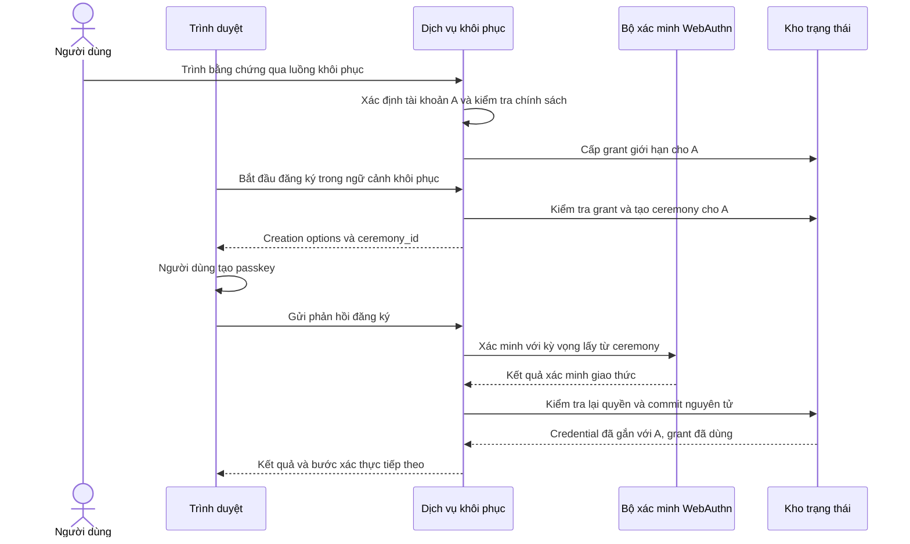

# Gắn passkey đúng tài khoản trong luồng khôi phục

## 1. Account binding là quyết định cấp quyền truy cập về sau

Trong chương **Passkey Recovery**, **Passkey account binding** là việc thiết lập liên kết giữa một credential passkey và đúng tài khoản tại dịch vụ. Sau khi liên kết được chấp nhận, những lần xác thực hợp lệ bằng credential đó có thể tạo quyền truy cập cho tài khoản tương ứng.

Trong phạm vi `SECURITY_AUTHENTICATION_ACCOUNT_RECOVERY`, đây là điểm nối giữa **chứng minh quyền khôi phục** và **cấp một phương thức xác thực mới**. Người dùng có thể đã mất mật khẩu, MFA, passkey hoặc thiết bị cũ, nhưng hệ thống vẫn phải trả lời được hai câu hỏi riêng:

1. Người đang thực hiện có đủ quyền thay phương thức xác thực cho tài khoản này không?
2. Credential mới có được đăng ký, lưu và sử dụng trong đúng ngữ cảnh tài khoản đã được cấp quyền không?

Ví dụ, Mai khôi phục tài khoản A sau khi mất điện thoại. Máy chủ xác minh bằng chứng cho A, nhưng endpoint hoàn tất lại lấy `accountId` từ request. Đối thủ sửa request để gắn credential do mình kiểm soát vào tài khoản B. Dù phản hồi đăng ký vượt qua kiểm tra giao thức, quyết định gắn credential vào B vẫn sai vì quyền khôi phục chỉ dành cho A.

Một lỗi khác xảy ra ngay trong trình duyệt của Mai: tab khôi phục đang xử lý A, còn một tab khác đã đăng nhập B. Nếu máy chủ dùng “tài khoản hiện tại” trong cookie để chọn đích ở bước cuối, credential có thể bị gắn nhầm mà người dùng không nhận ra.

Các mô hình dữ liệu và luồng trong bài là **thiết kế tham khảo**. Chúng minh họa cách giữ nguyên tài khoản đích, kiểm soát token dùng một lần, xử lý cạnh tranh và giới hạn session; không phải API có sẵn hoặc cấu hình bảo đảm an toàn cho mọi sản phẩm.

## 2. Phân biệt các định danh trước khi thiết kế

### 2.1. Không có một trường ID duy nhất thay cho mọi quan hệ

| Thành phần | Vai trò trong thiết kế | Không tự chứng minh điều gì |
|---|---|---|
| `account_id` | Định danh tài khoản nội bộ | Người gửi biết ID có quyền sửa tài khoản |
| `identity_scope_id` | Miền danh tính mà tài khoản thuộc về | Một tenant do client chọn là tenant được phép |
| RP ID | Phạm vi relying party của credential | Credential thuộc người dùng hay tenant cụ thể nào |
| `credential_id` | Tra cứu bản ghi credential | Người biết ID giữ được khóa riêng |
| `public_key` | Kiểm tra assertion theo giao thức | Việc gắn khóa vào tài khoản ban đầu đã được cấp quyền |
| `user_handle` | Liên kết danh tính WebAuthn với tài khoản phía RP | Chuỗi handle tự nó là bằng chứng đăng nhập |
| `recovery_transaction_id` | Theo dõi một giao dịch khôi phục | Người biết mã giao dịch được cấp quyền khôi phục |
| `ceremony_id` | Tra cứu một lần đăng ký hoặc xác thực | Ceremony đó đang còn hiệu lực và đúng mục đích |

Một dịch vụ có thể dùng định danh khác với bảng trên. Điều cần giữ là quan hệ và nguồn tin cậy của từng giá trị, không phải tên cột.

### 2.2. Tài khoản tại dịch vụ khác với tài khoản nhà cung cấp passkey

Mai có thể dùng một trình quản lý để lưu passkey cho nhiều tài khoản và nhiều dịch vụ. Tài khoản đăng nhập vào trình quản lý không mặc nhiên là tài khoản đích tại RP.

Trong thiết kế của dịch vụ, không thực hiện các suy luận sau:

- Email của nhà cung cấp giống email hồ sơ nên được phép gắn credential.
- Máy có tên giống thiết bị cũ nên credential mới thuộc chủ tài khoản.
- Passkey xuất hiện lại sau đồng bộ nên một liên kết đã bị thu hồi được tự hoạt động lại.
- Cùng trình quản lý passkey nên có thể chuyển credential giữa hai tài khoản nội bộ.

Nếu người dùng phục hồi được passkey cũ qua nhà cung cấp, RP vẫn cần xác thực credential còn được phép. Nếu phải tạo credential mới, quyền gắn mới cần được cấp từ ngữ cảnh tài khoản tại RP.

## 3. User handle ổn định, tên hiển thị có thể thay đổi

### 3.1. Thiết kế một định danh riêng cho WebAuthn

WebAuthn quy định `user.id` là chuỗi byte dài từ 1 đến 64 byte. Đây là user handle, không phải tên để hiển thị. [W3C — User account parameters](https://www.w3.org/TR/webauthn-3/#dictdef-publickeycredentialuserentity).

Một cách triển khai tham khảo là sinh ngẫu nhiên 32 byte khi tạo danh tính WebAuthn, rồi lưu ổn định cho tài khoản trong RP đó. Con số 32 byte ở đây là lựa chọn của ví dụ.

```text
rp_id = login.example.test
identity_scope_id = customer-main
account_id = A-1842
user_handle = <32 byte ngẫu nhiên, đã lưu>

credential C1 -> danh tính WebAuthn của A-1842
credential C2 -> cùng danh tính WebAuthn của A-1842
```

Handle không cần chứa email, số điện thoại, mã nhân viên hoặc thông tin hồ sơ có thể đổi. Không sinh một handle mới mỗi lần thêm passkey cho cùng danh tính, và không cấp handle của tài khoản đã xóa cho tài khoản khác.

MDN mô tả `userHandle` trong assertion là định danh opaque có nguồn từ `user.id` lúc tạo credential; dữ liệu này không dành cho người đọc và không nên chứa thông tin nhận dạng cá nhân. [MDN — AuthenticatorAssertionResponse.userHandle](https://developer.mozilla.org/en-US/docs/Web/API/AuthenticatorAssertionResponse/userHandle).

### 3.2. Không chọn chủ tài khoản từ tên trong hộp chọn passkey

Các trường `user.name` và `user.displayName` giúp người dùng phân biệt tài khoản khi tương tác. Chúng không thay cho bản ghi định danh phía máy chủ. [MDN — Creation options](https://developer.mozilla.org/en-US/docs/Web/API/PublicKeyCredentialCreationOptions#user).

Giả sử Mai đổi email từ `mai-old@example.test` sang `mai-new@example.test`. Thiết kế nên giữ nguyên `account_id` và handle, rồi xử lý nhãn hiển thị theo khả năng hỗ trợ. Không tìm hoặc tạo tài khoản mới từ email cũ còn xuất hiện trong giao diện authenticator.

Handle cũng không phải bí mật dùng để khôi phục. Đối thủ biết handle không được quyền đăng ký credential mới, giống như biết mã khách hàng không được quyền thay khóa đăng nhập của khách hàng đó.

## 4. Tách quyền gắn credential khỏi kết quả đăng ký

### 4.1. Đang đăng nhập chưa chắc đủ quyền thêm passkey

Một session có thể được tạo từ lâu, có mức xác thực chưa phù hợp hoặc đang bị đối thủ sử dụng. Nếu chỉ cần session đó là được thêm passkey, cookie bị đánh cắp có thể trở thành quyền truy cập lâu dài.

OWASP khuyến nghị xem đăng ký passkey là thay đổi tài khoản nhạy cảm, xác thực lại phù hợp và ràng buộc ceremony với tài khoản dự định ở phía máy chủ. [OWASP — Authorized account context](https://cheatsheetseries.owasp.org/cheatsheets/Passkey_Security_Cheat_Sheet.html#establish-an-authorized-account-context).

Trong ứng dụng tham khảo, quyền gắn có thể đến từ:

| Ngữ cảnh | Điều kiện trước khi bắt đầu | Phạm vi kết quả |
|---|---|---|
| Thêm passkey khi còn phương thức an toàn | Xác thực lại đáp ứng chính sách quản lý phương thức | Thêm credential cho chính tài khoản đã xác thực |
| Khôi phục khi không còn phương thức cần thiết | Bằng chứng khôi phục đã được chấp nhận cho tài khoản đích | Grant giới hạn để đăng ký credential thay thế |
| Tạo tài khoản mới | Giao dịch tạo tài khoản đã xác định đúng danh tính đích | Gắn credential cho tài khoản vừa tạo |
| Hỗ trợ hoặc quản trị | Quy trình riêng, quyền thao tác rõ, có kiểm soát và audit | Hành động cụ thể được phê duyệt trong phạm vi được giao |

Không trộn các ngữ cảnh chỉ vì chúng cùng gọi `navigator.credentials.create()`. Quyền nguồn của một luồng tạo tài khoản mới không được dùng để ghi vào tài khoản đã tồn tại.

### 4.2. Khi mất mọi phương thức, quyền phải đến từ khôi phục

NIST mô tả khôi phục tài khoản là lấy lại khả năng truy cập sau khi mất quyền kiểm soát authenticator cần thiết; khi hoàn tất, người dùng có thể gắn authenticator mới. [NIST — Account recovery](https://pages.nist.gov/800-63-4/sp800-63b.html#account-recovery).

Điều này không có nghĩa một OTP bất kỳ luôn đủ quyền thay passkey. Dịch vụ cần xác định bộ bằng chứng phù hợp với tài khoản, rủi ro và cách tài khoản đã được thiết lập. Nếu chưa đủ bằng chứng, việc người yêu cầu có thể tạo một passkey mới trên máy của mình không giải quyết được khoảng thiếu đó.

Ví dụ, thao tác vân tay khi tạo credential mới diễn ra với thiết bị đang được dùng. Nó không tự đối chiếu người đang chạm cảm biến với chủ tài khoản lịch sử của Mai. Luồng khôi phục vẫn phải chịu trách nhiệm về mối liên hệ đó.

## 5. Các bất biến của một liên kết an toàn

Thiết kế tham khảo dưới đây giữ các bất biến sau trong toàn bộ giao dịch:

1. **Một tài khoản đích:** account và miền danh tính được quyết định khi cấp quyền, không đổi ở callback.
2. **Một mục đích:** quyền `ENROLL_REPLACEMENT_PASSKEY` không tự dùng để đổi email, gỡ MFA hoặc hợp nhất tài khoản.
3. **Một ngữ cảnh đăng ký:** challenge gắn với grant, ceremony, RP và chính sách xác minh cụ thể.
4. **Một chủ cho mỗi credential trong RP:** không chuyển một credential đã đăng ký sang tài khoản khác để xử lý trùng.
5. **Một lần hoàn tất:** một grant không tạo nhiều kết quả liên kết qua retry hoặc request đồng thời.
6. **Trạng thái nguồn còn hợp lệ:** quyền bị hủy, tài khoản bị khóa hoặc phiên bản bảo mật thay đổi phải được xét lại trước commit.
7. **Session được cấp theo chính sách:** ghi được credential không tự cấp mọi quyền nghiệp vụ.
8. **Có thể truy vết:** hệ thống ghi nhận credential được gắn do xác thực lại, khôi phục hay một quy trình được phép khác.

Các bất biến này giúp nhận diện lỗi mà một phép kiểm tra chữ ký đơn lẻ không phát hiện được. Ví dụ, request có thể đúng challenge và đúng origin nhưng vẫn không được hoàn tất nếu grant đã bị người dùng hủy trước đó.

## 6. Mô hình dữ liệu tham khảo

### 6.1. Tách danh tính, credential và giao dịch

```text
account
  identity_scope_id
  account_id
  status
  security_version

webauthn_identity
  rp_id
  user_handle_bytes
  identity_scope_id
  account_id

passkey_credential
  rp_id
  credential_id_bytes
  user_handle_bytes
  public_key_cose
  status
  created_at
  binding_source
  binding_transaction_id
  verifier_metadata

recovery_grant
  grant_id
  token_digest_if_client_presented
  identity_scope_id
  account_id
  rp_id
  purpose
  evidence_reference
  expected_security_version
  recovery_context_id
  status
  expires_at
  consumed_at

registration_ceremony
  ceremony_id
  grant_id
  challenge_bytes
  expected_user_handle_bytes
  recovery_context_id
  verification_policy_version
  status
  expires_at
  result_credential_id_bytes
  completion_fingerprint
```

`verifier_metadata` đại diện cho dữ liệu mà thư viện và chính sách thực tế cần; không nên hiểu đây là một cột JSON tùy ý thay cho việc mô hình hóa các thuộc tính cần truy vấn hoặc ràng buộc.

Grant có thể chỉ là trạng thái máy chủ. Nếu client phải trình một token, token đó cần bí mật đủ mạnh, thời hạn, kiểm soát sử dụng và cơ chế tra cứu an toàn; không dùng riêng `grant_id` công khai như một bearer secret.

### 6.2. Ràng buộc duy nhất phải có đúng phạm vi

Với mô hình một RP chứa nhiều tài khoản, có thể dùng các ràng buộc logic:

```text
UNIQUE webauthn_identity(rp_id, user_handle_bytes)
UNIQUE webauthn_identity(rp_id, identity_scope_id, account_id)
UNIQUE passkey_credential(rp_id, credential_id_bytes)

passkey_credential(rp_id, user_handle_bytes)
  REFERENCES webauthn_identity(rp_id, user_handle_bytes)
```

Bản ghi credential trỏ tới danh tính WebAuthn; tài khoản được suy ra qua liên kết đó. Nếu triển khai lưu lặp cả `account_id` trong credential để truy vấn nhanh, cần thêm ràng buộc nhất quán để hai đường không trỏ sang hai chủ khác nhau.

Chỉ đặt `UNIQUE(account_id, credential_id)` là chưa đủ cho mô hình này: nó vẫn cho phép cùng credential xuất hiện dưới A và B. Cũng cần so sánh ID theo byte hoặc biểu diễn chuẩn hóa, tránh hai chuỗi base64 khác hình thức trở thành hai bản ghi cho cùng dữ liệu.

### 6.3. Không dùng upsert để đổi chủ credential

Một thao tác như sau rất nguy hiểm:

```sql
-- Phản ví dụ: lỗi trùng có thể biến thành chuyển chủ credential.
INSERT INTO passkey_credential (...)
VALUES (...)
ON CONFLICT (rp_id, credential_id_bytes)
DO UPDATE SET user_handle_bytes = EXCLUDED.user_handle_bytes;
```

Khi trùng, hệ thống cần phân biệt retry của kết quả đã commit với một đăng ký mới không hợp lệ. Không đổi chủ hoặc thay public key của bản ghi cũ để “cho người dùng tiếp tục”.

Việc hợp nhất tài khoản hoặc di chuyển danh tính là nghiệp vụ riêng, cần quyền và quy tắc riêng. Nó không phải cách sửa nhanh một lỗi đăng ký passkey.

## 7. Luồng gắn passkey sau khi đủ bằng chứng khôi phục

### 7.1. Quyền nguồn đi trước ceremony



Trong sơ đồ, bằng chứng khôi phục không được chuyển thành quyền tùy ý trên mọi tài khoản. Grant chỉ cho hành động đã định, và ceremony kế thừa tài khoản từ grant.

Một request bắt đầu có thể chỉ cần:

```json
{
  "recoveryTransactionId": "R-93",
  "action": "ENROLL_REPLACEMENT_PASSKEY"
}
```

Máy chủ xác minh quyền truy cập giao dịch R-93 từ ngữ cảnh bảo mật đã thiết lập. Biết mã R-93, sửa `action` trong JSON hoặc tự thêm `accountId` không cấp thêm quyền.

### 7.2. Creation options lấy thông tin đích từ máy chủ

Ví dụ dưới đây chỉ minh họa các trường chính ở dạng truyền JSON:

```json
{
  "ceremonyId": "REG-71",
  "publicKey": {
    "challenge": "<base64url của challenge ngẫu nhiên>",
    "rp": {
      "id": "login.example.test",
      "name": "Example Learning"
    },
    "user": {
      "id": "<base64url của user handle đã lưu cho A>",
      "name": "mai@example.test",
      "displayName": "Mai"
    },
    "pubKeyCredParams": [
      { "type": "public-key", "alg": -7 },
      { "type": "public-key", "alg": -257 }
    ],
    "authenticatorSelection": {
      "residentKey": "required",
      "userVerification": "required"
    },
    "attestation": "none"
  }
}
```

Trước khi gọi API trình duyệt, các giá trị nhị phân cần được chuyển về kiểu dữ liệu mà API yêu cầu bằng cơ chế chuyển đổi được hỗ trợ. Danh sách thuật toán là ví dụ, phải khớp với cấu hình verifier thực tế. `residentKey`, `userVerification` và `attestation` là những lựa chọn khác nhau trong creation options. [MDN — PublicKeyCredentialCreationOptions](https://developer.mozilla.org/en-US/docs/Web/API/PublicKeyCredentialCreationOptions).

Trong luồng tham khảo này, chủ động yêu cầu UV để đăng ký credential thay thế. Không suy ra danh tính lịch sử của người dùng chỉ từ việc tùy chọn đó được đáp ứng.

Nếu tài khoản dùng nhiều passkey, server có thể đưa credential phù hợp vào `excludeCredentials`. Đây không phải ràng buộc duy nhất tại cơ sở dữ liệu, cũng không phải cơ chế cấp quyền hoặc chống chuyển chủ.

### 7.3. Lưu đủ kỳ vọng cho lần hoàn tất

Một ceremony cần lưu hoặc ràng buộc có thể kiểm chứng:

```text
ceremony_id = REG-71
type = PASSKEY_REGISTRATION
grant_id = G-28
target = (customer-main, A-1842)
rp_id = login.example.test
expected_user_handle = handle của A-1842
expected_origin_policy = web-recovery-v3
verification_policy_version = 12
challenge = 32 byte ngẫu nhiên
recovery_context_id = RC-8
expected_security_version = 17
expires_at = thời điểm do máy chủ quyết định
status = PENDING
```

Độ dài challenge 32 byte là lựa chọn minh họa. Thời hạn nên đủ ngắn theo mô hình rủi ro và khả năng thao tác; không lấy timestamp do client gửi làm quyết định hết hạn.

Không chỉ lưu challenge vào một biến toàn cục kiểu `session.lastChallenge`. Hai tab có thể ghi đè nhau, và bước hoàn tất có thể vô tình dùng challenge của lần đăng nhập thay cho lần đăng ký.

Nếu dùng state được ký thay cho một số cột máy chủ, vẫn cần cơ chế quản lý hủy, dùng một lần và thay đổi trạng thái bảo mật. Chữ ký của state không tự ngăn một token hợp lệ bị phát lại.

## 8. Xác minh giao thức và kiểm tra quyền là hai lớp

### 8.1. Dùng verifier với kỳ vọng do máy chủ quyết định

OWASP khuyến nghị dùng thư viện WebAuthn được duy trì, còn ứng dụng chịu trách nhiệm về challenge, ngữ cảnh tài khoản, session và vòng đời credential. [OWASP — Use a maintained library](https://cheatsheetseries.owasp.org/cheatsheets/Passkey_Security_Cheat_Sheet.html#use-a-maintained-library).

Trong kiến trúc tham khảo, bộ xác minh nhận phản hồi cùng cấu hình đã lưu: loại ceremony, challenge, origin được phép, RP ID, chính sách UV, thuật toán và attestation. Ứng dụng không nhận một cờ `verified=true` do client tự gửi để thay kết quả verifier.

Cũng không lấy `expectedOrigin` hoặc `expectedRpId` từ request hoàn tất. Nếu client tự chọn cả dữ liệu cần kiểm tra lẫn giá trị kỳ vọng, kiểm tra mất ý nghĩa.

Với attestation `none`, không giả định mọi đăng ký đều có chữ ký của khóa riêng credential mới để chứng minh sở hữu. Nếu cần xác nhận sử dụng credential, có thể yêu cầu một assertion mới sau đăng ký. [W3C — Registration verification](https://www.w3.org/TR/webauthn-3/#sctn-registering-a-new-credential).

### 8.2. Callback không được chọn lại tài khoản

Một callback tham khảo có dạng:

```text
POST /recovery/passkeys/registration/finish

{
  ceremonyId,
  credentialResponse
}
```

Nếu API có thêm ID tài khoản phục vụ điều hướng, ID đó chỉ được đối chiếu với ngữ cảnh đã cấp quyền; không dùng nó để thay tài khoản đích.

Những giá trị sau không được dùng như bằng chứng chọn chủ credential:

- Email vừa nhập lại trên màn hình hoàn tất.
- `accountId`, `tenantId` hoặc `userHandle` do client tự thêm.
- Tên passkey hoặc tên thiết bị người dùng đặt.
- Tài khoản đăng nhập ở một tab khác.
- Thông tin “đã xác minh nhà cung cấp” không được RP kiểm chứng.

Phản hồi đăng ký không phải một bản xác nhận danh tính chứa mọi trường `user` ban đầu. Máy chủ phải giữ handle kỳ vọng trong state của mình, không chờ một trường `user.id` do client gửi lại để quyết định liên kết.

### 8.3. Bảo vệ cả điểm bắt đầu lẫn hoàn tất

Một đối thủ có thể lừa trình duyệt đã đăng nhập bắt đầu thay phương thức hoặc hoàn tất một giao dịch không mong muốn. Luồng cần cơ chế chống CSRF phù hợp, cookie và session được cấu hình đúng, cùng kiểm soát origin ở tầng ứng dụng.

WebAuthn origin verification bảo vệ ceremony theo giao thức; nó không thay mọi kiểm soát đối với endpoint quản lý tài khoản. Tương tự, một trang có XSS có thể thao túng luồng ngay trên origin hợp lệ.

Giới hạn tốc độ cần xét cả cấp grant, phát challenge và thử hoàn tất. Khi thất bại, không ghi credential trước rồi hy vọng một tác vụ dọn dẹp sẽ xử lý bản ghi sai.

## 9. Commit liên kết và tiêu thụ quyền trong cùng ranh giới nhất quán

### 9.1. Kiểm tra đầu luồng không thay kiểm tra trước commit

Giả sử grant được cấp khi `security_version=17`. Trước lúc callback tới, chủ tài khoản báo bị chiếm và hệ thống tăng phiên bản lên 18. Challenge có thể chưa hết hạn, nhưng quyền gắn mới ở phiên bản 17 không còn đủ để hoàn tất.

Với mô hình này, kiểm tra grant và ceremony cần được lặp lại trong ranh giới giao dịch nơi credential được ghi. Nếu có nhiều instance ứng dụng, trạng thái “đã dùng” phải có hiệu lực giữa các instance; biến trong bộ nhớ của một process không đủ.

### 9.2. Pseudocode cho đường hoàn tất

```text
finishRegistration(request, recoveryContext):
    ceremony = loadCeremony(request.ceremonyId)
    requireAuthorizedRecoveryContext(recoveryContext, ceremony)
    requirePendingAndUnexpired(ceremony)

    candidate = webAuthnVerifier.verifyRegistration(
        request.credentialResponse,
        expectedParametersFrom(ceremony)
    )

    transaction:
        account = lockTargetAccount(ceremony.target)
        grant = lockGrant(ceremony.grantId)
        current = lockCeremony(ceremony.id)

        requireAuthorizedRecoveryContext(recoveryContext, current)

        if current.status == COMMITTED:
            requireSameAuthorizedContextAndCompletion(request, current)
            return previouslyCommittedResult(current)

        requirePendingAndUnexpired(current)
        requireGrantActiveForExactPurposeAndTarget(grant, current)
        requireGrantAndCeremonyStillMatchSecurityState(account)
        requireCurrentPolicyStillAllowsCompletion(account, grant, current)
        requireNoCredentialConflict(current.rpId, candidate.credentialId)

        insertCredential(
            rpId = current.rpId,
            userHandle = current.expectedUserHandle,
            credential = candidate,
            source = RECOVERY,
            transactionId = grant.recoveryTransactionId
        )

        consumeGrant(grant)
        commitCeremonyWithResult(current, candidate)
        advanceRelevantSecurityVersion(account)
        appendAuditAndNotificationOutbox(account, grant, candidate)

    return committedResultWithoutAutomaticallyGrantingFullSession()
```

Đây là pseudocode, không phải mã thư viện. Các hàm `require...` cần được hiện thực bằng kiểm tra cụ thể; việc khóa hàng, kiểm tra phiên bản và cách ly giao dịch phụ thuộc cơ sở dữ liệu.

Nếu kiểm tra chống trùng và insert tách rời, hai request vẫn có thể vượt qua cùng một phép kiểm tra. Vì vậy, ngoài kiểm tra ứng dụng, cần ràng buộc duy nhất tại nơi ghi. Tất cả tác động trong transaction phải rollback nếu ghi credential hoặc tiêu thụ grant thất bại.

Nhánh `COMMITTED` bên trong transaction phục vụ request đã vượt kiểm tra ban đầu nhưng thua một request khác trong cuộc đua. Request retry tới sau khi state đã commit có thể cần một đường trả kết quả riêng có cùng kiểm soát quyền và đối chiếu kết quả.

### 9.3. Retry không được biến thành đăng ký thứ hai

Nếu server đã commit nhưng response bị mất, retry được phép trả lại kết quả đã có khi:

1. Client vẫn chứng minh được quyền xem kết quả của đúng giao dịch.
2. Ceremony và dữ liệu hoàn tất tương ứng với kết quả đã ghi.
3. Response trả lại không tự phát thêm grant hoặc session đầy đủ.

Có thể lưu fingerprint của dữ liệu hoàn tất đã chuẩn hóa hoặc một tham chiếu kết quả phù hợp. Không chỉ tin một `Idempotency-Key` bất kỳ mà client tự đặt.

Với hai ceremony khác nhau dùng cùng grant, thiết kế ví dụ chỉ cho một kết quả liên kết. Ceremony thua cuộc phải dừng; không cấp lại grant từ callback để cố làm cả hai thành công.

### 9.4. Thông báo có thể gửi sau commit, ý định gửi phải được giữ

Gửi email trong transaction dễ tạo tình huống email đã gửi nhưng dữ liệu rollback, hoặc dữ liệu commit mà thông báo thất lạc. Một cách thiết kế là ghi outbox cùng transaction, rồi worker vận hành gửi và retry theo event ID.

Tăng `security_version` ở ví dụ nhằm vô hiệu hóa quyền thay đổi cũ theo chính sách. Không giả định tăng một cột sẽ tự thu hồi mọi cookie và refresh token; cơ chế kiểm tra session phải được thiết kế và tích hợp riêng.

## 10. Giữ đúng tài khoản trong lần xác thực bằng passkey

### 10.1. Hai kiểu xác định tài khoản

Sau khi gắn credential, máy chủ còn phải tránh chọn sai tài khoản khi nhận assertion.

| Ngữ cảnh xác thực | Quan hệ cần được kiểm tra |
|---|---|
| Đã xác định tài khoản trước ceremony | Credential thuộc tài khoản đó; nếu có `userHandle`, handle phải khớp |
| Chưa xác định tài khoản trước ceremony | Phải có `userHandle`; handle và credential cùng trỏ tới một tài khoản |

Đó là yêu cầu trong quy trình xác minh assertion của WebAuthn. [W3C — Verifying an authentication assertion](https://www.w3.org/TR/webauthn-3/#sctn-verifying-assertion).

Các kiểm tra này đi cùng xác minh assertion, không thay chữ ký, challenge hoặc trạng thái credential. Không cấp session chỉ vì tra được handle tồn tại.

`allowCredentials` có thể giới hạn danh sách credential được yêu cầu. Nếu không giới hạn danh sách này, hộp chọn có thể cho người dùng chọn credential khác với tài khoản họ đang nghĩ tới. [MDN — Request options](https://developer.mozilla.org/en-US/docs/Web/API/PublicKeyCredentialRequestOptions#allowcredentials).

### 10.2. Xác thực đúng B không được hoàn tất khôi phục A

Giả sử Mai đang khôi phục A nhưng chọn passkey của B trong hộp chọn. Assertion cho B có thể hoàn toàn hợp lệ.

Nếu mục đích ceremony là kiểm tra credential mới của A, hệ thống phải đối chiếu với A và credential đã được gắn trong giao dịch. Kết quả cho B không được dùng để đánh dấu A đã khôi phục hoặc phát session A.

Ngược lại, một luồng đăng nhập thông thường có thể cho đăng nhập B sau khi xác minh đúng chính sách của B. Đó là một hành động riêng, cần hiển thị đúng kết quả và không âm thầm chuyển trạng thái giao dịch khôi phục A.

### 10.3. Không chấp nhận credential đã thu hồi chỉ vì vẫn có bản sao

Trong thiết kế tham khảo, verifier tra cứu bản ghi và kiểm tra trạng thái cho phép trước khi cấp quyền. Credential còn trong trình quản lý, còn tạo được chữ ký hoặc còn hiển thị tên tài khoản không làm mất hiệu lực quyết định thu hồi của RP.

Một bản sao đồng bộ của cùng credential không phải một liên kết tài khoản mới. Không tạo một chủ tài khoản khác cho mỗi lần thấy credential từ thiết bị mới.

## 11. Nhiều tenant, đổi email và vòng đời tài khoản

### 11.1. RP ID chung không tự tạo cách ly tenant

Giả sử hai tổ chức cùng sử dụng RP `login.example.test`:

```text
Tổ chức Bắc:
  identity_scope_id = north
  account_id = 42
  user_handle = H-N

Tổ chức Nam:
  identity_scope_id = south
  account_id = 42
  user_handle = H-S
```

Hai `account_id` trùng số vẫn là hai tài khoản khác nhau. Grant phải giữ đủ miền danh tính và tài khoản; callback không được đổi `north` thành `south` bằng một trường request.

Trong mô hình này, H-N và H-S khác nhau và duy nhất trong RP chung. Nếu chỉ sinh handle từ ID cục bộ `42`, đăng nhập không nhập tên có thể mất khả năng phân biệt hai danh tính.

Nếu hệ thống dùng **một danh tính toàn cục với nhiều membership tổ chức**, mô hình cần phản ánh điều đó: passkey gắn với danh tính toàn cục, còn quyền vào từng tổ chức được kiểm tra bằng membership hiện hành. Không mặc định một thiết kế tài khoản riêng cho tenant rồi lại dùng chung handle như mô hình danh tính toàn cục.

### 11.2. Tenant từ URL không đủ cấp quyền

Tên miền, đường dẫn hoặc màn hình chọn tổ chức có thể giúp định tuyến. Chúng phải được đối chiếu với đích của grant và cấu hình máy chủ.

Ví dụ, trang hiển thị tổ chức Nam nhưng grant chỉ cho tài khoản ở Bắc thì luồng phải dừng hoặc yêu cầu bắt đầu một giao dịch được cấp quyền mới. Không đổi tài khoản trong state để “khớp giao diện”.

Nếu các tenant dùng RP ID riêng, credential của RP này không được tự coi là credential của RP khác. Di chuyển miền đăng nhập hoặc thay RP ID cần thiết kế riêng; khôi phục không phải quyền bỏ qua ranh giới RP.

### 11.3. Không nối lại tài khoản qua email đã tái sử dụng

Trong một hệ thống tổ chức, nhân viên cũ rời đi và địa chỉ email được cấp cho người mới. Nếu tài khoản mới dùng lại handle hoặc tự nhận credential cũ theo email, quyền của người cũ có thể bị nối sang người mới.

Thiết kế cần dựa vào định danh tài khoản bất biến và vòng đời danh tính:

- Đổi email của cùng một tài khoản không tự đổi chủ credential.
- Tạo tài khoản mới cho người khác không kế thừa passkey theo email trùng.
- Khôi phục một tài khoản đã đóng cần chính sách riêng, không tự mở lại vì hộp thư nhận được OTP.
- Hợp nhất hoặc chia tài khoản cần xử lý phương thức xác thực bằng luồng được cấp quyền riêng.

## 12. Các lỗi tấn công và lỗi thao tác thường gặp

### 12.1. Đổi đích qua request hoàn tất

Đối thủ có grant hợp lệ cho tài khoản của mình, rồi gửi callback với `accountId` của nạn nhân.

Cách bảo vệ trong mô hình bài học là không dùng ID từ callback làm đích. Nếu API vẫn nhận ID để đối chiếu, sai đích phải bị từ chối trước khi ghi dữ liệu; không thử “sửa” grant sang tài khoản được yêu cầu.

### 12.2. Lừa người dùng tạo passkey cho tài khoản đối thủ

Đối thủ có thể dẫn nạn nhân tới một giao dịch đăng ký đang nhắm vào tài khoản của đối thủ. Người dùng tưởng đang khôi phục tài khoản của mình nhưng lại tạo credential liên kết với tài khoản khác.

Trước thao tác nhạy cảm, giao diện trong ngữ cảnh đã được cấp quyền nên cho biết dịch vụ, tài khoản và tổ chức đang được xử lý bằng thông tin đủ phân biệt. Nếu người dùng nhận thấy sai đích, họ cần dừng và bắt đầu lại theo luồng xác minh phù hợp.

Chỉ hiển thị tên tài khoản không đủ chống mọi hình thức lừa đảo. Nó cần đi cùng ngữ cảnh trình duyệt hợp lệ, chống CSRF và kiểm tra đích bất biến phía server. Ở điểm vào công khai chưa xác minh, không tiết lộ danh sách credential hoặc thông tin tài khoản chỉ để giúp chọn đích.

### 12.3. Trộn ceremony giữa hai tab

Tab 1 bắt đầu khôi phục A; tab 2 bắt đầu thêm passkey cho B. Một callback từ tab 1 không được sử dụng “ceremony mới nhất” của tab 2.

Mỗi ceremony cần ID riêng, mục đích riêng và tham chiếu ngữ cảnh được kiểm tra ở phía máy chủ. Nếu cookie thay đổi khiến ngữ cảnh không còn tương thích, hệ thống yêu cầu tiếp tục bằng một đường an toàn; không tự chọn B vì B vừa đăng nhập gần nhất.

### 12.4. Dùng lại grant sau khi chủ tài khoản đã phản đối

Mai nhận thông báo thay phương thức và báo giao dịch không phải của mình. Hệ thống đã hủy grant nhưng callback cũ vẫn đang được xử lý trên một instance khác.

Nếu instance đó chỉ tin kết quả kiểm tra trước khi xác minh WebAuthn, credential có thể vẫn được ghi. Kiểm tra trạng thái hiện hành trong transaction và cơ chế đồng bộ phiên bản giúp chặn bước hoàn tất này.

Khả năng ngăn callback không đồng nghĩa mọi quyền đã bị đối thủ lấy trước đó đều được thu hồi. Cần xử lý riêng các credential hoặc session đã commit.

### 12.5. Xem một grant khôi phục là vé vào mọi chức năng

Đối thủ lấy được một quyền chỉ dành cho gắn credential nhưng dùng nó để gọi API đổi email, phát mã khôi phục mới hoặc quản lý session toàn tài khoản.

Ứng dụng cần kiểm tra mục đích tại từng endpoint và phân biệt principal của session khôi phục giới hạn với session người dùng đầy đủ. Chỉ dùng một cờ `loggedIn=true` cho cả hai loại sẽ làm mất ranh giới quyền.

## 13. Quyền sau liên kết và xử lý credential cũ

### 13.1. Có credential mới chưa đồng nghĩa có session đầy đủ

Sau commit, dịch vụ có thể yêu cầu assertion mới từ credential vừa gắn để xác nhận khả năng sử dụng. Ceremony xác nhận đó phải nhắm đúng tài khoản và, nếu cần, giới hạn đúng credential vừa tạo.

Một assertion thành công chứng minh khả năng sử dụng credential trong điều kiện được xác minh; nó không tự cải thiện chất lượng bằng chứng khôi phục đã dùng để cấp quyền gắn credential đó.

Ví dụ, chính sách của một hệ thống tài chính có thể tiếp tục giới hạn đổi người thụ hưởng sau khôi phục. Một hệ thống học tập có thể áp dụng chính sách khác. Không áp một thời gian chờ hoặc mức quyền cố định cho mọi dịch vụ chỉ vì cả hai cùng dùng passkey.

### 13.2. Giữ nguồn gốc của liên kết để quyết định quyền

Dữ liệu nguồn có thể bao gồm:

```text
binding_source = RECOVERY
recovery_transaction_id = R-93
evidence_policy_version = 9
registered_credential_id = C-77
registered_at = thời điểm commit
new_credential_confirmed_at = thời điểm assertion mới, nếu có
post_recovery_restrictions = chính sách đang áp dụng
```

Các giá trị này giúp dịch vụ phân biệt việc vừa xác thực bằng passkey mới với lịch sử cấp quyền tạo passkey. Không tự gán một mức bảo đảm chỉ từ nhãn `binding_source`; quyết định phải xét đầy đủ chính sách và giao dịch thực tế.

Khi cấp session tiếp theo, cần áp dụng chính sách xoay định danh session và bảo vệ cookie phù hợp. Không nâng session giới hạn thành session đầy đủ chỉ bằng cách sửa một thuộc tính phía client.

### 13.3. Xử lý credential và session bị ảnh hưởng theo phạm vi rõ ràng

Nếu C1 bị mất hoặc nghi bị đối thủ giữ, liên kết C2 mới không tự thu hồi C1. Dịch vụ cần quyết định riêng về C1, session đã phát từ C1 và các quyền khôi phục còn chờ.

Nếu C1 được đồng bộ thành nhiều bản sao, một quyết định thu hồi bản ghi C1 tại RP áp dụng cho credential đó. Không hứa chỉ ngăn một chiếc điện thoại khi RP không phân biệt được từng bản sao.

Cũng không xóa mọi credential còn an toàn chỉ vì vừa có một liên kết thay thế. Phạm vi ngăn chặn cần dựa trên bằng chứng sự cố và quyền thực hiện.

## 14. Khi phát hiện đã gắn nhầm tài khoản

Liên kết sai có thể do lỗi ứng dụng, dữ liệu di chuyển sai, thao tác hỗ trợ hoặc hành vi tấn công. Cách sửa không nên là thay trực tiếp `account_id` của credential trong cơ sở dữ liệu.

Một quy trình xử lý tham khảo:

1. Xác định credential, tài khoản, RP, giao dịch nguồn và phạm vi có thể bị ảnh hưởng; giới hạn quyền tra cứu hồ sơ sự cố.
2. Đình chỉ hoặc thu hồi liên kết không an toàn theo quyền và bằng chứng hiện có.
3. Rà soát session, refresh token và thay đổi tài khoản phát sinh từ liên kết đó.
4. Hủy các grant hoặc ceremony còn hiệu lực có liên quan tới ngữ cảnh sai.
5. Xác minh lại quyền đối với tài khoản cần khôi phục bằng luồng được chấp nhận.
6. Đăng ký một credential mới đúng đích và kiểm tra khả năng sử dụng.
7. Thông báo cho chủ thể phù hợp, đồng thời xử lý riêng dữ liệu hoặc hành động nghiệp vụ đã đi vào tài khoản sai.

Quy trình thực tế có thể cần ngăn chặn khẩn cấp hoặc thực hiện một số bước song song. Không trì hoãn xử lý quyền đã xác định là nguy hiểm chỉ để giữ đúng thứ tự minh họa.

Nhân viên hỗ trợ không cần thu thập private key, PIN, cookie hoặc mã khôi phục rõ để sửa liên kết. Họ cần công cụ giới hạn quyền, tham chiếu bằng chứng và khả năng yêu cầu người dùng thực hiện lại ceremony trên môi trường phù hợp.

## 15. Dữ liệu vận hành và tiêu chí kiểm chứng

### 15.1. Ghi sự kiện về quyết định liên kết

Một sự kiện `PASSKEY_BOUND` có thể ghi tài khoản nội bộ, miền danh tính, RP, tham chiếu credential, giao dịch khôi phục, loại quyền nguồn, thời điểm và phiên bản chính sách.

Không ghi token khôi phục nguyên bản, challenge response chứa dữ liệu không cần thiết, mã OTP, PIN, private key hoặc cookie phiên vào log. Credential ID và handle cũng là dữ liệu có thể liên kết hoạt động, cần giới hạn truy cập và thời gian lưu phù hợp.

Thông báo cho người dùng cần nói rõ có phương thức mới được gắn và cách báo sự cố qua kênh chính thức. Không đính kèm một đường “đổi lại chủ tài khoản” không cần xác minh.

NIST yêu cầu thông báo khi gắn authenticator mới và mô tả việc lưu các sự kiện quan trọng trong vòng đời authenticator. [NIST — Authenticator binding](https://pages.nist.gov/800-63-4/sp800-63b.html#authenticator-binding).

### 15.2. Các hành vi cần được kiểm chứng khi triển khai

| Tình huống | Hành vi mong đợi |
|---|---|
| Grant cấp cho A, callback tự khai B | Không gắn credential vào B |
| Hai tenant có cùng ID tài khoản cục bộ | Giữ đúng miền danh tính của grant |
| Người dùng đổi email nhưng giữ tài khoản | Không tạo chủ credential mới theo email |
| Email cũ được cấp cho một người khác | Không chuyển passkey hoặc handle của tài khoản cũ |
| Callback dùng ceremony đăng nhập thay ceremony đăng ký | Từ chối vì sai mục đích |
| Callback có challenge đúng nhưng grant đã hủy | Không commit |
| Tài khoản thay đổi trạng thái bảo mật trước commit | Kiểm tra lại, không hoàn tất bằng quyền cũ không còn hợp lệ |
| Hai callback đồng thời cho cùng grant | Có tối đa một kết quả liên kết được cấp quyền |
| Commit xong nhưng response bị mất | Retry trả lại kết quả hợp lệ, không thêm credential thứ hai |
| Credential ID đã thuộc tài khoản khác trong cùng RP | Không chuyển chủ hoặc ghi đè public key |
| Credential ID có hai cách mã hóa chuỗi | So sánh theo dữ liệu chuẩn, không tạo hai chủ |
| Người dùng chọn passkey B khi xác nhận khôi phục A | Không dùng kết quả B để hoàn tất A |
| Luồng không nhập tên trả handle và credential của hai tài khoản khác nhau | Không cấp session |
| Credential đã thu hồi vẫn tạo assertion hợp lệ về mật mã | Không chấp nhận như credential đang hoạt động |
| Đăng ký credential mới thành công | Chỉ cấp quyền tiếp theo theo chính sách session |
| Thông báo gửi lỗi sau commit | Có trạng thái gửi lại, không lặp thao tác liên kết |
| Phát hiện liên kết sai sau một số lần đăng nhập | Xử lý cả liên kết và quyền đã phát sinh |

Bảng trên mô tả tiêu chí cho hệ thống sẽ triển khai, không phải kết quả kiểm thử đã chạy.

Một hồ sơ hoàn tất liên kết cần trả lời được: credential nào, thuộc tài khoản và miền danh tính nào, trong RP nào, được gắn từ quyền nguồn nào, qua ceremony nào, đã tiêu thụ quyền khôi phục ra sao và còn những quyền nào phải xử lý sau sự cố. Nếu thiếu một mắt xích, việc tạo được passkey mới chưa đủ để kết luận quá trình khôi phục đã gắn đúng quyền cho đúng người.
