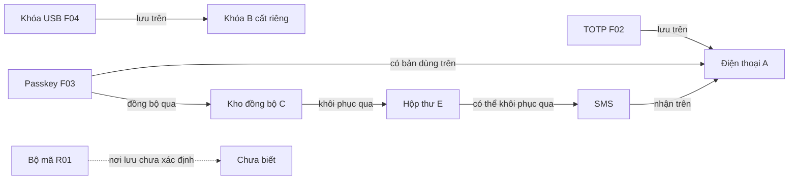
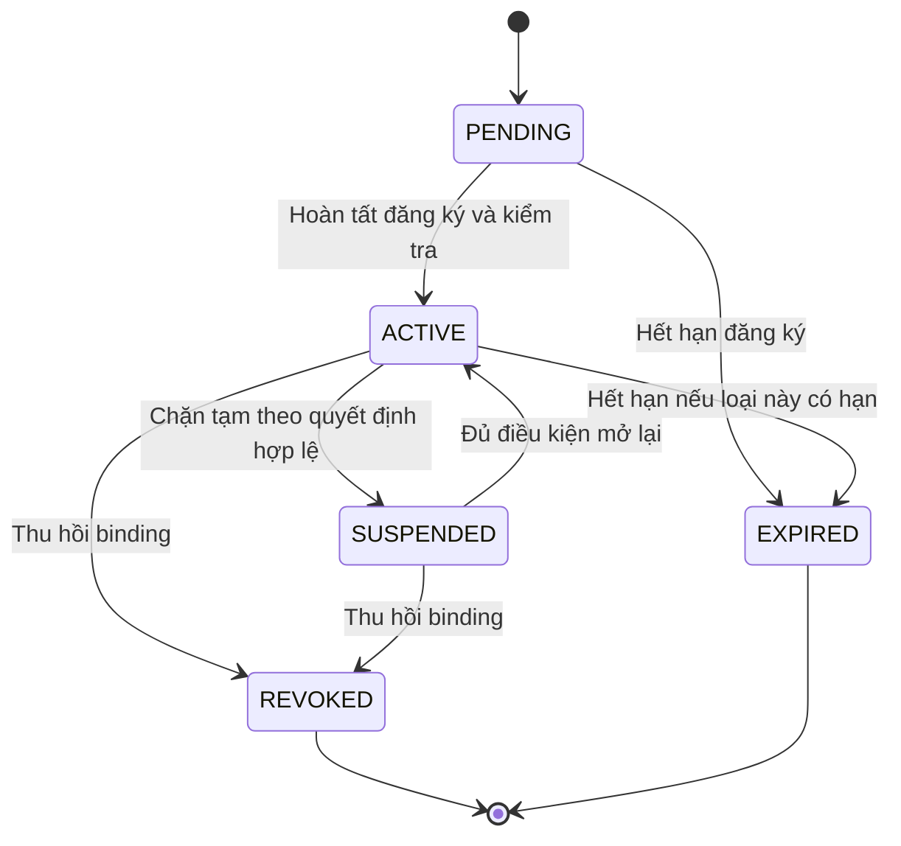

# MFA factor inventory: Kiểm kê phương tiện xác thực phục vụ khôi phục MFA

## 1. Mục tiêu và bối cảnh

Trong chương **MFA Recovery** của module `SECURITY_AUTHENTICATION_ACCOUNT_RECOVERY`, bài học này giải thích cách xây dựng **MFA factor inventory**: hồ sơ kiểm kê phương tiện xác thực và những phụ thuộc liên quan, dùng để quyết định cách khôi phục tài khoản khi người dùng mất MFA, passkey hoặc thiết bị.

Một cờ `mfaEnabled = true` chỉ nói rằng tài khoản đã bật MFA. Nó không cho biết người dùng còn dùng được phương tiện nào, phương tiện nào có thể bị kẻ khác kiểm soát, hay việc mất một chiếc điện thoại sẽ làm mất đồng thời bao nhiêu đường truy cập.

Ví dụ, một người có TOTP, SMS và passkey nhưng cả ba chỉ sử dụng được trên cùng chiếc điện thoại. Danh sách có ba mục, song mất điện thoại có thể làm cả ba cùng không khả dụng. Ngược lại, một khóa bảo mật dự phòng được giữ riêng có thể tạo ra đường truy cập hữu ích hơn nhiều so với thêm một phương thức vẫn phụ thuộc vào điện thoại đó.

Sau bài học, người học có thể:

- Phân biệt yếu tố xác thực, authenticator, credential, kênh khôi phục và session.
- Thiết kế dữ liệu kiểm kê có trạng thái, nguồn bằng chứng, thời điểm quan sát và lịch sử vòng đời.
- Nhận diện phụ thuộc chung về thiết bị, kho đồng bộ, số điện thoại và nhà cung cấp danh tính.
- Dùng inventory để đề xuất đường khôi phục, sau đó yêu cầu bằng chứng mới trước khi cấp quyền.
- Cập nhật inventory và kiểm soát session khi thay thế hoặc thu hồi phương tiện xác thực.

Các cấu trúc dữ liệu và chính sách bên dưới là **thiết kế minh họa của ứng dụng**. Chúng cần được điều chỉnh theo mô hình đe dọa và mức bảo đảm mà hệ thống yêu cầu.

## 2. Kiểm kê cái gì?

### 2.1. Những khái niệm dễ bị gộp chung

| Khái niệm | Ý nghĩa trong bài học | Ví dụ |
| --- | --- | --- |
| Yếu tố xác thực — authentication factor | Nhóm bằng chứng về điều người dùng biết, có hoặc là | Mật khẩu; quyền kiểm soát khóa; đặc điểm sinh trắc học |
| Phương tiện xác thực — authenticator | Phương tiện tạo hoặc trình bày bằng chứng xác thực | Ứng dụng TOTP, khóa bảo mật, authenticator tích hợp trên máy |
| Credential | Dữ liệu được gắn với tài khoản để hệ thống kiểm tra bằng chứng | Public key và credential ID của một đăng ký WebAuthn |
| Binding | Liên kết giữa tài khoản và authenticator/credential | Khóa bảo mật F04 được đăng ký cho tài khoản U123 |
| Kênh khôi phục | Đường hỗ trợ một chính sách khôi phục cụ thể | Địa chỉ nhận mã khôi phục đã đăng ký trước |
| Session | Trạng thái truy cập được tạo sau một lần xác thực | Phiên trình duyệt có thời điểm và phương thức xác thực |
| Tín hiệu rủi ro | Dữ liệu giúp điều chỉnh quyết định | Thiết bị mới, thay số điện thoại gần đây, tần suất thử mã |

Tên gọi “factor inventory” thường được dùng rộng hơn nghĩa chặt của “factor”. Trong triển khai, nên có bản ghi riêng cho từng binding hoặc credential, rồi liên kết các bản ghi với thiết bị và những tài nguyên phụ thuộc. Không tạo một danh sách lẫn lộn mà mọi dòng đều được tính như một yếu tố độc lập.

Hai mật khẩu không tạo ra hai nhóm yếu tố. Hai ứng dụng TOTP sao chép cùng seed cũng không tạo ra hai bí mật xác thực độc lập. Một authenticator có thể kết hợp quyền sở hữu khóa với cơ chế kích hoạt bằng PIN hoặc sinh trắc học; vì vậy số lượng dòng trong cơ sở dữ liệu cũng không quyết định một lần xác thực có đáp ứng MFA hay không.

### 2.2. Phân loại theo vai trò sử dụng

| Đối tượng | Thông tin inventory cần giữ | Giới hạn khi dùng cho recovery |
| --- | --- | --- |
| Mật khẩu | Binding đang hoạt động, thời điểm thay đổi, nguồn quản lý | Biết mật khẩu chưa đủ để thay MFA nếu chính sách yêu cầu thêm bằng chứng |
| TOTP | Binding, tham chiếu seed được bảo vệ, lần xác thực gần nhất | Cần kiểm tra mã mới; bản sao seed có cùng phạm vi phải thu hồi |
| WebAuthn/passkey | Credential ID, public key, trạng thái binding, metadata đã kiểm chứng | Cần assertion mới và xác minh phù hợp với chính sách |
| Push authenticator | Binding theo thiết bị, khóa hoặc thông tin verifier, trạng thái đăng ký | Gửi được thông báo chưa chứng minh người dùng đã phê duyệt đúng giao dịch |
| SMS/thoại | Số đã che, tham chiếu định tuyến được bảo vệ, thời điểm xác minh | Cần xét nguy cơ chiếm số, chuyển SIM và phụ thuộc vào thiết bị bị mất |
| Email khôi phục | Địa chỉ đã che, trạng thái xác minh, vai trò được phép | Không tự động quy đổi việc nhận email thành bằng chứng MFA |
| Bộ mã khôi phục | Mã định danh bộ, số mã chưa dùng, thời điểm phát hành/thu hồi | Mỗi mã phải được xác minh và tiêu thụ đúng một lần |
| Session còn tồn tại | Mức xác thực, thời điểm, nguồn tạo phiên, trạng thái thu hồi | Phiên có thể bị đánh cắp; cần chính sách xác thực lại cho thao tác nhạy cảm |

Một số điện thoại có thể được dùng để đăng nhập, nhận cảnh báo hoặc nhận mã khôi phục. Ba vai trò này phải được khai báo riêng. Việc số đó tồn tại trong hồ sơ liên hệ không đồng nghĩa nó đã được phép dùng để khôi phục MFA.

### 2.3. Cơ sở tiêu chuẩn và giới hạn áp dụng

NIST yêu cầu duy trì hồ sơ authenticator gắn với tài khoản và các mốc vòng đời quan trọng. Đây là cơ sở để tổ chức inventory có lịch sử thay vì chỉ giữ cờ bật MFA. Tuy nhiên, có bản ghi không chứng minh người yêu cầu hiện kiểm soát phương tiện đó. Xem [NIST SP 800-63B-4, Authenticator Binding](https://pages.nist.gov/800-63-4/sp800-63b/events/#authenticator-binding).

## 3. Ba góc nhìn cần tách biệt

### 3.1. Hồ sơ liên kết: hệ thống đang chấp nhận cái gì?

Đây là dữ liệu có thẩm quyền: tài khoản nào sở hữu credential nào, binding đã được kích hoạt chưa, đã bị thu hồi chưa, phiên bản hiện tại là bao nhiêu.

Ví dụ: `F02` là một binding TOTP đang `ACTIVE`, được tạo ngày 02/09. Bản ghi này không tự biết người dùng còn giữ điện thoại chứa seed hay không.

### 3.2. Khả năng sử dụng trong sự cố: hiện còn dùng được cái gì?

Đây là góc nhìn theo từng yêu cầu khôi phục. Người dùng có thể khai báo mất điện thoại nhưng vẫn giữ khóa USB. Dữ liệu này có thời điểm và độ tin cậy; nó không được tự ý thay đổi hồ sơ liên kết lâu dài.

Ví dụ: trong yêu cầu `RC42`, `F02` có khả năng sử dụng `REPORTED_UNAVAILABLE`. Kết luận này giúp tránh đề xuất TOTP trên điện thoại đã mất, nhưng chưa đủ để cho một người chưa được xác minh thu hồi vĩnh viễn binding của nạn nhân.

### 3.3. Bằng chứng giao dịch: vừa kiểm tra thành công điều gì?

Đây là kết quả xác thực mới cho một mục đích cụ thể: đã kiểm tra assertion, mã TOTP, mã khôi phục hay quy trình xác minh danh tính nào; lúc nào; thuộc yêu cầu nào; có còn hiệu lực không.

Một lần dùng khóa thành công từ tháng trước là dữ liệu lịch sử. Assertion mới gắn với challenge của giao dịch hiện tại mới là bằng chứng cho lần thao tác này.

Quan hệ giữa ba góc nhìn:

```text
Binding hợp lệ
    + thông tin sự cố và phụ thuộc
    + chính sách hiện hành
        -> đề xuất phương án có thể thử

Phương án được chọn
    + bằng chứng mới đã kiểm tra
    + kiểm tra lại trạng thái và phiên bản
        -> quyết định có cấp quyền thao tác hay không
```

Inventory hỗ trợ lựa chọn. Bộ kiểm tra bằng chứng và chính sách mới quyết định quyền.

## 4. Thiết kế dữ liệu kiểm kê

### 4.1. Bản ghi binding/credential

Một mô hình thực dụng nên trả lời được các câu hỏi sau:

| Nhóm dữ liệu | Trường minh họa | Mục đích |
| --- | --- | --- |
| Chủ thể và phạm vi | `tenant_id`, `account_id`, `binding_id`, `issuer` | Ngăn nhầm tài khoản, tenant hoặc miền quản lý |
| Loại và vai trò | `method_type`, `allowed_purposes` | Phân biệt đăng nhập, xác thực lại, recovery và thông báo |
| Vòng đời | `lifecycle_state`, `bound_at`, `activated_at`, `revoked_at`, `expires_at` | Biết phương tiện có được verifier chấp nhận không |
| Verifier | `verifier_ref` | Trỏ tới dữ liệu kiểm tra được bảo vệ; không sao chép secret vào danh sách |
| Đặc tính bảo đảm | `capabilities`, `evidence_source`, `observed_at` | Ghi rõ đặc tính nào đã có bằng chứng, đặc tính nào chưa biết |
| Phụ thuộc | `dependency_edges` | Liên kết thiết bị, kho đồng bộ, nhà cung cấp và nguồn khôi phục khác |
| Sử dụng gần nhất | `last_success_at` | Hỗ trợ UX và phát hiện phương tiện lâu không dùng |
| Nhất quán | `record_version`, `security_version` | Phát hiện quyết định dựa trên trạng thái cũ |
| Truy vết | `created_by`, `change_reason`, `source_event_id` | Điều tra thay đổi và đồng bộ an toàn |

`binding_id` là định danh nội bộ. Nó khác với credential ID trong giao thức WebAuthn và khác mã định danh thiết bị. Không dùng một trường duy nhất để đại diện cho cả ba.

### 4.2. Mỗi kết luận cần nguồn và thời điểm

Tránh các cờ khó diễn giải như `trusted = true` hoặc `independent = true` mà không có ngữ cảnh. Một quan sát nên biểu diễn được:

```json
{
  "property": "physical_storage",
  "value": "separate_location",
  "source": "USER_DECLARED",
  "observed_at": "2026-11-23T08:00:00Z"
}
```

Đây là lời khai về nơi cất giữ, không phải bằng chứng máy chủ có thể kiểm chứng bằng mật mã. Có thể dùng nó để tư vấn dự phòng, nhưng không được vì vậy mà bỏ qua việc kiểm tra khóa trong giao dịch mới.

Những nguồn khác có thể là `VERIFIED_PROTOCOL`, `IDP_API`, `ADMIN_REVIEWED` hoặc `UNKNOWN`. “Không biết” phải được lưu và xử lý rõ ràng; không chuyển thiếu dữ liệu thành mặc định an toàn.

### 4.3. Snapshot phục vụ yêu cầu khôi phục

Ví dụ dưới đây là projection nội bộ đã loại dữ liệu verifier và định tuyến nhạy cảm. Nó không phải response để trả toàn bộ ra trang recovery công khai.

```json
{
  "account_ref": "U123",
  "request_ref": "RC42",
  "security_version": 17,
  "policy_version": "recovery-policy-3",
  "snapshot_at": "2026-11-23T08:05:00Z",
  "bindings": [
    {
      "binding_id": "F02",
      "method_type": "TOTP",
      "lifecycle_state": "ACTIVE",
      "allowed_purposes": ["LOGIN", "REAUTH"],
      "dependency_refs": ["PHONE-A", "TOTP-SEED-GROUP-1"],
      "incident_availability": "REPORTED_UNAVAILABLE",
      "availability_source": "USER_DECLARED"
    },
    {
      "binding_id": "F04",
      "method_type": "WEBAUTHN",
      "lifecycle_state": "ACTIVE",
      "allowed_purposes": ["LOGIN", "REAUTH"],
      "dependency_refs": ["USB-KEY-B"],
      "incident_availability": "REPORTED_AVAILABLE",
      "availability_source": "USER_DECLARED",
      "last_success_at": "2026-07-01T09:00:00Z"
    }
  ],
  "recovery_resources": [
    {
      "resource_id": "R01",
      "resource_type": "SAVED_RECOVERY_CODE_SET",
      "lifecycle_state": "ACTIVE",
      "remaining_codes": 6,
      "incident_availability": "UNKNOWN"
    }
  ]
}
```

`REPORTED_AVAILABLE` chỉ cho phép đề xuất thử khóa F04. Nó chưa phải `VERIFIED_AVAILABLE` cho yêu cầu RC42. Ngay cả trạng thái đã xác minh cũng cần gắn với hạn dùng và mục đích, thay vì trở thành cờ có hiệu lực vô thời hạn.

## 5. Những đặc điểm riêng của từng phương tiện

### 5.1. TOTP: kiểm kê binding và phạm vi seed

TOTP dựa trên bí mật chung và thời gian. Hai bản sao cùng seed với cùng tham số tạo ra cùng chuỗi mã; máy chủ thường không phân biệt được bản sao nào đang gửi mã. Vì vậy, phải coi chúng có chung phạm vi ảnh hưởng khi lộ seed. Cơ sở thuật toán nằm ở [RFC 6238, mục 3–4](https://www.rfc-editor.org/rfc/rfc6238.html#section-3).

Trong thiết kế inventory, có thể dùng `seed_group_ref` để diễn đạt quan hệ này khi có thông tin đáng tin cậy. Nếu ứng dụng cho phép export seed ngoài tầm quan sát, máy chủ phải giữ khả năng có bản sao chưa biết.

Ví dụ: điện thoại A và B cùng quét một QR đăng ký. Xóa ứng dụng trên A không làm bản sao ở B hết hiệu lực. Muốn vô hiệu hóa mọi bản sao của binding cũ, verifier phải ngừng chấp nhận seed đó và người dùng đăng ký seed mới.

Đối với dữ liệu lưu trữ, inventory chỉ giữ tham chiếu. Dịch vụ xác minh TOTP cần truy cập seed được bảo vệ, chẳng hạn mã hóa bằng khóa do hệ thống quản lý khóa kiểm soát. Không thay seed bằng một password hash rồi kỳ vọng vẫn tính được TOTP. Không đưa seed, QR enrollment hoặc mã người dùng nhập vào audit log.

### 5.2. Passkey và WebAuthn: một credential không đồng nghĩa một thiết bị

Credential được đồng bộ có thể tồn tại trên nhiều thiết bị mà hệ thống chỉ thấy một đăng ký. Các credential khác nhau cũng có thể cùng phụ thuộc vào một kho đồng bộ. Vì vậy, cần tách định danh credential khỏi thông tin về thiết bị và nguồn dự phòng.

Theo WebAuthn, `BE` cho biết khả năng backup; `BS` là trạng thái backup được quan sát. `BE` cố định cho credential, còn `BS` có thể đổi. Tổ hợp `(0,1)` không hợp lệ. Các cờ không cung cấp danh sách thiết bị hoặc chứng minh một bản sao khác đang dùng được. Xem [WebAuthn Level 3, Credential Backup State](https://www.w3.org/TR/webauthn-3/#sctn-credential-backup).

Ứng dụng nên lưu metadata sau khi xác minh giao thức thành công, kèm thời điểm quan sát. Không suy ra nhà cung cấp kho đồng bộ chỉ từ tên trình duyệt hoặc tên do người dùng đặt. Một mô tả như “passkey trên laptop” cũng không chứng minh khóa chỉ tồn tại trên laptop.

Khi chính sách đòi xác minh người dùng tại authenticator, verifier phải kiểm tra kết quả của lần ceremony hiện tại. Việc từng dùng PIN hoặc sinh trắc học trước đây không thay thế kiểm tra giao dịch mới. Dữ liệu sinh trắc học không cần được sao chép vào inventory của dịch vụ.

Trong thiết kế này, thu hồi binding nghĩa là máy chủ từ chối credential đó trong các lần sau. Không hiển thị thông báo “đã xóa mọi bản sao passkey khỏi thiết bị”, vì ứng dụng không có quyền bảo đảm hành động đó.

### 5.3. Push và thiết bị xác thực

Một tài khoản có thể đăng ký push trên nhiều điện thoại. Inventory cần binding theo từng thiết bị và dữ liệu kiểm tra tương ứng. Push token của dịch vụ chuyển thông báo là thông tin định tuyến, không tự nó là bằng chứng người dùng sở hữu khóa xác thực.

Nếu push token hết hạn, cần phân biệt “không chuyển được thông báo” với “credential đã bị thu hồi”. Khi thay token định tuyến, không tự tạo lại sự tin cậy cho một binding đã bị vô hiệu hóa.

Một lần phê duyệt phải liên quan đến giao dịch đang yêu cầu. Inventory chỉ giúp tìm binding có thể thử; nó không giải quyết thay verifier các nguy cơ phê duyệt nhầm hoặc bấm chấp nhận vì bị làm phiền.

### 5.4. Mã khôi phục và kênh nhận mã

Theo mô hình ứng dụng, bộ mã có bản ghi tổng hợp, còn từng mã có trạng thái riêng. Nếu còn sáu mã chưa dùng, đó là sáu lần sử dụng tiềm năng của một tài nguyên recovery, không phải sáu đường dự phòng độc lập. Cả bộ có thể nằm trong cùng một tệp đã bị mất hoặc bị đánh cắp.

Inventory giữ mã định danh bộ và số lượng còn lại. Giá trị dùng để xác minh từng mã được lưu ở vùng bảo vệ, dưới dạng dẫn xuất một chiều phù hợp với entropy và thiết kế khóa. Không lưu bản rõ để nhân viên hỗ trợ đọc lại cho người dùng.

Một mã được cấp trong giao dịch recovery cần được quản lý riêng với bộ mã lưu sẵn: mục đích, nơi nhận, hạn dùng, số lần thử và trạng thái tiêu thụ. Địa chỉ email hoặc số điện thoại mới do người yêu cầu nhập chưa phải kênh đã được thiết lập từ trước.

Không dùng `remaining_codes > 0` làm bằng chứng rằng người yêu cầu có mã. Hệ thống chỉ biết có mã chưa bị tiêu thụ trên máy chủ; người dùng có còn giữ chúng hay không là câu hỏi khác.

## 6. Phụ thuộc chung và tính độc lập của đường khôi phục

### 6.1. Dựng đồ thị phụ thuộc

Một danh sách phẳng khó thể hiện quan hệ “mất một tài nguyên làm hỏng nhiều phương thức”. Có thể bổ sung đồ thị với các loại cạnh:

- `STORED_ON`: credential hoặc seed được lưu trên thiết bị nào.
- `SYNCED_VIA`: credential được dự phòng qua kho đồng bộ nào, nếu có thông tin.
- `DELIVERED_TO`: mã hoặc thông báo được gửi tới kênh nào.
- `RECOVERED_BY`: quyền truy cập tài nguyên này được khôi phục qua tài nguyên nào.
- `MANAGED_BY`: binding do IdP hoặc hệ thống nào quản lý.

Ví dụ đồ thị sau mô tả thông tin đã biết của một tài khoản:



Trong ví dụ này, chuỗi kho đồng bộ → email → SMS tạo ra phụ thuộc gián tiếp vào số điện thoại. Nếu người dùng mất quyền kiểm soát số, ảnh hưởng có thể lan sang những tài nguyên khác. Đồ thị không khẳng định mọi kho đồng bộ hay hộp thư đều có cấu hình như vậy; quan hệ phải xuất phát từ bằng chứng hoặc được ghi rõ là lời khai.

### 6.2. Tính độc lập phụ thuộc kịch bản

Không có một cờ “độc lập” đúng cho mọi sự cố. Cần đặt câu hỏi cụ thể:

| Kịch bản | Hai phương tiện có thể cùng mất hiệu lực/khả dụng vì đâu? | Điều cần kiểm tra |
| --- | --- | --- |
| Làm rơi điện thoại | TOTP, push và SIM cùng nằm trên máy | Có thiết bị hoặc khóa riêng ngoài máy đó không? |
| Bị chiếm số điện thoại | SMS và các tài nguyên được khôi phục qua số đó | Email, kho đồng bộ có dựa vào số đó không? |
| Kho mật khẩu bị chiếm | Mật khẩu, TOTP seed, passkey hoặc mã dự phòng cùng nằm trong kho | Có phương tiện ngoài kho và không khôi phục qua kho không? |
| Mất cả túi xách | Laptop, điện thoại và khóa USB được mang cùng nhau | Khóa dự phòng có thật sự được giữ ở nơi khác không? |
| IdP không hoạt động | Mọi credential do cùng IdP xác minh không thể được sử dụng qua dịch vụ | Có quy trình đã thiết kế trước, hay phải chờ IdP phục hồi? |

Tách cả **miền có thể mất cùng lúc** và **miền có thể bị chiếm cùng lúc**. Hai máy cùng đồng bộ một credential giúp chống hỏng một máy, nhưng không nhất thiết cung cấp hai gốc tin cậy độc lập trước nguy cơ chiếm kho đồng bộ.

### 6.3. Không đếm dòng để suy ra độ an toàn

Ba chỉ số sau phục vụ các câu hỏi khác nhau:

```text
Số binding đang hoạt động
    -> hệ thống đang chấp nhận bao nhiêu liên kết?

Số phương án đạt chính sách trong một sự cố
    -> có bao nhiêu tổ hợp bằng chứng được phép thử?

Số phương án không chung phụ thuộc trọng yếu đã biết
    -> mức dự phòng trước kịch bản đó ra sao?
```

Một phương án có thể cần tổ hợp mật khẩu và khóa bảo mật, hoặc mã recovery cùng một bằng chứng khác. Không tính mỗi thành phần của tổ hợp thành một phương án khôi phục hoàn chỉnh.

Đồ thị có chỗ chưa biết phải làm tăng nhu cầu kiểm tra hoặc giới hạn kết luận. Nó không được dùng để tự động kết luận “không có phụ thuộc” chỉ vì chưa tìm thấy cạnh nào.

## 7. Vòng đời và tính mới của inventory

### 7.1. Trạng thái binding khác trạng thái sự cố

Một máy trạng thái minh họa cho binding:



Đây là trạng thái do ứng dụng định nghĩa. Không phải mọi loại credential đều có ngày hết hạn. `REVOKED` là kết thúc binding trong mô hình này; nếu đăng ký lại, tạo binding mới để bảo toàn lịch sử.

Ngược lại, `REPORTED_LOST`, `UNKNOWN` hoặc `VERIFIED_FOR_REQUEST` thuộc hồ sơ sự cố hoặc bằng chứng giao dịch. Không đưa chúng vào cùng một enum rồi để các dịch vụ hiểu khác nhau.

Một báo cáo mất máy từ người chưa được xác minh có thể là cách kẻ tấn công gây khóa tài khoản. Hệ thống cần chính sách riêng về mức bằng chứng cần có để ghi nhận báo cáo, chặn tạm hoặc thu hồi. Ghi nhận lời khai không tự động cấp quyền thay đổi MFA.

### 7.2. Sự kiện nào cần làm mới dữ liệu?

Inventory cần phản ánh các thay đổi có liên quan: đăng ký hoàn tất, xác thực thành công, đổi số hoặc email, thay đổi trạng thái backup được quan sát, phát hành lại bộ mã, thu hồi credential và thay đổi tại IdP.

Nên tách hai loại phiên bản:

- `record_version`: phục vụ kiểm soát cập nhật của một bản ghi, kể cả metadata.
- `security_version`: tăng khi thay đổi ảnh hưởng đến quyết định bảo mật của tài khoản, như thêm/thu hồi binding hoặc thay kênh recovery.

Không nhất thiết tăng phiên bản bảo mật cho mọi lần cập nhật `last_success_at`; điều đó có thể vô hiệu hóa các luồng hợp lệ liên tục. Phải xác định rõ những thay đổi nào buộc đánh giá lại recovery.

### 7.3. Nguồn có thẩm quyền và dữ liệu đồng bộ

Nếu MFA do IdP quản lý, inventory của ứng dụng là bản phản chiếu. Phải biết nguồn chịu trách nhiệm về binding và cách kiểm tra trạng thái hiện tại ở nguồn đó. Không đánh dấu credential tại IdP là đã bị thu hồi chỉ vì ứng dụng đã ghi một cờ cục bộ.

Với dữ liệu đồng bộ, lưu thời điểm cập nhật từ nguồn và trạng thái đồng bộ. Webhook hoặc sự kiện có thể bị trễ, trùng hay đến sai thứ tự; xử lý theo định danh sự kiện và phiên bản nguồn khi có hỗ trợ.

Một snapshot cũ vẫn có thể dùng để gợi ý bước kế tiếp. Để cấp quyền nhạy cảm, cần kiểm tra trạng thái đủ mới từ nguồn có thẩm quyền. Nếu không làm được và thông tin thiếu có thể thay đổi quyết định, dừng bước cấp quyền hoặc chuyển sang quy trình có kiểm soát; không coi lỗi đồng bộ là bằng chứng xác thực thành công.

## 8. Từ inventory đến quyết định khôi phục

### 8.1. Xác định quyền muốn cấp trước khi chọn phương tiện

Các thao tác sau không nên dùng chung một quyết định “đã recovery thành công”:

- Cho phép thử một challenge.
- Cho phép bắt đầu đăng ký phương tiện thay thế.
- Cho phép kích hoạt binding mới.
- Thu hồi phương tiện bị mất hoặc nghi bị chiếm.
- Cấp lại session đăng nhập thông thường.
- Cho phép thao tác có giá trị cao sau recovery.

Chính sách cần biết đích của từng bước. Một bằng chứng chỉ đủ để bắt đầu quy trình không tự động đủ để sửa email recovery, thay mật khẩu và cấp quyền quản trị.

### 8.2. Đề xuất phương án theo tổ hợp bằng chứng

Pseudocode dưới đây minh họa vai trò của inventory. Đây không phải mã xác thực hoàn chỉnh:

```text
function proposePlans(account, incident, targetAction):
    snapshot = loadInventoryFromAuthoritativeSources(account)
    policy = loadApplicablePolicy(account, targetAction)

    candidates = snapshot.resources.filter(resource ->
        resource.belongsTo(account)
        and resource.lifecycleAllowsUse()
        and resource.purposeAllows(targetAction)
        and not incident.hasRelevantCompromiseEvidence(resource)
    )

    plans = policy.buildEvidenceCombinations(candidates)

    for each plan in plans:
        plan.attachDependencyAssessment(snapshot.dependencies, incident)
        plan.attachMissingEvidenceAndFreshnessRequirements()

    return policy.keepPermittedPlans(plans)
        .rankByAssuranceAndExpectedAvailability()
        .bindTo(snapshot.securityVersion, policy.version)
```

`lifecycleAllowsUse()` phải xét trạng thái thực, hạn dùng và hạn chế của nguồn quản lý. `purposeAllows()` kiểm tra vai trò đã được cấp, không tự mở thêm vai trò recovery cho một email liên hệ.

Phương án còn thiếu thông tin có thể được giữ để thử một challenge an toàn, nếu chính sách cho phép. Nó phải được đánh dấu cần bằng chứng, không xuất hiện dưới dạng “đã đủ điều kiện khôi phục”. Việc xếp hạng không được biến thành cho phép phương án yếu hơn chỉ vì dễ thực hiện hơn.

### 8.3. Bằng chứng phải gắn với giao dịch

Khi người dùng chọn phương án, máy chủ tạo challenge gắn với tài khoản, yêu cầu, mục đích, thời hạn và bước thao tác. Sau khi kiểm tra thành công, lưu kết quả xác minh phía máy chủ với khả năng sử dụng đã giới hạn.

Không nhận `verified = true`, `factor_type = PASSKEY` hoặc `allowed_to_reset_mfa = true` từ trình duyệt làm căn cứ. Trình duyệt chỉ gửi kết quả giao thức để verifier kiểm tra.

Mã khôi phục được dùng một lần phải được tiêu thụ nguyên tử. Nếu hai request đồng thời gửi cùng một mã, chỉ một request được chuyển mã từ chưa dùng sang đã dùng. Việc cập nhật trạng thái mã và tạo quyền cho bước tiếp theo cần cùng ranh giới giao dịch, hoặc một thiết kế tương đương có chống phát lại và tính idempotent rõ ràng.

OWASP khuyến nghị xác thực lại bằng phương tiện đã đăng ký khi thay MFA và cảnh báo không dựa duy nhất vào session đang mở. Xem [OWASP, Changing MFA Factors](https://cheatsheetseries.owasp.org/cheatsheets/Multifactor_Authentication_Cheat_Sheet.html#changing-mfa-factors). Nếu người dùng mất toàn bộ phương tiện, ứng dụng cần đi qua chính sách recovery thay thế đã thiết kế trước; không diễn giải yêu cầu xác thực lại thành một bước bất khả thi rồi tự bỏ qua nó.

### 8.4. Kiểm tra lại ngay trước khi ghi thay đổi

Giả sử phương án được lập tại `security_version = 17`. Trong lúc người dùng thao tác, một phiên hợp lệ khác thu hồi khóa F04 và phiên bản tăng lên 18. Assertion gửi sau đó không được tiếp tục được chấp nhận cho mục đích đổi MFA chỉ vì challenge được tạo lúc khóa còn hoạt động.

Trước khi commit, cần kiểm tra lại:

1. Yêu cầu recovery còn hiệu lực và chưa hoàn tất/hủy.
2. Bằng chứng đúng tài khoản, đúng mục đích, còn hạn và chưa bị sử dụng trái phép.
3. Những binding làm căn cứ vẫn hợp lệ tại nguồn có thẩm quyền.
4. Phiên bản bảo mật, chính sách và thông tin rủi ro vẫn cho phép quyết định.
5. Phương tiện mới đã hoàn tất kiểm tra đăng ký cần thiết.

Nếu trạng thái thay đổi, đánh giá lại phương án hoặc yêu cầu bằng chứng mới. Không chỉ so sánh timestamp ở trình duyệt.

## 9. Thay MFA phải phối hợp với session và token

Xóa một binding không tự làm mọi session cũ hết hiệu lực. Đây là hai loại trạng thái khác nhau. Một kẻ đã có session hoặc refresh token có thể tiếp tục hoạt động nếu các dịch vụ chỉ kiểm tra chữ ký token mà không xét trạng thái tài khoản.

Trong thiết kế ứng dụng, khi hoàn tất thay thế phương tiện do nghi bị chiếm, giao dịch có thể gồm:

```text
Xác minh lại quyền và các phiên bản liên quan
    -> kích hoạt binding mới đã kiểm tra
    -> thu hồi các binding thuộc phạm vi bị ảnh hưởng
    -> tiêu thụ quyền recovery đang dùng
    -> tăng security_version và đánh dấu session/token cần thu hồi
    -> ghi audit event và outbox event
    -> commit
```

Phạm vi thu hồi phải xuất phát từ sự cố. Lộ một TOTP seed ảnh hưởng mọi bản sao của seed đó. Mất một điện thoại chứa credential đồng bộ không đồng nghĩa chỉ có đúng một bản credential trên điện thoại; cần xét nguy cơ người khác sử dụng thiết bị và những bản credential liên quan. Thao tác thu hồi binding ở máy chủ cần được mô tả đúng phạm vi.

Nếu người dùng chỉ thay khóa vì khóa cũ hỏng, chính sách có thể khác trường hợp nghi chiếm tài khoản. Không áp dụng một lệnh “xóa toàn bộ MFA” cho mọi trường hợp mà không đánh giá tác động khóa người dùng hợp lệ.

Các thành phần ngoài cơ sở dữ liệu cần cơ chế lan truyền thay đổi: ví dụ outbox có retry và xử lý idempotent. Nếu dùng phiên bản bảo mật trong token, nơi chấp nhận token phải có cách so sánh với phiên bản có thẩm quyền. Chỉ thêm claim vào JWT mà không kiểm tra nó sẽ không thu hồi được session.

Với access token tự chứa được kiểm tra hoàn toàn ngoại tuyến, việc thu hồi tức thời cần thêm cơ chế như kiểm tra trạng thái hoặc danh sách chặn. Nếu kiến trúc chỉ dựa vào token ngắn hạn, phải biết khoảng thời gian token cũ vẫn còn được chấp nhận và không tuyên bố đã thu hồi ngay lập tức.

Một quyền tạm để đăng ký MFA mới nên có phạm vi hẹp: tài khoản nào, yêu cầu nào, hành động nào, hạn dùng và số lần dùng. Quyền đó không đồng thời cho phép đổi địa chỉ nhận cảnh báo hoặc truy cập đầy đủ dữ liệu tài khoản.

## 10. Bảo vệ dữ liệu inventory và giao diện quản lý

### 10.1. Tách vùng dữ liệu theo nhu cầu sử dụng

Có thể tổ chức ba lớp truy cập:

| Lớp | Dữ liệu được sử dụng | Ai cần truy cập? |
| --- | --- | --- |
| Metadata nghiệp vụ | Loại, trạng thái, nhãn, mốc thời gian, định danh tham chiếu | Dịch vụ recovery và giao diện đã được phân quyền |
| Dữ liệu kiểm tra/định tuyến | Public key, seed được bảo vệ, dẫn xuất mã recovery, địa chỉ nhận đầy đủ | Verifier hoặc dịch vụ gửi tương ứng |
| Audit và rủi ro | Sự kiện thay đổi, mã lý do, tác nhân, kết quả, phiên bản | Chức năng điều tra được cấp quyền |

Public key không phải secret như TOTP seed, nhưng toàn bộ tập dữ liệu vẫn có giá trị riêng tư và vận hành. Không vì có trường công khai mà công khai luôn liên kết tài khoản, credential và thiết bị.

Quyền đọc inventory không kéo theo quyền đọc seed, phát hành lại mã, đổi kênh hoặc thu hồi binding. Nhân viên hỗ trợ cần xem dữ liệu đủ để hướng dẫn theo quy trình; không cần xem mã dự phòng hoặc QR enrollment của người dùng.

### 10.2. Trước và sau khi xác minh người yêu cầu

Nếu trang công khai trả về “tài khoản này có khóa USB, SMS số đuôi 1234 và email công ty”, kẻ tấn công có thể dùng nó để dò tài khoản và dựng kịch bản giả mạo hỗ trợ.

Trước khi người yêu cầu có quyền xem thông tin, giao diện nên dùng thông báo chung và chỉ dẫn không tiết lộ inventory cụ thể. Luồng recovery vẫn có thể nhận bằng chứng theo thiết kế, nhưng không trả danh sách chi tiết chỉ dựa vào email được nhập.

Sau mức xác minh phù hợp, chỉ hiển thị những lựa chọn cần thiết, với nhãn và thông tin liên hệ đã che. Mức che cụ thể cần phù hợp với khả năng nhận diện và nguy cơ suy đoán trong sản phẩm. Ở mọi bước, kiểm tra quyền theo tài khoản và tenant phía máy chủ; không tin `account_id` hoặc `binding_id` mà client gửi lên.

Những thao tác thay đổi phải có kiểm tra quyền riêng, chống giả mạo yêu cầu phù hợp với cơ chế session, và giới hạn tần suất. Không cho một API đọc danh sách có tham số phụ như `reset=true` làm phát sinh thay đổi.

### 10.3. Nhãn và hướng dẫn có thể hiểu được

Nhãn như “Khóa dự phòng cất tại nhà” giúp người dùng nhận ra phương tiện, nhưng là dữ liệu do họ đặt. Không dùng nhãn “khóa phần cứng” để quyết định đặc tính bảo đảm nếu không có bằng chứng phù hợp.

Giao diện có thể trình bày:

```text
Khóa bảo mật dự phòng
Đăng ký: 01/07/2026
Dùng thành công gần nhất: 01/07/2026
Trạng thái: đang được tài khoản chấp nhận

Bạn cần dùng khóa để xác minh trong bước tiếp theo.
```

Không đổi dòng cuối thành “khóa vẫn nằm trong tay bạn” dựa trên thời điểm dùng cũ. Với phương tiện lâu không dùng, có thể khuyến khích kiểm tra lại qua challenge hợp lệ mà không thu thập secret vào biểu mẫu hỗ trợ.

## 11. Ví dụ xuyên suốt: mất điện thoại nhưng còn khóa dự phòng

### 11.1. Inventory trước sự cố

Tài khoản U123 có các tài nguyên sau:

| ID | Tài nguyên | Trạng thái đã biết | Phụ thuộc/điểm chưa biết |
| --- | --- | --- | --- |
| F01 | Mật khẩu | Binding đang hoạt động | Người dùng nói còn nhớ; cần kiểm tra nếu phương án yêu cầu |
| F02 | TOTP | Binding đang hoạt động | Seed nằm trên điện thoại A; không biết có bản export khác không |
| F03 | Passkey có khả năng đồng bộ | Credential đang hoạt động | Đã dùng trên điện thoại A; chưa có bằng chứng thiết bị khác dùng được |
| F04 | Khóa USB dự phòng | Binding đang hoạt động | Người dùng khai cất riêng, lần dùng thành công cách đây vài tháng |
| R01 | Bộ mã khôi phục | Còn sáu mã chưa dùng | Người dùng không nhớ nơi cất |
| E01 | Email nhận cảnh báo | Đã xác minh cho vai trò thông báo | Không được cấu hình thành bằng chứng đủ để thay MFA |

Người yêu cầu khai mất điện thoại A. Thông tin sự cố mới làm F02 không khả dụng theo lời khai và F03 chưa chắc dùng được. Nó không thay đổi F04 thành đã được xác minh, cũng không tự thêm quyền recovery cho E01.

### 11.2. Chọn và thực hiện phương án

Giả sử chính sách minh họa của tài khoản cho phép quản lý MFA sau khi xác thực lại bằng mật khẩu và một assertion hợp lệ từ khóa F04. Khi đó:

1. Hệ thống nhận diện ứng viên F04 từ inventory hiện tại, sau mức xác minh phù hợp để hiển thị lựa chọn.
2. Người dùng thực hiện xác thực mới theo tổ hợp chính sách yêu cầu. Verifier kiểm tra bằng chứng; thời điểm dùng khóa cũ không thay thế bước này.
3. Máy chủ cấp quyền giới hạn để đăng ký phương tiện thay thế, gắn với yêu cầu RC42.
4. Người dùng đăng ký authenticator mới; máy chủ kiểm tra hoàn tất quá trình trước khi kích hoạt.
5. Máy chủ kiểm tra lại trạng thái của F04 và phiên bản bảo mật, rồi commit các thay đổi được phép.
6. Những binding được đánh giá thuộc phạm vi rủi ro bị thu hồi theo chính sách. Session và token liên quan được xử lý theo thiết kế thu hồi.
7. Thông báo và audit được ghi nhận qua những kênh đã thiết lập, không dùng địa chỉ mới do người yêu cầu vừa cung cấp làm kênh duy nhất.

Nếu F04 không thể sử dụng, hệ thống đánh giá phương án khác đã được chính sách cho phép. Sáu mã R01 chỉ trở thành bằng chứng khi người dùng trình được một mã hợp lệ. E01 không được tự nâng vai trò chỉ vì những phương án khác thất bại.

Trường hợp không còn phương án tự phục vụ đạt yêu cầu phải chuyển sang quy trình xác minh danh tính hoặc hỗ trợ có kiểm soát mà sản phẩm đã thiết kế. Không tạo một nút “bỏ qua MFA” để kết thúc luồng.

### 11.3. So sánh kết quả khi có và thiếu inventory

| Điểm quyết định | Chỉ có `mfaEnabled` | Có inventory được duy trì đúng |
| --- | --- | --- |
| Chọn đường thử | Không biết ngoài điện thoại còn gì | Có thể đề xuất khóa F04 và ghi rõ cần bằng chứng mới |
| Hiểu passkey | Dễ mặc định mất máy là mất hết hoặc chắc chắn còn backup | Phân biệt credential, khả năng backup và điều chưa xác minh |
| Phạm vi thu hồi TOTP | Dễ nhầm xóa ứng dụng là đủ | Biết phải vô hiệu hóa binding dùng seed cũ |
| Email cảnh báo | Dễ bị dùng nhầm làm phương thức thay MFA | Vai trò E01 được kiểm tra độc lập |
| Thay đổi đồng thời | Khó phát hiện phương tiện vừa bị thu hồi | Kiểm tra lại trạng thái và phiên bản trước commit |
| Session cũ | Dễ bị quên sau khi đổi MFA | Có kế hoạch xử lý session/token riêng |

## 12. Sai lầm thiết kế thường gặp

| Sai lầm | Vì sao làm hỏng quyết định? | Cách sửa trong mô hình |
| --- | --- | --- |
| Đếm số method để tính mức dự phòng | Nhiều method có thể cùng nằm trên một máy hoặc một kho | Đánh giá tổ hợp và phụ thuộc theo sự cố |
| Coi `ACTIVE` là người dùng còn giữ phương tiện | Đây chỉ là trạng thái chấp nhận của máy chủ | Tách khả năng sử dụng và bằng chứng giao dịch |
| Coi lần dùng gần nhất là xác minh hiện tại | Bằng chứng cũ không gắn với thao tác mới | Yêu cầu challenge mới và kiểm tra hạn hiệu lực |
| Coi passkey đồng bộ là nhiều credential độc lập | Có thể cùng credential hoặc chung gốc khôi phục | Ghi nhận quan hệ backup và phần chưa biết |
| Dùng email/SMS mới nhập để xác minh thay MFA | Kẻ yêu cầu có thể cung cấp kênh do mình kiểm soát | Chỉ dùng kênh có vai trò hợp lệ hoặc quy trình thiết lập riêng |
| Trả toàn bộ inventory trước xác minh | Lộ phương tiện và hỗ trợ dò tài khoản | Hạn chế dữ liệu theo quyền và giai đoạn |
| Tin client thông báo đã xác thực | Kẻ tấn công có thể sửa request | Chỉ dùng kết quả verifier phía máy chủ |
| Cho lời khai mất máy trực tiếp thu hồi MFA | Có thể gây từ chối dịch vụ cho chủ tài khoản | Xác minh quyền thay đổi và áp dụng chính sách báo mất |
| Thu hồi binding nhưng giữ nguyên mọi token | Phiên đã bị chiếm có thể tiếp tục tồn tại | Phối hợp trạng thái credential, session và nơi chấp nhận token |
| Cho inventory cũ quyết định thao tác nhạy cảm | Binding hoặc chính sách có thể vừa thay đổi | Kiểm tra nguồn có thẩm quyền và phiên bản tại commit |
| Ghi seed hoặc mã dự phòng vào log | Log trở thành nguồn cung cấp bí mật xác thực | Dùng định danh tham chiếu và mã lý do |

## 13. Dữ liệu vận hành cần quan sát

Audit event hữu ích có thể chứa `event_id`, `account_ref`, `request_ref`, `binding_ref`, loại sự kiện, thời điểm, tác nhân, mã lý do và phiên bản trước/sau. Không cần đưa giá trị mã, seed, session token hoặc dữ liệu sinh trắc học vào sự kiện.

Một số chỉ số có ý nghĩa:

- Tỷ lệ tài khoản có ít nhất một phương án dự phòng được đánh giá đáp ứng chính sách cho kịch bản mất thiết bị chính.
- Tỷ lệ tài nguyên có phụ thuộc chưa xác định hoặc thông tin quan sát quá cũ.
- Tỷ lệ khôi phục thành công qua phương tiện đã đăng ký, phân biệt với quy trình hỗ trợ thay thế.
- Số giao dịch bị dừng do trạng thái hoặc phiên bản thay đổi.
- Độ trễ lan truyền thu hồi đến các nơi chấp nhận session/token.
- Số trường hợp không thể khôi phục do mọi tài nguyên cùng phụ thuộc vào một điểm mất mát.

Khi báo cáo tỷ lệ “có phương án dự phòng”, phải nêu rõ đó là khả năng suy ra từ metadata, thông tin người dùng khai báo hay phương tiện vừa được kiểm tra. Chỉ số không nên tuyên bố người dùng chắc chắn có thể tự khôi phục nếu hệ thống chưa xác minh điều đó.

Một cấu hình luyện tập hữu ích là dựng tài khoản có TOTP và passkey trên cùng điện thoại, một khóa dự phòng ở nơi khác, rồi lần lượt thay đổi kịch bản sang mất điện thoại, chiếm kho đồng bộ và thu hồi khóa dự phòng giữa giao dịch. Với mỗi kịch bản, ghi rõ phương án được phép thử, bằng chứng còn thiếu và thay đổi nào phải chặn việc cấp quyền. Kết quả cần thể hiện được sự khác nhau giữa dữ liệu kiểm kê, lời khai về sự cố và bằng chứng xác thực mới.
