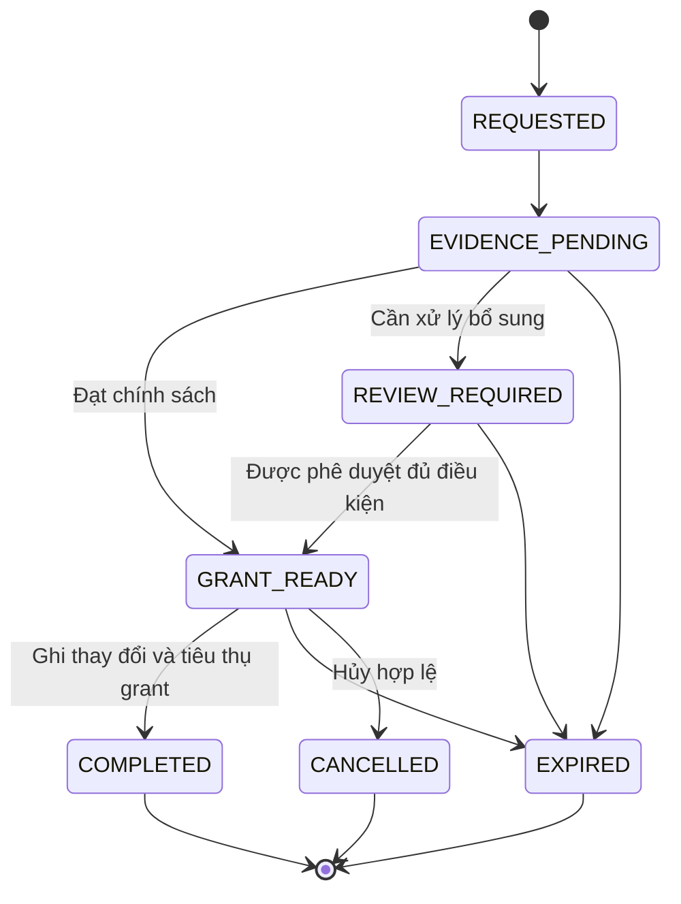

# Lost primary factor

## 1. Mất phương thức chính không có nghĩa phải tắt MFA

Người dùng quên mật khẩu nhưng vẫn còn ứng dụng TOTP. Một người khác mất điện thoại chứa passkey thường dùng nhưng vẫn giữ khóa bảo mật dự phòng. Cả hai đều có thể nói “tôi mất phương thức đăng nhập chính”, nhưng hệ thống không nên xử lý hai trường hợp bằng một nút “reset toàn bộ bảo mật”.

**Lost primary factor** trong bài này là tình huống người dùng không còn sử dụng được phương thức xác thực thường dùng hoặc phương thức được sản phẩm đặt ở bước đầu của luồng đăng nhập. “Primary” mô tả vai trò trong trải nghiệm đăng nhập; nó không tự xác định loại bằng chứng, mức đảm bảo hay quyền được cấp khi khôi phục.

Trong phạm vi khôi phục tài khoản an toàn, nhiệm vụ của hệ thống là tìm phần bằng chứng còn tin cậy, cho phép thay đúng phương thức bị mất và giữ quyền truy cập trong phạm vi mà bằng chứng đó cho phép. Cần đồng thời giảm khóa tài khoản cho người dùng hợp pháp và ngăn kẻ tấn công lợi dụng recovery để vượt MFA.

Sau bài học, người học cần biết:

- Xác định người dùng mất credential nào và còn xác thực được bằng cách nào.
- Phân biệt thay mật khẩu, thay thiết bị MFA và khôi phục toàn bộ quyền truy cập.
- Thiết kế grant khôi phục có mục đích rõ ràng, dùng một lần và có giới hạn quyền.
- Xử lý session, thu hồi và chống lạm dụng trong cả tình huống mất đơn thuần lẫn nghi ngờ xâm phạm.

## 2. Phân biệt factor, authenticator và credential bị mất

**Factor** là loại bằng chứng, chẳng hạn điều người dùng biết hoặc thứ người dùng có. **Authenticator** là phương tiện dùng để chứng minh bằng chứng đó. **Credential** là dữ liệu hoặc mối liên kết mà hệ thống dùng để nhận biết và kiểm tra phương tiện xác thực.

NIST phân biệt mật khẩu gửi tới verifier với activation secret dùng cục bộ, chẳng hạn PIN mở khóa authenticator. Vì vậy, quên PIN thiết bị và quên mật khẩu ứng dụng cần được phân loại riêng. [Nguồn: NIST SP 800-63B-4 — Authenticator and Verifier Requirements](https://pages.nist.gov/800-63-4/sp800-63b/authenticators/).

Ví dụ trong thiết kế sản phẩm:

| Người dùng mô tả | Điều cần làm rõ | Sai lầm dễ xảy ra |
|---|---|---|
| “Tôi quên mật khẩu” | Mật khẩu của ứng dụng, email hay tài khoản quản lý passkey? | Đặt lại nhầm tài khoản hoặc tắt MFA không cần thiết |
| “Tôi mất điện thoại” | Điện thoại chứa những phương thức nào; còn thiết bị dự phòng không? | Coi mật khẩu còn nhớ là đủ để thay mọi phương thức |
| “Không dùng được vân tay” | Còn cách mở khóa authenticator hợp lệ nào không? | Yêu cầu đăng ký lại tài khoản ngay |
| “Mã xác thực không chạy” | Mất ứng dụng, mất seed hay chỉ sai giờ hoặc lỗi thao tác? | Thu hồi toàn bộ phương thức trước khi hiểu nguyên nhân |
| “Tôi mất khóa chính” | Còn credential khác đã đăng ký và được chính sách chấp nhận không? | Ép vào recovery dù vẫn có thể đăng nhập hợp lệ |

Giao diện có thể dùng ngôn ngữ đơn giản. Backend cần giữ thông tin cụ thể hơn: phương thức bị ảnh hưởng, thời điểm báo mất, bằng chứng còn lại và hành động được đề nghị.

Không nên có một thuộc tính `primaryFactorLost=true` rồi dùng nó để quyết định mọi quyền. Đây là khai báo sự cố, không phải kết quả xác minh danh tính.

## 3. Chọn đúng nhánh trước khi phát hành quyền khôi phục

NIST coi thay mật khẩu đã quên khi người dùng còn xác thực được bằng authenticator khác là việc gắn authenticator mới. Account recovery áp dụng khi không còn đủ authenticator để đạt mức đảm bảo cần thiết. Với recovery của tài khoản đạt tối đa AAL2, NIST nêu các tổ hợp như hai recovery code từ hai phương thức khác nhau, một recovery code cộng authenticator một yếu tố đã gắn, hoặc xác minh lại danh tính nếu tài khoản đã được xác minh trước đó. Không thể mặc định một mã bất kỳ là đủ cho mọi tài khoản. [Nguồn: NIST SP 800-63B-4 — Authenticator Event Management, mục 4.2](https://pages.nist.gov/800-63-4/sp800-63b/events/#account-recovery).

Bảng sau là cách phân nhánh tham khảo cho một ứng dụng, không phải tuyên bố tuân thủ một mức AAL cụ thể:

| Tình huống | Phần còn sử dụng được | Nhánh thiết kế |
|---|---|---|
| Quên mật khẩu ứng dụng | Bằng chứng đặt lại được chấp nhận và MFA hiện có | Thay mật khẩu; giữ MFA |
| Mất authenticator thường dùng | Phương thức thay thế đã đăng ký, đáp ứng chính sách | Xác thực bằng phương thức thay thế rồi quản lý credential bị mất |
| Còn mật khẩu, mất thiết bị MFA duy nhất | Recovery code hoặc bằng chứng recovery phù hợp | Khôi phục phương thức MFA; không chỉ dựa vào mật khẩu |
| Mất cả mật khẩu và MFA | Chỉ còn bằng chứng phục hồi được chuẩn bị trước | Recovery tài khoản với phạm vi quyền hẹp |
| Nghi ngờ người khác đang kiểm soát tài khoản | Bằng chứng còn lại cũng có thể bị ảnh hưởng | Xử lý sự cố và xác minh qua miền độc lập |

Trong dòng đầu tiên, không nên hiểu “còn TOTP” là luôn đủ để thay mật khẩu. Cần xem TOTP đó được chính sách chấp nhận cho mục đích nào và phải kết hợp với bằng chứng nào khác. Bảng mô tả việc giữ MFA khi thay mật khẩu, không tự nâng giá trị của một OTP đơn lẻ.

## 4. Mô hình đe dọa: recovery là một đường cấp quyền

Một luồng recovery an toàn cần xét ít nhất hai bên: người dùng hợp pháp đang mất phương thức và người khác có một phần thông tin của họ.

| Khả năng của đối tượng yêu cầu | Nguy cơ nếu thiết kế sơ sài | Ràng buộc nên thiết kế |
|---|---|---|
| Biết email hoặc tên đăng nhập | Dò tài khoản, gửi hàng loạt thông báo, làm người dùng bị khóa | Tách yêu cầu công khai khỏi thay đổi bảo mật |
| Có mật khẩu bị lộ | Báo mất thiết bị để bỏ qua MFA | Mật khẩu đơn lẻ không tự cấp quyền thay MFA |
| Kiểm soát email | Dùng liên kết reset để thay cả mật khẩu lẫn mọi factor | Tách mục đích reset mật khẩu khỏi reset MFA |
| Có session bị đánh cắp | Thêm authenticator của kẻ tấn công | Kiểm tra quyền và bằng chứng cho việc gắn phương thức mới |
| Có nhiều thông tin cá nhân | Thuyết phục hỗ trợ “xác nhận chủ tài khoản” | Quy trình hỗ trợ có tiêu chí bằng chứng và quyền hạn rõ ràng |
| Có token recovery cũ | Dùng lại sau khi chủ tài khoản đã đổi cấu hình | Kiểm tra hạn dùng, trạng thái tiêu thụ và phiên bản bảo mật |

OWASP xem thay factor là thao tác rủi ro cao, khuyến nghị xác thực lại bằng phương thức đã đăng ký, không chỉ tin session hiện có và thông báo khi factor thay đổi. [Nguồn: OWASP — Multifactor Authentication Cheat Sheet, Changing MFA Factors](https://cheatsheetseries.owasp.org/cheatsheets/Multifactor_Authentication_Cheat_Sheet.html#changing-mfa-factors).

Từ mô hình trên, câu hỏi thiết kế cần chuyển từ “người này biết những gì về tài khoản?” sang “bằng chứng nào đã được xác minh và bằng chứng đó cho phép hành động cụ thể nào?”.

## 5. Kiểm kê bằng chứng còn lại

### 5.1. Bằng chứng tồn tại trước sự cố

Một thiết kế có thể ưu tiên đánh giá các phương thức hoặc kênh đã được thiết lập trước thời điểm nghi vấn. Ví dụ: khóa dự phòng đã đăng ký, recovery code đã phát hành hoặc kênh khôi phục được xác minh từ trước.

Đây không phải quy tắc “cũ thì chắc chắn an toàn”. Nếu email cũ đã bị chiếm, tuổi của địa chỉ không giúp nó trở nên đáng tin. Giá trị của lịch sử là giúp phát hiện việc kẻ tấn công vừa thêm một phương thức rồi dùng chính phương thức đó để hợp thức hóa recovery.

Nên lưu và đối chiếu:

- Phương thức được gắn khi nào và qua luồng nào.
- Ai hoặc giao dịch nào đã phê duyệt việc gắn.
- Có thay đổi email, số điện thoại hoặc quyền quản trị gần thời điểm báo mất không.
- Bằng chứng đã từng bị thu hồi, báo lộ hoặc tiêu thụ chưa.
- Bằng chứng đang dùng có cùng miền phụ thuộc với phương thức bị nghi ngờ không.

### 5.2. Khác phương thức chưa chắc độc lập

Giả sử điện thoại bị mất chứa ứng dụng TOTP, email đã đăng nhập và bản chụp recovery code. Nếu thiết bị bị mở khóa trái phép, ba phương thức có thể cùng bị ảnh hưởng.

Do đó, một kế hoạch dự phòng có thể chọn khóa bảo mật cất riêng hoặc recovery code lưu ngoại tuyến. Điều quan trọng là tình huống mất phương thức chính không đồng thời làm mất hoặc lộ mọi đường dự phòng.

Không nên tự đếm “email + OTP” thành hai yếu tố độc lập. Cần biết OTP đến từ đâu, email được kiểm soát qua miền nào và chính sách đang đòi loại bằng chứng gì.

### 5.3. Session cũ là dữ kiện, không phải quyền thay factor vô điều kiện

Người dùng có thể vẫn mở được ứng dụng trên laptop nhưng quên mật khẩu. Session đó có ích để hiển thị hướng dẫn, lịch sử hoặc yêu cầu xác thực lại. Tuy nhiên, cần xác định độ mới và mức đảm bảo của sự kiện xác thực trước khi cho thay phương thức.

NIST quy định session không được coi là có mức đảm bảo cao hơn sự kiện xác thực tạo ra nó. Việc có access token cũng không chứng minh người dùng đang hiện diện. [Nguồn: NIST SP 800-63B-4 — Session Management](https://pages.nist.gov/800-63-4/sp800-63b/session/).

## 6. Luồng tham khảo khi mất mật khẩu nhưng vẫn giữ MFA

Đây là nhánh trung tâm của bài học: thay phương thức chính bị mất mà không vô tình xóa lớp bảo vệ còn hiệu lực.

Giả sử ứng dụng dùng mật khẩu kết hợp TOTP. Chính sách của sản phẩm cho phép một tổ hợp bằng chứng phục hồi đã xác định để đặt lại mật khẩu. Việc chấp nhận tổ hợp nào phải được quyết định trước, phù hợp với mức rủi ro của tài khoản.

```mermaid
sequenceDiagram
    participant U as Người dùng
    participant R as Dịch vụ recovery
    participant E as Bộ kiểm tra bằng chứng
    participant A as Kho tài khoản
    U->>R: Báo quên mật khẩu
    R-->>U: Phản hồi chung và hướng dẫn
    U->>R: Hoàn tất bằng chứng được yêu cầu
    R->>E: Kiểm tra cho mục đích thay mật khẩu
    E-->>R: Kết quả và phạm vi được chấp nhận
    R-->>U: Grant chỉ cho phép đặt mật khẩu mới
    U->>R: Xác nhận mật khẩu mới
    R->>A: Kiểm tra grant và cập nhật nguyên tử
    A-->>R: Đã đổi mật khẩu, MFA giữ nguyên
    R-->>U: Hoàn tất; đăng nhập theo chính sách MFA
```

Các bước ở tầng ứng dụng:

1. **Tiếp nhận yêu cầu.** Chưa thay mật khẩu, tắt MFA hoặc khóa tài khoản chỉ vì có người biết địa chỉ email.
2. **Xác minh cho đúng mục đích.** Kết quả chỉ cho phép thay mật khẩu nếu chính sách đã được đáp ứng; không dùng chung với quyền thay email hoặc xóa factor.
3. **Cấp grant hẹp.** Grant gắn người dùng, hồ sơ recovery, mục đích, thời hạn và trạng thái bằng chứng.
4. **Hoàn tất thay đổi.** Kiểm tra lại trạng thái hiện tại trước khi ghi; không tin kết quả đã lưu từ quá lâu nếu tài khoản vừa có sự kiện bảo mật khác.
5. **Đưa người dùng qua đăng nhập bình thường.** MFA hiện có vẫn được kiểm tra theo chính sách; không đánh dấu đã xác thực MFA chỉ vì mật khẩu vừa được thay.

OWASP khuyến nghị token reset khó đoán, có hạn dùng, dùng một lần và không tự đăng nhập người dùng sau khi reset mật khẩu. [Nguồn: OWASP — Forgot Password Cheat Sheet](https://cheatsheetseries.owasp.org/cheatsheets/Forgot_Password_Cheat_Sheet.html).

Ví dụ lỗi nghiêm trọng:

```text
Reset mật khẩu thành công
  → đặt mfaEnabled = false
  → phát session đầy đủ
```

Luồng này biến quyền kiểm soát đường reset mật khẩu thành quyền bỏ MFA. Thiết kế đúng cho nhánh đang xét là thay mật khẩu, giữ cấu hình MFA và tiếp tục yêu cầu những bằng chứng còn thiếu trước khi cấp quyền sử dụng tài khoản.

## 7. Luồng khi mất phương thức chính là thiết bị hoặc passkey

### 7.1. Còn phương thức thay thế đáp ứng chính sách

Nếu người dùng còn khóa dự phòng hoặc credential khác được chấp nhận, có thể đi qua đăng nhập bằng phương thức đó. Sau khi đạt điều kiện quản lý bảo mật, họ có thể báo mất và thay credential liên quan.

Nên thể hiện rõ credential nào bị ảnh hưởng. “Mất điện thoại A” không nhất thiết đồng nghĩa “mọi credential của tài khoản phải bị xóa”. Ngược lại, khi có dấu hiệu cả kho credential bị lộ, chỉ xóa một tên thiết bị có thể không đủ.

Với passkey, cần phân biệt còn sử dụng được credential qua môi trường khác với việc ứng dụng cho đăng ký credential thay thế. Đây là hai hành động khác nhau ở tầng quản lý tài khoản.

### 7.2. Chỉ còn mật khẩu, mất thiết bị MFA duy nhất

Biết mật khẩu không tự chứng minh người yêu cầu được phép thay MFA. Trong trường hợp này, phải đánh giá thêm bằng chứng recovery theo chính sách đã công bố.

Không nên có lối tắt như “nhập đúng mật khẩu ba lần để bỏ MFA” hoặc chuyển ngay sang mã SMS gửi đến số điện thoại vừa được khai trong yêu cầu. Số mới chưa được gắn với tài khoản không trở thành bằng chứng chỉ vì người yêu cầu nhận được mã trên số đó.

### 7.3. Mất mọi phương thức được chấp nhận

Recovery cần có điểm kết thúc rõ ràng: bằng chứng đủ, chưa đủ, hết hạn hoặc được chuyển sang quy trình hỗ trợ phù hợp. Không nên giảm yêu cầu sau mỗi lần người dùng thất bại cho đến khi chỉ còn thông tin công khai.

Nếu cần xác minh danh tính, phải có cách liên kết kết quả với tài khoản đang yêu cầu. Một giấy tờ hợp lệ không tự chứng minh quyền sở hữu tài khoản vốn chỉ đăng ký bằng biệt danh. Chỉ thu thập dữ liệu cần thiết, giới hạn quyền truy cập và xác định thời gian lưu phù hợp.

## 8. Mô hình trạng thái cho recovery có giới hạn quyền

Một mô hình tham khảo có thể dùng các trạng thái sau. Đây là thiết kế riêng cho bài học, không phải tên trạng thái bắt buộc của một chuẩn.

| Trạng thái | Ý nghĩa | Quyền tối đa trong luồng |
|---|---|---|
| `REQUESTED` | Đã tiếp nhận yêu cầu | Xem hướng dẫn chung |
| `EVIDENCE_PENDING` | Đang kiểm tra bằng chứng | Nộp bằng chứng trong phạm vi hồ sơ |
| `REVIEW_REQUIRED` | Chưa đủ điều kiện tự động | Theo dõi hoặc bổ sung theo quy trình hỗ trợ |
| `GRANT_READY` | Đã đủ điều kiện cho hành động được chỉ định | Dùng grant để thay đúng phương thức |
| `COMPLETED` | Thay đổi đã ghi thành công | Chuyển sang đăng nhập hoặc bước xác thực tiếp theo |
| `EXPIRED` | Hết thời gian xử lý | Không còn quyền thay đổi |
| `CANCELLED` | Hồ sơ đã bị hủy theo quy trình hợp lệ | Không còn quyền thay đổi |



Không suy ra quyền từ tên trạng thái duy nhất. Grant còn cần xác định `purpose`, tài khoản đích và điều kiện hiện tại. Một hồ sơ được chấp nhận để thay mật khẩu không đồng thời cho phép thay email khôi phục.

Nếu chính sách có thời gian chờ, hãy coi đó là cơ hội phát hiện và xử lý bất thường. Chờ đủ thời gian không biến một bằng chứng yếu thành bằng chứng đủ mạnh. Khi thời gian chờ kết thúc, grant vẫn phải còn hợp lệ và các ràng buộc vẫn phải được kiểm tra.

## 9. Grant và cập nhật nguyên tử trong Java

### 9.1. Dữ liệu tối thiểu cho grant

Một grant tham khảo có thể chứa hoặc tham chiếu:

| Thuộc tính | Mục đích |
|---|---|
| `grantId` | Định danh bản ghi, không thay thế bí mật |
| `accountId` | Tài khoản được phép thay đổi |
| `recoveryCaseId` | Hồ sơ đã cung cấp bằng chứng |
| `purpose` | Ví dụ `RESET_PRIMARY_PASSWORD` |
| `tokenDigest` | Giá trị kiểm tra bí mật; không lưu token rõ |
| `expiresAt`, `consumedAt` | Giới hạn thời gian và lần sử dụng |
| `securityVersion` | Phát hiện thay đổi bảo mật làm grant cũ không còn phù hợp |
| `evidenceReferences`, `policyVersion` | Truy vết quyết định đã chấp nhận |

Với bearer token ngẫu nhiên có entropy cao, có thể dùng bộ sinh ngẫu nhiên mật mã và lưu digest để giảm rủi ro khi lộ cơ sở dữ liệu. Mã ngắn nhập tay cần cơ chế chống đoán và bảo vệ kiểm tra phù hợp; không áp dụng máy móc cách lưu token dài cho mọi loại mã.

### 9.2. Mã giả hoàn tất thay mật khẩu

Đoạn sau minh họa **giao dịch nghiệp vụ**, không phải mã hoàn chỉnh để triển khai. Các repository, hàm kiểm tra và cơ chế mật khẩu đều là thành phần giả định của ứng dụng.

```java
@Transactional
public void completeLostPasswordReset(ResetPasswordCommand command) {
    Instant now = clock.instant();

    RecoveryGrant grant = grants.lockById(command.grantId());
    grant.requireValidSecret(command.secret());
    grant.requirePurpose(RESET_PRIMARY_PASSWORD);
    grant.requireUnusedAndUnexpired(now);

    Account account = accounts.lockById(grant.accountId());
    grant.requireSecurityVersion(account.securityVersion());

    RecoveryCase recovery = recoveryCases.lockById(grant.recoveryCaseId());
    recovery.requireAccount(account.id());
    recovery.requireState(GRANT_READY);
    recovery.requirePurpose(RESET_PRIMARY_PASSWORD);

    recoveryPolicy.requireCurrentEvidenceSufficient(
        recovery, account, now
    );

    PasswordHash replacement = passwordService.validateAndHash(
        command.newPassword()
    );

    account.replacePassword(replacement);
    // Giữ nguyên các MFA binding hiện có trong nhánh này.
    account.advanceSecurityVersion();

    grant.consume(now);
    recovery.complete(now);
    grants.invalidateOtherGrantsForAccount(account.id());

    outbox.add(primaryPasswordReplacedEvent(account, recovery, now));
}
```

Những điều cần được bảo đảm khi hiện thực hóa:

- Bí mật grant được xác minh an toàn, không xuất hiện trong log; lỗi bên ngoài không làm lộ trạng thái tài khoản hoặc bản ghi nội bộ.
- Mọi luồng cạnh tranh dùng thứ tự khóa nhất quán hoặc cơ chế kiểm soát đồng thời tương đương. Hai request không được cùng dùng một grant thành công.
- Thay mật khẩu, tiêu thụ grant, hoàn tất hồ sơ và ghi sự kiện outbox phải cùng commit hoặc cùng rollback trong mô hình giao dịch đã chọn.
- Bằng chứng dùng một lần phải được tiêu thụ nguyên tử khi đổi sang grant, hoặc khi hoàn tất theo thiết kế. Nó không được tái sử dụng để mở một hồ sơ khác.
- Việc tăng `securityVersion` chỉ có hiệu quả nếu các nơi cấp và kiểm tra quyền đều thực thi quy tắc phiên bản. Thay một số trong cơ sở dữ liệu không tự thu hồi mọi token.
- Kiểm tra đầu vào, chính sách mật khẩu, CSRF và giới hạn chi phí xử lý thuộc endpoint thực tế; mã giả chưa thể hiện chúng.

Nếu hệ thống có nhiều kho dữ liệu, không nên coi chú thích `@Transactional` là đủ cho mọi dịch vụ. Cần nêu rõ nguồn trạng thái có thẩm quyền và giới hạn nhất quán của việc thu hồi.

## 10. Session và thu hồi sau khi thay phương thức

### 10.1. Phân biệt mất đơn thuần với nghi ngờ xâm phạm

Quên một mật khẩu chưa có dấu hiệu bị lộ khác với việc mất điện thoại đang mở khóa. Tuy vậy, quyết định giữ hay thu hồi session cần có chính sách nhất quán, có thể chọn thu hồi rộng để bảo vệ người dùng.

| Tình huống minh họa | Phạm vi cần xem xét |
|---|---|
| Thay mật khẩu đã quên | Mật khẩu cũ, reset grant còn hiệu lực và các session theo chính sách |
| Mất thiết bị chứa MFA | Binding liên quan, session trên thiết bị và phương thức dự phòng còn an toàn |
| Nghi lộ credential | Credential bị ảnh hưởng, token và hoạt động sau thời điểm nghi vấn |
| Có thay đổi bảo mật trái phép | Factor, kênh recovery và quyền truy cập mới được thêm |

Đừng thu hồi MFA còn an toàn chỉ vì mật khẩu được đặt lại. Cũng đừng chỉ thay mật khẩu rồi kết luận đã đẩy kẻ tấn công ra nếu họ còn session hoặc phương thức đã gắn trước đó.

### 10.2. Grant recovery và session sử dụng ứng dụng cần tách quyền

Một phiên phục vụ recovery có thể chỉ cho xem tiến độ, nộp bằng chứng hoặc đặt mật khẩu mới. Nó không cần quyền đọc hồ sơ riêng tư, chuyển tiền, xuất dữ liệu hay quản lý mọi authenticator.

Sau khi người dùng hoàn tất xác thực theo chính sách, ứng dụng mới cấp session phù hợp. OWASP khuyến nghị đổi session ID khi mức quyền thay đổi và xử lý xác thực lại sau các sự kiện rủi ro. [Nguồn: OWASP — Session Management Cheat Sheet](https://cheatsheetseries.owasp.org/cheatsheets/Session_Management_Cheat_Sheet.html#renew-the-session-id-after-any-privilege-level-change).

Với access token tự chứa, cần xác định rõ cách chặn token cũ: kiểm tra trạng thái có thẩm quyền, danh sách thu hồi hoặc thời hạn hiệu lực có giới hạn phù hợp. Thu hồi refresh token thường chặn việc lấy token mới, nhưng không tự làm mọi access token đã phát hành mất hiệu lực ngay.

Nếu đăng nhập do IdP quản lý, recovery của mật khẩu hoặc MFA thuộc IdP. RP không nên tự tạo tài khoản mật khẩu cục bộ dự phòng chỉ từ một yêu cầu hỗ trợ. Cần tách session tại RP với session và trạng thái xác thực tại IdP.

## 11. Chống lạm dụng và bảo vệ người dùng trong quá trình recovery

### 11.1. Không biến khởi tạo recovery thành công cụ khóa tài khoản

OWASP khuyến nghị phản hồi nhất quán cho tài khoản tồn tại và không tồn tại, đồng thời tránh thay đổi tài khoản chỉ vì yêu cầu reset chưa được xác minh. [Nguồn: OWASP — Forgot Password Request](https://cheatsheetseries.owasp.org/cheatsheets/Forgot_Password_Cheat_Sheet.html#forgot-password-request).

Một phản hồi có thể là: “Nếu thông tin phù hợp với tài khoản, hệ thống sẽ cung cấp hướng dẫn qua phương thức đã đăng ký.”

Để hạn chế lạm dụng, thiết kế có thể kết hợp hạn mức gửi theo tài khoản, theo nguồn yêu cầu và theo hệ thống; tách hạn mức gửi mã khỏi số lần nhập sai. Không chỉ dựa vào IP vì kẻ tấn công có thể phân tán nguồn và nhiều người dùng hợp pháp có thể chung mạng.

Không nên gửi một push phê duyệt sau mỗi lần thất bại. Người dùng đang mất phương thức dễ bị thuyết phục bấm chấp nhận để “giúp khôi phục”.

### 11.2. Tách báo mất và cấp quyền thay thế

Hệ thống có thể cần đường báo mất nhanh để hạn chế thiệt hại. Đường này phải có mức xác minh thích hợp và biện pháp chống báo giả, nhưng không nhất thiết phải trao ngay quyền đăng ký phương thức mới.

Ví dụ, sau một báo cáo đã được xác minh đủ cho việc tạm đình chỉ thiết bị, hệ thống có thể giữ credential đó ở trạng thái đình chỉ. Việc cấp credential thay thế vẫn cần đáp ứng điều kiện riêng. Chính sách phải tránh cả hai cực: không thể báo mất khi đã mất thiết bị, hoặc bất kỳ ai cũng có thể khóa thiết bị chỉ bằng email tài khoản.

### 11.3. Liên kết và token không nên gây thay đổi chỉ vì được mở

Email có thể được quét liên kết trước khi người dùng đọc. Trong một thiết kế tham khảo, GET chỉ mở giao diện hướng dẫn; hành động xác nhận có kiểm tra phù hợp mới thực hiện thay đổi và tiêu thụ quyền.

Nên giới hạn tài nguyên bên thứ ba trên màn hình chứa token, loại bí mật khỏi telemetry và tránh đưa bí mật vào thông báo lỗi. Không gửi mật khẩu mới trong email hoặc hướng dẫn người dùng chuyển OTP cho nhân viên hỗ trợ.

## 12. Vai trò của hỗ trợ và thông báo

Một quy trình hỗ trợ cho người mất phương thức chính nên trả lời rõ:

- Nhân viên được xem dữ liệu gì, được phê duyệt mục đích nào và ai có quyền ngoại lệ.
- Bằng chứng nào đủ, bằng chứng nào chỉ dùng để tra cứu hồ sơ.
- Tình huống nào phải chuyển cho người đánh giá khác hoặc xử lý sự cố.
- Quyền phê duyệt có hết hạn và được ghi nhận cùng lý do hay không.
- Người dùng làm gì nếu không nhận ra thay đổi.

Không nên có công cụ hỗ trợ đặt cờ `mfaEnabled=false` mà không gắn với hồ sơ, quyết định và phạm vi quyền. Một phương án là hỗ trợ chỉ phê duyệt hồ sơ đúng mục đích; dịch vụ recovery mới phát grant hẹp theo chính sách.

Thông báo nên mô tả hành động đã xảy ra, thời điểm, cách liên hệ và các bước khi người dùng không thực hiện yêu cầu. Với tài khoản nghi bị chiếm, cần xét khả năng kẻ tấn công vừa thay kênh liên lạc. Không tự động khôi phục mọi địa chỉ cũ vì chúng cũng có thể từng bị lộ hoặc mất quyền kiểm soát.

Một sự kiện vận hành tham khảo:

```json
{
  "eventType": "PRIMARY_PASSWORD_REPLACED",
  "accountRef": "internal-account-reference",
  "recoveryCaseRef": "internal-case-reference",
  "recoveryPurpose": "RESET_PRIMARY_PASSWORD",
  "mfaBindingsChanged": false,
  "nextStep": "NORMAL_SIGN_IN_WITH_MFA",
  "policyVersion": "example-v1"
}
```

Các trường phải phản ánh điều thực sự đã xác minh hoặc đã ghi. Không ghi mật khẩu, OTP, recovery code, cookie hay token vào sự kiện. Quyền đọc log cần phù hợp với dữ liệu nhạy cảm còn lại.

## 13. Ba tình huống áp dụng

### Tình huống A — Quên mật khẩu, vẫn còn MFA

Mai quên mật khẩu ứng dụng học tập, nhưng vẫn dùng được TOTP và còn kênh phục hồi đã xác minh. Giả sử tổ hợp này đáp ứng chính sách thay mật khẩu của sản phẩm.

Hệ thống phát grant chỉ cho phép đặt mật khẩu mới. Khi Mai hoàn tất, cấu hình TOTP không đổi. Mai đăng nhập theo luồng mật khẩu và MFA thông thường. Nếu kẻ tấn công chỉ có liên kết của một bước bằng chứng, hắn không được mặc định bỏ qua các điều kiện còn thiếu.

### Tình huống B — Kẻ tấn công biết mật khẩu và báo mất điện thoại

Một người nhập đúng mật khẩu của Huy rồi nói không dùng được thiết bị MFA. Nếu hỗ trợ tắt MFA chỉ vì mật khẩu đúng, tài khoản bị chiếm ngay tại đường recovery.

Thiết kế cần bằng chứng phù hợp với nhánh mất MFA, chẳng hạn tổ hợp recovery đã quy định hoặc quy trình hỗ trợ có kiểm soát. Mật khẩu vẫn có giá trị trong tổ hợp được chấp nhận, nhưng không tự cấp mọi quyền thay bảo mật.

### Tình huống C — Mất thiết bị chính nhưng có khóa dự phòng

An mất điện thoại thường dùng và vẫn giữ authenticator dự phòng đã đăng ký. Nếu phương thức này đáp ứng chính sách, An có thể xác thực bằng nó rồi xử lý phương thức bị mất.

Ứng dụng nên hỗ trợ đường đi đó thay vì bắt đầu một quy trình xác minh danh tính dài không cần thiết. Nếu An báo điện thoại có nguy cơ bị mở khóa, cần đồng thời rà soát session và credential liên quan; đăng nhập thành công bằng khóa dự phòng không xóa đi nguy cơ từ thiết bị đã mất.

## 14. Câu hỏi tự kiểm tra thiết kế

1. “Phương thức chính” là mật khẩu, thiết bị hay chỉ là thứ được ưu tiên trên giao diện?
2. Người dùng còn đủ bằng chứng cho đăng nhập bình thường hay phải đi qua recovery?
3. Quyền thay mật khẩu có vô tình cho xóa MFA, đổi email hoặc đăng ký thiết bị mới không?
4. Bằng chứng được chấp nhận đã tồn tại trước sự cố và còn độc lập với miền bị nghi ngờ không?
5. Hai request cạnh tranh có thể tiêu thụ cùng grant hoặc cùng recovery code không?
6. Grant cũ có tiếp tục dùng được sau khi người dùng đã thay đổi cấu hình bảo mật không?
7. Khi cập nhật thành công, session và token nào còn hiệu lực, và điều đó có đúng chính sách không?
8. Một yêu cầu recovery công khai có thể khiến người dùng hợp pháp bị khóa hoặc bị gửi thông báo liên tục không?
9. Nếu không đủ bằng chứng, hệ thống có đường hỗ trợ rõ ràng mà không hạ điều kiện tùy tiện không?

Thiết kế cần giữ được nguyên tắc: khôi phục đúng khả năng bị mất, dựa trên bằng chứng đã kiểm tra và chỉ cấp quyền cần thiết cho từng bước. Việc mất phương thức thường dùng không tự tạo quyền bỏ qua những lớp bảo vệ còn lại của tài khoản.
