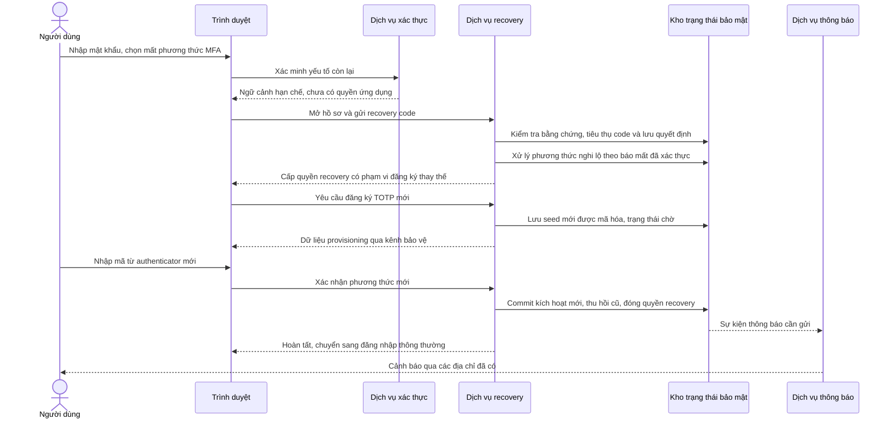
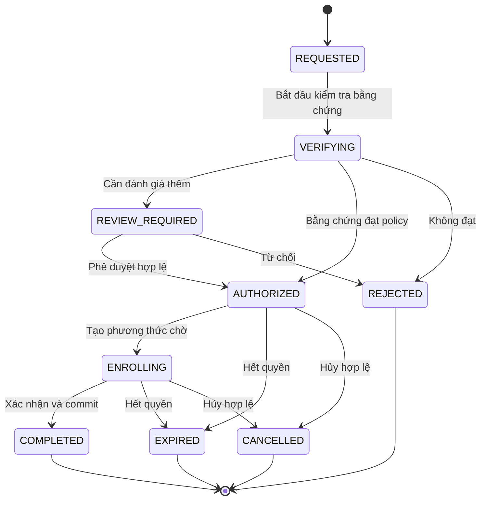

# Lost secondary factor — Khôi phục khi mất yếu tố xác thực thứ hai

## 1. Còn mật khẩu nhưng chưa đủ quyền truy cập

Một người dùng vẫn nhớ mật khẩu nhưng vừa mất điện thoại chứa ứng dụng authenticator. Họ nhập đúng mật khẩu, đến màn hình MFA rồi không thể tiếp tục. Hệ thống cần giúp họ lấy lại quyền truy cập mà vẫn ngăn người chỉ đánh cắp được mật khẩu làm điều tương tự.

**Lost secondary factor** là tình huống người dùng mất khả năng sử dụng phương tiện xác thực bổ sung cần thiết cho luồng đăng nhập. Trong thực tế, thứ bị mất thường là thiết bị hoặc authenticator: điện thoại sinh TOTP, thiết bị nhận push, SIM nhận mã hay khóa bảo mật. “Yếu tố thứ hai” nói về vai trò trong luồng đăng nhập, không có nghĩa mọi phương tiện đều có cùng mức bảo vệ.

Đây là một bài thuộc chương **MFA Recovery**, trong phạm vi dịch vụ `SECURITY_AUTHENTICATION_ACCOUNT_RECOVERY`. Việc khôi phục phải kết hợp đánh giá rủi ro, bằng chứng sở hữu tài khoản, bí mật dùng một lần, chống lạm dụng và kiểm soát session. Kết quả cần đạt là người dùng có phương thức xác thực hợp lệ trở lại và phương thức bị mất không tiếp tục gây rủi ro.

Sau bài học, người học cần có khả năng:

- Phân loại mất phương tiện MFA, gián đoạn tạm thời và nghi bị chiếm tài khoản.
- Chọn nhánh xác minh dựa trên phương thức còn lại và bằng chứng đã chuẩn bị trước.
- Thiết kế phiên recovery có quyền hạn hẹp, không tự bỏ yêu cầu MFA.
- Đăng ký và xác nhận yếu tố thay thế trước khi kết thúc hồ sơ.
- Thu hồi yếu tố cũ, xử lý phiên và đối phó yêu cầu đồng thời.

Các trạng thái, API, thời hạn và mã giả trong bài là **thiết kế tham khảo của ứng dụng**. Chúng không tự tạo thành chứng nhận tuân thủ NIST hay một mức bảo đảm xác thực cụ thể.

## 2. Hiểu đúng thứ đã mất

### 2.1. Yếu tố, phương thức và thiết bị

Ba khái niệm cần được phân biệt:

| Khái niệm | Ý nghĩa | Ví dụ |
|---|---|---|
| Authentication factor | Loại bằng chứng xác thực | Điều biết, thứ sở hữu, đặc điểm sinh trắc |
| Authenticator hoặc phương thức | Cơ chế sử dụng một hoặc nhiều yếu tố | Mật khẩu, TOTP authenticator, khóa mật mã |
| Thiết bị | Nơi giữ hoặc sử dụng phương thức | Điện thoại, máy tính, khóa bảo mật |

Hai mật khẩu không tạo thành hai loại yếu tố khác nhau. Ngược lại, một authenticator có thể kết hợp nhiều yếu tố trong một thao tác. Không kết luận số yếu tố chỉ bằng số màn hình người dùng phải đi qua.

TOTP thông thường chứng minh khả năng tạo mã từ một shared secret. Người dùng nhập mã vào website, nên bản thân OTP không chống được mọi hình thức phishing. NIST trình bày đặc tính này trong [Authenticator and Verifier Requirements — Single-Factor OTP](https://pages.nist.gov/800-63-4/sp800-63b/authenticators/#sfotp).

Passkey có thể được dùng theo một mô hình xác thực khác với mật khẩu cộng OTP. Khi hỗ trợ passkey như phương án còn lại, máy chủ phải đánh giá thuộc tính xác thực thực tế và chính sách UV, thay vì gán nhãn “yếu tố thứ hai” cho mọi khóa đã đăng ký.

### 2.2. Các tình huống cần rẽ nhánh

| Người dùng mô tả | Điều cần làm rõ | Nhánh phù hợp trong thiết kế này |
|---|---|---|
| Quên điện thoại ở nhà | Có thể lấy lại và không nghi bị truy cập trái phép không? | Dùng phương thức dự phòng đã đăng ký hoặc chờ lấy lại |
| Mã authenticator luôn sai | Đồng hồ, tài khoản được chọn và tham số có đúng không? | Hỗ trợ chẩn đoán có giới hạn; chưa tự reset MFA |
| Hỏng hoặc cài lại điện thoại | Có bản sao tin cậy, khóa dự phòng hay recovery code không? | Xác minh rồi đăng ký phương thức thay thế |
| Mất điện thoại hoặc khóa bảo mật | Những credential và session nào nằm trên thiết bị? | Tiếp nhận báo mất hợp lệ, kiểm soát rủi ro rồi thay thế |
| Mất số điện thoại hoặc nghi SIM swap | Kênh SMS còn đáng tin cậy không? | Chuyển sang bằng chứng khác; xem xét sự cố chiếm quyền |
| Nhận push không do mình khởi tạo | Mật khẩu hoặc phiên có thể đã bị lộ không? | Điều tra truy cập trái phép; không gửi thêm push hàng loạt |
| Mất cả mật khẩu lẫn MFA | Không còn phương thức đầu vào nào phù hợp? | Chuyển sang chính sách khôi phục tài khoản rộng hơn |

Không hướng dẫn người dùng gửi seed TOTP, ảnh QR hoặc mã khôi phục cho nhân viên hỗ trợ để “kiểm tra”. Những dữ liệu đó có thể trao khả năng xác thực cho người nhận.

## 3. Mô hình đe dọa của luồng mất yếu tố thứ hai

Một đường recovery yếu có thể làm giảm lợi ích của MFA. Hãy xét các đối tượng sau:

| Đối tượng | Đã có gì? | Muốn lợi dụng điều gì? |
|---|---|---|
| Kẻ lấy được mật khẩu | Một yếu tố hợp lệ | Nút “mất điện thoại” để bỏ qua yếu tố còn lại |
| Kẻ chiếm email | Quyền đọc hộp thư | Link reset MFA hoặc thay địa chỉ recovery |
| Người giữ thiết bị bị mất | Seed, khóa hoặc session trên thiết bị | Tiếp tục xác thực trong lúc nạn nhân khôi phục |
| Người điều khiển session bị đánh cắp | Cookie hoặc refresh token | Thêm phương thức của họ vào tài khoản |
| Kẻ giả danh qua hỗ trợ | Thông tin công khai, câu chuyện thuyết phục | Ép nhân viên tắt MFA hoặc đổi số điện thoại |
| Bot | Khả năng gửi nhiều request | Đoán code, dò tài khoản, gây khóa hoặc làm quá tải hỗ trợ |

**Nhập đúng mật khẩu nhưng không vượt MFA cũng có thể là dấu hiệu mật khẩu đã bị đánh cắp.** Giao diện cần cho người dùng hợp lệ một đường tiếp tục, nhưng backend không được mặc định mọi người ở màn hình này đều là chủ tài khoản.

Mục tiêu bảo vệ gồm quyền gắn phương thức mới, cấu hình MFA, kênh recovery, bí mật dùng một lần và session đang tồn tại. Một luồng chỉ đổi authenticator mà bỏ qua các session trên điện thoại bị mất có thể chưa loại được truy cập trái phép.

## 4. Chọn bằng chứng thay thế theo chính sách

### 4.1. Ưu tiên những phương án đã được thiết lập

| Phương tiện còn lại | Cách sử dụng có kiểm soát | Giới hạn cần nhớ |
|---|---|---|
| Phương thức MFA dự phòng đã đăng ký | Xác thực lại bằng tổ hợp đạt chính sách rồi mở quyền thay thế | Kiểm tra phương thức đó có cùng nằm trên thiết bị bị mất không |
| Mật khẩu và saved recovery code | Kiểm tra mật khẩu gần thời điểm yêu cầu; xác minh và tiêu thụ code | Không coi riêng mật khẩu là quyền reset MFA |
| Kênh recovery đã xác lập | Sử dụng trong tổ hợp bằng chứng được chính sách chấp nhận | Quyền đọc email hoặc nhận SMS không tự đáp ứng mọi mức bảo đảm |
| Quy trình xác minh lại danh tính | Đối chiếu với danh tính đã gắn với tài khoản | Không chỉ thu một ảnh giấy tờ mới rồi mặc định đúng tài khoản |
| Hỗ trợ có xét duyệt | Ghi nhận bằng chứng và quyết định, cấp quyền hẹp sau khi đạt | Nhân viên không được tùy tiện biến cuộc gọi thành quyền toàn bộ |
| Chỉ còn session cũ | Cho truy cập chức năng hỗ trợ hoặc bắt đầu hồ sơ theo chính sách | Session có thể bị đánh cắp; cần thêm xác minh trước thay MFA |

OWASP coi thay phương thức MFA là thao tác rủi ro cao, khuyến nghị xác thực lại và không chỉ dựa vào session hiện hữu. Xem [Multifactor Authentication Cheat Sheet — Changing MFA Factors](https://cheatsheetseries.owasp.org/cheatsheets/Multifactor_Authentication_Cheat_Sheet.html#changing-mfa-factors).

Một yêu cầu “xác thực lại” phải có đường đi khả thi khi phương thức bị mất. Có thể sử dụng authenticator dự phòng còn tin cậy hoặc chuyển sang recovery với bằng chứng thay thế; không bắt người dùng chứng minh bằng đúng thiết bị họ vừa báo mất trong mọi nhánh.

### 4.2. Khi áp dụng yêu cầu NIST

Với tài khoản có mức xác thực tối đa AAL2, NIST nêu ba lựa chọn recovery: hai recovery code từ các phương thức khác nhau; một recovery code kèm xác thực bằng authenticator đơn yếu tố đã gắn với tài khoản; hoặc xác minh lại danh tính nếu tài khoản từng được identity-proofed. Hai mã trong cùng một bộ saved codes không phải hai phương thức khác nhau. Xem [NIST SP 800-63B-4 — Recovery Requirements by IAL/AAL](https://pages.nist.gov/800-63-4/sp800-63b/events/#recover).

Trong một thiết kế có áp dụng lựa chọn tương ứng, mật khẩu còn hợp lệ cộng recovery code là đường khôi phục khả thi khi TOTP bị mất. Tuy nhiên, không suy rộng ví dụ đó thành “mật khẩu cộng email luôn tương đương MFA trước đây”. Cần đối chiếu loại code, tổ hợp được phép, rủi ro tài khoản và toàn bộ yêu cầu áp dụng.

### 4.3. Kiểm tra sự phụ thuộc chung

Điện thoại có thể đồng thời giữ ứng dụng TOTP, hộp thư đã đăng nhập, SIM và bản chụp recovery codes. Bốn lựa chọn trên giao diện khi đó có thể cùng chịu một sự cố.

Trong đánh giá rủi ro, ghi nhận miền phụ thuộc: thiết bị, tài khoản cloud, số điện thoại, hộp thư và người hỗ trợ. Ưu tiên phương án dự phòng có khả năng sống sót qua sự cố chính, chẳng hạn bản recovery code được cất an toàn riêng với điện thoại. Không tuyên bố độc lập chỉ vì các kênh có tên khác nhau.

## 5. Tách yêu cầu MFA khỏi trạng thái authenticator

Một lỗi thiết kế thường gặp là đồng nhất hai điều kiện:

```text
Không còn authenticator hoạt động
        => mfaEnabled = false
        => Cho đăng nhập bằng mật khẩu
```

Nhánh này có thể mở quyền truy cập ngay lúc tài khoản đang dễ bị chiếm nhất. Trong mô hình tham khảo, chính sách và dữ liệu phương thức được tách riêng:

```text
account.authenticationPolicy.mfaRequired = true

authenticator.old.state = SUSPENDED hoặc REVOKED
authenticator.new.state = PENDING_CONFIRMATION

recoverySession.scope = ENROLL_REPLACEMENT_FACTOR
```

Nếu không còn tổ hợp authenticator nào đáp ứng chính sách, tài khoản cần đi qua recovery; không tự chuyển sang đăng nhập chỉ bằng mật khẩu. Việc người dùng nhìn thấy màn hình đăng ký MFA mới không có nghĩa session đó được phép đọc dữ liệu hoặc gọi API thông thường.

### 5.1. Ba mức quyền của session trong ví dụ

| Loại session/ngữ cảnh | Đã xác lập được gì? | Được phép làm gì? |
|---|---|---|
| `FIRST_FACTOR_VERIFIED` | Mật khẩu vừa được kiểm tra | Tiếp tục MFA hoặc bắt đầu hồ sơ recovery có giới hạn |
| `RECOVERY_ONLY` | Bằng chứng recovery đã đạt chính sách | Đăng ký và xác nhận đúng một phương thức thay thế |
| `AUTHENTICATED` | Đăng nhập đạt chính sách sau recovery | Truy cập ứng dụng, chịu các hạn chế bảo mật còn hiệu lực |

Các tên trên là lựa chọn của ứng dụng. Backend cần kiểm tra mức quyền thực tế ở từng endpoint, bao gồm API tải dữ liệu, WebSocket và luồng phát refresh token. Không chỉ ẩn menu trên frontend.

NIST yêu cầu session không được có mức bảo đảm cao hơn sự kiện xác thực tạo ra nó và giới hạn việc dùng cookie ghi nhớ thay xác thực. Tham khảo [NIST SP 800-63B-4 — Session Management](https://pages.nist.gov/800-63-4/sp800-63b/session/).

## 6. Luồng khôi phục đầu cuối

Ví dụ xuyên suốt: Huy còn mật khẩu, mất điện thoại chứa TOTP và có một recovery code được lưu riêng. Chính sách tài khoản chấp nhận tổ hợp bằng chứng này cho recovery.



### 6.1. Tiếp nhận yêu cầu

Màn hình MFA cung cấp lựa chọn “Không còn truy cập phương thức này” và giải thích các phương án hiện có sau khi người gọi đã đủ quyền xem. Việc mở hồ sơ chưa được làm mất hiệu lực mọi khóa của tài khoản.

Đối với entrypoint công khai, tránh tiết lộ tài khoản tồn tại, số phương thức MFA hoặc địa chỉ liên hệ đầy đủ. OWASP trình bày nguyên tắc phản hồi nhất quán, token có hạn và chống gửi yêu cầu hàng loạt trong [Forgot Password Cheat Sheet](https://cheatsheetseries.owasp.org/cheatsheets/Forgot_Password_Cheat_Sheet.html). Khi áp dụng cho MFA recovery, vẫn cần chính sách bằng chứng riêng cho thao tác thay phương thức.

### 6.2. Xác minh và chốt quyết định

Hồ sơ lưu tài khoản đích do máy chủ xác định, loại phương thức mất, bằng chứng đã kiểm tra, thời điểm xác thực lại, quyết định rủi ro và tập authenticator cần xử lý. Không lấy `accountId` từ form hoàn tất rồi dùng nó làm chủ thể thay đổi.

Nếu bằng chứng không đủ, dừng ở trạng thái chờ hoặc từ chối và cung cấp đường hỗ trợ phù hợp. Một khoảng chờ có thể hỗ trợ phát hiện gian lận nhưng không tự biến bằng chứng không đạt thành bằng chứng hợp lệ.

### 6.3. Báo mất và thu hồi là một quyết định có cấp quyền

Việc cho phép báo mất để đình chỉ một authenticator có thể dùng chính sách khác với quyền gắn authenticator mới. Đánh giá hai quyết định riêng, ghi rõ ai yêu cầu và bằng chứng nào hỗ trợ.

Khi báo mất đã được xác thực và phương thức được xác định có rủi ro, đình chỉ hoặc thu hồi sớm theo chính sách sự cố. Không bắt buộc chờ thiết lập TOTP mới. Đồng thời không cho một request ẩn danh chỉ biết email xóa các phương thức của nạn nhân.

Nếu đình chỉ phương thức cũ làm thay đổi cấu hình bảo mật, tăng phiên bản cấu hình và lưu phiên bản kỳ vọng cho hồ sơ sau quyết định đó. Các bước đăng ký tiếp theo phải dựa trên trạng thái đã được cập nhật.

### 6.4. Chỉ cấp quyền hẹp

Recovery grant có thể là bí mật opaque ngẫu nhiên, được lưu dạng băm phía máy chủ, có hạn và gắn với một hồ sơ cùng phiên recovery. Ví dụ thuộc tính:

```text
caseId                  = mfr_52
accountId               = u_107
purpose                 = REPLACE_LOST_SECONDARY_AUTHENTICATOR
allowedAuthenticatorType = TOTP
scope                   = recovery:enroll, recovery:confirm
expectedSecurityVersion = 8
proofRef                = proof_208
expiresAt               = thời điểm hết quyền
consumedAt              = null
revokedAt               = null
```

Grant không được gọi API đổi mật khẩu, thay email, tắt yêu cầu MFA hoặc tạo API key. Nếu sự cố đòi hỏi đổi mật khẩu, đó là bước có chính sách và quyền riêng, không âm thầm mở rộng scope của grant.

“Dùng một lần” nghĩa là grant chỉ hoàn tất được một lần thay thế. Nó có thể cho phép nhiều request cần thiết trong hồ sơ, nhưng mỗi lần tạo lại dữ liệu đăng ký phải vô hiệu hóa candidate cũ và chịu ngân sách thử chung.

## 7. Recovery code: tiêu thụ đúng một lần

Saved recovery code là bí mật chuẩn bị từ trước, khác với mã TOTP ngắn thay đổi theo thời gian. Không thiết kế saved code như một chuỗi sáu chữ số tồn tại vô thời hạn.

NIST quy định saved recovery code có ít nhất 64 bit ngẫu nhiên, được lưu dạng băm và bị vô hiệu hóa sau khi dùng; cần phát hành mã thay thế theo quy trình tương ứng. Tham khảo [NIST SP 800-63B-4 — Saved Recovery Codes](https://pages.nist.gov/800-63-4/sp800-63b/events/#savedrecovery). Các yêu cầu đó không được suy ra chỉ từ số ký tự hiển thị nếu cách sinh mã thiếu entropy.

### 7.1. Chống hai request cùng dùng một code

Sau khi kiểm tra giá trị code và quyền với tài khoản, thao tác tiêu thụ cần có điều kiện. Mã SQL dưới đây chỉ minh họa phần cập nhật trạng thái, không thay thế bước so khớp bí mật:

```sql
UPDATE recovery_code
SET consumed_at = :now,
    consumed_by_case_id = :case_id
WHERE id = :verified_code_id
  AND account_id = :server_selected_account_id
  AND consumed_at IS NULL
  AND revoked_at IS NULL;
```

Chỉ khi số dòng cập nhật bằng một, request mới có thể sử dụng code để ghi nhận bằng chứng được chấp nhận. Trong cùng transaction, lưu quyết định hồ sơ và quyền recovery tương ứng. Hai verifier cùng kiểm tra đúng code trước đó vẫn chỉ có một request tiêu thụ thành công.

Nếu quy trình đã chấp nhận code rồi người dùng bỏ dở đăng ký, code vẫn đã dùng. Hồ sơ có thể cho tiếp tục trong thời hạn và quyền còn hiệu lực; không làm code sống lại để “hoàn tác” việc bỏ dở. Nếu transaction chấp nhận chưa commit thì chưa có quyết định thành công được lưu.

### 7.2. Quản lý bộ mã sau sự cố

Mã đã dùng không được xuất hiện trở lại trong danh sách còn dùng. Khi phát hành mã hoặc bộ mã thay thế, thực hiện qua màn hình đủ quyền, chỉ hiển thị bí mật theo thiết kế và xác định rõ những mã cũ nào bị thu hồi.

Nếu bộ mã cũng nằm trên điện thoại bị mất hoặc tài khoản cloud nghi bị chiếm, xem xét thu hồi toàn bộ bộ mã theo kết luận sự cố. Một code được cất riêng còn an toàn không tự chứng minh mọi code khác cũng an toàn.

Nếu áp dụng yêu cầu NIST về cấp mã thay thế sau sử dụng, quy trình sản phẩm phải có bước thực hiện và theo dõi việc này; không chỉ đánh dấu đã dùng rồi quên chuẩn bị khả năng recovery tiếp theo. Không gửi mã mới đến một địa chỉ vừa bị đổi trong cùng hồ sơ chưa đủ xác minh.

## 8. Đăng ký yếu tố thay thế: ví dụ TOTP

### 8.1. Tạo seed mới và giữ ở trạng thái chờ

Máy chủ sinh shared secret mới cho authenticator thay thế, lưu được mã hóa và gắn với hồ sơ. Dữ liệu provisioning được chuyển qua kênh được bảo vệ; QR nên được tạo trong thành phần do ứng dụng kiểm soát, không gửi secret đến dịch vụ QR bên ngoài.

Ví dụ cấu hình nội bộ, không chứa secret thực:

```text
authenticatorId = auth_new_71
caseId          = mfr_52
type            = TOTP
state           = PENDING_CONFIRMATION
secretRef       = tham chiếu seed đã mã hóa
algorithm       = thuật toán được ứng dụng cho phép
digits          = số chữ số đã thống nhất với client
period          = thời lượng bước thời gian đã thống nhất
lastAcceptedStep = chưa có
```

Không tái hiển thị seed cũ của điện thoại bị mất để người dùng quét lại. Nếu seed đó đã bị lộ, mọi bản sao vẫn có thể tạo mã. Đổi tên thiết bị, đổi mật khẩu hoặc tạo QR khác từ cùng seed không thu hồi được quyền đó.

TOTP cần shared secret có thể sử dụng để kiểm tra mã; lưu băm một chiều thay cho seed sẽ không đáp ứng cách xác minh này. Bảo vệ seed bằng mã hóa và giới hạn giải mã. RFC 6238 mô tả sinh khóa, bảo vệ khóa và cửa sổ xác minh trong [TOTP — Security Considerations](https://www.rfc-editor.org/rfc/rfc6238.html#section-5).

Trang provisioning cần chống lưu cache và rò rỉ qua telemetry, ảnh chụp log hoặc tài nguyên bên thứ ba. Không đặt seed vào URL ứng dụng, history hay log HTTP. Nếu dùng URI provisioning bên trong QR, coi toàn bộ URI đó là bí mật.

### 8.2. Xác nhận bằng mã từ authenticator mới

Người dùng quét dữ liệu đăng ký rồi nhập mã TOTP. Máy chủ kiểm tra trên đúng candidate của hồ sơ và trả về bước thời gian đã khớp, thay vì chỉ một cờ `true` không kèm ngữ cảnh.

Các điều kiện nghiệp vụ phải được kiểm tra cùng việc xác nhận:

1. Hồ sơ, grant và phiên recovery vẫn hợp lệ.
2. Candidate chưa bị thay thế, hết hạn hoặc thu hồi.
3. Quyền đầu vào và quyết định policy chưa lỗi thời.
4. Mã đạt quy tắc xác minh TOTP của hệ thống.
5. Bước thời gian được chấp nhận chưa được dùng cho authenticator này.
6. Tài khoản đích và phiên bản bảo mật vẫn khớp trạng thái đã phê duyệt.

Ghi nhận bước thời gian đã dùng ngay khi chấp nhận xác nhận, nhất quán với kích hoạt. Sau đó không cho dùng lại bước đó để đăng nhập. Có thể hướng dẫn người dùng chờ mã tiếp theo. Không cấm vĩnh viễn một chuỗi chữ số vì những chuỗi giống nhau có thể xuất hiện ở các thời điểm khác nhau.

NIST yêu cầu OTP chỉ được chấp nhận một lần khi còn hiệu lực và có giới hạn thử phù hợp. Xem [Single-Factor OTP Verifiers](https://pages.nist.gov/800-63-4/sp800-63b/authenticators/#sfotpver). Cửa sổ thời gian cần được định nghĩa; không mở rộng tùy ý để che lỗi đồng hồ.

### 8.3. Mã mới đúng không xác minh lại danh tính

Một người được cấp grant sai có thể tự quét seed mới và nhập mã đúng. Vì vậy, xác nhận TOTP chỉ chứng minh người thao tác có khả năng tạo mã từ seed mới; quyền thay phương thức vẫn dựa vào bằng chứng trước đó.

Nếu nhiều thiết bị giữ cùng seed, máy chủ không thể phân biệt thiết bị nào đã sinh cùng một mã. Muốn loại quyền của bản sao nghi lộ, thu hồi seed cũ và gắn seed mới; không chỉ đổi nhãn điện thoại trong danh sách.

### 8.4. Những phương thức khác cần đối tượng thu hồi khác nhau

| Phương thức bị mất | Thay thế và thu hồi cần xét |
|---|---|
| TOTP | Seed cũ, mọi bản sao cùng seed, cấu hình verifier |
| HOTP | Shared secret và trạng thái counter của authenticator cũ |
| Push | Đăng ký thiết bị và khóa xác thực của ứng dụng; địa chỉ push chỉ là kênh định tuyến |
| SMS hoặc cuộc gọi | Số đã đăng ký, SIM swap/porting và quyền đổi số |
| Khóa bảo mật hoặc passkey | Credential ID và khóa công khai được RP chấp nhận; xác minh theo giao thức tương ứng |

Nếu policy yêu cầu phương thức chống phishing, không âm thầm thay bằng TOTP hoặc SMS vì dễ hoàn tất hơn. Phương thức mới phải đáp ứng chính sách sau recovery, hoặc đi qua một ngoại lệ được phê duyệt rõ ràng.

## 9. Trạng thái hồ sơ và dữ liệu cần quản lý



Hồ sơ chờ xác minh hoặc xét duyệt cũng cần thời hạn vận hành, giới hạn nhắc lại và đường kết thúc; sơ đồ tập trung vào các trạng thái có quyền thay thế. Hết hạn phải được kiểm tra khi xử lý request, không phụ thuộc vào việc job dọn dữ liệu đã chạy hay chưa.

| Thực thể | Dữ liệu quan trọng trong ví dụ |
|---|---|
| Account | `id`, `tenantId`, `mfaRequired`, `securityVersion`, `sessionEpoch` |
| RecoveryCase | Chủ thể, trạng thái, bằng chứng tham chiếu, policy, thời hạn, phiên bản kỳ vọng, phương thức cũ được xử lý |
| RecoveryGrant | Giá trị băm, hồ sơ, scope, ràng buộc phiên, thời hạn, trạng thái dùng/thu hồi |
| Authenticator | Loại, trạng thái, tài khoản, phiên bản cấu hình, dữ liệu verifier, hồ sơ tạo |
| RecoveryCode | Hash, tài khoản, bộ mã, thời điểm dùng và hồ sơ đã dùng |
| CompletionReceipt | Kết quả, thời gian commit, tham chiếu không chứa bí mật |
| OutboxEvent | Sự kiện cần gửi, người nhận đã xác lập, trạng thái chuyển giao |

Tách trạng thái authenticator thành `PENDING_CONFIRMATION`, `ACTIVE`, `SUSPENDED`, `REVOKED` và `ABANDONED` hoặc mô hình tương đương. Đường đăng nhập thường chỉ chấp nhận phương thức đang hoạt động và còn đáp ứng policy.

`securityVersion` phải được cập nhật bởi mọi đường thay đổi bảo mật liên quan, không riêng recovery. Nếu người dùng hoặc nhân viên khác đổi yếu tố MFA hay kênh recovery giữa chừng, hồ sơ dựa trên cấu hình cũ cần bị từ chối hoặc đánh giá lại.

## 10. Commit thay thế bằng transaction

Thao tác hoàn tất cần giữ nhất quán: xác nhận phương thức mới, thu hồi đúng phương thức cũ, kết thúc quyền recovery và cập nhật session. Không chia thành các lệnh độc lập mà một nửa thành công đã đủ mở quyền truy cập.

### 10.1. Mã giả Java cho xác nhận TOTP

Đoạn sau minh họa ranh giới xử lý, không phải API của thư viện cụ thể hay mã có thể chạy ngay. Việc kiểm tra code, lưu lỗi thử, khóa dữ liệu và xử lý policy phải được triển khai đầy đủ ở ứng dụng.

```java
CompletionReceipt confirmReplacementTotp(
        RecoveryCaseId caseId,
        String submittedCode,
        RecoveryContext context) {

    // Kiểm tra quyền và ngân sách trước khi dùng tài nguyên verifier/KMS.
    attemptLimiter.checkAndRecordAttempt(context, caseId);
    EnrollmentSnapshot snapshot = repository.loadAuthorizedEnrollment(
            caseId, context);

    // Verifier dùng seed và tham số từ snapshot do máy chủ quản lý.
    // Kết quả chứa candidate/version và bước thời gian khớp.
    VerifiedTotp verified = totpVerifier.verify(
            snapshot.verificationParameters(),
            submittedCode,
            clock.instant());

    return transactions.required(() -> {
        // Mọi đường cập nhật liên quan tuân theo cùng thứ tự khóa.
        Account account = accounts.lock(snapshot.accountId());
        RecoveryCase recoveryCase = cases.lock(caseId);
        RecoveryGrant grant = grants.lock(snapshot.grantId());
        Authenticator candidate = authenticators.lock(snapshot.candidateId());
        Instant now = clock.instant();

        requireAccountAndTenant(account, recoveryCase, context);
        requireState(recoveryCase, ENROLLING);
        requireCaseAuthorizationCurrent(recoveryCase, now);
        requireGrantActiveAndBound(grant, recoveryCase, context, now);
        requireScope(grant, "recovery:confirm");
        requireSecurityVersion(
                account, recoveryCase.expectedSecurityVersion());
        requireCandidateUnchanged(candidate, recoveryCase, snapshot);
        requireState(candidate, PENDING_CONFIRMATION);
        requireVerifiedResultBoundTo(verified, candidate, snapshot);
        requireMatchedStepStillAllowed(verified, candidate, now);

        // Điều kiện dùng một lần được kiểm tra/cập nhật nguyên tử.
        candidate.acceptTimeStepOnce(verified.matchedStep());
        candidate.activate(now);
        authenticators.revokeApprovedLostAuthenticators(
                account.id(),
                recoveryCase.approvedLostAuthenticatorIds(),
                candidate.id(),
                now);

        // Giữ chính sách MFA; không gán mfaRequired=false.
        requireResultingConfigurationMeetsPolicy(account);
        grant.consume(now);
        recoverySessions.terminateReplacementAuthority(caseId, now);
        account.incrementSecurityVersion();
        account.incrementSessionEpoch();

        CompletionReceipt receipt = recoveryCase.complete(candidate.id(), now);
        receipts.save(receipt);
        audit.recordFactorRecovery(account, recoveryCase, now);
        outbox.appendFactorRecoveryNotification(account, recoveryCase, now);
        return receipt;
    });
}
```

Snapshot giúp tránh giữ khóa cơ sở dữ liệu trong lúc gọi dịch vụ khóa hoặc xử lý tương tác người dùng. Kiểm tra lại candidate, thời hạn và phiên bản trong transaction ngăn việc dùng kết quả xác minh sau khi hồ sơ đã bị hủy hoặc cấu hình thay đổi.

`VerifiedTotp` là kết quả nội bộ của verifier; request không được gửi cờ “đã xác minh”. Ngân sách thử phải ghi nhận được cả lỗi. Nếu tăng bộ đếm trong transaction rồi ném lỗi làm rollback, bộ đếm có thể không bao giờ tăng; cần xử lý lưu trạng thái thất bại đúng ranh giới.

Ví dụ giả định các thay đổi quyết định nằm trong cùng miền transaction. Một annotation Java không tự tạo tính nguyên tử giữa SQL, Redis và dịch vụ session bên ngoài. Với kiến trúc phân tán, cần nơi lưu quyết định authoritative và cơ chế truyền trạng thái, retry cùng xử lý lỗi rõ ràng.

### 10.2. Hai hồ sơ hoặc hai request hoàn tất cùng lúc

Giả sử hai hồ sơ đều được phê duyệt ở `securityVersion=8`. Hồ sơ thứ nhất hoàn tất và tăng thành 9; hồ sơ thứ hai không được tự thay tiếp dựa trên phiên bản 8. Khóa hoặc compare-and-swap cần bảo đảm chỉ một quyết định được commit trên trạng thái kỳ vọng.

Khi client gửi lặp request hoàn tất, grant đã dùng và hồ sơ đã hoàn thành phải ngăn tác động lần hai. Có thể trả hướng dẫn đọc biên nhận đã lưu, không phát hành thêm seed hay cấp lại session bí mật. Nếu hỗ trợ idempotency key, ràng buộc nó với người gọi, hồ sơ, operation và payload.

## 11. Session, thiết bị tin cậy và việc đăng nhập lại

### 11.1. Thu hồi authenticator chưa đủ

Thiết bị bị mất có thể giữ session cookie hoặc refresh token đã vượt MFA trước đó. Thu hồi seed TOTP không tự làm những token này hết hiệu lực.

Trong thiết kế tham khảo, quyết định sự cố có thể vô hiệu hóa phiên nguy hiểm ngay khi báo mất được xác thực. Khi hoàn tất recovery, tăng `sessionEpoch` và thu hồi refresh token theo phạm vi chính sách; kết thúc quyền recovery. Người dùng sau đó đăng nhập lại bằng tổ hợp phương thức đáp ứng policy, với session ID mới.

`sessionEpoch` chỉ có tác dụng nếu nơi xử lý request đối chiếu nó. JWT tự chứa vẫn có thể được chấp nhận đến hạn nếu resource server chỉ kiểm tra chữ ký. Cần định nghĩa nơi kiểm tra thu hồi, độ trễ cache và biện pháp với thao tác nhạy cảm; một cột phiên bản trong database không tự đăng xuất tất cả ứng dụng.

### 11.2. Không bỏ sót quyền ghi nhớ

Kiểm kê cả cookie “ghi nhớ thiết bị”, quyền bỏ qua MFA, phiên ứng dụng di động, token refresh và app password nếu sản phẩm có hỗ trợ. Quyết định giữ hoặc thu hồi phải dựa trên bằng chứng thiết bị và rủi ro, không chỉ trên danh sách authenticator đang hiển thị.

Nếu đăng nhập qua IdP bên ngoài, ứng dụng và IdP có trạng thái phiên khác nhau. Thu hồi ở một bên không mặc nhiên kết thúc mọi phiên ở bên kia. Tính năng recovery cần xác định hệ thống nào sở hữu cấu hình MFA và đường cập nhật nào có hiệu lực.

### 11.3. Giữ dấu vết recovery sau đăng nhập

Một lần đăng nhập thành công bằng MFA mới không xóa rủi ro từ quy trình đã cấp quyền thay nó. Có thể duy trì hạn chế phù hợp với tài khoản vừa recovery, như yêu cầu đánh giá thêm trước khi đổi địa chỉ khôi phục hoặc xuất dữ liệu lớn.

Thời gian chờ và điều kiện gỡ hạn chế phải rõ ràng. Không chặn người dùng vô thời hạn bằng một cờ không có đường xử lý. Cũng không tự gắn thuộc tính “chống phishing” chỉ vì họ đã qua hai màn hình xác nhận.

## 12. API, hỗ trợ và chống lạm dụng

### 12.1. API có quyền hạn rõ ràng

| Endpoint minh họa | Quyền và hành vi |
|---|---|
| `POST /mfa-recovery/cases` | Khởi tạo có giới hạn; chưa thay cấu hình MFA |
| `POST /mfa-recovery/cases/{id}/proofs` | Kiểm tra bằng chứng cho đúng hồ sơ và tài khoản |
| `POST /mfa-recovery/cases/{id}/enrollments` | Chỉ grant được phép mới tạo một candidate |
| `POST /mfa-recovery/cases/{id}/enrollments/{candidateId}/confirm` | Xác nhận candidate của hồ sơ rồi commit |
| `POST /mfa-recovery/cases/{id}/cancel` | Hủy với quyền phù hợp; không tự kích hoạt lại phương thức cũ |
| `GET /mfa-recovery/cases/{id}/status` | Trả trạng thái hoặc biên nhận cho chủ thể được phép đọc |

`caseId` và `candidateId` là định danh, không phải quyền truy cập. Kiểm tra liên kết account, tenant, hồ sơ, phiên và scope ở backend. Với cookie, dùng HTTPS và các thuộc tính bảo vệ phù hợp, đồng thời kiểm tra CSRF cho request thay đổi trạng thái.

### 12.2. Giới hạn thử không được dễ dàng làm mới

Áp dụng giới hạn ở nhiều cấp: tài khoản, hồ sơ, phiên, nguồn yêu cầu và toàn dịch vụ. Cần ngân sách riêng cho kiểm tra mật khẩu, recovery code, TOTP candidate, phát thông báo và yêu cầu hỗ trợ.

Không reset số lần sai khi đổi candidate, xin code mới, tải lại trang hay mở hồ sơ khác. Nếu chỉ giới hạn theo IP, attacker có thể phân tán nguồn; nếu chỉ theo tài khoản và khóa cứng kéo dài, attacker có thể gây từ chối dịch vụ cho nạn nhân. Đường khôi phục sau giới hạn cần được thiết kế cùng cơ chế chống lạm dụng.

Ví dụ để thảo luận: grant có hiệu lực 10 phút, candidate có hiệu lực không dài hơn grant và hồ sơ cần đánh giá lại sau 5 lần xác nhận sai. Đây là tham số minh họa để cân bằng rủi ro và trải nghiệm, không phải mốc bắt buộc của tiêu chuẩn.

### 12.3. Hỗ trợ không có nút bỏ qua mọi kiểm soát

Nhân viên nên ghi bằng chứng, thực hiện tác vụ được phân quyền và tạo quyết định có thể kiểm tra. Với tài khoản đặc quyền hoặc trường hợp rủi ro cao, tổ chức có thể yêu cầu người duyệt độc lập hoặc quy trình tăng cường đã được xác định trước.

Không dùng tên công ty, ngày sinh, chức danh, giọng nói quen thuộc hoặc lời thúc giục làm bằng chứng duy nhất. Không yêu cầu người dùng đọc code cho nhân viên qua cuộc gọi. Nếu có ngoại lệ khẩn cấp, phạm vi quyền, thời hạn, người chịu trách nhiệm và việc thu hồi phải được lưu rõ ràng.

Đối với tài khoản chưa từng được gắn với danh tính ngoài đời, một giấy tờ mới có thể không đủ nối người yêu cầu với tài khoản. Quy trình hỗ trợ phải giải quyết mối liên hệ đó bằng bằng chứng đã định nghĩa, thay vì chỉ hoàn thành một màn hình tải giấy tờ.

## 13. Lỗi giữa chừng và cách phục hồi

| Tình huống | Hành vi cần có trong thiết kế này |
|---|---|
| Mật khẩu đúng nhưng không có bằng chứng thay thế đạt policy | Chưa cấp quyền ứng dụng; cung cấp nhánh hỗ trợ phù hợp |
| Người dùng nhập recovery code đã dùng | Từ chối; cho tiếp tục hồ sơ cũ chỉ khi ngữ cảnh còn được phép |
| Đã tiêu thụ code rồi tải lại trang | Đọc trạng thái hồ sơ; không tiêu thụ thêm mã hoặc làm mã cũ sống lại |
| Đã quét QR nhưng chưa xác nhận | Candidate vẫn chờ; không được dùng để đăng nhập thường |
| Tạo candidate mới | Candidate và dữ liệu đăng ký trước mất hiệu lực theo quy tắc đã định |
| Code TOTP vừa dùng xác nhận được dùng lại để đăng nhập | Từ chối bước thời gian đã dùng; hướng dẫn chờ mã tiếp theo |
| Hồ sơ hết hạn hoặc bị hủy | Đóng grant; bỏ candidate; giữ quyết định xử lý phương thức nghi lộ |
| Cấu hình bảo mật thay đổi giữa chừng | Kiểm tra phiên bản không đạt; đánh giá lại |
| Commit thành công nhưng client mất response | Truy vấn biên nhận có kiểm soát; không lặp tác động |
| Gửi cảnh báo thất bại | Retry qua outbox; không phục hồi authenticator đã thu hồi |
| Người dùng tìm lại điện thoại sau khi seed đã bị thay | Seed cũ vẫn không hợp lệ; không tự gắn trở lại |

Nếu điện thoại đã bị mất, hướng dẫn khóa hoặc xóa thiết bị từ xa có thể giúp giảm rủi ro ở phạm vi thiết bị. Tuy nhiên, việc thu hồi phương thức và session phía dịch vụ vẫn cần được thực hiện; không dựa vào lời hứa đã xóa điện thoại làm điều kiện duy nhất.

## 14. Ví dụ hoàn chỉnh: Huy mất điện thoại chứa TOTP

Huy dùng mật khẩu cộng TOTP cho tài khoản học tập. Anh còn nhớ mật khẩu và giữ recovery code trên một bản in riêng. Điện thoại bị mất có ứng dụng authenticator và một session đang đăng nhập.

1. Huy nhập mật khẩu trên một thiết bị phù hợp rồi chọn mất phương thức TOTP. Máy chủ chỉ tạo ngữ cảnh hạn chế, chưa cấp session ứng dụng.
2. Huy gửi recovery code. Máy chủ kiểm tra tổ hợp bằng chứng theo policy, tiêu thụ code nguyên tử và ghi nhận hồ sơ được phê duyệt.
3. Báo mất được xử lý theo chính sách: authenticator TOTP cũ bị đình chỉ, session có rủi ro được vô hiệu hóa. Hồ sơ lưu phiên bản cấu hình sau các thay đổi này.
4. Grant cho phép Huy đăng ký một TOTP mới. Máy chủ sinh seed mới, bảo vệ seed và lưu candidate ở trạng thái chờ. `mfaRequired` vẫn là `true`.
5. Huy quét dữ liệu đăng ký và nhập mã từ ứng dụng mới. Máy chủ kiểm tra mã, ghi nhận bước thời gian đã dùng, kích hoạt candidate và thu hồi authenticator cũ trong quyết định hoàn tất.
6. Grant bị tiêu thụ, quyền recovery kết thúc, session epoch được cập nhật và thông báo được xếp hàng qua các địa chỉ đã có.
7. Huy đăng nhập bằng mật khẩu cùng mã TOTP ở bước thời gian chưa dùng. Quy trình đưa anh tới bước chuẩn bị recovery code thay thế theo chính sách, đồng thời hiển thị các hạn chế sau recovery nếu có.

Nếu bản recovery code cũng chỉ được lưu trên điện thoại bị mất, Huy không có bằng chứng đó. Hệ thống cần nhánh recovery khác đã được cho phép; không chuyển sang tắt MFA vì anh nhập đúng mật khẩu nhiều lần.

Nếu Huy nhìn thấy lịch sử recovery mà mình không thực hiện, đây là tín hiệu sự cố. Hệ thống cần hỗ trợ đình chỉ truy cập nguy hiểm, rà soát phương thức và kênh recovery, kiểm tra session rồi thiết lập lại quyền kiểm soát theo quy trình thích hợp.

## 15. Audit, thông báo và tiêu chí hoàn tất

### 15.1. Ghi lại quyết định thay vì ghi bí mật

Các sự kiện có thể gồm:

```text
SECONDARY_AUTHENTICATOR_LOSS_REPORTED
RECOVERY_EVIDENCE_ACCEPTED
RECOVERY_CODE_CONSUMED
LOST_AUTHENTICATOR_SUSPENDED
FACTOR_REPLACEMENT_AUTHORIZED
REPLACEMENT_AUTHENTICATOR_STAGED
REPLACEMENT_AUTHENTICATOR_CONFIRMED
MFA_RECOVERY_COMPLETED
RECOVERY_AUTHORITY_TERMINATED
RECOVERY_NOTIFICATION_QUEUED
```

Sự kiện cần có thời gian, chủ thể, tài khoản nội bộ, hồ sơ, kết quả, mã lý do, phiên bản policy và mã tương quan. Tránh raw password, OTP, recovery code, grant, cookie, seed và URI provisioning. Dữ liệu mạng hoặc thiết bị chỉ nên được thu thập ở mức cần cho đánh giá và điều tra, có kiểm soát truy cập cùng thời hạn lưu.

Thông báo mô tả phương thức đã thay, thời điểm, phạm vi xử lý phiên và cách báo “tôi không yêu cầu”. Gửi qua địa chỉ đã được xác lập, không chỉ đến địa chỉ vừa nhập trong hồ sơ. Đường phản đối phải dẫn đến xử lý được kiểm soát, không chỉ là nút tự bật lại authenticator cũ.

Ghi sự kiện outbox trong transaction hoàn tất giúp tránh mất thông báo khi tiến trình chết sau commit. Bộ gửi cần retry và chống gửi lặp. Không diễn giải trạng thái nhà cung cấp đã nhận thư thành bằng chứng chủ tài khoản đã đọc và đồng ý.

### 15.2. Điều kiện để hồ sơ thật sự hoàn tất

| Câu hỏi | Trạng thái cần giải thích được |
|---|---|
| Ai được phép thay phương thức? | Có bằng chứng, quyết định policy và quyền recovery phù hợp |
| Yêu cầu MFA có bị bỏ không? | Chính sách vẫn được giữ; luồng đăng nhập kiểm tra đầy đủ |
| Phương thức mới đã sử dụng được chưa? | Candidate đã được xác nhận và kích hoạt nhất quán |
| Phương thức cũ còn tạo quyền truy cập không? | Các binding hoặc secret bị mất đã được xử lý theo kết luận sự cố |
| Phiên trên thiết bị bị mất còn hiệu lực không? | Có quyết định thu hồi và cơ chế thực thi ở nơi truy cập tài nguyên |
| Code và grant đã dùng có thể bị phát lại không? | Việc tiêu thụ được lưu và kiểm tra nguyên tử |
| Người dùng có thể recovery lần sau không? | Đã xử lý việc cấp mã hoặc phương thức dự phòng theo chính sách |
| Có thể điều tra hoặc phản đối không? | Có audit, thông báo và đường xử lý sự cố rõ ràng |

Mất yếu tố thứ hai cần dẫn đến một quy trình tái lập quyền kiểm soát có giới hạn. Độ an toàn của quy trình phụ thuộc vào bằng chứng cấp quyền, cách thay phương thức và hiệu lực thu hồi phiên; việc người dùng chỉ cần thấy lại màn hình đăng nhập chưa đủ để coi sự cố đã được xử lý.
