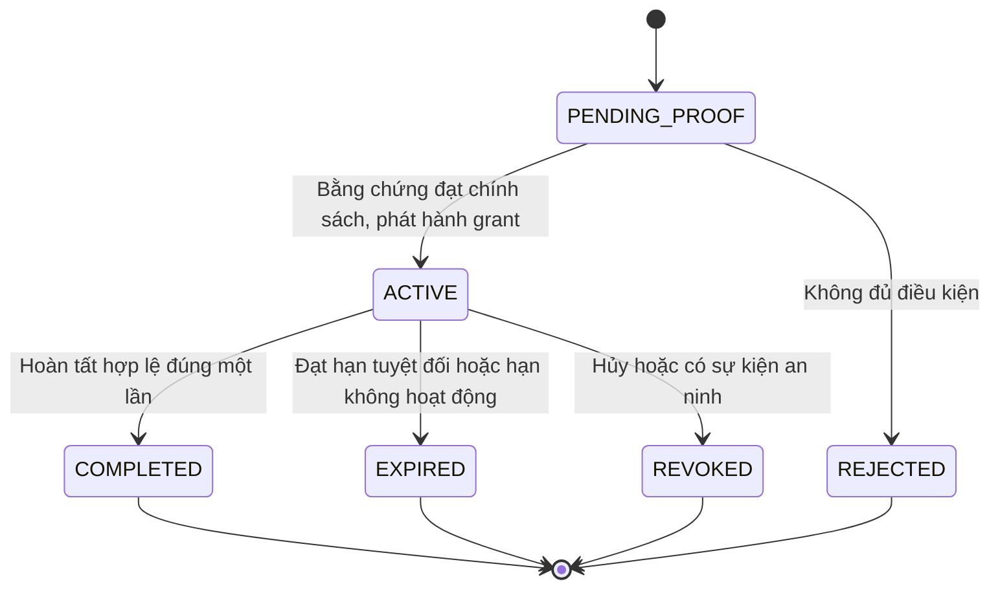
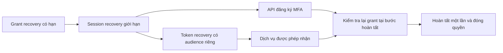

# MFA bypass duration: Giới hạn thời gian quyền khôi phục MFA tạm thời

## 1. Mục tiêu và phạm vi

Trong chương **MFA Recovery** của module `SECURITY_AUTHENTICATION_ACCOUNT_RECOVERY`, bài học này giải thích cách thiết kế **thời hạn bỏ qua yêu cầu MFA thông thường trong một luồng khôi phục được kiểm soát**. Trọng tâm là giảm nguy cơ chiếm đoạt tài khoản khi người dùng mất ứng dụng MFA, passkey hoặc thiết bị xác thực, đồng thời tạo đủ điều kiện để họ đăng ký phương tiện thay thế.

Một thiết kế thiếu chặt chẽ thường có dạng: “bỏ MFA trong mười phút, sau đó bật lại”. Câu nói này chưa trả lời được mười phút tính từ lúc nào, người dùng được làm gì trong khoảng đó, session có sống lâu hơn không, và điều gì xảy ra nếu một request bắt đầu trước nhưng thực hiện thay đổi sau hạn chót.

Trong bài học, **bypass grant** là quyền khôi phục tạm thời do máy chủ cấp sau khi bằng chứng khôi phục đã đạt chính sách. Nó gắn với một tài khoản, một yêu cầu và một tập thao tác hẹp. Cách triển khai ưu tiên là giữ chính sách MFA thông thường của tài khoản, đồng thời mở một đường được cấp quyền riêng để đăng ký phương tiện mới.

Mục tiêu sau bài học:

- Phân biệt hạn dùng mã, thời gian xác minh, thời hạn bypass, timeout session và khoảng hạn chế sau recovery.
- Chọn thời lượng theo phạm vi thao tác, rủi ro và thời gian thực tế để hoàn tất đăng ký.
- Áp dụng hạn tuyệt đối, hạn không hoạt động, số lần sử dụng và thu hồi sớm.
- Bảo đảm refresh, retry, cache và token ở dịch vụ khác không kéo dài quyền.
- Thiết kế trạng thái hết hạn, hoàn tất và hủy mà không để lại một tài khoản được hạ yêu cầu MFA vô thời hạn.

Các thời lượng cụ thể trong bài là **giả định của thiết kế minh họa**, không phải thời hạn MFA bypass do NIST, OWASP hoặc giao thức JWT quy định chung cho mọi hệ thống.

## 2. Xác định quyền tạm trước khi chọn số phút

### 2.1. Phân biệt ba cơ chế thường bị gọi chung là bypass

| Cơ chế | Quyền thực tế | Rủi ro cần xử lý |
| --- | --- | --- |
| Quyền đăng ký lại MFA | Cho thực hiện một luồng enrollment đã được phê duyệt | Bị dùng để gắn phương tiện của kẻ tấn công nếu bằng chứng recovery yếu |
| Session recovery có phạm vi hạn chế | Cho truy cập một số màn hình và API recovery | Bị chấp nhận nhầm như session đăng nhập thông thường |
| Ngoại lệ miễn MFA khi đăng nhập | Cho đăng nhập mà không thực hiện MFA theo quy tắc thường lệ | Có thể mở truy cập rộng và tạo session/token vượt thời hạn ngoại lệ |

Bài học chủ yếu dùng hai cơ chế đầu. Nếu sản phẩm bắt buộc có cơ chế thứ ba, thời hạn ngoại lệ chỉ là một điều kiện; vẫn phải kiểm soát quyền của mọi session được tạo ra từ ngoại lệ đó.

Không dùng chung cờ `mfa_bypassed = true` cho cả ba trường hợp. Cờ này không thể hiện mục đích, tài khoản, thời điểm kết thúc hoặc mức bảo đảm của bằng chứng đã sử dụng.

### 2.2. Phạm vi hẹp giúp thời lượng có ý nghĩa

Một grant minh họa chỉ cho phép:

- Xem trạng thái của yêu cầu recovery hiện tại.
- Bắt đầu và xác minh đăng ký phương tiện thay thế được chính sách cho phép.
- Hoàn tất đúng một giao dịch thay thế.
- Hủy yêu cầu hoặc kết thúc session recovery.

Grant này không cho phép thay email khôi phục, tạo API key, sửa quyền quản trị, xuất dữ liệu hoặc thực hiện giao dịch tài chính. Những thao tác đó cần quyết định cấp quyền riêng.

Grant mười phút với quyền rộng có thể gây thiệt hại ngay trong vài giây đầu. Giảm thời lượng không sửa được lỗi cấp quá nhiều quyền hoặc lỗi xác minh danh tính. Ngược lại, phạm vi hẹp không làm thời hạn trở nên không cần thiết: một grant đăng ký MFA bị đánh cắp vẫn có thể được dùng để giành quyền kiểm soát tài khoản.

### 2.3. Không ghi nhận mức xác thực cao hơn bằng chứng thực tế

Session được tạo từ recovery phải lưu nguồn xác minh và mức bảo đảm thực tế. Không đánh dấu `mfa_satisfied = true` hoặc gán mức xác thực cao chỉ để vượt middleware yêu cầu MFA.

OWASP coi thay phương tiện MFA là thao tác nhạy cảm và khuyến nghị không chỉ dựa vào session đang mở. Xem [OWASP, Changing MFA Factors](https://cheatsheetseries.owasp.org/cheatsheets/Multifactor_Authentication_Cheat_Sheet.html#changing-mfa-factors). Khi mất mọi phương tiện, hệ thống phải áp dụng quy trình recovery thay thế đã được thiết kế và phê duyệt; việc người dùng không thể thực hiện MFA cũ không tự tạo ra quyền bypass.

## 3. Những đồng hồ phải được quản lý riêng

### 3.1. Bảng phân biệt thời hạn

| Thời hạn | Câu hỏi nó trả lời | Có đồng nghĩa với thời hạn bypass không? |
| --- | --- | --- |
| Hạn dùng mã/challenge | Còn được trình mã hoặc kết quả challenge này không? | Không; kiểm soát một bằng chứng cụ thể |
| Độ mới của bằng chứng | Kết quả xác minh trước đó còn đủ mới để cấp quyền hoặc làm bước nhạy cảm không? | Không; tùy chính sách của từng bước |
| Hạn kích hoạt | Grant đã phát hành nhưng chưa kích hoạt còn được bắt đầu dùng không? | Không; cần thêm hạn kết thúc quyền sau kích hoạt |
| Hạn tuyệt đối của grant | Quyền recovery phải dừng muộn nhất lúc nào? | Đây là trần thời gian của quyền |
| Hạn không hoạt động | Người dùng bỏ dở bao lâu thì session recovery phải dừng? | Có thể kết thúc sớm hơn trần tuyệt đối |
| Hạn access token | Token cụ thể còn được chấp nhận không? | Không được làm quyền sống lâu hơn grant |
| Hạn session | Phiên còn được tiếp tục ở mức quyền hiện tại không? | Phụ thuộc cả nguồn quyền và chính sách session |
| Thời gian chờ trước cấp quyền | Khi nào người dùng mới được bắt đầu bước recovery? | Không phải thời gian được phép bypass |
| Khoảng hạn chế sau recovery | Bao lâu một số thao tác giá trị cao còn bị hạn chế? | Là một chính sách sau recovery, không kéo dài bypass |

Một yêu cầu hỗ trợ có thể mở nhiều ngày trong lúc chờ xác minh. Điều đó không có nghĩa người yêu cầu được giữ quyền recovery trong toàn bộ những ngày đó. Chỉ phát hành quyền có thể sử dụng sau khi các điều kiện cấp quyền đã đạt.

Tương tự, một bộ mã dự phòng được lưu từ lâu có thể còn hiệu lực theo chính sách riêng; trình thành công một mã không đồng nghĩa bypass được giữ cùng thời lượng với tuổi thọ của bộ mã.

### 3.2. Hạn tuyệt đối và hạn không hoạt động

**Hạn tuyệt đối** là mốc kết thúc không bị đẩy lùi bởi việc tải lại trang hoặc gửi request. **Hạn không hoạt động** có thể được cập nhật khi có hoạt động hợp lệ, nhưng luôn bị chặn bởi mốc tuyệt đối.

OWASP phân biệt hai loại timeout này và yêu cầu thực thi phía máy chủ. Đồng hồ đếm ngược phía trình duyệt chỉ hỗ trợ trải nghiệm. Xem [OWASP, Session Expiration](https://cheatsheetseries.owasp.org/cheatsheets/Session_Management_Cheat_Sheet.html#session-expiration).

Trong mô hình của bài học, hoạt động có ý nghĩa như gửi yêu cầu đăng ký hợp lệ có thể làm mới hạn không hoạt động. Ping nền, polling hiển thị trạng thái hoặc mở tab không tự gia hạn. Đây là lựa chọn chính sách của ứng dụng, cần được định nghĩa nhất quán để tránh vừa làm người dùng hết phiên bất ngờ vừa cho phép một script giữ phiên vô thời hạn.

### 3.3. Thời hạn session thông thường không phải mặc định cho bypass

NIST mô tả timeout tổng thể và timeout không hoạt động của session, cùng điều kiện xác thực lại. Các giới hạn session phụ thuộc bối cảnh và mức bảo đảm; không nên sao chép một con số timeout session sang quyền recovery. Xem [NIST SP 800-63B-4, Session Management](https://pages.nist.gov/800-63-4/sp800-63b/session/).

Một lần refresh token chỉ chứng minh client còn giữ thông tin để refresh theo cơ chế đã cấp. Nó không tự trở thành một lần xác minh danh tính mới để bắt đầu lại đồng hồ bypass.

## 4. Đặt điểm bắt đầu và điểm kết thúc rõ ràng

### 4.1. Chính sách đơn giản: tính từ khi phát hành

Với grant được dùng ngay sau xác minh, có thể đặt:

```text
issued_at       = thời điểm máy chủ phát hành grant
not_before      = issued_at
absolute_end    = issued_at + allowed_duration

Cho phép về mặt thời gian khi:
    not_before <= now < absolute_end
```

Tại đúng `absolute_end`, grant đã hết hạn. Không dùng điều kiện `now <= absolute_end` nếu chính sách đã định nghĩa khoảng có đầu đóng và cuối mở như trên.

Ví dụ: phát hành lúc 09:00, cho phép tối đa mười phút thì mốc kết thúc là 09:10. Mở trang lần đầu lúc 09:08 không làm mốc đó thành 09:18.

### 4.2. Nếu thời lượng tính từ lần kích hoạt đầu

Một số sản phẩm phát hành thông tin kích hoạt trước khi người dùng sẵn sàng thao tác. Khi đó phải giới hạn cả thời gian chờ và tổng tuổi thọ:

```text
activation_deadline = issued_at + maximum_wait_to_activate
total_deadline      = issued_at + maximum_total_lifetime

Khi kích hoạt hợp lệ lần đầu:
    absolute_end = min(
        activated_at + allowed_active_duration,
        total_deadline,
        approval_hard_deadline
    )
```

Kích hoạt phải là một chuyển trạng thái được bảo vệ, không phải sự kiện mở email hoặc crawler truy cập URL. Chỉ yêu cầu sở hữu link mà không có các ràng buộc cần thiết có thể cho phép người nhận nhầm kích hoạt quyền.

Không ghi lại `activated_at` mỗi lần đăng nhập recovery. Lần kích hoạt đầu phải được xác định nguyên tử; hai request đồng thời không được tạo ra hai mốc kết thúc khác nhau.

### 4.3. Nhiều giới hạn cùng có hiệu lực

Với một session recovery đã hoạt động, mốc kết thúc hữu hiệu có thể là:

```text
effective_end = min(
    grant.absolute_end,
    recovery_session.absolute_end,
    recovery_session.idle_deadline,
    current_policy.hard_stop_at nếu có
)
```

Đây mới là điều kiện về thời gian. Trạng thái thu hồi, tài khoản bị khóa, bằng chứng bị vô hiệu hoặc phiên bản bảo mật thay đổi vẫn có thể chặn quyền trước `effective_end`.

Độ mới của bằng chứng được kiểm tra đúng bước chính sách yêu cầu. Nếu bằng chứng chỉ cần đủ mới khi phát hành grant, không tự coi lúc nó hết độ mới là grant bị thu hồi. Nếu chính sách yêu cầu bằng chứng còn mới ở bước hoàn tất, phải kiểm tra lại tại bước đó. Phân biệt này giúp tránh hai dịch vụ áp dụng thời hạn khác nhau cho cùng một yêu cầu.

## 5. Chọn thời lượng dựa trên thao tác và rủi ro

### 5.1. Cân bằng thời gian hoàn tất và thời gian phơi nhiễm

Thời lượng cần đủ để một người hợp lệ hoàn tất công việc được cấp quyền: chuẩn bị thiết bị mới, thực hiện ceremony, xác minh phương tiện và xác nhận hoàn tất. Cần đo cả trường hợp mạng chậm, người dùng dùng công nghệ hỗ trợ và thao tác trên nhiều thiết bị.

Tuy nhiên, không cấp một grant dài chỉ vì người dùng chưa mua khóa bảo mật mới hoặc bộ phận hỗ trợ chưa xử lý xong hồ sơ. Có thể giữ yêu cầu ở trạng thái chờ mà chưa tạo quyền bypass, rồi phát hành một cửa sổ thao tác ngắn khi họ sẵn sàng.

Rủi ro ảnh hưởng cả quyết định có được cấp quyền hay không. Bằng chứng không đủ mạnh, nghi chiếm tài khoản hoặc dấu hiệu sửa kênh recovery bất thường có thể yêu cầu kiểm tra thêm hoặc từ chối. Không dùng phép đổi “bằng chứng yếu hơn thì bypass ngắn hơn” như một quy tắc bảo đảm an toàn.

### 5.2. Một chính sách minh họa

Giả sử sản phẩm chỉ cho phép session recovery đăng ký lại MFA, không có quyền truy cập nghiệp vụ:

| Thành phần | Giá trị giả định | Ý nghĩa |
| --- | --- | --- |
| Hạn tuyệt đối grant | 10 phút từ lúc phát hành | Trần cố định cho cửa sổ đăng ký |
| Hạn không hoạt động | 3 phút | Kết thúc sớm khi bỏ dở |
| Hạn challenge | Tối đa 2 phút, đồng thời không vượt trần grant | Challenge không sống lâu hơn quyền mẹ |
| Access token recovery | Tối đa 2 phút, đồng thời không vượt trần grant/session | Token được cấp muộn không mở thêm thời gian |
| Số lần hoàn tất | 1 | Thành công thì đóng quyền ngay |
| Gia hạn tự động | Không | Refresh và retry không sửa mốc tuyệt đối |

Các giá trị này chỉ giúp minh họa công thức và tình huống biên. Trước khi áp dụng, cần có dữ liệu về thời gian hoàn tất, đánh giá tác động và khả năng thực thi nhất quán tại các dịch vụ.

Một tài khoản quản trị có thể không được phép dùng loại grant này; chính sách có thể yêu cầu kênh xác minh mạnh hơn hoặc quy trình khác. Không nhất thiết phải tạo một dòng thời lượng cho mọi nhóm tài khoản.

### 5.3. Đo cửa sổ quyền thực tế

Nếu grant kết thúc lúc 09:10 nhưng session sinh từ nó vẫn truy cập được tới 17:00, thời gian phơi nhiễm không dừng ở mười phút. Cần theo dõi đến thời điểm cuối cùng mọi quyền có nguồn gốc từ grant bị dừng hoặc được thay bằng một quyết định xác thực mới hợp lệ.

Những quyền bền vững được tạo trong cửa sổ ngắn cũng cần được xét: refresh token, API key, phương tiện xác thực mới hoặc kênh recovery mới. Đó là lý do grant không được cấp quyền tùy ý tạo các tài nguyên này ngoài mục đích đã phê duyệt.

## 6. Mô hình dữ liệu và vòng đời của grant

### 6.1. Các trường cần lưu

| Nhóm | Trường minh họa | Vai trò |
| --- | --- | --- |
| Chủ thể | `tenant_id`, `account_id`, `recovery_request_id` | Ràng buộc quyền vào đúng tài khoản và hồ sơ |
| Định danh quyền | `grant_id`, `token_digest` nếu dùng token opaque | Tra cứu grant; tránh lưu bản rõ bearer token |
| Phạm vi | `purpose`, `allowed_actions`, `audience` | Giới hạn thao tác và nơi nhận |
| Nguồn cấp | `proof_reference`, `approval_reference`, `issued_by` | Truy vết cơ sở phát hành |
| Thời gian | `issued_at`, `not_before`, `absolute_end`, `activated_at` nếu cần | Giữ các mốc có thẩm quyền phía máy chủ |
| Trạng thái | `state`, `completed_at`, `revoked_at`, `reason_code` | Phân biệt hoàn tất, thu hồi và hết hạn |
| Nhất quán | `record_version`, `security_version`, `policy_version` | Phát hiện thay đổi giữa các bước |
| Ràng buộc session | `recovery_session_ref` | Giới hạn quyền vào session được cấp; không phải bằng chứng chống đánh cắp tuyệt đối |
| Chống lạm dụng | `attempt_count`, giới hạn phát hành theo tài khoản/yêu cầu | Ngăn brute force và tạo grant nối tiếp |

Thông tin session có thể chứa hạn tuyệt đối và hạn không hoạt động riêng. Tách dữ liệu session khỏi grant giúp thấy rõ đóng grant có tác động gì đến phiên đang sử dụng nó.

Ví dụ bản ghi nội bộ đã bỏ token và dữ liệu bằng chứng nhạy cảm:

```json
{
  "grant_id": "BG42",
  "account_ref": "U123",
  "recovery_request_ref": "RC42",
  "purpose": "MFA_REENROLLMENT",
  "allowed_actions": [
    "READ_OWN_RECOVERY_STATUS",
    "START_APPROVED_ENROLLMENT",
    "VERIFY_APPROVED_ENROLLMENT",
    "FINALIZE_ONCE",
    "CANCEL_OWN_RECOVERY"
  ],
  "audience": "recovery-service",
  "issued_at": "2026-11-23T02:00:00Z",
  "not_before": "2026-11-23T02:00:00Z",
  "absolute_end": "2026-11-23T02:10:00Z",
  "state": "ACTIVE",
  "security_version": 17,
  "policy_version": "recovery-duration-3",
  "recovery_session_ref": "RS42"
}
```

Trong ví dụ, UTC 02:00 tương ứng 09:00 tại Việt Nam. Dữ liệu lưu bằng một hệ thời gian thống nhất; giao diện có thể hiển thị múi giờ của người dùng.

`purpose` và `allowed_actions` ở đây là từ vựng ứng dụng, không phải claim chuẩn tự được mọi thư viện hiểu. Mỗi API cần ánh xạ rõ thao tác được phép và kiểm tra phía máy chủ.

### 6.2. Máy trạng thái



Đây là máy trạng thái nghiệp vụ gộp hồ sơ và grant. Ở mức lưu trữ, có thể chưa tồn tại grant khi hồ sơ còn `PENDING_PROOF`. Không nên tạo một grant sử dụng được trước rồi hy vọng một trường trạng thái ở hệ thống khác sẽ chặn nó.

Các trạng thái kết thúc không được đổi ngược thành `ACTIVE` chỉ bằng cách sửa thời gian. Nếu chính sách cho phép cấp lại, đó là một quyết định mới có định danh, bằng chứng và audit riêng.

### 6.3. Hết hạn logic khác với cập nhật trạng thái trong cơ sở dữ liệu

Một bản ghi vẫn có thể ghi `state = ACTIVE` khi đồng hồ đã qua `absolute_end` và tác vụ nền chưa chạy. Bộ kiểm tra quyền phải từ chối dựa trên thời gian, không chờ tác vụ đổi trạng thái thành `EXPIRED`.

Tương tự, TTL của kho cache chủ yếu hỗ trợ loại bỏ bản ghi đúng lúc hoặc gần đúng lúc. Không dùng việc “key còn tồn tại” làm điều kiện đầy đủ để cho phép thao tác. Bản ghi cần chứa hạn cuối và được kiểm tra theo thời gian có thẩm quyền.

## 7. Thực thi thời hạn ở điểm quyết định có thẩm quyền

### 7.1. Điều kiện cho phép gồm nhiều thành phần

Một grant chỉ được sử dụng khi tất cả điều kiện liên quan đều đạt:

```text
allow =
    đúng tenant, tài khoản, session và yêu cầu
    AND grant đang hoạt động và chưa bị tiêu thụ
    AND yêu cầu recovery chưa hủy/đóng
    AND not_before <= trusted_now < effective_end
    AND thao tác nằm trong allowed_actions
    AND bằng chứng cần cho bước này hợp lệ và đủ mới
    AND trạng thái bảo mật và chính sách hiện hành còn cho phép
```

Thời hạn là một điều kiện bắt buộc, không thay thế các điều kiện còn lại. Token còn thời gian cũng không làm grant đã bị thu hồi trở nên hợp lệ.

### 7.2. Pseudocode cho bước hoàn tất

Ví dụ sau minh họa một ranh giới giao dịch cục bộ. Nó không tự cung cấp giao dịch nguyên tử với IdP bên ngoài:

```text
function finalizeEnrollment(session, grantId, enrollmentId, requestKey):
    verifyRequestProtectionAndSession(session)
    verifyEnrollmentProtocolResult(enrollmentId)

    begin transaction
        grant = loadGrantWithConcurrencyControl(grantId)
        account = loadAccountWithConcurrencyControl(grant.accountId)
        enrollment = loadPendingEnrollment(enrollmentId)
        recoverySession = loadRecoverySession(session.id)
        policy = loadPolicyForDecision(account)

        now = trustedTimeAtDecision()

        require grant.belongsTo(account, session, enrollment.recoveryRequestId)
        require enrollment.isVerifiedAndBoundTo(grant)
        require grant.state == ACTIVE
        require grant.allows(FINALIZE_ONCE)
        require recoveryRequestIsOpen(grant.recoveryRequestId)
        require securityContextStillValid(grant, account, policy)
        require proofRequirementsSatisfiedForThisStep(grant, now, policy)
        require grant.notBefore <= now
        require now < effectiveEnd(grant, recoverySession, policy)

        activateApprovedBinding(enrollment)
        markGrantCompleted(grant, requestKey)
        closeRecoverySession(recoverySession)
        applyRequiredCredentialAndSessionRevocations(account)
        advanceSecurityVersion(account)
        appendAuditAndOutboxEvents()
    commit transaction

    return completionStatusWithoutReopeningGrant()
```

Các hàng và phiên bản liên quan phải được phối hợp sao cho một request khác không thể thu hồi grant hoặc thay chính sách giữa lần kiểm tra và lần thay đổi mà vẫn bị bỏ qua. Cách cụ thể có thể là khóa phù hợp, cập nhật có điều kiện hoặc cơ chế kiểm soát cạnh tranh tương đương.

Nếu việc xác minh giao thức được thực hiện ngoài giao dịch để tránh giữ khóa lâu, kết quả phải được lưu phía máy chủ, gắn với enrollment và được kiểm tra lại về trạng thái, mục đích, thời hạn và quyền sử dụng trong giao dịch. Không tin một cờ `verified` do client gửi.

### 7.3. Chọn rõ mốc được dùng để xét hạn

Giả sử request tới API lúc 09:09:59 nhưng chờ khóa cơ sở dữ liệu đến 09:10:02, trong khi grant hết hạn lúc 09:10. Nếu chỉ lấy giờ ở middleware đầu request, thao tác có thể được cho phép sai.

Trong thiết kế này, mốc xét quyền là **thời điểm quyết định nhạy cảm được tuần tự hóa cùng thay đổi trạng thái**, sau những bước chờ liên quan. Điều kiện thời gian và việc tiêu thụ quyền phải được phối hợp với nhau. Không lấy timestamp từ client hoặc từ đầu request rồi tái sử dụng sau một lần chờ dài.

Cần hiểu semantics của nguồn thời gian được chọn. Có hệ thống cơ sở dữ liệu cung cấp giá trị thời gian cố định từ đầu giao dịch; nếu dùng giá trị đó sau khi chờ lâu, nó có thể không phản ánh thời điểm quyết định. Triển khai phải chọn cách lấy giờ phù hợp và có giới hạn thời gian xử lý.

Một quyết định hợp lệ đã được thực hiện trước hạn có thể có response về tới người dùng sau hạn. Thời điểm nhận response không làm quyết định trước đó hết hiệu lực. Ngược lại, chỉ nhận request trước hạn không giữ chỗ quyền cho công việc nhạy cảm sẽ diễn ra sau hạn.

### 7.4. Dùng thời gian phía máy chủ một cách nhất quán

Lưu các mốc dưới dạng instant thống nhất, tránh cộng trừ trên chuỗi giờ địa phương. Thay múi giờ, chuyển giờ mùa hè hoặc sửa đồng hồ trên điện thoại không được thay đổi hạn của grant.

Đồng hồ đơn điệu có ích để đo thời gian xử lý trong một tiến trình, nhưng không tự thay thế timestamp bền vững dùng qua nhiều máy và sau restart. Hệ thống phân tán cần nguồn giờ đáng tin cậy, giám sát độ lệch và chính sách khi không thể bảo đảm độ mới của thời gian.

Nếu đồng hồ có thể lùi đáng kể hoặc một node lệch quá mức cho phép, không được âm thầm làm quyền sống lại. Có thể ngừng cấp/quyết định quyền recovery trên node đó và chuyển sang thành phần có thẩm quyền. Khi hệ thống không thể kiểm tra điều kiện hết hạn, bước nhạy cảm phải bị từ chối thay vì mặc định cho qua.

## 8. Session, token và dịch vụ khác không được vượt quyền mẹ

### 8.1. Kế thừa trần thời gian

Một challenge hoặc token con không được có hạn cấp quyền vượt mốc của quyền mẹ:

```text
child_end = min(
    now + configured_child_lifetime,
    parent_grant.absolute_end,
    recovery_session.absolute_end
)
```

Hạn không hoạt động có thể thay đổi khi có hoạt động hợp lệ; dịch vụ vẫn cần kiểm tra hạn hiện hành. Chỉ chép hạn tuyệt đối vào token không thực thi được hạn không hoạt động hoặc thu hồi sớm.

Nếu grant kết thúc lúc 09:10, phát hành token lúc 09:09 với cấu hình hai phút thì hạn token không được trở thành 09:11. Mốc cuối phải bị chặn ở 09:10, và token còn có thể bị từ chối sớm hơn vì trạng thái session/grant.

### 8.2. JWT không tự biết grant đã bị đóng

RFC 7519 quy định ý nghĩa của `exp` và cho phép khoảng dung sai nhỏ để xử lý lệch đồng hồ. Dung sai không phải cơ chế gia hạn nghiệp vụ. Xem [RFC 7519, mục 4.1.4](https://www.rfc-editor.org/rfc/rfc7519.html#section-4.1.4).

Trong thiết kế có mốc dừng cứng cho recovery, bộ kiểm tra có thẩm quyền vẫn phải xét `absolute_end` và trạng thái grant. Không dùng cấu hình dung sai chung của thư viện để cho phép bước hoàn tất sau mốc đó.

Chữ ký JWT hợp lệ chỉ cho biết token đáp ứng kiểm tra mật mã tương ứng; còn phải kiểm tra issuer, audience, mục đích, thời gian và điều kiện cấp quyền. Một API nghiệp vụ không được nhận token recovery chỉ vì nó được ký bằng cùng khóa với token đăng nhập.

Token tự chứa được xác minh hoàn toàn ngoại tuyến không nhận biết ngay việc grant bị hủy hoặc hoàn tất. Nếu cần dừng quyền tức thời, nơi chấp nhận phải kiểm tra trạng thái có thẩm quyền hoặc sử dụng cơ chế thu hồi tương đương. Token ngắn hạn đơn thuần chỉ giảm khoảng trễ, không biến nó thành bằng không.

### 8.3. Cache và độ trễ thu hồi

Trong OAuth, introspection là một cơ chế để resource server hỏi trạng thái token; RFC 7662 lưu ý việc cache kết quả có thể tạo khoảng thời gian chấp nhận token đã bị thu hồi. Xem [RFC 7662, Security Considerations](https://www.rfc-editor.org/rfc/rfc7662.html#section-4).

Nếu dịch vụ cache quyết định `allow`, hạn cache không được vượt hạn grant/token. Đối với bước hoàn tất đăng ký, có thể cần đọc trạng thái hiện tại tại nơi có thẩm quyền thay vì chấp nhận một quyết định `allow` cũ.

Đây là hai yêu cầu khác nhau:

- **Không chấp nhận sau hạn tuyệt đối:** cần xét thời gian và hạn cuối tại nơi quyết định.
- **Không chấp nhận sau thu hồi sớm:** cần trạng thái đủ mới hoặc cơ chế vô hiệu hóa đồng bộ thích hợp.

Pub/sub hoặc sự kiện hỗ trợ giảm độ trễ, nhưng không tự bảo đảm mọi consumer luôn nhận sự kiện đúng lúc. Phải xác định hành vi khi mất kết nối, cache lỗi hoặc nguồn trạng thái không truy cập được.

### 8.4. Kiểm soát mọi đường sử dụng quyền



Kiểm tra không chỉ áp dụng trên màn hình web. API di động, kết nối thời gian dài và công việc nền cũng cần giữ thông tin về nguồn quyền. Một kết nối được mở trước hạn không được tiếp tục gửi lệnh nhạy cảm vô thời hạn; mỗi thông điệp liên quan phải được cấp quyền theo chính sách hiện tại.

## 9. Gia hạn, phát hành lại và retry

### 9.1. Hoạt động không tạo lại hạn tuyệt đối

Những sự kiện sau không được tự đặt lại `issued_at` hoặc `absolute_end`:

- Tải lại trang hay đổi tab.
- Polling trạng thái, heartbeat hoặc gọi API đọc thông tin.
- Refresh access token hoặc xoay session ID.
- Gửi lại cùng một request vì mạng chậm.
- Phát hành challenge mới sau một lần nhập sai trong giới hạn cho phép.

Nếu challenge cần được cấp lại, hạn challenge mới vẫn không vượt hạn grant. Việc nhập sai còn phải chịu giới hạn số lần thử và chính sách chống lạm dụng, không chỉ chịu timeout.

### 9.2. Cấp lại phải là một quyết định mới

Nếu hết thời gian trước khi người hợp lệ hoàn tất, ứng dụng có thể cho bắt đầu lại theo chính sách. Quy trình đó cần xác định bằng chứng nào phải kiểm tra lại, bằng chứng nào còn đủ mới, và có cần đánh giá rủi ro hoặc phê duyệt mới không.

Trong mô hình minh họa, chỉ một grant đang hoạt động cho cùng mục đích và yêu cầu. Khi phát hành grant thay thế, đóng grant trước và các session phụ thuộc theo một quy trình nhất quán. Không để hai cửa sổ quyền chồng nhau ngoài ý muốn.

Giới hạn tần suất phải tính theo tài khoản, hồ sơ và nguồn phù hợp; không chỉ đếm theo `grant_id`. Nếu mỗi lần hết hạn đều được tự tạo grant mới vô điều kiện, hệ thống đã biến nhiều cửa sổ ngắn thành một ngoại lệ không có điểm dừng.

### 9.3. Idempotency không đồng nghĩa phát hành lại quyền

Hai request retry có cùng khóa idempotency có thể nhận cùng kết quả nghiệp vụ, nhưng không được nhận một grant mới có hạn dài hơn. Kết quả idempotency cần gắn với tài khoản, hành động và nội dung thích hợp để tránh dùng nhầm giữa người dùng hoặc giao dịch.

Nếu bước hoàn tất đã thành công và response bị mất, retry sau hạn có thể trả trạng thái đã hoàn tất qua kênh kiểm tra trạng thái được cấp quyền riêng. Nó không được thực hiện enrollment lần thứ hai, khôi phục bearer token cũ hoặc mở lại grant đã đóng.

“Dùng một lần” cũng cần được định nghĩa rõ. Một session enrollment có thể cần nhiều HTTP request; chỉ có thao tác hoàn tất được tiêu thụ đúng một lần. Đừng tiêu thụ grant ở lần tải giao diện đầu tiên rồi buộc người dùng xin bypass mới cho từng bước.

## 10. Ví dụ theo dòng thời gian

### 10.1. Giả định

Người dùng U123 mất điện thoại có ứng dụng TOTP. Quy trình RC42 đã kiểm tra bằng chứng recovery đạt chính sách. Máy chủ cấp grant BG42 lúc 09:00 giờ Việt Nam, với các giới hạn minh họa ở mục 5:

- Kết thúc tuyệt đối lúc 09:10.
- Hết phiên nếu không có hoạt động hợp lệ trong ba phút.
- Chỉ cho đăng ký và hoàn tất một phương tiện thay thế.
- Token/challenge con không vượt hạn của grant.

Việc mất điện thoại không tự làm mật khẩu đủ để cấp BG42. Giả định bằng chứng đạt chính sách là một điều kiện đầu vào của ví dụ, không phải bước được phép bỏ qua.

### 10.2. Một chuỗi hoạt động hợp lệ

| Thời điểm | Sự kiện | Hạn không hoạt động sau xử lý | Hạn tuyệt đối |
| --- | --- | --- | --- |
| 09:00 | Phát hành grant và session recovery | 09:03 | 09:10 |
| 09:02 | Bắt đầu enrollment hợp lệ | 09:05 | 09:10 |
| 09:04 | Thực hiện bước enrollment hợp lệ | 09:07 | 09:10 |
| 09:06 | Tiếp tục bước xác minh được cho phép | 09:09 | 09:10 |
| 09:08 | Hoạt động hợp lệ tiếp theo | Không muộn hơn 09:10 | 09:10 |

Nếu một token con có thời lượng cấu hình hai phút được cấp lúc 09:08:30, hạn của nó bị chặn ở 09:10, thay vì 09:10:30. Nếu thao tác lúc 09:08 chỉ là polling nền không được tính hoạt động, hạn không hoạt động không tự đổi theo bảng; bảng giả định đó là một hoạt động được chính sách chấp nhận.

### 10.3. Các kết cục độc lập của ví dụ

**Nhánh A — hoàn tất sớm:** lúc 09:09, hệ thống kiểm tra lại mọi điều kiện, kích hoạt binding mới và chuyển BG42 sang `COMPLETED` trong giao dịch hợp lệ. Quyền bypass kết thúc ngay lúc hoàn tất, không tiếp tục tồn tại đến 09:10. Muốn truy cập nghiệp vụ, người dùng cần đi qua bước xác thực và cấp session thông thường theo chính sách sau recovery.

**Nhánh B — hết hạn:** người dùng chưa hoàn tất khi tới 09:10. Một request lúc 09:10 bị từ chối dù bản ghi chưa được tác vụ nền chuyển sang `EXPIRED`. Đến 09:12 tác vụ dọn dữ liệu mới chạy cũng không tạo thêm hai phút quyền.

**Nhánh C — request vượt ranh giới thời gian:** request đến lúc 09:09:59 nhưng chờ một tài nguyên đến 09:10:02 mới quyết định thay đổi. Bước hoàn tất bị từ chối vì điều kiện thời gian được kiểm tra tại điểm quyết định có thẩm quyền, không phải chỉ ở lúc nhận request.

**Nhánh D — bỏ dở sớm:** với một lịch sử khác, người dùng chỉ hoạt động đến 09:04 rồi dừng. Session kết thúc lúc 09:07 vì không hoạt động. Mốc tuyệt đối 09:10 không bảo đảm họ vẫn được dùng quyền đến 09:10.

### 10.4. Hoàn tất enrollment chưa phải đăng nhập thông thường

Xác minh một mã từ TOTP mới hoặc một kết quả WebAuthn mới cho biết người đang thao tác kiểm soát phương tiện mới tương ứng. Nó không tự chứng minh quy trình recovery ban đầu đã xác minh đúng chủ tài khoản; điều kiện cấp quyền recovery vẫn phải hợp lệ ở bước hoàn tất.

Sau khi đăng ký hợp lệ, nên đóng session recovery và yêu cầu một quyết định xác thực mới đáp ứng chính sách thông thường, với định danh session mới khi cấp phiên. Những hạn chế sau recovery, nếu có, vẫn được kiểm tra độc lập. Không chỉ sửa `session.type` từ `RECOVERY` thành `NORMAL` và giữ nguyên mọi quyền cũ.

## 11. Hết hạn, hủy và công việc dở dang

### 11.1. Hết hạn phải tạo trạng thái an toàn

Khi bypass kết thúc mà enrollment chưa hoàn tất:

- Grant không còn được sử dụng để cấp quyền thao tác.
- Session recovery và token phụ thuộc không tiếp tục có quyền recovery.
- Challenge hoặc giao dịch đăng ký chưa hoàn tất không được tự kích hoạt credential sau đó.
- Dữ liệu tạm được xử lý theo chính sách lưu giữ và dọn dẹp phù hợp với loại authenticator.
- Hồ sơ vẫn có thể giữ tiến độ không nhạy cảm để hướng dẫn người dùng bắt đầu lại qua bước được kiểm soát.

Nếu đã tạo TOTP seed nhưng chưa hoàn tất đăng ký, không coi seed đó là binding đang hoạt động. Sau hết hạn, quy trình mới cần quyết định có thể tái sử dụng dữ liệu nào an toàn; mặc định không tiếp tục một giao dịch mật mã đã bị vô hiệu chỉ để tiết kiệm thao tác.

Không tự khôi phục credential cũ đã bị thu hồi vì nghi lộ chỉ để người dùng đỡ bị khóa. Trạng thái credential và trạng thái ngoại lệ là hai vấn đề riêng: hết bypass phải chấm dứt ngoại lệ, còn việc phục hồi quyền truy cập cần tiếp tục theo chính sách recovery.

### 11.2. Không dựa vào tác vụ “bật MFA lại”

Mẫu triển khai sau có khoảng hở:

```text
Khi bắt đầu: cập nhật mfa_enabled = false
Sau 10 phút: cron cập nhật mfa_enabled = true
```

Nếu cron lỗi, trạng thái yếu hơn có thể tồn tại lâu hơn dự kiến. Nếu đăng nhập trong khoảng đó tạo session dài hạn, bật lại MFA cũng chưa chắc làm session hết hiệu lực.

Thiết kế grant có hạn tránh phụ thuộc này: chính sách MFA thông thường vẫn tồn tại, và mỗi thao tác recovery chỉ được phép khi grant còn hợp lệ. Nếu hệ thống cũ bắt buộc dùng ngoại lệ ở mức tài khoản, mọi nơi đánh giá ngoại lệ phải xét mốc kết thúc có thẩm quyền; một boolean cùng tác vụ phục hồi chạy sau là chưa đủ.

### 11.3. Queue, callback và IdP bên ngoài

Một công việc được đưa vào queue lúc grant còn hạn chưa có nghĩa được phép kích hoạt MFA nhiều phút sau khi grant hết hạn. Job phải mang tham chiếu giao dịch và kiểm tra lại quyền tại bước có tác động bảo mật. Tùy quy trình, có thể lưu kết quả xác minh để người dùng tiếp tục sau khi đạt một quyết định recovery mới, nhưng không âm thầm kích hoạt bằng quyền cũ.

Callback từ IdP cũng cần gắn với đúng enrollment, yêu cầu, trạng thái và quyền sử dụng. Callback đến muộn không tự được kéo dài BG42.

Khi thay đổi credential thực sự diễn ra ở IdP, một transaction của ứng dụng không thể tự bảo đảm nguyên tử với transaction ở IdP. Cần thiết kế điểm mà IdP thực thi quyền có hạn, cơ chế điều phối và đối soát trạng thái, cùng hành động xử lý khi hai bên không nhất quán. Không được báo “đã hủy đăng ký” nếu credential đã hoạt động ở nguồn ngoài mà chưa được vô hiệu hóa.

Nếu nhà cung cấp chỉ hỗ trợ ngoại lệ MFA ở phạm vi rộng hoặc không thực thi được giới hạn cần thiết, ứng dụng phải xét lại khả năng dùng cơ chế đó cho luồng này. Một bộ đếm thời gian trên trang web không thể bổ sung bảo đảm mà nơi cấp quyền thực sự không hỗ trợ.

### 11.4. Sự kiện chấm dứt sớm

Ngoài timeout, có thể cần đóng quyền khi người dùng hủy, phát hiện chiếm tài khoản, hồ sơ recovery bị bác bỏ hoặc chính sách yêu cầu đánh giá lại sau một thay đổi bảo mật. Đóng sớm phải phối hợp với những session, token và job phụ thuộc.

Không cho phép một người chưa được xác minh liên tục hủy hoặc cấp lại grant của nạn nhân. Các thao tác hủy, báo gian lận và yêu cầu bắt đầu lại đều cần được thiết kế để giảm cả chiếm đoạt lẫn từ chối dịch vụ.

## 12. Trải nghiệm người dùng và quy trình hỗ trợ

### 12.1. Thông báo đúng về quyền và thời hạn

Giao diện recovery có thể hiển thị:

```text
Bạn có quyền đăng ký lại phương tiện xác thực cho yêu cầu này.
Quyền kết thúc muộn nhất lúc 09:10 hôm nay (giờ Việt Nam).
Phiên cũng có thể kết thúc sớm nếu không có hoạt động trong 3 phút.

Hãy chuẩn bị thiết bị mới trước khi tiếp tục.
Nếu hết thời gian, bạn sẽ được hướng dẫn kiểm tra điều kiện để bắt đầu lại.
```

Máy chủ trả mốc kết thúc và thông tin giờ cần thiết để giao diện tính phần thời gian còn lại. Đồng hồ phía client không quyết định quyền. Khi server báo hết hạn, giao diện phải ngừng trình bày thao tác như vẫn có thể thực hiện dù bộ đếm cục bộ còn vài giây.

Cho cảnh báo sắp hết hạn ở thời điểm hữu ích, nhưng không tự thêm “thời gian ân hạn” sau khi người dùng đã được thông báo mốc kết thúc. Nếu chính sách cần một khoảng dự phòng cho thao tác, hãy tính nó vào thời lượng được cấp và thực thi nhất quán.

### 12.2. Không ép người dùng làm nhanh bằng cách giảm chất lượng xác minh

Người dùng cần đọc và xác nhận đúng thao tác đang thực hiện. Một cửa sổ quá ngắn có thể làm tăng việc xin hỗ trợ và khuyến khích nhân viên tạo ngoại lệ ngoài quy trình. Có thể cải thiện bằng hướng dẫn chuẩn bị trước khi cấp grant, giảm bước thừa hoặc sửa độ trễ hệ thống.

Không vì gần hết hạn mà bỏ xác minh phương tiện mới, yêu cầu họ gửi seed/QR cho nhân viên hỗ trợ hoặc tắt kiểm tra rủi ro. Thời gian hoàn tất nên được đo từ khi thực sự cấp quyền, tách khỏi thời gian chờ hỗ trợ trước đó.

### 12.3. Nhân viên hỗ trợ không được tùy ý sửa hạn cuối

Nếu nhân viên có quyền phát hành grant, hệ thống cần giới hạn loại grant, phạm vi tài khoản, trần thời lượng và điều kiện phê duyệt. Tài khoản nhạy cảm có thể cần kiểm soát bổ sung theo chính sách.

Mỗi quyết định cấp lại phải có mã lý do và cơ sở xác minh. Không cung cấp thao tác tùy ý “thêm một ngày” vào grant đang hoạt động mà không đánh giá lại. Một hồ sơ hỗ trợ vẫn đang mở không tự kéo dài quyền đã cấp.

Thông báo về sự kiện recovery nên đi qua kênh đã được thiết lập và phù hợp với tình huống. Không đặt bearer token, mã bypass hoặc nội dung nhạy cảm vào log, thông báo hỗ trợ hay URL có nguy cơ bị ghi lại ngoài ý muốn.

## 13. Sai lầm và dữ liệu cần quan sát

### 13.1. Những lỗi làm thời hạn mất hiệu lực

| Sai lầm | Hậu quả | Cách xử lý trong thiết kế |
| --- | --- | --- |
| Chỉ dùng đồng hồ đếm ngược trên giao diện | Client có thể tiếp tục gọi API sau khi trang hết giờ | Kiểm tra thời gian phía máy chủ ở mọi thao tác liên quan |
| Dùng sliding timeout mà không có trần tuyệt đối | Gửi request liên tục giữ quyền mãi | Giữ hạn tuyệt đối không đổi |
| Tính lại hạn từ lần refresh | Token mới nối dài cửa sổ bypass | Mọi quyền con kế thừa trần của grant |
| Chỉ kiểm tra quyền lúc mở trang | Request hoàn tất muộn vẫn có thể đổi MFA | Kiểm tra lại tại điểm quyết định nhạy cảm |
| Chờ TTL hoặc cron xóa bản ghi mới chặn | Quyền sống thêm khi dọn dữ liệu chậm | Tách hết hạn logic khỏi dọn dữ liệu |
| Dùng cache `allow` quá lâu | Thu hồi hoặc hết hạn chưa được phản ánh | Ràng buộc hạn cache và kiểm tra nguồn có thẩm quyền khi cần |
| Coi grant đã hoàn tất là vẫn còn hạn để dùng lại | Có thể đăng ký thêm phương tiện ngoài quyết định ban đầu | Tiêu thụ đúng một lần và đóng quyền ngay |
| Cấp grant mới vô điều kiện sau mỗi lần hết hạn | Tạo bypass không có điểm dừng bằng các lần cấp nối tiếp | Xác minh lại theo chính sách và giới hạn phát hành |
| Thay trạng thái session thành xác thực đầy đủ | Che mất nguồn quyền và mức bảo đảm | Cấp session mới qua quyết định xác thực phù hợp |
| Chấp nhận job/callback chỉ vì được tạo trước hạn | Thay đổi nhạy cảm diễn ra sau khi quyền đã hết | Kiểm tra lại quyền tại nơi thực hiện thay đổi |

### 13.2. Audit cho quyết định thời gian

Một sự kiện audit có thể chứa định danh hồ sơ/grant, tài khoản tham chiếu, thao tác, tác nhân, thời điểm quyết định, hạn hữu hiệu, phiên bản chính sách, kết quả và mã lý do. Những mốc này giúp phân biệt hết hạn tuyệt đối, hết hạn không hoạt động, thu hồi sớm và xung đột phiên bản.

Không ghi bearer token, mã recovery, TOTP seed hoặc session secret vào audit. Hệ thống điều tra cần định danh tham chiếu, không cần bí mật để tái sử dụng quyền.

Các chỉ số hữu ích gồm:

- Thời gian từ phát hành grant đến hoàn tất, theo phân vị và loại enrollment.
- Tỷ lệ hết hạn trước hoàn tất, phân biệt nguyên nhân không hoạt động và hạn tuyệt đối.
- Số lần phát hành lại theo cùng tài khoản/yêu cầu trong một khoảng thời gian.
- Số request bị chặn ở bước cuối do quyền hết hạn sau khi đã bắt đầu xử lý.
- Độ trễ dừng quyền sau thu hồi sớm tại từng nơi chấp nhận session/token.
- Số hoạt động nhạy cảm được chấp nhận ngoài hạn hoặc sau khi grant đã hoàn tất; đây là tín hiệu cần điều tra thiết kế thực thi.

Khi điều chỉnh thời lượng, dùng cả dữ liệu hoàn tất và dữ liệu phơi nhiễm quyền. Tăng tỷ lệ hoàn tất bằng cách cho phép session rộng tồn tại lâu hơn có thể làm chỉ số trải nghiệm đẹp lên nhưng làm sai mục tiêu bảo mật. Một chính sách có thể giải thích được phải chỉ rõ ai được nhận quyền, quyền làm được gì, bắt đầu và kết thúc khi nào, sự kiện nào đóng sớm, và nơi nào thực thi từng điều kiện đó.
