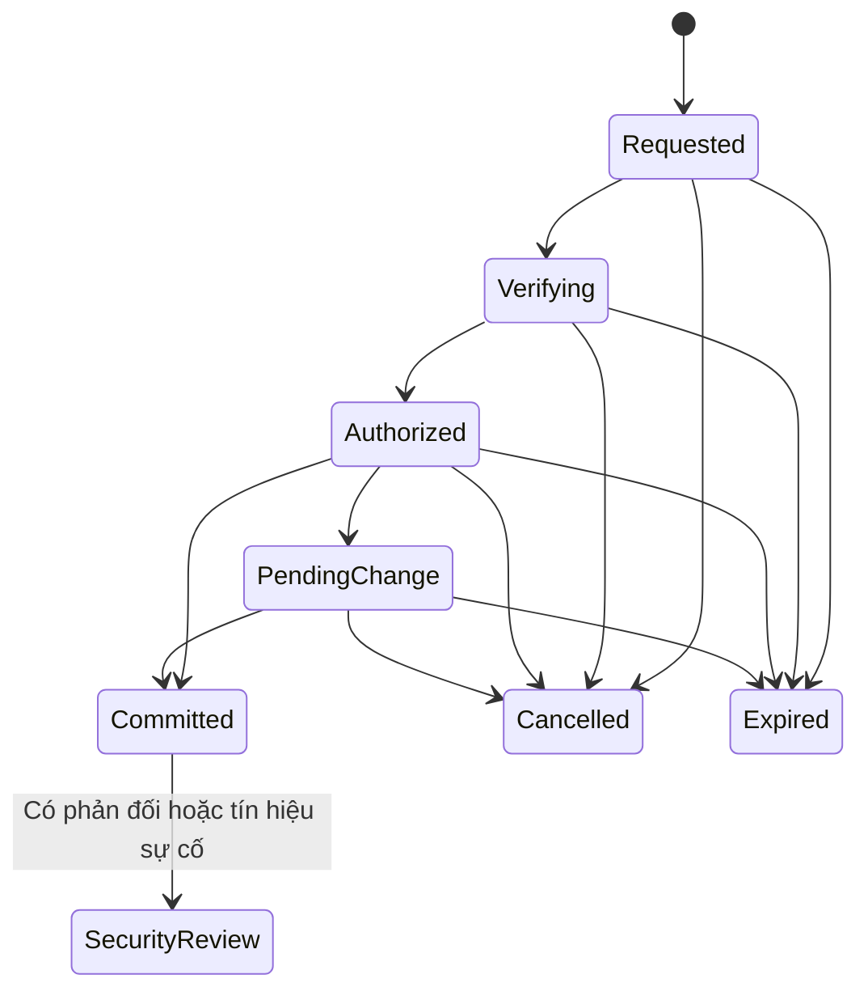
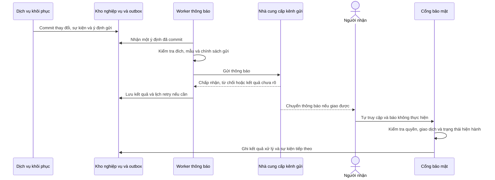

# Thông báo trong luồng khôi phục MFA

## 1. Thông báo giúp phát hiện và phản ứng với thay đổi trái phép

Trong chương **MFA Recovery**, **MFA recovery notification** là các thông báo cho chủ tài khoản hoặc người được chỉ định biết một sự kiện khôi phục MFA đã xảy ra, đang chờ thực hiện hoặc đã làm thay đổi phương thức xác thực. Thông báo cần giúp người nhận hiểu đúng trạng thái và biết cách phản ứng nếu họ không thực hiện hành động đó.

Trong phạm vi `SECURITY_AUTHENTICATION_ACCOUNT_RECOVERY`, người dùng có thể mất mật khẩu, ứng dụng OTP, passkey, khóa bảo mật hoặc thiết bị xác thực. Dịch vụ cần hỗ trợ lấy lại quyền truy cập nhưng vẫn giảm nguy cơ chiếm đoạt tài khoản. Một luồng xác minh tốt vẫn có thể để lại khoảng trống nếu thay MFA diễn ra âm thầm, cảnh báo bị gửi vào kênh vừa bị đối thủ thay, hoặc nút “Không phải tôi” lại trở thành đường cấp quyền tài khoản.

Ví dụ, Mai mất điện thoại chứa ứng dụng OTP. Sau khi hoàn tất quy trình khôi phục, Mai đăng ký một phương thức mới. Thông báo cần mô tả đúng việc đã thay đổi và đường báo sự cố. Nếu đối thủ thực hiện cùng hành động bằng bằng chứng bị đánh cắp, cảnh báo gửi tới một kênh còn an toàn có thể giúp Mai phát hiện và yêu cầu ngăn chặn sớm.

Có ba trách nhiệm riêng:

| Trách nhiệm | Câu hỏi phải trả lời |
|---|---|
| Xác minh và cấp quyền khôi phục | Người yêu cầu có đủ bằng chứng để thay MFA của tài khoản này không? |
| Thông báo | Chủ thể liên quan có được biết đúng sự kiện qua kênh phù hợp không? |
| Ứng phó và kiểm soát quyền | Nếu sự kiện bị phản đối, hệ thống ngăn những quyền nào, dựa trên quyền hoặc bằng chứng nào? |

Gửi được email không thay cho xác minh danh tính. Người nhận không phản hồi không đồng nghĩa đồng ý. Một thông báo “thành công” cũng không chứng minh mọi session của đối thủ đã bị thu hồi.

Các luồng, tên sự kiện và mô hình dữ liệu trong bài là thiết kế tham khảo để triển khai theo chính sách của dịch vụ.

## 2. Chọn sự kiện cần thông báo theo vòng đời khôi phục

### 2.1. Phân biệt nhận yêu cầu với thay đổi đã commit

Một giao dịch khôi phục có thể đi qua các trạng thái:



Không phải mọi sản phẩm đều cần trạng thái chờ `PendingChange`. Nếu có thời gian chờ, nó phải là một phần của chính sách khôi phục, không phải một con số được thêm tùy ý trong mẫu email.

| Sự kiện tham khảo | Ý nghĩa | Nội dung có thể thông báo |
|---|---|---|
| `MFA_RECOVERY_REQUESTED` | Đã ghi nhận một yêu cầu | Chưa xác nhận danh tính, chưa đổi MFA |
| `MFA_RECOVERY_CHANGE_SCHEDULED` | Đã đủ quyền và có thay đổi đang chờ | Hành động dự kiến, thời điểm hiệu lực, cách báo trái phép |
| `MFA_RECOVERY_COMPLETED` | Kết quả khôi phục đã được commit | Thay đổi thực tế và bước bảo vệ tiếp theo |
| `MFA_FACTOR_BOUND` | Phương thức mới đã được gắn | Loại phương thức và thời điểm gắn |
| `MFA_FACTOR_REVOKED` | Phương thức cụ thể đã bị thu hồi | Phạm vi đã ngừng chấp nhận |
| `MFA_RECOVERY_CANCELLED` | Giao dịch đã hủy trước khi hoàn tất | Yêu cầu nào đã dừng, điều gì chưa thay đổi |
| `MFA_RECOVERY_DISPUTED` | Có phản đối về giao dịch | Đã nhận báo cáo và trạng thái xử lý thực tế |

Một lần hoàn tất có thể tạo cả sự kiện khôi phục và sự kiện gắn phương thức. Dịch vụ có thể dùng một thông báo tổng hợp nếu vẫn thể hiện đầy đủ sự kiện và đáp ứng chính sách áp dụng; không nhất thiết gửi hai nội dung gần giống nhau.

Thông báo cho từng lần nhập OTP sai hoặc từng yêu cầu khôi phục công khai cần được cân nhắc chống lạm dụng. Ngược lại, thay đổi phương thức đã commit không được vô tình bị bỏ qua vì bộ chống spam đang gộp các yêu cầu trước đó.

### 2.2. Phân biệt yêu cầu của chuẩn với lựa chọn thiết kế

NIST SP 800-63B-4 yêu cầu thông báo khi khôi phục tài khoản và có quy định về địa chỉ nhận, kể cả các trường hợp phải gửi bưu chính. Thông báo phải hướng dẫn rõ cách phản đối sự kiện, kèm thông tin liên hệ. Hệ thống tuyên bố tuân thủ cần áp dụng đầy đủ những yêu cầu liên quan. [NIST — Account notifications](https://pages.nist.gov/800-63-4/sp800-63b.html#account-notifications).

OWASP khuyến nghị thông báo qua kênh ngoài luồng khi thay yếu tố MFA, đồng thời kiểm soát quyền thay đổi thay vì chỉ tin một session đang hoạt động. [OWASP — Changing MFA factors](https://cheatsheetseries.owasp.org/cheatsheets/Multifactor_Authentication_Cheat_Sheet.html#changing-mfa-factors).

Bảng sự kiện ở trên là mô hình của bài học, không phải danh sách tên sự kiện bắt buộc trong các tài liệu đó. Tần suất gửi cho yêu cầu mới, mức ưu tiên, thời gian chờ và cơ chế xử lý thất bại cần được dịch vụ quy định riêng.

## 3. Chọn người nhận từ trạng thái liên hệ đáng tin cậy

### 3.1. Không gửi duy nhất tới kênh vừa được khai trong khôi phục

Một đối thủ có thể thay email hoặc số điện thoại trước khi khôi phục MFA, rồi đề nghị gửi mọi cảnh báo tới thông tin mới. Nếu hệ thống chỉ đọc “email hiện tại” lúc worker chạy, chủ tài khoản có thể không biết thay đổi đã xảy ra.

Thiết kế cần phân biệt:

| Loại địa chỉ | Có thể dùng để làm gì? | Điều không được tự suy ra |
|---|---|---|
| Địa chỉ thông báo đã được thiết lập hợp lệ | Nhận sự kiện theo chính sách và trạng thái an toàn hiện hành | Hộp thư chắc chắn vẫn do chủ tài khoản kiểm soát |
| Địa chỉ vừa nhập nhưng chưa xác minh | Tiếp tục một quy trình xác minh riêng nếu được phép | Được nhận thông tin nhạy cảm hoặc thay mọi kênh lịch sử |
| Địa chỉ mới đã xác minh trong giao dịch | Nhận thông tin theo quyền đã được cấp và chính sách chuyển đổi | Tự thay bằng chứng lịch sử hoặc làm mất mọi cảnh báo tới kênh còn phù hợp |
| Địa chỉ cũ đã bị thu hồi vì mất hoặc bị chiếm | Cần xử lý theo hồ sơ sự cố | Cứ là địa chỉ cũ thì luôn an toàn hơn |
| Người nhận được chỉ định trước | Nhận sự kiện trong đúng phạm vi được thiết lập | Được quyền đăng nhập hoặc khôi phục thay chủ tài khoản |

Không tự động gửi lại tới mọi địa chỉ từng có trong lịch sử. Một số địa chỉ đã bị thay vì mất quyền kiểm soát, chấm dứt quan hệ hoặc được tái cấp cho người khác.

OWASP lưu ý không chỉ dựa vào thông tin khôi phục vừa thay và không tự phục hồi những địa chỉ cũ đã bị thay thế khi xử lý tài khoản nghi bị chiếm. [OWASP — Recovery after suspected compromise](https://cheatsheetseries.owasp.org/cheatsheets/Forgot_Password_Cheat_Sheet.html#account-recovery-after-suspected-compromise).

### 3.2. Giữ phiên bản liên hệ nhưng vẫn kiểm tra nguy cơ lộ dữ liệu

Tại thời điểm ghi sự kiện, hệ thống có thể lưu tham chiếu tới những địa chỉ thông báo được chọn cùng phiên bản chính sách. Nhờ đó, một thay đổi liên hệ sau này không âm thầm chuyển thông báo của sự kiện cũ sang người nhận khác.

Tuy nhiên, snapshot người nhận không phải mệnh lệnh gửi bất chấp mọi thông tin mới. Nếu trước khi gửi có bằng chứng địa chỉ bị thu hồi hoặc bị chiếm, cần áp dụng quyết định an toàn hiện hành, ghi rõ lý do, chọn kênh thay thế được phép hoặc chuyển xử lý. Không đánh dấu “đã thông báo” khi thực tế địa chỉ bắt buộc chưa được xử lý.

Dịch vụ cần lưu được cả quyết định chọn người nhận ban đầu và quyết định giao nhận cuối cùng. Nếu có yêu cầu tuân thủ về nơi nhận, không tự hạ yêu cầu đó chỉ vì một kênh khó gửi.

### 3.3. Nhiều kênh chưa chắc độc lập

Email, SMS và push có thể cùng chỉ mở được trên chiếc điện thoại vừa mất. Ba thông báo tới cùng một điểm phụ thuộc không bảo đảm người dùng nhìn thấy.

Có thể cung cấp nhiều địa chỉ và loại kênh đã được thiết lập trước, kèm thông báo trong khu vực bảo mật khi người dùng truy cập được. Thông báo trong app chỉ có tác dụng khi còn đường vào app; không dùng nó làm lời giải duy nhất cho người đang bị khóa ngoài.

Nếu nghi email bị chiếm, việc gửi mã xác minh và cảnh báo về cùng email không tạo hai bằng chứng độc lập. Thông báo vẫn cần được đánh giá như một kênh phát hiện, không biến thành yếu tố MFA bổ sung chỉ vì có hai tin nhắn.

## 4. Nội dung đủ để nhận diện sự kiện, không phát tán bí mật

### 4.1. Những thông tin cần thiết

Một thông báo nên giúp người nhận trả lời:

1. Dịch vụ hoặc tổ chức nào đang thông báo?
2. Tài khoản nào bị ảnh hưởng, với mức che thông tin phù hợp?
3. Đã có yêu cầu, thay đổi đang chờ hay thay đổi đã hoàn tất?
4. Sự kiện xảy ra lúc nào, theo múi giờ nào?
5. Những phương thức hoặc quyền nào thực sự đã thay đổi?
6. Nếu không thực hiện, người nhận phải vào đâu và làm gì?

Thời gian cần phân biệt thời điểm xảy ra sự kiện với thời điểm gửi. Có thể hiển thị giờ địa phương kèm múi giờ, còn hồ sơ nội bộ giữ thời gian chuẩn để đối chiếu.

Thiết bị, trình duyệt và khu vực ước lượng có thể hỗ trợ nhận diện, nhưng không phải bằng chứng danh tính. Không viết “kẻ tấn công ở thành phố X” chỉ từ địa chỉ IP. Nếu dữ liệu không đáng tin hoặc không cần thiết, bỏ khỏi mẫu thay vì tạo cảm giác chính xác giả.

### 4.2. Những dữ liệu không nên xuất hiện

Không đưa TOTP seed, QR đăng ký MFA, mã dự phòng, OTP, private key, mật khẩu hoặc cookie session vào cảnh báo. Nội dung hướng dẫn không được yêu cầu người nhận gửi các bí mật đó để “hủy khôi phục”.

Ngoài phần thân, cần xem cả tiêu đề email, SMS và preview trên màn hình khóa. Chúng có thể bị đọc mà chưa mở thiết bị. Một push chung như “Có hoạt động bảo mật cần xem” thường ít lộ dữ liệu hơn thông báo đầy đủ tên tài khoản và phương thức vừa thay.

Không đặt token hành động hoặc thông tin định danh nhạy cảm vào hệ thống phân tích marketing, công cụ rút gọn URL hoặc các biến mẫu không được kiểm soát. Tên thiết bị và nhãn người dùng nhập cần được escape khi render HTML, đồng thời kiểm soát ký tự xuống dòng nếu dùng trong header.

### 4.3. Viết đúng quyền và trạng thái đã thực hiện

Các câu như “MFA đã được đặt lại”, “mọi phiên đã đăng xuất” hoặc “tài khoản đã an toàn” chỉ được dùng khi chúng phản ánh đúng kết quả được xác nhận.

Ví dụ, nếu hệ thống mới ghi nhận yêu cầu, hãy nói “Chúng tôi đã nhận yêu cầu”. Nếu chỉ thu hồi refresh token nhưng access token còn có thể được chấp nhận trong một khoảng thời gian theo kiến trúc, không khẳng định mọi quyền truy cập đã dừng ngay.

Thông báo cũng cần dùng thuật ngữ dễ hiểu. Có thể nói “ứng dụng tạo mã xác thực” thay cho chỉ viết “TOTP”, nhưng không làm mất khác biệt giữa thu hồi phương thức cũ và đăng ký phương thức mới.

## 5. Mẫu thông báo theo trạng thái

Những mẫu dưới đây minh họa nội dung. Thời gian và tên dịch vụ là dữ liệu ví dụ, không phải cấu hình thời gian chờ bắt buộc.

### 5.1. Đã nhận yêu cầu, chưa thay đổi phương thức

```text
Tiêu đề: Đã nhận yêu cầu khôi phục xác thực cho tài khoản của bạn

Dịch vụ Example Learning đã nhận một yêu cầu khôi phục MFA
cho tài khoản m***@example.test.

Thời điểm yêu cầu: 09:10 ngày 23/11/2026, GMT+07:00.
Mã tham chiếu hỗ trợ: R-482.

Thông báo này chưa xác nhận người yêu cầu và chưa có nghĩa
phương thức xác thực của bạn đã được thay đổi.

Nếu bạn thực hiện yêu cầu, hãy tiếp tục trong luồng đang mở
trên ứng dụng hoặc website chính thức.

Nếu không phải bạn, hãy tự mở Example Learning, vào mục
Bảo mật để báo hoạt động này, hoặc dùng mục Trợ giúp trên
website chính thức nếu bạn không đăng nhập được.

Chúng tôi không yêu cầu bạn gửi mật khẩu, mã OTP hoặc
mã khôi phục qua email, tin nhắn hay cuộc gọi hỗ trợ.
```

Mã tham chiếu giúp tra cứu, không phải token cho phép khôi phục. Giao diện nhận báo cáo không được cấp quyền chỉ vì người dùng biết mã đó.

### 5.2. Thay đổi đang chờ hiệu lực

```text
Tiêu đề: Có thay đổi phương thức xác thực đang chờ thực hiện

Một yêu cầu khôi phục đã được chấp nhận theo quy trình
của Example Learning cho tài khoản m***@example.test.

Thay đổi dự kiến:
- Thay ứng dụng tạo mã xác thực đã báo mất.
- Đăng ký phương thức thay thế trong luồng khôi phục.

Thời điểm dự kiến thực hiện: 09:45 ngày 23/11/2026, GMT+07:00.

Nếu bạn không thực hiện yêu cầu này, hãy báo ngay qua mục
Bảo mật hoặc Trợ giúp trên ứng dụng, website chính thức.

Không phản hồi thông báo này không phải là xác nhận của bạn.
```

Chỉ sử dụng mẫu này nếu thực sự có một thay đổi đã được cấp quyền và đang chờ. Không mô tả một yêu cầu công khai chưa xác minh như một hành động sắp chắc chắn xảy ra.

Nếu thời gian chờ thay đổi, thông báo mới cần thể hiện mốc mới và quan hệ với thông báo trước. Không tự tính thời điểm hiệu lực bằng “30 phút sau khi bạn đọc email”, vì server không thể tin chắc lúc người dùng thực sự đọc.

### 5.3. Khôi phục đã hoàn tất

```text
Tiêu đề: Đã hoàn tất thay đổi phương thức xác thực

Example Learning đã hoàn tất một thay đổi MFA
cho tài khoản m***@example.test.

Thời điểm hoàn tất: 09:45 ngày 23/11/2026, GMT+07:00.
Mã tham chiếu hỗ trợ: R-482.

Kết quả đã ghi nhận:
- Phương thức tạo mã trước đây được chọn trong giao dịch
  đã bị thu hồi.
- Một khóa bảo mật mới đã được đăng ký.

Hãy mở ứng dụng hoặc website chính thức để kiểm tra
phương thức đăng nhập và các phiên hoạt động.

Nếu không phải bạn, hãy báo sự cố ngay qua mục Bảo mật
hoặc Trợ giúp. Báo cáo sẽ được xử lý theo trạng thái hiện tại;
thông báo này không có chức năng tự khôi phục phương thức cũ.

Không gửi OTP, mã khôi phục hoặc PIN khóa bảo mật
cho bất kỳ người nào yêu cầu qua tin nhắn.
```

Chỉ liệt kê những tác động đã được xác nhận. Nếu giao dịch chỉ cấp một quyền khôi phục giới hạn mà chưa đăng ký phương thức mới, không dùng mẫu “đã hoàn tất thay đổi”.

## 6. Đường phản đối không trở thành đường vượt MFA

### 6.1. Tách xem sự kiện, báo sự cố và cấp quyền

Một giao diện an toàn cần phân biệt:

| Hành động | Quyền cần có | Kết quả tối đa trong luồng tương ứng |
|---|---|---|
| Mở hướng dẫn công khai | Không cần biết tài khoản cụ thể | Xem cách tự truy cập dịch vụ và liên hệ hỗ trợ |
| Xem chi tiết sự kiện bảo mật | Session hoặc ngữ cảnh đủ quyền | Xem sự kiện trong đúng tài khoản |
| Báo “Tôi không thực hiện” | Bằng chứng phù hợp với mức tác động | Ghi nhận phản đối và bắt đầu đánh giá |
| Hủy một giao dịch khôi phục đang chờ | Quyền hủy đúng giao dịch | Dừng đúng giao dịch chưa hoàn tất |
| Đổi email, thay MFA hoặc cấp session mới | Quyền riêng cho thay đổi đó | Chỉ thực hiện hành động đã được cấp quyền |

Một thông báo đọc được từ email bị chiếm không được trở thành quyền đổi email, gỡ MFA hoặc đăng nhập toàn tài khoản.

Với người mất mọi phương thức, cần có đường báo sự cố không đòi chính yếu tố đã mất. Tuy nhiên, ghi nhận một báo cáo chưa được xác minh khác với việc chấp nhận người báo là chủ tài khoản. Tránh cho một lời khai công khai tự khóa vô hạn tài khoản của người khác.

### 6.2. Ưu tiên đường truy cập dịch vụ dễ nhận biết

Thông báo có thể hướng người dùng tự mở ứng dụng hoặc gõ tên miền chính thức đã biết. Nếu có link, dùng đích cố định do server quản lý; không ghép hostname từ request và không nhận một URL chuyển hướng tùy ý.

Không thiết kế mẫu email theo kiểu “có nhân viên đang chờ, hãy đọc mã OTP để hủy”. Hướng dẫn đó làm người dùng quen với việc giao bí mật cho người khác.

Các trạng thái như “đã nhận báo cáo”, “đã hủy giao dịch” và “đã hạn chế truy cập” cần xuất hiện riêng. Không trả thông điệp “tài khoản đã được bảo vệ” chỉ vì form báo cáo lưu thành công.

### 6.3. Không làm thay đổi bảo mật bằng GET

Các công cụ kiểm tra link, trình xem trước hoặc thao tác tải lại có thể truy cập URL mà không thể hiện ý định hủy của người dùng. RFC 9110 xác định GET thuộc nhóm phương thức an toàn; hành động làm thay đổi trạng thái không nên được gắn vào việc chỉ truy xuất tài nguyên. [RFC 9110 — Safe methods](https://www.rfc-editor.org/rfc/rfc9110.html#section-9.2.1).

Trong thiết kế tham khảo:

```text
GET  /security/recovery-notice
     -> Hiện trang hướng dẫn hoặc xác nhận phù hợp
     -> Không hủy yêu cầu, không tiêu thụ token

POST /security/recovery-disputes
     -> Kiểm tra quyền, CSRF và dữ liệu giao dịch
     -> Ghi nhận báo cáo hoặc hủy trong đúng phạm vi
```

Đổi GET thành POST chưa tự bảo đảm an toàn. Server vẫn phải kiểm tra quyền và ý định thao tác; một nút bấm không thay cho kiểm soát nguồn request.

## 7. Token hành động nếu thật sự cần

### 7.1. Cấp quyền hẹp, không dùng lại token khôi phục

Đường phản đối có thể không cần token nếu người dùng vào cổng chính thức và xác minh theo luồng riêng. Nếu sản phẩm chọn gửi token hành động trong thông báo, nó cần mục đích độc lập.

Ví dụ một quyền hủy giới hạn:

```text
notification_action:
  action_id
  token_digest
  account_id
  identity_scope_id
  recovery_transaction_id
  expected_recovery_version
  source_event_id
  purpose = CANCEL_PENDING_RECOVERY
  expires_at
  consumed_at
```

Token cần được sinh bằng nguồn ngẫu nhiên mật mã, có thời hạn và được kiểm tra phía server. Bản ghi dùng digest hỗ trợ tra cứu hoặc đối chiếu mà không lưu bearer secret rõ trong bảng hành động.

Không dùng token này để hoàn tất khôi phục, thêm MFA, phát recovery code, khôi phục liên hệ cũ hoặc cấp session. Không cho client sửa `purpose`, tài khoản hay giao dịch đích.

Việc người cầm token có thể hủy một yêu cầu là một quyền có tác động tới tính khả dụng. Chính sách phải chấp nhận và giới hạn tác động đó; không coi mọi token gửi qua email là bằng chứng chủ tài khoản đủ mạnh cho mọi hành động.

### 7.2. Hủy và hoàn tất phải giải quyết được cuộc đua

Giả sử callback đăng ký MFA mới và lệnh hủy cùng tới:

```text
cancelPendingRecovery(actionToken):
    verifyTokenAndIntentWithoutConsumingOnPageView()

    transaction:
        recovery = lockExactRecoveryTransaction()
        action = lockExactNotificationAction()

        requireMatchingAccountPurposeVersionAndExpiry()
        requireActionUnused()

        if recovery.status == COMMITTED:
            return CHANGE_ALREADY_COMPLETED_USE_INCIDENT_PATH

        requireRecoveryStillCancellable()
        cancelRecoveryAndInvalidateItsUnconsumedGrants()
        consumeAction()
        appendCancellationEventAndNotificationIntent()
```

Đường hoàn tất khôi phục cũng cần kiểm tra trạng thái trong ranh giới nhất quán. Nếu hủy thắng, callback hoàn tất không được bỏ qua hủy chỉ vì challenge còn hạn. Nếu hoàn tất thắng, lệnh hủy không được trả lời “đã ngăn thay đổi” hoặc tự quay về phương thức cũ.

Token hết hạn không nên làm mất khả năng báo sự cố. Người dùng vẫn cần đường vào cổng hỗ trợ chính thức; chỉ quyền hành động chứa trong token đó hết hiệu lực.

### 7.3. Không để token đi vào dữ liệu phụ trợ

Nếu token xuất hiện trong URL, cần kiểm soát log truy cập, referrer, cache, công cụ tracking và tài nguyên bên thứ ba trên trang nhận. Không gửi toàn bộ URL cho analytics hoặc hỗ trợ.

Nếu cần gửi lại cùng thông báo, thiết kế phải có cách giữ nội dung nhạy cảm được bảo vệ hoặc phát hành lại theo vòng đời token được quy định. Không ghi token rõ vào outbox chỉ để retry thuận tiện, và không âm thầm gia hạn quyền sau mỗi lần gửi lỗi.

## 8. Tách sự kiện bảo mật khỏi việc giao thông báo

### 8.1. Ghi ý định gửi cùng thay đổi nghiệp vụ

Một lỗi phổ biến là đổi MFA xong rồi mới gọi API gửi email. Process dừng giữa hai bước sẽ để lại thay đổi không có cảnh báo. Làm ngược lại có thể gửi thư thành công dù giao dịch nghiệp vụ rollback.

Mô hình tham khảo dùng một transaction để ghi:

```text
transaction:
    requireRecoveryAuthorizedAndCurrent()
    commitAuthorizedMfaChanges()
    consumeRecoveryAuthority()
    appendImmutableSecurityEvent()
    appendNotificationIntents()
```

Worker gửi sau khi transaction đã commit. Nếu cơ sở dữ liệu thay đổi phương thức và hệ thống phát sự kiện không dùng chung transaction, cần cơ chế nhất quán khác; không giả định một hàng outbox ở kho riêng tự giải quyết vấn đề.

Thông báo trước thay đổi cũng chỉ được gửi sau khi trạng thái “đang chờ” tương ứng đã được ghi nhận. Không gửi nội dung khẳng định hoàn tất chỉ vì đã tạo được một job.

### 8.2. Sơ đồ giao nhận và phản hồi



Không có mũi tên từ “nhà cung cấp chấp nhận gửi” sang “khôi phục được cấp quyền”. Hai quyết định này độc lập.

### 8.3. Dữ liệu tham khảo

```text
security_event:
  event_id
  account_id
  identity_scope_id
  recovery_transaction_id
  event_type
  aggregate_version
  occurred_at
  committed_at
  safe_details_reference

notification_intent:
  notification_id
  event_id
  recipient_endpoint_id
  recipient_endpoint_version
  channel
  notification_purpose
  template_version
  recipient_policy_version
  protected_payload_reference
  priority
  delivery_deadline
  dispatch_state
  next_attempt_at

notification_attempt:
  attempt_id
  notification_id
  provider_message_id_if_known
  started_at
  outcome
  safe_error_code
  completed_at

notification_receipt:
  receipt_id
  provider_event_id
  notification_id
  provider_event_type
  provider_occurred_at
  received_at
  verification_result
```

Tham chiếu nội dung và địa chỉ cần được bảo vệ theo mức nhạy cảm. Không sao chép toàn bộ bằng chứng danh tính, TOTP seed hoặc grant khôi phục vào hàng đợi.

Thông tin giao nhận và sự kiện bảo mật có vòng đời khác nhau. Một sự kiện có thể có nhiều ý định gửi, mỗi ý định có nhiều lần thử và nhiều receipt. Không nén tất cả vào một cờ `emailSent=true`.

## 9. Retry và chống trùng mà không lặp thay đổi MFA

### 9.1. Khử trùng theo sự kiện và người nhận

Một ràng buộc logic tham khảo là:

```text
UNIQUE (
  event_id,
  recipient_endpoint_id,
  recipient_endpoint_version,
  channel,
  notification_purpose
)
```

Nó giúp một sự kiện không tạo nhiều ý định giống nhau khi consumer đọc lại message. Một lần thử gửi lại vẫn thuộc cùng `notification_id`, không phải sự kiện khôi phục mới.

Không khử trùng chỉ theo `account_id` trong một khoảng thời gian dài. Làm vậy có thể khiến thông báo “đã hoàn tất” bị loại vì trước đó tài khoản vừa nhận thông báo “đã yêu cầu”.

Cũng không đặt `template_version` thành một chiều tùy ý để việc triển khai mẫu mới tự phát lại mọi cảnh báo cũ. Phiên bản mẫu cần được chọn có kiểm soát, và nếu phải đính chính nội dung thì có quan hệ rõ với thông báo trước.

### 9.2. Kết quả chưa rõ khác với gửi thất bại

Nhà cung cấp có thể đã nhận thông báo nhưng response về worker bị timeout. Worker chưa biết kết quả; không được kết luận chắc chắn thư chưa gửi.

Một đường xử lý tham khảo:

```text
dispatch(notificationId):
    intent = claimCommittedIntentWithLease(notificationId)
    event = loadOriginalSecurityEvent(intent.eventId)

    requireRecipientAndTemplatePolicySatisfied(intent, event)
    payload = renderSafePayload(event, intent)

    attempt = persistAttemptBeforeExternalSend(intent)

    result = sendThroughProvider(
        payload,
        stableIdempotencyKeyIfProviderSupports(intent)
    )

    if result is ACCEPTED:
        recordProviderReferenceAndAcceptedStatus(attempt, result)
    else if result is RETRYABLE_FAILURE:
        scheduleBoundedRetryWithBackoffAndJitter(intent, attempt)
    else if result is PERMANENT_FAILURE:
        recordFailureAndEscalateOrUseApprovedAlternative(intent)
    else:
        markUnknownAndReconcileBeforeFurtherAttempts(intent, attempt)
```

Pseudocode không giả định mọi nhà cung cấp có idempotency hoặc API tra cứu. Nếu không đối soát được, hệ thống có thể phải retry với nguy cơ gửi trùng và ghi nhận giới hạn đó. Không hứa gửi đúng một lần từ đầu đến cuối chỉ bằng một unique key trong cơ sở dữ liệu.

Điều bắt buộc về mặt thiết kế là retry gửi thông báo không được gọi lại nghiệp vụ thay MFA, cấp thêm mã dự phòng hoặc gia hạn token khôi phục.

### 9.3. Nhận kết quả từ nhà cung cấp có kiểm chứng

Nếu nhận webhook hoặc receipt bất đồng bộ, cần xác minh nguồn theo cơ chế được nhà cung cấp hỗ trợ, khử trùng sự kiện và ánh xạ về lần gửi do hệ thống thực sự tạo.

Không dùng một `accountId` trong payload bên ngoài để cập nhật tùy ý trạng thái tài khoản. Kết quả gửi chỉ cập nhật dữ liệu giao nhận hoặc kích hoạt đánh giá vận hành được quy định, không tự cấp quyền khôi phục.

Receipt cũng có thể tới trễ hoặc không theo thứ tự. Nên giữ lịch sử quan sát, tránh ghi đè một kết quả giao nhận bằng một callback “đã chấp nhận” đến muộn. Đồng thời, không coi mọi loại receipt là một thang trạng thái tăng đơn giản: phản hồi bounce hoặc complaint có thể bổ sung thông tin sau một sự kiện trước đó.

## 10. Hiểu đúng trạng thái giao nhận

Ví dụ, Amazon SES phân biệt sự kiện `Send` với `Delivery`; delivery biểu thị việc chuyển tới máy chủ thư người nhận. Điều này cho thấy “API gửi thành công” và “đã chuyển tới máy chủ thư” là hai mốc khác nhau. [AWS — Monitoring sending activity](https://docs.aws.amazon.com/ses/latest/dg/monitor-sending-activity.html).

Trong mô hình của dịch vụ, có thể định nghĩa:

| Trạng thái hoặc quan sát | Có thể kết luận | Không được kết luận |
|---|---|---|
| `QUEUED` | Ý định gửi đã được ghi bền vững | Nhà cung cấp đã nhận |
| `SENDING` | Có một lần thử đang được xử lý | Thông báo đã ra khỏi hệ thống |
| `PROVIDER_ACCEPTED` | Nhà cung cấp báo đã nhận yêu cầu | Người dùng đã nhận hoặc đồng ý |
| `PROVIDER_DELIVERED` | Có kết quả giao nhận theo định nghĩa của kênh | Chủ tài khoản thật sự đã đọc |
| `RETRY_WAIT` | Có lịch thử lại sau lỗi tạm thời | Thay đổi MFA đã bị hủy |
| `UNKNOWN` | Chưa đủ dữ liệu kết luận lần gửi | Có thể gửi lại mà chắc chắn không trùng |
| `PERMANENT_FAILURE` | Có lỗi không nên retry y nguyên | Được tự đổi người nhận hoặc hạ điều kiện khôi phục |
| Quan sát mở hoặc click | Có tương tác được công cụ ghi nhận | Có sự chấp thuận hợp lệ của chủ tài khoản |
| Báo cáo phản đối đã ghi nhận | Có một báo cáo đang được xử lý | Mọi quyền trái phép đã được ngăn |

Tên trạng thái trên là quy ước của ví dụ, không phải giao diện dùng chung của mọi nhà cung cấp.

Không dùng open tracking hoặc click tracking để hoàn tất khôi phục. Ngay cả khi một người đã mở email thật, người đó có thể là đối thủ giữ hộp thư. Một yêu cầu xác nhận quyền cần ceremony hoặc bằng chứng riêng theo chính sách, không phải pixel theo dõi.

Nếu chỉ một trong nhiều người nhận được giao thành công, cần lưu kết quả từng đích. Không gộp thành “tất cả đã nhận” và cũng không gửi lại vô hạn tới những đích đã xử lý ổn chỉ vì một đích khác bị lỗi.

## 11. Thông báo đến muộn, sai thứ tự và thời gian chờ

### 11.1. Giữ sự kiện lịch sử, phản ánh trạng thái hiện tại

Ví dụ:

```text
10:00  Giao dịch R-482 chuyển sang đang chờ thay MFA.
10:05  Giao dịch R-482 được hủy hợp lệ.
10:06  Thông báo đã hủy đến người nhận.
10:20  Email đang chờ từ 10:00 mới đến.
```

Hệ thống không thể thu lại mọi email đã gửi. Vì vậy, mỗi thông báo cần có thời điểm sự kiện và mã tham chiếu phù hợp; khu vực bảo mật hiển thị trạng thái hiện hành từ máy chủ.

Nếu một ý định chưa gửi đã trở nên lạc hậu, worker có thể áp dụng chính sách ngừng gửi mẫu “đang chờ” hoặc dùng một nội dung cập nhật có nguồn sự kiện rõ ràng. Cần ghi nhận lý do và bảo đảm sự kiện thực tế cần thông báo không bị mất.

Không sửa lịch sử thành “khôi phục chưa từng xảy ra” khi đã từng hoàn tất rồi mới thu hồi phương thức. Đó là hai sự kiện khác nhau, đều có thể quan trọng để điều tra.

### 11.2. Không lấy im lặng làm bằng chứng đồng ý

Một thời gian chờ có thể tạo cơ hội phát hiện sự cố, nhưng không chứng minh người nhận nhìn thấy cảnh báo. Kênh có thể bị mất, thư có thể bị lọc hoặc người dùng đang không truy cập được.

Nếu chính sách quy định hành động được thực hiện sau thời gian chờ, cơ sở cấp quyền vẫn là bộ bằng chứng đã được chấp nhận cùng những điều kiện khác. Nó không trở thành một phương pháp “không ai phản đối nên đúng chủ tài khoản”.

Nếu sản phẩm yêu cầu một điều kiện giao nhận trước khi tiếp tục, phải định nghĩa rõ mốc nào được chấp nhận và cách xử lý khi không quan sát được mốc đó. Không gọi `QUEUED` là “đã thông báo thành công” chỉ để vượt điều kiện.

### 11.3. Có deadline và nhánh vận hành khi gửi lỗi

Một chính sách tham khảo có thể đặt thời hạn xử lý theo độ quan trọng:

- Sự kiện thay MFA đã commit được ưu tiên hơn nhắc lại một yêu cầu chưa xác minh.
- Lỗi tạm thời được retry có giới hạn, không làm nghẽn hàng đợi mãi mãi.
- Lỗi mẫu, đích không hợp lệ hoặc lỗi kéo dài được chuyển xử lý với cảnh báo vận hành.
- Kênh thay thế chỉ được dùng khi địa chỉ và phạm vi sử dụng đã được phép.

Không tự chuyển tới email mới do người yêu cầu nhập để cải thiện tỷ lệ giao thành công. Cũng không biến SMS cảnh báo thành quyền reset MFA vì email đang lỗi.

Với một thay đổi có rủi ro cao chưa commit, dịch vụ có thể giữ quyền giới hạn hoặc chuyển đánh giá khi các điều kiện vận hành bắt buộc chưa đáp ứng. Với một phương thức đã xác định bị xâm phạm, việc ngăn chặn cần được xử lý theo quyền và chính sách sự cố, không chờ nhà cung cấp email hoạt động trở lại.

## 12. Chống lạm dụng hệ thống thông báo

### 12.1. Không biến điểm vào công khai thành công cụ dò tài khoản

Một API nhận email khôi phục không nên trả “tài khoản này có ứng dụng OTP, đã gửi tới số đuôi 1234” cho bất kỳ ai.

OWASP khuyến nghị thông điệp phản hồi nhất quán và kiểm soát số lượng yêu cầu để giảm dò tài khoản và làm ngập email hoặc SMS trong luồng reset mật khẩu. Đây cũng là vấn đề cần xét khi thiết kế điểm vào khôi phục MFA. [OWASP — Forgot password request](https://cheatsheetseries.owasp.org/cheatsheets/Forgot_Password_Cheat_Sheet.html#forgot-password-request).

Thông tin giao nhận chi tiết chỉ nên hiển thị trong ngữ cảnh đủ quyền. Một mã tra cứu công khai không được cho phép đọc danh sách phương thức, địa chỉ liên hệ hoặc lịch sử phản đối.

### 12.2. Giới hạn lưu lượng nhưng bảo toàn cảnh báo quan trọng

Có thể phối hợp giới hạn theo tài khoản nội bộ, địa chỉ nhận, nguồn request, thiết bị và toàn hệ thống. Nếu lưu khóa giới hạn từ thông tin liên hệ, cần bảo vệ để nó không thành danh sách dữ liệu cá nhân dễ đọc trong cache hoặc log.

Đối thủ có thể tạo nhiều yêu cầu khôi phục để làm người dùng mệt mỏi hoặc che khuất email thay MFA thật. Thiết kế cần tách:

```text
Yêu cầu công khai lặp lại:
    Có thể gộp theo chính sách chống lạm dụng.

Sự kiện thay đổi phương thức được cấp quyền:
    Giữ ý định thông báo riêng, ưu tiên và theo dõi đầy đủ.

Báo cáo trái phép:
    Giới hạn chống spam, vẫn có đường xử lý sự cố thật.
```

Không đặt một nút “tắt mọi cảnh báo bảo mật” trong thư yêu cầu công khai để giải quyết việc gửi quá nhiều. Tùy chọn marketing, cấu hình thông báo và yêu cầu an toàn bắt buộc cần có chính sách riêng; khi một kênh bị suppression, phải xử lý minh bạch thay vì giả vờ đã gửi.

### 12.3. Giới hạn quyền của hệ thống gửi

Worker thông báo chỉ cần quyền đọc nội dung được phép và cập nhật giao nhận. Nó không cần quyền đổi MFA, xem bí mật authenticator hoặc phát session tài khoản.

Nếu tài khoản nhà cung cấp gửi thư bị chiếm, đối thủ có thể giả cảnh báo hoặc thu thập metadata. Việc hạn chế dữ liệu trong payload, bảo vệ khóa gửi và có khả năng thay thế kênh giúp giảm phạm vi ảnh hưởng; nó không làm các thư đã bị giả trở nên đáng tin.

Đường phản đối vẫn phải kiểm tra quyền ở dịch vụ chính. Không tin một email có vẻ đúng thương hiệu như bằng chứng duy nhất cho hành động quản lý tài khoản.

## 13. Kết nối thông báo với kiểm soát session và ứng phó

### 13.1. Thông báo phải phản ánh kết quả của hệ thống quyền

Hoàn tất khôi phục MFA có thể đi cùng thu hồi phương thức cũ, thay mã dự phòng, hạn chế session hoặc vô hiệu hóa những quyền khôi phục đang chờ. Những hành động đó cần được thực hiện ở hệ thống chịu trách nhiệm, không chỉ được viết trong mẫu thông báo.

Ví dụ, nếu chính sách yêu cầu thu hồi các phiên có khả năng thuộc đối thủ, cần kiểm tra cách session cookie, refresh token và access token được chấp nhận trong kiến trúc thực tế. Một hàng `notification_intent` không có hiệu lực thu hồi chúng.

Nếu tác động còn đang lan truyền hoặc có tác vụ chưa hoàn tất, trạng thái hiển thị phải phản ánh giới hạn đó. Không gọi sự kiện `RECOVERY_COMPLETED` là bằng chứng rằng toàn bộ thiết bị vật lý của người dùng đã an toàn.

### 13.2. Phản đối sau hoàn tất là đường xử lý sự cố

Khi thay đổi đã commit, nút hủy yêu cầu đang chờ không còn đủ ý nghĩa. Luồng cần chuyển sang đánh giá sự cố:

1. Xác định đúng tài khoản và giao dịch được phản đối.
2. Phân loại bằng chứng người báo và tín hiệu xâm phạm.
3. Ngăn những authenticator hoặc session không an toàn bằng quyền phù hợp.
4. Rà soát liên hệ, mã khôi phục và những thay đổi liên quan.
5. Thiết lập lại đường truy cập được chấp nhận trên môi trường phù hợp.
6. Thông báo đúng những hành động đã thực hiện và phần còn đang xử lý.

Không tự khôi phục phương thức cũ chỉ vì người nhận bấm “Không phải tôi”. Phương thức cũ có thể chính là thiết bị bị lấy cắp hoặc bí mật đã lộ.

Đường hỗ trợ cũng cần hoạt động khi người báo không còn MFA. Nhân viên hỗ trợ được xem tham chiếu và bằng chứng cần thiết, không yêu cầu OTP, PIN hoặc mã dự phòng qua hội thoại để xác nhận quyền.

## 14. Ba tình huống thực tế

### 14.1. Mất điện thoại nhưng còn email an toàn

Mai mất điện thoại chứa ứng dụng OTP, còn truy cập được email đã thiết lập từ trước. Dịch vụ xử lý bằng chứng khôi phục theo chính sách, sau đó thu hồi phương thức được xác định cần thay và đăng ký phương thức mới.

Thông báo hoàn tất được tạo từ kết quả commit, gửi tới những địa chỉ còn phù hợp. Nếu có thông báo trước đó về yêu cầu, hai nội dung vẫn phân biệt rõ “chưa thay đổi” và “đã thay đổi”.

Mai nhận email không tự làm điều kiện xác minh đủ hơn. Nếu cần xác nhận phương thức mới hoặc kiểm tra session, đó là bước riêng trong dịch vụ.

### 14.2. Kênh nhận vừa bị đổi trong sự cố

Đối thủ đổi email rồi bắt đầu thay MFA. Nếu worker chỉ đọc email mới nhất và gửi duy nhất tới đó, cảnh báo có thể tới chính đối thủ.

Hệ thống cần xem phiên bản liên hệ, nguồn thay đổi và những kênh đã được thiết lập còn an toàn. Nếu email cũ đã được xác nhận mất quyền kiểm soát từ trước, không tự gửi trở lại chỉ vì nó có lịch sử lâu hơn.

Khi không còn kênh phù hợp để giao, hệ thống ghi nhận thất bại, áp dụng chính sách giới hạn hoặc chuyển xử lý. Không lấy “không gửi được cảnh báo” làm lý do cho phép một địa chỉ mới tự chứng minh quyền thay MFA.

### 14.3. Nhà cung cấp nhận thư nhưng worker bị timeout

Dịch vụ đã commit thay đổi và ý định gửi. Nhà cung cấp nhận thư, nhưng worker không nhận được response.

Lần thử được giữ ở trạng thái chưa rõ để đối soát hoặc retry theo chính sách. Nếu phải gửi lại và người dùng nhận hai thư, cả hai cùng nói về một sự kiện; không có lần đăng ký MFA thứ hai.

Nếu callback báo giao nhận đến sau, nó cập nhật dữ liệu thông báo của sự kiện đó. Nó không gọi lại nghiệp vụ khôi phục và không phát thêm token cho người nhận.

## 15. Dữ liệu vận hành và tiêu chí kiểm chứng

### 15.1. Đo khả năng cảnh báo, không suy ra sự chấp thuận

Các chỉ số có ích gồm độ trễ từ commit tới lần gửi đầu, tỷ lệ vượt deadline theo loại sự kiện, tỷ lệ giao nhận theo định nghĩa từng kênh, lỗi mẫu, lỗi đích, số lần retry và lượng kết quả chưa rõ.

Cần đo độ bao phủ theo từng ý định gửi tới những địa chỉ phải được xử lý. Một tỷ lệ gửi thành công cao không có ý nghĩa nếu hệ thống bỏ tạo ý định cho các địa chỉ khó gửi.

Có thể theo dõi thời gian từ khi nhận phản đối tới khi đánh giá hoặc ngăn quyền liên quan. Phải phân biệt “đã nhận form” với “đã xác minh báo cáo” và “đã xử lý quyền”. Không tối ưu số click hoặc open rate rồi coi đó là tỷ lệ người dùng xác nhận giao dịch.

Log nên chứa event ID, transaction ID, notification ID, loại kênh, mã lỗi an toàn, phiên bản chính sách và dấu thời gian. Giới hạn quyền truy cập, thời hạn lưu và khả năng liên kết dữ liệu; không ghi nội dung bí mật chỉ để dễ debug.

### 15.2. Các hành vi cần kiểm chứng khi triển khai

| Tình huống | Hành vi mong đợi |
|---|---|
| Nhận yêu cầu chưa xác minh | Không thông báo rằng MFA đã được thay |
| Thay MFA rollback | Không gửi nội dung khẳng định đã hoàn tất |
| Thay MFA commit rồi process dừng | Ý định thông báo vẫn còn để xử lý |
| Email nhận bị đổi trước lúc worker chạy | Không tự chuyển đích khỏi quyết định được cấp quyền |
| Địa chỉ lịch sử đã bị thu hồi vì bị chiếm | Không tự khôi phục làm kênh an toàn |
| Chỉ còn thông báo trong app nhưng người dùng bị khóa ngoài | Có đường hỗ trợ hoặc chính sách xử lý phù hợp |
| Token hoặc mã tham chiếu thuộc giao dịch khác | Không cho tác động sang tài khoản khác |
| Công cụ kiểm tra link gọi GET | Không hủy, không gỡ MFA, không tiêu thụ token |
| POST có token nhưng sai mục đích hoặc hết hạn | Không thực hiện hành động quản lý |
| Hủy và hoàn tất tới đồng thời | Có kết quả nhất quán, không báo hủy nếu thay đổi đã thắng |
| Webhook bị giả hoặc gửi lại | Không cập nhật tùy ý, không tạo thay đổi MFA |
| Timeout sau khi nhà cung cấp có thể đã nhận | Giữ trạng thái chưa rõ, không tự khẳng định chưa gửi |
| Retry thông báo | Không lặp khôi phục hoặc gia hạn quyền |
| Một đích gửi lỗi, một đích thành công | Theo dõi riêng, không kết luận mọi đích đều đã nhận |
| Thông báo đang chờ đến sau thông báo hủy | Có dấu thời gian và đường xem trạng thái hiện hành |
| Người nhận mở email nhưng không phản hồi | Không coi là đồng ý hoặc đủ bằng chứng |
| Đối thủ làm ngập yêu cầu công khai | Kiểm soát lưu lượng, vẫn giữ cảnh báo thay đổi quan trọng |
| Phản đối sau khi thay MFA đã commit | Chuyển xử lý sự cố, không tự phục hồi phương thức cũ |
| Nội dung nói session đã bị thu hồi | Có kết quả thật từ cơ chế kiểm soát session tương ứng |
| Preview xuất hiện trên màn hình khóa | Không lộ OTP, seed hoặc thông tin nhạy cảm không cần thiết |

Bảng trên là tiêu chí thiết kế cho hệ thống sẽ triển khai, không phải kết quả kiểm thử đã chạy.

Một hồ sơ thông báo hoàn chỉnh cần nối được sự kiện bảo mật, tài khoản đích, quyết định chọn người nhận, nội dung đã gửi, kết quả từng lần giao và phản ứng đã được xử lý. Chuỗi này giúp cảnh báo hỗ trợ phát hiện chiếm đoạt tài khoản mà không tự tạo thêm một đường vượt qua MFA.
