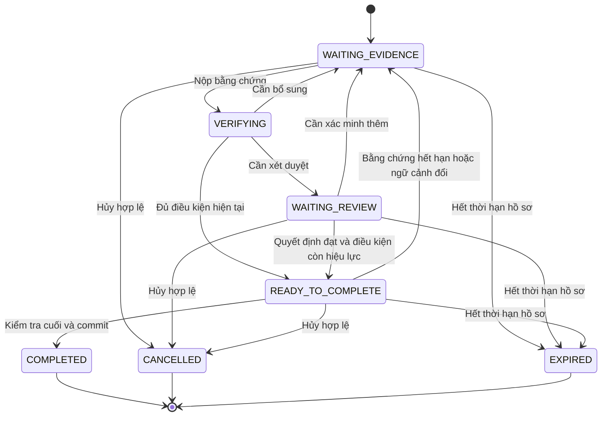

# In progress recovery session — Duy trì phiên khôi phục đang thực hiện

## 1. Giữ tiến độ nhưng phải kiểm tra quyền hiện tại

Người dùng đã xác minh một kênh khôi phục, gửi thêm bằng chứng và đang chờ xét duyệt. Họ tải lại trang, mất mạng hoặc quay lại sau vài giờ. Nếu hệ thống bắt đầu lại toàn bộ, trải nghiệm trở nên khó khăn và người dùng có thể tạo nhiều yêu cầu trùng nhau. Nếu hệ thống tin mọi bước đã làm mãi mãi, một phiên bị đánh cắp hoặc bằng chứng đã hết hạn có thể dẫn tới chiếm đoạt tài khoản.

**In progress recovery session** là ngữ cảnh được bảo vệ giúp người dùng tiếp tục một quy trình khôi phục chưa hoàn tất. Nó liên kết trình duyệt hiện tại với hồ sơ phía máy chủ, cho phép những hành động phù hợp tại thời điểm xử lý. Phiên này không tự trở thành phiên đăng nhập có quyền sử dụng tài khoản.

Trong chương **Session Continuity** của dịch vụ `SECURITY_AUTHENTICATION_ACCOUNT_RECOVERY`, bài học này tập trung vào khoảng thời gian giữa lúc bắt đầu và lúc hoàn tất recovery. Người dùng có thể đang khôi phục mật khẩu, MFA, passkey hoặc thiết bị xác thực; cơ chế duy trì tiến độ cần bảo vệ cả bằng chứng, token dùng một lần và quyền thao tác.

Sau bài học, người học cần có khả năng:

- Tách hồ sơ recovery, phiên trình duyệt, bằng chứng và quyền thực hiện thao tác.
- Tiếp tục an toàn sau tải lại trang, timeout, mất phản hồi hoặc chờ xét duyệt.
- Quản lý thời hạn và độ mới của từng loại dữ liệu, kể cả khi phiên vẫn hoạt động.
- Xử lý nhiều tab, request gửi lặp, thay trình duyệt và thay đổi cấu hình bảo mật.
- Kết thúc quyền recovery nhất quán, đồng thời cho phép đọc lại kết quả cần thiết.

Các trạng thái, API, cấu trúc dữ liệu và thời hạn trong bài là **thiết kế tham khảo của ứng dụng**. Chúng cần được điều chỉnh theo mô hình đe dọa, loại bằng chứng và yêu cầu bảo đảm của hệ thống.

## 2. Bốn đối tượng có vòng đời khác nhau

| Đối tượng | Câu hỏi nó trả lời | Điều nó không tự chứng minh |
|---|---|---|
| Recovery case | Quy trình nào đang xử lý cho tài khoản đích? | Người cầm mã hồ sơ có quyền tiếp tục |
| Recovery session | Request này đến từ ngữ cảnh tiếp tục nào đã được máy chủ chấp nhận? | Chủ thể đã đủ điều kiện đổi credential |
| Verified evidence | Bằng chứng nào đã được kiểm tra, cho mục đích gì và đến bao giờ? | Bằng chứng còn mới hoặc dùng được cho mọi hành động |
| Action grant | Hành động nhạy cảm cụ thể nào được phép thực hiện một lần? | Quyền truy cập ứng dụng hoặc quyền recovery không giới hạn |

Có thể thêm các đối tượng như challenge, yêu cầu chuyển trình duyệt, quyết định xét duyệt và biên nhận hoàn tất. Không gộp chúng vào một token mang ý nghĩa “đã xác minh tất cả”.

Ví dụ, hồ sơ `rc_204` tồn tại một ngày để chờ xử lý. Phiên của trình duyệt chỉ có hạn trong thời gian ngắn. Bằng chứng email có hạn riêng, còn grant đổi passkey chỉ được cấp khi đủ điều kiện thực hiện. Hồ sơ còn tồn tại không làm ba đối tượng còn lại tự còn hiệu lực.

### 2.1. Mã hồ sơ chỉ là định danh

Một đường dẫn như `/recovery/cases/rc_204` giúp tìm hồ sơ, nhưng không phải bí mật cấp quyền. Backend phải xác thực phiên và kiểm tra quan hệ với hồ sơ trước khi trả trạng thái hoặc nhận bằng chứng.

Không cho phép truy cập dựa trên tổ hợp email cộng mã hồ sơ. Không lấy `accountId`, `tenantId`, mức tin cậy hoặc trạng thái từ dữ liệu frontend để xác định chủ thể được thay đổi.

### 2.2. Recovery session không phải application session

Trong thiết kế này, một phiên recovery chỉ có thể được phép đọc trạng thái tối thiểu, nộp bằng chứng hoặc thực hiện thao tác recovery đã được cấp quyền. Nó không được dùng để đọc hồ sơ cá nhân, xuất dữ liệu, tạo API key hay gọi endpoint yêu cầu đăng nhập bình thường.

NIST yêu cầu session không có mức bảo đảm cao hơn sự kiện xác thực đã tạo ra nó. Việc giữ được một cookie không tự bổ sung yếu tố xác thực còn thiếu. Xem [NIST SP 800-63B-4 — Session Management](https://pages.nist.gov/800-63-4/sp800-63b/session/).

## 3. Trạng thái của hồ sơ và quyền của trình duyệt

### 3.1. Hồ sơ có tiến độ nghiệp vụ



Sơ đồ thể hiện các chuyển trạng thái chính. Request đang xác minh cũng phải kiểm tra hủy hoặc hết hạn trước khi lưu kết quả; không được commit chỉ vì lúc bắt đầu request hồ sơ còn hợp lệ.

`READY_TO_COMPLETE` là kết luận dựa trên điều kiện tại một thời điểm. Backend phải đánh giá lại trước hành động nhạy cảm. Nếu bằng chứng hết hạn nhưng job nền chưa cập nhật trạng thái lưu, kiểm tra quyền vẫn phải từ chối hoàn tất.

### 3.2. Phiên có phạm vi quyền riêng

| Phạm vi quyền tham khảo | Khi nào có thể được cấp? | Chỉ cho phép |
|---|---|---|
| `CASE_VIEW` | Đã thiết lập được quyền xem hồ sơ | Trạng thái tối thiểu và hướng dẫn bước tiếp theo |
| `EVIDENCE_SUBMIT` | Đủ điều kiện nộp loại bằng chứng tương ứng | Gửi và kiểm tra bằng chứng của chính hồ sơ |
| `ACTION_EXECUTE` | Policy hiện tại đạt và có grant cụ thể | Đúng hành động, tài khoản và dữ liệu được phê duyệt |
| `RECEIPT_ONLY` | Hồ sơ vừa kết thúc, còn quyền đọc biên nhận ngắn hạn | Kết quả không chứa bí mật; không thực hiện lại recovery |

Một hồ sơ sẵn sàng hoàn tất không làm mọi phiên đang xem hồ sơ tự có quyền `ACTION_EXECUTE`. Quyền đó cần được cấp cho đúng phiên, với kiểm tra độ mới và ràng buộc cần thiết.

Khi hiển thị trạng thái, có thể trả `effectiveState` và `allowedActions` được tính từ dữ liệu hiện tại. Danh sách này hỗ trợ giao diện; backend vẫn kiểm tra lại tại endpoint thực thi. Không tin request chỉ vì frontend từng được trả `allowedActions: ["COMPLETE"]`.

## 4. Quản lý nhiều đồng hồ cùng lúc

### 4.1. Thời hạn không thay thế cho nhau

| Đồng hồ | Ý nghĩa | Ví dụ minh họa |
|---|---|---|
| Case lifetime | Khoảng thời gian còn xử lý hồ sơ | 24 giờ |
| Session idle timeout | Hạn khi không có hoạt động người dùng đủ điều kiện | 15 phút |
| Session absolute timeout | Trần tuổi thọ phiên trước khi cần thiết lập lại quyền tiếp tục | 60 phút |
| Evidence freshness | Khoảng thời gian bằng chứng được chấp nhận cho một mục đích | 10 phút cho một bước xác minh |
| Action grant lifetime | Khoảng thời gian cho phép hành động nhạy cảm | 2 phút |
| Challenge lifetime | Thời gian nhận phản hồi của một lần thử | Theo giao thức và policy của bước đó |

Các con số chỉ nhằm minh họa quan hệ giữa các đồng hồ, không phải thời hạn bắt buộc của tiêu chuẩn. Độ mới của một bằng chứng phải xét phương thức, rủi ro và hành động đích.

OWASP mô tả idle timeout, absolute timeout và yêu cầu thực thi thời hạn phía máy chủ trong [Session Management Cheat Sheet — Session Expiration](https://cheatsheetseries.owasp.org/cheatsheets/Session_Management_Cheat_Sheet.html#session-expiration).

### 4.2. Quyền thực thi không sống lâu hơn điều kiện cấp nó

Trong thiết kế tham khảo, thời điểm hết hạn của một grant không được vượt quá điều kiện gần nhất:

```text
actionGrant.expiresAt <= min(
    case.expiresAt,
    recoverySession.absoluteExpiresAt,
    requiredEvidence.validUntil,
    now + actionGrantPolicyLifetime
)
```

Nếu có nhiều bằng chứng bắt buộc, lấy thời hạn giới hạn của tổ hợp được policy chấp nhận. Bằng chứng chưa đủ tổ hợp không được dùng để tính ra một grant hợp lệ.

Idle timeout và quyền bị thu hồi vẫn phải kiểm tra riêng tại request. Công thức thời hạn không bảo đảm phiên chưa bị hủy, tài khoản chưa bị khóa hay policy chưa thay đổi.

### 4.3. Polling không phải xác thực lại

Trang chờ xét duyệt có thể hỏi trạng thái định kỳ. Trong mô hình này, polling tự động không làm mới độ tin cậy của bằng chứng và không kéo dài tuổi thọ tuyệt đối của phiên. Có thể chỉ tính những hoạt động người dùng được xác định rõ cho idle timeout, tránh để tab mở vô thời hạn giữ quyền nhạy cảm.

Đổi session ID cũng không tự đặt lại tuổi thọ tuyệt đối của cùng ngữ cảnh quyền. Muốn có thời hạn mới sau khi hết trần, cần một quy trình thiết lập lại phiên được chính sách cho phép, với bằng chứng phù hợp.

## 5. Lưu tiến độ phía máy chủ

### 5.1. Mô hình dữ liệu tham khảo

| Thực thể | Dữ liệu chính |
|---|---|
| RecoveryCase | `caseId`, tài khoản và tenant đích, loại recovery, trạng thái, thời hạn, `caseVersion`, policy và phiên bản bảo mật kỳ vọng |
| RecoverySession | Hash bí mật phiên, `caseId`, liên kết người khởi tạo, phạm vi quyền, thời gian tạo, idle/absolute expiry, thế hệ phiên, trạng thái thu hồi |
| EvidenceRecord | Loại bằng chứng, mục đích, kết quả, thời gian xác minh, thời hạn, ràng buộc phiên/thiết bị nếu có, nguồn và phiên bản verifier |
| ActionGrant | Hash bí mật, hồ sơ, phiên được cấp, hành động, dấu vết dữ liệu được duyệt, thời hạn, trạng thái dùng/thu hồi |
| OperationRecord | Chủ thể được phép, hồ sơ, loại thao tác, idempotency key, dấu vết request và kết quả tối thiểu |
| ReviewDecision | Chủ thể xét duyệt, phạm vi quyết định, điều kiện, thời gian, bằng chứng và phiên bản đã dựa vào |
| CompletionReceipt | Kết quả, thời gian và tham chiếu không chứa bí mật |

Không đặt toàn bộ tiến độ tin cậy vào hidden field, query string hay local storage. Frontend có thể giữ bước giao diện đang mở, nhưng máy chủ quyết định bước nào thực sự được phép.

`EvidenceRecord` phải phân biệt “đã từng xác minh” và “còn đủ điều kiện dùng cho hành động này”. Lịch sử được giữ để điều tra; quyền hiện tại được tính theo policy và thời gian.

### 5.2. Những phiên bản có nhiệm vụ khác nhau

`caseVersion` giúp phát hiện tiến độ hồ sơ đã bị thay đổi bởi request hoặc tab khác. `securityVersion` của tài khoản giúp phát hiện cấu hình xác thực, kênh recovery hoặc quyết định sự cố liên quan đã đổi. `sessionGeneration` giúp phân biệt các thế hệ bí mật phiên và quyền đang được chấp nhận.

Không tăng `caseVersion` chỉ vì một request đọc trạng thái cập nhật `lastSeenAt`, nếu điều đó làm mọi tab liên tục xung đột. Tách cập nhật hoạt động vận hành khỏi phiên bản quyết định nghiệp vụ. Ngược lại, thêm bằng chứng, đổi phương thức đích, hủy hồ sơ hay cấp grant cần có quy tắc cập nhật phiên bản nhất quán.

Các endpoint khác có thể thay đổi bảo mật của tài khoản cũng phải cập nhật phiên bản theo cùng quy ước. Nếu chỉ recovery làm điều này, kiểm tra phiên bản sẽ bỏ sót xung đột từ các đường quản trị hoặc tự phục vụ khác.

### 5.3. Không lưu lại bí mật để tiện tiếp tục

Không lưu password, OTP, raw recovery code hoặc private key trong dữ liệu tiến độ. Những bí mật cần lưu cho một giao thức riêng phải theo mô hình bảo vệ tương ứng, chẳng hạn seed TOTP được mã hóa ở hệ thống verifier; chúng không trở thành dữ liệu tùy ý của recovery session.

Audit và dữ liệu idempotency cũng cần được giới hạn. Một request fingerprint có thể dùng cơ chế chuẩn hóa và bảo vệ bằng khóa phía máy chủ khi thích hợp; không lưu nguyên payload chứa code chỉ để so sánh retry.

## 6. Bảo vệ cookie và điểm vào quy trình

### 6.1. Cookie chỉ chứa bí mật tham chiếu

Ví dụ header, với giá trị chỉ là chỗ giữ chỗ:

```http
Set-Cookie: __Host-recovery=<opaque-random-secret>; Path=/; Secure; HttpOnly; SameSite=Lax
Cache-Control: no-store
Referrer-Policy: no-referrer
```

Máy chủ phát bí mật ngẫu nhiên đủ mạnh, lưu tham chiếu được bảo vệ và kiểm tra trạng thái phiên ở mỗi request. Với cookie dùng tiền tố `__Host-`, cấu hình ví dụ dùng `Secure`, `Path=/` và không có `Domain`.

`Path=/` không cấp quyền gọi mọi API. Backend vẫn tách recovery session khỏi application session. `HttpOnly` hạn chế đọc cookie bằng JavaScript nhưng không ngăn mã độc cùng origin thực hiện hành động qua trình duyệt đã bị xâm phạm.

Khi nâng quyền sau một bước xác minh, thay session ID và hủy hiệu lực thế hệ cũ theo thiết kế. OWASP trình bày nguyên tắc này tại [Renew the Session ID After Any Privilege Level Change](https://cheatsheetseries.owasp.org/cheatsheets/Session_Management_Cheat_Sheet.html#renew-the-session-id-after-any-privilege-level-change).

Không cho trình duyệt tự chỉ định ID phiên mà máy chủ sẽ tin. Nếu response đổi cookie bị mất, cách tiếp tục phải đi qua quyền hiện còn hoặc quy trình tái thiết lập phiên; không tự cho phép cookie cũ lấy lại quyền mới.

### 6.2. Bảo vệ các thao tác thay đổi trạng thái

Nộp bằng chứng, đổi candidate, chuyển trình duyệt, cấp grant và hủy hồ sơ đều cần bảo vệ CSRF cùng kiểm tra quyền nghiệp vụ. `SameSite` là một lớp hỗ trợ, không thay cho toàn bộ cơ chế. Dùng cơ chế của framework nếu phù hợp và kiểm tra origin theo thiết kế triển khai. Xem [OWASP — CSRF Prevention Cheat Sheet](https://cheatsheetseries.owasp.org/cheatsheets/Cross-Site_Request_Forgery_Prevention_Cheat_Sheet.html).

GET đọc trạng thái không được tiêu thụ code, cấp quyền nhạy cảm hoặc hoàn tất recovery. Nếu email có link chứa bí mật, trang mở đầu chỉ nên dẫn tới bước xác nhận phù hợp; không để một lần tải trang của bộ quét thư tự hoàn tất hành động.

Link có chứa token vẫn có thể là bearer secret. Giảm rò rỉ qua log, referrer, analytics, tài nguyên bên thứ ba và history; sau khi trao đổi token hợp lệ, chuyển về URL sạch theo thiết kế. Không mô tả việc dùng POST là biện pháp tự chống được phishing hoặc mọi kiểu lấy cắp token.

## 7. Tiếp tục sau tải lại trang hoặc mất mạng

### 7.1. Tải lại trang dùng trạng thái máy chủ

Khi tải lại trang, trình duyệt gửi cookie còn hợp lệ và đọc trạng thái của hồ sơ được phép. Máy chủ trả thông tin tối thiểu, ví dụ:

```json
{
  "caseId": "rc_204",
  "caseVersion": 7,
  "effectiveState": "WAITING_REVIEW",
  "allowedActions": ["VIEW_STATUS", "CANCEL"],
  "nextStep": "WAIT_FOR_REVIEW",
  "sessionExpiresAt": "<server-controlled-time>",
  "requiresFreshEvidenceBeforeCompletion": true
}
```

Không trả code đã dùng, raw token, seed, toàn bộ giấy tờ hoặc lý do chấm điểm rủi ro. Thời hạn hiển thị giúp người dùng hiểu trạng thái; thời hạn thực thi vẫn nằm ở máy chủ.

Frontend khôi phục giao diện từ response đó. Không lấy `step=complete` trên URL làm bằng chứng rằng hồ sơ đã qua các bước trước.

### 7.2. Timeout không cho biết thao tác có commit hay chưa

Cần phân biệt ba tình huống:

| Điều đã xảy ra | Điều client quan sát | Cách tiếp tục |
|---|---|---|
| Request chưa đến máy chủ | Timeout hoặc lỗi mạng | Có thể retry theo hợp đồng thao tác |
| Máy chủ kiểm tra nhưng chưa commit | Timeout | Đọc trạng thái hoặc retry có kiểm soát |
| Máy chủ đã commit nhưng response bị mất | Timeout giống hai trường hợp trên | Đọc kết quả đã lưu; không tự tạo tác động lần hai |

Ví dụ một recovery code đã được tiêu thụ thành công nhưng response bị mất. Giao diện không nên tự yêu cầu nhập một code khác ngay. Trước hết kiểm tra tiến độ bằng phiên còn được phép, hoặc gửi lại cùng thao tác theo cơ chế idempotency đã định nghĩa.

Nếu cookie cũng không còn hợp lệ, không hạ mức kiểm tra để tiện đọc hồ sơ. Người dùng cần đi qua nhánh tái thiết lập quyền tiếp tục phù hợp.

### 7.3. Phân biệt khôi phục giao diện và khôi phục quyền

Giao diện có thể nhớ người dùng đang ở màn hình “chờ xét duyệt”, nhưng điều này chỉ giúp điều hướng. Backend quyết định xem phiên hiện tại có được đọc hồ sơ, nộp thêm bằng chứng hay thực hiện thay đổi không.

Một thông báo hữu ích là: “Hồ sơ vẫn được giữ. Phiên tiếp tục đã hết hạn; cần xác minh lại để xem hoặc tiếp tục.” Thông báo không nên khẳng định hồ sơ đã bị xóa khi chỉ có phiên trình duyệt hết hạn.

## 8. Bằng chứng và xét duyệt trong quy trình kéo dài

### 8.1. Lưu lịch sử, đánh giá lại khả năng sử dụng

Một bằng chứng đã được xác minh cần có mục đích và giới hạn. Ví dụ, bằng chứng cho phép xem tiến độ không mặc nhiên cho phép đổi số điện thoại; bằng chứng gắn với phiên A không tự trở thành bằng chứng hợp lệ của phiên B.

Mỗi hành động nhạy cảm cần xác định tập bằng chứng bắt buộc, độ mới, mức tin cậy, điều kiện ràng buộc và khả năng bị thu hồi. Khi một bằng chứng hết hạn, có thể yêu cầu xác minh lại đúng phần đó thay vì xóa lịch sử hồ sơ. Tuy nhiên, nếu thay đổi làm mất hiệu lực cả tổ hợp, cần đánh giá lại tổ hợp đầy đủ.

Không đánh dấu `identityVerified=true` rồi sử dụng cờ đó cho mọi request trong suốt đời hồ sơ. Điều kiện quyết định phải có ngữ cảnh và thời gian.

### 8.2. Quyết định xét duyệt cũng có phạm vi

Một nhân viên có thể phê duyệt việc tiếp tục dựa trên bằng chứng và cấu hình tại thời điểm xét duyệt. Quyết định cần lưu ai duyệt, mục đích, điều kiện và phiên bản dữ liệu đã sử dụng.

Nếu tài khoản đổi kênh recovery, phát hiện sự cố hoặc bị khóa trong lúc chờ, một callback “đã duyệt” không được ghi đè trạng thái mới. Callback phải được xác thực là từ thành phần được phép và được đối chiếu với hồ sơ hiện tại.

Phê duyệt nghiệp vụ không tự làm mới mã email cũ hay biến mọi phiên đang polling thành phiên được đổi credential. Người dùng có thể được thông báo đã có kết quả, sau đó cần xác minh mới để nhận grant thực thi.

### 8.3. Kiểm tra cuối gắn với đúng thay đổi

Trước khi hoàn tất, xác minh tài khoản đích, loại thay đổi, credential hoặc phương thức liên quan và dữ liệu đã được phê duyệt. Nếu người dùng đổi phương thức đích hoặc candidate sau khi được cấp quyền, grant cũ phải bị vô hiệu hóa hoặc được đánh giá lại.

OWASP khuyến nghị thực thi đúng thứ tự, kiểm soát dữ liệu giao dịch và có cổng kiểm tra quyền ngay trước thực thi. Các nguyên tắc đó được áp dụng vào recovery trong thiết kế này. Xem [Transaction Authorization Cheat Sheet](https://cheatsheetseries.owasp.org/cheatsheets/Transaction_Authorization_Cheat_Sheet.html).

## 9. Retry, nhiều tab và request đến muộn

### 9.1. Idempotency không phải quyền truy cập

Idempotency giúp cùng một thao tác được gửi lại mà không tạo tác động lần hai. Khóa idempotency phải gắn với hồ sơ, chủ thể hoặc liên kết tiếp tục đã được xác thực, loại thao tác và nội dung request.

Hai request có cùng key nhưng payload khác phải bị từ chối. Việc biết key không cho phép xem kết quả nếu session đã bị thu hồi hoặc người gọi không còn quyền với hồ sơ.

Kiểm tra kết quả đã lưu sau khi xác thực quyền hiện tại, trước khi lặp lại việc tiêu thụ bí mật dùng một lần. Khi có hai request đồng thời, vẫn cần ràng buộc duy nhất hoặc khóa để chỉ một transaction tạo quyết định. Không dựa riêng vào thao tác “đọc chưa thấy kết quả” rồi cùng ghi.

Chỉ lưu kết quả phù hợp để trả lại, như trạng thái hoặc biên nhận không chứa bí mật. Không phát lại seed provisioning, raw grant hay application session token qua một cache idempotency chung.

### 9.2. Hai tab cùng tiến lên

Giả sử tab A và tab B cùng đọc `caseVersion=7`. Tab A nộp bằng chứng và làm phiên bản tăng thành 8. Tab B gửi thao tác dựa trên phiên bản 7 phải được kiểm tra xung đột.

Có thể dùng `If-Match` với ETag hoặc trường phiên bản trong hợp đồng API. Khi không khớp, client đọc lại trạng thái và hiển thị bước hiện tại. Không tự ghi đè trạng thái mới bằng toàn bộ bản sao cũ từ tab B.

Nếu việc nâng quyền làm đổi cookie dùng chung giữa các tab, tab cũ cần lấy lại trạng thái và token CSRF hiện tại trước thao tác tiếp theo. Không để một cache frontend cũ quyết định thế hệ phiên nào được máy chủ chấp nhận.

### 9.3. Request hoàn tất đang chạy thì hồ sơ bị hủy

Một chữ ký hoặc code có thể được xác minh ngoài transaction để tránh giữ khóa lâu. Trước khi commit, phải đọc lại trạng thái hồ sơ, session, grant và bằng chứng liên quan.

Nếu request hủy hợp lệ commit trước, request hoàn tất đến sau phải bị từ chối. Nếu hoàn tất commit trước, thao tác hủy không được âm thầm đảo ngược credential mới hoặc làm sống lại khóa cũ. Nó cần trả trạng thái đã hoàn tất hoặc chuyển sang quy trình ứng phó phù hợp.

Trong hệ thống nhiều instance, mutex trong một tiến trình không bảo vệ được toàn bộ request. Dùng transaction, khóa hàng, compare-and-swap hoặc cơ chế nhất quán tương đương ở nơi lưu quyết định.

## 10. Mất cookie, đóng trình duyệt hoặc chuyển thiết bị

### 10.1. Cùng trình duyệt, phiên còn hợp lệ

Đọc trạng thái và tiếp tục những bước hiện được phép. Dù cookie còn hợp lệ, mỗi hành động nhạy cảm vẫn phải đạt yêu cầu bằng chứng hiện tại.

Không hứa rằng cookie không có `Max-Age` sẽ luôn biến mất khi người dùng đóng cửa sổ; cách khôi phục phiên của trình duyệt có thể khác nhau. Máy chủ phải thực thi thời hạn và trạng thái thu hồi.

### 10.2. Không còn phiên hợp lệ

Máy chủ không được khôi phục quyền chỉ từ `caseId`, email, IP quen thuộc hoặc câu trả lời “tôi đã xác minh trước đó”. Cần một quy trình resume có bằng chứng được policy chấp nhận.

Một resume token có thể được gửi qua kênh đã xác lập, có mục đích, thời hạn và trạng thái dùng một lần. Trong thiết kế này, quyền ban đầu có thể chỉ là xem trạng thái tối thiểu hoặc mở lại bước xác minh; nó không mặc nhiên kế thừa quyền thay credential.

OWASP nêu nguyên tắc token ngẫu nhiên, lưu an toàn, dùng một lần và có hạn trong [Forgot Password Cheat Sheet](https://cheatsheetseries.owasp.org/cheatsheets/Forgot_Password_Cheat_Sheet.html). Khi dùng cho resume, vẫn phải định nghĩa riêng quyền mà token được phép khôi phục.

Không tự tái sử dụng bằng chứng cũ nếu bằng chứng đã hết hạn, gắn với session khác hoặc mục đích không phù hợp. Trường hợp policy cho phép kế thừa một phần, cần ghi rõ phần nào được kế thừa và căn cứ nào hỗ trợ.

### 10.3. Chuyển có chủ đích từ trình duyệt A sang B

Một luồng chuyển giao tham khảo cần xác lập cả quyền cho phép chuyển và sự tham gia của trình duyệt nhận:

1. B tạo một yêu cầu nhận với bí mật tạm thời do máy chủ cấp, chưa có quyền với hồ sơ.
2. A, nếu còn quyền chuyển giao theo policy, xem và xác nhận mục đích cùng thông tin yêu cầu nhận.
3. Máy chủ kiểm tra yêu cầu ghép đôi, thời hạn, bằng chứng và rủi ro; yêu cầu xác minh thêm nếu cần.
4. Việc chuyển được tiêu thụ nguyên tử, cấp phiên mới cho đúng B và chấm dứt quyền thực thi của phiên cũ theo chính sách.
5. B đọc lại trạng thái; grant và challenge gắn với phiên cũ không tự được sử dụng ở B.

Đây là mô hình nghiệp vụ, không phải mô tả đầy đủ một giao thức ghép đôi. Mã hiển thị hoặc QR có thể bị chuyển tiếp cho người khác. Cần giới hạn thử, hiển thị đúng tài khoản và mục đích, đồng thời chống việc attacker dụ nạn nhân phê duyệt yêu cầu do attacker khởi tạo.

Nếu A không còn được phép chuyển giao, quay về nhánh thiết lập lại quyền bằng bằng chứng phù hợp. Không giải quyết bằng cách bỏ ràng buộc session của grant.

## 11. Kiểm tra trước khi hoàn tất: mã giả Java

Đoạn dưới minh họa phần kiểm tra cuối cho một hồ sơ đã có kế hoạch thay đổi được phê duyệt. Nó không triển khai toàn bộ xác minh danh tính hay giao thức đăng ký credential. Các helper là mã giả, cần được thực hiện đúng ranh giới transaction và quyền truy cập của ứng dụng.

```java
CompletionReceipt completeRecovery(
        RecoveryCaseId caseId,
        CompleteCommand command,
        RecoveryRequestContext context) {

    attemptLimiter.checkAndRecord(context, caseId, COMPLETE_RECOVERY);

    return transactions.required(() -> {
        // Account đã được máy chủ xác định từ ngữ cảnh/hồ sơ được phép.
        // Các đường cập nhật liên quan dùng cùng thứ tự khóa.
        Account account = accounts.lock(context.serverResolvedAccountId());
        RecoveryCase recoveryCase = cases.lock(caseId);
        RecoverySession session = recoverySessions.lockPresentedSession(context);
        ActionGrant grant = grants.lockPresentedGrant(context);
        Instant now = clock.instant();

        requireSameAccountAndTenant(account, recoveryCase, context);
        requireSessionBoundToCase(session, recoveryCase);
        requireActiveMutationSession(session, now);
        requireCaseNotTerminalAndNotExpired(recoveryCase, now);
        requireCaseVersion(recoveryCase, command.expectedCaseVersion());
        requireSecurityVersion(
                account, recoveryCase.expectedSecurityVersion());

        requireState(recoveryCase, READY_TO_COMPLETE);
        requireCurrentPolicyAllowsCompletion(account, recoveryCase, now);
        requireRequiredEvidenceStillValid(recoveryCase, session, now);
        requireGrantUnusedAndUnexpired(grant, now);
        requireGrantBoundToActionAndSession(
                grant, recoveryCase, session, command.approvedIntentReference());
        requireApprovedChangeUnchangedAndConfirmed(recoveryCase);

        // Tác động chỉ theo kế hoạch phía máy chủ đã được đối chiếu.
        recoveryChanges.applyApprovedPlan(account, recoveryCase, now);
        grant.consume(now);
        recoveryGrants.revokeOtherMutationGrants(caseId, now);
        recoverySessions.endOtherMutationAuthority(caseId, session.id(), now);
        account.incrementSecurityVersion();
        applicationSessions.applyApprovedRevocationPlan(account, recoveryCase, now);

        CompletionReceipt receipt = recoveryCase.complete(now);
        receipts.save(receipt);

        // Chỉ còn đọc kết quả tối thiểu, không kéo dài trần phiên.
        Instant receiptUntil = min(
                session.absoluteExpiresAt(),
                now.plus(receiptReadPolicyLifetime));
        session.restrictToReceiptOnly(receipt.id(), receiptUntil);

        audit.recordRecoveryCompleted(account, recoveryCase, session, now);
        outbox.appendCompletionNotification(account, recoveryCase, now);
        return receipt;
    });
}
```

`approvedIntentReference` trong command chỉ là tham chiếu để đối chiếu; không cấp quyền tự chọn tài khoản, credential hoặc kế hoạch thu hồi. Các bản ghi bằng chứng, candidate và grant phải được khóa hoặc kiểm tra phiên bản theo cách ngăn thay đổi giữa kiểm tra và ghi.

Nếu kiểm tra mật mã được thực hiện trước transaction, kết quả phải gắn với snapshot cụ thể; trong transaction kiểm tra lại dữ liệu và thời hạn đó. Không nhận các cờ `verified=true` hoặc `approved=true` do client gửi.

Ví dụ giả định quyết định quan trọng có thể được ghi nhất quán. Nếu session nằm ở Redis, credential ở SQL và quyền ở nhiều resource server, một annotation Java không tự tạo transaction chung. Cần nơi lưu quyết định authoritative, cơ chế truyền trạng thái và giới hạn độ trễ đã được xác định.

## 12. Hợp đồng API cho việc tiếp tục

| Endpoint minh họa | Vai trò và giới hạn |
|---|---|
| `GET /recovery/cases/{id}/status` | Đọc trạng thái được phép; không chuyển bước nhạy cảm |
| `POST /recovery/cases/{id}/evidence` | Nộp bằng chứng, kiểm tra phiên bản và chống gửi lặp |
| `POST /recovery/cases/{id}/action-grants` | Cấp quyền cụ thể sau khi kiểm tra điều kiện hiện tại |
| `POST /recovery/cases/{id}/complete` | Kiểm tra cuối và commit đúng một lần |
| `POST /recovery/cases/{id}/resume-requests` | Khởi tạo resume có giới hạn; chưa trả quyền cũ |
| `POST /recovery/resume/exchange` | Trao đổi bằng chứng resume theo mục đích đã định |
| `POST /recovery/cases/{id}/cancel` | Hủy hợp lệ và thu hồi quyền liên quan |

Endpoint khởi tạo công khai và endpoint đã xác thực có mức tiết lộ khác nhau. Nếu việc resume bắt đầu bằng email hoặc tên tài khoản, trả phản hồi nhất quán để tránh dò tài khoản hoặc trạng thái hồ sơ của người khác.

Một số kết quả nghiệp vụ có ích cho client đã đủ quyền:

```text
SESSION_REESTABLISHMENT_REQUIRED
EVIDENCE_REFRESH_REQUIRED
CASE_VERSION_CONFLICT
REVIEW_PENDING
ACTION_GRANT_EXPIRED
CASE_ALREADY_COMPLETED
CASE_CANCELLED
```

Ánh xạ HTTP status cần được thống nhất trong API. Chỉ trả chi tiết khi người gọi có quyền biết; không dùng lỗi “bạn đã có 3 passkey” cho một request chưa được xác thực.

Giao diện nên phân biệt trường hợp cần xác minh lại với trường hợp chỉ cần đọc lại trạng thái. Không tự lặp POST nhạy cảm vô hạn khi nhận lỗi quyền hoặc xung đột.

## 13. Kết thúc quyền và xử lý hồ sơ bị bỏ dở

### 13.1. Hoàn tất nhưng response bị mất

Trong mô hình tham khảo, transaction hoàn tất chấm dứt mọi quyền thay đổi của recovery và có thể để phiên thực hiện giữ quyền `RECEIPT_ONLY` trong thời gian ngắn. Quyền này chỉ trả kết quả tối thiểu, không trả credential secret và không tạo application session.

Nhờ đó, client còn cookie hợp lệ có thể xác định thao tác đã thành công sau timeout. Request ghi tiếp theo vẫn bị từ chối. Nếu receipt session cũng hết hạn hoặc bị thu hồi vì nghi lộ, người dùng cần đi qua kênh đã được cho phép để kiểm tra kết quả, chẳng hạn đăng nhập thông thường hoặc thiết lập lại quyền đọc phù hợp.

Thiết kế chọn hủy mọi phiên ngay khi hoàn tất cũng có thể phù hợp, nhưng phải có đường đọc kết quả được cấp quyền riêng. Không vừa tuyên bố hủy mọi token vừa cho token cũ đọc dữ liệu mà không kiểm tra.

### 13.2. Hủy và hết hạn

Hủy hồ sơ cần thu hồi action grants, challenge và quyền tiếp tục liên quan. Candidate chưa hoàn tất bị đánh dấu bỏ dở hoặc dọn theo quy tắc dữ liệu. Không tự phục hồi credential từng bị đình chỉ do sự cố.

Phiên trình duyệt hết hạn không nhất thiết làm hồ sơ nghiệp vụ hết hạn. Hồ sơ có thể tiếp tục chờ xét duyệt; người dùng phải thiết lập lại quyền khi quay lại. Ngược lại, hồ sơ đã hết hạn thì một cookie còn trong trình duyệt cũng không cho phép tiếp tục thay đổi.

Job dọn dẹp xóa hoặc giảm dữ liệu theo thời hạn lưu, nhưng không quyết định hiệu lực quyền trong thời gian chờ chạy. Kiểm tra expiry và thu hồi phải có trên đường xử lý request.

### 13.3. Xử lý nghi bị chiếm trong lúc recovery

Nếu phát hiện session bị lộ, ngừng quyền thực thi của session đó và các grant liên quan; giữ lịch sử để điều tra. Việc mở lại hồ sơ cần căn cứ mới theo policy, không chỉ một lần nhấn “thử lại”.

Một request mở hồ sơ hoặc yêu cầu resume chưa đủ bằng chứng không được tự thu hồi mọi phiên hợp lệ của nạn nhân. Tách tiếp nhận yêu cầu khỏi quyết định bảo vệ tài khoản có cấp quyền và đánh giá rủi ro.

## 14. Ví dụ theo dòng thời gian

Giả sử Mai mất thiết bị MFA, đã nhập đúng phương thức còn lại và đang đi qua policy khôi phục. Các thời hạn dưới đây chỉ minh họa cách hệ thống ra quyết định.

| Thời điểm | Sự kiện | Trạng thái và quyền cần hiểu |
|---|---|---|
| 09:00 | Mở hồ sơ và tạo phiên recovery | Chỉ có quyền thực hiện các bước ban đầu đã cho phép |
| 09:02 | Một bằng chứng được kiểm tra, có hạn đến 09:12 | Lưu lịch sử và mục đích; chưa đủ quyền ứng dụng |
| 09:05 | Hồ sơ chuyển chờ xét duyệt | Có thể đọc trạng thái tối thiểu |
| 09:08 | Mai tải lại trang | Cookie còn hợp lệ; giao diện được dựng từ máy chủ |
| 09:10 | Mạng ngắt sau một POST | Không suy luận thất bại; đọc trạng thái hoặc retry đúng hợp đồng |
| 09:30 | Mai đóng máy, phiên không còn đủ điều kiện dùng | Hồ sơ vẫn tồn tại; bằng chứng ngắn hạn đã hết hiệu lực |
| 11:00 | Có quyết định xét duyệt | Không tự làm bằng chứng 09:02 mới trở lại |
| 11:05 | Mai quay lại bằng trình duyệt khác | Thiết lập quyền resume; không chỉ nhập mã hồ sơ |
| 11:08 | Hoàn tất bằng chứng mới cần thiết | Kiểm tra policy hiện tại, cấp grant cho đúng phiên |
| 11:09 | Hoàn tất recovery nhưng response bị mất | Transaction đã kết thúc quyền ghi; đọc biên nhận nếu còn được phép |
| 11:10 | Mai đăng nhập bằng phương thức đã khôi phục | Luồng đăng nhập bình thường kiểm tra chính sách và hạn chế còn hiệu lực |

Điểm chính là mỗi lần quay lại chỉ khôi phục phần quyền mà bằng chứng hiện tại cho phép. Tiến độ hợp lệ được giữ, còn quyền đã hết hạn phải được thiết lập lại.

### 14.1. Ma trận các tình huống dễ xử lý sai

| Tình huống | Phản ứng cần có |
|---|---|
| Còn cookie nhưng proof hết hạn | Cho đọc trạng thái trong phạm vi còn quyền; yêu cầu proof mới cho hành động cần nó |
| Mất cookie nhưng nhớ case ID | Không cấp lại quyền chỉ từ ID; dùng quy trình resume |
| Code đã dùng, response thất lạc | Tra kết quả có cấp quyền; không làm code sống lại |
| Callback xét duyệt đến sau khi hủy | Không mở lại hồ sơ hoặc cấp grant |
| Hai tab đổi candidate khác nhau | Phát hiện xung đột phiên bản; grant cho dữ liệu cũ không dùng được |
| Đổi cookie nhưng response không tới client | Thiết lập lại quyền qua nhánh phù hợp; không mặc định tin ID cũ |
| Máy chủ cache chưa nhận trạng thái thu hồi | Hạn chế hoặc kiểm tra authoritative tại thao tác nhạy cảm |
| Cảnh báo gửi lỗi sau commit | Retry thông báo; giữ nguyên quyết định hoàn tất |

## 15. Audit và tiêu chí thiết kế đạt yêu cầu

### 15.1. Sự kiện cần theo dõi

Một chuỗi sự kiện có thể gồm:

```text
RECOVERY_SESSION_CREATED
RECOVERY_PROGRESS_READ
RECOVERY_EVIDENCE_ACCEPTED
RECOVERY_SESSION_PRIVILEGE_CHANGED
RECOVERY_SESSION_ROTATED
RECOVERY_RESUME_REQUESTED
RECOVERY_RESUME_AUTHORIZED
RECOVERY_EVIDENCE_REFRESH_REQUIRED
RECOVERY_ACTION_GRANT_ISSUED
RECOVERY_COMPLETED
RECOVERY_SESSION_RESTRICTED_TO_RECEIPT
RECOVERY_SESSION_REVOKED
```

Không nhất thiết ghi mỗi lần polling thành một sự kiện audit dung lượng lớn. Có thể tách log truy cập, metric và sự kiện quyết định bảo mật, bảo đảm vẫn điều tra được việc ai nhận quyền nào và vì sao.

Ghi mã tương quan, hồ sơ, chủ thể nội bộ, phiên bản, phương thức, kết quả và thời gian. Không ghi raw cookie, grant, resume token, OTP hoặc payload giấy tờ. Tham chiếu session phục vụ điều tra cần là giá trị phù hợp, không phải bí mật có thể dùng lại để truy cập.

Các chỉ số hữu ích gồm tỷ lệ phải xác minh lại khi quay lại, xung đột giữa tab, retry được xử lý không tạo tác động mới, số resume bị từ chối và số hồ sơ bị bỏ dở trong lúc xét duyệt. Độ trễ truyền quyết định thu hồi cũng cần được quan sát nếu hệ thống phân tán.

### 15.2. Câu hỏi tự kiểm tra

| Câu hỏi | Lập luận cần đạt |
|---|---|
| Vì sao hồ sơ còn tồn tại nhưng phiên đã hết quyền? | Hồ sơ và session phục vụ mục đích khác nhau, có đồng hồ riêng |
| Vì sao cookie còn hợp lệ chưa đủ hoàn tất? | Policy, bằng chứng, grant và cấu hình hiện tại vẫn phải đạt |
| Vì sao chờ xét duyệt không được kéo dài proof tự động? | Quyết định xét duyệt không tái xác minh bằng chứng đã cũ |
| Vì sao case ID không dùng làm resume secret? | Nó chỉ định danh hồ sơ, không chứng minh người gọi được tiếp tục |
| Vì sao idempotency không thay kiểm tra quyền? | Kết quả cũ cũng chỉ được trả cho chủ thể hiện còn quyền phù hợp |
| Vì sao cần kiểm tra lại trước commit? | Trạng thái có thể bị hủy, hết hạn hoặc thay đổi trong lúc xử lý |
| Vì sao hoàn tất rồi vẫn có thể đọc biên nhận? | Quyền đọc tối thiểu được định nghĩa riêng, ngắn hạn và không cho thực thi |

Một phiên khôi phục đang thực hiện cần giúp người dùng tiếp tục công việc mà không phải lưu lại các bí mật đã dùng. Máy chủ giữ tiến độ, đánh giá điều kiện hiện tại và chỉ cấp đúng quyền cho bước tiếp theo; đó là cơ sở để duy trì tính liên tục mà vẫn kiểm soát nguy cơ chiếm đoạt tài khoản.
