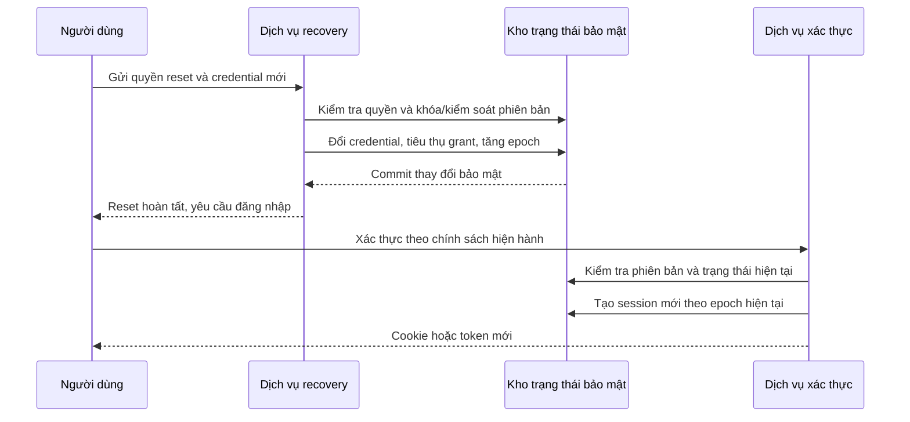

# Session rotation after reset: Thay session an toàn sau khôi phục tài khoản

## 1. Reset là ranh giới tin cậy của session

Trong chương **Session Continuity** của module `SECURITY_AUTHENTICATION_ACCOUNT_RECOVERY`, bài học này trình bày cách xử lý session sau khi người dùng đặt lại mật khẩu, khôi phục MFA hoặc thay phương tiện xác thực bị mất. Mục tiêu là giúp người hợp lệ tiếp tục sử dụng tài khoản mà không giữ lại quyền truy cập của kẻ có session hoặc token cũ.

Đổi mật khẩu không tự làm cookie đăng nhập hết hiệu lực. Đăng ký một passkey mới cũng không tự thu hồi refresh token đã bị đánh cắp. Credential và session là hai loại trạng thái khác nhau; muốn reset trở thành một điểm khôi phục kiểm soát thực sự, hệ thống phải xử lý cả hai.

Ví dụ: người dùng An và kẻ tấn công cùng giữ giá trị session `S_OLD` do cookie đã bị sao chép. An đặt lại mật khẩu, máy chủ gửi cookie `S_NEW`, nhưng vẫn chấp nhận `S_OLD` để tránh gián đoạn. Kẻ tấn công tiếp tục truy cập bằng cookie cũ mà không cần biết mật khẩu mới. Trong trường hợp này, việc gửi session mới chưa hoàn thành mục tiêu bảo mật.

Sau bài học, người học có thể:

- Phân biệt session rotation, thu hồi session, xác thực lại và refresh token rotation.
- Chọn chính sách session phù hợp với reset thông thường và khôi phục sau nghi bị chiếm tài khoản.
- Xây dựng luồng đổi credential, tiêu thụ quyền recovery và vô hiệu hóa quyền cũ một cách nhất quán.
- Ngăn request đăng nhập hoặc refresh đồng thời tạo lại quyền từ bằng chứng trước reset.
- Giữ tiến độ sử dụng phù hợp mà không sao chép quyền, mức MFA hoặc bí mật session cũ.

Các cấu trúc dữ liệu và chính sách bên dưới là thiết kế minh họa của ứng dụng. Chúng không giả định rằng mọi framework hoặc nhà cung cấp danh tính tự động xử lý toàn bộ các bước này.

## 2. Phân biệt các thao tác thường bị gộp chung

| Thao tác | Điều nó thay đổi | Điều nó không tự bảo đảm |
| --- | --- | --- |
| Session rotation | Thay bí mật hoặc định danh dùng để tiếp tục một session | Không tự thu hồi session trên thiết bị khác |
| Session revocation | Ngừng chấp nhận một session hoặc một nhóm session | Không tự xóa bản sao cookie trong máy của kẻ tấn công |
| Reauthentication | Kiểm tra lại bằng chứng xác thực theo chính sách | Không tự thu hồi mọi token đã phát hành trước đó |
| Refresh token rotation | Thay refresh token sau khi dùng để xin token mới | Không đồng nghĩa access token cũ đã ngừng được chấp nhận |
| Credential reset | Thay mật khẩu hoặc phương tiện xác thực | Không tự thay mọi session secret |
| Signing key rotation | Thay khóa ký token của hệ thống | Không phải thao tác phù hợp để xử lý riêng một người dùng trong mọi lần reset |

Trong một luồng reset, “rotation” có thể là đóng session cũ rồi tạo một session độc lập sau xác thực lại. Không nhất thiết phải giữ nguyên đối tượng session và chỉ sửa một trường ID.

OWASP khuyến nghị tái tạo session ID sau thay đổi mức quyền, trong đó có các thay đổi nhạy cảm như mật khẩu. Xem [OWASP, Renew the Session ID After Any Privilege Level Change](https://cheatsheetseries.owasp.org/cheatsheets/Session_Management_Cheat_Sheet.html#renew-the-session-id-after-any-privilege-level-change). Trong thiết kế của bài học, session cũ thuộc phạm vi thu hồi không được tiếp tục dùng để lấy session mới.

Một định danh mới phải là bí mật mới, đủ khó đoán, được tạo bằng cơ chế ngẫu nhiên mật mã phù hợp. Không dùng `hash(old_session_id)`, tên tài khoản cộng timestamp hoặc giá trị do trình duyệt đề xuất để tạo bí mật mới.

## 3. Những nguy cơ rotation phải xử lý

### 3.1. Session fixation

Kẻ tấn công tìm cách làm trình duyệt nạn nhân dùng một session ID mà mình biết, rồi chờ nạn nhân hoàn tất đăng nhập hoặc recovery. Nếu ứng dụng nâng quyền ngay trên ID đó, người biết ID có thể hưởng quyền sau xác thực.

Vì vậy, không giữ nguyên bí mật của session ẩn danh hoặc session recovery khi chuyển sang trạng thái xác thực thông thường. Chỉ một người giữ link recovery không được mặc nhiên biến session tùy ý đang có trên trình duyệt thành session đầy đủ của tài khoản.

### 3.2. Session bị sao chép trước reset

Hai bên có thể dùng cùng một bearer secret. Máy chủ thường không phân biệt chắc chắn ai là chủ tài khoản chỉ qua IP hoặc User-Agent. Đổi ID cho một bên nhưng chừa đường tiếp tục cho ID cũ giữ lại quyền cho bên còn lại.

Không tạo API có dạng “đưa `S_OLD` để nhận `S_NEW`” sau reset. Ánh xạ nội bộ giữa session cũ và mới có thể phục vụ audit, nhưng không được trở thành đường chuyển quyền cho người chỉ giữ bí mật đã bị thu hồi.

### 3.3. Token sống ngoài session trình duyệt

Ứng dụng di động, một client OAuth hoặc một API có thể dùng access token và refresh token riêng. Xóa cookie ở trang reset không tác động trực tiếp đến những token đó. Cần biết quyền nào được tạo từ session hoặc authorization grant nào, ở nơi nào, và nơi nào thực thi việc thu hồi.

### 3.4. Quyền recovery bị nâng thành đăng nhập đầy đủ

Reset token thường chỉ cho phép một mục đích như thay mật khẩu. Session nhận từ quy trình recovery cũng có thể chỉ đủ quyền đăng ký lại MFA. Nếu ứng dụng đổi session ID nhưng sao chép `authenticated = true`, `mfa_verified = true` hoặc role từ trạng thái cũ, một session mới vẫn có thể mang quyền không được chứng minh.

Tạo secret mới giải quyết việc tiếp tục sử dụng secret cũ. Nó không tự làm bằng chứng recovery đạt mức bảo đảm cao hơn. NIST nêu rằng session không được có mức bảo đảm cao hơn sự kiện xác thực tạo ra nó. Xem [NIST SP 800-63B-4, Session Bindings](https://pages.nist.gov/800-63-4/sp800-63b/session/).

## 4. Chọn chính sách sau reset theo tình huống

### 4.1. Đừng thu hồi session chỉ vì có người gửi yêu cầu quên mật khẩu

Một người chưa được xác minh có thể nhập địa chỉ của nạn nhân vào biểu mẫu quên mật khẩu. Nếu hành động đó lập tức tăng phiên bản bảo mật hoặc đăng xuất mọi thiết bị, kẻ tấn công có thể dùng recovery để gây từ chối dịch vụ.

Điểm đổi trạng thái tài khoản phải gắn với bằng chứng và quyền thao tác hợp lệ. Việc tiếp nhận yêu cầu công khai, phát hành challenge và hoàn tất reset là các bước khác nhau.

### 4.2. Chính sách minh họa

| Tình huống | Cách xử lý session minh họa | Điều kiện quan trọng |
| --- | --- | --- |
| Quên mật khẩu, dùng luồng recovery ngoài session đăng nhập | Hoàn tất reset, thu hồi theo chính sách, yêu cầu đăng nhập thông thường để tạo session mới | Reset token không tự thay bước MFA còn được yêu cầu |
| Khôi phục sau nghi chiếm tài khoản | Thu hồi mọi session và token thuộc phạm vi rủi ro; xác thực mới trước khi tiếp tục | Phải xét cả refresh token và nơi chấp nhận access token |
| Đổi mật khẩu trong session hợp lệ, có xác thực lại đủ mạnh | Có thể cho phép tiếp tục bằng session mới nếu chính sách chấp thuận | Không chỉ dựa vào việc session cũ đang tồn tại |
| Khôi phục hoặc thay MFA do mất thiết bị | Đóng quyền recovery, xử lý các session liên quan, tạo session mới qua bước xác thực phù hợp | Không sao chép trạng thái MFA của thiết bị bị mất |
| Chỉ có yêu cầu reset chưa được xác minh | Chưa thu hồi session tài khoản chỉ từ yêu cầu này | Áp dụng chống lạm dụng riêng cho endpoint công khai |

OWASP khuyến nghị người dùng đăng nhập qua cơ chế thông thường sau đặt lại mật khẩu, thay vì tự động đăng nhập từ luồng reset. Xem [OWASP, User Resets Password](https://cheatsheetseries.owasp.org/cheatsheets/Forgot_Password_Cheat_Sheet.html#user-resets-password). Bài học dùng cách này làm luồng chính; trường hợp tiếp tục sau đổi mật khẩu đã xác thực lại cần một chính sách riêng rõ ràng.

### 4.3. Quyết định rõ phạm vi thu hồi

“Session hiện tại” phải được định nghĩa bằng tham chiếu có thẩm quyền, không phải session ID tùy ý client gửi trong body. Khi cookie đã bị sao chép, giữ nguyên session hiện tại cũng có thể giữ quyền cho kẻ tấn công.

Với tài khoản nghi bị chiếm, việc cho người dùng bỏ chọn “đăng xuất các thiết bị khác” có thể không phù hợp với mục tiêu khôi phục kiểm soát. Ứng dụng cần quyết định bắt buộc theo rủi ro, không đẩy mọi trách nhiệm về một checkbox.

Đối với các session không liên quan được phép giữ lại trong một tình huống ít rủi ro hơn, cần có cách định danh và chính sách riêng. Không tuyên bố “thu hồi tất cả” trong khi vẫn giữ một nhóm token hoạt động mà không đánh giá.

## 5. Dữ liệu cần có để rotation và thu hồi nhất quán

### 5.1. Bản ghi tài khoản và session

Một mô hình đơn giản có thể gồm:

| Đối tượng | Trường minh họa | Mục đích |
| --- | --- | --- |
| Tài khoản | `tenant_id`, `account_id`, `security_epoch`, `credential_version`, `account_state` | Đại diện trạng thái bảo mật có thẩm quyền |
| Session | `session_ref`, `secret_digest`, `account_id`, `session_type`, `state` | Tra cứu và phân biệt session ẩn danh, recovery, thông thường |
| Nguồn xác thực | `authentication_event_ref`, `auth_time`, `auth_methods`, `assurance_context` | Biết session dựa trên bằng chứng nào |
| Liên kết phiên bản | `session_epoch`, `record_version` | Ngăn session cũ hoạt động sau thay đổi bảo mật |
| Thời gian session | `created_at`, `last_activity_at`, `absolute_end`, `idle_deadline`, `rotated_at` | Phân biệt tạo/đổi bí mật với xác thực lại |
| Token | `token_family_ref`, `authorization_grant_ref`, `client_ref`, trạng thái token | Thu hồi chuỗi token liên quan |
| Recovery | `recovery_request_ref`, `grant_ref`, trạng thái tiêu thụ | Không tái sử dụng quyền reset |

`security_epoch` ở đây là một số phiên bản do ứng dụng định nghĩa. Khi một sự kiện cần vô hiệu hóa toàn bộ session cũ, tăng giá trị này; session mới chỉ được cấp cho trạng thái bảo mật hiện hành sau khi kiểm tra bằng chứng tương ứng.

### 5.2. Quy tắc kiểm tra epoch

```text
session hợp lệ khi:
    session.account_id thuộc đúng tenant và chủ thể
    AND session.state == ACTIVE
    AND session.session_epoch == account.security_epoch
    AND chưa hết hạn tuyệt đối hoặc không hoạt động
    AND mức xác thực và scope đáp ứng thao tác
```

Một token mang epoch chỉ có tác dụng thu hồi khi nơi chấp nhận có cách đối chiếu với epoch có thẩm quyền đủ mới. Nếu API chỉ kiểm tra chữ ký và không đọc trạng thái tương ứng, claim epoch không tự ngăn truy cập.

Mô hình một epoch cho toàn tài khoản phù hợp với thu hồi toàn bộ. Nếu muốn thu hồi có chọn lọc, cần dữ liệu riêng theo session, thiết bị hoặc token family. Không âm thầm sửa epoch của mọi session cũ thành giá trị mới, vì điều đó sẽ “hợp lệ hóa lại” cả session của kẻ tấn công.

### 5.3. Rotation không tự làm mới thời điểm xác thực

Ví dụ, session được xác thực lúc 08:00 và đổi ID lúc 09:00 do bảo trì. Không ghi `auth_time = 09:00` nếu người dùng chưa xác thực lại. Thời điểm thay secret và thời điểm kiểm tra bằng chứng là hai mốc khác nhau.

Tương tự, xoay session ID định kỳ không tự đặt lại hạn tuyệt đối. Sau một lần xác thực mới hợp lệ, session mới có thể nhận hạn mới theo chính sách; đó là kết quả của quyết định xác thực, không chỉ của thao tác tạo một chuỗi ngẫu nhiên khác.

## 6. Luồng chính: reset xong rồi xác thực để tạo session mới

### 6.1. Các bước nghiệp vụ

Một luồng khôi phục mật khẩu có thể được tổ chức như sau:

1. Tiếp nhận yêu cầu recovery và kiểm tra bằng chứng theo chính sách, với biện pháp chống lạm dụng phù hợp.
2. Cấp quyền chỉ đủ để đặt lại mật khẩu, gắn với tài khoản và yêu cầu cụ thể.
3. Người dùng gửi mật khẩu mới; máy chủ kiểm tra quyền reset, thời hạn, trạng thái và điều kiện bảo mật hiện tại.
4. Trong ranh giới giao dịch có kiểm soát cạnh tranh, cập nhật credential, tiêu thụ quyền reset và thay trạng thái thu hồi liên quan.
5. Đóng session recovery; thông báo rằng người dùng cần đăng nhập lại. Không trả session thông thường từ reset token.
6. Người dùng đăng nhập bằng cơ chế thông thường, gồm MFA khi chính sách yêu cầu.
7. Sau khi xác thực hợp lệ với trạng thái hiện hành, máy chủ tạo session secret mới và cấp cookie/token mới đúng phạm vi.



Session mới không cần kế thừa bí mật hoặc toàn bộ thuộc tính của session reset. Những thông tin như trang muốn quay lại có thể được lưu riêng, qua kiểm tra an toàn.

### 6.2. Giao dịch reset minh họa

Pseudocode này dùng một kho trạng thái có thẩm quyền chung. Các bước gọi nhà cung cấp ngoài cần cơ chế điều phối riêng:

```text
function completePasswordReset(presentedGrant, newPassword, requestKey):
    grantRef = lookupGrantReferenceSecurely(presentedGrant)
    preparedCredential = validateAndPrepareCredential(newPassword)

    begin transaction
        account, grant = loadWithConsistentConcurrencyControl(grantRef)
        now = trustedTimeAtDecision()

        require grant.belongsTo(account)
        require grant.purpose == PASSWORD_RESET
        require grant.state == ACTIVE
        require grant.notBefore <= now < grant.expiresAt
        require recoveryProofAndPolicyStillAllow(grant, account, now)
        require accountAllowsReset(account)

        replacePasswordVerifier(account, preparedCredential)
        advanceCredentialVersion(account)
        advanceSecurityEpoch(account)
        markGrantConsumed(grant, requestKey)
        invalidateOtherOutstandingResetPermissions(account)
        applySessionAndTokenRevocationState(account)
        closeRelatedRecoverySessions(account, grant)
        appendAuditAndOutboxEvents(account)
    commit transaction

    return resetCompletedAndRequireNormalLogin()
```

Việc tiêu thụ grant và thay credential cần cùng một quyết định nguyên tử hoặc một thiết kế tương đương có khả năng chống phát lại. Không cập nhật mật khẩu rồi để một bước sau mới đánh dấu token đã dùng mà không kiểm soát lỗi và cạnh tranh.

`invalidateOtherOutstandingResetPermissions` nói đến quyền reset/link đang chờ theo chính sách, không tự bao gồm mọi credential hoặc mọi bộ mã dự phòng đã đăng ký. Phạm vi xử lý các tài nguyên đó cần quyết định theo sự cố.

Nếu dùng epoch để chặn ngay session cũ, việc xóa vật lý hàng triệu bản ghi có thể chạy sau. Điều kiện là nơi chấp nhận session thực sự kiểm tra epoch/trạng thái đủ mới; tác vụ dọn dữ liệu không phải điểm thực thi bảo mật duy nhất.

### 6.3. Nhánh tiếp tục sau đổi mật khẩu đã xác thực lại

Một sản phẩm có thể cho người đã đăng nhập và vừa xác thực lại đủ mạnh tiếp tục sau khi đổi mật khẩu. Nhánh này khác với tự động đăng nhập từ reset link:

- Máy chủ có sự kiện xác thực lại hợp lệ, đủ mới, đáp ứng mức quyền sẽ cấp.
- Thao tác đổi credential và chính sách giữ phiên đã được cho phép rõ ràng.
- Session mới có secret mới, gắn với trạng thái bảo mật sau thay đổi.
- Session cũ bị vô hiệu; những phiên khác được xử lý theo phạm vi thu hồi.
- Trạng thái xác thực, quyền và hạn dùng được tính lại, không sao chép mù từ session cũ.

Nếu có nghi ngờ trình duyệt hiện tại đã bị chiếm, đổi cookie trong cùng trình duyệt không loại bỏ được mã độc hoặc kẻ còn điều khiển endpoint. Chính sách có thể yêu cầu chấm dứt phiên và phục hồi qua môi trường phù hợp hơn.

## 7. Ngăn đăng nhập và refresh đồng thời vượt qua reset

### 7.1. Lỗi “kiểm tra bằng chứng cũ, cấp phiên bản mới”

Một lỗi tinh vi xuất hiện theo thứ tự:

```text
T1: Request đăng nhập đọc password verifier và epoch = 17.
T2: Request đăng nhập kiểm tra mật khẩu cũ thành công.
T3: Reset đổi mật khẩu, tăng epoch lên 18 và commit.
T4: Request đăng nhập đọc epoch mới = 18.
T5: Request đăng nhập cấp session epoch = 18 từ bằng chứng mật khẩu cũ.
```

Session ở T5 vượt cơ chế thu hồi dù epoch được kiểm tra trên mỗi request. Lỗi nằm ở việc gắn kết quả xác thực trước reset với trạng thái sau reset mà không đánh giá lại.

### 7.2. Gắn kết quả xác thực với phiên bản đã kiểm tra

Khi đọc dữ liệu để xác minh credential, dịch vụ ghi nhận cả phiên bản credential và epoch của snapshot đó. Trước khi phát hành session hoặc token, phải kiểm tra rằng trạng thái liên quan vẫn hợp lệ trong một bước phối hợp với reset.

```text
snapshot = loadAuthenticationSnapshot(account)
proofResult = verifyPresentedCredentials(snapshot)

begin transaction
    current = loadAccountWithConcurrencyControl(account)
    require proofResult.isValidFor(snapshot)
    require current.credentialVersion == snapshot.credentialVersion
    require current.securityEpoch == snapshot.securityEpoch
    require current.accountStateAllowsLogin()

    session = createNewSession(
        epoch = current.securityEpoch,
        authenticationEvent = proofResult.event,
        secret = freshCryptographicSecret()
    )
commit transaction
```

Nếu phiên bản đã thay đổi, yêu cầu xác thực mới hoặc xử lý lại theo chính sách. Không chỉ thay số epoch trong kết quả cũ để tiếp tục.

Trong mô hình có MFA nhiều bước, challenge và kết quả kiểm tra từng bước cũng cần gắn với tài khoản, yêu cầu và phiên bản phù hợp. Một bước mật khẩu trước reset không được ghép tùy tiện với một bước MFA sau reset để tạo kết quả có vẻ mới.

### 7.3. Refresh phải chịu cùng ranh giới bảo mật

Request refresh cần kiểm tra refresh token còn hoạt động, token family/authorization grant chưa bị thu hồi, và epoch tương ứng còn hợp lệ. Kiểm tra rồi cấp token phải được phối hợp với reset để tránh khoảng trống giữa hai bước.

Hai trường hợp đều phải an toàn:

| Thứ tự | Kết quả cần có |
| --- | --- |
| Refresh hoàn tất trước reset | Token được phát hành thuộc thế hệ trước; reset phải làm nó mất quyền theo cơ chế đã thiết kế |
| Reset hoàn tất trước refresh | Refresh dùng thế hệ trước bị từ chối, không được cấp token thế hệ mới |

Nếu access token được ký sau khi giao dịch refresh đã commit, claim của nó vẫn phải giữ epoch đã được cấp quyền trong giao dịch đó. Không đọc epoch mới nhất sau reset rồi ký token mới với epoch mới từ quyết định refresh cũ.

### 7.4. Request nghiệp vụ đang chạy

Một request có thể được xác thực trước reset rồi chờ lâu trước khi ghi thay đổi nhạy cảm. Đối với thao tác cần bảo đảm không sử dụng quyền đã bị thu hồi, phải kiểm tra lại trạng thái ở điểm quyết định hoặc sử dụng điều kiện phiên bản được phối hợp với thao tác ghi.

Trong một kho dữ liệu có thể tuần tự hóa các quyết định, cần xác định rõ request nghiệp vụ hay reset xảy ra trước tại điểm đó. Việc đã nhận request qua HTTP trước reset không tự giữ quyền cho một thay đổi sẽ diễn ra sau reset.

Không thể thu hồi dữ liệu đã được gửi hoặc hoàn tác mọi hành động đã được commit trước ranh giới thu hồi chỉ bằng session rotation. Với hệ thống nhiều dịch vụ, cần nêu rõ giới hạn nhất quán và độ trễ của cơ chế thực thi.

## 8. Cookie và trạng thái trình duyệt sau rotation

### 8.1. Cấp cookie cho session mới

Ví dụ cho một ứng dụng web cùng host, sau khi đã có quyết định cấp session thông thường:

```http
Set-Cookie: __Host-session=<new-random-secret>; Path=/; Secure; HttpOnly; SameSite=Lax
Cache-Control: no-store
```

`__Host-` yêu cầu `Secure`, `Path=/` và không có `Domain` trên trình duyệt hỗ trợ tiền tố này. `HttpOnly` là thuộc tính được đặt thêm trong ví dụ. Xem [MDN, Set-Cookie: Cookie prefixes](https://developer.mozilla.org/en-US/docs/Web/HTTP/Reference/Headers/Set-Cookie#cookie_prefixes).

Ví dụ không có `Max-Age` không có nghĩa máy chủ bỏ timeout. Server vẫn phải xét hạn tuyệt đối, hạn không hoạt động và trạng thái thu hồi. Cấu hình `SameSite` cần phù hợp với luồng liên miền thực tế; nó không thay thế toàn bộ biện pháp chống CSRF.

Không gửi session secret qua query string, URL redirect hoặc nội dung trang để client tự ghi vào một nơi tùy ý. Chỉ phản hồi session mới sau khi trạng thái phát hành đã commit hợp lệ.

### 8.2. Xóa cookie không thay thế thu hồi phía máy chủ

Đặt cookie rỗng hoặc hết hạn giúp trình duyệt ngừng gửi giá trị đó, nhưng kẻ tấn công có thể giữ một bản sao riêng. Server phải từ chối secret cũ dù nó vẫn được gửi lên.

Khi xóa một cookie cũ, cần dùng tên và phạm vi cookie phù hợp với cookie đã đặt. Những cookie cùng tên nhưng khác `Path` hoặc `Domain` có thể gây hành vi khó hiểu. Việc thiết kế phạm vi nhất quán từ đầu giúp tránh đọc nhầm giá trị.

Không tạo một khoảng chấp nhận session cũ sau reset chỉ để các tab cũ không gặp lỗi. Một cơ chế chuyển tiếp cho rotation định kỳ có mục tiêu khác với xử lý secret có khả năng đã bị lộ; không nên áp dụng mặc định cùng chính sách cho hai tình huống.

### 8.3. Tạo lại ngữ cảnh bảo mật liên quan

Nếu ứng dụng dùng CSRF token gắn với session, tạo hoặc ràng buộc lại token theo session mới và vô hiệu hóa ngữ cảnh cũ tương ứng. Không sao chép hàng loạt mọi thuộc tính chỉ vì chúng đang nằm trong cùng session object.

Những dữ liệu cần tính lại gồm quyền hiện tại, trạng thái xác thực lại, mức MFA, đối tượng tài khoản và tenant. Những dữ liệu có thể chuyển có chọn lọc gồm ngôn ngữ giao diện hoặc đích điều hướng đã được kiểm tra.

Một URL `return_to` do người dùng gửi cần được giới hạn vào đích an toàn của ứng dụng. Đừng để bước rotation thành đường redirect tới trang do kẻ tấn công điều khiển.

### 8.4. Nhiều tab và response đến sai thứ tự

Các tab có thể chia sẻ cookie. Request từ tab cũ có thể trả về sau khi tab mới đã đăng nhập lại. Nếu mọi response lỗi đều gửi lệnh xóa cookie, một response đến muộn có thể xóa cookie mới của người dùng.

Thiết kế client và server cần xử lý sự kiện session thay đổi, giảm những response có thể ghi đè trạng thái mới từ request cũ, và chỉ gửi cookie khi thật sự phát hành hoặc chấm dứt đúng ngữ cảnh. Việc một response cũ làm người dùng phải đăng nhập lại là lỗi trải nghiệm; cách sửa không phải khôi phục giá trị session đã thu hồi.

Thông báo giữa các tab chỉ giúp cập nhật giao diện. Nó không phải nơi quyết định session cũ còn được phép gọi API hay không.

## 9. Access token, refresh token và token family

### 9.1. Tạo token mới chưa thu hồi token cũ

Hai JWT có chữ ký hợp lệ có thể cùng được chấp nhận tới các thời điểm hết hạn khác nhau. Tạo JWT mới sau reset không tự sửa `exp` hoặc trạng thái của JWT cũ.

Muốn dừng token cũ trước hạn, resource server cần cơ chế phù hợp như kiểm tra trạng thái session/epoch, introspection hoặc danh sách thu hồi được quản lý đúng. Nếu chỉ xác minh ngoại tuyến, token ngắn hạn giới hạn thời gian còn có thể truy cập nhưng không bảo đảm thu hồi tức thời.

Đổi khóa ký chung để xử lý reset của một người dùng có thể ảnh hưởng mọi người dùng và mọi dịch vụ tin khóa đó. Thiết kế thu hồi theo tài khoản, session hoặc grant thường cần một cơ chế riêng thay vì dựa vào thay khóa ký toàn hệ thống.

### 9.2. Refresh token rotation và phát hiện tái sử dụng

RFC 9700 mô tả rotation như cơ chế phát hiện phát lại refresh token: token trước bị vô hiệu khi phát hành token thay thế, còn quan hệ giữa chúng được giữ lại. Với public client, tiêu chuẩn yêu cầu cơ chế phát hiện phát lại bằng rotation hoặc sender-constraining. Xem [RFC 9700, mục 4.14.2](https://www.rfc-editor.org/rfc/rfc9700.html#section-4.14.2).

Trong thiết kế ứng dụng, có thể nhóm chuỗi refresh token vào một `token_family_ref`, gắn với authorization grant và tài khoản. Sau reset thuộc phạm vi thu hồi, phải chặn cả token hiện tại và việc tạo hậu duệ từ family cũ, không chỉ xóa một token từng được dùng trên trình duyệt.

Request refresh đồng thời từ nhiều tab cũng có thể trình lại token đã dùng. Cần kiểm soát cạnh tranh phía server và giảm refresh song song phía client. Không kết luận mọi lần tái sử dụng chắc chắn là kẻ tấn công, nhưng cũng không mở một khoảng chấp nhận vô hạn cho token cũ để tránh đăng xuất.

Retry hoặc idempotency, nếu được hỗ trợ, phải ràng buộc vào cùng giao dịch và client theo thiết kế. Sau reset, nó không được trả lại quyền mới cho family đã bị thu hồi.

### 9.3. Phạm vi thu hồi không được suy đoán

RFC 7009 quy định cơ chế thu hồi OAuth và nêu rằng việc vô hiệu hóa có thể có độ trễ lan truyền trong thực tế. Quan hệ thu hồi giữa token và authorization grant còn phụ thuộc chính sách. Xem [RFC 7009, mục 2.1](https://www.rfc-editor.org/rfc/rfc7009.html#section-2.1).

Do đó, cần xác minh rõ nhà cung cấp có thu hồi refresh token, access token và grant liên quan như mong muốn không. Một response thành công từ endpoint thu hồi không tự chứng minh mọi resource server đã ngừng chấp nhận mọi token của tài khoản.

API key, mật khẩu ứng dụng hoặc grant cho bên thứ ba có thể không nằm trong mô hình session của ứng dụng web. Nếu sự cố yêu cầu xử lý chúng, phải kiểm kê và thu hồi riêng. Không tuyên bố reset đã loại bỏ toàn bộ đường truy cập khi chỉ cookie web bị thay.

## 10. Rotation trong hệ thống nhiều dịch vụ và SSO

### 10.1. Trạng thái có thẩm quyền và cache

Giả sử dịch vụ xác thực đã tăng epoch lên 18 nhưng một API vẫn cache epoch 17. Session cũ mang epoch 17 có thể tiếp tục được API đó chấp nhận tới lúc cache làm mới. Đây là khoảng trễ thu hồi, không phải bằng chứng rằng session cũ vẫn hợp lệ theo quyết định của nguồn chính.

Thiết kế cần nêu rõ mức nhất quán yêu cầu cho từng thao tác. Có thể dùng kiểm tra trạng thái trực tuyến, cache với hạn rõ ràng, cơ chế vô hiệu hóa hoặc phối hợp phiên bản tại điểm ghi. Với thao tác nhạy cảm cần dừng quyền cũ ngay, không dựa duy nhất vào một cache `allow` có thể cũ.

Khi nguồn trạng thái không truy cập được, hệ thống không thể vừa bảo đảm thu hồi tức thời vừa tự động cho mọi request dùng cache cũ. Phải quyết định hành vi theo mức rủi ro và ghi rõ giới hạn. Đối với thay credential hoặc cấp quyền mới, không được biến lỗi kiểm tra trạng thái thành cho phép mặc định.

### 10.2. Outbox và sự kiện thu hồi

Giao dịch reset có thể ghi đồng thời một outbox event với epoch mới. Thành phần phát sự kiện chuyển thông tin đến các consumer để đóng kết nối, vô hiệu cache hoặc cập nhật projection.

Một sự kiện minh họa:

```json
{
  "event_id": "EV-RESET-42",
  "event_type": "ACCOUNT_SECURITY_CONTEXT_CHANGED",
  "account_ref": "U123",
  "security_epoch": 18,
  "reason": "PASSWORD_RECOVERY_COMPLETED",
  "recovery_request_ref": "RC42",
  "occurred_at": "2026-11-23T02:00:00Z"
}
```

Consumer cần xử lý lặp an toàn và không để sự kiện epoch cũ đến muộn hạ trạng thái đang biết. Không đưa session secret, token đầy đủ hoặc mật khẩu vào event.

Outbox giúp tránh mất thông tin giữa commit và publish, nhưng không làm mọi consumer cập nhật đồng thời. Bước thực thi quan trọng vẫn phải xét khả năng sự kiện trễ, consumer ngừng chạy hoặc projection bị cũ.

### 10.3. WebSocket, stream và công việc nền

Một WebSocket đã xác thực từ session cũ có thể tồn tại sau khi cookie bị đổi. Cần chấm dứt hoặc giảm quyền theo thiết kế, và kiểm tra lại các thông điệp nhạy cảm bằng trạng thái hiện hành. Chỉ xác thực ở lần mở kết nối chưa đủ cho kết nối sống lâu.

Tác vụ nền được tạo trước reset cũng cần phân loại. Một thông báo đã được cho phép có thể tiếp tục theo chính sách riêng; một lệnh đổi phương tiện xác thực chưa thực hiện cần kiểm tra lại quyền tại bước tác động. Không dùng nguyên tắc “đã vào queue thì luôn được chạy” cho mọi tác vụ.

Với thao tác ghi ở dịch vụ có cơ sở dữ liệu riêng, kiểm tra epoch rồi ghi sau đó vẫn có thể có khoảng trống nếu reset xảy ra ở giữa. Nếu cần bảo đảm chặt, kiến trúc phải phối hợp quyết định và thao tác qua cơ chế có thể thực thi ràng buộc đó. Một event bus đơn thuần không tạo giao dịch nguyên tử xuyên hệ thống.

### 10.4. Session ứng dụng và session IdP độc lập

Trong SSO, đăng xuất ứng dụng chưa chắc kết thúc session ở IdP. Nếu session IdP vẫn hoạt động, một lần chuyển hướng đăng nhập có thể tạo assertion mới mà không có tương tác xác thực mới của người dùng.

NIST lưu ý session tại IdP và tại relying party được quản lý độc lập; relying party phải đánh giá yêu cầu xác thực lại của mình. Xem [NIST SP 800-63B-4, Reauthentication](https://pages.nist.gov/800-63-4/sp800-63b/session/#reauthentication).

Ứng dụng cần kiểm tra thông tin xác thực do giao thức cung cấp và dùng cơ chế yêu cầu xác thực lại phù hợp với giao thức/nhà cung cấp. Đừng chỉ thấy assertion mới được phát hành là suy ra người dùng vừa nhập lại credential hoặc thực hiện MFA.

Nếu reset diễn ra ở IdP, ứng dụng phải biết cách nhận hoặc kiểm tra thay đổi đó. Nếu reset chỉ diễn ra ở ứng dụng, không được báo đã thu hồi mọi session IdP khi chưa có khả năng và bằng chứng cho điều đó.

## 11. Ví dụ xuyên suốt: kẻ tấn công đang giữ session cũ

### 11.1. Trạng thái ban đầu

Tài khoản U123 có `security_epoch = 17`. Người dùng đang có session web S1, một ứng dụng di động có token family F1, và session web S2 trên máy khác. Kẻ tấn công đã sao chép secret của S1.

Mô hình minh họa chọn thu hồi toàn bộ quyền session/token cũ sau khi hoàn tất recovery do nghi bị chiếm. Nơi xử lý các thao tác nhạy cảm kiểm tra trạng thái epoch hiện tại; không chỉ xác minh chữ ký token ngoại tuyến.

### 11.2. Dòng thời gian

| Thời điểm tương đối | Sự kiện | Kết quả cần có |
| --- | --- | --- |
| T0 | Người dùng gửi yêu cầu quên mật khẩu công khai | Không tự thu hồi S1/S2 chỉ vì yêu cầu chưa xác minh |
| T1 | Người dùng đạt điều kiện recovery và nhận quyền reset | Quyền chỉ cho thao tác reset đã được phê duyệt |
| T2 | Một request refresh F1 bắt đầu | Kết quả vẫn gắn với epoch 17 đã kiểm tra |
| T3 | Reset cập nhật credential, tiêu thụ grant và tăng epoch lên 18 | Quyền cũ bị vô hiệu theo mô hình thu hồi |
| T4 | Kẻ tấn công gọi API bằng secret S1 | Bị từ chối vì session cũ/epoch không còn hợp lệ |
| T5 | Token từ request refresh trước T3 được gửi về client muộn | Token vẫn thuộc epoch 17, không được đổi thành 18 |
| T6 | Client dùng refresh token cũ để xin quyền mới | Bị từ chối do family/grant/epoch đã bị thu hồi |
| T7 | Người dùng đăng nhập bằng credential hiện hành và MFA theo chính sách | Tạo session S3 với secret mới, epoch 18 |
| T8 | Một tab cũ vẫn gửi S1 | Không có đường đổi S1 lấy S3; tab được hướng dẫn đăng nhập lại |

Request refresh tại T2 có thể được tuần tự hóa trước hoặc sau reset. Nếu trước, token phát hành thuộc thế hệ cũ và bị reset chặn. Nếu sau, request phải thất bại. Không có nhánh an toàn nào cho phép dùng family cũ để tạo token epoch 18 mà không có quyết định xác thực/cấp quyền mới thích hợp.

### 11.3. Session S3 có gì khác?

S3 có bí mật ngẫu nhiên mới, liên kết tới sự kiện đăng nhập mới và trạng thái bảo mật hiện hành. Role và quyền được lấy từ nguồn có thẩm quyền. Mức MFA dựa vào bằng chứng thực tế của lần xác thực, không dựa vào cờ từng nằm trong S1.

Audit có thể liên kết RC42 với sự kiện thu hồi epoch 17 và sự kiện đăng nhập tạo S3 để phục vụ điều tra. Quan hệ truy vết này không cho phép người giữ S1 truy vấn hoặc nhận secret S3.

Nếu bằng chứng hiện có chỉ đủ cho một session recovery hạn chế, session mới vẫn phải hạn chế. Tên “session mới” không đồng nghĩa với quyền truy cập đầy đủ.

### 11.4. Giữ liên tục những dữ liệu phù hợp

Người dùng có thể được đưa lại trang đang làm sau khi đăng nhập. Ngôn ngữ, lựa chọn hiển thị hoặc bản nháp không nhạy cảm có thể được giữ theo chính sách dữ liệu của ứng dụng.

Không chuyển nguyên trạng token OAuth, mã CSRF cũ, cờ đã step-up, thông tin quyền đã cache hoặc đường dẫn tài nguyên chưa kiểm tra quyền. Khi mở lại một bản nháp hoặc đối tượng nghiệp vụ, kiểm tra quyền của session mới trước khi cung cấp dữ liệu.

Nếu bản nháp có dữ liệu nhạy cảm lưu cục bộ, việc giữ hay xóa cần chính sách riêng theo môi trường và sự cố. “Session continuity” là giữ trải nghiệm có kiểm soát, không phải duy trì mọi dữ liệu và quyền bất kể bối cảnh.

## 12. Lỗi giữa chừng, retry và các tình huống biên

### 12.1. Reset commit nhưng response bị mất

Mật khẩu có thể đã được đổi và grant đã tiêu thụ dù trình duyệt hiện lỗi mạng. Retry không được thực hiện reset lần hai hoặc khôi phục lại session cũ để “bù” response thất lạc.

Thiết kế idempotency có thể trả trạng thái nghiệp vụ của cùng thao tác qua kênh đã được cấp quyền phù hợp. Nó không được phát hành thêm secret hoặc cho bất kỳ người giữ một mã định danh request công khai biết thông tin tài khoản.

Luồng chính yêu cầu đăng nhập lại giúp tránh phải chuyển lại một session thông thường đã được tạo từ reset nhưng chưa tới được trình duyệt. Nếu lần đăng nhập sau đó tạo session nhưng response cookie bị mất, client có thể đăng nhập lại; session mồ côi được xử lý bằng chính sách phiên và giám sát, không bằng cách cho phép ID cũ lấy secret mới.

### 12.2. Hai request cùng dùng một quyền reset

Chỉ một request được tiêu thụ grant thành công. Request còn lại có thể nhận trạng thái phù hợp nhưng không được đổi credential thêm lần nữa bằng cùng grant. Kiểm tra `used = false` bên ngoài giao dịch rồi cập nhật sau không đủ để bảo đảm điều này.

Khóa idempotency cũng phải ràng buộc với chủ thể, mục đích và nội dung thao tác theo thiết kế. Không cho cùng một khóa được dùng để thay mật khẩu khác với thao tác ban đầu mà vẫn trả thành công như đã thực hiện.

### 12.3. Thu hồi trên một thiết bị không tới được thiết bị đó

Một điện thoại ngoại tuyến có thể vẫn hiển thị giao diện cũ và giữ token trong bộ nhớ. Server không cần chờ điện thoại nhận thông báo mới có quyền từ chối token. Khi thiết bị kết nối trở lại, request phải chịu kiểm tra trạng thái và được hướng dẫn xác thực lại.

Không hứa đã xóa dữ liệu trên thiết bị chỉ vì đã thu hồi session phía server. Hai hành động có phạm vi khác nhau.

### 12.4. Dịch vụ ngoài hoặc IdP chưa thu hồi xong

Một transaction trong ứng dụng có thể đã hoàn tất trong khi yêu cầu thu hồi ở nhà cung cấp ngoài còn chờ. Cần trạng thái theo dõi, retry có kiểm soát, đối soát và thông báo đúng về phạm vi đã xử lý.

Ứng dụng có thể chặn session cục bộ của mình ngay theo nguồn trạng thái có thẩm quyền. Điều đó chưa chứng minh một client khác hoặc resource server ngoài đã dừng chấp nhận token của IdP.

Không rollback việc đổi credential bằng cách phục hồi mật khẩu cũ chỉ vì bước thông báo hoặc thu hồi ngoài hệ thống bị lỗi. Cần quy trình xử lý lỗi phù hợp với thay đổi đã commit, tránh khôi phục một bí mật có thể đã bị lộ.

### 12.5. Kẻ tấn công vẫn còn một phương tiện khác

Session rotation loại bỏ quyền session trong phạm vi thực thi; nó không tự loại bỏ passkey lạ, email recovery bị thay hoặc API key do kẻ tấn công tạo trước đó. Recovery sau nghi chiếm tài khoản còn cần kiểm tra những phương tiện và kênh liên quan theo chính sách.

Nếu phương tiện của kẻ tấn công vẫn được chấp nhận, họ có thể xác thực mới và nhận một session hoàn toàn mới. Đây là vấn đề khôi phục kiểm soát tài khoản, không thể giải quyết bằng việc liên tục đổi session ID.

## 13. Sai lầm thường gặp và dấu hiệu vận hành

### 13.1. Bảng đối chiếu thiết kế

| Sai lầm | Tác động | Cách xử lý |
| --- | --- | --- |
| Chỉ gửi cookie mới sau reset | Người giữ cookie cũ có thể vẫn hoạt động | Thu hồi trạng thái cũ tại nơi kiểm tra quyền |
| Chỉ xóa cookie ở trình duyệt | Bản sao cookie của kẻ tấn công không bị ảnh hưởng | Vô hiệu secret/session phía server |
| Cho ID cũ đổi lấy ID mới | Người giữ secret cũ theo được chuỗi rotation | Không dùng bí mật đã thu hồi để tiếp tục quyền |
| Tăng epoch nhưng mọi API chỉ kiểm tra chữ ký JWT | Epoch không có tác dụng thực thi | Đối chiếu trạng thái có thẩm quyền đủ mới |
| Gắn epoch mới vào kết quả đăng nhập trước reset | Bằng chứng cũ tạo lại quyền sau reset | Kiểm tra phiên bản đã xác minh trước khi phát hành |
| Chỉ thu hồi một refresh token | Hậu duệ hoặc token cùng grant vẫn hoạt động | Xử lý token family/grant theo chính sách |
| Sao chép mọi thuộc tính session | Mang theo quyền, mức MFA hoặc trạng thái step-up cũ | Tính lại ngữ cảnh bảo mật, chỉ chuyển dữ liệu cho phép |
| Đổi `auth_time` khi chỉ đổi ID | Tạo cảm giác bằng chứng mới hơn thực tế | Tách thời điểm rotation và xác thực |
| Hứa thu hồi ngay nhưng cache còn chấp nhận quyền | Người dùng hiểu sai phạm vi bảo vệ | Đo và thiết kế độ trễ thực thi rõ ràng |
| Thu hồi tất cả ngay khi nhận yêu cầu quên mật khẩu | Kẻ chưa xác minh có thể đăng xuất nạn nhân liên tục | Chỉ đổi trạng thái bảo mật tại bước đã đủ quyền |

### 13.2. Audit không chứa bí mật session

Ghi nhận sự kiện reset, tăng epoch, thu hồi session/token family, xác thực mới và tạo session mới bằng các định danh tham chiếu. Có thể giữ quan hệ sự kiện để biết những quyền nào bị chấm dứt vì một lần recovery.

Không log session cookie, reset token, refresh token hoặc mật khẩu. Định danh tương quan phục vụ điều tra nên được thiết kế sao cho không thể dùng để đăng nhập. Mã lý do cũng cần phân biệt hết hạn, thu hồi, sai epoch, grant đã dùng và yêu cầu xác thực lại.

### 13.3. Những dữ liệu cần đo

- Thời gian từ commit reset tới lúc từng nơi chấp nhận quyền cũ ngừng cho phép.
- Số request dùng session/epoch cũ bị chặn sau reset.
- Số lần refresh cố tạo token từ family đã bị thu hồi.
- Số request đăng nhập bị đánh giá lại vì credential version thay đổi giữa chừng.
- Tỷ lệ người dùng đăng nhập lại thành công và các lỗi do nhiều tab/response đến muộn.
- Số sự kiện thu hồi ngoài hệ thống chưa hoàn tất hoặc phải đối soát.
- Số thao tác nhạy cảm được chấp nhận bằng ngữ cảnh bảo mật trước reset sau ranh giới thu hồi đã cam kết.

Khi quan sát một request bị chặn sau reset, cần phân biệt tab cũ của người hợp lệ, thiết bị ngoại tuyến và dấu hiệu tái sử dụng token đáng ngờ. Một request bị chặn riêng lẻ chưa xác định được tác nhân; chuỗi sự kiện, nguồn xác thực và thời điểm thay đổi bảo mật mới giúp đánh giá điều gì đã xảy ra.
