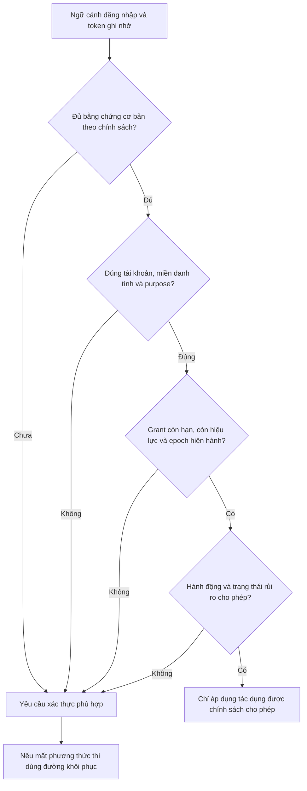

# Xử lý thiết bị được ghi nhớ sau khôi phục tài khoản

## 1. Vì sao đổi phương thức đăng nhập chưa đủ?

Trong chương **Session Continuity**, **Remembered device treatment** là việc xác định và xử lý quyền mà dịch vụ đã cấp cho một trình duyệt hoặc thiết bị được ghi nhớ trước, trong và sau khôi phục tài khoản.

Trong phạm vi `SECURITY_AUTHENTICATION_ACCOUNT_RECOVERY`, người dùng có thể mất mật khẩu, MFA, passkey hoặc thiết bị xác thực. Khôi phục không chỉ cấp một phương thức mới mà còn phải xem các đường truy cập cũ có tiếp tục được chấp nhận hay không. Một cookie “ghi nhớ trình duyệt này” còn hiệu lực có thể làm thay đổi hành vi đăng nhập dù mật khẩu đã đổi và session đang thấy trên màn hình đã được kết thúc.

Ví dụ, Hà từng chọn không hỏi lại MFA trên máy tính cá nhân. Đối thủ lấy được một bản sao cookie ghi nhớ và mật khẩu cũ. Hà phát hiện sự cố, đổi mật khẩu và thay MFA. Nếu sau đó đối thủ lấy được mật khẩu mới qua một đường khác, cookie cũ không nên tiếp tục giúp bỏ qua yêu cầu xác thực vốn phải được khôi phục sau sự cố.

Một biến thể khác không cần mật khẩu: tính năng “duy trì đăng nhập” có thể có quyền tạo lại session. Nếu chỉ xóa session hiện tại mà bỏ qua quyền tạo lại đó, người dùng tưởng đã đăng xuất mọi nơi nhưng đối thủ lại xuất hiện bằng session mới.

Bài học này tập trung vào **phạm vi quyền, thu hồi, kiểm tra lại và cấp lại trạng thái ghi nhớ**. Các tên bảng, state và thuật toán dưới đây là thiết kế tham khảo; phải điều chỉnh theo chính sách xác thực và kiến trúc của dịch vụ.

## 2. “Được ghi nhớ” có thể là nhiều cơ chế khác nhau

### 2.1. Đọc quyền thực tế thay vì chỉ đọc nhãn giao diện

| Cơ chế | Quyền hoặc vai trò thường gặp | Điều cần phân biệt khi khôi phục |
|---|---|---|
| Cookie session | Tiếp tục một phiên đã được xác thực | Thu hồi session không chắc đã thu hồi mọi quyền tạo session mới |
| Persistent login hoặc “remember me” | Có thể giúp khôi phục trạng thái đăng nhập theo chính sách | Đây có thể là bí mật truy cập dài hạn |
| Cookie ghi nhớ MFA | Có thể ảnh hưởng việc yêu cầu lại MFA trong ngữ cảnh được phép | Không được mặc định là một lần MFA mới |
| ID trình duyệt phục vụ đánh giá rủi ro | Nhận diện lịch sử hoặc liên kết hoạt động | Không phải bằng chứng độc lập về chủ tài khoản |
| Passkey đã đăng ký | Tham gia ceremony xác thực bằng credential | Là phương thức xác thực riêng, không phải cookie ghi nhớ |
| Chứng chỉ hoặc bằng chứng quản lý thiết bị | Chứng minh một thuộc tính được hệ thống quản lý xác nhận | Không tự đồng nghĩa người đang dùng là chủ tài khoản |

Không phải mọi sản phẩm đều có đủ các loại trên. Có sản phẩm gọi cả persistent login và giảm nhắc MFA là “thiết bị tin cậy”, dù hai quyền khác nhau đáng kể.

Một bước điều tra cần trả lời: dữ liệu này chỉ giúp nhận diện, có thể giảm yêu cầu xác thực, hay thực sự tạo quyền truy cập? Chính câu trả lời đó quyết định phạm vi xử lý.

### 2.2. Trình duyệt quen không thay thế mọi yêu cầu xác thực

NIST SP 800-63B-4 giới hạn việc dùng cookie hoặc tính năng ghi nhớ trình duyệt thay cho xác thực; chuẩn chỉ nêu ngoại lệ tái xác thực AAL2 trong điều kiện cụ thể về thời hạn phiên. Không diễn giải ngoại lệ đó thành quyền bỏ MFA vô thời hạn trên máy quen. [NIST — Session bindings](https://pages.nist.gov/800-63-4/sp800-63b.html#session-bindings).

OWASP mô tả đánh giá rủi ro như một cách điều chỉnh tần suất nhắc MFA theo ngữ cảnh. Đây là quyết định chính sách, không phải bảo đảm một nhãn “trusted” đáp ứng mọi mức xác thực. [OWASP — Risk based authentication](https://cheatsheetseries.owasp.org/cheatsheets/Multifactor_Authentication_Cheat_Sheet.html#risk-based-authentication).

Nếu ứng dụng không cho phép dùng cookie để giảm bước xác thực, cookie ghi nhớ chỉ nên làm dữ liệu hỗ trợ. Nếu có cho phép trong một số luồng, cần xác định rõ giới hạn thời gian, loại hành động và điều kiện buộc xác thực lại.

### 2.3. Một bản ghi không nhất thiết là một thiết bị vật lý

Một máy có nhiều browser profile có thể tạo nhiều bản ghi. Ngược lại, dữ liệu profile được sao chép hoặc phục hồi có thể khiến một bí mật ghi nhớ xuất hiện ở nơi khác.

Tên như “Laptop của Hà” thường chỉ là nhãn người dùng hoặc chuỗi suy ra từ user agent. Nó không phải chứng cứ máy chủ đang nói chuyện với đúng chiếc laptop vật lý.

Thiết kế và giao diện nên mô tả đúng khả năng quan sát: “trình duyệt đã được ghi nhớ”, “quyền ghi nhớ” hoặc “lần đăng ký này”, thay vì khẳng định xác định được mọi bản sao trên từng thiết bị.

## 3. Những đường rủi ro cần tính đến

### 3.1. Bí mật ghi nhớ bị lấy cắp hoặc sao chép

Nếu cơ chế dùng bearer token, bên trình được token có thể được hưởng tác dụng của nó cho tới khi token hết hạn, bị thu hồi hoặc không còn đáp ứng chính sách. Chỉ đổi user agent, thêm nhãn thiết bị hay lưu IP lần đầu không biến token đó thành khóa không thể sao chép.

Một cookie được bảo vệ tốt giúp giảm một số đường lấy cắp, nhưng không giải quyết mọi sự cố từ malware, thiết bị bị mở khóa trái phép hoặc môi trường trình duyệt bị kiểm soát.

### 3.2. Thiết bị bị mất vẫn giữ quyền dài hạn

Điện thoại bị mất có thể còn session, persistent login và quyền ghi nhớ MFA. Ba quyền đó có vòng đời khác nhau. Thu hồi passkey trên điện thoại không tự kết thúc tất cả chúng.

Nếu không có cách liên kết chính xác quyền ghi nhớ với thiết bị đã mất, hệ thống không nên hứa “chỉ bỏ tin cậy đúng máy đó”. Cần đánh giá phạm vi rộng hơn và giải thích tác động tới những trình duyệt còn lại.

### 3.3. Trạng thái đã bị đối thủ tạo từ trước

Trước khi nạn nhân bắt đầu khôi phục, đối thủ có thể đã đăng ký trình duyệt của mình là nơi được ghi nhớ. Danh sách “đã dùng nhiều lần” vì thế không chứng minh các mục trong đó đều an toàn.

Đặc biệt cần xét những bản ghi được tạo gần sự cố, được cấp từ session có dấu hiệu bị chiếm hoặc dựa vào một authenticator sau đó đã được xác định bị lộ.

### 3.4. Quyền khôi phục yếu bị chuyển thành quyền dài hạn

Một luồng chỉ cấp quyền giới hạn để thay phương thức không nên tự cấp thêm quyền ghi nhớ đăng nhập lâu dài. Nếu không, đối thủ vượt được một bước khôi phục có thể giữ truy cập sau khi luồng đó hết hạn.

Cũng không nên dùng lập luận vòng tròn: trình duyệt được miễn MFA vì đã được ghi nhớ, rồi chính lần miễn đó được ghi như “MFA mới” để gia hạn ghi nhớ. Lịch sử cấp quyền phải phản ánh phương thức thật sự đã được kiểm tra.

## 4. Chính sách xử lý theo loại sự kiện

### 4.1. Một yêu cầu công khai chưa đủ quyền thu hồi

Chỉ nhập email tại trang “Tôi mất MFA” không nên tự xóa mọi thiết bị được ghi nhớ hoặc đăng xuất toàn tài khoản. Đối thủ có thể dùng chức năng đó làm công cụ gây gián đoạn.

Có thể ghi nhận yêu cầu, giới hạn lưu lượng hoặc thay đổi đánh giá rủi ro theo chính sách. Thu hồi có tác động tới tài khoản cần quyền phù hợp hoặc một quyết định ứng phó có căn cứ.

### 4.2. Ma trận quyết định tham khảo

| Sự kiện | Xử lý trạng thái ghi nhớ | Lưu ý về quyền khác |
|---|---|---|
| Đăng xuất thông thường | Áp dụng ý nghĩa đã công bố của logout; có thể có lựa chọn quên trình duyệt | Không ngầm hứa logout một phiên là thu hồi mọi persistent login |
| Đổi mật khẩu bằng phương thức hiện hành an toàn | Đánh giá lại theo chính sách thay đổi bảo mật | Quyết định riêng về session và quyền tạo session |
| Hoàn tất khôi phục sau mất mật khẩu | Chính sách thận trọng có thể buộc xác thực lại các quyền ghi nhớ trước khôi phục | Không giữ đường tự tạo session cũ ngoài ý muốn |
| Khôi phục hoặc thay MFA bị mất | Vô hiệu hóa quyền giảm nhắc gắn với bằng chứng cũ; có thể mở rộng toàn tài khoản | Kiểm tra authenticator, session và grant khôi phục liên quan |
| Báo mất một máy, còn phương thức an toàn khác | Thu hồi các quyền được xác định thuộc máy đó; mở rộng nếu không xác định đủ | Không quên persistent login chỉ vì đã thu hồi passkey |
| Nghi bị chiếm tài khoản | Ngăn những quyền liên quan; cân nhắc thu hồi toàn bộ trạng thái ghi nhớ trước sự cố | Rà soát cả session, phương thức mới và liên hệ |
| Phát hiện token ghi nhớ bị lộ | Thu hồi token và các quyền phát sinh có thể bị ảnh hưởng | Không chỉ yêu cầu xóa cookie trên một trình duyệt |
| Hoàn tất khôi phục và đăng nhập lại hợp lệ | Chỉ cấp trạng thái ghi nhớ mới nếu đủ điều kiện riêng | Không tự kích hoạt lại các bản ghi cũ |

Đây là ma trận thiết kế, không phải quy tắc bắt buộc giống nhau cho mọi dịch vụ. Phạm vi thu hồi cần dựa trên bằng chứng và khả năng liên kết của hệ thống.

OWASP khuyến nghị xác thực lại sau những sự kiện rủi ro như khôi phục tài khoản, reset mật khẩu và thay đổi thông tin nhạy cảm. [OWASP — Reauthentication after risk events](https://cheatsheetseries.owasp.org/cheatsheets/Authentication_Cheat_Sheet.html#reauthentication-after-risk-events).

### 4.3. Định nghĩa riêng việc quên và việc đăng xuất

Một sản phẩm có thể chọn:

```text
Đăng xuất phiên này:
    Kết thúc session hiện tại theo chính sách logout.

Quên trình duyệt này:
    Thu hồi quyền ghi nhớ tương ứng.
    Không tự thu hồi passkey hoặc mọi session khác.

Đăng xuất và quên mọi nơi:
    Xử lý cả session và các quyền ghi nhớ trong phạm vi được công bố.
    Xét thêm persistent login và quyền làm mới nếu có.
```

Nếu “Đăng xuất phiên này” vẫn cho persistent login lập tức tạo lại session mà không có thao tác xác thực theo chính sách, ý nghĩa logout cần được thiết kế lại hoặc giải thích rõ. Không để giao diện hứa nhiều hơn những gì backend thực hiện.

## 5. Giới hạn tác dụng theo từng hành động

Một bản ghi ghi nhớ còn hiệu lực cũng không nên trở thành quyền quản trị tài khoản.

| Hành động | Tác dụng tối đa có thể được chính sách cho phép |
|---|---|
| Nhận diện trình duyệt quay lại | Hỗ trợ giao diện hoặc đánh giá rủi ro |
| Bắt đầu đăng nhập | Cung cấp ngữ cảnh; không tự chứng minh mọi yếu tố cần thiết |
| Giảm nhắc MFA trong điều kiện được phép | Chỉ áp dụng đúng loại luồng, thời hạn và mức rủi ro |
| Tiếp tục một session | Vẫn kiểm tra session và thời hạn riêng |
| Khôi phục khi mất mọi phương thức | Không dùng trạng thái ghi nhớ làm bằng chứng duy nhất |
| Thêm hoặc thay authenticator | Kiểm tra quyền nhạy cảm riêng |
| Đổi email, số điện thoại hoặc mã khôi phục | Không được tự bỏ qua xác minh vì máy quen |
| Ghi nhớ một trình duyệt mới | Cần bằng chứng và quyết định cấp quyền mới |
| Xem hoặc thu hồi các quyền khác | Kiểm tra đúng tài khoản và quyền thao tác |

Trong thiết kế tham khảo, một session khôi phục giới hạn có thể cho phép tới trang hướng dẫn, trình thêm bằng chứng hoặc đăng ký phương thức theo grant đã cấp. Nó không tự được dùng để cấp thêm persistent login hay mở mọi thao tác bảo mật.

Khi còn một phương thức đã đăng ký đáp ứng chính sách, người dùng có thể xác thực lại bằng phương thức đó. Khi không còn, hệ thống đưa về đường khôi phục phù hợp thay vì gọi cookie máy quen là yếu tố đã mất.

## 6. Mô hình quyền ghi nhớ có thể thu hồi

### 6.1. Lưu quyền ở máy chủ, không chỉ lưu một cờ ở client

Một cờ `trusted=true` trong local storage hoặc một device ID do client tự chọn không đủ cho quyết định bỏ bước xác thực.

Mô hình tham khảo:

```text
account_security_state:
  identity_scope_id
  account_id
  security_version
  trust_epoch
  session_epoch
  recovery_state

remembered_browser_grant:
  grant_id
  identity_scope_id
  account_id
  purpose
  token_digest
  status
  issued_in_trust_epoch
  source_authentication_event_id
  source_credential_references
  binding_source
  policy_version_at_issue
  created_at
  absolute_expires_at
  last_used_at
  revoked_at
  revocation_reason

session:
  session_id_digest
  identity_scope_id
  account_id
  issued_in_session_epoch
  authentication_context
  remembered_grant_reference_if_used
  created_at
  expires_at
  status
```

`purpose` phân biệt, chẳng hạn, một quyền phục vụ chính sách giảm nhắc với một quyền persistent login. Không phát một token có thể được hiểu theo cả hai mục đích tùy endpoint.

`source_credential_references` là tham chiếu cần thiết cho đánh giá, không chứa seed OTP, private key hoặc mã khôi phục. Nếu hệ thống không biết quyền cũ được tạo từ bằng chứng nào, nó không nên tự suy đoán để giữ quyền sau sự cố.

### 6.2. Ba loại phiên bản có nhiệm vụ khác nhau

| Trường | Vai trò trong ví dụ |
|---|---|
| `security_version` | Kiểm soát thay đổi bảo mật và tính hiện hành của quyền khôi phục |
| `trust_epoch` | Vô hiệu hóa hàng loạt các quyền ghi nhớ được cấp trước một mốc |
| `session_epoch` | Vô hiệu hóa những session không còn được phép tiếp tục |

Một hệ thống có thể dùng một phiên bản chung hoặc cơ chế khác. Việc tách trong ví dụ nhằm thể hiện rõ: thu hồi khả năng giảm nhắc MFA không tự kết thúc mọi session, và kết thúc session không tự thu hồi mọi quyền ghi nhớ.

Nếu tăng `trust_epoch` từ 7 lên 8, những grant mang epoch 7 bị từ chối khi sử dụng. Không cần đợi trình duyệt tự xóa token hay một job cập nhật xong từng hàng.

Nhưng quy tắc đó chỉ có hiệu lực tại những nơi thực sự đọc và kiểm tra epoch. Một endpoint bỏ qua kiểm tra hoặc cache cũ vẫn có thể chấp nhận quyền không còn hợp lệ.

### 6.3. Trạng thái không còn hiệu lực không được tự sống lại

Các trạng thái có thể gồm:

```text
ACTIVE:
    Có thể được đánh giá theo đúng purpose và chính sách.

NEEDS_REAUTH:
    Chưa được dùng để giảm yêu cầu xác thực.

REVOKED:
    Quyền đã bị thu hồi.

EXPIRED:
    Quyền đã hết hạn.
```

Bản ghi `ACTIVE` vẫn có thể bị từ chối vì epoch cũ, sai tài khoản hoặc rủi ro. Không nên chỉ kiểm tra tên trạng thái.

Trong thiết kế này, xác thực lại thành công dẫn tới quyết định cấp một grant mới nếu được phép. Nó không làm token cũ bị lộ tự hợp lệ trở lại. Bản ghi cũ được giữ hoặc dọn theo chính sách dữ liệu, đồng thời duy trì quyết định thu hồi cần thiết.

## 7. Điều kiện cấp trạng thái ghi nhớ

### 7.1. Ghi nhớ là hành động được cấp quyền

Có thể yêu cầu những điều kiện sau trước khi tạo grant:

1. Tài khoản đích được xác định từ ngữ cảnh xác thực được kiểm soát.
2. Các phương thức mà chính sách yêu cầu đã được kiểm tra đủ mới.
3. Lần cấp không dựa vòng tròn vào chính ngoại lệ ghi nhớ đang muốn gia hạn.
4. Trạng thái bảo mật hiện tại cho phép cấp quyền dài hạn tương ứng.
5. Người dùng chọn ghi nhớ trong ngữ cảnh phù hợp.
6. Máy chủ ghi được nguồn bằng chứng, purpose và thời hạn.

Không chỉ kiểm tra `session.authenticated=true`. Session có thể đến từ persistent login cũ, từ luồng khôi phục giới hạn hoặc từ một lần xác thực không đáp ứng yêu cầu cấp quyền này.

OWASP coi việc thêm thiết bị tin cậy và những thay đổi nhạy cảm là các trường hợp cần xét xác thực lại. [OWASP — Reauthentication triggers](https://cheatsheetseries.owasp.org/cheatsheets/Authentication_Cheat_Sheet.html#when-to-trigger-reauthentication).

### 7.2. Không cấp mặc định trên máy dùng chung

Giao diện nên giải thích tác dụng của việc ghi nhớ và nhắc người dùng tránh chọn trên máy công cộng hoặc dùng chung. Không hứa hệ thống luôn tự phát hiện chính xác máy dùng chung.

Một môi trường được quản lý có thể có tín hiệu từ hệ thống quản trị thiết bị, nhưng cần kiểm chứng qua cơ chế phù hợp. Một trường `managedDevice=true` do browser tự gửi không thay cho bằng chứng đó.

Nếu người dùng không chọn ghi nhớ, luồng xác thực bình thường vẫn cần hoạt động. Tùy chọn tiện dụng không nên trở thành điều kiện bắt buộc để khôi phục.

### 7.3. Có thời hạn tuyệt đối và điều kiện đánh giá lại

`last_used_at` thể hiện hoạt động gần nhất, không phải thời điểm đã thực hiện MFA mới. Không gia hạn vô hạn quyền ghi nhớ chỉ vì trình duyệt còn phát request.

Thiết kế có thể dùng thời hạn tuyệt đối, giới hạn không hoạt động và điều kiện hết hiệu lực khi thay đổi bảo mật. Con số cụ thể phụ thuộc chính sách, mức xác thực và bối cảnh sử dụng; không có một thời hạn “tin cậy máy” phù hợp mọi sản phẩm.

Nếu có xoay token, cần xác định mốc xoay và cách xử lý nhiều tab. Xoay trên mọi request mà không có thiết kế cạnh tranh có thể làm request hợp lệ tự loại nhau. Nếu có khoảng chuyển tiếp, khoảng đó không được làm token đã bị thu hồi tiếp tục vượt qua kiểm tra epoch.

## 8. Bảo vệ bí mật ghi nhớ trong trình duyệt

### 8.1. Token phải có bí mật thực sự

Với mô hình opaque bearer token, một lựa chọn tham khảo là sinh 32 byte ngẫu nhiên bằng nguồn mật mã và mã hóa để truyền. Server lưu digest phù hợp để tra cứu hoặc đối chiếu, không dùng chính `grant_id`, email hoặc fingerprint làm bí mật.

Token ngẫu nhiên có entropy cao khác với OTP ngắn và mật khẩu do người dùng chọn. Không sao chép một công thức hash mật khẩu sang mọi loại dữ liệu mà không hiểu đặc tính của chúng; cần dùng cơ chế lưu bí mật và thư viện phù hợp với token đang triển khai.

Token ghi nhớ thường có vòng đời nhiều lần sử dụng theo chính sách. Nó không tự có cùng tính chất dùng một lần với mã khôi phục. Khi token được thay hoặc thu hồi, phải bảo đảm bản cũ không còn tác dụng ngoài khoảng chuyển tiếp được phép.

### 8.2. Ví dụ cookie có phạm vi rõ ràng

```http
Set-Cookie: __Host-remembered-browser=<opaque-token>; Path=/; Secure; HttpOnly; SameSite=Lax; Max-Age=604800
```

Giá trị `Max-Age` bảy ngày chỉ minh họa cú pháp, không phải khuyến nghị thời hạn chung. Server vẫn quyết định hết hạn và thu hồi; sửa đồng hồ hay kéo dài cookie ở client không được kéo dài grant.

MDN khuyến nghị giới hạn phạm vi cookie, dùng `Secure`, đặt `HttpOnly` khi JavaScript không cần đọc và chọn `SameSite` phù hợp. Cookie có tiền tố `__Host-` yêu cầu `Secure`, `Path=/` và không có `Domain`. [MDN — Secure cookie configuration](https://developer.mozilla.org/en-US/docs/Web/Security/Practical_implementation_guides/Cookies).

Trong ví dụ, cookie chỉ dành cho host đặt nó. Không mở rộng sang toàn bộ tên miền cha chỉ để tiện dùng giữa những ứng dụng không cùng ranh giới an toàn.

`HttpOnly` giúp ngăn script đọc trực tiếp cookie qua API thông thường, nhưng không ngăn mọi tác động của XSS. Script trong origin vẫn có thể phát request hoặc thao túng giao diện. `SameSite` cũng không thay mọi kiểm soát CSRF.

### 8.3. Xóa cookie là một phần của dọn dẹp, không phải thu hồi toàn cục

Khi quên trình duyệt, server có thể trả cookie hết hạn với đúng tên, host và path đã dùng. Điều đó chỉ xử lý bản sao trong ngữ cảnh browser nhận response.

Một bản sao bị lấy cắp hoặc một trình duyệt đang ngoại tuyến không nhận được lệnh xóa đó. Quyết định server từ chối grant mới là cơ chế ngăn sử dụng lại.

Không đưa token vào URL, log, công cụ analytics hoặc ticket hỗ trợ. Nếu chỉ cần hiển thị một bản ghi trong danh sách, dùng định danh tham chiếu không có quyền bearer.

## 9. Kiểm tra trước khi cho quyền ghi nhớ ảnh hưởng đăng nhập

### 9.1. Token hợp lệ về hình thức chưa đủ



Ngữ cảnh đăng nhập phải được server quản lý. Email vừa nhập, một ID tài khoản trong body hoặc cookie của tài khoản khác không được làm grant đổi chủ.

### 9.2. Pseudocode đánh giá

```text
evaluateRememberedGrant(loginContext, rawToken, action):
    if not baseAuthenticationPolicySatisfied(loginContext):
        return REQUIRE_REQUIRED_AUTHENTICATION

    if actionDoesNotAllowRememberedExemption(action):
        return EVALUATE_ACTION_WITHOUT_REMEMBERED_EXEMPTION

    grant = lookupGrantUsingProtectedTokenVerification(rawToken)

    if grant is absent:
        return REQUIRE_REQUIRED_AUTHENTICATION

    if grant.target != loginContext.target:
        return REQUIRE_REQUIRED_AUTHENTICATION

    if grant.purpose != expectedPurposeFor(action):
        return REQUIRE_REQUIRED_AUTHENTICATION

    security = loadCurrentAuthoritativeSecurityState(grant.target)

    if grant.status != ACTIVE or grant.isExpired(serverTime):
        return REQUIRE_REQUIRED_AUTHENTICATION

    if grant.issuedInTrustEpoch != security.trustEpoch:
        return REQUIRE_REQUIRED_AUTHENTICATION

    if sourceEvidenceNoLongerAccepted(grant, security):
        return REQUIRE_REQUIRED_AUTHENTICATION

    if not currentPolicyAndRiskAllow(grant, security, action):
        return REQUIRE_REQUIRED_AUTHENTICATION

    return ELIGIBLE_FOR_ONLY_THE_ALLOWED_REDUCTION
```

`REQUIRE_REQUIRED_AUTHENTICATION` không có nghĩa buộc dùng duy nhất phương thức vừa mất. Hệ thống có thể cho phương thức thay thế được phép hoặc hướng sang khôi phục. Nó có nghĩa token ghi nhớ không đủ để bỏ qua yêu cầu hiện tại.

Kết quả đánh giá cũng không phải quyền vĩnh viễn. Nếu sau đó phát session hoặc hoàn tất một hành động nhạy cảm, cần bảo đảm trạng thái chưa thay đổi tại điểm quyết định.

Nếu không đọc được trạng thái bảo mật, không mặc định grant vẫn an toàn. Chính sách lỗi có thể yêu cầu xác thực độc lập, giữ quyền giới hạn hoặc tạm không hoàn tất hành động; không chuyển lỗi cache thành miễn MFA.

## 10. Thu hồi trong giao dịch khôi phục

### 10.1. Định nghĩa ranh giới thay đổi quyền

Với một sự cố cần thu hồi toàn bộ trạng thái ghi nhớ và session cũ, ví dụ có thể là:

```text
completeRecovery(authorizedRecoveryContext):
    transaction:
        account = lockTargetAccount()
        recovery = lockExactRecoveryTransaction()

        requireRecoveryAuthorizedUnexpiredAndUnused()
        requireTargetAndSecurityVersionMatch()
        requireCurrentPolicyAllowsCompletion()

        applyAuthorizedAuthenticatorChanges()

        account.trustEpoch += 1
        account.sessionEpoch += 1
        account.securityVersion += 1

        consumeRecoveryAuthority()
        commitRecoveryResult()
        appendSecurityEventAndNotificationIntent()

    continueThroughExplicitPostRecoveryAuthenticationPolicy()
```

Đây là trường hợp thu hồi toàn cục được chọn trong ví dụ. Nếu chỉ xử lý một bản ghi hoặc một nhóm thiết bị, cần cập nhật đúng grant và xử lý những session phụ thuộc, không giả vờ một epoch toàn cục có thể chỉ tác động một máy.

Grant khôi phục, grant ghi nhớ và session là ba loại quyền khác nhau. Các bước tiêu thụ và thu hồi phải áp dụng đúng loại; xóa một dòng trong bảng session không thay cho tăng `trust_epoch`.

### 10.2. Request đồng thời không được tạo lại đường truy cập cũ

Một request dùng token cũ có thể đang chuẩn bị tạo session trong lúc khôi phục hoàn tất.

Nếu nó tạo session trước mốc thu hồi toàn cục, session mang epoch cũ và cần bị từ chối sau khi epoch đổi. Nếu nó tới bước quyết định sau mốc đó, token ghi nhớ cũ không được chấp nhận.

Điểm phát session cần được phối hợp với trạng thái tài khoản bằng giao dịch, khóa hoặc kiểm tra phiên bản thích hợp. Không lấy epoch hiện tại rồi gắn vào một session mới chỉ vì token cũ đã từng qua kiểm tra trước đó.

Nếu chính sách chỉ thu hồi chọn lọc, cần truy vết session được tạo dựa trên grant nào hoặc có cơ chế tương đương để xử lý quyền phát sinh. Chỉ ngăn lần sử dụng token kế tiếp có thể để nguyên một session mà đối thủ vừa tạo.

### 10.3. Session hiện tại của chủ tài khoản cũng cần quyết định rõ

Nếu thu hồi toàn cục, session đang thao tác của người dùng có thể cũng bị ảnh hưởng. Sau khôi phục, dịch vụ có thể tiếp tục bằng một ngữ cảnh được cấp riêng hoặc yêu cầu đăng nhập lại theo chính sách, rồi phát session mới.

Không giữ nguyên cookie cũ bằng một ngoại lệ “đây là máy đang khôi phục” chưa được chứng minh. Cũng không tự biến grant khôi phục giới hạn thành session đầy đủ hoặc trạng thái ghi nhớ mới chỉ để tránh người dùng thấy màn hình đăng nhập.

## 11. Hiệu lực thu hồi trong hệ thống phân tán

### 11.1. Cập nhật cơ sở dữ liệu chưa chắc đã ngăn mọi request

Một dịch vụ đăng nhập có thể kiểm tra `trust_epoch`, trong khi một API khác vẫn tin cookie cũ hoặc session trong cache. Nếu các đường thực thi không cùng áp dụng quyết định thu hồi, tài khoản vẫn có cửa truy cập ngoài ý muốn.

Cần liệt kê những điểm có thể dùng trạng thái ghi nhớ hoặc phát quyền từ nó:

- Đăng nhập trên web và ứng dụng di động.
- Endpoint giảm nhắc hoặc xác nhận MFA.
- Persistent login và các đường tạo lại session.
- Các API quản lý phương thức và liên hệ.
- Cổng quản trị, ứng dụng liên quan hoặc thành phần SSO nếu có.

Không giả định một thay đổi ở ứng dụng tự thu hồi session tại nhà cung cấp danh tính bên ngoài. Ngược lại, một session bên ngoài còn tồn tại không được tự bỏ qua những yêu cầu sau khôi phục của ứng dụng.

### 11.2. Cache cần mô hình độ trễ thu hồi

Nếu dịch vụ dùng cache, cần xác định những quyết định nào buộc đọc trạng thái hiện hành và những quyết định nào được phép có độ trễ theo chính sách.

Có thể phối hợp cập nhật nguồn trạng thái, sự kiện vô hiệu hóa và thời hạn cache có giới hạn. Tuy nhiên, sự kiện có thể đến muộn hoặc bị xử lý lại. Sự kiện epoch cũ không được ghi đè epoch mới hoặc làm một grant bị thu hồi thành `ACTIVE`.

Với hành động nhạy cảm hoặc quyết định cấp session sau sự cố, một cache không biết mình còn mới không nên được dùng để giảm yêu cầu xác thực. Nếu hệ thống chấp nhận một khoảng độ trễ ở nơi khác, khoảng đó cần được đo và phản ánh đúng trong cam kết vận hành.

### 11.3. Token tự chứa không loại bỏ nhu cầu thu hồi

Một token được ký có thể chứa account, purpose, thời hạn và epoch lúc cấp. Chữ ký giúp kiểm tra nội dung không bị sửa, nhưng không cho biết tài khoản vừa khôi phục sau khi token được phát.

Nếu chỉ kiểm tra chữ ký và `exp`, token cũ có thể tiếp tục có tác dụng tới khi hết hạn. Muốn thu hồi trước hạn cần kiểm tra trạng thái hiện hành, danh sách thu hồi hoặc cơ chế tương đương.

Điều tương tự cần được xét với access token hoặc session đã phát sinh. Thu hồi refresh token có thể ngăn cấp token mới nhưng không tự chứng minh mọi access token đang được chấp nhận đã dừng ngay. Kiến trúc phải xử lý hoặc công bố rõ giới hạn thực tế này.

### 11.4. Không hoàn tác thu hồi vì tác vụ phụ thất bại

Nếu cảnh báo email gửi lỗi hoặc một job dọn cookie thất bại, không tự khôi phục quyền ghi nhớ đã bị thu hồi vì sự cố. Những tác vụ đó cần retry hoặc chuyển xử lý riêng.

Quyết định bảo mật và khả năng giao thông báo có liên hệ vận hành nhưng không phải cùng một trạng thái. Một email có nội dung “đã quên mọi trình duyệt” chỉ nên được tạo từ kết quả thu hồi đã xác nhận trong phạm vi được mô tả.

## 12. Cấp lại sau khôi phục mà không kế thừa nhầm độ tin cậy

### 12.1. Bắt đầu từ bằng chứng mới và chính sách hiện hành

Người dùng vừa khôi phục có thể vẫn muốn ghi nhớ trình duyệt cá nhân. Điều đó có thể được cho phép sau khi những điều kiện cần thiết đã đáp ứng.

Một luồng tham khảo:

```text
Khôi phục được cấp quyền
    -> Xử lý phương thức và các quyền cũ
    -> Xác thực tiếp theo bằng phương thức được chấp nhận
    -> Đánh giá quyền ghi nhớ theo nguồn khôi phục và rủi ro
    -> Người dùng chọn ghi nhớ nếu được phép
    -> Cấp grant mới trong epoch hiện hành
```

Không sao chép danh sách `trustedDevices` từ snapshot trước sự cố sang trạng thái mới. Không lấy token cũ, đổi trường epoch rồi tiếp tục chấp nhận cùng bí mật đó.

Một phương thức mới dùng thành công chứng minh khả năng sử dụng phương thức đó trong giao dịch được xác minh. Nó không tự làm bằng chứng khôi phục ban đầu mạnh hơn. Chính sách có thể giữ hạn chế sau khôi phục hoặc trì hoãn quyền ghi nhớ dài hạn khi mức rủi ro chưa phù hợp.

### 12.2. Giữ đúng lịch sử phương thức đã sử dụng

Nếu một lần đăng nhập dùng mật khẩu và ngoại lệ ghi nhớ, hồ sơ không nên ghi như vừa có một OTP hoặc assertion MFA mới.

Có thể lưu:

```text
base_authentication_event
last_actual_required_factor_verification_at
remembered_grant_used
remembered_policy_decision
recovery_source_reference_if_relevant
effective_authorization_context
```

Những thông tin này giúp endpoint nhạy cảm yêu cầu đúng bằng chứng bổ sung. Nếu mọi lần dùng cookie đều cập nhật “MFA vừa thực hiện”, thao tác đổi email hoặc thêm passkey có thể vô tình được phép bằng lịch sử sai.

NIST quy định session không được xem là có mức bảo đảm cao hơn sự kiện xác thực tạo ra nó. Điều đó cũng là lý do không tự nâng mức bảo đảm chỉ từ một nhãn trình duyệt quen. [NIST — Session binding properties](https://pages.nist.gov/800-63-4/sp800-63b.html#session-bindings).

### 12.3. Người dùng có thể phải xác thực lại trên máy còn an toàn

Khi chính sách thu hồi toàn cục, một máy không bị mất cũng có thể bị hỏi lại. Giao diện cần giải thích đây là kết quả của việc thay đổi bảo mật, không phải kết luận máy đó đã bị đối thủ chiếm.

Nếu còn phương thức hợp lệ, người dùng dùng phương thức đó để tiếp tục. Nếu không còn phương thức đáp ứng chính sách, cần đường khôi phục được thiết kế sẵn; không chỉ hiển thị lặp lại một yêu cầu MFA bất khả thi.

Một thông điệp tham khảo:

```text
Bạn vừa khôi phục tài khoản. Quyền ghi nhớ trước đó của
trình duyệt này không còn được dùng để giảm bước xác thực.

Hãy xác thực bằng một phương thức hiện còn được chấp nhận.
Nếu không sử dụng được phương thức nào, chọn Khôi phục
tài khoản để xem đường hỗ trợ phù hợp.
```

Không yêu cầu gửi cookie hoặc token ghi nhớ cho nhân viên hỗ trợ để được “bật tin cậy lại”.

## 13. Giao diện quản lý và thao tác thu hồi

### 13.1. Cho người dùng biết đang quản lý loại quyền nào

Danh sách có thể hiển thị nhãn trình duyệt, thời điểm cấp, lần dùng gần nhất, thời hạn và trạng thái. Những thông tin địa lý hoặc thiết bị ước lượng cần được trình bày với đúng giới hạn.

Không hiển thị bearer token hoặc digest như một mã người dùng phải sao chép. Dữ liệu nhận diện trình duyệt và lịch sử sử dụng cũng cần quyền truy cập và thời gian lưu phù hợp.

Nếu sản phẩm có cả session, passkey và quyền ghi nhớ, giao diện cần phân biệt được tác động. Người dùng bỏ ghi nhớ một trình duyệt không nhất thiết muốn xóa passkey đang cất trong trình quản lý của mình.

### 13.2. Mô tả kết quả theo phạm vi thật

| Thao tác | Diễn giải kết quả phù hợp |
|---|---|
| Quên một grant | Token của lần ghi nhớ đó không còn được chấp nhận |
| Thu hồi các session liên quan | Những session trong phạm vi được xử lý không còn quyền tiếp tục theo cơ chế thực thi |
| Quên tất cả | Những quyền ghi nhớ trong phạm vi tài khoản đã bị vô hiệu hóa |
| Thu hồi passkey | Credential đó không còn được RP chấp nhận |
| Yêu cầu xóa cookie | Browser nhận response được yêu cầu xóa dữ liệu tương ứng |

Không gọi việc thu hồi grant là “đã xóa dữ liệu khỏi thiết bị bị mất”. Server thường chỉ kiểm soát khả năng chấp nhận quyền, không thể chứng minh đã xóa mọi bản sao bí mật ở máy từ xa.

Đối với bearer token đã bị sao chép, thu hồi một grant ngăn mọi bản sao cùng token khi chúng đi qua kiểm tra server. Nó không phân biệt được bản nào là bản của chủ tài khoản.

### 13.3. Kiểm tra quyền thao tác, tránh gây gián đoạn từ xa

Endpoint quên thiết bị cần kiểm tra account và miền danh tính từ ngữ cảnh đã được cấp quyền. Không cho sửa `accountId` hoặc `grantId` để thu hồi quyền của tài khoản khác.

Thao tác làm thay đổi trạng thái cần cơ chế chống CSRF và kiểm tra quyền phù hợp. Một link xem trước hoặc một báo cáo công khai không được tự trở thành lệnh đăng xuất mọi nơi.

Nếu người dùng báo một bản ghi lạ nhưng không còn khả năng xác thực cần thiết, hệ thống có thể tiếp nhận báo cáo và áp dụng quy trình sự cố. Không mặc định người báo đủ quyền chỉ vì họ biết tên browser hoặc thời điểm gần đúng.

## 14. Ba tình huống so sánh

### 14.1. Mất MFA nhưng còn trình duyệt được ghi nhớ

Lan mất điện thoại tạo OTP. Laptop còn quyền ghi nhớ MFA nên trước đây ít bị hỏi lại.

Laptop có thể hỗ trợ tiếp cận luồng hỗ trợ hoặc cung cấp ngữ cảnh, nhưng cookie đó không tự đủ quyền thay MFA. Dịch vụ cần bằng chứng khôi phục được chấp nhận hoặc một phương thức đã đăng ký khác đáp ứng chính sách.

Nếu Lan còn khóa bảo mật đã đăng ký và dùng được, cô có thể xác thực bằng khóa đó theo đường phù hợp. Đây là giá trị của một phương thức còn hoạt động, không phải đặc quyền từ nhãn “máy tin cậy”.

Sau khi thay MFA, dịch vụ xử lý những grant dựa trên phương thức cũ theo chính sách. Không tự cấp lại chúng chỉ vì Lan vẫn đang dùng cùng chiếc laptop.

### 14.2. Đối thủ giữ token trước sự cố

Đối thủ có token T được cấp ở `trust_epoch=7`. Tài khoản hoàn tất khôi phục theo chính sách thu hồi toàn cục, chuyển sang `trust_epoch=8` và tăng phiên bản session.

T vẫn còn trong một browser và chưa hết `Max-Age`. Khi trình lại, server từ chối vì epoch không khớp. Nếu đối thủ đã tạo session dựa trên T trước mốc khôi phục, session đó cũng cần bị xử lý theo phiên bản session và phạm vi thu hồi đã chọn.

Không đủ nếu chỉ kiểm tra T ở trang đăng nhập mà để một endpoint persistent login khác tạo session mới. Tất cả đường dùng quyền tương ứng phải cùng áp dụng quy tắc.

### 14.3. Người dùng đăng xuất trên máy công cộng

Minh đăng nhập ở một máy dùng chung và vô tình chọn ghi nhớ. Anh bấm đăng xuất rồi rời máy.

Nếu logout chỉ kết thúc session, quyền ghi nhớ có thể vẫn còn. Minh cần có thao tác quên browser hoặc quản lý từ nơi khác với quyền phù hợp; sản phẩm cũng nên làm rõ hoặc gộp hành vi theo cách nhất quán.

Khi Minh quên bản ghi từ máy cá nhân, không cần giả định trình duyệt công cộng đã trực tuyến để nhận lệnh xóa cookie. Server phải từ chối quyền đó khi được sử dụng tiếp.

Nếu máy công cộng còn session khác, việc quên grant không tự chứng minh session đó đã dừng. Hệ thống cần xử lý session theo phạm vi của thao tác được chọn.

## 15. Theo dõi quyết định và tiêu chí kiểm chứng

### 15.1. Ghi nguồn quyền và lý do thay đổi

Các sự kiện có thể gồm:

```text
REMEMBERED_GRANT_ISSUED
REMEMBERED_GRANT_USED
REMEMBERED_GRANT_REAUTH_REQUIRED
REMEMBERED_GRANT_REVOKED
ACCOUNT_TRUST_EPOCH_ADVANCED
DEPENDENT_SESSION_INVALIDATED
POST_RECOVERY_REMEMBERING_DENIED
```

Có thể ghi account nội bộ, miền danh tính, grant reference, epoch, hành động, nguồn xác thực và mã lý do. Không ghi raw token, cookie, OTP, private key hoặc bí mật khôi phục.

Những chỉ số có ích gồm số lần token cũ bị trình sau khôi phục, độ trễ thực thi thu hồi giữa các thành phần, số quyền ghi nhớ được cấp từ session không đủ điều kiện và tỷ lệ vòng lặp yêu cầu MFA khiến người dùng không thể tiếp tục.

Không tối ưu số lần giảm prompt bằng cách bỏ qua các trạng thái cần xác thực lại. Cũng không coi mỗi IP mới là bằng chứng chắc chắn có tấn công; người dùng có thể đổi mạng hoặc dùng mạng chia sẻ.

### 15.2. Những hành vi cần kiểm chứng khi triển khai

| Tình huống | Hành vi mong đợi |
|---|---|
| Chỉ biết device ID hoặc tự gửi `trusted=true` | Không cấp quyền giảm xác thực |
| Cookie tồn tại nhưng grant đã thu hồi | Không tiếp tục chấp nhận grant |
| Token đúng hình thức nhưng thuộc tài khoản khác | Không dùng cho tài khoản đang xử lý |
| Hai tenant có cùng ID cục bộ | Không lẫn miền danh tính |
| Token giảm nhắc MFA được gửi tới endpoint persistent login | Không đổi purpose để tạo session |
| Yêu cầu khôi phục công khai chưa xác minh | Không tự thu hồi mọi quyền của nạn nhân |
| Hoàn tất khôi phục có quyết định tăng trust epoch | Token epoch cũ không còn tác dụng |
| Session đã tạo từ grant cũ trước sự cố | Được xử lý trong phạm vi thu hồi session đã chọn |
| Request phát session chạy đồng thời với khôi phục | Không gắn epoch mới cho quyết định dựa trên quyền cũ không còn hợp lệ |
| Endpoint sử dụng cache chưa cập nhật | Không vượt qua chính sách độ trễ hoặc điều kiện kiểm tra hiện hành |
| Sự kiện epoch cũ đến sau epoch mới | Không giảm epoch hoặc kích hoạt lại grant |
| Token ký còn hạn nhưng account đã đổi epoch | Không chỉ kiểm tra chữ ký và thời hạn |
| Không đọc được trạng thái bảo mật | Không mặc định miễn MFA |
| Dùng cookie nhiều lần | Không ghi thành nhiều lần xác minh MFA mới |
| Recovery session có quyền giới hạn | Không tự cấp persistent login hoặc quyền ghi nhớ mới |
| Xác thực lại và được phép ghi nhớ | Cấp grant mới, không làm token bị thu hồi sống lại |
| Người dùng chỉ quên một browser | Không tự xóa passkey không liên quan |
| Cookie bị sao chép sang hai nơi | Thu hồi grant ngăn cả hai bản sao khi dùng qua server |
| Browser ngoại tuyến hoặc không nhận lệnh xóa cookie | Quyết định thu hồi vẫn được thực thi phía server |
| Gửi thông báo lỗi sau thu hồi | Không hoàn tác quyết định bảo mật |
| Người dùng không còn MFA để xác thực lại | Có nhánh khôi phục phù hợp thay vì vòng lặp bất khả thi |

Bảng này mô tả tiêu chí cho một hệ thống triển khai, không phải kết quả kiểm thử đã chạy.

Để kết luận xử lý trạng thái ghi nhớ sau khôi phục đã đầy đủ, cần xác định được quyền nào đã tồn tại, được cấp từ bằng chứng nào, còn tác dụng ở endpoint nào, đã thu hồi tới đâu và điều kiện nào cho phép cấp lại. Session continuity chỉ có ý nghĩa an toàn khi giữ được quyền truy cập hợp lệ mà không giữ nguyên những ngoại lệ đã mất cơ sở tin cậy.
