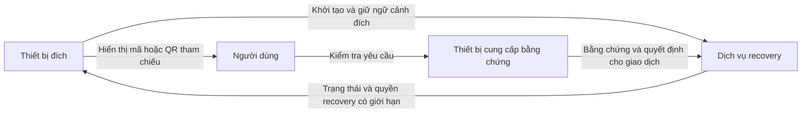
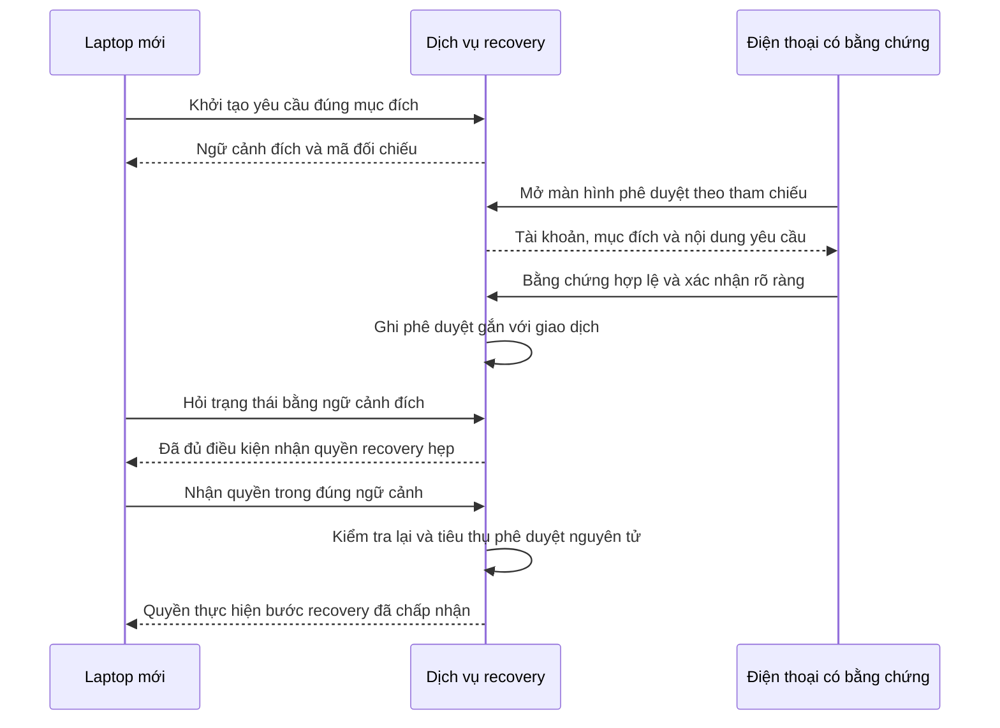
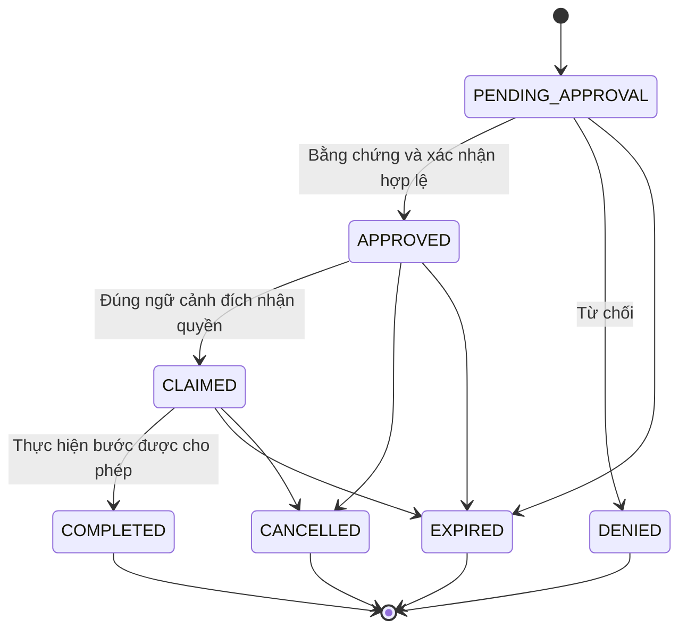

# Cross device recovery

## 1. Khôi phục xuyên thiết bị là chuyển tiếp quyền có kiểm soát

Người dùng bắt đầu khôi phục tài khoản trên laptop mới nhưng bằng chứng còn lại nằm trên điện thoại. Một người khác mở liên kết recovery bằng ứng dụng email rồi muốn tiếp tục trong trình duyệt. Cũng có trường hợp điện thoại chính đã mất, còn khóa bảo mật dự phòng được dùng trên một máy khác.

**Cross device recovery** là luồng khôi phục có nhiều thiết bị hoặc ngữ cảnh ứng dụng cùng tham gia. Máy chủ phải xác định bằng chứng thuộc tài khoản nào, cho phép hành động gì và ngữ cảnh nào được nhận quyền để tiếp tục.

Trong phạm vi khôi phục tài khoản khi mất mật khẩu, MFA, passkey hoặc thiết bị xác thực, mục tiêu không chỉ là giúp hai màn hình “nhìn thấy nhau”. Mục tiêu là nối đúng bằng chứng với đúng yêu cầu, đồng thời ngăn kẻ tấn công gửi yêu cầu của mình cho chủ tài khoản phê duyệt.

Một thiết kế cần trả lời bốn câu hỏi:

1. Ai đang cung cấp bằng chứng được chấp nhận?
2. Họ đang phê duyệt yêu cầu cụ thể nào?
3. Quyền nào được phép cấp sau khi phê duyệt?
4. Ngữ cảnh đích nào được nhận và sử dụng quyền đó?

Không nên triển khai tính liên tục bằng cách sao chép cookie, refresh token, TOTP seed hoặc khóa riêng giữa các thiết bị. Sự liên tục của quy trình được giữ bằng trạng thái giao dịch và quyết định cấp quyền phía máy chủ.

## 2. Phân biệt các hoạt động dễ bị gọi chung là recovery

| Hoạt động | Ví dụ | Ý nghĩa bảo mật |
|---|---|---|
| Đăng nhập bằng authenticator ở thiết bị khác | Dùng passkey trên điện thoại để đăng nhập laptop | Có thể là xác thực thông thường nếu đáp ứng chính sách |
| Đồng bộ credential | Passkey có sẵn trong môi trường mới qua provider | Không tự chứng minh RP vừa thực hiện recovery |
| Khôi phục và gắn phương thức thay thế | Dùng bằng chứng còn lại để đăng ký MFA mới | Cần quyết định cấp quyền cho thao tác thay bảo mật |
| Chuyển ngữ cảnh hồ sơ | Bắt đầu trên máy tính, tiếp tục nộp bằng chứng trên điện thoại | Phải ràng buộc việc tiếp tục với đúng hồ sơ và người được phép |
| OAuth device authorization | Một thiết bị dùng trình duyệt trên thiết bị khác để xin quyền truy cập | Là giao thức cấp quyền; không mặc định là quy trình recovery tài khoản |

FIDO mô tả cross-device authentication là dùng passkey trên một thiết bị để đăng nhập trên thiết bị khác. Do đó, việc quét QR để đăng nhập không tự chứng minh khóa đã được sao chép sang thiết bị mới. [Nguồn: FIDO Alliance — Passkeys, Cross-Device Authentication](https://fidoalliance.org/passkeys/).

RFC 8628 định nghĩa OAuth Device Authorization Grant cho các thiết bị bị hạn chế khả năng nhập hoặc thiếu trình duyệt phù hợp. Các ý tưởng về mã và phê duyệt có thể giúp phân tích thiết kế, nhưng một luồng recovery riêng không trở thành RFC 8628 chỉ vì có QR và polling. [Nguồn: RFC 8628 — Introduction](https://www.rfc-editor.org/rfc/rfc8628.html#section-1).

Nếu đã có phương thức đăng nhập tiêu chuẩn phù hợp, nên dùng nó thay vì tự xây thêm giao thức chuyển session. Nếu người dùng không còn đủ bằng chứng đăng nhập, phải áp dụng chính sách recovery tương ứng.

## 3. Vai trò của từng thiết bị và ranh giới tin cậy

Trong mô hình tham khảo của bài học:

- **Thiết bị khởi tạo hoặc thiết bị đích** là nơi người dùng muốn tiếp tục recovery hoặc sử dụng tài khoản.
- **Thiết bị cung cấp bằng chứng** là nơi có authenticator, kênh hoặc quy trình được chính sách chấp nhận.
- **Dịch vụ recovery** quản lý tài khoản đích, trạng thái giao dịch, bằng chứng và phạm vi quyền.
- **Kênh thông báo** giúp người dùng nhận biết sự kiện, không tự thay thế bằng chứng phê duyệt.



Có hai trục phải được đánh giá riêng:

| Trục đánh giá | Câu hỏi |
|---|---|
| Bằng chứng của người phê duyệt | Người này có đáp ứng chính sách cho hành động đang yêu cầu không? |
| Ngữ cảnh và môi trường đích | Quyền sẽ được cấp vào đâu, và môi trường đó phù hợp để nhận quyền nào? |

Một điện thoại cung cấp bằng chứng mạnh không làm máy tính công cộng trở thành thiết bị đáng tin cậy. Một cookie ràng buộc ngữ cảnh chứng minh bên gọi đang giữ ngữ cảnh đó, nhưng không chứng minh phần cứng sạch mã độc hoặc thuộc quyền sở hữu của người dùng.

Nếu tài khoản có yêu cầu thiết bị được tổ chức quản lý, cần kiểm tra yêu cầu đó bằng cơ chế riêng. Tên máy do client gửi hoặc fingerprint trình duyệt không nên được coi là bằng chứng thiết bị đã được quản lý.

## 4. Mô hình đe dọa cho luồng nhiều thiết bị

| Tình huống | Nguy cơ | Ràng buộc cần có |
|---|---|---|
| Kẻ tấn công khởi tạo yêu cầu rồi gửi QR cho nạn nhân | Nạn nhân phê duyệt quyền vào ngữ cảnh của kẻ tấn công | Hiển thị mục đích, đối chiếu yêu cầu và kiểm tra ý định |
| Người khác chụp màn hình mã đang chờ | Dò giao dịch hoặc can thiệp trước chủ tài khoản | Không dùng mã hiển thị làm bí mật duy nhất để nhận quyền |
| Điện thoại đang mở tài khoản B nhưng yêu cầu dành cho A | Phê duyệt nhầm hoặc gắn sai tài khoản | Kiểm tra subject của bằng chứng với tài khoản trong giao dịch |
| Chỉ còn session đã bị đánh cắp | Kẻ tấn công thêm phương thức của mình | Điều kiện phê duyệt riêng, không chỉ dựa vào session |
| Phê duyệt đúng yêu cầu nhưng quyền bị đổi sau đó | Từ thay mật khẩu thành đổi email hoặc reset MFA | Khóa nội dung phê duyệt; thay đổi quan trọng phải phê duyệt lại |
| Hai request cùng nhận kết quả | Phát nhiều grant từ một lần chấp nhận | Tiêu thụ nguyên tử, kiểm soát retry và trạng thái |
| Callback do client tùy ý cung cấp | Token hoặc quyền bị đưa sang ứng dụng khác | Cấu hình đích quay lại và kiểm tra ngữ cảnh |
| Thiết bị chính đã mất vẫn nhận push phê duyệt | Người đang giữ thiết bị mất xác nhận thay chủ tài khoản | Chọn bằng chứng còn an toàn, xử lý thiết bị bị ảnh hưởng |

RFC 8628 nêu nguy cơ remote phishing khi yêu cầu được khởi tạo trên thiết bị của kẻ tấn công rồi gửi cho người dùng xác nhận. Mã đối chiếu và giải thích thiết bị đang được cấp quyền là biện pháp giảm rủi ro, không phải bảo đảm chống mọi lừa đảo tương tác trực tiếp. [Nguồn: RFC 8628 — Remote Phishing](https://www.rfc-editor.org/rfc/rfc8628.html#section-5.4).

Vì vậy, thông báo “quét mã này để bảo vệ tài khoản” là quá mơ hồ. Người dùng cần biết họ sắp cho phép hành động nào trên yêu cầu do ai khởi tạo.

## 5. Tách mã công khai, bí mật ngữ cảnh và quyền recovery

Không nên dùng một chuỗi duy nhất cho mọi vai trò trong luồng.

| Thành phần tham khảo | Vai trò | Cách đối xử |
|---|---|---|
| `requestRef` | Tra cứu giao dịch | Không coi riêng nó là quyền truy cập tài khoản |
| `displayCode` | Giúp người dùng tìm và đối chiếu yêu cầu | Có hạn dùng, chống đoán; không đủ để nhận quyền đích |
| Bí mật ngữ cảnh đích | Chứng minh bên tiếp tục giữ ngữ cảnh đã khởi tạo | Giữ tại thiết bị đích, không đưa vào QR phê duyệt |
| Kết quả xác minh bằng chứng | Ghi nhận backend đã chấp nhận bằng chứng cho giao dịch | Gắn tài khoản, mục đích, nội dung và thời hạn |
| Grant recovery | Cho phép thực hiện một bước đã được chấp nhận | Phạm vi hẹp, ràng buộc ngữ cảnh, dùng một lần theo thiết kế |

Ví dụ, trong ứng dụng web, máy chủ có thể phát một bí mật ngữ cảnh trong cookie được bảo vệ và lưu giá trị kiểm tra phía máy chủ. QR chỉ dẫn tới màn hình phê duyệt cùng tham chiếu phù hợp. Người nhìn thấy QR không vì thế có bí mật nhận quyền ở trình duyệt đích.

Đây là cách tổ chức kiến trúc tham khảo, không phải đặc tả một giao thức mới để thay thế các chuẩn xác thực. Cơ chế cụ thể phải dùng thư viện và thành phần bảo mật phù hợp, đồng thời được đánh giá trong kiến trúc thực tế.

Mã ngắn người dùng nhập cần hạn mức thử và không gian mã phù hợp. Bí mật tự động do máy giữ cần entropy cao. Không thể dùng cùng lập luận “mã hết hạn nhanh” để bỏ bảo vệ chống đoán cho mọi loại mã.

Không đưa token recovery, OTP, seed hoặc cookie vào QR chỉ để giảm một bước thao tác. Cũng không mặc định coi dữ liệu nằm trong QR là bí mật: mã có thể bị nhìn, chụp hoặc chuyển tiếp.

## 6. Luồng tham khảo: laptop mới và authenticator còn dùng được trên điện thoại

Giả sử người dùng mất một phương thức nhưng vẫn giữ bằng chứng trên điện thoại đáp ứng chính sách cho bước recovery được yêu cầu. Việc còn điện thoại không tự làm mọi session trên đó đủ điều kiện; máy chủ vẫn phải kiểm tra bằng chứng cần thiết.



### Bước 1 — Khởi tạo không làm thay đổi quyền tài khoản

Tạo yêu cầu, đặt hạn dùng và ghi mục đích. Nếu người dùng nhập email, phản hồi công khai không nên làm lộ tài khoản có tồn tại hay các authenticator đang có.

Không tắt MFA, thu hồi mọi session hoặc thay email chỉ vì một người khởi tạo yêu cầu từ laptop mới. Những thay đổi đó cần điều kiện riêng.

### Bước 2 — Mở màn hình xác nhận tại dịch vụ đúng

Người dùng có thể mở ứng dụng chính thức hoặc địa chỉ được biết trước, rồi nhập mã đang hiển thị. Nếu dùng QR, cần kiểm tra đích thực sự và vẫn trình bày nội dung cần xác nhận.

Tham chiếu giao dịch không cho phép người chưa xác thực xem toàn bộ dữ liệu tài khoản. Màn hình phải bảo vệ thông tin theo quyền của bên đang truy cập.

### Bước 3 — Xác minh bằng chứng cho đúng tài khoản và mục đích

Máy chủ xác định người đang xác thực có khớp tài khoản trong yêu cầu hay không. Nếu trình duyệt điện thoại đang mở tài khoản khác, cần xử lý chuyển tài khoản hoặc từ chối rõ ràng, không tự gộp hai danh tính.

Bằng chứng phải đáp ứng chính sách cho hành động đích. Một session đăng nhập cũ có thể giúp dẫn đường, nhưng không nên tự là lý do duy nhất để cấp quyền thay phương thức bảo mật.

NIST phân biệt việc xác thực, account recovery và gắn authenticator mới; tài liệu cũng yêu cầu thông báo khi gắn authenticator. Một bước xác nhận xuyên thiết bị phải được đặt trong quy trình phù hợp, không dùng để bỏ qua các điều kiện của bước sau. [Nguồn: NIST SP 800-63B-4 — Authenticator Event Management](https://pages.nist.gov/800-63-4/sp800-63b/events/).

### Bước 4 — Ghi phê duyệt với nội dung bất biến

Phê duyệt gắn với tài khoản, mục đích, ngữ cảnh đích và phiên bản nội dung đang được xác nhận. Nếu thay mục đích từ đặt lại mật khẩu sang thay MFA, phải đánh giá và xác nhận lại theo chính sách.

### Bước 5 — Chỉ ngữ cảnh đích hợp lệ được nhận quyền hẹp

Máy chủ kiểm tra bí mật ngữ cảnh đích, trạng thái giao dịch, hạn dùng và trạng thái bảo mật hiện tại. Bên chỉ có QR hoặc mã hiển thị không được nhận grant thay cho laptop đã khởi tạo.

Kết quả ở đây là quyền thực hiện bước recovery được cho phép. Nó chưa nhất thiết là session sử dụng đầy đủ tài khoản.

## 7. Màn hình phê duyệt phải diễn đạt đúng hậu quả

Một màn hình minh họa có thể trình bày:

```text
Cho phép tiếp tục khôi phục phương thức xác thực

Tài khoản: m***@example.com
Hành động: Đăng ký phương thức MFA thay thế
Yêu cầu được tạo: vừa xong
Mã đối chiếu: DEMO-7KQ2

Chỉ tiếp tục nếu bạn vừa tự tạo yêu cầu này trên thiết bị
đang ở trước mặt và mã ở cả hai nơi khớp nhau.

[Từ chối]  [Xác minh và tiếp tục]
```

Mã trên chỉ là dữ liệu minh họa. Độ dài và tập ký tự thực tế cần được thiết kế cùng hạn mức thử, thời hạn và quy mô hệ thống.

Các điều cần thể hiện rõ:

- Hành động được cho phép và phạm vi quyền sau đó.
- Tài khoản đang được xử lý, trong giới hạn quyền riêng tư phù hợp.
- Cách từ chối nếu người dùng không tự khởi tạo yêu cầu.
- Việc xác nhận có đưa quyền vào thiết bị khác hay không.

Tên thiết bị và vị trí suy ra từ mạng chỉ nên là thông tin hỗ trợ, không phải bảo đảm về chủ sở hữu. Nếu tên do client cung cấp, không nên hiển thị như thể máy chủ đã kiểm chứng đó là “Laptop cá nhân an toàn”.

OWASP nhấn mạnh việc cấp quyền giao dịch phải gắn với dữ liệu cụ thể và được thực thi phía máy chủ. Với recovery, cách áp dụng là khóa mục đích và nội dung đã được phê duyệt, rồi kiểm tra lại tại điểm thực hiện. [Nguồn: OWASP — Transaction Authorization Cheat Sheet](https://cheatsheetseries.owasp.org/cheatsheets/Transaction_Authorization_Cheat_Sheet.html).

Mã đối chiếu giúp giảm phê duyệt nhầm. Tuy nhiên, nếu người dùng làm theo kẻ giả hỗ trợ và cố ý đối chiếu mã do kẻ đó cung cấp, ràng buộc kỹ thuật vẫn có thể đang nối đúng tới thiết bị của kẻ tấn công. Chính sách cho thao tác có thiệt hại cao cần xét cả nguy cơ này.

## 8. Trạng thái giao dịch và quyền tiếp tục

Một mô hình tham khảo:

| Trạng thái | Ý nghĩa |
|---|---|
| `PENDING_APPROVAL` | Đang chờ bằng chứng và quyết định phù hợp |
| `APPROVED` | Đã chấp nhận cho đúng mục đích, chưa chuyển thành quyền ở đích |
| `CLAIMED` | Ngữ cảnh đích hợp lệ đã nhận grant recovery |
| `COMPLETED` | Bước recovery được cho phép đã hoàn tất |
| `DENIED` | Người dùng hoặc chính sách từ chối |
| `EXPIRED` | Hết thời gian hiệu lực |
| `CANCELLED` | Đã hủy theo điều kiện được phép |



Grant con cần kiểm tra trạng thái và điều kiện liên quan của giao dịch cha, hoặc có cơ chế vô hiệu tương đương. Nếu hồ sơ đã bị hủy mà grant vẫn dùng được, trạng thái hiển thị không phản ánh quyền thực tế.

Polling chỉ trả trạng thái cho ngữ cảnh được phép. Nó không nên trả token đầy đủ cho bất kỳ bên nào biết mã ngắn. Nếu dùng OAuth Device Authorization Grant thực sự, phải tuân thủ các trường, khoảng polling và xử lý lỗi của giao thức đó; không thay thế bằng hợp đồng API tự đặt rồi vẫn gọi là triển khai chuẩn.

Việc tải lại màn hình hoặc mạng đứt không được tự mở lại phê duyệt đã tiêu thụ. Cần thiết kế retry có tính idempotent và cách tiếp tục an toàn khi phản hồi chứa bí mật bị mất.

## 9. Minh họa Java: nhận grant trong đúng ngữ cảnh đích

Đoạn sau là mã giả cho tầng nghiệp vụ của mô hình trên. Nó không phải endpoint OAuth Device Grant, API WebAuthn hoặc thư viện recovery có sẵn.

`VerifiedTargetContext` chỉ do backend tạo sau khi xác minh bí mật ngữ cảnh. Kết quả này không chứng minh thiết bị đáng tin về phần cứng; nó chỉ xác nhận bên gọi đang giữ ngữ cảnh được ràng buộc.

```java
@Transactional
public RecoveryGrantDescriptor claimRecoveryStep(
    ClaimCommand command,
    VerifiedTargetContext target
) {
    Instant now = clock.instant();

    CrossDeviceRecovery transaction = transactions.lockByReference(
        command.requestRef()
    );
    transaction.requireTargetContext(target.id());
    transaction.requireState(APPROVED);
    transaction.requireUnexpired(now);

    AccountSecurity account = accounts.lockSecurity(
        transaction.accountId()
    );
    transaction.requireSecurityVersion(account.version());

    VerifiedApproval approval = approvals.lockById(
        transaction.approvalId()
    );
    approval.requireUnusedAndUnexpired(now);
    approval.requireTransaction(transaction.id());
    approval.requireAccount(account.accountId());
    approval.requireContentVersion(transaction.contentVersion());

    recoveryPolicy.requireCurrentApprovalSufficient(
        transaction, approval, account, target, now
    );

    RecoveryGrant grant = grants.createBoundGrant(
        account.accountId(),
        transaction.id(),
        target.id(),
        transaction.approvedPurpose(),
        transaction.allowedGrantExpiry(now)
    );

    approval.consume(now);
    transaction.markClaimed(grant.id(), now);
    outbox.add(recoveryStepClaimedEvent(transaction, grant, now));

    return grantDelivery.describe(grant);
}
```

Các điều kiện phải được bảo đảm khi hiện thực hóa:

- Xác minh ngữ cảnh không chỉ so một ID công khai; phải kiểm tra bí mật hoặc bằng chứng sở hữu tương ứng.
- Kiểm tra subject, mục đích, hạn dùng, mức bằng chứng và trạng thái tài khoản diễn ra ở backend.
- Mọi luồng cạnh tranh dùng thứ tự khóa nhất quán hoặc cơ chế đồng thời tương đương.
- Tạo grant, tiêu thụ phê duyệt và đổi trạng thái phải cùng commit hoặc cùng rollback trong ranh giới giao dịch đã chọn.
- `grantDelivery` phải chuyển quyền qua kênh được bảo vệ cho đúng ngữ cảnh, không đưa bí mật vào URL, log hoặc sự kiện outbox.
- Nếu phản hồi thất lạc, retry không được phát thêm quyền độc lập hoặc đặt lại trạng thái `APPROVED` tùy tiện.
- Thay đổi bảo mật sau khi phê duyệt có thể làm quyết định cũ không còn phù hợp; kiểm tra phiên bản phải được thực thi ở mọi điểm cần thiết.

Endpoint thực tế còn cần kiểm soát CSRF khi dùng cookie, xác minh origin theo cơ chế phù hợp, hạn mức và xử lý lỗi không làm lộ dữ liệu. Mã giả không thể thay thế toàn bộ các lớp đó.

## 10. Thiết lập quyền ở thiết bị mới

### 10.1. Quyền recovery không đồng nghĩa session đầy đủ

Nếu phê duyệt chỉ cho phép đăng ký MFA thay thế, grant tại thiết bị đích chỉ nên cho thao tác đó và các bước hỗ trợ cần thiết. Nó không tự cho đổi email, xuất dữ liệu hoặc xóa mọi phương thức cũ.

Sau khi phương thức mới được đăng ký và xác minh theo loại authenticator, hệ thống mới quyết định bước xác thực và quyền sử dụng tài khoản tiếp theo. Không gắn cờ `mfaVerified=true` chỉ vì thiết bị kia đã bấm đồng ý một yêu cầu chưa đáp ứng chính sách MFA.

### 10.2. Không sao chép session từ thiết bị phê duyệt

Thiết bị đích cần ngữ cảnh và session riêng. Không chuyển cookie của điện thoại sang laptop và không phát lại refresh token của điện thoại cho laptop.

OWASP khuyến nghị đổi session ID khi mức quyền thay đổi và vô hiệu quyền phiên ở phía máy chủ khi cần kết thúc session. Điều này hỗ trợ tách phiên recovery với phiên sử dụng được thiết lập sau xác thực. [Nguồn: OWASP — Session Management Cheat Sheet](https://cheatsheetseries.owasp.org/cheatsheets/Session_Management_Cheat_Sheet.html).

Nếu thiết bị đích là máy mượn, có thể chỉ cho một phiên ngắn theo chính sách và không mặc định bật remember-me hoặc đăng ký authenticator thường trực. Cần đánh giá riêng rủi ro nếu người dùng muốn lưu phương thức mới trên môi trường đó.

### 10.3. Native app và trình duyệt có thể là hai ngữ cảnh khác nhau

Khi ứng dụng mở trình duyệt hoặc nhận callback, phải ràng buộc kết quả với giao dịch khởi tạo. Không tin một tham số `returnUrl` tùy ý để chuyển token hoặc quyền.

Với OAuth trong native app, RFC 8252 hướng dẫn dùng external user-agent và các cơ chế redirect phù hợp. Đây là hướng dẫn cho OAuth native app, không phải giấy phép chuyển bí mật recovery qua bất kỳ deep link nào. [Nguồn: RFC 8252 — OAuth 2.0 for Native Apps](https://www.rfc-editor.org/rfc/rfc8252.html).

Nếu hệ thống dùng IdP bên ngoài, cần giữ rõ tài khoản và giao dịch mà kết quả IdP xác thực. Một session SSO đang tồn tại không tự thay cho quyết định cho phép gắn credential mới ở RP.

## 11. Tiếp tục trên thiết bị khác và xử lý gián đoạn

### Đổi trình duyệt hoặc mất cookie ngữ cảnh

Người dùng mở liên kết recovery trong trình duyệt nhúng của email rồi chuyển sang trình duyệt chính. Hai môi trường có thể không chia sẻ cookie. Chỉ biết mã hiển thị không nên đủ để tự nhận quyền của ngữ cảnh cũ.

Có thể cung cấp bước tiếp tục có xác minh và thời hạn rõ, hoặc hướng dẫn khởi tạo lại theo chính sách. Nếu hỗ trợ chuyển đích, việc đổi đích cần được phê duyệt hoặc xác minh lại phù hợp; không thay `targetContextId` chỉ vì client yêu cầu.

### Nhiều yêu cầu cùng lúc

Người dùng có thể mở hai laptop hoặc nhiều tab. Mỗi yêu cầu cần được phân biệt, và xác nhận phải áp dụng đúng giao dịch đang hiển thị. Không dùng một trường “yêu cầu mới nhất của tài khoản” rồi mặc định mọi phê duyệt áp dụng vào đó.

Một chính sách có thể làm vô hiệu các grant cũ sau khi thay đổi bảo mật hoàn tất. Tuy nhiên, chỉ tạo yêu cầu công khai mới không nên tự hủy mọi quy trình hợp lệ của người dùng, vì kẻ tấn công có thể lạm dụng điều đó để gây gián đoạn.

### Thiết bị phê duyệt không còn hoặc bị nghi ngờ

Nếu điện thoại đã mất, không thể coi push gửi đến điện thoại đó là đường recovery an toàn mặc định. Cần chọn bằng chứng khác như authenticator dự phòng hoặc tổ hợp recovery được chính sách chấp nhận.

Nếu không còn thiết bị nào đủ tin cậy, luồng phải chuyển sang recovery phù hợp thay vì hạ điều kiện cho đến khi chỉ cần biết thông tin công khai. Việc người dùng có một thiết bị mới không tự tạo ra bằng chứng sở hữu tài khoản.

### Không có camera hoặc không thể quét QR

Nên có đường nhập mã và địa chỉ rõ ràng khi phù hợp. Khả năng tiếp cận giúp người dùng hoàn tất quy trình mà không phải gửi ảnh QR hoặc bí mật cho người khác hỗ trợ thao tác.

## 12. Thu hồi và kiểm soát session trong quá trình chuyển tiếp

Một giao dịch xuyên thiết bị không tự giải quyết rủi ro từ session cũ.

| Sự kiện | Hành vi cần xác định trong chính sách |
|---|---|
| Chỉ khởi tạo yêu cầu mới | Không tự thu hồi mọi phiên hoặc đổi cấu hình tài khoản |
| Báo mất thiết bị đã được xác minh đủ | Hạn chế hoặc thu hồi quyền liên quan theo phạm vi sự cố |
| Phê duyệt chuyển bước recovery | Chỉ cấp phạm vi đã chấp nhận cho ngữ cảnh đích |
| Hoàn tất thay phương thức | Xử lý credential, session và token cũ theo chính sách |
| Hủy hoặc hết hạn giao dịch | Ngăn nhận quyền mới và vô hiệu quyền con liên quan |

Nếu quyền đang được cấp dựa trên một phiên bản bảo mật, phải kiểm tra lại khi nhận grant và khi thực hiện bước thay đổi nhạy cảm. Một phê duyệt hợp lệ trước đó có thể không còn phù hợp sau khi tài khoản bị khóa do sự cố mới.

Với hệ thống phân tán, cần xác định nguồn trạng thái có thẩm quyền và giới hạn độ trễ lan truyền. Không để một dịch vụ vẫn chấp nhận grant đã hủy chỉ vì cache chưa cập nhật mà không có ràng buộc bổ sung cho thao tác có thiệt hại cao.

Không thu hồi thiết bị phê duyệt một cách mù quáng ngay khi thiết bị mới gửi yêu cầu. Cũng không giữ nguyên mọi quyền cũ chỉ để trải nghiệm chuyển tiếp có vẻ liền mạch. Hai quyết định cần dựa trên bằng chứng và phạm vi sự cố.

## 13. Ba tình huống thực tế

### Tình huống A — Người dùng tự bắt đầu trên laptop mới

Hà mất một phương thức MFA nhưng vẫn có authenticator dự phòng trên thiết bị khác. Hà khởi tạo recovery trên laptop và tự mở ứng dụng chính thức để xem yêu cầu.

Sau khi xác minh bằng chứng đáp ứng chính sách, Hà đối chiếu đúng yêu cầu và cho phép bước đăng ký phương thức thay thế. Laptop chỉ nhận grant trong ngữ cảnh đã khởi tạo. Việc đăng ký và xác minh phương thức mới vẫn được thực hiện riêng trước khi cấp quyền sử dụng phù hợp.

Điểm cần học: thiết bị thứ hai cung cấp bằng chứng cho một giao dịch, không gửi session của nó sang laptop.

### Tình huống B — Kẻ giả hỗ trợ gửi QR

Kẻ tấn công mở recovery trên máy của mình rồi gửi QR cho Minh, nói rằng Minh cần quét để “hủy đăng nhập lạ”. Minh dùng authenticator thật để xác nhận.

Ràng buộc ngữ cảnh có thể vẫn hoạt động đúng về kỹ thuật: quyền được đưa về đúng máy đã tạo yêu cầu, nhưng máy đó thuộc kẻ tấn công. Vì vậy, chỉ có mã đối chiếu hoặc chữ ký hợp lệ chưa bảo đảm ý định của người dùng đã được hiểu đúng.

Màn hình phải nêu rõ quyền sẽ cấp và nhắc người dùng chỉ xác nhận yêu cầu họ tự khởi tạo. Với hành động rủi ro cao, có thể cần thêm ràng buộc về thiết bị, bằng chứng độc lập hoặc quy trình hỗ trợ phù hợp. Không nên tuyên bố một nút xác nhận đã loại bỏ toàn bộ phishing.

### Tình huống C — Đúng người nhưng sai tài khoản trên điện thoại

Lan bắt đầu recovery tài khoản cá nhân A trên laptop, còn điện thoại đang đăng nhập tài khoản công việc B. Nếu backend lấy tài khoản B từ session rồi gắn phê duyệt vào yêu cầu A, dữ liệu danh tính đã bị trộn.

Luồng cần kiểm tra tài khoản của bằng chứng với tài khoản của yêu cầu, hướng dẫn chuyển tài khoản và xác minh theo chính sách. Không dùng việc cùng một người cầm điện thoại để tự bỏ kiểm tra subject giữa hai tài khoản.

Điểm cần học: “đúng thiết bị phê duyệt” không thay thế “đúng tài khoản và đúng giao dịch”.

## 14. Chống lạm dụng và quan sát vận hành

Một chính sách có thể kết hợp:

- Hạn mức tạo yêu cầu theo nhiều chiều để giảm spam và dò tài khoản.
- Hạn mức nhập mã, xác minh bằng chứng và polling riêng biệt.
- Giới hạn số yêu cầu đang chờ và tuổi của từng trạng thái theo chính sách sản phẩm.
- Từ chối, hủy và báo cáo yêu cầu không nhận ra bằng đường dễ hiểu.
- Thông báo qua kênh đã đăng ký phù hợp với mức rủi ro và khả năng kênh bị ảnh hưởng.

Không gửi push liên tục sau mỗi lần polling. Một người đang mất phương thức dễ bị mệt mỏi và nhầm một phê duyệt lặp lại với bước bắt buộc để lấy lại tài khoản.

Ví dụ sự kiện đã nhận quyền ở đích:

```json
{
  "eventType": "CROSS_DEVICE_RECOVERY_STEP_CLAIMED",
  "accountRef": "internal-account-reference",
  "transactionRef": "internal-transaction-reference",
  "approvalRef": "internal-approval-reference",
  "targetContextRef": "internal-target-context-reference",
  "purpose": "ENROLL_REPLACEMENT_MFA",
  "fullAccountSessionIssued": false,
  "policyVersion": "example-v1"
}
```

Đây là bản ghi minh họa, không chứa token, OTP, cookie hoặc toàn bộ URL có thể mang bí mật. Tham chiếu phải phục vụ điều tra và được bảo vệ bằng quyền truy cập phù hợp.

Các chỉ số hữu ích gồm tỷ lệ người dùng từ chối yêu cầu không nhận ra, lỗi không khớp tài khoản, lỗi mất ngữ cảnh, số lần nhận quyền lặp, thời gian hoàn tất và tỷ lệ cần hỗ trợ. Cần đọc các chỉ số cùng rủi ro chiếm đoạt; tỷ lệ hoàn tất cao không có ý nghĩa tốt nếu người dùng đang phê duyệt nhầm thiết bị.

## 15. Câu hỏi tự đánh giá thiết kế

1. Luồng đang thực hiện đăng nhập, tiếp tục hồ sơ hay khôi phục và gắn phương thức mới?
2. Tài khoản, mục đích, nội dung và ngữ cảnh đích có được ràng buộc phía máy chủ không?
3. Bên chỉ nhìn thấy QR hoặc biết mã ngắn có nhận được quyền recovery không?
4. Session cũ trên thiết bị phê duyệt có bị coi là bằng chứng đủ cho mọi thay đổi bảo mật không?
5. Người dùng có hiểu mình đang cấp quyền cho thiết bị và hành động nào không?
6. Kẻ tấn công có thể gửi QR của chính mình rồi thuyết phục nạn nhân xác nhận không, và chính sách còn lớp bảo vệ nào?
7. Hai request cạnh tranh hoặc retry sau lỗi mạng có thể phát nhiều grant từ một lần phê duyệt không?
8. Khi mất cookie, đổi trình duyệt hoặc đổi thiết bị đích, việc tiếp tục có được xác minh lại phù hợp không?
9. Giao dịch bị hủy hoặc tài khoản đổi trạng thái có thực sự chặn được grant con và session liên quan không?
10. Người không còn thiết bị phê duyệt hoặc không thể quét QR có đường xử lý an toàn và khả thi không?

Khôi phục xuyên thiết bị cần duy trì đúng giao dịch và phạm vi quyền qua nhiều ngữ cảnh. Sự thuận tiện chỉ có giá trị khi bằng chứng hợp lệ được dùng đúng mục đích, đưa quyền đến đúng nơi và không biến thao tác phê duyệt thành đường cấp quyền cho người khác.
