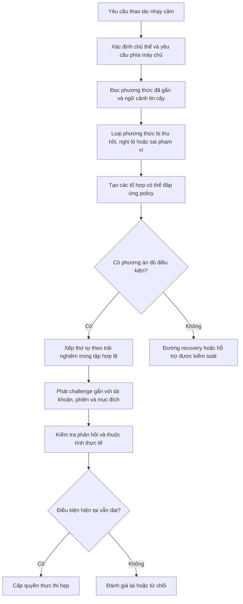

# Reauthentication factor selection — Lựa chọn yếu tố để xác thực lại

## 1. Chọn phương thức phù hợp với điều cần bảo vệ

Một người dùng đang có session hợp lệ và muốn thay passkey, xóa MFA hoặc đổi địa chỉ khôi phục. Máy chủ cần xác thực lại trước khi thực hiện. Nếu luôn yêu cầu mật khẩu, người dùng đăng nhập bằng passkey có thể không có mật khẩu để nhập. Nếu cho chọn bất kỳ phương thức nào, attacker có thể đi qua lựa chọn yếu nhất. Nếu bắt sử dụng đúng thiết bị vừa bị mất, người dùng hợp lệ sẽ không có đường tiếp tục.

**Reauthentication factor selection** là quyết định chọn authenticator hoặc tổ hợp yếu tố đủ điều kiện để xác thực lại cho một ngữ cảnh cụ thể. Quyết định này phải xét thao tác đích, chính sách bảo vệ, tình trạng phương thức, độ mới của bằng chứng và khả năng người dùng thực hiện.

Trong chương **Reauthentication** của dịch vụ `SECURITY_AUTHENTICATION_ACCOUNT_RECOVERY`, bài học tập trung vào lựa chọn phương thức trước và sau các bước khôi phục mật khẩu, MFA, passkey hoặc thiết bị xác thực. Mục tiêu là tạo đường tiếp tục khả thi mà vẫn kiểm soát nguy cơ chiếm đoạt tài khoản.

Sau bài học, người học cần có khả năng:

- Phân biệt xác thực lại, nâng mức xác thực và xác minh quyền trong recovery.
- Chuyển yêu cầu của thao tác thành điều kiện chọn phương thức phía máy chủ.
- Loại phương thức bị thu hồi, nghi lộ hoặc không phù hợp trước khi xếp thứ tự lựa chọn.
- Xác minh kết quả theo đúng thuộc tính cần thiết, không chỉ theo nhãn phương thức.
- Xử lý trường hợp không còn phương thức đạt yêu cầu và kiểm soát fallback.

Các chính sách, API, cấu trúc dữ liệu và mã giả trong bài là **thiết kế tham khảo cho ứng dụng**. Chúng không tự xác nhận hệ thống đáp ứng một mức bảo đảm NIST hay một yêu cầu tuân thủ cụ thể.

## 2. Xác định đúng loại yêu cầu

### 2.1. Ba quyết định liên quan nhưng có đầu vào khác nhau

| Quyết định | Câu hỏi cần trả lời | Ví dụ |
|---|---|---|
| Reauthentication | Người đang sử dụng phiên còn kiểm soát phương thức cần thiết không? | Xác thực lại khi phiên không hoạt động một thời gian |
| Step-up authentication | Bằng chứng hiện tại đã đủ cho mức yêu cầu cao hơn chưa? | Đòi phương thức chống phishing trước khi thay kênh recovery |
| Recovery authorization | Khi mất phương thức thông thường, người yêu cầu có đủ bằng chứng để lấy lại quyền không? | Mật khẩu còn hợp lệ cộng bằng chứng recovery theo policy |

Một lần xác thực lại có thể đồng thời nâng mức bằng chứng, nhưng không phải lần nào cũng vậy. Nhập lại mật khẩu có thể làm mới bằng chứng kiến thức, không tự tạo thêm một yếu tố sở hữu.

OWASP khuyến nghị xác thực lại cho thao tác nhạy cảm và sau sự kiện rủi ro như recovery hoặc reset mật khẩu. Tham khảo [Authentication Cheat Sheet — Re-authentication After Risk Events](https://cheatsheetseries.owasp.org/cheatsheets/Authentication_Cheat_Sheet.html#re-authentication-after-risk-events).

### 2.2. Duy trì phiên và cho phép đổi credential có thể có chính sách khác nhau

NIST cho phép một cách xác thực lại giới hạn tại AAL2 khi hết inactivity timeout nhưng chưa hết overall timeout: mật khẩu hoặc so khớp sinh trắc thành công kết hợp session secret, với các điều kiện áp dụng. Không suy rộng ngoại lệ duy trì phiên này thành quyền thay MFA hoặc khôi phục tài khoản chỉ bằng mật khẩu. Xem [NIST SP 800-63B-4 — Authentication Assurance Levels](https://pages.nist.gov/800-63-4/sp800-63b/aal/).

Ứng dụng cần phân loại lý do yêu cầu xác thực lại. Ví dụ `SESSION_CONTINUATION`, `CHANGE_RECOVERY_ADDRESS`, `REPLACE_AUTHENTICATOR` và `POST_RECOVERY_HIGH_IMPACT_ACTION` có thể dẫn tới những yêu cầu khác nhau.

Không dùng một cờ chung `reauthenticated=true` cho tất cả mục đích. Kết quả cần ghi rõ đã xác minh điều gì, lúc nào, cho chủ thể nào và có thể dùng để cho phép hành động nào.

## 3. Phân biệt yếu tố, authenticator và thuộc tính đã được xác minh

### 3.1. Số màn hình không quyết định số yếu tố

| Khái niệm | Ý nghĩa |
|---|---|
| Yếu tố xác thực | Loại bằng chứng, như kiến thức, sở hữu hoặc sinh trắc |
| Authenticator | Phương tiện thực hiện xác thực, có thể sử dụng một hoặc nhiều yếu tố |
| Phương thức hiển thị | Lựa chọn người dùng nhìn thấy, như mật khẩu, ứng dụng mã hoặc passkey |
| Authentication event | Kết quả cụ thể đã được verifier kiểm tra thành công |

Hai mật khẩu không trở thành MFA vì được nhập ở hai bước. Một thao tác với authenticator mật mã có user verification phù hợp có thể sử dụng nhiều yếu tố dù người dùng chỉ thấy một hộp thoại.

Đặc tính “thiết bị hỗ trợ sinh trắc” cũng không chứng minh lần xác thực vừa rồi có sử dụng xác minh người dùng. Cần kiểm tra bằng chứng do giao thức cung cấp sau khi xác minh phản hồi.

### 3.2. Khả năng của phương thức và kết quả thực tế

Một passkey có thể hỗ trợ UV, nhưng request yêu cầu `preferred` chưa buộc lần xác thực thực hiện UV. Một khóa bảo mật có thể chứng minh sở hữu mà chỉ yêu cầu chạm; thao tác chạm xác nhận sự hiện diện không tự trở thành yếu tố kiến thức hoặc sinh trắc thứ hai.

OWASP nêu việc yêu cầu và kiểm tra UV khi dùng passkey cho MFA tại [Multifactor Authentication Cheat Sheet — Passkeys](https://cheatsheetseries.owasp.org/cheatsheets/Multifactor_Authentication_Cheat_Sheet.html#passkeys).

Do đó, bước lựa chọn có hai lần kiểm tra:

1. Trước challenge: phương thức hoặc tổ hợp có khả năng đáp ứng yêu cầu và được phép sử dụng không?
2. Sau phản hồi: sự kiện vừa xác minh có thực sự đạt các thuộc tính đã yêu cầu không?

Không cấp quyền chỉ vì tên phương thức trong request là `PASSKEY`, `MFA` hoặc `BIOMETRIC`.

## 4. So sánh phương thức để thiết kế policy

Bảng sau giúp nhận diện điểm cần đánh giá; nó không phải bảng ánh xạ tự động phương thức sang AAL.

| Phương thức | Bằng chứng thường cần xem xét | Điểm cần chú ý khi chọn để xác thực lại |
|---|---|---|
| Mật khẩu | Kiến thức về bí mật đã gắn với tài khoản | Không đủ khi policy cần thêm yếu tố; không chọn nếu mật khẩu nghi lộ |
| TOTP/HOTP | Khả năng tạo mã từ shared secret | Mã có thể bị chuyển tiếp qua phishing; cần chống dùng lại và giới hạn thử |
| SMS/cuộc gọi | Kiểm soát kênh số điện thoại đã đăng ký | Xét SIM swap, chuyển số và chính sách hạn chế sử dụng |
| Push authenticator | Phản hồi từ đăng ký ứng dụng/thiết bị có xác thực | Xác minh transaction và chính sách kích hoạt; tránh xem một cú bấm bất kỳ là đủ |
| Khóa mật mã chỉ có UP | Kiểm soát private key và sự hiện diện | Có thể cần kết hợp yếu tố khác để đáp ứng yêu cầu đa yếu tố |
| Passkey/khóa mật mã có UV được kiểm tra | Kiểm soát khóa cùng bước xác minh cục bộ phù hợp | Kiểm tra trạng thái credential, UV và chính sách tin cậy thực tế |
| Mã dự phòng hoặc recovery code | Kiểm soát bí mật dùng một lần đã được cấp | Phải phân biệt authenticator dự phòng với bằng chứng dành riêng cho recovery |
| Phiên ghi nhớ thiết bị | Quyền giữ session secret hoặc dữ liệu ghi nhớ | Không tự coi là một lần xác thực mới |

NIST mô tả đặc tính OTP và việc sử dụng PSTN có điều kiện trong [Authenticator and Verifier Requirements](https://pages.nist.gov/800-63-4/sp800-63b/authenticators/). Khi xây dựng bảng chính sách, cần đọc yêu cầu đầy đủ cho loại authenticator được triển khai.

### 4.1. Email và câu hỏi bảo mật

Quyền kiểm soát email có thể đóng vai trò trong một quy trình recovery đã được đánh giá, nhưng không được tự đổi nhãn thành một authenticator mạnh cho mọi thao tác. Một email vừa được thay trong cùng sự cố không nên trở thành bằng chứng độc lập để phê duyệt thay đổi tiếp theo.

Câu hỏi bảo mật không nên được đưa vào danh sách thay thế cho một phương thức xác thực lại đạt yêu cầu. Thông tin có thể đoán hoặc tìm trên mạng không giải quyết được việc session đã bị đánh cắp.

### 4.2. Không xếp hạng bằng một con số duy nhất

Một phương thức có thể phù hợp về chống phishing nhưng không đạt chính sách nguồn gốc khóa. Một phương thức khác có thể đáp ứng số yếu tố nhưng không còn tin cậy vì nằm trên thiết bị bị mất.

Hãy dùng các điều kiện rõ ràng thay vì chỉ gán `strength=1,2,3`. Nếu ứng dụng có nhãn mức bảo đảm nội bộ, phải định nghĩa và kiểm chứng ý nghĩa của nhãn đó; không coi tên `HIGH` là bằng chứng đáp ứng tiêu chuẩn.

## 5. Đầu vào của quyết định lựa chọn

### 5.1. Yêu cầu từ thao tác đích

Máy chủ xác định yêu cầu theo loại hành động và dữ liệu cần thay đổi. Ví dụ một yêu cầu nội bộ:

```text
action                  = CHANGE_RECOVERY_ADDRESS
actorAccountId          = tài khoản do máy chủ xác định
requiredFactorPolicy    = tổ hợp được chính sách chấp nhận
phishingResistance      = REQUIRED
freshAuthentication     = REQUIRED
userVerification        = REQUIRED cho phương án mật mã tương ứng
credentialTrustPolicy   = không thuộc phạm vi nghi lộ
purposeBinding          = đúng địa chỉ/kế hoạch thay đổi đã được duyệt
grantUse                = SINGLE_ACTION
```

Đây là policy minh họa cho một thao tác cụ thể. Không mặc định mọi ứng dụng đều có cùng yêu cầu thay địa chỉ recovery, nhưng yêu cầu đã chọn phải được thực thi nhất quán qua tất cả đường gọi.

Client không được gửi `requiredLevel=LOW` để giảm yêu cầu. Loại hành động phải được đối chiếu với endpoint, tài nguyên đích và quyền của người gọi.

### 5.2. Ngữ cảnh hiện tại

| Nhóm thông tin | Ví dụ dữ liệu phục vụ lựa chọn |
|---|---|
| Chủ thể và quyền | Tài khoản, tenant, vai trò, quyền được yêu cầu hành động |
| Session | Loại session, tuổi thọ, thế hệ, dấu hiệu thu hồi hoặc nghi lộ |
| Sự kiện xác thực | Thời điểm, phương thức, từng thuộc tính đã kiểm tra, nguồn xác thực |
| Registry authenticator | Binding với tài khoản, trạng thái, đặc tính được biết, lịch sử thay đổi |
| Recovery context | Hồ sơ nguồn, credential mới cấp, điều kiện chờ hoặc hạn chế còn hiệu lực |
| Dấu hiệu rủi ro | Thiết bị mới, địa chỉ mạng bất thường, thay SIM, thay đổi liên tiếp |
| Khả năng thực hiện | Phương thức người dùng có thể sử dụng, hỗ trợ client và khả năng tiếp cận |

Tín hiệu rủi ro có thể khiến ứng dụng yêu cầu thêm kiểm soát; nó không tự thay thế yếu tố xác thực. Nhận định này cũng được NIST nêu trong [Authentication Assurance Levels](https://pages.nist.gov/800-63-4/sp800-63b/aal/).

Thông tin client về hỗ trợ WebAuthn hay người dùng đang có thiết bị nào chỉ hỗ trợ chọn trải nghiệm. Attacker có thể nói “trình duyệt không hỗ trợ” để tìm fallback; yêu cầu tối thiểu không được giảm chỉ từ lời khai đó.

### 5.3. Bảo vệ dữ liệu lựa chọn

Chỉ trả danh sách phương thức sau khi người gọi có quyền xem cho đúng tài khoản. Nhãn hiển thị cần hạn chế dữ liệu nhạy cảm; không công khai số điện thoại đầy đủ, credential ID hoặc lịch sử recovery cho người chưa đủ quyền.

## 6. Quy trình chọn: lọc trước, xếp thứ tự sau



### 6.1. Loại những phương thức không đủ điều kiện

Các lý do loại có thể gồm:

- Không thuộc tài khoản hoặc tenant đang được xử lý.
- Đã bị thu hồi, đình chỉ, hết hạn hoặc chưa kích hoạt.
- Nằm trong phạm vi thiết bị, seed hoặc tài khoản đồng bộ nghi bị chiếm.
- Không đáp ứng thuộc tính bắt buộc của thao tác.
- Có nguồn gốc đăng ký không phù hợp với mục đích phê duyệt hiện tại.
- Đang bị giới hạn do lạm dụng hoặc cần xét duyệt theo policy.

Một credential vẫn có thể tồn tại trong database để giữ lịch sử nhưng không được phép dùng. Không dùng điều kiện “có record” thay cho trạng thái hoạt động và quyết định tin cậy.

### 6.2. Xây dựng các tổ hợp phù hợp

Hệ thống phải chọn một **phương án xác thực**, không chỉ một ID phương thức. Ví dụ policy có thể chấp nhận một authenticator đa yếu tố phù hợp hoặc một tổ hợp mật khẩu cùng authenticator sở hữu đã được phép.

Không cộng hai phương thức cùng loại thành hai yếu tố khác nhau. Khi tính khả năng đáp ứng, cần xét cả thuộc tính của từng phương thức lẫn cách chúng được kết hợp và xác minh.

Nếu policy cho phép tái sử dụng một sự kiện xác thực gần đây, phải kiểm tra nguồn, độ mới, binding và mục đích. Các thao tác đòi một sự kiện mới không được bỏ challenge chỉ vì người dùng vừa thao tác ở nơi khác.

### 6.3. Xếp thứ tự trong tập hợp lệ

Trong các phương án đều đạt yêu cầu, có thể ưu tiên phương thức người dùng đang có, ít thao tác hơn hoặc hỗ trợ tốt khả năng tiếp cận. Cho phép chọn phương án khác vẫn đạt cùng policy.

Nút “Thử cách khác” không được đưa ra phương thức đã bị loại. Việc người dùng thất bại nhiều lần có thể dẫn tới giới hạn, trợ giúp hoặc recovery; nó không tự làm giảm mức yêu cầu.

## 7. Ma trận lựa chọn theo tình huống recovery

| Tình huống | Phương án cần xem xét | Hành vi không phù hợp |
|---|---|---|
| Còn passkey tin cậy, muốn thay kênh recovery | Xác thực lại bằng khóa đủ thuộc tính theo policy của thay đổi | Cho cookie cũ tự đổi kênh |
| Mất TOTP nhưng còn khóa dự phòng đạt yêu cầu | Dùng phương án dự phòng đã gắn, sau đó cấp quyền thay thế hẹp | Tiếp tục bắt nhập mã từ điện thoại bị mất |
| Chỉ còn mật khẩu, MFA không sử dụng được | Đi qua recovery với tổ hợp bằng chứng đã định nghĩa | Tắt MFA sau khi nhập đúng mật khẩu |
| Mật khẩu nghi lộ nhưng khóa mật mã độc lập còn tin cậy | Chọn phương án đáp ứng policy mà không dựa vào mật khẩu nghi lộ | Nhập lại chính mật khẩu đó và coi rủi ro đã hết |
| Miền đồng bộ passkey nghi bị chiếm | Loại credential thuộc phạm vi nghi lộ; tìm phương án độc lập phù hợp | Chọn bất kỳ bản sao nào chỉ vì nhãn thiết bị khác |
| Vừa reset mật khẩu qua recovery | Xem nguồn cấp quyền, yếu tố còn lại và hạn chế sau recovery | Dùng mật khẩu mới để chứng minh hồi tố recovery ban đầu là đúng |
| Không còn phương án phù hợp | Dừng thao tác; chuyển sang nhánh recovery/xét duyệt được phép | Tự thêm email hoặc SMS làm fallback yếu hơn |

### 7.1. Credential mới có thể dùng cho việc gì?

Sau khi được cấp đúng quy trình và kích hoạt, credential mới có thể được dùng trong luồng xác thực được policy cho phép. Tuy nhiên, bằng chứng nó tạo ra không độc lập với quy trình đã cấp quyền đăng ký nó.

Ví dụ, một attacker đã chiếm email và lợi dụng recovery để tạo mật khẩu mới có thể nhập lại mật khẩu đó thành công. Việc xác thực lại không sửa sai sót đã cấp quyền thay mật khẩu. Tương tự, assertion từ passkey vừa được attacker gắn vào tài khoản chỉ chứng minh họ đang kiểm soát khóa đó.

Vì vậy, ghi nguồn gốc credential, hồ sơ recovery và các hạn chế đang áp dụng. Đối với thao tác ảnh hưởng lớn ngay sau recovery, policy có thể đòi bằng chứng độc lập còn tin cậy, thêm xét duyệt hoặc điều kiện chờ. Không cấm credential mới vô thời hạn bằng một cờ không có đường kết thúc.

### 7.2. Phân biệt mã dự phòng với mã dành cho recovery

Một ứng dụng có thể có look-up secret dùng như authenticator dự phòng và cũng có recovery code cho một quy trình lấy lại quyền riêng. Hai đối tượng có thể có cách lưu giống nhau nhưng quyền sử dụng khác nhau.

Không đưa mọi mã này vào cùng lựa chọn “MFA khác” rồi cấp quyền tương đương. Máy chủ phải biết loại mã, mục đích, tổ hợp cần thiết và trạng thái tiêu thụ của nó.

## 8. Độ mới: xác thực điều gì vào thời điểm nào?

### 8.1. Không dùng tuổi của cookie làm tuổi của bằng chứng

Session vừa được refresh không có nghĩa người dùng vừa nhập mật khẩu hay thực hiện MFA. `lastSeenAt`, thời điểm cấp access token và thời điểm kiểm tra yếu tố xác thực phục vụ những mục đích khác nhau.

Một authentication event nên lưu các thuộc tính cần thiết cho quyết định, ví dụ:

```text
eventId             = ae_83
accountId           = u_42
verifiedAt          = thời điểm verifier chấp nhận kết quả
method              = phương thức thực tế đã được kiểm tra
authenticatorRefs   = tham chiếu phương thức phía máy chủ
verifiedProperties  = các thuộc tính đã được xác minh
factorEventTimes    = thời điểm bằng chứng thành phần nếu cần
sessionBinding      = phiên/ngữ cảnh liên quan
purpose             = mục đích hoặc phạm vi được phép tái sử dụng
provenance          = nguồn xác thực và quan hệ với recovery
```

Không nhận `verifiedAt` hoặc danh sách `verifiedProperties` từ dữ liệu client rồi lưu như kết quả đáng tin cậy.

### 8.2. Các yếu tố có thể có độ mới khác nhau

Giả sử mật khẩu được kiểm tra lúc 08:00, TOTP lúc 10:00 và người dùng muốn đổi kênh recovery lúc 10:01. Việc gọi toàn bộ tổ hợp là “MFA một phút trước” có thể sai nếu policy yêu cầu cả hai bằng chứng phải mới cho hành động này.

Ngược lại, một policy duy trì phiên có thể cho phép sử dụng bằng chứng session còn đủ điều kiện cùng một bước xác thực lại cụ thể. Cần đánh giá theo quy tắc của trường hợp đó; không áp dụng một phép lấy thời điểm mới nhất cho mọi mục đích.

### 8.3. Freshness không thay thế trạng thái tin cậy

Một code đúng vừa nhập từ seed đã bị lộ vẫn mới về thời gian nhưng không còn đáng tin cho quyết định. Một passkey bị thu hồi không được dùng dù assertion vừa tạo cách đây vài giây.

Mọi lần hoàn tất phải kiểm tra lại trạng thái authenticator và phiên bản cấu hình bảo mật. Kết quả xác minh trước đó có thể đã lỗi thời vì người dùng báo mất phương thức hoặc quản trị viên xử lý sự cố trong lúc request đang chạy.

## 9. Mã giả Java cho bộ chọn phương án

Ví dụ sau minh họa lựa chọn policy phía máy chủ, không phải API của thư viện cụ thể. Những hàm tính đặc tính, tạo tổ hợp và kiểm tra recovery phải được triển khai theo mô hình bảo vệ của ứng dụng.

```java
ReauthSelection selectReauthenticationPlan(
        SensitiveActionReference actionReference,
        AuthenticatedRequestContext context,
        ClientCapabilities clientHints,
        Instant now) {

    Account account = accounts.requireServerResolvedAccount(context);
    SessionContext session = sessions.requireAllowedContext(context, now);
    ActionIntent intent = actions.loadAuthorizedIntent(
            account, actionReference, context);

    ReauthRequirements requirements = policies.requirementsFor(
            account,
            intent,
            session,
            riskSignals.currentFor(account, context),
            now);

    List<AuthenticatorRecord> eligible = authenticators.forAccount(account.id())
            .stream()
            .filter(a -> a.isActiveAt(now))
            .filter(a -> trustPolicy.isAllowedForPurpose(a, intent, context))
            .filter(a -> !incidentPolicy.isInCompromisedScope(a, account))
            .filter(a -> capabilities.canParticipate(a, requirements))
            .toList();

    // Chỉ tái sử dụng bằng chứng mà policy cho phép, còn mới và đúng binding.
    EvidenceSet reusableEvidence = evidencePolicy.eligibleExistingEvidence(
            session, intent, requirements, now);

    List<FactorPlan> validPlans = planBuilder
            .boundedCandidateCombinations(eligible, reusableEvidence, requirements)
            .stream()
            .filter(plan -> policies.satisfiesAllRequirements(
                    plan, requirements, context, now))
            .toList();

    if (validPlans.isEmpty()) {
        // Chưa cấp quyền thực thi. Nhánh recovery có policy riêng.
        return ReauthSelection.noEligiblePlan(
                recoveryRouter.allowedNextStep(account, intent, context));
    }

    // Client hints chỉ giúp xếp thứ tự phương án đã đạt policy.
    List<FactorPlan> ordered = usability.rankWithinEligiblePlans(
            validPlans, clientHints, context);

    return attempts.createBoundSelection(
            account,
            session,
            intent,
            requirements,
            ordered,
            account.securityVersion(),
            now);
}
```

`boundedCandidateCombinations` biểu thị việc tạo phương án trong giới hạn, tránh sinh tổ hợp không kiểm soát khi registry lớn hoặc request bị lạm dụng. Bộ chọn cần hiểu authenticator đa yếu tố và tổ hợp nhiều authenticator; không chỉ kiểm tra `eligible.size() >= 2`.

Kết quả `validPlans` nói rằng các phương án có thể đáp ứng yêu cầu nếu được thực hiện đúng. Sau khi nhận phản hồi, verifier vẫn phải xác nhận từng thuộc tính thực tế. Nếu policy yêu cầu UV mà phản hồi không có UV hợp lệ, plan thất bại dù đã được đề nghị trước đó.

Việc tạo attempt phải gắn với tài khoản, tenant, session, action intent, policy, thời hạn và phiên bản bảo mật. Nếu cấu hình thay đổi ngay sau bước chọn, endpoint hoàn tất cần phát hiện thay đổi đó trước khi cấp quyền.

## 10. Ví dụ thực thi bằng WebAuthn

### 10.1. Chỉ đưa credential đủ điều kiện vào phương án

Giả sử policy cho hành động đang xét yêu cầu phương án mật mã có UV. Tài khoản có ba credential: một khóa tin cậy còn hoạt động, một khóa đã báo mất và một candidate chưa kích hoạt. Máy chủ chỉ cho phép khóa phù hợp với quyết định tin cậy hiện tại.

Ví dụ options ở dạng JSON vận chuyển:

```json
{
  "challenge": "<base64url-challenge-moi>",
  "rpId": "learn.example",
  "allowCredentials": [
    {
      "type": "public-key",
      "id": "<base64url-credential-id-du-dieu-kien>"
    }
  ],
  "userVerification": "required",
  "timeout": 120000
}
```

Các chỗ giữ chỗ không phải dữ liệu có thể chạy. Client cần chuyển trường nhị phân sang kiểu API yêu cầu, gọi `navigator.credentials.get()` và serialize phản hồi đúng hợp đồng với máy chủ.

`timeout` hỗ trợ trải nghiệm phía client; máy chủ thực thi thời hạn challenge. Không để client tự đổi credential allowlist hoặc `userVerification` rồi coi đó là policy mới của máy chủ.

### 10.2. Kiểm tra kết quả theo giao thức và mục đích

Máy chủ dùng thư viện WebAuthn thực hiện thủ tục xác minh đầy đủ: loại phản hồi, challenge, origin, RP, credential/tài khoản, chữ ký, UP, UV khi yêu cầu và metadata liên quan. Xem [W3C WebAuthn — Verifying an Authentication Assertion](https://www.w3.org/TR/webauthn-3/#sctn-verifying-assertion).

Sau kiểm tra giao thức, còn phải đối chiếu attempt, session, tài khoản đích, hành động, trạng thái credential và policy hiện tại. Không dùng một assertion hợp lệ của tài khoản A để phê duyệt hành động đang chờ của tài khoản B.

Nếu hỗ trợ luồng discoverable credential không có allowlist, kết quả vẫn phải được ràng buộc với chủ thể kỳ vọng của reauthentication. Không tự chuyển tài khoản đang xử lý chỉ vì người dùng chọn một passkey khác trong hộp thoại.

### 10.3. Nhãn thiết bị không phải điều kiện mật mã

`platform`, `cross-platform`, thông tin transport hoặc tên khóa do người dùng nhập không tự chứng minh mọi yêu cầu về nguồn gốc và cách bảo vệ private key. Nếu policy có điều kiện thiết bị được quản lý hoặc khóa không xuất được, cần căn cứ và cơ chế kiểm tra tương ứng.

Không gửi thêm yêu cầu thu thập sinh trắc lên backend chỉ vì giao diện đã hiển thị Face ID hoặc vân tay. Sử dụng thuộc tính giao thức đã được xác minh và mô hình authenticator phù hợp; một cờ JavaScript “biometric success” không phải bằng chứng xác thực lại.

## 11. Khi authenticator nằm ở IdP bên ngoài

Ứng dụng dùng SSO không nhất thiết tự chọn được từng thiết bị của người dùng. RP yêu cầu ngữ cảnh xác thực qua giao thức với IdP, sau đó kiểm tra kết quả nhận được.

Trong OpenID Connect, `max_age` giới hạn tuổi xác thực và khi sử dụng phải có `auth_time` trong ID Token. `acr` mô tả ngữ cảnh, `amr` mô tả phương thức theo ý nghĩa đã thống nhất; `iat` là thời điểm phát token. Xem [OpenID Connect Core — Authentication Request](https://openid.net/specs/openid-connect-core-1_0.html#AuthRequest) và [ID Token](https://openid.net/specs/openid-connect-core-1_0.html#IDToken).

RP cần kiểm tra ID Token theo giao thức, đối chiếu issuer, chủ thể, audience, thời hạn và các ràng buộc request, rồi đánh giá độ mới và ngữ cảnh. Không coi riêng `amr` có hai phần tử là đủ MFA hoặc coi yêu cầu `acr_values` là kết quả đã được đáp ứng.

Trong thiết kế này, cặp issuer/chủ thể phải khớp tài khoản đang thực hiện hành động. Nếu user chọn tài khoản khác ở IdP, từ chối việc dùng kết quả đó cho hành động hiện tại; không tự liên kết lại tài khoản dựa trên email trả về.

Khi IdP thiếu thuộc tính mà policy bắt buộc, ứng dụng phải từ chối hoặc chọn đường đã được phê duyệt khác. Không mặc định SSO vừa trả token là người dùng vừa xác thực lại đủ mạnh. Thời hạn phiên RP và IdP cũng cần được đánh giá riêng.

## 12. Từ kết quả xác thực lại đến quyền thực hiện

### 12.1. Kết quả cần gắn với đúng hành động

Thiết kế có thể sử dụng một reauthentication attempt và một action ticket:

| Đối tượng | Dữ liệu quan trọng |
|---|---|
| ReauthAttempt | Chủ thể, session, action intent, các plan được phép, yêu cầu, challenge, thời hạn, trạng thái, policy/security version |
| VerifiedAuthenticationEvent | Kết quả verifier, phương thức, thuộc tính, thời điểm, nguồn và binding |
| ActionTicket | Đúng hành động, tài khoản, session được cấp, tham chiếu event, thời hạn, dấu vết intent, trạng thái dùng/thu hồi |

Ticket không phải access token toàn quyền. Ví dụ ticket thay một passkey không được dùng để đổi email hoặc tắt MFA. Nếu dữ liệu đích thay đổi sau khi xác thực lại, kiểm tra intent phải chặn việc sử dụng quyền cũ cho thay đổi mới.

### 12.2. Kiểm tra hai lần và tiêu thụ một lần

Lúc nhận phản hồi, kiểm tra challenge chưa dùng, attempt đúng ngữ cảnh và kết quả đạt yêu cầu. Khi cấp ticket, ghi kết quả và tiêu thụ challenge nhất quán; không để hai request phát sinh hai quyết định trái chính sách từ cùng phản hồi.

Trước khi hành động thực sự commit, kiểm tra lại ticket, session, cấu hình bảo mật, intent và điều kiện rủi ro. Việc ticket được cấp một phút trước không bảo đảm tài khoản chưa bị khóa hoặc credential vừa dùng chưa bị báo mất.

Thao tác nhạy cảm và việc tiêu thụ ticket cần nằm trong cùng quyết định nhất quán. Nếu client mất response sau commit, đọc lại biên nhận được phép hoặc dùng cơ chế idempotency phù hợp; không làm ticket dùng lại vô hạn.

### 12.3. Đổi session ID và giữ đúng phạm vi

Khi nâng mức quyền hoặc thiết lập lại session, đổi định danh và xử lý thế hệ cũ theo thiết kế. Ticket cần gắn với session có hiệu lực sau quyết định này; đừng cấp ticket cho một session ID vừa bị hủy.

Một recovery session chỉ có quyền thay authenticator không tự trở thành application session sau khi thực hiện một bước reauthentication. Việc cấp phiên ứng dụng cần đi qua chính sách xác thực đầy đủ và những hạn chế sau recovery còn hiệu lực.

Không cập nhật đồng loạt mọi thời điểm yếu tố thành “vừa xác thực” chỉ vì một bước thành công. Lưu đúng bằng chứng đã có để quyết định sau không kế thừa mức tin cậy không tồn tại.

## 13. Khi không thể dùng phương án được đề nghị

### 13.1. Phương án khác vẫn phải đạt policy

Người dùng có thể bỏ quên khóa, bị lỗi thiết bị hoặc cần công cụ hỗ trợ khả năng tiếp cận khác. Hệ thống nên cho thử một phương án đủ điều kiện khác, kèm hướng dẫn cụ thể.

Nếu trình duyệt không hỗ trợ lựa chọn ưu tiên, có thể hướng dẫn dùng môi trường phù hợp hoặc phương thức được phép khác. Không coi lỗi API, timeout hay việc bấm hủy là căn cứ để tự chuyển sang phương thức yếu hơn.

### 13.2. Không còn phương án thì chuyển quy trình

Nếu mọi phương án còn lại đều không đạt yêu cầu, dừng hành động đang chờ và cung cấp nhánh recovery/xét duyệt phù hợp. Nhánh đó xác lập quyền bằng một chính sách khác; nó không phải nút bỏ qua bước reauthentication.

Khi mất phương thức, máy chủ có thể tạo hồ sơ liên quan đến hành động ban đầu để người dùng không phải nhập lại mọi thông tin. Dữ liệu tiến độ được giữ không có nghĩa quyền thực thi được giữ. Sau recovery, cần đánh giá lại hành động, intent, độ mới và các hạn chế còn hiệu lực.

### 13.3. Không gửi challenge không giới hạn

Giới hạn thử ở cấp tài khoản, session, attempt, phương thức và nguồn yêu cầu phù hợp. Đặt ngân sách cho push, SMS và kiểm tra code, tránh gây mệt mỏi phê duyệt hoặc làm quá tải dịch vụ.

Không reset ngân sách chỉ vì người dùng đổi tab, chọn phương án khác hoặc xin challenge mới. Đồng thời thiết kế đường trợ giúp cho người hợp lệ thay vì khóa cứng vô thời hạn khi attacker gửi nhiều yêu cầu.

## 14. Ví dụ xuyên suốt và những lỗi cần tránh

### 14.1. Lan muốn thay địa chỉ khôi phục

Lan có một passkey còn tin cậy, một TOTP trên điện thoại đã báo mất và mật khẩu nghi bị lộ. Session hiện tại vẫn hoạt động. Policy của thao tác thay địa chỉ recovery yêu cầu sự kiện mật mã mới có UV cùng các điều kiện tin cậy liên quan.

1. Máy chủ xác định tài khoản của Lan và intent thay địa chỉ từ ngữ cảnh được cấp quyền.
2. Bộ chọn loại TOTP thuộc thiết bị đã báo mất và mật khẩu nghi lộ. Cookie hiện tại chỉ là ngữ cảnh phiên, không phải bằng chứng xác thực mới.
3. Passkey còn tin cậy tạo thành phương án có thể đáp ứng policy. Máy chủ phát challenge mới, gắn với session và intent cụ thể, yêu cầu UV.
4. Lan thực hiện xác thực. Máy chủ kiểm tra assertion, thuộc tính thực tế và phiên bản bảo mật; nếu không có UV hợp lệ thì chưa cấp quyền.
5. Khi đạt, máy chủ cấp ticket ngắn hạn chỉ cho intent đã duyệt. Endpoint thực thi kiểm tra lại và tiêu thụ ticket cùng thay đổi.
6. Máy chủ thông báo sự kiện qua kênh phù hợp đã xác lập và áp dụng kế hoạch session theo quyết định rủi ro.

Nếu Lan cũng mất passkey, hệ thống không đề nghị nhập lại mật khẩu nghi lộ để hoàn tất. Nó chuyển sang recovery hoặc xét duyệt theo policy, chưa thay địa chỉ đích.

### 14.2. Ma trận lỗi thiết kế

| Lỗi | Vì sao nguy hiểm? | Cách xử lý |
|---|---|---|
| Luôn yêu cầu mật khẩu | Không phù hợp tài khoản passwordless; có thể dùng đúng bí mật nghi lộ | Chọn phương án theo policy và registry thực tế |
| Luôn cho người dùng chọn bất kỳ phương thức | Attacker chọn đường yếu nhất | Lọc phương án hợp lệ trước khi hiển thị |
| Đếm hai method thành hai factor | Các method có thể cùng loại yếu tố | Đánh giá tổ hợp và thuộc tính xác thực |
| Tin nhãn passkey mà không kiểm tra UV | Kết quả thực tế có thể thiếu thuộc tính bắt buộc | Yêu cầu và xác minh đúng giao thức |
| Bỏ qua sau nhiều lần thất bại | Tạo đường downgrade có thể chủ động kích hoạt | Giới hạn, hỗ trợ hoặc chuyển recovery riêng |
| Tin token SSO vừa phát | Token mới không chứng minh xác thực mới hoặc đủ ngữ cảnh | Kiểm tra thời gian, claim và binding thực tế |
| Dùng credential mới để hợp thức hóa recovery cũ | Không có bằng chứng độc lập về chủ tài khoản | Giữ provenance và kiểm tra chính sách sau recovery |
| Cấp cờ toàn session không có mục đích | Kết quả có thể bị dùng cho thao tác khác | Event và ticket có phạm vi, thời hạn, binding |
| Không kiểm tra lại trước commit | Credential có thể đã bị thu hồi giữa chừng | Kiểm tra trạng thái và phiên bản tại thực thi |

## 15. Audit và tiêu chí tự kiểm tra

### 15.1. Ghi nhận lý do lựa chọn

Các sự kiện có thể gồm:

```text
REAUTHENTICATION_REQUIRED
REAUTHENTICATION_PLAN_SELECTED
REAUTHENTICATION_METHOD_EXCLUDED
REAUTHENTICATION_CHALLENGE_ISSUED
REAUTHENTICATION_VERIFIED
REAUTHENTICATION_PROPERTIES_INSUFFICIENT
REAUTHENTICATION_NO_ELIGIBLE_PLAN
SENSITIVE_ACTION_TICKET_ISSUED
SENSITIVE_ACTION_TICKET_CONSUMED
```

Audit cần thể hiện thao tác đích, chủ thể, policy, phương án được chọn, loại thuộc tính đã xác minh, thời điểm, kết quả và mã lý do phù hợp. Chi tiết phương thức bị loại thuộc dữ liệu bảo mật nội bộ; không nhất thiết trả đầy đủ cho client.

Không ghi mật khẩu, OTP, recovery code, raw challenge response, cookie hoặc ticket bí mật. Chỉ lưu tham chiếu và metadata cần thiết, với kiểm soát truy cập và thời hạn lưu tương ứng.

Các chỉ số hữu ích gồm tỷ lệ không có phương án đủ điều kiện, tỷ lệ bỏ dở theo phương thức, số lần thử fallback, số phản hồi thiếu thuộc tính và số lần từ chối do cấu hình đổi sau challenge. Dùng số liệu để cải thiện lựa chọn và khả năng tiếp cận trong tập phương án hợp lệ.

### 15.2. Câu hỏi kiểm tra khả năng thiết kế

| Câu hỏi | Lập luận cần đạt |
|---|---|
| Vì sao một session MFA cũ có thể cần phương án mạnh hơn? | Thao tác, độ mới và rủi ro hiện tại khác lúc đăng nhập |
| Vì sao không đếm số màn hình để xác định MFA? | Cần hai loại yếu tố hoặc authenticator đa yếu tố phù hợp |
| Vì sao chọn plan chưa đủ cấp quyền? | Phải xác minh thuộc tính thực tế của phản hồi |
| Vì sao không luôn bắt phương thức mạnh nhất đã đăng ký? | Nó có thể bị mất hoặc nghi lộ; cần một phương án hiện còn đủ điều kiện |
| Vì sao không tự fallback sang email? | Recovery evidence và authenticator cho thao tác có mục đích, yêu cầu khác nhau |
| Vì sao `iat` mới không chứng minh reauthentication mới? | Đó là thời điểm phát token, không phải thời điểm người dùng được xác thực |
| Vì sao passkey mới không chứng minh recovery trước đó đúng? | Người được cấp quyền sai cũng có thể tạo và sử dụng khóa của họ |
| Vì sao cần ticket gắn hành động? | Kết quả xác thực không được dùng tùy ý cho tài nguyên hoặc thay đổi khác |

Lựa chọn yếu tố để xác thực lại là một quyết định cấp quyền có căn cứ. Máy chủ xác định yêu cầu, tìm phương án còn tin cậy, kiểm tra kết quả thực tế và chỉ cho phép đúng hành động khi các điều kiện vẫn đạt. Nếu không còn phương án phù hợp, một đường recovery được kiểm soát giúp người dùng tiếp tục mà không làm giảm yêu cầu bảo vệ một cách âm thầm.
