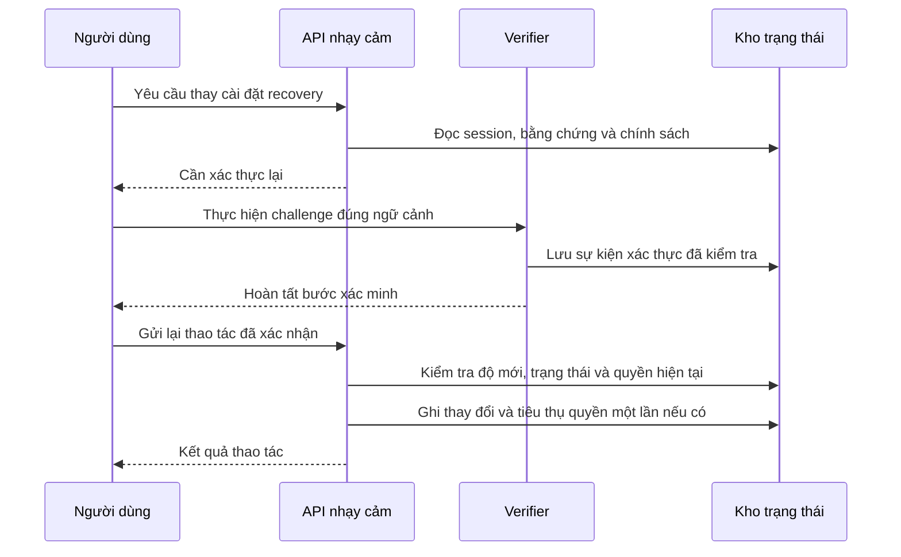

# Recent authentication window: Cửa sổ xác thực gần đây trong khôi phục tài khoản

## 1. Khái niệm và mục tiêu

Trong chương **Reauthentication** của module `SECURITY_AUTHENTICATION_ACCOUNT_RECOVERY`, **recent authentication window** là khoảng tuổi tối đa mà một thao tác chấp nhận đối với bằng chứng xác thực đã được kiểm tra. Nó giúp trả lời: “Người yêu cầu đã xác thực đủ gần đây để thực hiện thao tác này chưa?”

Ví dụ, một session vẫn hợp lệ để xem nội dung thông thường, nhưng sự kiện xác thực tạo ra nó đã diễn ra từ nhiều giờ trước. Khi người dùng muốn thay email recovery hoặc xóa phương tiện MFA cuối cùng, ứng dụng có thể yêu cầu bằng chứng mới thay vì chỉ dựa vào cookie còn hiệu lực.

Trong luồng khôi phục, câu hỏi này đặc biệt quan trọng. Kẻ tấn công có thể giữ session cũ, lợi dụng một kết quả xác minh được dùng lại quá lâu, hoặc làm hệ thống coi token vừa refresh là người dùng vừa xác thực. Một cửa sổ được thiết kế đúng phải dựa trên sự kiện xác thực thật và chính sách của thao tác, không dựa trên việc trình duyệt vừa gửi request.

Sau bài học, người học có thể:

- Phân biệt độ mới của xác thực với tuổi session, hoạt động gần nhất và hạn dùng token.
- Đặt điều kiện thời gian rõ ràng cho từng thao tác recovery nhạy cảm.
- Lưu bằng chứng xác thực cùng chủ thể, phương thức, thời điểm và phiên bản bảo mật liên quan.
- Xử lý session còn hạn nhưng bằng chứng quá cũ, bằng chứng còn mới nhưng không đủ mạnh, và sự kiện bảo mật làm mất hiệu lực kết quả cũ.
- Thực thi kiểm tra phía máy chủ, kể cả khi dùng IdP và khi có request chạy đồng thời.

Các giá trị như hai hoặc năm phút trong bài là **chính sách minh họa**, không phải cửa sổ xác thực gần đây bắt buộc chung cho mọi hệ thống.

## 2. “Gần đây” chỉ là một chiều của quyết định

### 2.1. Những câu hỏi phải được trả lời riêng

| Chiều đánh giá | Câu hỏi | Ví dụ không đạt |
| --- | --- | --- |
| Hiệu lực session | Phiên hiện tại còn được chấp nhận không? | Session đã bị thu hồi sau reset |
| Chủ thể và phạm vi | Bằng chứng thuộc đúng tài khoản, tenant và ngữ cảnh không? | Xác thực lại nhầm tài khoản ở màn hình SSO |
| Độ mới | Bằng chứng đã xảy ra cách đây bao lâu? | MFA thành công từ sáng nhưng thao tác vào buổi chiều |
| Đặc tính bảo đảm | Bằng chứng có đáp ứng phương thức và điều kiện yêu cầu không? | Chỉ nhập mật khẩu trong khi thao tác yêu cầu phương án khác |
| Quyền nghiệp vụ | Người này có được làm thao tác không? | Xác thực mới nhưng không có quyền quản trị |
| Trạng thái bảo mật | Credential, tài khoản và kết quả xác thực còn hợp lệ không? | Credential vừa bị thu hồi vì nghi lộ |
| Ràng buộc thao tác | Bằng chứng/quyền tạm có dùng được cho mục đích này không? | Quyền đăng ký lại MFA bị dùng để đổi email recovery |

Không dùng một cờ `recently_authenticated = true` để đại diện cho tất cả các chiều trên. Cờ đó không cho biết xác thực ai, bằng cách nào, khi nào, để làm gì hoặc dựa trên trạng thái tài khoản nào.

### 2.2. Mới không tự đồng nghĩa mạnh

Một lần nhập mật khẩu cách đây mười giây có thể mới nhưng không đủ cho chính sách thay phương tiện MFA. Một lần xác thực mạnh cách đây ba giờ có thể đủ đặc tính nhưng không đủ mới. Cả hai trường hợp đều cần xử lý, song không nhất thiết yêu cầu cùng một bước bổ sung.

Mức cần đạt phải xuất phát từ thao tác và mô hình rủi ro. Không xếp hạng phương thức chỉ bằng tên gọi do client gửi như `strong`, `trusted` hoặc `passkey`. Máy chủ phải biết bằng chứng nào đã được kiểm tra và những điều kiện của nó.

### 2.3. Cửa sổ gần đây khác timeout session

NIST phân biệt timeout tổng thể và timeout không hoạt động của session. Chúng quản lý việc duy trì phiên, không tự thay thế yêu cầu về độ mới của một thao tác cụ thể. Xem [NIST SP 800-63B-4, Session Management](https://pages.nist.gov/800-63-4/sp800-63b/session/).

Trong thiết kế ứng dụng, session có thể tiếp tục cho phép đọc dữ liệu thông thường khi cửa sổ của thao tác đổi email đã hết. Ngược lại, một sự kiện xác thực vừa xảy ra không cứu được một session đã bị thu hồi. Trước hết phải có một ngữ cảnh truy cập hợp lệ để sử dụng bằng chứng.

## 3. Chọn đúng mốc thời gian

### 3.1. Các mốc dễ bị nhầm

| Mốc | Ý nghĩa trong mô hình ứng dụng | Có tự chứng minh xác thực gần đây không? |
| --- | --- | --- |
| `authenticated_at` | Thời điểm bằng chứng xác thực phù hợp thực sự được kiểm tra thành công | Là mốc đầu vào nếu nguồn và ngữ cảnh hợp lệ |
| `completed_at` | Thời điểm giao dịch xác thực nhiều bước hoàn tất | Không làm mọi bước trước đó tự mới lại |
| `session_created_at` | Thời điểm tạo session | Không, nếu session kế thừa kết quả cũ |
| `session_rotated_at` | Thời điểm thay session secret | Không, nếu không có xác thực mới |
| `last_activity_at` | Thời điểm hoạt động gần nhất trong session | Không; có thể chỉ là tải trang hoặc polling |
| `token_issued_at` | Thời điểm phát hành token | Không; token mới có thể dựa trên sự kiện cũ |
| `token_expires_at` | Hạn chấp nhận token cụ thể | Không; token còn hạn không đồng nghĩa bằng chứng đủ mới |
| `proof_received_at` | Thời điểm dịch vụ nhận một kết quả từ nguồn khác | Không được thay thời điểm xảy ra bằng chứng |

Ví dụ: người dùng đăng nhập lúc 08:00, refresh lúc 10:00 và đổi session ID lúc 10:01. Nếu không có xác thực mới, sự kiện xác thực vẫn là 08:00. Ghi lại giờ mới vì vừa xử lý một HTTP request sẽ kéo dài độ mới mà không có bằng chứng tương ứng.

### 3.2. Bằng chứng nhiều bước cần giữ thời điểm từng phần

Giả sử chính sách minh họa yêu cầu tổ hợp mật khẩu và TOTP, cả hai đều phải mới trong năm phút. Mật khẩu được kiểm tra lúc 10:00, TOTP lúc 10:04. Không nên ghi một mốc 10:04 rồi coi mật khẩu cũng mới từ 10:04.

Nếu chính sách thật sự yêu cầu mọi thành phần đều còn mới, có thể tính hạn từ từng thành phần:

```text
evidence_end = min(
    password_verified_at + password_max_age,
    totp_verified_at + totp_max_age
)
```

Kết quả tổ hợp còn phải được ràng buộc vào cùng giao dịch/ngữ cảnh mà chính sách cho phép. Không lấy mật khẩu của một lần thử trên tab A ghép với TOTP của một lần thử độc lập trên tab B chỉ vì hai mốc đều gần đây.

Đây là mô hình minh họa cho yêu cầu theo từng thành phần. Nếu chính sách chấp nhận một authenticator khác tự đáp ứng toàn bộ phương án, hãy đánh giá phương án đó riêng; không bắt nó kế thừa thời điểm của một bước mật khẩu không cần thiết.

### 3.3. Không tự đặt timestamp từ client

Những trường như `authenticated_at`, phương thức đã dùng và kết quả xác minh phải được xác lập phía verifier hoặc từ nguồn được tin cậy theo giao thức. Một body có `reauthenticated_at = now` không phải bằng chứng.

Khi nhận assertion hoặc token, timestamp chỉ có ý nghĩa sau các kiểm tra hợp lệ của giao thức và ràng buộc với yêu cầu đang chờ. Đọc một payload JSON mà chưa xác minh nguồn không biến giá trị trong đó thành dữ liệu có thẩm quyền.

## 4. Định nghĩa cửa sổ và chính sách theo thao tác

### 4.1. Công thức cơ bản

Với một sự kiện đáp ứng đủ phương thức, một chính sách đơn giản có thể đặt:

```text
age = trusted_now - authenticated_at
recent khi: 0 <= age < allowed_max_age

window_end = authenticated_at + allowed_max_age
```

Trong mô hình này, tại đúng `window_end` thì bằng chứng đã quá tuổi cho thao tác. Cần thống nhất độ chính xác timestamp và cách so sánh tại mọi nơi thực thi. Một chính sách đóng ở ranh giới không được nơi này hiểu là bao gồm giây cuối, nơi khác lại loại trừ.

Đây là quy ước của thiết kế ứng dụng. Khi tích hợp giao thức ngoài, cần đọc semantics của tham số giao thức và chuyển thành quyết định cục bộ rõ ràng; không suy ra rằng mọi thư viện dùng cùng toán tử ở ranh giới.

### 4.2. Tuổi tối đa không làm mới theo hoạt động

Cửa sổ tính từ bằng chứng đã xác minh không phải một sliding window tính lại sau mỗi request. Thao tác được cho phép lúc 10:03 không làm mốc 10:00 thành 10:03.

Refresh, xoay session ID, đọc trạng thái recovery, tạo challenge hoặc ghi nhật ký đều không tự làm mới sự kiện xác thực. Chỉ sự kiện xác minh mới đáp ứng chính sách mới có thể tạo bằng chứng mới.

### 4.3. Bảng chính sách minh họa

| Thao tác | Ví dụ điều kiện về độ mới | Điều kiện ngoài thời gian |
| --- | --- | --- |
| Xem thông tin thông thường | Theo chính sách session | Session và quyền đọc hợp lệ |
| Thay địa chỉ recovery | Bằng chứng đạt phương án cho phép trong 5 phút | Kiểm tra quyền, xác minh địa chỉ mới và xử lý thông báo riêng |
| Xóa phương tiện MFA | Bằng chứng phù hợp trong 2 phút | Đánh giá phương tiện còn lại và rủi ro khóa tài khoản |
| Hoàn tất thay phương tiện trong recovery | Theo chính sách quyền recovery và bằng chứng của bước này | Grant đúng mục đích, chưa dùng, đúng trạng thái tài khoản |
| Thao tác đặc biệt nhạy cảm | Có thể yêu cầu xác thực cho từng giao dịch | Ràng buộc nội dung và tiêu thụ quyền thao tác theo thiết kế |

Các con số trong bảng không thay thế đánh giá rủi ro. Cần cân nhắc hậu quả, tính nhạy cảm của dữ liệu, đặc tính phương thức, khả năng bị đánh cắp session và thời gian thực tế để người dùng hoàn thành bước xác minh.

Không rút ngắn cửa sổ để “bù” cho bằng chứng vốn không đạt yêu cầu. Một phương án không đủ bảo đảm cần bị loại hoặc được bổ sung theo chính sách, thay vì được cho phép trong ít giây hơn.

### 4.4. Sự kiện rủi ro có thể buộc xác thực mới ngay

OWASP đề cập xác thực lại sau các sự kiện như recovery, reset mật khẩu và hoạt động đáng ngờ. Xem [OWASP, Reauthentication After Risk Events](https://cheatsheetseries.owasp.org/cheatsheets/Authentication_Cheat_Sheet.html#reauthentication-after-risk-events).

Trong ứng dụng, một thay đổi bảo mật có thể làm bằng chứng vừa xác minh không còn sử dụng được, dù chưa hết cửa sổ thời gian. Quyết định này cần có nguồn có thẩm quyền và mã lý do rõ ràng, thay vì chỉ so tuổi timestamp.

## 5. Mô hình bằng chứng xác thực

### 5.1. Lưu sự kiện, không chỉ lưu “được phép tới lúc nào”

Một bản ghi minh họa:

```json
{
  "authentication_event_ref": "AE42",
  "tenant_ref": "T1",
  "account_ref": "U123",
  "session_context_ref": "SC42",
  "authentication_transaction_ref": "AT42",
  "source": "LOCAL_VERIFIER",
  "authenticated_at": "2026-11-23T03:00:00Z",
  "completed_at": "2026-11-23T03:00:00Z",
  "verified_method_refs": ["METHOD-7"],
  "assurance_profile": "APP_PROFILE_FOR_RECOVERY_SETTINGS",
  "security_version": 17,
  "credential_binding_refs": ["F04"],
  "state": "VALID"
}
```

`assurance_profile` và các giá trị tham chiếu trong ví dụ là từ vựng nội bộ, không phải nhãn tiêu chuẩn mặc nhiên có nghĩa với mọi hệ thống. Máy chủ phải có ánh xạ chính sách cụ thể để biết sự kiện đáp ứng phương án nào.

Mốc kết thúc của thao tác được tính từ sự kiện và chính sách hiện hành. Nếu chỉ lưu `reauthenticated_until`, hệ thống dễ mất dấu thời điểm gốc và dùng nhầm một khoảng tuổi vốn được đặt cho thao tác khác.

### 5.2. Những ràng buộc cần đi cùng thời gian

| Nhóm dữ liệu | Vai trò |
| --- | --- |
| Chủ thể, tenant, issuer | Ngăn dùng bằng chứng của người hoặc miền quản lý khác |
| Session context và transaction | Ngăn chuyển kết quả xác minh giữa các luồng độc lập ngoài chính sách |
| Phương thức và binding | Biết đã kiểm tra phương tiện nào, còn hợp lệ không |
| Thời điểm xác minh và hoàn tất | Không làm bước cũ mới lại khi kết thúc giao dịch |
| Phiên bản bảo mật/credential liên quan | Phát hiện reset hoặc thu hồi giữa các bước |
| Nguồn và mã kết quả verifier | Phân biệt bằng chứng có thẩm quyền với lời khai client |

Một lần thay session secret có thể vẫn thuộc cùng ngữ cảnh xác thực nếu ứng dụng đã thiết kế quan hệ đó. Việc dùng `session_context_ref` không cho phép chuyển bằng chứng sang bất kỳ session nào của tài khoản; quan hệ kế thừa cần được kiểm soát phía máy chủ.

### 5.3. Bằng chứng tái sử dụng được hay quyền thao tác một lần?

Cửa sổ năm phút không tự có nghĩa chỉ được dùng một lần. Nếu sản phẩm cho tái sử dụng bằng chứng trong nhóm thao tác phù hợp, nhiều request có thể hợp lệ trong cửa sổ đó.

Với thao tác cần ràng buộc chặt, máy chủ có thể tạo một quyền riêng sau xác thực lại: đúng tài khoản, đúng loại thao tác, đúng nội dung đã xác nhận, hạn ngắn và số lần dùng giới hạn. Đây là dữ liệu cấp quyền bổ sung, khác bản thân sự kiện xác thực.

OWASP phân biệt xác thực người dùng với việc cho phép một giao dịch cụ thể. Xem [OWASP, Transaction Authorization](https://cheatsheetseries.owasp.org/cheatsheets/Transaction_Authorization_Cheat_Sheet.html). Trong mô hình minh họa, một bằng chứng còn mới để chỉnh cài đặt không tự cho phép đổi bất kỳ địa chỉ recovery nào mà người dùng chưa xác nhận.

## 6. Luồng xác thực lại khi bằng chứng quá cũ

### 6.1. Quyết định cần bước nào

Khi người dùng yêu cầu thao tác nhạy cảm, máy chủ cần phân biệt ít nhất ba kết quả:

| Kết quả | Ý nghĩa | Hành vi tiếp theo |
| --- | --- | --- |
| `ALLOW` | Ngữ cảnh, quyền, phương thức, độ mới và điều kiện khác đều đạt | Thực hiện thao tác với kiểm tra lại tại điểm cần thiết |
| `REAUTH_REQUIRED` | Có đường xác thực lại phù hợp để đáp ứng điều kiện thiếu | Khởi tạo giao dịch xác thực lại đúng phạm vi |
| `DENY_OR_ALTERNATE_RECOVERY` | Không có quyền, tài khoản bị chặn hoặc phương tiện cần thiết không còn | Từ chối hoặc chuyển quy trình recovery riêng đã thiết kế |

Đây là mã quyết định nội bộ minh họa, không phải bộ mã HTTP chuẩn cho mọi API. Một thông báo “cần đăng nhập lại” chung cho mọi lỗi có thể tạo vòng lặp nếu vấn đề thật sự là thiếu quyền hoặc phương tiện đã bị thu hồi.

### 6.2. Tạo challenge có ngữ cảnh

Giao dịch xác thực lại nên gắn với tài khoản và tenant đã xác định, session context, thao tác đang chờ, phương án được chấp nhận, hạn challenge và phiên bản bảo mật liên quan.



Hạn challenge và cửa sổ dùng bằng chứng sau xác minh là hai giới hạn khác nhau. Challenge tạo lúc 10:00 nhưng được giải lúc 10:01 không có nghĩa mọi dữ liệu của giao dịch được phép tồn tại vô thời hạn kể từ đó.

### 6.3. Người dùng phải xác thực đúng chủ thể

Với IdP có nhiều tài khoản đang đăng nhập, người dùng có thể chọn nhầm tài khoản trên màn hình xác minh. Kết quả mới của tài khoản B không được gắn vào session của tài khoản A.

Phải đối chiếu danh tính có thẩm quyền và ngữ cảnh đang chờ. Một `login_hint` hoặc tên hiển thị chỉ hỗ trợ trải nghiệm, không thay kiểm tra chủ thể. Thay đổi tài khoản trong lúc step-up cần được xử lý như một chuyển ngữ cảnh riêng, không tự cấp quyền cho yêu cầu ban đầu.

### 6.4. Khi không còn phương tiện để xác thực lại

Trong module account recovery, đây là tình huống thực tế: người dùng đang có session nhưng đã mất MFA hoặc passkey. Hệ thống không nên lặp vô tận một challenge mà họ không thể hoàn thành.

Có thể đề xuất phương án đã đăng ký khác nếu chính sách cho phép. Nếu không có, chuyển sang quy trình recovery có bằng chứng và kiểm soát riêng. Không tự chấp nhận session cũ, câu hỏi bảo mật hoặc email mới nhập chỉ vì cửa sổ xác thực đã hết.

Thông báo cho người dùng cần giải thích thao tác đang được bảo vệ và đường tiếp tục, không tiết lộ chi tiết inventory cho người chưa được phép xem.

## 7. Kiểm tra phía máy chủ và tại bước ghi thay đổi

### 7.1. Bộ đánh giá độ mới

Pseudocode sau chỉ minh họa cách tổ chức quyết định, không thay cho verifier của từng giao thức:

```text
function assessRecentAuthentication(session, event, action, account, policy, now):
    require session.isActiveAndUnexpired(now)
    require session.belongsTo(account)
    require userHasBusinessPermission(account, action)

    if event is missing:
        return REAUTH_REQUIRED

    require event.matchesSubjectAndAllowedContext(account, session)

    if not event.isValidUnderCurrentSecurityState(account):
        return REAUTH_REQUIRED_OR_DENY

    route = policy.findSatisfiedAuthenticationRoute(event, action)
    if route is missing:
        return REAUTH_REQUIRED

    if event.hasUnacceptableTimestamp(now):
        return REAUTH_REQUIRED_OR_DENY

    end = computeEvidenceEnd(route, event, policy)
    if now >= end:
        return REAUTH_REQUIRED

    if policy.requiresNewProofForCurrentRisk(action, account):
        return REAUTH_REQUIRED

    return ALLOW_WITH_EVIDENCE_END(end)
```

Trường hợp sai chủ thể hoặc bằng chứng có dấu hiệu giả mạo có thể cần từ chối và điều tra, không chỉ nhắc nhập lại. Các nhánh `REAUTH_REQUIRED_OR_DENY` cần được chuyển thành hành vi cụ thể theo nguyên nhân và chính sách.

Không chỉ chọn sự kiện có timestamp lớn nhất trong mọi sự kiện của tài khoản. Phải chọn một phương án phù hợp với thao tác và ngữ cảnh được phép sử dụng. Một event mới của luồng khôi phục hạn chế không thay một event đăng nhập đầy đủ.

### 7.2. Không giữ quyết định cho phép quá lâu

Giả sử API kiểm tra độ mới lúc 10:04:59, rồi chờ khóa đến 10:05:02 mới thay email. Nếu cửa sổ kết thúc lúc 10:05, chỉ kiểm tra ở đầu request có thể không đáp ứng chính sách.

Trong thiết kế này, thao tác nhạy cảm được đánh giá lại ở điểm quyết định có thẩm quyền, sau những bước chờ đáng kể và phối hợp với thay đổi trạng thái. Cần lấy thời gian phù hợp tại điểm đó; giá trị cố định từ đầu request hoặc đầu giao dịch có thể đã cũ.

Một quyết định hợp lệ đã được ghi nhận trước hạn có thể trả response sau hạn. Điều đó khác với việc nhận request trước hạn rồi dùng nó để giữ quyền cho công việc chưa được quyết định.

### 7.3. Ví dụ quyền một lần gắn với nội dung

Với thao tác thay địa chỉ recovery, máy chủ có thể tạo một bản ghi thao tác đang chờ, gồm tài khoản, loại thay đổi, giá trị đích đã chuẩn hóa và phiên bản của bản ghi đó. Sau khi người dùng xác thực và xác nhận đúng thao tác, quyền một lần tham chiếu tới phiên bản đã xác nhận.

```text
begin transaction
    load account, pendingAction, evidence, actionGrant
        with appropriate concurrency control
    now = trustedTimeAtDecision()

    require account and session are still valid
    require pendingAction matches approved type and payload version
    require evidence satisfies current method and freshness requirements
    require actionGrant is active, unexpired and belongs to this context
    require security state and business permission still allow the action

    applyApprovedChange(pendingAction)
    consumeActionGrant(actionGrant)
    recordSecurityChangeAndAudit()
commit transaction
```

Nếu người dùng sửa địa chỉ sau bước xác nhận, không dùng quyền cũ cho nội dung mới. Nếu chỉ cần một cửa sổ tái sử dụng được cho một nhóm thao tác, hệ thống có thể không tạo quyền một lần, nhưng vẫn phải kiểm tra các điều kiện tương ứng ở từng request.

### 7.4. Cấp quyền tạm không được mở rộng cửa sổ gốc

Một quyền con có thể có hạn riêng, nhưng không tự kéo dài bằng chứng cần cho bước thực hiện:

```text
action_grant_end = min(
    issued_at + configured_action_grant_lifetime,
    evidence_window_end,
    parent_recovery_grant_end nếu có,
    applicable_session_end
)
```

Công thức này giả định chính sách yêu cầu bằng chứng vẫn đủ mới tại bước thực hiện. Nếu một quy trình khác chỉ cần bằng chứng đủ mới khi cấp một quyền độc lập, phải mô tả rõ semantics đó và giới hạn của quyền mới. Không để hai dịch vụ tự hiểu khác nhau về việc cấp grant có “đóng băng” độ mới hay không.

## 8. Sự kiện bảo mật và nguồn thời gian

### 8.1. Bằng chứng còn mới nhưng trạng thái đã đổi

Một event lúc 10:06 có thể chưa đủ một phút tuổi khi tài khoản vừa reset hoặc credential vừa bị thu hồi lúc 10:06:30. So tuổi thời gian đơn thuần vẫn trả “gần đây”, nhưng event có thể không còn dùng được.

Có thể liên kết event với phiên bản bảo mật của tài khoản và phiên bản binding liên quan. Trước thao tác, kiểm tra chúng theo chính sách hiện hành. Tăng phiên bản khi cần làm mất hiệu lực ngữ cảnh cũ, không chỉ khi thay một trường hiển thị.

Phạm vi vô hiệu hóa phải rõ ràng. Không nhất thiết mọi thay đổi metadata đều làm mọi event hết giá trị. Tuy nhiên, một event dựa trên credential đã bị xác định bị chiếm không được tiếp tục được chấp nhận chỉ vì nó rất mới.

### 8.2. Recovery không được tạo vòng suy luận tin cậy

Giả sử quy trình recovery chỉ cấp quyền hạn chế để đăng ký MFA mới. Người dùng xác minh thành công phương tiện vừa đăng ký, rồi ứng dụng đánh dấu “vừa MFA” và cho đổi mọi kênh recovery hoặc tạo quyền quản trị. Thiết kế đó có thể đã bỏ qua hạn chế của quyết định recovery ban đầu.

Xác minh phương tiện mới chứng minh quyền kiểm soát phương tiện đó, không tự giải quyết mọi nghi ngờ về danh tính hoặc sự cố trước đó. Nếu có bước xác minh bổ sung, khoảng hạn chế sau recovery hoặc phê duyệt độc lập, những điều kiện đó vẫn phải được thực thi.

Không dùng thao tác ghi mật khẩu mới làm mốc `authenticated_at` chỉ vì người dùng vừa gõ mật khẩu vào form reset. Xác lập credential mới và kiểm tra credential để xác thực cho một ngữ cảnh cụ thể là hai hành động có mục đích khác nhau.

### 8.3. Đồng hồ, timestamp tương lai và độ lệch

Lưu mốc xác thực dưới dạng instant thống nhất. Dùng giờ phía máy chủ cho quyết định, không để thay múi giờ hoặc sửa đồng hồ client kéo dài cửa sổ.

Với event cục bộ, timestamp tương lai hoặc tuổi âm cần được xử lý như trạng thái không thể chấp nhận theo mô hình `0 <= age`. Với nguồn federated, ứng dụng cần chính sách độ lệch nhỏ, được giới hạn và giám sát; không lấy mọi tuổi âm bằng không rồi chấp nhận một sự kiện nằm xa trong tương lai.

Nếu có dung sai, phải xác định nó áp dụng ở lớp kiểm tra giao thức nào và ảnh hưởng ra sao tới ranh giới nghiệp vụ. Dung sai không được trở thành vài phút gia hạn ngầm ở mỗi dịch vụ. Khi không bảo đảm được nguồn giờ hoặc trạng thái đủ tin cậy, không cấp quyền nhạy cảm dựa trên phỏng đoán.

Đồng hồ đơn điệu giúp đo khoảng thời gian trong một tiến trình, nhưng không tự thay thế timestamp bền vững khi chạy nhiều máy hoặc sau restart. Cần cơ chế giám sát độ lệch và chính sách vận hành phù hợp.

## 9. Tích hợp OIDC và API OAuth

### 9.1. Yêu cầu và kiểm tra độ mới trong OIDC

Trong OIDC, `auth_time` là lúc xác thực người dùng; `iat` là lúc cấp ID Token. Khi dùng `max_age`, ID Token phải có `auth_time`. RP vẫn cần kiểm tra kết quả theo chính sách. Xem [OpenID Connect Core, Authentication Request](https://openid.net/specs/openid-connect-core-1_0.html#AuthRequest).

Ví dụ yêu cầu `max_age=300` diễn đạt tuổi tối đa 300 giây. Muốn yêu cầu xác thực chủ động lại, `max_age=0` tương đương `prompt=login`. Các tham số này không tự bảo đảm đúng phương thức cần cho thao tác.

Trong thiết kế ứng dụng, callback phải được ràng buộc vào giao dịch xác thực lại đang chờ và đúng chủ thể. Sau xác minh giao thức, kết quả vẫn phải vượt bộ đánh giá chính sách cục bộ; một response thành công không thay bước đó.

### 9.2. Refresh không tạo sự kiện xác thực mới

OIDC quy định `auth_time` trong ID Token trả qua refresh, nếu có, phản ánh xác thực gốc; không thay bằng lúc cấp token mới. Xem [OpenID Connect Core, Successful Refresh Response](https://openid.net/specs/openid-connect-core-1_0.html#RefreshTokenResponse).

Nếu thiếu dữ liệu thời điểm cần thiết, ứng dụng không được tự lấy giờ nhận response làm bằng chứng gần đây. Có thể yêu cầu một luồng phù hợp để nhận bằng chứng có thể đánh giá, hoặc từ chối bước nhạy cảm khi không xác định được điều kiện.

### 9.3. Thông báo yêu cầu step-up cho API OAuth

RFC 9470 định nghĩa challenge `insufficient_user_authentication`, với `max_age` và `acr_values` để diễn đạt yêu cầu độ mới hoặc ngữ cảnh. Ví dụ minh họa:

```http
HTTP/1.1 401 Unauthorized
WWW-Authenticate: Bearer error="insufficient_user_authentication", max_age="300"
Cache-Control: no-store
```

Client có thể bắt đầu luồng đáp ứng yêu cầu; resource server vẫn đánh giá token mới. Xem [RFC 9470, Authentication Requirements Challenge](https://www.rfc-editor.org/rfc/rfc9470.html#section-3).

API cần có dữ liệu xác thực đủ tin cậy qua cơ chế tích hợp phù hợp. ID Token dành cho client không tự trở thành access token cho API. Không nhận một timestamp do client đọc rồi gửi riêng như kết quả step-up.

### 9.4. Không suy diễn ngữ cảnh từ tên claim

Ứng dụng phải ánh xạ những giá trị ngữ cảnh được nhà cung cấp hỗ trợ sang chính sách cục bộ đã thống nhất. Không so sánh hai chuỗi `acr` theo thứ tự chữ hoặc tự cho rằng một danh sách phương thức luôn chứng minh chống phishing, kiểm tra người dùng hay mức bảo đảm mong muốn.

Nếu nhà cung cấp không tạo được bằng chứng đáp ứng yêu cầu, cần hiển thị đường xử lý phù hợp thay vì lặp redirect vô hạn hoặc hạ yêu cầu xuống chỉ để nhận token thành công.

## 10. Ví dụ xuyên suốt: thay cài đặt recovery

### 10.1. Giả định của ứng dụng

Tài khoản U123 có session thông thường còn hợp lệ. Chính sách minh họa yêu cầu bằng chứng của một phương án được chấp nhận trong vòng năm phút để thay cài đặt recovery. Quy tắc thời gian là `0 <= age < 5 phút`.

Sự kiện AE42 được xác minh lúc 10:00, đúng chủ thể và ngữ cảnh, đáp ứng phương án cần thiết và gắn với `security_version = 17`. Những điều kiện khác như quyền nghiệp vụ và trạng thái credential cũng được kiểm tra ở mỗi quyết định.

### 10.2. Dòng thời gian

| Thời điểm | Sự kiện | Quyết định liên quan đến độ mới |
| --- | --- | --- |
| 10:00 | Xác minh AE42 thành công | Cửa sổ của thao tác kết thúc lúc 10:05 |
| 10:03 | Người dùng đọc trang cài đặt | Không đổi mốc xác thực 10:00 |
| 10:04:30 | Client refresh token | Không đổi mốc xác thực 10:00 |
| 10:04:59 | Quyết định thay đổi được kiểm tra | AE42 chưa quá tuổi, nhưng vẫn cần đạt các điều kiện khác |
| 10:05:00 | Một thao tác mới được quyết định | AE42 hết cửa sổ theo quy ước minh họa |
| 10:06 | Người dùng thực hiện xác thực mới hợp lệ AE43 | Có thể tạo cửa sổ mới từ bằng chứng mới |
| 10:06:30 | Một sự kiện reset làm phiên bản bảo mật chuyển sang 18 và vô hiệu ngữ cảnh cũ | AE43 không tự giữ hiệu lực chỉ vì còn rất mới |
| 10:07 | Request dùng session/bằng chứng thuộc phiên bản 17 | Bị chặn do ngữ cảnh bảo mật cũ |

Nếu một request tới lúc 10:04:59 nhưng chờ đến 10:05:02 mới quyết định thay đổi, nó không đạt điều kiện thời gian. Ngược lại, nếu quyết định và thay đổi đã hợp lệ tại 10:04:59, response về lúc 10:05:02 không tự làm giao dịch đó sai.

### 10.3. Bằng chứng tổ hợp không được “trẻ hóa”

Xét một lịch sử riêng: chính sách yêu cầu mật khẩu và TOTP, mỗi thành phần trong năm phút. Mật khẩu được kiểm tra lúc 10:00, TOTP lúc 10:04, cùng giao dịch được phép và chưa vượt các giới hạn khác.

Tại 10:04:30, hai thành phần có tuổi lần lượt bốn phút ba mươi giây và ba mươi giây. Tại 10:06, thành phần mật khẩu đã sáu phút tuổi. Không thể lấy mốc hoàn tất 10:04 để nói cả tổ hợp mới được hai phút.

Nếu người dùng thực hiện một phương án độc lập khác đáp ứng toàn bộ yêu cầu lúc 10:04, phương án đó có thời điểm riêng. Bộ đánh giá phải dựa vào phương án thực sự được chọn và kiểm chứng, không lấy timestamp nhỏ nhất của mọi phương thức từng tồn tại trong tài khoản.

### 10.4. Đổi nội dung sau xác thực

Giả sử người dùng xác thực lại và xác nhận thay email recovery thành địa chỉ E2. Sau đó một request bị sửa để thay thành E3. Nếu thiết kế dùng quyền một lần gắn với E2, request E3 phải bị từ chối dù event xác thực vẫn còn trong năm phút.

Nếu sản phẩm chủ ý chỉ dùng bằng chứng tái sử dụng được cho nhóm cài đặt, cần mô tả rõ phạm vi được phép và vẫn yêu cầu các bước xác nhận, xác minh địa chỉ và kiểm soát nghiệp vụ thích hợp. Cửa sổ thời gian không tự chứa ý nghĩa “người dùng đã đồng ý mọi thay đổi trong khoảng đó”.

## 11. Request đồng thời, replay và hệ thống nhiều dịch vụ

### 11.1. Xác minh trước reset, nhận kết quả sau reset

Một challenge bắt đầu ở phiên bản 17 có thể được giải thành công trước khi reset, nhưng kết quả được xử lý sau khi tài khoản đã chuyển sang phiên bản 18. Dịch vụ không được gắn lại kết quả cũ vào phiên bản 18 chỉ vì callback vừa tới.

Kết quả phải giữ liên kết tới giao dịch và trạng thái được xác minh. Ở bước chấp nhận event hoặc cấp quyền, kiểm tra xem thay đổi bảo mật có làm ngữ cảnh đó mất hiệu lực không. Khi cần, bắt đầu một giao dịch mới theo trạng thái hiện tại.

### 11.2. Nhận lại cùng kết quả không làm mới bằng chứng

Retry cùng callback hoặc cùng mã request không được thay `authenticated_at` bằng giờ nhận lần sau. Một event đã ghi nhận nên giữ thời điểm thực tế và định danh ổn định của nó.

Giao thức challenge cần cơ chế chống phát lại phù hợp; quyền thao tác một lần phải được tiêu thụ nguyên tử. Hai request đồng thời không được cùng dùng một quyền để thực hiện hai thay đổi nếu chính sách chỉ cho phép một lần.

Nếu một request đã hoàn tất và response bị mất, retry có thể trả trạng thái của cùng thao tác theo cơ chế idempotency được cấp quyền. Nó không tự tạo bằng chứng xác thực mới hoặc mở lại cửa sổ đã hết.

### 11.3. Không tin header xác thực do bên ngoài tự đặt

Một số kiến trúc dùng gateway để xác minh rồi chuyển danh tính, thời gian và ngữ cảnh vào backend. Những header này chỉ đáng tin khi backend được bảo vệ khỏi việc client tự gửi hoặc đi vòng gateway, và khi đường truyền/ràng buộc nguồn đã được thiết kế phù hợp.

Không nhận `X-Authenticated-At` hoặc `X-Reauthenticated: true` từ một request công khai rồi coi đó là kết quả verifier. Backend cần biết dữ liệu nào do thành phần có thẩm quyền xác lập và thao tác nào vẫn phải kiểm tra cục bộ.

### 11.4. Cache chỉ được dùng trong giới hạn đã xác định

Nếu cache kết quả đánh giá một event, hạn cache không được vượt cửa sổ của thao tác, hạn quyền cha hoặc hạn token liên quan. Cùng một event có thể đáp ứng thao tác A nhưng quá cũ cho thao tác B; khóa cache cần phản ánh đủ chính sách và ngữ cảnh.

Cache còn phải xét thu hồi và thay đổi phiên bản. Một kết quả “mới và hợp lệ” cách đây mười giây có thể không dùng được sau reset. Với thao tác cần trạng thái hiện tại, dùng nguồn có thẩm quyền hoặc cơ chế phối hợp tương đương tại điểm thực thi.

Token tự chứa được kiểm tra ngoại tuyến có thể cung cấp thời gian và ngữ cảnh đã ký, nhưng không tự cho biết tài khoản vừa bị thu hồi session hoặc đổi chính sách. Độ mới của bằng chứng và độ mới của trạng thái bảo mật là hai vấn đề phải giải quyết riêng.

### 11.5. Queue không giữ chỗ độ mới

Một lệnh nhạy cảm được enqueue trước khi cửa sổ kết thúc chưa chắc được phép thực hiện sau đó. Phải xác định nơi nào quyết định cấp quyền cuối cùng và nơi nào thực hiện thay đổi.

Nếu chính sách yêu cầu bằng chứng còn mới tại bước thay đổi, worker cần kiểm tra lại hoặc dùng một thiết kế cấp quyền có semantics rõ ràng. Một timestamp cho thấy lệnh đã vào queue trước hạn không thay điều kiện đó. Với các dịch vụ có cơ sở dữ liệu riêng, kiểm tra và ghi ở hai nơi khác nhau còn cần đánh giá khoảng trống nhất quán; event bus không tự tạo giao dịch nguyên tử xuyên hệ thống.

## 12. Trải nghiệm người dùng và chống lạm dụng

### 12.1. Yêu cầu xác thực lại đúng thời điểm

Không nên bắt người dùng nhập một biểu mẫu dài rồi mới báo bằng chứng đã quá cũ, nếu ứng dụng có thể phát hiện sớm và chuẩn bị luồng xác minh. Tuy nhiên, kiểm tra sớm để hướng dẫn không thay kiểm tra lại lúc ghi thay đổi.

Một thông báo có thể là:

```text
Để thay thông tin khôi phục, bạn cần xác thực lại.
Bước này giúp bảo vệ tài khoản khi phiên đăng nhập vẫn còn mở.
Sau khi xác minh, hãy kiểm tra và xác nhận thay đổi bạn muốn thực hiện.
```

Nếu phiên thông thường vẫn hợp lệ, không nhất thiết đăng xuất toàn bộ chỉ vì event quá tuổi cho một thao tác. Có thể dừng riêng thao tác đó và dẫn sang bước xác thực lại, trừ khi sự kiện rủi ro yêu cầu chấm dứt session.

### 12.2. Giảm gián đoạn mà không kéo dài timestamp

Có thể giữ bản nháp không nhạy cảm và đích điều hướng đã kiểm tra trong lúc người dùng xác thực lại. Sau khi quay lại, đối chiếu nội dung đang chờ và kiểm tra quyền trước khi thực hiện.

Không tự gửi lại một thay đổi nhạy cảm chỉ vì vừa quay về callback nếu người dùng chưa xác nhận nội dung mà chính sách yêu cầu. Cũng không sao chép trạng thái `reauthenticated` từ client để bỏ qua phần đối chiếu.

Nếu quá nhiều người hết cửa sổ trước khi hoàn tất, cần đo thời gian của từng bước, khả năng truy cập, độ trễ IdP và các yêu cầu dư thừa. Điều chỉnh luồng hoặc chính sách có đánh giá; đừng sửa timestamp thành giờ hiện tại để làm chỉ số thành công đẹp hơn.

### 12.3. Kiểm soát việc khởi tạo challenge và thử bằng chứng

Endpoint xác thực lại vẫn cần giới hạn tần suất và số lần thử phù hợp. Một kẻ có session có thể cố brute force hoặc gửi nhiều push để làm phiền chủ tài khoản. Việc còn session không đồng nghĩa mọi yêu cầu challenge đều vô hại.

Phân biệt giới hạn chống lạm dụng, hạn challenge và cửa sổ sau xác minh. Hết hạn challenge không được làm bộ đếm thử sai tự về không sau mỗi lần tạo challenge mới nếu điều đó cho phép thử vô hạn.

Không yêu cầu người dùng gửi mật khẩu, seed hoặc mã khôi phục qua trao đổi hỗ trợ để “xác thực gần đây”. Bằng chứng phải đi qua verifier và quy trình được thiết kế cho mục đích đó.

### 12.4. Khi không thể tiếp tục

Nếu người dùng mất mọi phương tiện, thông báo cần dẫn sang quy trình recovery được phép. Nếu thiếu quyền nghiệp vụ, giải thích kết quả phù hợp thay vì tiếp tục hỏi MFA. Nếu bằng chứng từ nhà cung cấp không có thời điểm đủ tin cậy, không hiển thị một vòng lặp đăng nhập vô hạn mà không có cách xử lý.

Chi tiết lỗi nội bộ cần đủ cho vận hành, nhưng thông báo công khai không nên làm lộ cấu hình bảo mật của tài khoản hoặc phương thức chưa được phép hiển thị.

## 13. Sai lầm thường gặp và dữ liệu vận hành

### 13.1. Bảng đối chiếu

| Sai lầm | Vì sao sai? | Cách xử lý |
| --- | --- | --- |
| Lấy hoạt động cuối làm mốc xác thực | Hoạt động có thể do polling hoặc session bị đánh cắp | Dùng sự kiện verifier đã kiểm tra |
| Lấy thời điểm cấp token mới làm độ mới | Token có thể dựa trên xác thực cũ | Giữ thời điểm xác thực gốc phù hợp |
| Lưu một cờ `recently_authenticated` | Không có tuổi, phương thức, chủ thể hoặc scope | Lưu event cùng ngữ cảnh và đánh giá theo thao tác |
| Chỉ kiểm tra bằng chứng còn trong vài phút | Bằng chứng có thể sai chủ thể hoặc không đủ mạnh | Đánh giá các chiều độc lập |
| Đặt mốc mới khi MFA nhiều bước hoàn tất | Làm thành phần đã cũ trở nên mới giả tạo | Giữ timestamp của các thành phần cần thiết |
| Cho event trước reset tiếp tục bằng phiên bản mới | Bỏ qua sự kiện làm mất hiệu lực ngữ cảnh | Kiểm tra phiên bản và binding hiện hành |
| Chỉ kiểm tra ở đầu request | Có thể qua hạn trong lúc chờ xử lý | Kiểm tra tại điểm quyết định nhạy cảm |
| Quyền con có hạn vượt bằng chứng mà chính sách còn yêu cầu | Mở rộng cửa sổ ngoài ý muốn | Ràng buộc hạn theo quyền cha và semantics đã chọn |
| Thay nội dung thao tác sau khi đã xác nhận | Độ mới không chứng minh sự đồng ý với nội dung mới | Gắn quyền một lần với thao tác/phiên bản đã phê duyệt khi cần |
| Hạ phương thức khi người dùng không còn MFA | Biến recovery thành đường bỏ qua kiểm soát | Chuyển quy trình recovery có chính sách riêng |

### 13.2. Audit cho quyết định độ mới

Một event audit có thể chứa tham chiếu tài khoản, session context, sự kiện xác thực, loại thao tác, phiên bản chính sách, thời điểm quyết định, tuổi bằng chứng hoặc mốc kết thúc, kết quả và mã lý do.

Phân biệt các lý do như `MISSING_EVENT`, `TOO_OLD`, `METHOD_NOT_ACCEPTED`, `SUBJECT_MISMATCH`, `SECURITY_CONTEXT_CHANGED` và `ACTION_GRANT_CONSUMED`. Những mã này giúp tránh sửa sai một vấn đề bằng cách tăng cửa sổ thời gian cho tất cả trường hợp.

Không log credential, mã TOTP, bearer token, session secret hoặc nội dung dữ liệu recovery nhạy cảm. Tham chiếu sự kiện phải đủ để điều tra mà không trở thành thông tin có thể tái sử dụng để xác thực.

### 13.3. Chỉ số hữu ích

- Tỷ lệ thao tác cần xác thực lại, chia theo nguyên nhân thay vì chỉ theo endpoint.
- Thời gian từ bắt đầu challenge đến xác minh và từ xác minh đến quyết định thay đổi.
- Tỷ lệ bị chặn do quá tuổi ngay trước bước ghi, để phát hiện luồng có độ trễ bất thường.
- Tỷ lệ mismatch chủ thể hoặc ngữ cảnh khi xác thực qua IdP.
- Số event trước reset/thu hồi bị cố dùng lại sau thay đổi bảo mật.
- Số lần refresh hoặc rotation làm sai thời điểm xác thực trong dữ liệu tích hợp.
- Tỷ lệ lặp challenge không thể hoàn tất do người dùng mất phương tiện hoặc IdP không đáp ứng yêu cầu.

Khi xem các chỉ số này, giữ riêng tuổi của bằng chứng, độ mới của trạng thái bảo mật và thời gian xử lý giao dịch. Ba đại lượng khác nhau có thể dẫn tới cùng một thông báo cần xác thực lại, nhưng cần những thay đổi thiết kế khác nhau để xử lý đúng.
