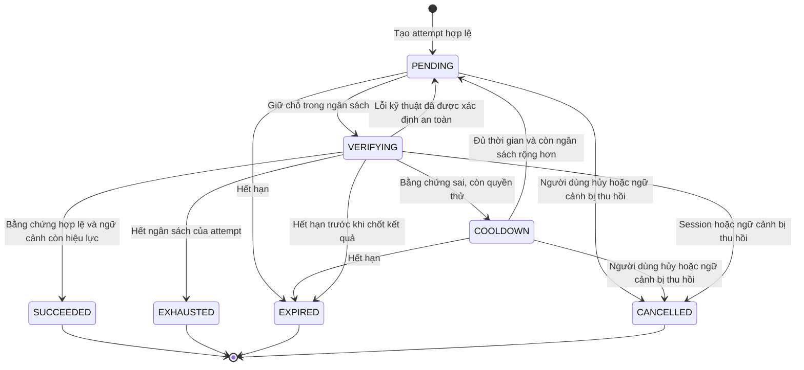

# Reauthentication retry

## 1. Mục tiêu và bối cảnh

Trong chương **Reauthentication** của module `SECURITY_AUTHENTICATION_ACCOUNT_RECOVERY`, bài này trình bày cách cho phép người dùng **thử xác thực lại có kiểm soát** khi họ nhập sai bằng chứng, gặp gián đoạn kỹ thuật hoặc không còn sử dụng được một phương thức xác thực.

Phạm vi module là thiết kế khôi phục tài khoản khi mất mật khẩu, MFA, passkey hoặc thiết bị xác thực, kết hợp đánh giá rủi ro, token dùng một lần, xác minh danh tính, chống lạm dụng và kiểm soát session. Retry là một điểm nối quan trọng: quá dễ thử lại tạo điều kiện chiếm đoạt tài khoản; khóa quá rộng lại biến cơ chế bảo vệ thành công cụ gây từ chối dịch vụ cho chủ tài khoản.

Ví dụ xuyên suốt: một người dùng đang đăng nhập muốn thay MFA sau khi mất điện thoại. Session hiện tại cho phép xem thông tin cơ bản, nhưng thao tác thay MFA yêu cầu bằng chứng xác thực mới từ phương thức còn hợp lệ. Người dùng có thể nhập nhầm mã dự phòng, hủy hộp thoại passkey hoặc gặp lỗi mạng sau khi gửi bằng chứng. Các tình huống ấy cần cách xử lý khác nhau.

Sau bài học, người đọc có thể:

- Phân loại lỗi để quyết định có thử lại, chờ, đổi phương thức hay đi vào khôi phục tài khoản.
- Thiết kế ngân sách thử, cooldown và trạng thái challenge phía server.
- Xử lý request trùng, replay và cạnh tranh giữa nhiều request.
- Bảo đảm retry không tự nâng quyền session hoặc làm yếu yêu cầu xác thực.

**Reauthentication** là xác thực lại trong một ngữ cảnh đã có danh tính hoặc session được xác lập. **Account recovery** là quy trình khôi phục khả năng truy cập khi các cách xác thực cần thiết không còn dùng được. Việc người dùng bấm “Tôi mất thiết bị” chỉ bắt đầu một quy trình khác; nó chưa chứng minh danh tính.

## 2. Hai loại retry cần phân biệt

### 2.1. Thử một bằng chứng xác thực mới

Người dùng nhập lại mật khẩu, nhập một OTP khác hoặc thực hiện một lần xác thực passkey mới. Đây là một cơ hội xác minh mới. Server phải áp dụng chính sách nhận request và ngân sách thử trước khi cho phép xử lý bằng chứng.

Chỉ kết quả xác minh đáng tin cậy từ verifier mới quyết định một lần xác thực có thành công hoặc thất bại. Thông báo do trình duyệt gửi lên như `userCancelled=true` không đủ để server phân loại một request chứa bằng chứng sai thành “không tính lượt”.

### 2.2. Gửi lại cùng một request vì chưa nhận được kết quả

Client gửi bằng chứng, server xử lý xong nhưng kết nối bị ngắt trước khi phản hồi tới trình duyệt. Client chưa biết kết quả nên gửi lại **cùng định danh request và cùng nội dung**.

Đây là vấn đề idempotency: hệ thống cần trả lại kết quả đã ghi nhận, thay vì xác minh và trừ thêm lượt. Đồng thời, nó không được chấp nhận bằng chứng đã dùng cho một thao tác mới.

| Tình huống | Bản chất | Hướng xử lý |
| --- | --- | --- |
| Nhập mật khẩu khác sau khi nhập sai | Lần thử xác thực mới | Kiểm tra ngân sách rồi xác minh |
| Gửi lại cùng request sau timeout mạng | Truy vấn hoặc tiếp tục cùng lần xử lý | Tra kết quả theo định danh, không tính hai lần |
| Xin challenge mới sau khi challenge hết hạn | Bắt đầu một ceremony mới | Giữ các giới hạn có phạm vi rộng hơn challenge |
| Bấm gửi lại mã qua kênh nhận | Yêu cầu phát hành hoặc phân phối mã | Áp dụng giới hạn gửi riêng |
| Hủy hộp thoại passkey, chưa gửi assertion | Tương tác phía client chưa hoàn tất | Có thể cho mở lại có kiểm soát |
| Dùng lại một OTP đã tiêu thụ bằng request mới | Replay | Từ chối; không coi là request trùng hợp lệ |

Không cài vòng lặp tự gửi lại mật khẩu hoặc OTP mỗi khi gặp lỗi. Sau lỗi mạng, ưu tiên đọc trạng thái request hoặc dùng lại đúng khóa idempotency. Một bằng chứng mới cần định danh request mới.

## 3. Những điều phải luôn đúng

Trong thiết kế minh họa của bài, các bất biến sau được áp dụng xuyên suốt:

1. **Thất bại không cấp quyền.** Sai mã, timeout, hủy thao tác và lỗi hạ tầng đều không làm tăng mức bảo đảm của session.
2. **Server giữ trạng thái quyết định.** Đồng hồ đếm ngược hoặc nút bị vô hiệu hóa trên giao diện chỉ hỗ trợ trải nghiệm.
3. **Không được cấp thêm ngân sách bằng cách đổi vỏ ngữ cảnh.** Đổi tab, session, challenge, IP hoặc chuyển phương thức không xóa giới hạn tương ứng trên tài khoản.
4. **Bằng chứng được ràng buộc với đúng ngữ cảnh.** Thành công phải thuộc đúng tài khoản, mục đích và lần thực hiện còn hiệu lực.
5. **Một kết quả chỉ được chốt một lần.** Request trùng không tạo thêm thất bại; bằng chứng thành công không tạo nhiều quyền thực hiện thao tác.
6. **Bất định không biến thành thành công.** Khi không đọc được trạng thái quyết định hoặc chưa biết verifier đã hoàn tất hay chưa, giữ thao tác nhạy cảm ở trạng thái chưa được phép.
7. **Hết khả năng xác thực thì chuyển quy trình.** Retry không tự biến thành quyền bỏ qua MFA hoặc quyền đăng ký yếu tố mới.

Ví dụ: đạt giới hạn thử mã dự phòng không được dẫn đến một nút “Bỏ qua xác minh”. Hệ thống có thể đưa người dùng sang quy trình khôi phục với bằng chứng độc lập, thời gian chờ và kiểm soát phù hợp.

## 4. Mô hình dữ liệu tối thiểu

Nên tách **ý định thực hiện thao tác**, **lần xác thực lại**, **challenge** và **request xác minh**.

| Thành phần | Thông tin tiêu biểu | Vai trò |
| --- | --- | --- |
| Operation intent | Tài khoản, loại thao tác, tham số quan trọng, thời hạn | Xác định người dùng đang xin quyền làm gì |
| Reauthentication attempt | Attempt ID, intent ID, ngữ cảnh session, mức bảo đảm cần đạt, trạng thái | Quản lý một tiến trình xác thực lại |
| Challenge | Challenge ID, phương thức, giá trị hoặc tham chiếu bảo mật, phiên bản, hạn dùng | Ràng buộc bằng chứng với một ceremony |
| Verification request | Request ID, dấu kiểm nội dung, trạng thái đang xử lý hoặc kết quả | Hỗ trợ idempotency |
| Retry budget | Phạm vi, số thất bại, số request đang xác minh, mốc mở lại | Kiểm soát số cơ hội thử |
| Reauthentication grant | Grant ID, tài khoản, session, intent, mức bảo đảm, thời hạn, trạng thái dùng | Cho phép thực hiện đúng thao tác đã xác thực |

Một attempt có thể chứa:

```text
attemptId
accountId
logicalSessionId
intentId
requiredAssurancePolicy
allowedAuthenticatorIds
state
challengeVersion
createdAt
expiresAt
nextAllowedAt
authStateVersion
riskPolicyVersion
```

`logicalSessionId` là định danh nội bộ của session, không phải bản sao cookie bí mật. Nếu cookie được xoay sau thành công, server vẫn có thể xác định quan hệ giữa session trước và sau khi xoay.

`authStateVersion` thay đổi khi có sự kiện làm kết quả cũ không còn đáng tin, chẳng hạn thu hồi phương thức, khôi phục tài khoản hoặc vô hiệu hóa session. Tên và cách triển khai trường này tùy hệ thống; điều quan trọng là kết quả đang xử lý phải được đối chiếu lại trước khi chốt.

Với thao tác thay MFA, intent nên ràng buộc loại thay đổi và dữ liệu đích cần thiết. Nếu người dùng đổi từ “thêm thiết bị” sang “xóa mọi phương thức cũ”, server phải đánh giá lại yêu cầu. Một kết quả xác thực cho thao tác nhẹ hơn không tự cấp quyền cho thao tác có tác động lớn hơn.

## 5. Vòng đời và trạng thái



Sơ đồ mô tả một attempt cho phép một request xác minh đang hoạt động tại một thời điểm. Một hệ thống cho phép song song cần giữ chỗ ngân sách cho từng request và ngăn nhiều kết quả cùng chốt thành công.

- `COOLDOWN` chỉ là thời gian chờ. Hết thời gian chờ vẫn phải kiểm tra các giới hạn khác.
- `EXHAUSTED` đóng attempt hiện tại. Attempt mới không xóa bộ đếm liên quan đến tài khoản hoặc authenticator.
- `EXPIRED` là trạng thái kết thúc. Không kéo dài challenge chỉ vì người dùng bấm thử lại.
- `CANCELLED` không xóa lịch sử thất bại hoặc dấu hiệu lạm dụng.
- `SUCCEEDED` ghi nhận kết quả xác thực. Quyền thay MFA còn phải được kiểm tra và tiêu thụ ở endpoint thực hiện thao tác.

Đối với request đang xác minh, mọi kết quả đến muộn phải bị chặn nếu attempt đã hết hạn, bị hủy hoặc có phiên bản ngữ cảnh không còn khớp.

## 6. Ngân sách thử nhiều lớp

### 6.1. Vì sao một bộ đếm trên challenge chưa đủ?

Giả sử mỗi challenge cho phép năm lần nhập mã. Nếu tạo challenge mới luôn nhận năm lượt mới, kẻ tấn công có thể đổi challenge liên tục để vượt giới hạn.

Tương tự, giới hạn theo IP bị né khi dùng nhiều IP; giới hạn theo session bị né khi mở nhiều session; giới hạn riêng từng phương thức có thể bị khai thác bằng cách thử lần lượt mọi phương thức.

Một mô hình thực tế cần phối hợp các phạm vi:

- **Challenge hoặc attempt:** giới hạn vòng tương tác hiện tại.
- **Tài khoản và authenticator:** giới hạn thử cùng một yếu tố qua nhiều challenge và session.
- **Tài khoản và nhóm thao tác nhạy cảm:** giới hạn tổng hợp khi chuyển phương thức hoặc tạo intent khác.
- **Nguồn gửi:** IP, dải mạng, thiết bị hoặc dấu hiệu tự động hóa để giảm lưu lượng tấn công.
- **Dịch vụ:** giới hạn công suất xác minh và chi phí gửi thông báo.

Chỉ cho tiếp tục khi **tất cả** giới hạn liên quan còn cho phép. Không cộng các ngân sách thành một tổng số lượt được cấp.

### 6.2. Cấu hình minh họa

Bảng sau là một cấu hình giả định để giải thích cơ chế, cần điều chỉnh theo mô hình đe dọa và dữ liệu sử dụng. Các con số không phải ngưỡng áp dụng chung.

| Phạm vi | Chính sách minh họa | Khi chạm ngưỡng |
| --- | --- | --- |
| Một attempt nhập mã | Tối đa 5 kết quả sai | Đóng attempt |
| Một tài khoản và authenticator | Tối đa 10 lần sai trong cửa sổ trượt 15 phút | Tạm ngừng xác minh yếu tố đó |
| Một tài khoản và nhóm thao tác thay yếu tố | Tối đa 10 lần sai trong cửa sổ trượt 15 phút, gộp các phương thức | Chặn thử thêm cho nhóm thao tác |
| Một tài khoản và authenticator | Chặn ở 30 thất bại liên tiếp | Vô hiệu hóa authenticator và yêu cầu quy trình khôi phục hoặc gắn lại phù hợp |
| Một attempt gửi mã | Ít nhất 60 giây giữa hai lần gửi; thêm hạn mức theo tài khoản | Không phát sinh lần gửi mới |
| Một attempt | Hạn tuyệt đối 5 phút | Bắt đầu lại ceremony nếu còn được phép |
| Một grant cho thao tác | Có hiệu lực 2 phút và dùng một lần | Xác thực lại nếu chưa thực hiện |

Cửa sổ trượt có thể hết hiệu lực theo thời gian. Bộ đếm **thất bại liên tiếp** có ngữ nghĩa khác: hết cooldown hoặc hết cửa sổ 15 phút không tự xóa nó. Khi authenticator đã bị vô hiệu hóa, tạo attempt mới cũng không làm nó hoạt động trở lại.

Trong phạm vi NIST SP 800-63B-4, mục 3.2.2 đặt trần mặc định 100 lần sai liên tiếp cho một authenticator trên một tài khoản khi cơ chế giới hạn này áp dụng; có thể đặt thấp hơn. Đây là giới hạn trên, không phải số lượt nên cấp cho mọi OTP. Mục 3.1.3.2 cũng quy định phát hành bí mật out-of-band mới không được đặt lại số thất bại. [Nguồn: NIST — Authenticator and Verifier Requirements](https://pages.nist.gov/800-63-4/sp800-63b/authenticators/#rate-limiting-throttling).

Giới hạn PIN mở khóa authenticator cục bộ là một cơ chế riêng, do authenticator hoặc nền tảng thực thi. Không dùng bộ đếm retry trên server để suy ra người dùng còn bao nhiêu lần nhập PIN trên thiết bị.

### 6.3. Khi nào được đặt lại bộ đếm?

Đặt lại có chọn lọc sau thành công đủ mức bảo đảm đối với **chính authenticator đã được chứng minh**, theo chính sách áp dụng. Không dùng một thành công yếu hơn để xóa thất bại của phương thức mạnh hơn. Đây cũng là điểm được NIST đề cập tại mục 3.2.2. [Nguồn: NIST — Rate Limiting](https://pages.nist.gov/800-63-4/sp800-63b/authenticators/#rate-limiting-throttling).

Trong mô hình minh họa, không xóa cửa sổ tổng hợp chống lạm dụng và dữ liệu phát hiện tấn công chỉ vì một lần xác thực thành công. Nếu không, kẻ đã biết một phương thức yếu có thể liên tục dùng nó để “rửa” lịch sử thử các phương thức khác.

Không đặt lại ngân sách khi:

- Reload trang, mở tab mới, xóa cookie hoặc đổi IP.
- Tạo attempt, challenge hoặc intent mới.
- Gửi lại mã, đổi ngôn ngữ hoặc chuyển kênh hỗ trợ.
- Tự khai báo đã hủy hộp thoại hoặc tự khai báo lỗi mạng.

## 7. Cooldown và backoff phía server

Backoff làm tăng thời gian chờ giữa những lần thử sai. Một công thức minh họa:

```text
delay(n) = min(60 giây, 2 giây × 2^(n - 1))
nextAllowedAt = serverNow + delay(n)
```

Với `n` là số thất bại trong attempt, bốn lần sai đầu có thể tạo thời gian chờ 2, 4, 8 và 16 giây. Trong cấu hình năm lần sai, lần thứ năm đóng attempt thay vì hứa hẹn một lượt mới sau cooldown.

Khi nhiều chính sách cùng áp dụng, thời điểm sớm nhất được thử lại là mốc muộn nhất của các hạn tạm chặn; nếu đã bị vô hiệu hóa thì không có mốc thử lại tự động.

Server cần:

- Dùng thời gian đáng tin cậy của hệ thống; không nhận `nextAllowedAt` từ client.
- Kiểm tra lại thời hạn và ngân sách ở mỗi request.
- Trả `Retry-After` phù hợp khi dùng HTTP 429.
- Không tự ngủ một thread ứng dụng trong suốt thời gian cooldown.
- Không kéo dài cooldown chỉ vì nhận nhiều bản sao của cùng request đã xử lý.
- Giới hạn lưu lượng từ đầu để request bị chặn không tiếp tục gây tốn tài nguyên.

Client hiển thị thời gian chờ từ kết quả server. Nếu thêm jitter cho lịch gửi lại khi hạ tầng phục hồi, jitter chỉ trì hoãn thêm; nó không được làm request đến trước thời điểm server cho phép.

Không tự mở lại hộp thoại passkey hoặc gửi push liên tục khi cooldown kết thúc. Một hành động xác thực cần chủ ý rõ ràng của người dùng.

## 8. Phân loại lỗi theo phương thức

| Kết quả quan sát | Xử lý bộ đếm xác thực | Hành vi phù hợp |
| --- | --- | --- |
| Verifier xác định mật khẩu hoặc mã không hợp lệ | Ghi nhận thất bại một lần | Cho thử lại nếu còn ngân sách |
| Challenge hết hạn hoặc không còn là phiên bản hiện hành | Không coi là một lần đoán trên challenge còn sống; vẫn chịu chống lạm dụng request | Bắt đầu lại ceremony |
| OTP đã được tiêu thụ | Không xác minh thành công lần nữa; ghi nhận replay theo chính sách | Tra request cũ hoặc dùng bằng chứng mới |
| Trình duyệt không trả assertion | Không tự ghi một lần sai mật mã ở server | Hướng dẫn thao tác lại có giới hạn |
| Verifier hoặc kho trạng thái không khả dụng | Không gán thành “người dùng nhập sai” | Giữ thao tác bị chặn, trả lỗi tạm thời |
| Request xác minh bị mất phản hồi | Chưa kết luận lần thử mới | Đọc trạng thái hoặc gửi lại cùng định danh |
| Người dùng báo mất mọi phương thức đáp ứng yêu cầu | Không tiếp tục vòng retry vô ích | Chuyển sang quy trình khôi phục |

Không cung cấp toàn bộ phân loại nội bộ trong thông báo công khai. Server có thể biết một mã là sai, cũ hay đã dùng, nhưng giao diện có thể dùng thông báo chung “Không thể xác minh bằng mã này”.

### 8.1. Mật khẩu

Phân biệt kiểm tra định dạng request với xác minh mật khẩu. Request thiếu trường hoặc quá kích thước bị loại sớm và chịu hạn mức lưu lượng riêng. Nếu server thực sự so khớp một ứng viên mật khẩu và nhận kết quả sai, nó phải ghi nhận cơ hội thử đó.

Không lưu mật khẩu trong log, hàng đợi retry hoặc dữ liệu idempotency. Không giữ mật khẩu để trình duyệt tự gửi lại định kỳ.

### 8.2. OTP và mã dự phòng

Một mã đã xác minh thành công phải được đánh dấu đã dùng bằng thao tác nguyên tử. Với TOTP, chống replay phải có phạm vi bao phủ các challenge và session có thể dùng cùng authenticator; chỉ đánh dấu “challenge đã dùng” là chưa đủ.

Không liên tục mở rộng cửa sổ chấp nhận TOTP để làm retry dễ thành công hơn. Trường hợp lệch giờ cần hướng dẫn xử lý riêng và vẫn chịu giới hạn thử.

Với mã được gửi qua kênh nhận, cấu hình minh họa chọn chính sách mã mới làm mã trước mất hiệu lực. Cập nhật phiên bản và việc phát hành phải nhất quán; request gửi trùng không được tạo hai mã mới. Lỗi nhà cung cấp nhận gửi chưa đồng nghĩa người dùng đã nhận được mã.

Mã dự phòng được tiêu thụ từng mã. Không đánh dấu toàn bộ bộ mã là đã dùng vì nhập sai một mã. Việc người dùng sở hữu mã dự phòng có đủ để thực hiện thao tác đích hay không là quyết định của chính sách khôi phục hoặc xác thực, không phải của nút retry.

### 8.3. Passkey và WebAuthn

WebAuthn có thể trả `NotAllowedError` ở nhiều nhánh như không tìm được credential phù hợp hoặc không nhận được sự đồng ý. Không nên suy luận duy nhất rằng người dùng đã nhập sai PIN. Khi có assertion, server vẫn phải kiểm tra challenge, origin, RP ID, chữ ký và yêu cầu user verification của ceremony. [Nguồn: W3C WebAuthn — Authentication Assertion Verification](https://www.w3.org/TR/webauthn-3/#sctn-verifying-assertion).

Trong thiết kế này, lần mở hộp thoại mới sau khi ceremony kết thúc dùng challenge mới và vô hiệu hóa challenge đã thay thế. Quy tắc đó không cho phép đặt lại ngân sách tài khoản.

Nếu chỉ gửi lại cùng request đang chưa rõ kết quả, client dùng định danh cũ để tra kết quả; không phát sinh ceremony khác một cách ngầm định. Người dùng có thể chọn passkey khác đã đăng ký nếu phương thức đó đáp ứng chính sách. Đăng ký passkey mới là một thao tác nhạy cảm riêng.

### 8.4. Push và các kênh gửi mã

Retry gửi push cần hạn mức riêng để ngăn làm phiền hoặc ép người dùng chấp thuận do mệt mỏi. Phản hồi “Không phải tôi” phải đi vào đánh giá rủi ro, thay vì tự động gửi tiếp.

Email hoặc số điện thoại do người đang xin khôi phục vừa nhập không tự trở thành kênh đáng tin. Khả năng nhận một mã cũng không tự chứng minh mức bảo đảm mà thao tác thay MFA yêu cầu.

Khi mật khẩu đúng nhưng yếu tố thứ hai thất bại, có thể người dùng mất thiết bị, cũng có thể mật khẩu đã bị lộ. OWASP khuyến nghị cung cấp phương thức phù hợp khác và có cơ chế thông báo; khôi phục MFA phải tránh trở thành đường vượt MFA. [Nguồn: OWASP — Failed Login Attempts và Resetting MFA](https://cheatsheetseries.owasp.org/cheatsheets/Multifactor_Authentication_Cheat_Sheet.html#failed-login-attempts).

## 9. Idempotency và chống replay

Hai cơ chế này phục vụ hai mục tiêu khác nhau:

- **Idempotency:** cùng một request hợp lệ chỉ tạo một kết quả logic.
- **Chống replay:** bằng chứng đã dùng hoặc không còn đúng ngữ cảnh không cấp thêm quyền.

Một bản ghi idempotency có thể được tra theo:

```text
accountId + logicalSessionId + attemptId + requestId
```

Server lưu dấu kiểm nội dung đã chuẩn hóa. Nếu nội dung có mật khẩu hoặc mã ít entropy, không lưu một hash không khóa để làm dấu kiểm vì nó tạo điều kiện đoán offline. Có thể dùng HMAC với khóa riêng do server quản lý, kết hợp không ghi lại dữ liệu nhạy cảm và thời hạn lưu ngắn.

Quy tắc xử lý:

1. Cùng khóa và cùng nội dung: trả kết quả cũ hoặc trạng thái đang xử lý.
2. Cùng khóa nhưng nội dung khác: từ chối xung đột.
3. Khóa mới: được xem là request mới và phải qua admission control.
4. Kết quả cũ chỉ được trả cho đúng ngữ cảnh có quyền truy cập.
5. Session đã bị thu hồi hoặc grant đã hết hiệu lực không được sống lại nhờ bản ghi kết quả cũ.

Sau thành công, endpoint trạng thái nên trả thông tin như `CONFIRMED` và tình trạng thực hiện intent. Nếu cần phân phối lại một tham chiếu grant, nó chỉ được trỏ tới **cùng grant** còn hiệu lực và còn dùng được trong ngữ cảnh hiện tại; không tạo grant mới.

Một ví dụ nguy hiểm là miễn trừ giới hạn cho mọi request có cùng `requestId` nhưng không kiểm tra nội dung. Kẻ tấn công có thể giữ ID cố định và thay mã đoán hàng nghìn lần.

Bản ghi idempotency cũng cần giới hạn kích thước, số lượng và thời gian lưu. Không tạo bản ghi bền vững vô hạn cho request vô danh hoặc attempt không thuộc quyền truy cập của người gọi.

## 10. Xử lý nguyên tử và cạnh tranh

### 10.1. Lỗi “đọc rồi mới tăng”

Một cách triển khai sai:

```text
Nếu failures < limit:
    xác minh bằng chứng
    nếu sai thì failures = failures + 1
```

Khi bộ đếm đang là 4 và giới hạn là 5, mười request song song có thể cùng đọc được 4 rồi đều được xác minh. Dù số cuối cùng là 5 hay 14, hệ thống đã cho thêm nhiều cơ hội thử.

Cần giữ chỗ ngân sách **trước khi** thực hiện xác minh:

```text
confirmedFailures + inFlightReservations < applicableLimit
```

Biểu thức phải đúng cho mọi phạm vi áp dụng. Với giới hạn tốc độ request và giới hạn gửi mã, mỗi request được nhận có thể tiêu thụ ngân sách riêng dù sau đó không trở thành thất bại xác thực.

### 10.2. Luồng xử lý minh họa

Đoạn dưới là mã giả phong cách Java, mô tả hợp đồng giữa các thành phần. Nó không phải lớp triển khai hoàn chỉnh.

```java
Outcome verify(ReauthRequest request, Session session) {
    requireActiveSession(session);
    validateRequestBoundsAndCsrf(request, session);

    BoundContext context = loadOwnedAttempt(request.attemptId(), session);
    RequestDigest digest = keyedDigest(request, context);

    Admission admission = admissionStore.beginAtomically(
        context, request.requestId(), digest, clock.instant()
    );

    if (admission.isExistingRequest()) {
        return admission.existingOutcomeAfterAccessCheck(session);
    }
    if (!admission.isAllowed()) {
        return admission.denial();
    }

    Reservation reservation = admission.reservation();
    VerificationResult result;
    try {
        result = verifier.verify(
            reservation.boundChallenge(),
            request.proof()
        );
    } catch (VerifierUnavailable error) {
        return admissionStore.finishUnavailableAtomically(reservation);
    }

    return admissionStore.finishAtomically(
        reservation, result, clock.instant()
    );
}
```

`beginAtomically` phải thực hiện nhất quán việc kiểm tra quyền sở hữu, trạng thái, thời hạn, cooldown, các ngân sách, khóa idempotency và tạo reservation. Không tạo hai reservation cho hai bản sao của cùng request.

`finishAtomically` phải:

- Chỉ chốt một reservation một lần.
- Kiểm tra reservation còn hiệu lực, đúng phiên bản challenge và ngữ cảnh.
- Kiểm tra lại session, trạng thái authenticator, chính sách rủi ro và hạn tuyệt đối.
- Khi sai: chuyển một reservation thành một thất bại, cập nhật cooldown hoặc đóng attempt.
- Khi đúng: tiêu thụ bằng chứng dùng một lần theo phạm vi phù hợp, hoàn tất attempt và ghi nhận cùng một grant.
- Lưu kết quả idempotency nhất quán với các thay đổi quyết định.

Không giữ transaction cơ sở dữ liệu hoặc khóa phân tán trong suốt cuộc gọi đến nhà cung cấp bên ngoài. Reservation có lease và fencing token giúp chặn một worker cũ chốt kết quả sau khi quyền xử lý đã chuyển sang worker khác.

Khi worker chết, không vội hoàn lại mọi reservation như thể chắc chắn chưa xác minh. Cần xác định kết quả theo request ID của verifier, hoặc áp dụng cách xử lý bảo thủ. Một reservation đã hết lease không được quyền chốt thành công muộn. Nếu không chắc một cơ hội thử đã được dùng hay chưa, hệ thống có thể tạm giữ nó trong ngân sách để tránh mở thêm cơ hội vô hạn.

Các thay đổi ở nhiều kho dữ liệu cần có chiến lược phối hợp rõ ràng. Nếu chưa bảo đảm nguyên tử giữa tiêu thụ mã và tạo grant, giữ trạng thái chưa hoàn tất có thể đối soát; không trả thành công trước khi trạng thái có thẩm quyền đã được ghi nhận.

## 11. Hợp đồng API và thông báo

Ví dụ các endpoint nội bộ của một ứng dụng:

```text
POST /security/reauthentication/attempts
POST /security/reauthentication/attempts/{attemptId}/verify
POST /security/reauthentication/attempts/{attemptId}/resend
GET  /security/reauthentication/attempts/{attemptId}/requests/{requestId}
POST /security/authenticator-changes/{intentId}/confirm
```

Đây là cách đặt tên minh họa. Mỗi endpoint đều cần kiểm soát truy cập, CSRF theo cơ chế session, kiểm tra nguồn yêu cầu phù hợp và không đưa secret vào URL.

Một response tạm chặn:

```http
HTTP/1.1 429 Too Many Requests
Retry-After: 16
Cache-Control: no-store
Content-Type: application/json

{
  "code": "REAUTH_RETRY_LATER",
  "message": "Bạn cần chờ trước khi thử lại.",
  "retryAfterSeconds": 16,
  "canUseAnotherMethod": true
}
```

`canUseAnotherMethod` chỉ được trả sau khi người gọi đã có quyền xem ngữ cảnh, và chỉ khi phương thức khác còn được chính sách cho phép. Giới hạn gộp trên tài khoản có thể làm giá trị này là `false`.

| Kết quả | HTTP minh họa | Thông báo hướng người dùng |
| --- | --- | --- |
| Xác minh đã chốt thành công | 200 | Đã xác minh, tiếp tục thao tác được yêu cầu |
| Bằng chứng không chấp nhận được | 400 | Không thể xác minh bằng thông tin này |
| Ngữ cảnh đã bị thay thế | 409 | Yêu cầu này không còn hiệu lực, hãy bắt đầu lại |
| Đang bị giới hạn | 429 | Cần chờ trước khi thử lại |
| Session kết thúc | 401 | Cần đăng nhập hoặc bắt đầu quy trình phù hợp |
| Không thể xác minh do dịch vụ tạm lỗi | 503 | Hiện chưa thể xác minh, hãy thử lại sau |

Mã HTTP không thay thế kiểm tra bảo mật. Không để endpoint trạng thái trở thành nơi dò tài khoản, dò phương thức đã đăng ký hoặc đọc trạng thái của người khác.

Ở bước yêu cầu khôi phục chưa xác lập được quyền truy cập, OWASP khuyến nghị phản hồi nhất quán cho tài khoản tồn tại và không tồn tại, chống gửi quá mức, và dùng token có hạn, dùng một lần. Không khóa tài khoản chỉ vì có người gửi yêu cầu đặt lại mật khẩu. [Nguồn: OWASP — Forgot Password](https://cheatsheetseries.owasp.org/cheatsheets/Forgot_Password_Cheat_Sheet.html#forgot-password-request).

## 12. Retry và kiểm soát session

Trong lúc retry, server giữ nguyên việc **chưa cấp quyền cho thao tác nhạy cảm**. Chính sách có thể cho session còn hiệu lực tiếp tục xem dữ liệu cơ bản, hoặc yêu cầu chấm dứt session khi có dấu hiệu chiếm đoạt.

Không cập nhật `lastSuccessfulAuthenticationAt` sau một request thất bại. Việc mở challenge hoặc bấm thử lại không được kéo dài vô hạn tuổi xác thực cần thiết cho thao tác.

NIST phân biệt timeout tổng thể và timeout không hoạt động: session phải kết thúc khi timeout tương ứng hết hạn; xác thực lại thành công có thể đặt lại cả hai. Không coi một lần retry thất bại là sự kiện xác thực thành công. [Nguồn: NIST — Session Management, Reauthentication](https://pages.nist.gov/800-63-4/sp800-63b/session/#reauthentication).

Sau thành công trong thiết kế minh họa:

1. Ghi nhận thời điểm, phương thức và mức bảo đảm thực sự đạt được.
2. Xoay định danh session khi có thay đổi trạng thái bảo mật hoặc nâng quyền theo chính sách session.
3. Cấp grant có thời hạn ngắn, giới hạn đúng intent và session.
4. Khi thực hiện thao tác, kiểm tra lại quyền, rủi ro, phiên bản trạng thái xác thực và hiệu lực grant.
5. Tiêu thụ grant cùng việc ghi nhận thay đổi trong một transaction hoặc quy trình bảo đảm tương đương.
6. Áp dụng việc thu hồi session, token hoặc yếu tố cũ theo chính sách của sự kiện khôi phục hay thay đổi.

Định danh operation cũng cần idempotency: gửi lại yêu cầu thay MFA sau khi mất phản hồi phải trả cùng kết quả, không thực hiện thay đổi thêm lần nữa.

Không đánh đồng “đã xác thực lại” với “đã khôi phục xong”. Nếu người dùng đã mất yếu tố cần thiết, quy trình khôi phục phải xác lập bằng chứng phù hợp trước khi gắn phương thức mới. Một email nhận được hoặc câu trả lời của nhân viên hỗ trợ không tự biến session thành session có mức bảo đảm cao.

## 13. Ví dụ diễn tiến

Giả sử tài khoản có một phương thức còn đáp ứng chính sách để xác thực lại trước khi thay MFA. Attempt hết hạn sau năm phút, cho tối đa năm kết quả sai và chịu các giới hạn gộp đã mô tả.

| Bước | Sự kiện | Kết quả phía server |
| --- | --- | --- |
| 1 | Tạo intent thay MFA và attempt A | Chưa cấp quyền thay MFA |
| 2 | Gửi request R1 với mã sai | Một thất bại, cooldown hai giây |
| 3 | Client mất phản hồi và gửi lại R1 cùng nội dung | Trả cùng kết quả, không tăng thất bại |
| 4 | Gửi R2 trong cooldown | Từ chối trước xác minh, chịu hạn mức lưu lượng |
| 5 | Hết cooldown, gửi R3 với mã sai | Hai thất bại, cooldown bốn giây |
| 6 | Hết cooldown, gửi R4 với mã hợp lệ | Tiêu thụ mã và chốt một grant G |
| 7 | Mất phản hồi sau khi R4 đã commit | Endpoint trạng thái cho biết cùng kết quả đã chốt |
| 8 | Gửi operation O1 để xác nhận thay MFA bằng G | Kiểm tra lại ngữ cảnh, tiêu thụ G và ghi nhận thay đổi |
| 9 | Gửi lại O1 do chưa nhận phản hồi | Trả cùng kết quả operation |
| 10 | Dùng mã đã tiêu thụ cho request hoặc operation mới | Không cấp thêm quyền |

Ở một nhánh khác, người dùng nhập sai năm lần và attempt A bị đóng. Sau đó họ tạo attempt B. Bộ đếm riêng B có thể bắt đầu từ không, nhưng bộ đếm tài khoản, authenticator và cửa sổ tổng hợp vẫn giữ lịch sử liên quan.

Nếu tổng số thất bại tiếp tục chạm ngưỡng vô hiệu hóa authenticator, người dùng cần phương thức còn hợp lệ khác hoặc quy trình khôi phục. Không có quy tắc “đợi một phút rồi coi thiết bị đã xác thực”.

Nếu mọi phương thức đủ điều kiện đều đã mất, giao diện cần cung cấp lối vào khôi phục phù hợp. Không ép người dùng tiếp tục nhập mã trên thiết bị họ không còn sở hữu.

## 14. Chống lạm dụng và quan sát vận hành

Retry có thể bị khai thác để đoán mã, gây khóa tài khoản, gửi SMS hàng loạt, làm phiền bằng push hoặc tiêu hao công suất xác minh mật khẩu.

Các lớp giới hạn nên có mục tiêu riêng:

- Bộ đếm thất bại bảo vệ bí mật xác thực.
- Hạn mức request và giới hạn xác minh đang chạy bảo vệ tài nguyên.
- Hạn mức resend bảo vệ kênh liên lạc và chi phí.
- Giới hạn tổng hợp bảo vệ khỏi đổi phương thức, session hoặc IP để né chính sách.
- Đánh giá rủi ro quyết định khi nào cần chặn rộng hơn, thông báo hoặc chuyển quy trình.

Không tự khóa vĩnh viễn toàn bộ tài khoản từ một vài request chưa xác lập danh tính. Việc vô hiệu hóa authenticator khi chạm ngưỡng cần có quy trình phục hồi rõ ràng, trong khi chống lạm dụng ở biên giúp giảm khả năng kẻ tấn công cố ý đẩy chủ tài khoản vào tình trạng đó.

Các chỉ số hữu ích:

| Chỉ số | Điều cần theo dõi |
| --- | --- |
| Tỷ lệ thành công sau retry theo phương thức | Phát hiện luồng gây khó hoặc phương thức gặp lỗi |
| Tỷ lệ lỗi kỹ thuật so với bằng chứng sai | Tránh quy trách nhiệm lỗi hạ tầng cho người dùng |
| Số attempt trên một tài khoản | Phát hiện né giới hạn hoặc UX khiến người dùng khởi động lại liên tục |
| Tỷ lệ resend và chi phí gửi | Phát hiện lạm dụng kênh liên lạc |
| Số request bị chặn trước xác minh | Đánh giá tải tấn công và hiệu quả admission control |
| Reservation treo hoặc chốt muộn bị từ chối | Phát hiện sự cố đồng bộ |
| Tỷ lệ chuyển sang khôi phục và hoàn tất | Đánh giá người dùng có lối thoát khả dụng |

Không gắn account ID vào nhãn metric có số lượng giá trị quá lớn. Audit log được kiểm soát truy cập có thể chứa định danh nội bộ, request ID, loại sự kiện, nguyên nhân nội bộ và phiên bản chính sách.

Không ghi mật khẩu, OTP, mã dự phòng, session cookie hoặc toàn bộ assertion vào log thông thường. Thông báo bảo mật cần hạn mức và cơ chế gộp để bản thân cảnh báo không trở thành công cụ gây phiền.

Khi kho trạng thái hoặc cơ chế giới hạn phân tán bị lỗi, không âm thầm chuyển sang bộ đếm RAM của từng instance để tiếp tục cho phép thao tác nhạy cảm. Hệ thống chỉ có thể tiếp tục nếu có chế độ dự phòng vẫn giữ được các bất biến đã xác định; nếu không, trả lỗi tạm thời và bảo toàn trạng thái chưa được cấp quyền.

## 15. Những sai lầm thiết kế thường gặp

| Sai lầm | Hậu quả | Cách thiết kế phù hợp |
| --- | --- | --- |
| Chỉ giới hạn ở giao diện | Gọi API trực tiếp để thử không giới hạn | Kiểm tra mọi request ở server |
| Tạo challenge mới là xóa số lần sai | Có ngân sách đoán mới liên tục | Giữ giới hạn trên tài khoản và authenticator |
| Chỉ giới hạn theo IP | Né bằng nguồn phân tán, ảnh hưởng người dùng dùng chung mạng | Phối hợp nhiều phạm vi |
| Trừ thêm lượt cho request gửi trùng | Người dùng hết lượt do mạng kém | Idempotency với dấu kiểm nội dung |
| Miễn mọi request có cùng request ID | Một ID dùng cho vô số mã đoán | Ràng buộc khóa với cùng nội dung |
| Lỗi nhà cung cấp cũng tính là nhập sai | Gây khóa do sự cố hạ tầng | Tách lỗi kỹ thuật và quản lý reservation |
| Hết cooldown là mở lại authenticator đã vô hiệu hóa | Vượt ngưỡng thất bại liên tiếp | Phân biệt chặn tạm và vô hiệu hóa |
| Tự giảm yêu cầu sau nhiều thất bại | Retry trở thành đường vượt MFA | Dùng phương thức đủ điều kiện hoặc khôi phục độc lập |
| Nhận mọi mã cũ sau resend | Tăng tập bằng chứng còn được chấp nhận | Chính sách phiên bản và hạn dùng rõ ràng |
| Cập nhật thời điểm xác thực khi bắt đầu retry | Giữ quyền nhạy cảm vô hạn mà chưa xác thực | Chỉ cập nhật sau thành công đã chốt |
| Chốt thành công sau khi session bị thu hồi | Cấp quyền từ kết quả đã lỗi thời | Kiểm tra phiên bản và trạng thái khi commit |
| Tạo grant mới khi đọc lại kết quả cũ | Một bằng chứng tạo nhiều lần cấp quyền | Trả cùng kết quả và cùng grant hợp lệ |

Reauthentication retry được thiết kế tốt cho phép người dùng sửa sai và vượt qua gián đoạn kỹ thuật, đồng thời giữ nguyên yêu cầu chứng minh danh tính. Quyền thực hiện thao tác chỉ xuất hiện sau một kết quả xác thực thành công đã được chốt nhất quán, còn hiệu lực và đúng phạm vi.

## 16. Tài liệu tham khảo

- [NIST SP 800-63B-4 — Authenticator and Verifier Requirements](https://pages.nist.gov/800-63-4/sp800-63b/authenticators/): tham chiếu mục 3.1.3.2 và 3.2.2 về bí mật out-of-band và giới hạn thử.
- [NIST SP 800-63B-4 — Session Management](https://pages.nist.gov/800-63-4/sp800-63b/session/): tham chiếu mục 5.2 về xác thực lại và timeout.
- [OWASP — Authentication Cheat Sheet](https://cheatsheetseries.owasp.org/cheatsheets/Authentication_Cheat_Sheet.html): bối cảnh xác thực lại cho sự kiện rủi ro và thao tác nhạy cảm.
- [OWASP — Multifactor Authentication Cheat Sheet](https://cheatsheetseries.owasp.org/cheatsheets/Multifactor_Authentication_Cheat_Sheet.html): thất bại yếu tố thứ hai và quy trình đặt lại MFA.
- [OWASP — Forgot Password Cheat Sheet](https://cheatsheetseries.owasp.org/cheatsheets/Forgot_Password_Cheat_Sheet.html): phản hồi không làm lộ tài khoản và kiểm soát yêu cầu khôi phục.
- [W3C — Web Authentication Level 3](https://www.w3.org/TR/webauthn-3/): xử lý ceremony và xác minh authentication assertion.

Các trạng thái, endpoint, reservation, công thức backoff và ngưỡng số trong bài là thiết kế minh họa. Việc áp dụng tiêu chuẩn cần đối chiếu đầy đủ loại authenticator, mức bảo đảm và bối cảnh triển khai.
