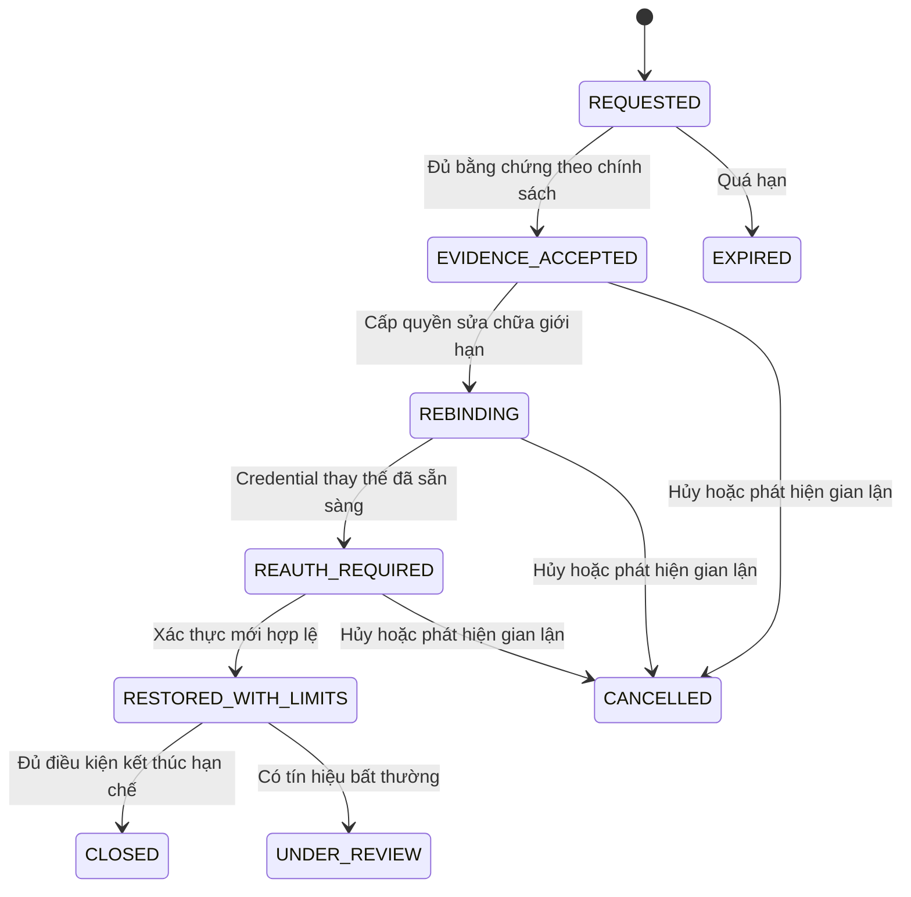

# Tái xác thực sau khi khôi phục tài khoản

## 1. Mục tiêu và phạm vi

Trong chương **Reauthentication** của module `SECURITY_AUTHENTICATION_ACCOUNT_RECOVERY`, bài học này giải quyết câu hỏi: sau khi một người khôi phục được mật khẩu, MFA, passkey hoặc thiết bị xác thực, hệ thống cần làm gì trước khi cho phép họ sử dụng lại tài khoản và thực hiện thao tác nhạy cảm?

Kết thúc bài học, bạn có thể:

- Phân biệt bằng chứng khôi phục với một lần xác thực mới có giá trị cho session.
- Chọn phương thức tái xác thực phù hợp với yếu tố còn giữ được, yếu tố vừa thay và dấu hiệu chiếm đoạt tài khoản.
- Thiết kế phiên khôi phục giới hạn, kiểm soát quyền tại backend và thu hồi quyền truy cập cũ.
- Ràng buộc kết quả xác thực với tài khoản, phiên, lần khôi phục và mục đích sử dụng.
- Nhận diện lỗi nâng quyền vòng tròn, phát lại bằng chứng và phục hồi quyền quá sớm.

Ví dụ xuyên suốt: **Lan mất điện thoại chứa ứng dụng TOTP**. Lan vẫn nhớ mật khẩu và còn mã khôi phục đã lưu trước đó. Sau khi xác minh theo chính sách, Lan được đăng ký lại TOTP. Việc hệ thống đã lưu secret TOTP mới chưa có nghĩa Lan đã hoàn thành một lần đăng nhập bằng mật khẩu và yếu tố thứ hai mới. Đồng thời, một refresh token trên điện thoại bị mất có thể vẫn còn hiệu lực nếu backend chưa thu hồi nó.

Trong bài, các trạng thái, tên trường, thời hạn và API là mô hình thiết kế minh họa. Chúng cần được điều chỉnh theo rủi ro và kiến trúc thực tế; không phải mọi chi tiết đều là yêu cầu của một tiêu chuẩn.

## 2. Recovery, tái xác thực và cấp quyền khác nhau thế nào?

**Account recovery** là quy trình thiết lập lại quyền kiểm soát tài khoản khi người dùng không còn sử dụng được các phương tiện xác thực cần thiết. **Reauthentication** là một sự kiện xác thực mới, giúp hệ thống xác nhận người đang thao tác đáp ứng yêu cầu hiện tại. **Authorization** quyết định họ được làm gì sau sự kiện đó.

NIST phân biệt khôi phục tài khoản với xác thực thông thường. Khi vẫn xác thực được bằng phương tiện khác, thay mật khẩu quên có thể thuộc việc gắn phương tiện xác thực mới. Cách gọi cần dựa vào khả năng còn lại của tài khoản. Xem [NIST SP 800-63B-4, Authenticator Event Management](https://pages.nist.gov/800-63-4/sp800-63b/events/).

| Bước | Câu hỏi cần trả lời | Kết quả hợp lý |
| --- | --- | --- |
| Xác minh recovery | Bằng chứng nào cho phép người yêu cầu sửa phương tiện xác thực? | Quyền thực hiện những bước sửa chữa đã được phê duyệt |
| Đăng ký lại yếu tố | Phương tiện mới đã được gắn đúng tài khoản và dùng được chưa? | Credential có trạng thái, nguồn gốc và phiên bản rõ ràng |
| Tái xác thực | Người hiện tại vừa chứng minh điều gì bằng phương thức nào? | Authentication event mới, có thời gian và ngữ cảnh |
| Khôi phục quyền | Bằng chứng mới đủ cho chức năng nào, còn hạn chế nào? | Session mới và tập quyền phù hợp |
| Step-up cho thao tác | Thao tác cụ thể có cần bằng chứng mạnh hơn hoặc mới hơn không? | Quyền cho thao tác tương ứng, trong phạm vi và thời gian ngắn |

OWASP xem recovery và thay đổi thông tin xác thực là các sự kiện cần cân nhắc tái xác thực, nhất là trước chức năng nhạy cảm. Xem [OWASP Authentication Cheat Sheet](https://cheatsheetseries.owasp.org/cheatsheets/Authentication_Cheat_Sheet.html#reauthentication-after-risk-events).

Một nguyên tắc thiết kế quan trọng là: **tái xác thực bằng credential vừa tạo chứng minh quyền sử dụng credential đó; chất lượng bằng chứng cho phép tạo credential vẫn phải được đánh giá riêng**.

Nếu kẻ tấn công kiểm soát email rồi đặt mật khẩu mới, yêu cầu nhập lại chính mật khẩu mới không làm cho email trở thành bằng chứng độc lập. Một bước kiểm tra có thể đúng về kỹ thuật nhưng không bổ sung điều mà chính sách bảo mật đang thiếu.

## 3. Vì sao giai đoạn sau recovery dễ bị khai thác?

### 3.1. Nâng độ tin cậy theo vòng tròn

Một luồng yếu có thể diễn ra như sau:

1. Người yêu cầu chứng minh quyền kiểm soát một kênh email đang bị xâm nhập.
2. Hệ thống cho đặt mật khẩu và đăng ký passkey mới.
3. Người yêu cầu dùng passkey mới để xác thực lại.
4. Hệ thống thấy phương thức chống phishing nên lập tức cho đổi email và tải toàn bộ dữ liệu.

Passkey có thể bảo vệ tốt những lần xác thực tiếp theo, nhưng không sửa được quyết định recovery sai ở bước đầu. Hệ thống cần lưu cả **nguồn gốc gắn credential** và các hạn chế còn hiệu lực sau recovery.

### 3.2. Session của kẻ tấn công sống lâu hơn mật khẩu

Đổi mật khẩu không tự động xóa session, access token, refresh token, thiết bị được ghi nhớ hoặc quyền truy cập đã cấp cho ứng dụng khác. Nếu các đường truy cập đó còn hoạt động, kẻ tấn công có thể thêm lại yếu tố hoặc thay thông tin khôi phục sau khi chủ tài khoản trở lại.

### 3.3. Lẫn quyền giữa phiên khôi phục và phiên ứng dụng

Một backend chỉ kiểm tra `userId != null` có thể cho phiên recovery gọi API đổi email, tạo API key hoặc xuất dữ liệu. Việc giao diện ẩn nút không ngăn được lời gọi trực tiếp.

### 3.4. Phát lại và tranh chấp trạng thái

Hai tab có thể cùng nộp một token. Một thiết bị có thể sử dụng bằng chứng tạo trước khi credential bị thu hồi. Một job đang chờ có thể hoàn thành thao tác sau khi recovery mới đã thay đổi trạng thái tài khoản. Tất cả đều đòi hỏi kiểm tra phiên bản và thời điểm có hiệu lực tại backend.

### 3.5. Yêu cầu lại yếu tố đã mất

Nếu người dùng mất toàn bộ phương tiện xác thực, bắt nhập TOTP cũ sẽ tạo ngõ cụt. Ngược lại, một nút “bỏ qua MFA” vô điều kiện biến ngõ cụt thành đường chiếm đoạt tài khoản. Thiết kế cần có nhánh recovery riêng với bằng chứng phù hợp, hoặc giữ tài khoản ở trạng thái hạn chế khi chưa đủ bằng chứng.

## 4. Xây dựng chính sách theo khả năng còn lại

Trước khi quyết định cách tái xác thực, hệ thống nên xác định:

- Người dùng còn phương tiện nào đã gắn trước sự cố và chưa bị đánh dấu xâm phạm?
- Mất thiết bị, quên bí mật hay có dấu hiệu bị chiếm đoạt tài khoản?
- Bằng chứng recovery đến từ kênh nào; kênh đó có phụ thuộc vào thiết bị hoặc nhà cung cấp đang gặp sự cố không?
- Tài khoản có vai trò quản trị, dữ liệu nhạy cảm hoặc khả năng tạo quyền truy cập lâu dài không?
- Người dùng đang muốn trở lại màn hình cơ bản hay thực hiện ngay một thay đổi bảo mật?

Ma trận dưới đây là ví dụ chính sách của một sản phẩm, không phải bảng quy đổi mức bảo đảm của NIST:

| Tình huống | Bằng chứng còn dùng được | Tái xác thực sau bước sửa chữa | Hạn chế cần xem xét |
| --- | --- | --- | --- |
| Quên mật khẩu, còn khóa bảo mật đã gắn | Khóa bảo mật đáng tin cậy và ngữ cảnh phù hợp | Xác thực mới theo tổ hợp được chính sách chấp nhận | Đổi email hoặc tạo khóa truy cập lâu dài có thể cần kiểm tra riêng |
| Mất TOTP, còn mật khẩu và mã dự phòng | Tổ hợp bằng chứng recovery được phê duyệt | Đăng nhập mới bằng mật khẩu và TOTP mới sau khi đăng ký hoàn tất | Thu hồi TOTP cũ, xử lý các mã dự phòng theo chính sách |
| Mất một passkey, còn passkey dự phòng độc lập | Credential khác đã có từ trước và chưa bị nghi lộ | Assertion mới bằng credential còn tin cậy | Thu hồi credential bị mất; xem xét session trên thiết bị đó |
| Mất toàn bộ phương tiện | Không còn yếu tố thông thường dùng được | Chỉ xác thực mới sau khi quy trình recovery đủ điều kiện cho phép gắn lại credential | Giữ giới hạn quyền hoặc chuyển xét duyệt nếu bằng chứng chưa đủ |
| Nghi tài khoản đã bị chiếm đoạt | Cần đánh giá lại cả credential và thông tin recovery | Dùng phương tiện đã xác định an toàn hoặc phương tiện mới từ recovery đã được phê duyệt | Thu hồi đường truy cập cũ, rà soát thay đổi trái phép và tăng giám sát |

Không đếm số màn hình xác minh để suy ra số yếu tố độc lập. Hai mã gửi về cùng hộp thư hoặc hai phương tiện cùng phụ thuộc vào tài khoản đám mây đã bị chiếm có thể chung một điểm thất bại.

Nếu hệ thống tuyên bố đáp ứng một AAL của NIST, cần đối chiếu trực tiếp yêu cầu recovery cho mức đó. AAL mô tả bảo đảm xác thực; IAL mô tả bảo đảm danh tính. Không tự gán AAL từ số bước trong giao diện. Tham khảo [NIST, Recovery Requirements by IAL/AAL](https://pages.nist.gov/800-63-4/sp800-63b/events/#recovery-requirements-by-ialaal).

## 5. Tách máy trạng thái recovery khỏi vòng đời tài khoản

Một yêu cầu recovery có thể dùng máy trạng thái sau:



Đây là trạng thái của **một hồ sơ recovery**. Các cờ hạn chế quyền, trạng thái credential và trạng thái session có thể được lưu riêng. Không cần biến tất cả thành một enum duy nhất của tài khoản.

Nhận được email hoặc tên tài khoản ở bước `REQUESTED` chưa cho phép hệ thống khóa tài khoản, xóa MFA hay thu hồi mọi session. Nếu làm vậy, người ngoài có thể dùng chức năng quên mật khẩu để gây từ chối dịch vụ. Thời điểm thay đổi có tác động phải dựa vào bằng chứng đã được chấp nhận hoặc cơ chế xử lý sự cố được bảo vệ.

`EVIDENCE_ACCEPTED` chỉ cho phép tiến hành phạm vi sửa chữa đã định. `REAUTH_REQUIRED` nghĩa là chưa có session ứng dụng mới đủ điều kiện. `RESTORED_WITH_LIMITS` cho phép một số chức năng sau xác thực, trong khi các thay đổi rủi ro cao có thể vẫn bị chặn.

Hết thời gian chờ không tự chứng minh người yêu cầu là chủ tài khoản. Chuyển sang `CLOSED` cần thỏa tất cả điều kiện còn lại, bao gồm việc không có tranh chấp đang mở và các bước xác minh bắt buộc đã hoàn thành.

## 6. Luồng hoàn chỉnh từ recovery đến session mới

### Bước 1: Tạo hồ sơ và xác minh bằng chứng

Backend tạo `recoveryCaseId`, ghi nhận chính sách đang áp dụng và kiểm tra bằng chứng theo nhánh phù hợp. Các bí mật nhập vào phải có giới hạn thử, phạm vi tài khoản và thời hạn tương ứng. Không chấp nhận số hồ sơ hỗ trợ như một credential.

### Bước 2: Cấp quyền sửa chữa tối thiểu

Khi đủ điều kiện, cấp bootstrap session ngắn hạn, chỉ cho phép những việc như hoàn tất thay mật khẩu hoặc đăng ký yếu tố thay thế. Session này có mục đích riêng và không được API ứng dụng thông thường chấp nhận.

Nếu bootstrap session hết hạn giữa chừng, hệ thống cần quy trình tiếp tục an toàn dựa trên trạng thái đã lưu. Không được phục hồi quyền chỉ bằng `recoveryCaseId` mà không có bằng chứng hoặc bí mật tiếp tục hợp lệ.

### Bước 3: Vô hiệu hóa credential không còn an toàn

Đánh dấu yếu tố mất hoặc bị xâm phạm trước khi cho nó tham gia quyết định xác thực tiếp theo. Không tự động xóa mọi yếu tố dự phòng nếu chúng vẫn đáng tin cậy và việc giữ lại phù hợp với chính sách. Cần phân biệt mất một thiết bị với mất mọi bản sao credential đồng bộ.

### Bước 4: Hoàn tất gắn yếu tố thay thế

Credential mới cần có bằng chứng hoạt động thích hợp. Ví dụ, đăng ký TOTP gồm việc xác nhận một mã hợp lệ; việc tạo secret rồi lưu ngay trạng thái “đã xác minh” là chưa đủ. Lần xác nhận đăng ký phải được ghi đúng mục đích, không âm thầm biến thành bằng chứng cho mọi thao tác khác.

### Bước 5: Chốt thay đổi và cắt đường truy cập cũ

Tại thời điểm commit thay đổi bảo mật đã được cho phép, tăng phiên bản bảo mật tài khoản và thực thi chính sách vô hiệu hóa session/token cũ. Với recovery do nghi chiếm đoạt, lựa chọn thu hồi toàn bộ session ứng dụng cũ thường phù hợp hơn việc để người yêu cầu tùy chọn giữ lại.

Nếu cần bootstrap session để đi tiếp, cấp lại hoặc chuyển nó sang phiên bản mới bằng một chuyển trạng thái phía server có kiểm soát. Không cho bootstrap session cũ tự nâng phiên bản chỉ vì client gửi một giá trị mới.

### Bước 6: Thực hiện một lần xác thực mới

Người dùng đi qua verifier xác thực thông thường với các phương tiện được chính sách cho phép. Authentication event phải được tạo sau bước sửa chữa liên quan, gắn đúng phiên bản credential và đáp ứng tổ hợp yêu cầu. Với tài khoản dùng mật khẩu và TOTP, nhập mật khẩu mới nhưng bỏ qua TOTP không hoàn tất yêu cầu đó.

Một cách triển khai dễ kiểm soát là kết thúc phiên sửa chữa rồi yêu cầu đăng nhập lại. OWASP khuyến nghị đăng nhập qua cơ chế thông thường sau khi đặt lại mật khẩu, thay vì tự động đăng nhập từ bước reset. Xem [OWASP Forgot Password Cheat Sheet](https://cheatsheetseries.owasp.org/cheatsheets/Forgot_Password_Cheat_Sheet.html#user-resets-password).

### Bước 7: Cấp session mới theo tập quyền thực tế

Backend phát hành session ứng dụng mới, có authentication event mới và mang theo các hạn chế sau recovery. Đổi session ID khi chuyển từ quyền giới hạn sang quyền ứng dụng; không chỉ sửa cờ `authenticated` trên cùng một phiên.

### Bước 8: Thông báo và rà soát

Thông báo qua những kênh đã được đánh giá còn an toàn, kèm thời điểm, loại thay đổi và cách báo cáo hành vi trái phép. Không tự động coi địa chỉ cũ là an toàn: nó có thể từng bị thay vì bị lộ. Cũng không chỉ gửi về địa chỉ vừa được người yêu cầu thêm trong recovery.

Người dùng đã được xác minh nên có thể rà soát danh sách phương tiện xác thực, session và ứng dụng được cấp quyền. Việc xem hoặc thay đổi các mục này vẫn phải tuân theo hạn chế đang áp dụng.

## 7. Thế nào là một kết quả tái xác thực đủ điều kiện?

Một giá trị `reauthenticated = true` không thể diễn đạt đầy đủ quyết định. Kết quả cần có ít nhất bốn nhóm thuộc tính.

### 7.1. Độ mới của bằng chứng

Phân biệt các thời điểm:

- `createdAt`: session hoặc bản ghi được tạo lúc nào.
- `authenticatedAt`: verifier hoàn tất xác thực chủ động lúc nào.
- `lastActivityAt`: request gần nhất xuất hiện lúc nào.
- `recoveryCommittedAt`: thay đổi recovery liên quan có hiệu lực lúc nào.

Refresh token được đổi mới lúc 10:05 không chứng minh người dùng đã xác thực lại lúc 10:05. Một request nền cũng không tạo authentication event mới.

Trong mô hình này, proof để rời `REAUTH_REQUIRED` phải có `authenticatedAt` không trước `recoveryCommittedAt` và không quá cửa sổ mà policy cho phép. Phiên bản sự kiện vẫn là ràng buộc chính; so sánh thời gian không thay thế kiểm tra phiên bản khi nhiều thay đổi xảy ra gần nhau.

### 7.2. Phương thức và bảo đảm thực tế

Lưu phương thức đã được verifier kiểm tra, trạng thái yếu tố, yêu cầu user verification nếu có, và kết quả chính sách. Không tin `amr`, `mfaCompleted` hoặc `assuranceLevel` do ứng dụng khách tự gửi.

Nếu chính sách yêu cầu MFA, cần chứng minh đúng cấu trúc yếu tố được chấp nhận. Không suy luận rằng mọi passkey đều đáp ứng mọi mức bảo đảm, hoặc mọi lần nhập OTP đều độc lập với mật khẩu vừa khôi phục.

### 7.3. Ràng buộc phạm vi

Một proof cần ràng buộc với:

- Đúng subject và tenant nếu hệ thống có nhiều tenant.
- Đúng bootstrap session hoặc phiên đang yêu cầu step-up.
- Đúng `recoveryCaseId` và phiên bản hồ sơ.
- Đúng `securityEpoch` của tài khoản và phiên bản credential liên quan.
- Đúng mục đích, chẳng hạn `RESUME_AFTER_RECOVERY`.
- Thời hạn và trạng thái sử dụng.

Proof dành cho hoàn tất recovery không được dùng lại để đổi email, xóa yếu tố cuối cùng hoặc tạo API key. Khi thao tác cần bằng chứng riêng, tạo yêu cầu step-up riêng và ràng buộc với dữ liệu thao tác cần bảo vệ.

### 7.4. Nguồn gốc và hạn chế còn hiệu lực

Lưu credential được gắn trước hay trong recovery, theo hồ sơ nào và bởi cơ chế phê duyệt nào. Session dùng credential mới có thể hợp lệ cho truy cập cơ bản nhưng vẫn chịu thời gian chờ đối với đổi kênh recovery hoặc tạo quyền truy cập lâu dài.

Rủi ro từ thiết bị, vị trí hoặc hành vi là tín hiệu bổ sung. IP quen thuộc không thay thế credential; IP thay đổi cũng không tự chứng minh có tấn công, đặc biệt khi dùng mạng di động hoặc VPN.

## 8. Xử lý theo loại phương tiện xác thực

### 8.1. Mật khẩu

Mật khẩu mới phải đi qua verifier và chính sách lưu trữ thông thường. Nhập lại mật khẩu tại form xác nhận giúp tránh gõ sai, nhưng không tạo thêm một yếu tố độc lập.

Nếu tài khoản vẫn có MFA hoạt động, recovery mật khẩu không được vô hiệu hóa MFA một cách ngầm định. Nếu mật khẩu cũ bị đánh dấu lộ, không dùng lại nó làm bằng chứng tin cậy cho bước hoàn tất.

### 8.2. TOTP và các yếu tố OTP

Phân biệt mã xác nhận đăng ký với mã xác thực cho lần đăng nhập mới. Trong mô hình minh họa, server theo dõi time-step đã được chấp nhận để không dùng lại một mã TOTP cho cả hai mục đích. Nếu cần mã kế tiếp, giao diện phải giải thích rõ để người dùng không liên tục thử mã đã dùng.

Xác nhận secret mới không chứng minh người dùng còn kiểm soát thiết bị cũ. Secret cũ bị mất hoặc lộ phải được vô hiệu hóa theo quyết định recovery. Mã dự phòng đã dùng cần được tiêu thụ; việc phát bộ mã mới phải có chính sách vô hiệu bộ cũ và cách lưu giữ an toàn.

### 8.3. Passkey và khóa bảo mật

Sau khi đăng ký credential mới, có thể yêu cầu một assertion mới cho mục đích hoàn tất recovery. Verifier cần kiểm tra challenge, origin, RP ID, chữ ký, credential thuộc tài khoản và cờ user verification theo yêu cầu. Không dùng kết quả registration thay cho mọi quyết định xác thực tiếp theo. Xem [W3C WebAuthn, Verifying an Authentication Assertion](https://www.w3.org/TR/webauthn-3/#sctn-verifying-assertion).

Một passkey đồng bộ có thể tiếp tục tồn tại trên thiết bị khác. Thu hồi credential tại relying party ngăn credential đó được chấp nhận cho dịch vụ này; nó không đồng nghĩa đã xóa mọi bản sao khỏi nhà cung cấp đồng bộ. Rà soát sự cố phải xác định phạm vi cần thu hồi.

### 8.4. Không còn bất kỳ yếu tố nào

Hệ thống phải dùng quy trình recovery đã định để quyết định có cho phép gắn credential mới hay không. Nếu đã có hồ sơ xác minh danh tính phù hợp, tổ chức có thể có nhánh đối chiếu lại; với tài khoản chưa có cơ sở đối chiếu, không tự coi một ảnh giấy tờ mới gửi là bằng chứng liên kết chắc chắn với tài khoản cũ.

Câu hỏi về ngày sinh, thông tin công khai hoặc xác nhận của nhân viên hỗ trợ rằng “nghe có vẻ đúng” không nên trở thành đường bỏ qua kiểm soát. Nhân viên hỗ trợ cần quyền hạn giới hạn, quyết định có lý do và dấu vết phê duyệt. Khi chưa đủ bằng chứng, giữ hạn chế hoặc chuyển xét duyệt là kết quả hợp lệ.

## 9. Quyền của session sau recovery

Một ví dụ phân quyền:

| Chức năng | Bootstrap session | Session mới còn hạn chế | Session đã đủ điều kiện theo policy |
| --- | --- | --- | --- |
| Hoàn tất bước gắn yếu tố đã được phép | Chỉ trong hồ sơ hiện tại | Theo quy trình quản lý credential riêng | Theo policy |
| Xem hướng dẫn và trạng thái recovery tối thiểu | Có | Có | Có |
| Truy cập chức năng học tập cơ bản | Không | Có thể cho phép | Có |
| Đổi email hoặc số điện thoại recovery | Không | Có thể tạm chặn | Cần step-up theo thao tác |
| Tạo API key, thêm ứng dụng hoặc cấp quyền lâu dài | Không | Có thể tạm chặn | Cần policy riêng và bằng chứng đủ mới |
| Xuất dữ liệu nhạy cảm hoặc thực hiện giao dịch giá trị cao | Không | Chặn hoặc yêu cầu xét duyệt | Theo rủi ro và quyền nghiệp vụ |
| Xóa dấu vết bảo mật, hủy audit log | Không | Không | Không cấp quyền chỉ nhờ tái xác thực |

Việc thực thi cần nằm ở backend, áp dụng cho REST, GraphQL, mobile, WebSocket và job xử lý nền có liên quan. Một API khác tên hoặc một phiên bản API cũ không được trở thành đường vòng.

Đặc biệt, `RECOVERY_BOOTSTRAP` là loại phiên có phạm vi riêng. Không nên biến nó thành role ứng dụng chung rồi hy vọng mọi service nhớ chặn role đó. Cổng phân quyền cần mặc định từ chối các tài nguyên không nằm trong phạm vi bootstrap.

## 10. Session và token: thu hồi phải có hiệu lực thật

### 10.1. Session ID và cookie

OWASP yêu cầu đổi session ID khi thay đổi mức quyền và vô hiệu ID cũ. Đây là cơ sở để không chuyển nguyên session recovery thành session đầy quyền. Xem [OWASP Session Management Cheat Sheet](https://cheatsheetseries.owasp.org/cheatsheets/Session_Management_Cheat_Sheet.html#renew-the-session-id-after-any-privilege-level-change).

Trong thiết kế minh họa, cookie bootstrap và cookie ứng dụng có mục đích tách biệt; backend kiểm tra đúng loại phiên. Cookie có `Secure`, `HttpOnly`, chính sách `SameSite` thích hợp, đồng thời các thao tác thay đổi trạng thái vẫn cần bảo vệ CSRF tương ứng. Xóa cookie trên trình duyệt không thay thế việc vô hiệu phiên phía server.

### 10.2. Security epoch

Giả sử tài khoản có `securityEpoch = 12`. Session và token được cấp trước recovery mang phiên bản 12. Khi thay đổi được commit, backend tăng lên 13. Các đường truy cập cần kiểm tra epoch hoặc trạng thái thu hồi tương đương trước khi chấp nhận quyền.

```text
Phiên bản trên credential/session/token: 12
Phiên bản tài khoản sau recovery:        13
Kết quả: từ chối quyền dựa trên phiên bản cũ
```

Epoch chỉ hoạt động khi các nơi cấp và dùng quyền thực sự tham gia cơ chế đó. Nếu service chỉ xác minh chữ ký JWT mà không biết tài khoản đã chuyển sang epoch 13, token phiên bản 12 vẫn có thể dùng đến lúc hết hạn.

Các cách triển khai có thể gồm session store tập trung, introspection, danh sách thu hồi hoặc kiểm tra phiên bản có cache. Nếu dùng cache và sự kiện bất đồng bộ, phải xác định khoảng trễ tối đa. Đối với thao tác rủi ro cao, nên có kiểm tra có hiệu lực ngay thay vì phụ thuộc hoàn toàn vào TTL của access token.

### 10.3. Refresh token và quyền truy cập lâu dài

Thu hồi session cần xử lý cả refresh-token family để client cũ không phát hành access token mới. Đồng thời rà soát remember-device token, app password, personal access token, API key và ứng dụng được cấp quyền theo phạm vi sự cố. Không mặc định mọi loại token đều tự chịu tác động khi epoch thay đổi.

Nếu chủ tài khoản bị chiếm quyền, kẻ tấn công có thể đã tạo một đường truy cập lâu dài khác. Việc rà soát phải bao gồm đường đó, không chỉ session đang hiển thị trên trang “thiết bị đăng nhập”.

### 10.4. Kết nối và tác vụ đang chạy

WebSocket đã mở, request đã vượt qua gateway và job đã được xếp hàng không tự biến mất khi đổi mật khẩu. Với tác vụ nhạy cảm, worker cần kiểm tra lại quyền và phiên bản ở thời điểm thực hiện hoặc commit. Nếu tác động đã xảy ra trước sự kiện thu hồi, cần xử lý sự cố hoặc bù trừ thích hợp; thu hồi token không đảo ngược tác động đã hoàn tất.

## 11. Tái xác thực khi dùng SSO hoặc OpenID Connect

Khi ứng dụng dựa vào identity provider, redirect đăng nhập có thể trả về ngay nhờ session SSO cũ. Vì vậy, xuất hiện một ID token mới chưa đủ để kết luận đã có xác thực chủ động mới.

OIDC định nghĩa `max_age` để yêu cầu độ mới xác thực và trả `auth_time` khi tham số đó được dùng. `prompt=login` yêu cầu tương tác xác thực lại; `iat` là thời điểm phát hành token, không thay thế `auth_time`. Xem [OpenID Connect Core, Authentication Request](https://openid.net/specs/openid-connect-core-1_0.html#AuthRequest).

Ví dụ, relying party có thể yêu cầu `max_age=0` và một authentication context đã thống nhất với IdP. Khi nhận kết quả, nó vẫn phải xác minh token theo giao thức, kiểm tra đúng subject của hồ sơ recovery, `auth_time` đủ mới và context trả về đáp ứng policy. Không coi việc đã gửi `acr_values` là bằng chứng IdP đã đáp ứng yêu cầu.

Ý nghĩa cụ thể của `acr` và `amr` phải được thống nhất với IdP. Nếu IdP không cung cấp bằng chứng đủ cho thao tác, ứng dụng cần giữ hạn chế hoặc dùng phương thức bổ sung được thiết kế trước; không tự gán mức bảo đảm cao hơn.

Thu hồi session cục bộ không mặc nhiên đăng xuất IdP hoặc mọi ứng dụng khác. Sau recovery, relying party cần ngăn session SSO cũ khôi phục quyền cục bộ không phù hợp với chính sách mới.

## 12. Mô hình dữ liệu phục vụ quyết định

Không nhất thiết tạo đúng các bảng dưới đây, nhưng cần có nơi lưu những quan hệ tương đương:

| Đối tượng | Trường minh họa | Ý nghĩa |
| --- | --- | --- |
| Account security state | `accountId`, `tenantId`, `securityEpoch`, `recoveryRestrictions` | Phiên bản và hạn chế hiện hành |
| Recovery case | `caseId`, `accountId`, `caseVersion`, `state`, `policyVersion`, `committedAt` | Hồ sơ và quyết định recovery có thể kiểm tra lại |
| Credential | `credentialId`, `bindingVersion`, `status`, `boundAt`, `boundViaCaseId` | Phương tiện nào còn hợp lệ, được gắn bằng quy trình nào |
| Bootstrap session | `sessionId`, `accountId`, `caseId`, `securityEpoch`, `expiresAt`, `scope` | Quyền sửa chữa có giới hạn |
| Authentication event/proof | `proofId`, `subject`, `sessionId`, `caseVersion`, `securityEpoch`, `authenticatedAt`, `purpose`, `method`, `consumedAt` | Bằng chứng server tạo sau khi verifier thành công |
| Application session | `sessionId`, `accountId`, `securityEpoch`, `authenticationEventId`, `restrictions` | Quyền sử dụng ứng dụng sau xác thực |

Nếu cần liên kết nhiều credential trong một authentication event, lưu danh sách tham chiếu và phiên bản của chúng. Không ép MFA thành một `credentialId` duy nhất rồi mất thông tin về tổ hợp đã kiểm tra.

`proofId` chỉ là định danh tra cứu, không tự có giá trị như bearer token. Endpoint còn phải xác minh session sở hữu proof và mọi ràng buộc liên quan. Nếu dùng token dạng bearer, cần thêm thiết kế chống đánh cắp và phát lại phù hợp với loại token đó.

## 13. Ví dụ Java: hoàn tất recovery bằng proof do server tạo

Đoạn dưới là **mã giả theo cú pháp Java**, minh họa ranh giới giao dịch. Các repository và policy là thành phần miền giả định, không phải thư viện có sẵn. Việc kiểm tra mật khẩu, OTP hoặc assertion diễn ra trong verifier trước đó; chỉ verifier đáng tin cậy được ghi proof thành công.

```java
@Transactional
public NewSession finishRecovery(
        TrustedBootstrapHandle handle, UUID proofId) {

    // handle do middleware tạo sau khi kiểm tra cookie phiên.
    AccountSecurity account = accounts.lock(handle.accountId());
    BootstrapSession bootstrap = bootstraps.lock(handle.sessionId());
    RecoveryCase recovery = recoveries.lock(bootstrap.caseId());
    AuthenticationProof proof = proofs.lock(proofId);
    Instant now = clock.instant();

    require(bootstrap.isActiveAt(now));
    require(bootstrap.accountId().equals(account.id()));
    require(recovery.accountId().equals(account.id()));
    require(recovery.state() == REAUTH_REQUIRED);
    require(bootstrap.securityEpoch() == account.securityEpoch());

    require(proof.subject().equals(account.subject()));
    require(proof.sessionId().equals(bootstrap.id()));
    require(proof.caseId().equals(recovery.id()));
    require(proof.caseVersion() == recovery.version());
    require(proof.securityEpoch() == account.securityEpoch());
    require(proof.purpose() == RESUME_AFTER_RECOVERY);
    require(proof.consumedAt() == null);
    require(proof.isValidAt(now));
    require(!proof.authenticatedAt().isBefore(recovery.committedAt()));

    // Kiểm tra tổ hợp, độ mới, nguồn gốc và trạng thái credential
    // tại cùng snapshot/giao dịch; từ chối nếu bindingVersion đã đổi.
    CredentialSnapshot current = credentials.lockFor(proof);
    RecoveryDecision decision = policy.evaluateResume(
        account, recovery, current, proof, now);
    require(decision.permitsResume());

    // Compare-and-set: chỉ một giao dịch được tiêu thụ proof.
    require(proofs.consumeIfUnused(proof.id(), now) == 1);
    bootstraps.revokeForCase(recovery.id());
    recoveries.markRestoredWithLimits(recovery.id(), decision, now);

    NewSession next = sessions.createFresh(
        account.id(), account.securityEpoch(), proof.eventId(),
        decision.remainingRestrictions(), now);
    outbox.appendRecoveryResumed(account.id(), recovery.id(), now);
    return next;
}
```

Các điểm cần hiểu:

- `TrustedBootstrapHandle` không phải DTO được bind trực tiếp từ JSON của client. Middleware phải xác lập nó từ session đã kiểm tra.
- Các lần tra cứu không tìm thấy phải kết thúc bằng từ chối có kiểm soát. Thông tin lỗi công khai không được làm lộ tài khoản hoặc proof tồn tại.
- Đường thay đổi bảo mật khác phải tuân theo cùng quy ước khóa/phiên bản. Một lock không có tác dụng nếu service khác cập nhật bỏ qua nó.
- `evaluateResume` phải đọc chính sách hiện hành, kiểm tra proof đủ mới và các credential vẫn hợp lệ. Không chỉ dựa vào kết quả `success` đã ghi từ trước.
- Session mới có định danh ngẫu nhiên mới; response đặt cookie chỉ được gửi sau khi giao dịch commit thành công. Kho session ngoài database cần cơ chế phối hợp riêng, không được coi `@Transactional` là bao phủ mọi hệ thống.
- Outbox giúp phát thông báo/sự kiện sau commit theo cơ chế thử lại. Hệ thống không nên cấp quyền trước rồi hy vọng job thu hồi token chạy thành công sau đó.

Nếu request hoàn tất bị gửi lại vì mất mạng, server cần trả kết quả đã hoàn thành hoặc hướng dẫn đăng nhập lại theo thiết kế idempotency. Không phát hành vô hạn session mới từ một proof đã tiêu thụ.

## 14. Thời hạn, chống lạm dụng và trải nghiệm

### 14.1. Mỗi loại thời hạn bảo vệ một việc

| Tham số ví dụ | Giá trị minh họa | Bảo vệ điều gì? |
| --- | --- | --- |
| Bootstrap session | 10 phút | Giới hạn quyền sửa chữa đang mở |
| Proof cho hoàn tất recovery | 2 phút, dùng một lần | Giảm cửa sổ phát lại kết quả xác thực |
| Độ mới cho thao tác đổi kênh recovery | 5 phút | Yêu cầu bằng chứng gần thời điểm thao tác |
| Thời gian hạn chế thay đổi rủi ro cao | 24 giờ trong một nhánh rủi ro | Tạo khoảng thời gian phát hiện và phản ứng |

Các con số trên chỉ phục vụ ví dụ, không phải giá trị mặc định an toàn cho mọi hệ thống. Chọn thời hạn dựa vào tác hại, khả năng trợ năng, độ trễ thực tế, mức bảo đảm và yêu cầu áp dụng. Thời gian chờ phải có điều kiện bắt đầu rõ ràng ở phía server; retry request không được tùy ý rút ngắn hoặc khởi động lại nó.

### 14.2. Giới hạn thử phải theo luồng

Áp dụng hạn mức ở nhiều chiều thích hợp: tài khoản, hồ sơ recovery, challenge, session và nguồn request. Một địa chỉ IP dùng chung không nên là căn cứ duy nhất; đổi IP cũng không được tạo ngân sách thử vô hạn.

Ghi nhận số lần thất bại bằng cơ chế lưu độc lập, để việc rollback giao dịch xác thực không xóa bộ đếm. Nếu mọi lần nộp sai đều ném exception rồi rollback cả bộ đếm, rate limit có thể không có tác dụng.

Không gửi liên tục email, SMS hay push cho mỗi retry. Có thời gian giãn cách và hạn mức thông báo để giảm quấy rối. Không biến nút “tôi không thực hiện việc này” trong email thành quyền đổi mật khẩu hoặc chuyển tài khoản cho bất kỳ ai cầm liên kết.

### 14.3. Bí mật không được đi vào hệ thống quan sát

Recovery token và challenge cần cơ chế sinh, lưu và tiêu thụ an toàn. Với token ngẫu nhiên đủ entropy có thể lưu digest hoặc HMAC phục vụ đối chiếu; với mã ngắn phải có bảo vệ trước đoán thử và rò rỉ kho dữ liệu thích hợp. Không dùng hash nhanh không khóa như biện pháp duy nhất bảo vệ OTP có không gian giá trị nhỏ.

Trong thiết kế này, các trang recovery dùng HTTPS, hạn chế tài nguyên bên thứ ba, không ghi token vào analytics, che query string chứa bí mật trong log và tránh rò rỉ qua referrer. Không ghi mật khẩu, TOTP secret, recovery code, cookie hoặc token đầy đủ vào audit log.

### 14.4. Giải thích đúng cho người dùng

Thông điệp sau đăng ký TOTP có thể là:

> Bạn đã thiết lập phương thức xác thực mới. Hãy đăng nhập lại bằng mật khẩu và mã xác thực để tiếp tục. Một số thay đổi bảo mật sẽ tạm thời bị hạn chế trong quá trình bảo vệ tài khoản.

Nếu phương tiện mới chưa đồng bộ hoặc challenge hết hạn, giải thích cách tạo challenge mới mà không làm mất toàn bộ tiến trình đã được chấp nhận. Không dùng thông điệp khẳng định “tài khoản đã hoàn toàn an toàn” chỉ vì người dùng hoàn thành một màn hình.

## 15. Diễn tiến thực tế với tài khoản của Lan

Giả sử chính sách sản phẩm yêu cầu mật khẩu và TOTP cho tài khoản này, đồng thời chặn đổi kênh recovery trong thời gian xem xét sau sự cố mất thiết bị.

| Thời điểm | Sự kiện | Kết quả phía server |
| --- | --- | --- |
| 09:00 | Lan báo mất điện thoại | Tạo hồ sơ; chưa tự động khóa tài khoản từ yêu cầu công khai |
| 09:04 | Tổ hợp mật khẩu và mã dự phòng được chấp nhận | Cấp bootstrap session cho việc thay TOTP |
| 09:06 | Lan xác nhận TOTP mới | Gắn credential mới, vô hiệu TOTP cũ và commit thay đổi |
| 09:06 | Chính sách thu hồi được thực thi | Tăng epoch; chặn session và refresh token cũ theo phạm vi đã chọn |
| 09:07 | Lan đăng nhập lại | Verifier kiểm tra mật khẩu và mã TOTP mới chưa bị dùng lại |
| 09:07 | Proof được tiêu thụ thành công | Cấp session mới, giữ hạn chế đổi kênh recovery |
| 09:08 | Lan muốn đổi email ngay | Backend từ chối theo hạn chế hiện hành và giải thích bước tiếp theo |
| Sau khi đủ điều kiện | Không có tranh chấp, các bước xét duyệt hoàn tất | Gỡ hạn chế theo policy; thao tác nhạy cảm vẫn cần step-up khi áp dụng |

Nếu kẻ tấn công giữ refresh token từ điện thoại cũ, token đó không được phép phát hành session mới sau thời điểm thu hồi. Nếu hệ thống phát hiện email cũng bị xâm phạm, cần đánh giá lại bằng chứng và kênh thông báo thay vì tiếp tục nhánh chỉ mất TOTP.

## 16. Các lỗi thiết kế thường gặp

| Cách làm dễ sai | Vấn đề | Hướng xử lý |
| --- | --- | --- |
| Recovery thành công thì tự cấp session đầy quyền | Gộp quyền sửa credential với quyền dùng tài khoản | Tách bootstrap và yêu cầu authentication event đủ điều kiện |
| Nhập lại mật khẩu vừa đặt là đủ cho tài khoản MFA | Không đáp ứng tổ hợp xác thực của tài khoản | Kiểm tra yếu tố còn lại hoặc nhánh recovery thay thế đã phê duyệt |
| Passkey mới luôn xóa mọi hạn chế | Bỏ qua nguồn gốc gắn passkey | Giữ provenance và áp dụng hạn chế độc lập với phương thức mạnh |
| Chỉ xóa cookie hiện tại | Session trên thiết bị khác và refresh token còn sống | Thu hồi phía server và kiểm tra mọi đường cấp quyền |
| Tăng epoch nhưng service không kiểm tra | Cơ chế thu hồi không có hiệu lực tại điểm dùng | Phối hợp verifier, cache, gateway và service nghiệp vụ |
| Dùng `lastActivityAt` làm độ mới xác thực | Hoạt động nền làm bằng chứng cũ trông như mới | Dựa vào authentication event do verifier tạo |
| Coi mã dự phòng là token dùng lại được | Mã bị phát lại cho nhiều lần recovery | Tiêu thụ nguyên tử và quản lý bộ mã theo phiên bản |
| Tin `mfaCompleted` trong request | Client tự tuyên bố đã vượt challenge | Chỉ tin proof được backend hoặc IdP đã xác minh tạo ra |
| Chỉ chặn thao tác trên giao diện web | Mobile/API cũ có thể bỏ qua | Thực thi policy tại backend cho mọi kênh |
| Yêu cầu TOTP đã mất ở mọi nhánh | Người dùng hợp lệ không thể phục hồi | Chọn nhánh recovery phù hợp hoặc xét duyệt khi thiếu bằng chứng |

## 17. Tiêu chí nghiệm thu hành vi

Các tiêu chí dưới đây giúp mô tả hành vi mong đợi khi triển khai, không phải khẳng định hệ thống cụ thể đã được kiểm thử:

1. Bootstrap session gọi API xuất dữ liệu phải bị từ chối, kể cả khi có `accountId` hợp lệ.
2. Hai request cùng hoàn tất bằng một proof chỉ có tối đa một lần chuyển trạng thái thành công.
3. Proof từ hồ sơ khác, tenant khác, session khác hoặc mục đích khác phải bị từ chối.
4. Proof tạo trước lần commit recovery liên quan không được dùng để khôi phục quyền.
5. Credential bị thu hồi hoặc đổi binding version trong lúc xác thực không được chấp nhận ở bước hoàn tất.
6. Refresh token cũ không tạo được access token mới sau thời điểm thu hồi có hiệu lực; access token cũ được xử lý đúng cơ chế đã công bố.
7. Xác thực thành công không tự gỡ thời gian chờ hoặc tranh chấp đang mở.
8. Callback SSO có token mới nhưng `auth_time` không đủ mới phải không vượt qua yêu cầu tái xác thực.
9. Thử sai liên tục vẫn bị ghi nhận dù giao dịch xác thực bị rollback; đổi IP không xóa toàn bộ hạn mức theo tài khoản.
10. Gửi lại request sau timeout không tạo thêm quyền hoặc phát lại một thay đổi bảo mật đã thực hiện.
11. Hủy recovery đang làm dở không tự phục hồi credential đã xác định bị xâm phạm.
12. Khi kho policy hoặc trạng thái bảo mật không truy cập được, thao tác nâng quyền phải dừng có kiểm soát thay vì mặc định cho phép.

## 18. Audit và theo dõi sau recovery

Một chuỗi sự kiện hữu ích gồm `RECOVERY_EVIDENCE_ACCEPTED`, `CREDENTIAL_REBOUND`, `SECURITY_EPOCH_ADVANCED`, `REAUTH_SUCCEEDED`, `RECOVERY_ACCESS_RESUMED`, `POST_RECOVERY_ACTION_DENIED` và `RECOVERY_DISPUTED`.

Mỗi sự kiện nên có thời điểm phía server, định danh tài khoản nội bộ, hồ sơ, phiên bản policy, loại quyết định và mã lý do. Dùng định danh tương quan an toàn thay vì session ID hoặc token đầy đủ. Quyền truy cập và thời gian lưu log phải phù hợp với dữ liệu cá nhân được ghi nhận.

Theo dõi các hiện tượng như nhiều lần recovery liên tiếp, đổi kênh ngay sau phục hồi, thêm credential rồi tạo quyền truy cập lâu dài, hoặc tỷ lệ thất bại cao bất thường ở một nhánh. Một tỷ lệ hoàn tất cao không tự chứng minh quy trình an toàn; cần xem cùng tranh chấp, cảnh báo và sự kiện chiếm đoạt sau recovery.

Đối với người thiết kế, câu hỏi quyết định ở mỗi bước là: **bằng chứng nào vừa được kiểm tra, nó đủ cho quyền gì, và những đường truy cập nào vẫn có thể tồn tại sau sự cố?** Trả lời được ba câu hỏi này giúp kết nối recovery, tái xác thực và kiểm soát session thành một luồng có thể thực thi và kiểm chứng.
