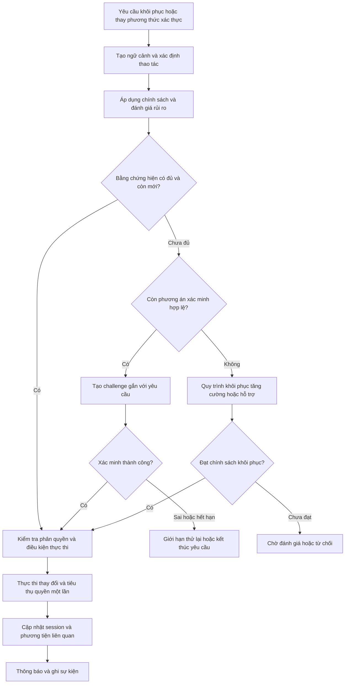

# Mục đích của step-up verification trong khôi phục tài khoản

Trong module `SECURITY_AUTHENTICATION_ACCOUNT_RECOVERY`, step-up verification là điểm kiểm soát trước khi hệ thống cho phép thực hiện một thao tác có thể thay đổi quyền kiểm soát tài khoản. Hệ thống yêu cầu bằng chứng phù hợp với mức nhạy cảm của thao tác, thay vì coi việc có session, mở được email hoặc vượt qua một bước khôi phục là đủ để làm mọi việc tiếp theo.

Chủ đề này thuộc chương **Step Up Verification**, tập trung vào câu hỏi: **Vì sao cần tăng yêu cầu xác minh trong luồng khôi phục, và kết quả xác minh đó được phép mở khóa điều gì?** Từ câu hỏi này, người học có thể thiết kế việc khôi phục mật khẩu, MFA, passkey hoặc thiết bị xác thực mà vẫn kiểm soát nguy cơ chiếm đoạt tài khoản.

## 1. Hiểu đúng về step-up

Theo cách dùng của NIST, step-up authentication có thể nâng mức bảo đảm xác thực của một session đã được xác thực khi thao tác tiếp theo yêu cầu mức cao hơn. [NIST SP 800-63B-4 — Introduction](https://pages.nist.gov/800-63-4/sp800-63b/introduction/)

Trong thiết kế sản phẩm, cụm từ **step-up verification** đôi khi còn được dùng rộng hơn để chỉ việc yêu cầu bằng chứng bổ sung, bằng chứng mới hơn hoặc xác nhận cho một thao tác cụ thể. Vì vậy, phải ghi rõ hệ thống đang nâng **độ mạnh của xác thực**, làm mới **thời điểm xác thực**, hay xác minh **quyền thực hiện một hành động**. Ba kết quả này có thể liên quan nhưng không đồng nhất.

| Khái niệm | Câu hỏi cần trả lời | Ví dụ trong khôi phục tài khoản |
| --- | --- | --- |
| Authentication — xác thực | Người gửi yêu cầu có kiểm soát phương tiện xác thực gắn với tài khoản không? | Xác thực bằng mật khẩu hoặc passkey còn sử dụng được. |
| Reauthentication — xác thực lại | Có bằng chứng xác thực đủ mới cho thời điểm hiện tại không? | Yêu cầu dùng lại khóa bảo mật đã đăng ký trước khi thay MFA. |
| Step-up authentication — nâng mức xác thực | Mức xác thực hiện có có đáp ứng yêu cầu cao hơn không? | Bổ sung yếu tố phù hợp khi session hiện tại chỉ được xác thực bằng mật khẩu. |
| Account recovery — khôi phục tài khoản | Khi mất phương tiện xác thực cần thiết, có quy trình hợp lệ nào để lấy lại quyền kiểm soát không? | Dùng bằng chứng khôi phục đã chuẩn bị trước theo chính sách của tài khoản. |
| Authorization — phân quyền | Chủ thể đã xác minh có được thực hiện đúng thao tác trên đúng tài khoản không? | Cho phép thay MFA của chính tài khoản đó, không cho sửa tài khoản người khác. |

Nhập lại cùng một mật khẩu có thể làm mới thời điểm xác thực nhưng không tự tạo thêm một yếu tố độc lập. Tương tự, dùng hai mã gửi vào cùng hộp thư không tự biến hộp thư đó thành hai yếu tố.

Một passkey có thể cung cấp xác thực mạnh, nhưng mức bảo đảm thực tế phụ thuộc vào đặc tính authenticator và cách verifier kiểm tra giao thức. Không gắn nhãn AAL2 hoặc AAL3 chỉ vì giao diện hiển thị chữ “passkey”, “MFA” hay “đã xác minh”.

## 2. Vì sao khôi phục tài khoản cần điểm kiểm soát này?

Luồng khôi phục cho phép thay đổi những thứ quyết định ai sẽ đăng nhập được trong tương lai:

- Đặt mật khẩu mới.
- Xóa MFA đang dùng và đăng ký MFA khác.
- Thêm hoặc thay passkey.
- Đổi địa chỉ nhận mã khôi phục.
- Phát hành lại recovery code.
- Hủy các session hoặc thiết bị đã được tin cậy.

Đây là các thao tác có ảnh hưởng kéo dài. Một kẻ tấn công chỉ có quyền truy cập tạm thời vào hộp thư hoặc trình duyệt có thể tìm cách chuyển quyền truy cập tạm thời đó thành quyền kiểm soát lâu dài.

Ví dụ, người dùng quên đăng xuất trên máy dùng chung. Session vẫn còn hiệu lực. Nếu API thay MFA chỉ kiểm tra “đã đăng nhập”, người ngồi vào máy sau có thể đăng ký MFA của họ và khóa chủ tài khoản ra ngoài. Step-up tạo thêm một điểm kiểm tra trước thay đổi này. OWASP khuyến nghị xác thực lại trước các thay đổi nhạy cảm và sau các sự kiện rủi ro, trong đó có khôi phục tài khoản. [OWASP Authentication Cheat Sheet](https://cheatsheetseries.owasp.org/cheatsheets/Authentication_Cheat_Sheet.html#reauthentication-after-risk-events)

Thiết kế cần xét cả chuỗi:

```text
Quyền truy cập ban đầu
    -> Bằng chứng được chấp nhận
    -> Thao tác thay đổi cơ chế đăng nhập
    -> Quyền truy cập sau thay đổi
```

Nếu bất kỳ bước nào cho phép vượt qua yêu cầu của bước sau, việc bổ sung một màn hình nhập mã vẫn không bảo vệ được tài khoản.

## 3. Những mục đích cần đạt

### 3.1. Ngăn sử dụng session bị đánh cắp để thay quyền kiểm soát

Session chứng minh một lần xác thực đã diễn ra trong quá khứ. Người đang sử dụng session có thể đã thay đổi.

Step-up yêu cầu bằng chứng mới ở ranh giới thao tác nhạy cảm. Một session đủ để xem phần tài khoản thông thường chưa chắc đủ để thay phương thức xác thực.

### 3.2. Giới hạn thiệt hại khi một kênh khôi phục bị lộ

Nếu kẻ tấn công chiếm được email, việc gửi thêm mã vào chính email đó không tạo ra một nguồn tin cậy độc lập.

Điểm kiểm soát phải đánh giá bằng chứng đó cho phép làm gì. Một bằng chứng có thể chỉ đủ để tiếp tục quy trình, chưa đủ để xóa mọi MFA hoặc tạo session đầy đủ quyền.

### 3.3. Buộc xác minh sát với thao tác thực tế

Một lần xác minh thành công không nên mở khóa vô hạn mọi thay đổi bảo mật.

Ví dụ, người dùng xác minh để **thay MFA A**. Kết quả đó phải gắn với yêu cầu thay MFA A, không được sử dụng lại để đổi email khôi phục, xuất dữ liệu hoặc sửa MFA của tài khoản B.

### 3.4. Duy trì khả năng khôi phục cho chủ tài khoản

Yêu cầu người dùng nhập OTP từ chiếc điện thoại đã mất sẽ tạo vòng lặp không thể hoàn thành.

Mục đích của step-up không phải luôn yêu cầu thêm một mã. Mục đích là đạt được mức tin cậy cần thiết bằng một phương án hợp lệ mà người dùng còn có thể thực hiện. Nếu không có bằng chứng phù hợp, hệ thống phải có trạng thái chờ hoặc quy trình hỗ trợ được kiểm soát.

### 3.5. Làm rõ cơ sở của quyết định bảo mật

Hệ thống cần giải thích được:

- Vì sao thao tác này cần xác minh bổ sung.
- Loại bằng chứng nào đã được chấp nhận.
- Chính sách nào áp dụng tại thời điểm ra quyết định.
- Kết quả được sử dụng cho yêu cầu nào và vào lúc nào.

Thông tin này phục vụ điều tra sự cố và vận hành. Không ghi bí mật xác thực vào nhật ký để đạt mục tiêu truy vết.

## 4. Khi nào nên yêu cầu step-up?

Bảng dưới đây là các tình huống thiết kế minh họa. Cách xử lý cuối cùng phụ thuộc vào mô hình đe dọa và yêu cầu bảo đảm của dịch vụ.

| Tình huống | Vấn đề cần kiểm soát | Hướng xử lý |
| --- | --- | --- |
| Session cũ yêu cầu thay MFA | Session có thể đã rơi vào tay người khác. | Yêu cầu bằng chứng đủ mới và phù hợp trước khi thay đổi. |
| Người dùng vừa đặt lại mật khẩu | Việc thay mật khẩu không tự chứng minh người dùng đang kiểm soát MFA cũ. | Giữ yêu cầu riêng cho việc thay hoặc xóa MFA. |
| Mất passkey trên một thiết bị nhưng còn khóa bảo mật dự phòng | Người dùng có thể vẫn xác thực được bằng phương tiện đã gắn trước đó. | Dùng phương tiện còn lại nếu đáp ứng chính sách của thao tác. |
| Thay toàn bộ phương thức xác thực từ thiết bị mới | Có khả năng đang xảy ra chiếm đoạt tài khoản. | Đánh giá rủi ro và yêu cầu tổ hợp bằng chứng phù hợp. |
| Email khôi phục vừa được thay đổi rồi có yêu cầu xóa MFA | Có thể là một chuỗi thay đổi do kẻ tấn công thực hiện. | Không tự coi kênh vừa đổi là nguồn xác minh đủ tin cậy cho bước kế tiếp. |
| Người dùng mất tất cả phương tiện xác thực | Không thể thực hiện step-up thông thường. | Chuyển sang quy trình khôi phục được định nghĩa trước. |

Cần phân biệt **yêu cầu bắt buộc theo thao tác** và **yêu cầu phát sinh do rủi ro**. Ví dụ, hệ thống có thể luôn yêu cầu xác minh mới khi thay MFA, rồi tăng thêm kiểm soát nếu nhận thấy thiết bị mới và nhiều lần thử thất bại.

Không dùng điểm rủi ro thấp để bỏ qua một yêu cầu bảo mật vốn bắt buộc cho thao tác đó.

## 5. Chọn bằng chứng dựa trên điều người dùng còn kiểm soát

### 5.1. Còn phương tiện xác thực đã đăng ký

Ưu tiên đánh giá các phương tiện đã gắn với tài khoản trước khi sự kiện khôi phục bắt đầu, chẳng hạn một khóa bảo mật khác hoặc một authenticator còn hoạt động.

Việc một phương tiện còn sử dụng được không đồng nghĩa nó luôn đủ mạnh cho mọi hành động. Backend vẫn phải kiểm tra đặc tính và chính sách của phương tiện đó.

OWASP xem thay yếu tố MFA là hành động có rủi ro cao, đồng thời cảnh báo không nên chỉ dựa vào session đang hoạt động để cho phép thay đổi. [OWASP Multifactor Authentication Cheat Sheet — Changing MFA Factors](https://cheatsheetseries.owasp.org/cheatsheets/Multifactor_Authentication_Cheat_Sheet.html#changing-mfa-factors)

### 5.2. Mất phương tiện chính nhưng còn bằng chứng khôi phục

Recovery code đã lưu, kênh khôi phục đã thiết lập hoặc quy trình xác minh lại danh tính có thể tham gia vào một phương án khôi phục. Tổ hợp được chấp nhận phải đáp ứng chính sách dành cho tài khoản.

NIST phân biệt khôi phục với xác thực thông thường, và đặt yêu cầu theo khả năng xác thực cùng lịch sử chứng minh danh tính của tài khoản. Không thể suy ra rằng một recovery code đơn lẻ luôn đủ để khôi phục mọi tài khoản. [NIST SP 800-63B-4 — Account Recovery](https://pages.nist.gov/800-63-4/sp800-63b/events/#account-recovery)

Recovery code là bí mật cho phép người nắm giữ thực hiện chức năng đã định. Độ mạnh của quy trình phụ thuộc cả cách cấp mã, lưu mã, sử dụng mã, tổ hợp bằng chứng và quyền được cấp sau đó.

### 5.3. Không còn bằng chứng đủ điều kiện

Cần có đường xử lý rõ ràng, ví dụ:

- Chờ đánh giá theo quy trình hỗ trợ có ghi nhận và phân quyền.
- Thực hiện lại phần chứng minh danh tính phù hợp nếu tài khoản đã có nền tảng đối chiếu danh tính tương ứng.
- Từ chối khôi phục tự động khi không thể đạt yêu cầu bảo đảm.

Không mặc định yêu cầu giấy tờ tùy thân cho mọi dịch vụ. Với một tài khoản bí danh chưa từng được đối chiếu với danh tính thật, việc người yêu cầu gửi ảnh giấy tờ không tự chứng minh họ là chủ tài khoản đó.

Nhân viên hỗ trợ cũng không được bỏ qua chính sách chỉ vì người gọi biết tên, ngày sinh, địa chỉ hoặc đang gây áp lực cần xử lý gấp.

### 5.4. Tránh tự tạo bằng chứng cho chính yêu cầu đang xét

Giả sử hệ thống cho phép:

1. Dùng session cũ để thêm số điện thoại mới.
2. Gửi OTP vào số mới.
3. Dùng OTP đó để xóa MFA cũ.

Chuỗi này cho phép người kiểm soát session tự tạo điều kiện xác minh cho chính họ. OTP chỉ chứng minh họ đang kiểm soát số vừa thêm.

Để chặn chuỗi này, chính sách phải xét **nguồn gốc và thời điểm thiết lập bằng chứng**, đồng thời kiểm soát ngay bước thêm phương tiện mới. Không thể chờ đến bước xóa MFA mới xử lý rủi ro.

## 6. Tín hiệu rủi ro giúp chọn kiểm soát, không thay thế bằng chứng

| Tín hiệu | Giá trị sử dụng | Giới hạn |
| --- | --- | --- |
| Thiết bị hoặc trình duyệt mới | Giúp phát hiện thay đổi môi trường truy cập. | Người dùng hợp lệ có thể vừa thay máy. |
| IP hoặc vị trí bất thường | Gợi ý nhu cầu đánh giá thêm. | VPN, mạng di động và sai số định vị có thể tạo cảnh báo giả. |
| Nhiều lần nhập sai hoặc tạo challenge | Gợi ý dò mã hoặc tự động hóa. | Cũng có thể xuất phát từ thao tác nhầm của người dùng. |
| Vừa đổi email, số điện thoại hoặc MFA | Giúp nhận ra chuỗi thay đổi quyền kiểm soát. | Cần biết thay đổi trước đó được xác minh ra sao. |
| Session lâu chưa xác thực lại | Cho biết bằng chứng hiện tại đã cũ. | Hoạt động liên tục không chứng minh chủ tài khoản vẫn là người đang thao tác. |
| Thông tin về sự cố chiếm đoạt | Giúp lựa chọn chế độ khôi phục nghiêm ngặt hơn. | Phải xác định độ tin cậy và nguồn của thông tin. |

Một địa chỉ IP quen thuộc không phải yếu tố xác thực. Cookie “thiết bị tin cậy” cũng không tự chứng minh chủ tài khoản đang có mặt.

Khi thiếu dữ liệu hoặc dịch vụ đánh giá rủi ro gặp lỗi, thao tác nhạy cảm cần đi theo nhánh an toàn đã định: yêu cầu bằng chứng đủ điều kiện, chờ xử lý hoặc từ chối tạm thời. Không mặc định coi “không đánh giá được” là “rủi ro thấp”.

## 7. Vị trí của step-up trong luồng khôi phục



Các điểm cần hiểu trong sơ đồ:

- **Ngữ cảnh** chứa tài khoản đích, thao tác, yêu cầu và phiên thực hiện; backend kiểm soát các liên kết này.
- **Challenge** là một yêu cầu chứng minh, không phải kết quả đã được chấp thuận.
- **Quyền một lần** chỉ cho phép thao tác đã xác minh, trong khoảng thời gian đã định.
- **Nhánh hỗ trợ** vẫn phải đạt chính sách khôi phục trước khi được đi tiếp.
- **Phân quyền** được kiểm tra cả khi xác minh thành công; không lấy việc vượt challenge để thay cho kiểm tra quyền.

Nếu khôi phục bắt đầu khi chưa đăng nhập, hệ thống có thể dùng một **recovery context** giới hạn quyền. Ngữ cảnh này phục vụ theo dõi quy trình, không phải session đầy đủ quyền và không cho phép đọc dữ liệu riêng tư tùy ý.

## 8. Ví dụ: mất điện thoại chứa ứng dụng MFA

Giả sử một dịch vụ quản lý tài liệu cá nhân có các điều kiện sau:

- Tài khoản đăng nhập thường ngày bằng mật khẩu và TOTP.
- Người dùng đã lưu recovery code trước khi mất điện thoại.
- Người dùng còn nhớ mật khẩu.
- Chính sách khôi phục của ví dụ chấp nhận mật khẩu hợp lệ kết hợp recovery code đã cấp trước để mở bước thay TOTP.
- Tài khoản không đang nằm trong diện nghi ngờ chiếm đoạt cần xử lý riêng.

Đây là chính sách minh họa cho một dịch vụ cụ thể, không phải công thức áp dụng cho mọi tài khoản hoặc cam kết tuân thủ một mức AAL.

Luồng xử lý có thể là:

1. Người dùng chọn “Tôi không còn dùng được ứng dụng xác thực”.
2. Backend tạo recovery context chỉ có quyền tiếp tục quy trình.
3. Backend xác minh mật khẩu và recovery code theo chính sách.
4. Khi mã hợp lệ, backend đánh dấu mã đã sử dụng bằng thao tác nguyên tử và ghi nhận kết quả cho đúng yêu cầu. Mã đó không tiếp tục được dùng ở yêu cầu khác.
5. Hệ thống cho phép thiết lập TOTP mới trong yêu cầu hiện tại. Việc nhập mã TOTP mới chứng minh thiết lập hoạt động; căn cứ cho phép thay MFA vẫn là bằng chứng ở bước 3.
6. Backend hoàn tất thay thế theo chính sách, cập nhật trạng thái session và các thông tin liên quan.
7. Người dùng đăng nhập lại bằng phương thức mới trước khi dùng chức năng thông thường.
8. Hệ thống thông báo sự kiện qua các kênh đã xác lập phù hợp và hướng dẫn phản hồi khi có thay đổi trái phép.

Nếu bước thiết lập mới bị gián đoạn sau khi recovery code đã bị tiêu thụ, hệ thống phải có quy tắc tiếp tục yêu cầu bằng ngữ cảnh còn hiệu lực hoặc bắt đầu lại với bằng chứng hợp lệ khác. Không khôi phục mã cũ thành trạng thái chưa dùng chỉ để tiện thử lại.

Hai điều cần tránh trong ví dụ:

- Bỏ yêu cầu TOTP ngay sau khi đặt lại mật khẩu rồi cấp session đầy đủ quyền.
- Dùng mã TOTP vừa được người yêu cầu thiết lập làm bằng chứng duy nhất để cho phép loại bỏ TOTP trước đó.

## 9. Kết quả xác minh cần gắn với điều gì?

Một kết quả xác minh phục vụ thay MFA có thể được mô hình hóa bằng bản ghi phía server như sau:

```json
{
  "grantId": "opaque-random-reference",
  "subjectId": "account-123",
  "contextId": "recovery-context-456",
  "requestId": "request-789",
  "action": "REPLACE_TOTP",
  "targetAuthenticatorId": "totp-existing",
  "actionDigest": "digest-of-canonical-action-data",
  "verifiedAt": "2026-11-23T03:00:00Z",
  "expiresAt": "2026-11-23T03:05:00Z",
  "evidenceRef": "server-side-evidence-record",
  "policyVersion": "recovery-policy-v7",
  "status": "AVAILABLE"
}
```

Các định danh, mốc thời gian và thời hạn năm phút chỉ là dữ liệu minh họa. Thời hạn thực tế cần được chọn theo mức nhạy cảm, cách xác minh và điều kiện vận hành.

| Thuộc tính | Mục đích |
| --- | --- |
| `subjectId` | Ngăn dùng kết quả của tài khoản này cho tài khoản khác. |
| `contextId` | Gắn với recovery context hoặc session đã được backend xác nhận. |
| `requestId`, `action` | Giới hạn kết quả vào một yêu cầu và loại thao tác. |
| `targetAuthenticatorId` | Xác định phương tiện cũ được phép thay. |
| `actionDigest` | Phát hiện dữ liệu thao tác thay đổi sau khi xác minh. |
| `verifiedAt`, `expiresAt` | Giới hạn độ mới và thời gian sử dụng kết quả. |
| `evidenceRef`, `policyVersion` | Cho phép kiểm tra lại căn cứ quyết định mà không đưa bí mật vào grant. |
| `status` | Hỗ trợ tiêu thụ một lần và chống xử lý đồng thời. |

Nếu dữ liệu của thao tác thay đổi sau khi xác minh, backend phải đánh giá lại phần ràng buộc liên quan. Không để client tự gửi `verified=true`, `assurance=high` hoặc `subjectId` rồi coi đó là kết luận bảo mật.

Nếu dùng token có chữ ký thay cho tham chiếu ngẫu nhiên, chữ ký chỉ giúp kiểm tra nguồn phát hành và tính toàn vẹn. Backend vẫn cần cơ chế ngăn sử dụng lại, kiểm tra thu hồi và kiểm tra trạng thái hiện tại.

## 10. Thực thi tại backend trước khi thay đổi tài khoản

Đoạn mã giả dưới đây minh họa điểm đặt kiểm soát. Các hàm đại diện cho nghiệp vụ phía server; đây không phải mã triển khai hoàn chỉnh.

```text
completeSensitiveRecovery(serverContext, requestId, grantReference):
    requireValidContext(serverContext)
    enforceRequestIntegrity(serverContext)
    enforceAbuseLimits(serverContext, requestId)

    transaction:
        request = loadAndLockRequest(requestId)
        account = loadAndLockAccount(request.subjectId)
        grant = loadAndLockGrant(grantReference)

        requireContextOwnsRequest(serverContext, request)
        requireActionIsAuthorized(serverContext, account, request)
        requireGrantMatches(grant, account, serverContext, request)
        requireAvailableAndUnexpired(grant, serverTime())
        requireActionDataUnchanged(grant, request)
        requireCurrentPolicyStillSatisfied(account, request, grant)

        applyApprovedChange(account, request)
        consumeGrant(grant)
        markRequestCompleted(request)
        updateSessionRevocationState(account, request)
        enqueueAuditAndNotificationEvents(account, request)

    return limitedCompletionResult()
```

Mục tiêu của cấu trúc này là làm cho **kiểm tra, thay đổi và tiêu thụ quyền** trở thành một quyết định nhất quán. Nếu hai request đồng thời dùng cùng một grant, chỉ một request được thực hiện thay đổi.

Các sự kiện thông báo có thể được đưa vào outbox trong cùng giao dịch rồi gửi sau. Lỗi gửi email không được khiến thao tác đã hoàn tất bị thực hiện lần thứ hai. Với hệ thống nhiều dịch vụ, cần cơ chế duy trì tính nhất quán tương đương; không giả định một giao dịch cơ sở dữ liệu tự bao phủ mọi dịch vụ.

`enforceRequestIntegrity` bao gồm các kiểm soát phù hợp với giao thức, chẳng hạn bảo vệ CSRF cho endpoint thay đổi trạng thái dựa trên cookie. Việc vượt qua step-up không thay thế các kiểm soát này.

## 11. Phân biệt challenge, recovery token và quyền thực thi

Ba loại dữ liệu dễ bị sử dụng lẫn nhau:

- **Challenge** yêu cầu người dùng thực hiện một phép chứng minh.
- **Recovery token hoặc code** là bí mật hoặc tham chiếu phục vụ một bước khôi phục.
- **Grant thực thi** là kết quả đã được backend kiểm chứng, cho phép một thao tác trong phạm vi đã định.

Chúng không nhất thiết phải được triển khai bằng ba token riêng. Điều quan trọng là mô hình quyền phải tách bạch.

Ví dụ, mở được liên kết đặt lại mật khẩu không nên tự cho phép đổi cả email khôi phục và MFA. Phải xác định chính xác liên kết đó cấp quyền nào.

OWASP yêu cầu token đặt lại mật khẩu có tính ngẫu nhiên phù hợp, thời hạn và khả năng sử dụng một lần. [OWASP Forgot Password Cheat Sheet](https://cheatsheetseries.owasp.org/cheatsheets/Forgot_Password_Cheat_Sheet.html)

Trong thiết kế minh họa của bài:

- Token ngẫu nhiên có entropy cao được đối chiếu qua giá trị dẫn xuất phù hợp, thay vì lưu bản rõ để tra cứu.
- Mã ngắn phải có giới hạn thử, thời hạn và bảo vệ dữ liệu lưu trữ phù hợp; một phép băm đơn thuần không làm mã ngắn khó đoán khi dữ liệu bị lộ.
- Không ghi token, OTP, recovery code, session cookie hoặc khóa bí mật vào log.
- Không đưa bí mật vào URL của trang có tài nguyên bên thứ ba dễ làm lộ qua lịch sử, log hoặc referrer.
- `verifiedAt` phản ánh lần xác minh thật; hoạt động tiếp tục trên trang không tự làm mới thời điểm này.

Một challenge dùng WebAuthn cần được verifier kiểm tra theo giao thức, bao gồm các ràng buộc cần thiết về challenge, RP và origin. Không coi chuỗi phản hồi bất kỳ là bằng chứng hợp lệ chỉ vì request đến từ trang của hệ thống.

## 12. Step-up phải đi cùng kiểm soát session

Cần thiết kế riêng quyền trong lúc khôi phục và quyền sau khi khôi phục.

### Trong quá trình khôi phục

Recovery context chỉ được tiếp cận những API cần cho quy trình. Không cấp quyền quản trị, xem toàn bộ dữ liệu hay thay đổi các kênh khôi phục khác chỉ vì người dùng đã vượt một bước.

Gắn context với yêu cầu bằng cơ chế do backend quản lý. IP và dấu vân tay thiết bị có thể hỗ trợ phát hiện rủi ro, nhưng không đủ để thay cho liên kết bảo mật này.

### Sau một thay đổi bảo mật thông thường

Áp dụng chính sách cập nhật session phù hợp với thay đổi vừa thực hiện. Khi cấp session sau một ranh giới xác thực hoặc thay đổi quyền, cần đổi định danh hoặc bí mật session để tránh tiếp tục sử dụng trạng thái cũ không phù hợp.

Một lần xác minh cho thao tác thay MFA không được tự mở khóa mọi chức năng khác của tài khoản.

### Sau khôi phục có nghi ngờ chiếm đoạt

Cần xử lý cả quyền truy cập mà kẻ tấn công có thể đang giữ: session khác, refresh token, phương tiện xác thực bị lộ và yêu cầu khôi phục còn hiệu lực.

Với access token tự chứa, chỉ thu hồi refresh token chưa chắc chặn ngay access token đã phát hành. Kiến trúc cần một cơ chế phù hợp như kiểm tra phiên bản session, kiểm tra trạng thái phía server hoặc thời hạn token đi kèm cửa sổ rủi ro được chấp nhận.

Không tự cấp session thông thường chỉ dựa trên việc đổi mật khẩu thành công. Một thiết kế dễ kiểm soát là kết thúc context khôi phục và yêu cầu đăng nhập bằng cấu hình xác thực mới.

## 13. Chống lạm dụng và hỗ trợ người dùng hợp lệ

Mỗi điểm xác minh bổ sung cũng tạo thêm một bề mặt có thể bị lạm dụng.

| Rủi ro | Kiểm soát cần cân nhắc |
| --- | --- |
| Dò OTP hoặc recovery code | Giới hạn thử theo tài khoản, yêu cầu và tín hiệu nguồn; theo dõi hành vi phân tán. |
| Tạo liên tục challenge để gửi email hoặc SMS | Giới hạn tần suất gửi, thời gian chờ gửi lại và ngân sách chống lạm dụng. |
| Gửi nhiều push làm người dùng bấm chấp thuận | Hạn chế yêu cầu, trình bày rõ ngữ cảnh và có đường báo cáo yêu cầu lạ. |
| Dùng yêu cầu khôi phục để khóa người khác | Không khóa đăng nhập toàn tài khoản chỉ vì có yêu cầu chưa được xác minh. |
| Dò xem tài khoản có tồn tại | Trả thông báo phù hợp ở điểm vào công khai, tránh khác biệt dễ quan sát về nội dung và thời gian. |
| Lừa nhân viên hỗ trợ bỏ qua kiểm soát | Dùng quy trình có tiêu chí, phân quyền, nhật ký và phê duyệt tương ứng với mức rủi ro. |
| Dùng lỗi hệ thống để đi vào phương án yếu hơn | Định nghĩa trước hành vi khi dịch vụ xác minh gặp lỗi; giữ nguyên yêu cầu bảo đảm. |

Giới hạn thử cho một challenge không tự giải quyết việc kẻ tấn công tạo challenge mới. Cần phối hợp giới hạn ở nhiều cấp, đồng thời tránh để người ngoài dễ gây từ chối dịch vụ cho chủ tài khoản.

Ở giao diện, nên:

- Nêu rõ thao tác đang cần xác minh, ví dụ “Xác minh để thay ứng dụng xác thực”.
- Chỉ hiển thị phương án mà người dùng có thể lựa chọn một cách an toàn.
- Cung cấp lựa chọn “Tôi không còn dùng được phương thức này”.
- Cho biết khi yêu cầu hết hạn và cách bắt đầu lại.
- Tránh tiết lộ danh sách chi tiết phương tiện hoặc thông tin liên hệ trước khi đủ điều kiện.
- Có đường hỗ trợ người khuyết tật hoặc người mất thiết bị mà vẫn giữ yêu cầu bằng chứng.

Thời gian chờ có thể giúp phát hiện và phản hồi thay đổi lạ. Tuy nhiên, chỉ chờ đủ lâu không làm cho một bằng chứng không hợp lệ trở thành hợp lệ.

## 14. Quan sát hiệu quả của điểm kiểm soát

Đánh giá step-up cần xem đồng thời mức bảo vệ và khả năng hoàn thành của người dùng.

| Chỉ số | Cách đọc |
| --- | --- |
| Tỷ lệ yêu cầu nhạy cảm cần step-up | Số yêu cầu được yêu cầu step-up chia cho tổng yêu cầu nhạy cảm trong cùng nhóm. |
| Tỷ lệ hoàn thành challenge | Số challenge hoàn thành chia cho số challenge đã bắt đầu; phân nhóm theo phương thức và nguyên nhân lỗi. |
| Tỷ lệ bỏ dở | Số quy trình dừng trước khi hoàn tất chia cho số quy trình bắt đầu trong một cửa sổ quan sát đã định. |
| Tỷ lệ phải chuyển hỗ trợ | Cho biết khoảng trống giữa phương án tự phục vụ và bằng chứng người dùng thực sự còn giữ. |
| Số lần dùng lại grant bị chặn | Gợi ý lỗi client, request đồng thời hoặc hành vi lạm dụng. |
| Sự kiện thay đổi bị chủ tài khoản báo cáo | Cần đối chiếu với các ca đã điều tra để đánh giá nguy cơ chiếm đoạt. |

Tỷ lệ vượt challenge cao không tự chứng minh hệ thống an toàn. Phương án quá yếu có thể khiến cả người dùng và kẻ tấn công đều hoàn thành dễ dàng.

Tỷ lệ thất bại cao cũng không tự chứng minh kiểm soát tốt. Có thể hệ thống đang yêu cầu bằng chứng mà phần lớn người dùng đã mất.

Nhật ký nên liên kết được yêu cầu, quyết định chính sách và kết quả thực thi bằng định danh không chứa bí mật. Tránh thu thập thêm dữ liệu nhạy cảm chỉ để tăng số lượng tín hiệu.

## 15. Những điều kiện thiết kế cần giữ

Một thiết kế đạt đúng mục đích của step-up cần duy trì các điều kiện sau:

1. Bằng chứng được chọn phù hợp với thao tác và tình trạng tài khoản.
2. Mất yếu tố xác thực có đường khôi phục được định nghĩa, không tự động dẫn đến bỏ yêu cầu bảo đảm.
3. Kết quả xác minh gắn với đúng tài khoản, ngữ cảnh, yêu cầu và dữ liệu thao tác.
4. Độ mới và thời hạn được backend kiểm tra tại thời điểm thực thi.
5. Quyền dùng một lần được tiêu thụ nhất quán với thay đổi tài khoản.
6. Backend kiểm tra phân quyền và chính sách hiện hành ngay cả khi challenge đã thành công.
7. Session và phương tiện liên quan được xử lý theo loại thay đổi và mức nghi ngờ chiếm đoạt.
8. Người dùng được thông báo và có khả năng phản hồi thay đổi trái phép.

Các mô hình dữ liệu, sơ đồ và mã giả trong bài là ví dụ thiết kế cho việc học. Khi áp dụng một tiêu chuẩn cụ thể, phải đối chiếu toàn bộ yêu cầu về authenticator, khôi phục và session của tiêu chuẩn đó; không suy ra mức tuân thủ chỉ từ việc có thêm bước nhập mã.
