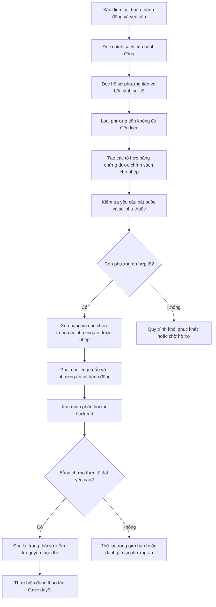

# Lựa chọn yếu tố xác minh bổ sung trong khôi phục tài khoản

**Step-up factor selection** là quá trình chọn phương tiện hoặc tổ hợp bằng chứng để xác minh người yêu cầu trước một thao tác nhạy cảm. Trong module `SECURITY_AUTHENTICATION_ACCOUNT_RECOVERY`, bài toán này xuất hiện khi người dùng mất mật khẩu, MFA, passkey hoặc thiết bị xác thực và muốn lấy lại quyền kiểm soát tài khoản.

Một lựa chọn tốt phải đáp ứng đồng thời ba điều kiện: phù hợp với thao tác, còn sử dụng được trong hoàn cảnh khôi phục và không dựa vào nguồn đã bị nghi ngờ chiếm đoạt. Việc chỉ hiển thị danh sách “email, SMS, TOTP, passkey” rồi cho chọn tùy ý chưa tạo thành chính sách lựa chọn an toàn.

Bài học tập trung vào cách xác định phương án đủ điều kiện, đánh giá sự phụ thuộc giữa các bằng chứng và xử lý trường hợp không còn yếu tố phù hợp.

## 1. Chọn một phương án xác minh, không chỉ chọn một công nghệ

Cần phân biệt các khái niệm trước khi lập danh sách lựa chọn:

| Khái niệm | Ý nghĩa | Ví dụ |
| --- | --- | --- |
| Yếu tố xác thực | Loại bằng chứng về điều người dùng biết, có hoặc là. | Mật khẩu; quyền sử dụng khóa mật mã; yếu tố sinh trắc học được kiểm tra theo cơ chế thích hợp. |
| Authenticator — phương tiện xác thực | Phương tiện thực hiện việc chứng minh một hay nhiều yếu tố. | Khóa bảo mật, ứng dụng OTP, authenticator tích hợp trong thiết bị. |
| Kênh truyền | Đường chuyển yêu cầu hoặc mã. | SMS, email, kết nối của ứng dụng xác thực. |
| Bằng chứng khôi phục | Bằng chứng được chấp nhận trong một quy trình lấy lại quyền kiểm soát. | Recovery code đã cấp trước hoặc kết quả xác minh lại danh tính theo quy trình. |
| Tín hiệu rủi ro | Thông tin hỗ trợ quyết định cần thêm kiểm soát nào. | Thiết bị mới, thay SIM, vị trí bất thường. |
| Phương án xác minh | Tổ hợp bằng chứng cùng các điều kiện sử dụng cho một hành động. | Mật khẩu được xác minh mới cùng TOTP từ authenticator còn an toàn. |

Một authenticator có thể thực hiện nhiều yếu tố. Ngược lại, hai màn hình nhập liệu có thể chỉ kiểm tra lại cùng một yếu tố hoặc cùng một nguồn quyền kiểm soát.

Ví dụ:

- Mật khẩu và một PIN khác cùng được server kiểm tra vẫn là hai bí mật thuộc nhóm “điều người dùng biết”.
- Một khóa mật mã được kích hoạt bằng PIN hoặc sinh trắc học có thể là authenticator nhiều yếu tố nếu cơ chế và kết quả xác minh đáp ứng yêu cầu.
- Một IP quen thuộc giúp đánh giá ngữ cảnh nhưng không thay thế yếu tố xác thực.

NIST yêu cầu hai yếu tố khác loại cho xác thực tại AAL2 và phân biệt rõ tín hiệu gian lận với yếu tố xác thực. Việc gắn nhãn AAL còn phụ thuộc toàn bộ quy trình, authenticator và verifier. [NIST SP 800-63B-4 — Authentication Assurance Levels](https://pages.nist.gov/800-63-4/sp800-63b/aal/)

## 2. Bắt đầu từ thao tác cần bảo vệ

Cùng một tài khoản có thể cần phương án khác nhau cho các hành động khác nhau.

| Hành động | Điều cần làm rõ trước khi chọn yếu tố |
| --- | --- |
| Đặt mật khẩu mới | Người dùng còn phương tiện xác thực nào khác? Token đặt lại mật khẩu cấp quyền đến đâu? |
| Thay TOTP bị mất | Có authenticator đã đăng ký khác hoặc tổ hợp bằng chứng khôi phục phù hợp không? |
| Xóa passkey | Có đang xóa phương tiện cuối cùng không? Có nghi ngờ khóa hoặc tài khoản đồng bộ bị chiếm đoạt không? |
| Thay email khôi phục | Kênh email hiện tại có còn tin cậy không? Kênh mới được xác nhận bằng quy trình nào? |
| Phát hành recovery code mới | Ai sẽ có khả năng khôi phục sau lần phát hành? Mã cũ được xử lý ra sao? |
| Khôi phục tài khoản có quyền quản trị | Có yêu cầu riêng về chống phishing, khóa thiết bị hoặc phê duyệt không? |

Một liên kết đặt lại mật khẩu có thể chỉ cho phép đặt mật khẩu. Không suy ra rằng người mở được liên kết đó cũng được thay mọi phương thức MFA.

Phương án phải gắn với **tài khoản đích, loại hành động và yêu cầu cụ thể**. Việc chọn phương án có thể xảy ra sớm trong luồng; quyết định chấp nhận bằng chứng phải được kiểm tra lại trước khi thực thi thay đổi.

## 3. Những đầu vào cần có

Backend cần tập hợp các nhóm dữ liệu sau trong phạm vi được phép xử lý:

1. **Yêu cầu bảo vệ:** độ nhạy cảm của hành động, mức xác thực cần đạt, yêu cầu chống phishing, độ mới của bằng chứng và phạm vi quyền sau xác minh.
2. **Danh mục phương tiện:** các authenticator và bằng chứng khôi phục đã gắn với tài khoản, trạng thái cùng lịch sử đăng ký liên quan.
3. **Bối cảnh sự cố:** người dùng khai báo mất gì, có dấu hiệu lộ mật khẩu, mất điện thoại, chiếm email hay chiếm tài khoản đồng bộ không.
4. **Khả năng sử dụng hiện tại:** phương tiện còn ở trong tay người dùng, trình duyệt hỗ trợ giao thức nào, có kết nối cần thiết hay không.
5. **Bằng chứng đã thu thập:** phương tiện nào đã được xác minh trong yêu cầu hiện tại, bằng cách nào và vào thời điểm nào.
6. **Ràng buộc vận hành:** giới hạn thử, thời hạn yêu cầu, tình trạng dịch vụ xác minh và đường hỗ trợ.

Không đồng nhất các trạng thái sau:

- **Đã đăng ký:** hệ thống có hồ sơ về phương tiện.
- **Có thể sử dụng:** phương tiện có khả năng thực hiện challenge hiện tại.
- **Đã được xác minh:** backend đã chấp nhận một phản hồi hợp lệ.
- **Đủ điều kiện cho hành động:** bằng chứng đã xác minh đáp ứng chính sách của thao tác.

Ví dụ, trình duyệt cho biết hỗ trợ WebAuthn chỉ chứng minh khả năng kỹ thuật. Nó chưa chứng minh có passkey phù hợp hoặc người dùng kiểm soát passkey đó.

Người dùng khai báo mất điện thoại có thể khiến phương tiện trên điện thoại không được đề xuất trong yêu cầu hiện tại. Một khai báo chưa được chứng thực không nên tự dẫn đến xóa hoặc thu hồi toàn bộ authenticator trên tài khoản, vì người ngoài có thể lạm dụng việc đó để khóa chủ tài khoản.

## 4. Lọc điều kiện bắt buộc trước khi xếp hạng

Lựa chọn có hai giai đoạn riêng.

### 4.1. Xác định phương án đủ điều kiện

Một phương án chỉ được xem xét nếu vượt qua các điều kiện bắt buộc tương ứng:

- Phương tiện đã được gắn với đúng tài khoản bằng quy trình được chấp nhận.
- Phương tiện chưa bị thu hồi, đình chỉ hoặc đánh dấu không được sử dụng trong tình huống hiện tại.
- Nguồn bằng chứng không thuộc phạm vi bị nghi ngờ chiếm đoạt mà chính sách yêu cầu loại trừ.
- Các đặc tính bảo mật đáp ứng yêu cầu của hành động.
- Tổ hợp bằng chứng đáp ứng các điều kiện về yếu tố và sự độc lập cần thiết.
- Có thể thực hiện việc xác minh trong môi trường hiện tại.
- Không sử dụng phương tiện mới được chính yêu cầu chưa xác minh này tạo ra để chứng minh quyền thực hiện yêu cầu đó.

Có những đặc tính chỉ biết chắc sau khi nhận phản hồi, chẳng hạn việc user verification thực sự diễn ra trong một lần xác thực WebAuthn. Với trường hợp đó, phương án được đề xuất kèm điều kiện; backend phải kiểm tra điều kiện khi xác minh phản hồi.

### 4.2. Xếp hạng trong các phương án đã đạt điều kiện

Sau khi lọc, có thể ưu tiên theo:

- Mức phù hợp với nguy cơ đang cần kiểm soát.
- Mức giảm phụ thuộc vào nguồn có khả năng đã bị lộ.
- Khả năng hoàn thành của người dùng.
- Khả năng tiếp cận đối với người khuyết tật.
- Số bước và thời gian xử lý.
- Độ ổn định của kênh hoặc dịch vụ.

Không cộng các tiêu chí này thành một tổng điểm để bù cho điều kiện bắt buộc bị thiếu. Một phương án dễ dùng không thể bù cho việc thiếu yêu cầu chống phishing.

Nếu không còn phương án đủ điều kiện, kết quả hợp lệ là chuyển sang quy trình khôi phục khác hoặc chờ xử lý. Không tự tạo một phương án yếu hơn để danh sách luôn có ít nhất một lựa chọn.

## 5. So sánh các phương tiện thường gặp

Bảng này hỗ trợ phân tích; không phải bảng chứng nhận mức AAL hay thứ hạng áp dụng cho mọi dịch vụ.

| Phương tiện hoặc bằng chứng | Có thể đóng góp điều gì? | Điểm cần xét khi lựa chọn |
| --- | --- | --- |
| Mật khẩu hiện tại | Bằng chứng về bí mật đã gắn với tài khoản; có thể bổ sung cho yếu tố sở hữu. | Không phù hợp để yêu cầu lại nếu đang quên mật khẩu; không dùng làm căn cứ tin cậy duy nhất khi nghi ngờ mật khẩu bị lộ. |
| Khóa bảo mật WebAuthn còn sử dụng được | Chứng minh quyền sử dụng khóa đã đăng ký qua giao thức ràng buộc với RP. | Kiểm tra có user verification hay chỉ user presence; không suy ra đặc tính chỉ từ hình dạng USB hoặc NFC. |
| Passkey đồng bộ | Có thể còn khả dụng trên thiết bị khác sau khi mất một thiết bị. | Xét nguy cơ đối với tài khoản đồng bộ, trạng thái xác minh người dùng và yêu cầu về khả năng xuất khóa. |
| TOTP từ authenticator khác | Có thể bổ sung bằng chứng sở hữu cho phương án phù hợp. | Mã có thể bị phishing theo thời gian thực; xét nơi lưu hoặc đồng bộ seed. |
| Push qua ứng dụng đã đăng ký | Có thể xác nhận quyền sử dụng ứng dụng hoặc thiết bị đã gắn. | Cần biết giao thức và cách kích hoạt; nút “Đồng ý” đơn thuần dễ bị lạm dụng bằng yêu cầu dồn dập. |
| SMS hoặc cuộc gọi tới số đã đăng ký | Có thể tham gia phương án được chính sách cho phép. | Xét chiếm số, thay SIM, tái cấp số và khả năng nhận mã. |
| Recovery code đã lưu | Bằng chứng khôi phục chuẩn bị từ trước. | Phải còn hiệu lực, chưa dùng và đáp ứng tổ hợp mà chính sách yêu cầu. |
| Mã khôi phục gửi tới địa chỉ đã thiết lập | Chứng minh quyền nhận mã tại kênh khôi phục tương ứng. | Phụ thuộc độ an toàn của kênh và lịch sử thay đổi địa chỉ. |
| Xác minh lại danh tính | Có thể hỗ trợ quy trình khôi phục dựa trên danh tính đã thiết lập. | Phải có cơ sở đối chiếu với tài khoản và quy trình phù hợp; ảnh giấy tờ bất kỳ không tự chứng minh quyền sở hữu tài khoản. |

OWASP nhấn mạnh rằng các yếu tố cần có tính độc lập và luồng thay MFA phải được bảo vệ tương xứng với nguy cơ chiếm đoạt tài khoản. [OWASP Multifactor Authentication Cheat Sheet](https://cheatsheetseries.owasp.org/cheatsheets/Multifactor_Authentication_Cheat_Sheet.html)

Cụm từ “backup code” trong giao diện chưa nói rõ đó là recovery code hay một loại authenticator dùng bí mật tra cứu. Mô hình backend phải phân loại theo quy trình cấp, kiểm tra và quyền được cấp sau khi dùng.

## 6. Đánh giá sự phụ thuộc giữa các bằng chứng

Đếm số phương thức chưa đủ để xác định một tổ hợp có giúp giảm rủi ro hay không.

Cần hỏi: **Một sự cố hoặc một nguồn quyền kiểm soát có thể làm lộ đồng thời những bằng chứng nào?**

| Tổ hợp minh họa | Sự phụ thuộc cần xem xét | Hệ quả đối với lựa chọn |
| --- | --- | --- |
| Hai mã gửi vào cùng một hộp thư | Cùng phụ thuộc quyền truy cập hộp thư. | Không coi là hai nguồn độc lập. |
| TOTP và SMS đều nằm trên điện thoại vừa mất | Cùng chịu ảnh hưởng từ sự cố mất thiết bị. | Không đề xuất nếu không còn khả năng sử dụng an toàn. |
| Mật khẩu và TOTP cùng lưu trong một kho đồng bộ đã bị nghi ngờ chiếm đoạt | Kẻ tấn công có thể lấy cả hai từ một nguồn. | Loại trừ hoặc yêu cầu bằng chứng ngoài phạm vi đó theo chính sách. |
| Hai passkey dùng chung một tài khoản đồng bộ | Có thể cùng chịu ảnh hưởng từ việc chiếm tài khoản đồng bộ. | Không tự coi hai credential ID là hai miền kiểm soát độc lập. |
| Khóa bảo mật dự phòng cất riêng và một phương tiện trên thiết bị bị mất | Có khả năng tách biệt về nơi giữ và nguồn quản lý. | Đánh giá khóa dự phòng theo đặc tính và lịch sử đăng ký thực tế. |

Hai loại yếu tố khác nhau vẫn có thể có rủi ro bị lộ cùng nhau. Ngược lại, việc cùng nằm trên một thiết bị không tự khiến mọi cơ chế MFA mất giá trị: ranh giới bảo vệ của authenticator và quy trình kích hoạt vẫn quan trọng.

Có thể mô hình hóa **miền kiểm soát** để phục vụ quyết định, ví dụ thiết bị, tài khoản đồng bộ, hộp thư hoặc nhà cung cấp quản lý số điện thoại. Đây là mô hình đánh giá rủi ro, không thay thế các loại yếu tố xác thực.

Không phải lúc nào server cũng biết người dùng lưu recovery code ở đâu hoặc các credential có dùng chung kho đồng bộ không. Khi dữ liệu không rõ, cần ghi nhận là chưa biết và áp dụng chính sách thận trọng tương ứng; không tự khẳng định sự độc lập từ tên phương thức.

## 7. Những điểm phải phân biệt khi chọn passkey hoặc khóa WebAuthn

### 7.1. User presence khác user verification

- **User presence — UP:** có tương tác với authenticator, chẳng hạn chạm vào khóa.
- **User verification — UV:** authenticator thực hiện xác minh cục bộ, chẳng hạn bằng PIN hoặc sinh trắc học.

Nếu phương án dựa vào UV, backend phải yêu cầu và kiểm tra kết quả phù hợp. Việc thiết bị “có hỗ trợ vân tay” không chứng minh lần xác thực hiện tại đã dùng UV.

WebAuthn Level 3 còn có trạng thái `uvInitialized` trong hồ sơ credential. Không tự coi lần đầu xuất hiện `UV=1` ở credential chưa có quan hệ UV tin cậy là yếu tố bổ sung đã được thiết lập. [W3C WebAuthn Level 3 — Credential Record](https://www.w3.org/TR/webauthn-3/#credential-record)

Thông tin người dùng nhập lên form như `usedBiometric=true` không có giá trị thay cho kết quả được verifier kiểm chứng.

### 7.2. Phương tiện đồng bộ và phương tiện gắn với thiết bị có đặc tính khác nhau

Passkey đồng bộ có lợi về khả năng sử dụng khi mất máy, nhưng cần đánh giá cả đường khôi phục của tài khoản đồng bộ.

NIST cho phép syncable authenticator hỗ trợ AAL2 khi đáp ứng yêu cầu liên quan; cơ chế đồng bộ xuất khóa không đáp ứng yêu cầu không xuất khóa của AAL3. Không gắn mức bảo đảm chỉ từ nhãn “passkey”. [NIST SP 800-63B-4 — Syncable Authenticators](https://pages.nist.gov/800-63-4/sp800-63b/syncable/)

Các cờ backup eligibility và backup state cung cấp thông tin về khả năng sao lưu và trạng thái sao lưu. Không dùng chúng để tự kết luận toàn bộ đặc tính phần cứng hoặc mức tuân thủ.

### 7.3. Năng lực được đăng ký khác kết quả của lần xác thực

Hồ sơ có thể cho biết authenticator hỗ trợ UV. Backend vẫn cần kiểm tra lần xác thực hiện tại, credential nào thực sự trả lời và credential đó thuộc tài khoản nào.

Một verifier WebAuthn phải xử lý đầy đủ các kiểm tra của giao thức như challenge, origin, RP ID, chữ ký và các điều kiện bắt buộc. Nên dùng thư viện server được duy trì thay vì chỉ tự kiểm tra một cờ. [OWASP Passkey Security Cheat Sheet](https://cheatsheetseries.owasp.org/cheatsheets/Passkey_Security_Cheat_Sheet.html#verify-the-authentication-response)

Trong lựa chọn yếu tố, đặc tính “có thể chống phishing” chỉ có ý nghĩa khi toàn bộ phép xác thực tương ứng được thực hiện đúng.

## 8. Email, SMS và OTP cần được đặt đúng vai trò

Một mã có thời hạn ngắn không tự là bằng chứng phù hợp cho mọi hành động.

Theo NIST, email không được dùng làm out-of-band authentication; mã xác nhận địa chỉ và issued recovery code qua email thuộc phạm vi khác. PSTN là cơ chế bị hạn chế, cần xét các tín hiệu như thay SIM hoặc chuyển số. OTP nhập thủ công không được xem là chống phishing. [NIST SP 800-63B-4 — Authenticator and Verifier Requirements](https://pages.nist.gov/800-63-4/sp800-63b/authenticators/)

Từ các phân biệt đó, thiết kế cần ghi rõ:

- Email đang được dùng để xác nhận địa chỉ, gửi mã khôi phục hay làm phương thức đăng nhập của sản phẩm.
- Tổ hợp có đủ điều kiện của **chính sách khôi phục** hay chỉ đủ để mở bước tiếp theo.
- Có bằng chứng nào khác đang phụ thuộc vào cùng hộp thư hoặc cùng số điện thoại.
- Tài khoản có đang trong tình huống nghi ngờ chiếm email hoặc chiếm số không.

Ví dụ, một mã gửi tới số vừa thay đổi bằng session cũ không nên trở thành căn cứ duy nhất để xóa MFA trước đó. Người kiểm soát session có thể đã tự thêm số của họ.

Khi chính sách của thao tác yêu cầu chống phishing, thay passkey bằng TOTP hoặc SMS vì “người dùng thấy dễ hơn” sẽ làm thay đổi điều kiện bảo vệ. Nếu cần có đường khôi phục riêng, phải định nghĩa đường đó cùng điều kiện, giới hạn quyền và trách nhiệm phê duyệt.

## 9. Khi mất yếu tố, chuyển đúng sang chính sách khôi phục

Step-up thông thường sử dụng phương tiện xác thực còn có thể đáp ứng yêu cầu. Khi không còn phương tiện cần thiết, hệ thống phải chọn **phương án khôi phục** được cho phép, thay vì tiếp tục yêu cầu yếu tố đã mất.

Ví dụ, NIST đặt các lựa chọn cho khôi phục tài khoản có khả năng xác thực tối đa tại AAL2: hai recovery code từ phương pháp khác nhau; một recovery code kết hợp authenticator một yếu tố đã gắn với tài khoản; hoặc xác minh lại danh tính khi tài khoản đã được chứng minh danh tính. Hai mã trong cùng một bộ mã đã lưu không tự trở thành hai phương pháp khác nhau. [NIST SP 800-63B-4 — Recovery at AAL2](https://pages.nist.gov/800-63-4/sp800-63b/events/#recovery-at-aal2)

Không áp dụng máy móc ví dụ này cho tài khoản có yêu cầu khác. Cũng không suy ra rằng hoàn thành khôi phục đồng nghĩa đã thực hiện một lần đăng nhập tại AAL tương ứng.

Đặc biệt, phương tiện vừa đăng ký trong luồng khôi phục có thể được kiểm tra để xác nhận nó hoạt động. Kết quả đó không tự tạo căn cứ cho phép khôi phục: người đang yêu cầu đã có thể tự tạo ra phương tiện mới ấy.

Một thời gian chờ hoặc thông báo ra kênh khác có thể hỗ trợ kiểm soát gian lận. Chúng không tự thay thế bằng chứng mà chính sách yêu cầu.

## 10. Mô hình hồ sơ để phục vụ lựa chọn

Ví dụ dưới đây là bản ghi minh họa về một credential đã có trên tài khoản:

```json
{
  "authenticatorId": "credential-42",
  "subjectId": "account-123",
  "kind": "WEBAUTHN",
  "state": "ACTIVE",
  "boundAt": "2026-09-18T08:00:00Z",
  "bindingEvidenceRef": "binding-event-17",
  "capabilities": {
    "userVerification": "SUPPORTED",
    "keyExportability": "UNKNOWN"
  },
  "lastObserved": {
    "userVerified": true,
    "backupEligible": true,
    "backupState": true
  },
  "uvTrustState": "ESTABLISHED",
  "controlDomainAssessment": "PARTIALLY_KNOWN",
  "compromiseAssessment": "NO_KNOWN_INDICATOR",
  "capabilityEvidenceRef": "credential-evidence-42"
}
```

Đây không phải schema tiêu chuẩn. Các tên trường chỉ thể hiện những thông tin hệ thống cần phân biệt.

Một số nguyên tắc sử dụng:

- `bindingEvidenceRef` trỏ tới căn cứ cho việc gắn credential; có ngày đăng ký chưa đủ để chứng minh việc đăng ký là hợp lệ.
- `lastObserved` là quan sát trước đây, không thay cho kết quả của challenge hiện tại.
- `UNKNOWN` phải được xử lý như chưa có bằng chứng về thuộc tính đó.
- `NO_KNOWN_INDICATOR` không có nghĩa phương tiện chắc chắn chưa bị lộ.
- Thông tin client cung cấp chỉ được sử dụng theo mức tin cậy tương ứng; không cho client tự quyết định `state`, độ mạnh hay quyền sở hữu.
- Bản ghi cần có khả năng thay đổi khi có thu hồi, báo mất đã được xác thực hoặc thông tin sự cố mới.

Đặc tính quan trọng như khóa không xuất được phải có căn cứ phù hợp với chính sách. Không suy ra đặc tính đó từ tên thiết bị, chuỗi user-agent hoặc nhãn do người dùng đặt.

## 11. Quy trình lựa chọn và thực thi



Mã giả cho phần lựa chọn:

```text
selectVerificationPlans(serverContext, request):
    requirements = policy.requirementsFor(request.action, request.subjectId)
    inventory = loadAuthenticatorInventory(request.subjectId)
    incident = loadIncidentContext(serverContext, request)

    candidates = filterByBindingStateAndIncident(inventory, incident)
    allowedRoutes = policy.routesFor(requirements, incident)
    plans = buildPlansFromAllowedRoutes(candidates, allowedRoutes)

    plans = keepOnlyPlansMeetingMandatoryConditions(
        plans,
        requirements,
        serverVerifiedEvidenceFor(request)
    )

    if plans.isEmpty():
        return policy.nextRecoveryState(requirements, incident)

    return rankEligiblePlans(plans, requirements, usabilityContext())
```

`buildPlansFromAllowedRoutes` tạo tổ hợp theo đường đã được chính sách định nghĩa. Nó không thử ghép bất kỳ hai thứ nào rồi coi là hai yếu tố.

Kết quả lựa chọn nên được lưu phía server và tham chiếu qua một `planId` khó đoán. Phương án có thể chứa:

- Tài khoản và hành động đích.
- Các credential hoặc loại bằng chứng được phép tham gia.
- Điều kiện chưa biết phải xác nhận khi nhận phản hồi.
- Phiên bản chính sách, thời hạn và ngữ cảnh yêu cầu.
- Phạm vi quyền tối đa nếu hoàn thành.

Khi nhận phản hồi, backend xác minh đúng loại bằng chứng đã chọn và đánh giá **kết quả thực tế**. Trước khi thực thi, cần đọc lại trạng thái liên quan để phát hiện credential vừa bị thu hồi, chính sách thay đổi hoặc tài khoản được đánh dấu nghi ngờ chiếm đoạt.

Không tin `method=passkey` hay `assurance=high` do client gửi. Một lựa chọn hợp lệ trên giao diện chưa phải bằng chứng xác thực.

## 12. Ví dụ lựa chọn với một tài khoản cụ thể

Giả sử tài khoản có các phương tiện trước khi phát sinh sự cố:

| Định danh minh họa | Phương tiện | Bối cảnh đã biết |
| --- | --- | --- |
| P | Mật khẩu | Chưa có chỉ báo bị lộ. |
| T | TOTP trên điện thoại | Có thể không còn dùng được nếu mất điện thoại. |
| K | Khóa bảo mật dự phòng | Đăng ký từ trước, có UV và lịch sử gắn hợp lệ. |
| S | Passkey đồng bộ | Có trên máy tính khác; mức an toàn còn phụ thuộc bối cảnh tài khoản đồng bộ. |
| R | Recovery code đã lưu | Chưa sử dụng, được cấp trước sự cố. |
| E | Email khôi phục | Đã thiết lập từ trước, có thể dùng cho đường khôi phục mà dịch vụ cho phép. |

Các quyết định sau là ví dụ cho chính sách của một dịch vụ; không phải quy tắc chung cho mọi hệ thống.

### Tình huống A: mất điện thoại, còn khóa dự phòng

Người dùng muốn thay TOTP. Backend loại T khỏi phương án của yêu cầu vì người dùng không còn sử dụng được điện thoại.

Nếu K đáp ứng yêu cầu của thao tác và kết quả UV được kiểm chứng, dịch vụ có thể ưu tiên K. Không bắt người dùng nhập TOTP từ thiết bị đã mất trước khi cho dùng K.

Việc sở hữu K còn phải được chứng minh bằng challenge mới, không dựa vào tên “khóa của tôi” trong danh sách.

### Tình huống B: quên mật khẩu, còn authenticator phù hợp

P không khả dụng. Nếu K hoặc S có thể thực hiện phép xác thực đáp ứng chính sách, không nên bắt người dùng chứng minh lại chính mật khẩu đang quên để sử dụng chúng.

Backend vẫn phải xét đặc tính thực tế và tình trạng an toàn của từng credential. “Còn passkey” chưa tự quyết định được kết quả.

### Tình huống C: nghi ngờ tài khoản đồng bộ bị chiếm đoạt

S bị loại khỏi những phương án yêu cầu bằng chứng ngoài miền nghi ngờ. Nếu R cũng được lưu trong chính tài khoản đồng bộ đó và điều này đã được xác định, R không tạo ra nguồn bằng chứng tách biệt như mong muốn.

K có thể là ứng viên nếu được giữ riêng và không có chỉ báo liên quan. Nếu không còn phương án đạt chính sách, chuyển sang đường khôi phục khác.

Không bù cho S bằng việc hỏi thêm hai câu bảo mật dễ suy ra từ thông tin công khai.

### Tình huống D: chỉ còn mật khẩu và recovery code

Dịch vụ có thể có đường khôi phục dùng P cùng R khi tổ hợp đó đáp ứng yêu cầu của tài khoản và không có chỉ báo làm mất hiệu lực của bằng chứng.

Đây là lựa chọn theo chính sách khôi phục, không phải lý do để coi R là mã TOTP hoặc tự nâng session hiện tại lên mọi quyền.

Sau khi R được sử dụng thành công, hệ thống phải ngăn dùng lại. Các bước sau chỉ được mở theo phạm vi yêu cầu đã được duyệt.

### Tình huống E: không còn bằng chứng phù hợp

Nếu người dùng không có P, T, K, S, R và không đủ điều kiện của đường khôi phục qua E, hệ thống không nên cho thêm một email mới rồi gửi mã vào đó để chứng minh quyền sở hữu.

Kết quả có thể là chờ xác minh theo quy trình hỗ trợ hoặc từ chối khôi phục tự động. Quy trình hỗ trợ phải có tiêu chí rõ; lời xác nhận của nhân viên không tự thay thế bằng chứng.

## 13. Kiểm soát việc chuyển phương án

Nút “Dùng cách khác” chỉ nên liệt kê những phương án backend đã cho phép cho yêu cầu hiện tại.

Ví dụ về lỗi cần tránh:

```text
Không dùng được passkey
    -> Chuyển sang SMS không xét chính sách
    -> Xóa toàn bộ MFA
```

Một người tấn công có thể chủ động làm phương án mạnh thất bại để được chuyển sang phương án yếu hơn.

Đường xử lý cần có các thuộc tính sau:

- Mỗi lần đổi phương án vẫn giữ nguyên yêu cầu bảo vệ của hành động hoặc chuyển sang một quy trình khôi phục riêng đã được phê duyệt.
- Giới hạn thử được áp dụng ở cấp tài khoản hoặc yêu cầu phù hợp, không chỉ ở challenge vừa tạo.
- Chuyển từ TOTP sang SMS không tự xóa lịch sử các lần thất bại.
- Mỗi challenge gắn với phương án, tài khoản và yêu cầu; không nhận mã đúng của một yêu cầu khác.
- Khi yêu cầu bị hủy, hoàn tất hoặc hết hạn, các quyền thực thi liên quan được xử lý nhất quán.
- Lỗi dịch vụ SMS, push hoặc xác minh danh tính không tự kích hoạt đường bỏ qua kiểm soát.

Với bằng chứng dùng một lần, cần tiêu thụ nhất quán với trạng thái của quy trình để chặn request đồng thời. Nếu người dùng bị gián đoạn sau một bước đã thành công, việc tiếp tục phải dựa trên ngữ cảnh còn hiệu lực do backend quản lý.

## 14. Thiết kế giao diện và đường hỗ trợ

Người dùng cần hiểu đang xác minh để làm gì, đồng thời có khả năng báo rằng phương tiện được đề xuất không còn dùng được.

Ví dụ thông báo:

> Xác minh để thay ứng dụng xác thực. Hãy dùng khóa bảo mật đã đăng ký hoặc chọn một phương án khôi phục được hỗ trợ.

Thông báo không cần giải thích thuật toán chấm rủi ro, loại cơ sở dữ liệu hay chi tiết nội bộ của policy engine.

Các lựa chọn hỗ trợ khả năng hoàn thành:

- Hiển thị phương án được khuyến nghị cùng các phương án khác đã đủ điều kiện.
- Có lựa chọn báo mất phương tiện và đường tiếp tục phù hợp.
- Hỗ trợ PIN khi phương tiện cho phép, thay vì buộc người dùng dùng sinh trắc học.
- Không mặc định mọi người đều nhận được SMS hoặc có điện thoại thông minh.
- Nêu rõ khi cần bắt đầu lại do hết hạn.
- Cho biết kênh hỗ trợ hợp lệ để tránh bị dẫn sang trang giả.

Trước khi đủ điều kiện xem thông tin tài khoản, không công khai toàn bộ danh sách authenticator, địa chỉ email hoặc số điện thoại. Việc che một phần địa chỉ vẫn có thể làm lộ thông tin nếu API cho phép truy vấn hàng loạt.

Nhân viên hỗ trợ cần thấy phương án nào được phép, bằng chứng nào còn thiếu và thẩm quyền của họ. Không cho phép bỏ kiểm soát bằng một ghi chú tự do như “đã gọi điện xác nhận”.

## 15. Quyền và session sau khi hoàn thành phương án

Lựa chọn đúng yếu tố chỉ có ý nghĩa nếu quyền được cấp sau đó được giới hạn phù hợp.

Một thiết kế có thể cho phép người dùng đã hoàn thành phương án khôi phục:

1. Thiết lập phương tiện thay thế trong đúng yêu cầu.
2. Xác nhận phương tiện mới hoạt động.
3. Hoàn tất cập nhật bảo mật theo chính sách.
4. Đăng nhập lại bằng cấu hình mới trước khi sử dụng chức năng thông thường.

Không mặc định cấp session đầy đủ chỉ vì đã nhập một recovery code hợp lệ. Cũng không giữ một cờ `stepUpPassed=true` vô thời hạn để mở khóa mọi thay đổi.

Khi có nghi ngờ chiếm đoạt, phải xét cả session, refresh token và phương tiện liên quan mà người tấn công có thể vẫn đang kiểm soát. Thông báo tới các kênh đã xác lập giúp chủ tài khoản phát hiện thay đổi trái phép, nhưng bản thân thông báo không phải bằng chứng xác minh.

## 16. Theo dõi chất lượng của việc lựa chọn

Cần quan sát vì sao phương án được đề xuất và người dùng thực sự hoàn thành bằng phương án nào.

| Thông tin quan sát | Giá trị đánh giá |
| --- | --- |
| Số yêu cầu không có phương án đủ điều kiện | Phát hiện thiếu phương tiện dự phòng hoặc chính sách không phù hợp với nhóm người dùng. |
| Tỷ lệ hoàn thành theo phương án đã đề xuất | So sánh khả năng sử dụng của các phương án trong cùng bối cảnh. |
| Tỷ lệ chuyển sang đường hỗ trợ | Đánh giá mức phụ thuộc vào xử lý thủ công. |
| Lý do loại phương tiện | Phân biệt mất thiết bị, bị thu hồi, không đủ đặc tính và lỗi dịch vụ. |
| Số lần chuyển phương án và lỗi giới hạn thử | Phát hiện vòng lặp giao diện hoặc hành vi tìm đường hạ yêu cầu. |
| Báo cáo thay đổi trái phép sau khôi phục | Đối chiếu với điều tra để đánh giá nguy cơ chiếm đoạt còn lại. |

Không ghi giá trị mật khẩu, OTP, recovery code, khóa riêng hoặc session cookie để phục vụ thống kê. Chỉ lưu tham chiếu sự kiện, loại bằng chứng và kết quả theo chính sách bảo vệ dữ liệu.

Một hồ sơ quyết định hữu ích cần chỉ ra được **thao tác**, **yêu cầu bắt buộc**, **tổ hợp được phép**, **căn cứ lựa chọn**, **điều kiện xác minh thực tế** và **quyền được cấp sau cùng**. Các bảng, sơ đồ và mã giả trong bài là mô hình học tập; việc áp dụng tiêu chuẩn cụ thể cần đối chiếu đầy đủ các yêu cầu tương ứng.
