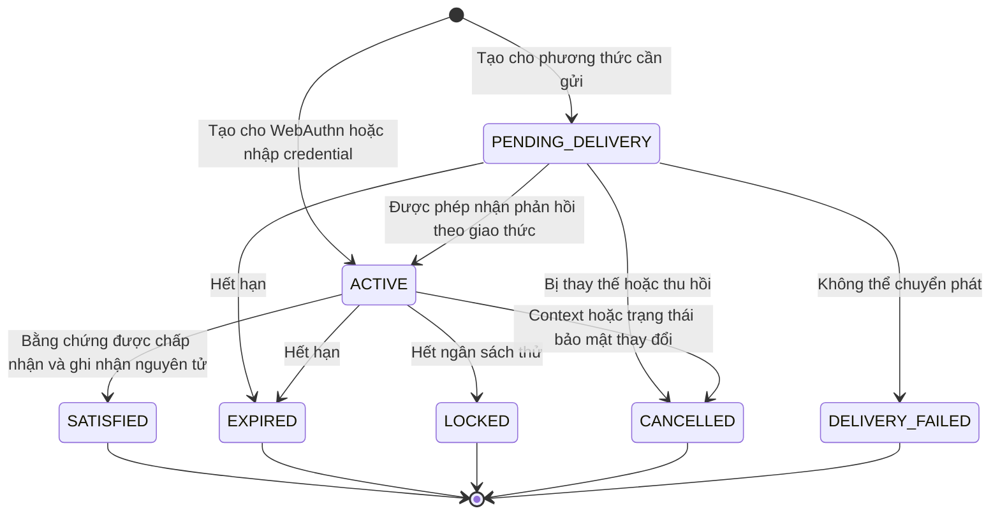
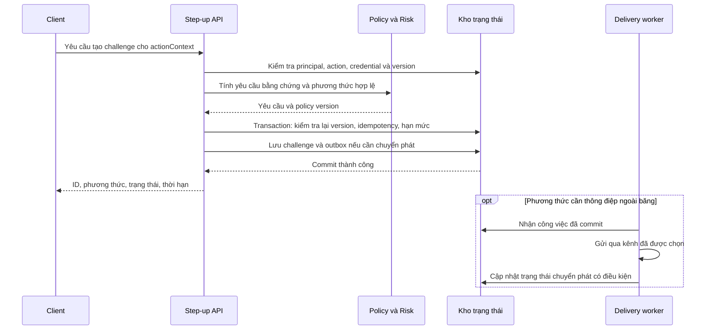

# Step up challenge creation

## Mục tiêu và phạm vi

**Step-up challenge creation** là bước server tạo một yêu cầu xác minh bổ sung khi bằng chứng của phiên hiện tại chưa đủ cho hành động sắp thực hiện. Challenge quy định người dùng phải chứng minh điều gì, bằng phương thức nào, cho tài khoản và hành động nào, trong khoảng thời gian nào.

Trong chương **Step Up Verification** của module `SECURITY_AUTHENTICATION_ACCOUNT_RECOVERY`, bước này đặc biệt quan trọng khi người dùng mất mật khẩu, MFA, passkey hoặc thiết bị xác thực. Một phiên recovery có thể được phép xem tiến trình phục hồi nhưng chưa được phép thay email, gỡ MFA hoặc tạo passkey mới. Tạo challenge sai có thể biến quyền truy cập hạn chế thành đường chiếm đoạt tài khoản.

Sau bài này, người học cần có khả năng:

- Phân biệt challenge, phản hồi xác thực, bằng chứng đã kiểm tra và quyền thực hiện hành động.
- Xác định dữ liệu nào server phải quyết định khi tạo challenge.
- Gắn challenge với đúng tài khoản, tenant, phiên, hành động và trạng thái recovery.
- Thiết kế nonce, thời hạn, trạng thái, idempotency và hạn mức chống lạm dụng.
- Tạo challenge cho phương thức phù hợp mà không tự hạ yêu cầu khi người dùng mất factor.
- Xử lý việc lưu challenge và gửi thông báo trong hệ thống nhiều node.

Các API, tên trạng thái, cấu trúc dữ liệu và mốc thời gian dưới đây là thiết kế minh họa. Những profile như `PREEXISTING_PASSKEY_UV` là tên policy nội bộ, không tự chứng minh hệ thống đáp ứng một mức AAL hoặc tiêu chuẩn tuân thủ cụ thể.

## 1. Tạo challenge chưa phải xác thực thành công

### 1.1. Bốn đối tượng cần tách biệt

| Đối tượng | Ví dụ | Ý nghĩa |
| --- | --- | --- |
| Challenge | Yêu cầu dùng passkey đã đăng ký để xác minh việc gỡ một MFA | Server đang yêu cầu thêm bằng chứng |
| Authenticator response | WebAuthn assertion, mã TOTP, phản hồi push | Dữ liệu chưa được tin trước khi verifier kiểm tra |
| Verified evidence | Kết quả đã kiểm tra credential, subject, thời điểm và các thuộc tính cần thiết | Ghi nhận một sự kiện xác thực được chấp nhận |
| Action grant | Quyền ngắn hạn thực hiện đúng thao tác gỡ MFA đang chờ | Kết quả áp dụng policy lên evidence và trạng thái hiện tại |

Một HTTP response báo “challenge đã tạo” không được cập nhật session thành `mfaVerified=true`. Tương tự, việc gửi SMS thành công chỉ phản ánh trạng thái chuyển phát, chưa chứng minh người nhận đã kiểm soát kênh và trả lời đúng.

OWASP khuyến nghị xác thực lại sau các sự kiện rủi ro, trong đó có account recovery, và trước các thao tác nhạy cảm. Điều đó không có nghĩa mọi yêu cầu xác minh bổ sung đều được phép dùng cùng một cơ chế. [OWASP — Authentication Cheat Sheet](https://cheatsheetseries.owasp.org/cheatsheets/Authentication_Cheat_Sheet.html#reauthentication-after-risk-events)

### 1.2. Challenge có hai lớp

Ở lớp nghiệp vụ, challenge là bản ghi chứa mục đích, binding, policy, thời hạn và trạng thái. Ở lớp giao thức, nó có thể chứa một giá trị ngẫu nhiên để authenticator ký, hoặc tham chiếu tới một phương thức đang chờ được xác minh.

Không phải phương thức nào cũng dùng nonce theo cùng cách:

- WebAuthn nhận một challenge ngẫu nhiên của RP để tạo assertion.
- Với TOTP, server tạo ngữ cảnh kiểm tra mã; ứng dụng TOTP vẫn tính mã từ secret và thời gian, không ký nonce nghiệp vụ của ứng dụng.
- Với mật khẩu, server yêu cầu xác minh lại credential hiện hành; không tạo mật khẩu mới làm đáp án.
- Với mã gửi ngoài băng, server tạo bí mật chuyển qua kênh đã được policy chấp nhận.

Một bản ghi có tên `challenge` không tự làm cho mọi phương thức có khả năng chống phishing hoặc ký chấp thuận nội dung giao dịch.

## 2. Bắt đầu từ hành động được bảo vệ

Giả sử người dùng còn một passkey hợp lệ nhưng đã mất thiết bị chứa TOTP. Họ muốn gỡ credential TOTP cũ khỏi tài khoản.

Luồng hợp lý có thể là:

1. Server tiếp nhận ý định gỡ đúng credential và tạo `actionContext`.
2. Server xác định phiên hiện tại chưa đủ điều kiện thực hiện thao tác.
3. Policy cho phép dùng một passkey đã được gắn với tài khoản bằng quy trình được tin cậy.
4. Server tạo challenge chỉ cho `actionContext` này.
5. Sau khi assertion được kiểm tra, server mới xem xét cấp quyền thực hiện thao tác.

Một luồng nguy hiểm là gửi mã đến địa chỉ email mới do người yêu cầu nhập, rồi dùng mã đó để cho phép gỡ TOTP cũ. Người yêu cầu chỉ chứng minh khả năng đọc hộp thư mới; mối liên hệ với chủ tài khoản chưa được xác lập.

Vì vậy, thiết kế phải đi theo thứ tự:

```text
Hành động cần bảo vệ
    -> yêu cầu bằng chứng
    -> phương thức và credential đủ điều kiện
    -> challenge có binding
    -> phản hồi được verifier kiểm tra
    -> quyết định cấp quyền
```

Không bắt đầu bằng câu hỏi “hệ thống gửi được loại mã nào?” rồi áp dụng cùng loại mã cho tất cả thao tác.

## 3. Đầu vào nào được phép ảnh hưởng tới challenge?

### 3.1. Phân định dữ liệu client và quyết định server

| Dữ liệu | Nguồn đáng tin để quyết định | Vai trò của client |
| --- | --- | --- |
| Account, tenant | Principal hoặc recovery context đã được server xác lập | Không được đổi subject bằng một `accountId` tùy ý |
| Hành động và tài nguyên đích | Action context do server kiểm tra quyền và sở hữu | Gửi ý định; server kiểm tra và lưu phiên bản chuẩn hóa |
| Mức bằng chứng cần đạt | Policy theo hành động, rủi ro và trạng thái tài khoản | Không tự chọn `requiredAssurance=LOW` |
| Phương thức có thể dùng | Tập phương thức policy cho phép và credential hiện hành | Có thể nêu ưu tiên trong tập được phép |
| Địa chỉ nhận mã | Kênh đã có binding và provenance phù hợp | Không thay kênh nhận bằng chuỗi email hoặc số điện thoại mới |
| TTL, số lần thử | Cấu hình được quản lý ở server | Chỉ hiển thị thời hạn do server trả về |
| IP, User-Agent, thiết bị | Tín hiệu có nguồn gốc và độ tin cậy được đánh giá | Có thể cung cấp dữ liệu tham khảo; không tự khẳng định thiết bị đáng tin |

Với recovery chưa có phiên đăng nhập đầy đủ, server có thể dùng một `recoveryContext` có quyền hạn chế. Context này phải gắn tài khoản và tiến trình phục hồi từ trước; biết một email hoặc đoán được account ID chưa đủ để truy cập API step-up dành cho phiên đã xác lập.

### 3.2. Kiểm tra quyền trước khi tạo challenge

Tạo challenge có thể gây side effect: gửi thông báo, tiêu tốn chi phí, tiết lộ credential hoặc thay thế một yêu cầu đang chờ. Vì vậy, server phải kiểm tra quyền tạo ngay tại endpoint creation.

Ví dụ, một thành viên tenant A không được tạo challenge nhắm tới credential thuộc tenant B. Hành động gỡ MFA của người khác cũng không trở nên hợp lệ chỉ vì người yêu cầu sẵn sàng xác thực chính mình.

Bước tạo challenge kiểm tra khả năng bắt đầu hành động. Bước thực thi vẫn phải kiểm tra lại quyền hiện hành; quyền có thể bị thu hồi trong thời gian người dùng đang xác minh.

## 4. Chốt policy trước khi sinh dữ liệu giao thức

### 4.1. Tập phương thức được phép là kết quả của policy

Một cách biểu diễn khái niệm:

```text
eligibleMethods =
    phương thức đạt yêu cầu của action
  INTERSECT phương thức còn khả dụng cho account
  INTERSECT phương thức được chấp nhận trong trạng thái recovery hiện tại
  INTERSECT phương thức đáp ứng giới hạn theo tenant và rủi ro
```

Nếu một profile đòi hỏi tổ hợp nhiều bằng chứng, policy phải mô tả tổ hợp đó và điều kiện về tính độc lập. Không coi hai lần nhập cùng một mật khẩu là hai yếu tố; cũng không tự coi hai kênh có chung đường recovery là độc lập.

Ví dụ policy minh họa:

```yaml
action: REMOVE_MFA_CREDENTIAL
requiredEvidenceProfile: PREEXISTING_PASSKEY_UV
allowedMethods:
  - WEBAUTHN_ASSERTION
requireUserVerification: true
allowCredentialBoundInCurrentRecovery: false
allowRecoveryRestrictedSession: true
onNoEligibleCredential: ROUTE_TO_RECOVERY_REVIEW
```

Trong ví dụ này, phiên recovery bị hạn chế chỉ được phép bắt đầu một challenge phù hợp. Nó chưa có quyền gỡ MFA, và cờ cho phép bắt đầu không thay các kiểm tra security hold hay phạm vi phiên.

### 4.2. Không có phương thức phù hợp là một kết quả hợp lệ

Khi người dùng mất toàn bộ phương thức đạt policy, server không nên tự đổi từ passkey sang email OTP cho tiện hoàn thành. Kết quả có thể là chuyển sang quy trình recovery riêng, chờ xác minh danh tính phù hợp, hoặc đưa thao tác vào trạng thái chờ xử lý.

Đường recovery cần có tiêu chí kết thúc rõ ràng để tránh vòng lặp “muốn phục hồi factor phải dùng chính factor đã mất”. Tuy nhiên, giải quyết vòng lặp bằng cách tự chấp nhận một kênh yếu hơn là thay đổi mô hình tin cậy, cần được thiết kế thành policy có chủ đích.

Credential vừa được tạo trong một recovery chưa hoàn tất không tự đủ để phê chuẩn chính recovery đó. Sau khi một quy trình phục hồi hợp lệ kết thúc, policy có thể cho phép credential mới dùng cho các hành động nhất định; quyết định này phải dựa trên trạng thái và provenance rõ ràng.

## 5. Binding: challenge phải thuộc đúng ngữ cảnh

### 5.1. Những ràng buộc cần lưu

| Binding | Nội dung cần xác định | Tấn công hoặc nhầm lẫn cần ngăn |
| --- | --- | --- |
| Subject | Account ID nội bộ và tenant | Dùng bằng chứng của B cho tài khoản A |
| Session context | Context xác thực do server quản lý | Chuyển challenge sang một phiên không được phép |
| Purpose | Ví dụ `REMOVE_MFA_CREDENTIAL` | Dùng xác minh xem dữ liệu để đổi factor |
| Action context | Tài nguyên đích và dữ liệu quan trọng của thao tác | Xác minh gỡ factor X nhưng thực thi gỡ factor Y |
| Policy snapshot | Phiên bản policy và yêu cầu đã chốt | Đổi phương thức hoặc bỏ UV sau khi đã phát challenge |
| Security state | Phiên bản bảo mật tài khoản, recovery context và hold liên quan | Dùng challenge từ trước một sự kiện thu hồi |
| Protocol context | Nonce, RP ID, cấu hình origin hoặc giao dịch của nhà cung cấp | Nhận phản hồi thuộc ceremony khác |

Một `challengeId` khó đoán chỉ giúp chống dò tìm. Nó không thay thế các binding trên. Endpoint lấy trạng thái hoặc gửi đáp án vẫn phải kiểm tra người gọi có quyền truy cập challenge đó.

### 5.2. Giữ action context bất biến

Ví dụ một bản ghi thao tác ở server:

```json
{
  "actionContextId": "act_opaque_reference",
  "accountRef": "acct_internal_reference",
  "tenantRef": "tenant_internal_reference",
  "action": "REMOVE_MFA_CREDENTIAL",
  "targetCredentialRef": "totp_credential_17",
  "version": 3,
  "status": "AWAITING_STEP_UP"
}
```

Challenge tham chiếu đúng `actionContextId` và `version`. Nếu người dùng đổi sang gỡ một credential khác, server tạo context mới hoặc tăng version và vô hiệu hóa challenge không còn phù hợp.

Có thể lưu thêm digest của dữ liệu đã chuẩn hóa để phát hiện sai khác giữa các bước. Digest phải được server tính từ representation ổn định; một chuỗi hash do client gửi không chứng minh action chưa bị sửa. Hash cũng không làm dữ liệu cá nhân có không gian giá trị nhỏ trở thành bí mật.

OWASP yêu cầu việc cấp quyền giao dịch và lựa chọn phương thức được thực thi phía server, đồng thời bảo vệ dữ liệu giao dịch khỏi thay đổi giữa các bước. Các binding trong bài là một cách triển khai các mục tiêu đó cho thao tác recovery. [OWASP — Transaction Authorization Cheat Sheet](https://cheatsheetseries.owasp.org/cheatsheets/Transaction_Authorization_Cheat_Sheet.html)

### 5.3. Binding phiên khi session được xoay

Không nên dùng IP làm khóa gắn phiên duy nhất: mạng di động, VPN và NAT có thể làm IP thay đổi hoặc nhiều người dùng chung một IP. Raw session cookie cũng không nên được sao chép vào bản ghi challenge.

Một thiết kế có thể dùng `sessionContextRef` do server quản lý. Nếu session cookie được xoay có kiểm soát trong cùng tiến trình, server quyết định context nào còn kế thừa challenge. Khi logout, thu hồi phiên hoặc có sự kiện compromise, context liên quan phải bị vô hiệu hóa theo policy.

Không tự chia sẻ mọi challenge cho toàn bộ một session family. Phạm vi kế thừa phải được định nghĩa rõ, tránh cho một phiên khác nhận quyền từ yêu cầu nhạy cảm mà nó không khởi tạo.

## 6. Sinh nonce và phân biệt dữ liệu công khai với bí mật

### 6.1. Nonce phải do server sinh bằng CSPRNG

Với challenge mật mã, dùng bộ sinh số ngẫu nhiên an toàn. Không suy ra nonce từ timestamp, account ID, số thứ tự, IP hoặc hash của những giá trị có thể dự đoán.

Ví dụ Java chỉ minh họa việc tạo giá trị ngẫu nhiên, chưa phải một dịch vụ step-up hoàn chỉnh:

```java
import java.security.SecureRandom;
import java.util.Base64;

public final class ChallengeRandom {
    private static final SecureRandom RANDOM = new SecureRandom();

    private ChallengeRandom() {}

    public static String randomBase64Url32Bytes() {
        byte[] bytes = new byte[32];
        RANDOM.nextBytes(bytes);
        return Base64.getUrlEncoder()
                .withoutPadding()
                .encodeToString(bytes);
    }
}
```

Thiết kế minh họa dùng hai lần sinh độc lập: một giá trị cho ID tra cứu và một giá trị cho nonce WebAuthn. Không dùng giá trị ngẫu nhiên công khai làm bí mật OTP hoặc token recovery ở bước khác.

WebAuthn yêu cầu challenge có đủ entropy chống đoán, khuyến nghị độ dài ít nhất 16 byte và yêu cầu RP kiểm tra challenge khi xác minh assertion. Ví dụ 32 byte ở đây là lựa chọn triển khai. Thời hạn lưu tại server vẫn cần thiết bên cạnh nonce. [W3C — WebAuthn, Cryptographic Challenges](https://www.w3.org/TR/webauthn-3/#sctn-cryptographic-challenges)

### 6.2. Không phải giá trị nào cũng phải được che giấu giống nhau

| Giá trị | Có trả về trình duyệt không? | Cách bảo vệ chính |
| --- | --- | --- |
| Nonce WebAuthn | Có, nó là đầu vào công khai của ceremony | Không đoán được trước, binding và đối chiếu chính xác |
| Challenge ID | Có, để tham chiếu yêu cầu | Không cấp quyền chỉ vì biết ID; kiểm tra context |
| Mã gửi ngoài băng | Không trả cùng response creation cho bên đang bị yêu cầu chứng minh kênh | Chuyển qua kênh được chọn, bảo vệ bí mật, giới hạn thử |
| TOTP seed | Không | Quản lý như bí mật credential, không đưa vào challenge mới |
| Mật khẩu hiện hành | Không trả về | Chỉ thu nhận qua luồng bảo vệ và verifier phù hợp |
| Session secret | Không sao chép vào payload challenge | Cookie hoặc cơ chế phiên được quản lý riêng |

Băm thường một mã ngắn không ngăn được việc thử hết không gian mã nếu database bị lộ. Với mã do server sinh và cần đối chiếu, một phương án là lưu HMAC gắn với challenge và mục đích, dùng khóa nằm ngoài kho dữ liệu challenge. Phương án này vẫn cần quản lý khóa, so sánh an toàn và giới hạn số lần thử trực tuyến.

Không áp dụng cách lưu OTP mới này cho secret dài hạn của TOTP. Verifier TOTP có yêu cầu lưu trữ và sử dụng seed riêng.

## 7. Tạo tham số theo đúng phương thức

### 7.1. WebAuthn assertion

Tại bước creation, server chọn những credential thuộc đúng tài khoản và đạt policy, sinh nonce, lưu context, rồi trả request options. Ví dụ các dữ liệu cần chốt:

- `rpId` lấy từ cấu hình RP được tin cậy, phù hợp môi trường và tenant.
- `challenge` là nonce mới của ceremony.
- `allowCredentials` được lọc theo subject và policy nếu luồng dùng danh sách credential cụ thể.
- `userVerification` phản ánh yêu cầu của action, ví dụ `required`.
- Danh sách origin được chấp nhận được giữ ở verifier; không lấy trực tiếp từ body request để tự cho phép origin mới.

Không lấy `Host` hoặc các forwarded header chưa được xác thực làm nguồn cấu hình RP tùy ý. Sai trust boundary ở reverse proxy có thể làm cấu hình được suy ra từ dữ liệu do người gọi kiểm soát.

Yêu cầu UV ở request options chưa thay việc kiểm tra cờ UV tại verifier. Verifier còn phải kiểm tra challenge, origin, RP ID, credential, chữ ký và các điều kiện của giao thức. UP không thay UV. [W3C — Verifying an Authentication Assertion](https://www.w3.org/TR/webauthn-3/#sctn-verifying-assertion)

Challenge gắn với action ở server giúp ngăn dùng assertion sai phạm vi. Điều đó chưa chứng minh người dùng đã nhìn thấy và hiểu từng chi tiết của thao tác trong một màn hình đáng tin cậy. Nếu cần chấp thuận nội dung giao dịch, phải thiết kế thêm bước hiển thị và xác nhận phù hợp.

### 7.2. TOTP hoặc xác minh lại mật khẩu

Server tạo bản ghi chờ xác minh cho credential hiện hành; không gửi TOTP seed hoặc hash mật khẩu ra client. Việc đổi `method` ở request verify không được biến challenge mật khẩu thành challenge TOTP hoặc ngược lại.

Với TOTP, trạng thái chống dùng lại phải gắn với credential và lần mã có hiệu lực, không chỉ với một challenge ID. Nếu chỉ đánh dấu từng challenge đã dùng, cùng một mã có thể vượt qua hai challenge được tạo gần nhau.

Theo NIST, một OTP phải chỉ được chấp nhận một lần khi còn hiệu lực; mã nhập thủ công không được coi là chống phishing. Do đó, việc gắn TOTP với `actionContextId` ở server không tự tạo binding mật mã giữa mã và nội dung hành động. [NIST SP 800-63B-4 — Authenticator and Verifier Requirements](https://pages.nist.gov/800-63-4/sp800-63b/authenticators/)

### 7.3. Mã gửi ngoài băng, push và recovery code

Khi policy cho phép cơ chế ngoài băng, server chọn endpoint đã có binding phù hợp, sinh bí mật hoặc tạo giao dịch theo giao thức của nhà cung cấp, và lưu tham chiếu chuyển phát. Response creation chỉ trả metadata cần thiết, chẳng hạn kênh đã che bớt ký tự và trạng thái đang gửi.

Không mặc nhiên đưa email vào tập phương thức step-up mạnh. NIST không cho phép email làm out-of-band authentication trong phạm vi yêu cầu đó, đồng thời phân biệt mã xác nhận email và mã recovery với quá trình xác thực này. Nếu ứng dụng dùng email trong recovery, phải giữ đúng vai trò và giới hạn của bằng chứng. [NIST SP 800-63B-4 — Out-of-Band Devices](https://pages.nist.gov/800-63-4/sp800-63b/authenticators/#out-of-band-devices)

Với push, cần gắn thông báo với đúng giao dịch và tài khoản, giới hạn tần suất, đồng thời hiển thị mục đích rõ ràng để giảm việc chấp nhận theo thói quen. Không coi việc nhà cung cấp nhận request là người dùng đã xác thực.

Recovery code đã cấp trước đó cũng có thể là đầu vào cho một nhánh phục hồi riêng. Không tạo recovery code mới rồi yêu cầu người gọi nhập lại chính code vừa nhận trong response để chứng minh quyền sở hữu tài khoản.

## 8. Bản ghi challenge cần những gì?

Một bản ghi phía server có thể có dạng sau. Tên và ID đều là giá trị minh họa:

```json
{
  "challengeId": "opaque_random_challenge_id",
  "accountRef": "acct_internal_reference",
  "tenantRef": "tenant_internal_reference",
  "sessionContextRef": "ctx_internal_reference",
  "recoveryContextRef": "recovery_internal_reference",
  "actionContextId": "act_opaque_reference",
  "actionContextVersion": 3,
  "purpose": "REMOVE_MFA_CREDENTIAL",
  "method": "WEBAUTHN_ASSERTION",
  "requiredEvidenceProfile": "PREEXISTING_PASSKEY_UV",
  "requireUserVerification": true,
  "policyVersion": "recovery-policy-v12",
  "accountSecurityVersion": 41,
  "credentialSetVersion": 8,
  "eligibleCredentialRefs": ["passkey_credential_9"],
  "protocolContext": {
    "rpId": "accounts.example.com",
    "webauthnChallengeB64": "base64url_encoded_random_nonce"
  },
  "createdAt": "2026-11-23T09:00:00Z",
  "expiresAt": "2026-11-23T09:05:00Z",
  "attemptBudgetRef": "budget_internal_reference",
  "status": "ACTIVE",
  "version": 1
}
```

Không trả nguyên bản ghi này cho trình duyệt. Account reference, policy chi tiết, bộ đếm và trạng thái nội bộ không phải dữ liệu giao diện mặc định.

Các version giúp phát hiện thay đổi giữa creation và verification. Trong thiết kế bảo thủ, bất kỳ thay đổi liên quan trong tập credential đều làm challenge cũ không còn hợp lệ. Thiết kế khác có thể dùng version theo credential cụ thể, miễn quy tắc vô hiệu hóa được thực thi nhất quán.

Policy snapshot giữ lại yêu cầu đã chốt, nhưng không phải giấy phép bỏ qua policy hiện hành. Nếu policy mới nghiêm ngặt hơn, tài khoản bị hold hoặc credential đã bị thu hồi, verifier phải đánh giá lại hoặc yêu cầu tạo challenge mới theo quy tắc đã định.

Token có chữ ký có thể mang một phần context, nhưng chữ ký chỉ bảo vệ tính toàn vẹn của token. Nó không tự bảo đảm token chưa được dùng, phiên chưa bị thu hồi hoặc action vẫn hợp lệ. Yêu cầu dùng một lần và thu hồi tức thời vẫn cần trạng thái hoặc cơ chế tương đương ở server.

## 9. Vòng đời, TTL và tính dùng một lần

### 9.1. Mô hình trạng thái minh họa



`SATISFIED` chỉ có nghĩa điều kiện xác minh của challenge đã được xử lý thành công. Nếu hệ thống cấp action grant ở bước này, việc ghi nhận grant và chuyển trạng thái phải nhất quán. Thực thi hành động nghiệp vụ là một bước riêng, vẫn phải kiểm tra và tiêu thụ grant theo phạm vi của nó.

Với cơ chế chuyển phát, cần định nghĩa chính xác khi nào được nhận phản hồi. Ví dụ, callback “nhà cung cấp nhận yêu cầu” chưa chắc đồng nghĩa thông điệp đã tới người dùng. Trạng thái chuyển phát không được dùng làm evidence xác thực.

### 9.2. Server là nơi quyết định hết hạn

Ví dụ TTL năm phút trong bài không phải mặc định áp dụng cho mọi phương thức. TTL phải phù hợp với giao thức, yêu cầu an toàn, độ trễ chuyển phát và khả năng sử dụng.

Một thiết kế có thể tính:

```text
expiresAt = min(
    createdAt + ttlCuaPhuongThuc,
    actionContext.expiresAt,
    sessionContext.absoluteExpiresAt,
    recoveryContext.expiresAt neu co
)
```

Các node dùng nguồn thời gian được quản lý nhất quán; quyết định chấp nhận phải kiểm tra thời hạn ngay tại thao tác xác minh. Database TTL hoặc job dọn dẹp chỉ phục vụ lưu trữ, không phải cơ chế từ chối challenge hết hạn.

`timeout` của giao diện WebAuthn hoặc bộ đếm trên màn hình không thay `expiresAt` ở server. Gửi lại mã, retry HTTP hoặc chậm callback cũng không được âm thầm gia hạn thời gian vô hạn.

### 9.3. Dùng một lần phải chịu được request đồng thời

Một kiểm tra “status đang ACTIVE” rồi cập nhật bằng hai thao tác rời rạc có thể cho hai request cùng thắng. Việc chấp nhận bằng chứng cần dùng transaction, compare-and-set hoặc cơ chế nguyên tử tương đương, có kiểm tra version và thời hạn.

Tạo challenge phải chuẩn bị sẵn những trường cần cho bước đó. Một nonce ngẫu nhiên mạnh vẫn chưa đủ nếu verifier bỏ qua trạng thái đã dùng hoặc endpoint thực thi bỏ qua action binding.

## 10. API creation: trả đủ để tiếp tục, không cấp quyền sớm

### 10.1. Request minh họa

```http
POST /v1/step-up/challenges HTTP/1.1
Content-Type: application/json
Idempotency-Key: random-client-request-reference
X-CSRF-Token: session-bound-csrf-token

{
  "actionContextId": "act_opaque_reference",
  "preferredMethod": "WEBAUTHN_ASSERTION"
}
```

Ví dụ giả định API dùng cookie phiên, nên phải có bảo vệ CSRF phù hợp. API dùng cơ chế khác cần bảo vệ tương ứng với cách credential được gửi. Challenge nonce không thay thế CSRF token.

Server tìm account và tenant từ context đã xác thực, kiểm tra quyền với action context, rồi mới xử lý `preferredMethod`. Client không được gửi thêm trường để tắt UV, thay tài khoản hoặc sửa hạn mức; schema nên kiểm soát rõ các trường được nhận.

Không dùng GET để tạo challenge có side effect. Đồng thời giới hạn kích thước request và số request đang xử lý để endpoint không trở thành nguồn làm cạn tài nguyên.

### 10.2. Response cho WebAuthn

```http
HTTP/1.1 201 Created
Cache-Control: no-store
Content-Type: application/json

{
  "challengeId": "opaque_random_challenge_id",
  "status": "ACTIVE",
  "expiresAt": "2026-11-23T09:05:00Z",
  "actionSummary": {
    "type": "REMOVE_MFA_CREDENTIAL",
    "label": "Gỡ ứng dụng xác thực cũ"
  },
  "method": "WEBAUTHN_ASSERTION",
  "publicKey": {
    "challenge": "base64url_encoded_random_nonce",
    "rpId": "accounts.example.com",
    "allowCredentials": [
      {
        "type": "public-key",
        "id": "base64url_encoded_eligible_credential_id"
      }
    ],
    "userVerification": "required",
    "timeout": 120000
  }
}
```

Các chuỗi biểu diễn nonce và credential ID ở ví dụ là placeholder, không phải dữ liệu để chạy trực tiếp. JSON là định dạng truyền của API ứng dụng; phía trình duyệt phải chuyển các trường byte về kiểu dữ liệu mà WebAuthn yêu cầu bằng cơ chế chuyển đổi hoặc thư viện phù hợp. Ý nghĩa của các trường request options được mô tả trong tài liệu API trình duyệt. [MDN — PublicKeyCredentialRequestOptions](https://developer.mozilla.org/en-US/docs/Web/API/PublicKeyCredentialRequestOptions)

`timeout` ở ví dụ là gợi ý chờ 120 giây cho giao diện; trình duyệt có thể điều chỉnh, còn server giữ giới hạn tuyệt đối riêng. Nếu giao diện hết thời gian, client không được tự sửa timeout hoặc TTL để làm mới challenge cũ; nó phải theo quy tắc retry hoặc tạo lại của server. [MDN — timeout](https://developer.mozilla.org/en-US/docs/Web/API/PublicKeyCredentialRequestOptions#timeout)

Không đưa `stepUpPassed`, access token có quyền cao hơn hoặc action grant vào response creation. Với phương thức cần gửi thông điệp, API có thể trả `202 Accepted` và `PENDING_DELIVERY`, kèm endpoint lấy trạng thái có kiểm tra quyền.

## 11. Trình tự xử lý và ranh giới transaction

### 11.1. Luồng creation



Nếu đánh giá rủi ro diễn ra ngoài transaction, phải kiểm tra lại các version liên quan trước khi commit. Không giữ transaction database mở trong suốt thời gian chờ nhà cung cấp SMS hoặc push.

Một mã có thể được gửi thành công dù request creation gặp lỗi sau đó. Vì thế cần lưu challenge bền vững trước khi phát side effect, chẳng hạn bằng transactional outbox. Event chuyển phát chứa tham chiếu và dữ liệu tối thiểu; nếu worker cần bí mật, dùng cơ chế mã hóa hoặc kho bí mật tạm thời có thời hạn, thay vì ghi mã rõ vào log và hệ thống analytics.

### 11.2. Mã giả cho phần quyết định

```text
createChallenge(request, callerContext):
    enforceRequestProtectionAndSizeLimit(request, callerContext)
    principal = requirePermittedSessionOrRecoveryContext(callerContext)
    action = loadAndAuthorizeActionContext(principal, request.actionContextId)

    snapshot = loadAccountSecurityAndCredentialSnapshot(principal, action)
    decision = evaluateStepUpPolicy(action, principal, snapshot)

    if decision.requiresHold:
        return actionPendingReview()

    method = chooseWithinAllowedMethods(decision, request.preferredMethod)
    if method is absent:
        return recoveryRouteWithoutDowngradingPolicy()

    candidate = prepareMethodContextWithSecureRandom(method, decision, snapshot)

    transaction:
        recheckActionAndSecurityVersions(action, snapshot, decision)
        existing = findScopedIdempotencyRecord(principal, request.idempotencyKey)
        if existing exists:
            requireSameCanonicalRequest(existing, request)
            requireCurrentCallerCanStillAccess(existing.challenge)
            return existingPublicCreationResultWithoutNewSideEffects()

        reserveCreationBudgetAtomically(principal, action, method)
        enforceActiveChallengeRule(principal, action)
        insertChallenge(candidate)
        saveScopedIdempotencyRecord(request, candidate)
        insertDeliveryOutboxIfNeeded(candidate)
    commit

    return minimalPublicCreationResult(candidate)
```

Các hàm trong mã giả là trách nhiệm thiết kế, không phải thư viện có sẵn. Nếu transaction rollback, không được gửi một thông điệp mới dựa trên candidate chưa commit. Việc sinh nonce rồi bỏ candidate khi gặp idempotent retry không làm nonce đó trở thành challenge hợp lệ.

## 12. Idempotency, nhiều tab và chống lạm dụng

### 12.1. Retry không được tạo thêm yêu cầu xác thực

Người dùng bấm lại vì mạng chậm không nên nhận năm push hoặc năm SMS khác nhau. Một idempotency key phải được scope ít nhất theo caller context và endpoint, đồng thời lưu fingerprint của request đã được server chuẩn hóa.

| Tình huống | Xử lý minh họa |
| --- | --- |
| Cùng key, cùng context và cùng request | Trả kết quả creation đã lưu, không gửi thêm |
| Cùng key nhưng khác action hoặc phương thức | Từ chối xung đột, không diễn giải lại key |
| Cùng key nhưng caller context không còn hợp lệ | Không trả dữ liệu chỉ vì key đã đúng |
| Challenge của key đã hết hạn hoặc kết thúc | Trả trạng thái phù hợp; yêu cầu key mới nếu bắt đầu lại |
| Hai request đồng thời dùng cùng key | Unique constraint hoặc cơ chế nguyên tử cho một kết quả duy nhất |

Idempotency của creation không phải idempotency của verification hay của hành động nghiệp vụ. Không trả lại một grant có thể dùng tiếp chỉ vì client lặp lại request tạo challenge cũ.

### 12.2. Quy tắc nhiều challenge phải có chủ đích

Một lựa chọn là chỉ có một challenge hoạt động cho cùng `(account, sessionContext, actionContext, purpose)`. Nếu thay thế, challenge cũ chuyển sang `CANCELLED`; ngân sách thử và giới hạn chuyển phát vẫn được giữ ở phạm vi phù hợp.

Quy tắc này cần khóa hoặc ràng buộc nhất quán để hai node không cùng tạo hai bản ghi hoạt động. Nếu ứng dụng cho phép nhiều challenge song song, mỗi challenge vẫn phải có nonce và trạng thái riêng, còn hạn mức tổng không được nhân theo số challenge.

Kẻ có session bị đánh cắp có thể liên tục thay challenge để làm phiền người dùng thật. Vì vậy, thay thế và hủy cũng cần kiểm tra quyền, cooldown và giới hạn; không cho thao tác không đáng tin vô hiệu hóa hàng loạt tiến trình hợp lệ.

### 12.3. Giới hạn phải tồn tại ngoài vòng đời một challenge

Nên xem riêng các ngân sách:

- Tần suất tạo challenge theo account, session context, tenant và nguồn truy cập.
- Số challenge đang hoạt động và chi phí lưu trữ.
- Tần suất gửi, gửi lại và chi phí theo kênh hoặc nhà cung cấp.
- Số lần thử xác minh theo credential, account và cửa sổ thời gian.
- Tín hiệu lạm dụng toàn hệ thống, chẳng hạn nhiều tài khoản bị nhắm từ cùng một nguồn.

IP là một tín hiệu bổ sung; chỉ giới hạn theo IP có thể ảnh hưởng người dùng chung NAT và vẫn bỏ lọt tấn công phân tán. Ngược lại, khóa tài khoản cứng chỉ từ request creation có thể tạo điều kiện từ chối dịch vụ.

NIST cũng yêu cầu giữ bộ đếm thất bại khi sinh bí mật ngoài băng mới. [NIST — Out-of-Band Verifiers](https://pages.nist.gov/800-63-4/sp800-63b/authenticators/#out-of-band-verifiers)

Gửi lại mã phải có quy tắc rõ: gửi lại cùng bí mật còn hiệu lực, hoặc thay bằng bí mật mới và vô hiệu hóa bản cũ. Cả hai cách đều không được reset ngân sách thử hay kéo dài tiến trình vô hạn. Với nhà cung cấp không hỗ trợ idempotency, worker có thể gửi trùng sau lỗi không rõ kết quả; thiết kế phải chấp nhận khả năng đó thay vì hứa chuyển phát đúng một lần tuyệt đối.

## 13. Gắn với recovery và kiểm soát session

### 13.1. Theo dõi provenance của credential

Xét diễn tiến sau:

```text
09:00  Tài khoản bắt đầu recovery vì mất TOTP.
09:02  Một email mới được nhập trong recovery.
09:03  Người yêu cầu chứng minh đọc được email mới.
09:04  Người yêu cầu xin gỡ TOTP cũ.
```

Bằng chứng ở 09:03 không tự đủ cho thao tác ở 09:04. Khi tạo challenge, policy phải biết kênh nào có trước recovery, kênh nào vừa được thêm, đã được gắn bằng cơ sở tin cậy nào và có còn nằm trong thời gian hạn chế hay không.

Nếu có passkey dự phòng đã đăng ký và còn đạt policy, hệ thống có thể tạo assertion challenge với passkey đó. Nếu không còn phương thức phù hợp, chuyển sang recovery riêng và giữ đúng giới hạn của phiên hiện tại.

Không bắt mọi tài khoản phải cung cấp giấy tờ tùy thân khi dịch vụ chưa từng thiết lập quan hệ định danh phù hợp. Xác minh danh tính phục vụ recovery cần có cơ sở so khớp và chính sách bảo vệ dữ liệu, không phải cách lấp chỗ trống cho mọi challenge thất bại.

### 13.2. Creation phải chuẩn bị cho thu hồi

Trong thời gian challenge còn sống, có thể xảy ra reset mật khẩu, thu hồi passkey, thay đổi quyền hoặc báo cáo compromise. Các bước verify và execute cần phát hiện những thay đổi này dựa trên trạng thái hiện hành và version đã lưu.

Nếu policy yêu cầu xoay session sau khi step-up thành công, việc chuyển quyền sang session mới phải được server kiểm soát. Không để client tự mang challenge sang một cookie hoặc recovery context tùy ý.

Với thao tác gỡ MFA sau recovery, hệ thống có thể còn áp dụng thời gian chờ, thông báo qua kênh đã có hoặc yêu cầu xem xét rủi ro. Challenge hợp lệ không tự xóa các điều kiện này và không tự cho mọi session khác của tài khoản quyền cao hơn.

## 14. Lỗi và dữ liệu vận hành

### 14.1. Hợp đồng lỗi phải phân biệt được nguyên nhân vận hành

| Tình huống | Quyết định ở server | Nội dung phù hợp cho người dùng |
| --- | --- | --- |
| Caller context không hợp lệ | Không tạo challenge | Yêu cầu bắt đầu lại phiên phù hợp |
| Action context sai quyền hoặc không thuộc caller | Từ chối truy cập | Không tiết lộ tài nguyên của người khác |
| Không có phương thức đạt policy | Không tự hạ yêu cầu | Hướng dẫn sang recovery hoặc hỗ trợ được phép |
| Tài khoản đang có hold | Giữ hold | Thông báo thao tác đang chờ điều kiện bổ sung |
| Vượt hạn mức creation hoặc chuyển phát | Không tạo side effect mới | Nêu thời điểm có thể thử lại khi phù hợp |
| Nhà cung cấp chuyển phát lỗi | Giữ trạng thái nhất quán, retry có giới hạn | Cho biết chưa gửi được; chưa xác thực thành công |
| Cấu hình phương thức hoặc kho trạng thái không khả dụng | Không tạo challenge thiếu binding | Báo tạm thời chưa thể xác minh |

Mã HTTP cụ thể thuộc hợp đồng API của hệ thống. Không trả exception, seed, OTP, danh sách credential đầy đủ hoặc lý do nội bộ có thể giúp dò tài khoản. Với endpoint recovery công khai, cần đặc biệt xem xét sự khác biệt về nội dung, thời gian phản hồi và side effect giữa tài khoản tồn tại và không tồn tại.

### 14.2. Audit đủ để điều tra, không lưu đáp án

Một sự kiện creation có thể ghi event ID, thời điểm, tham chiếu challenge có kiểm soát truy cập, action type, method, policy version, decision và reason code. Tài khoản và recovery context nên dùng tham chiếu nội bộ theo nhu cầu điều tra, có thời hạn lưu và quyền đọc phù hợp.

Không ghi mật khẩu, OTP, TOTP seed, recovery token, raw session cookie hoặc private key. Dù nonce WebAuthn là dữ liệu công khai trong giao thức, cũng không cần đổ toàn bộ payload xác thực vào log mặc định. Tránh dùng account ID hoặc challenge ID làm nhãn metric có số lượng giá trị không giới hạn.

Các metric hữu ích gồm tỷ lệ creation bị chặn theo nhóm lý do, số thông điệp gửi trên mỗi challenge, tỷ lệ lỗi chuyển phát, tỷ lệ challenge hết hạn và số xung đột idempotency. Những số liệu này giúp nhận biết push fatigue, spam kênh phục hồi hoặc lỗi làm người dùng tạo lại liên tục.

## 15. Những thiết kế dễ tạo lỗ hổng

| Thiết kế sai | Vì sao nguy hiểm | Cách sửa ở bước creation |
| --- | --- | --- |
| Client gửi account ID và server tạo thẳng challenge | Sai subject hoặc vượt tenant | Lấy subject từ context đáng tin và kiểm tra action |
| Có session là được chọn email mới nhận mã | Kẻ chiếm session tự chọn nơi nhận bằng chứng | Chỉ chọn endpoint có binding và provenance đạt policy |
| Mất passkey thì tự chuyển sang OTP bất kỳ | Hạ mức bảo vệ của thao tác | Tính lại tập phương thức hợp lệ; không có thì recovery riêng |
| Lưu challenge nhưng không lưu mục đích | Dùng chéo giữa xem dữ liệu và gỡ factor | Gắn purpose, action context và version |
| Mỗi lần resend tạo TTL và ngân sách thử mới | Mở rộng thời gian và số lần đoán vô hạn | Giới hạn theo tiến trình, account và credential |
| Chỉ ký JWT rồi coi là token dùng một lần | Không phát hiện replay hoặc thu hồi kịp thời | Lưu trạng thái dùng và kiểm tra version hiện hành |
| Gửi mã trước khi lưu challenge | Có thông điệp không gắn bản ghi hợp lệ | Commit challenge và outbox trước chuyển phát |
| Response creation chứa cờ đã vượt step-up | Cấp quyền trước khi có bằng chứng | Chỉ trả dữ liệu để tiếp tục ceremony |
| Một challenge thành công nâng mọi session | Mở rộng quyền ngoài yêu cầu ban đầu | Chuẩn bị grant có phạm vi cụ thể và quy tắc phiên rõ ràng |

Một challenge được tạo đúng phải có câu trả lời rõ cho bảy câu hỏi: ai đang được yêu cầu chứng minh, nhằm hành động nào, dùng phương thức và credential nào, gắn với context nào, hết hạn khi nào, chịu ngân sách thử nào và sự kiện nào sẽ làm nó mất hiệu lực. Những câu trả lời này phải tồn tại trong quyết định và trạng thái của server trước khi yêu cầu xác minh được đưa tới người dùng.
