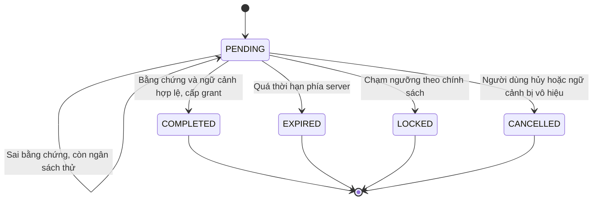
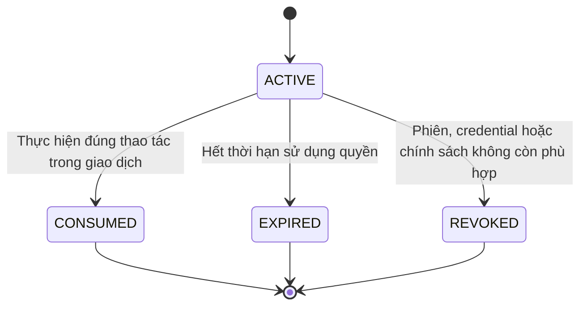

# Hoàn tất thử thách xác minh tăng cường

## 1. Mục tiêu của bước hoàn tất challenge

Trong chương **Step Up Verification** của module `SECURITY_AUTHENTICATION_ACCOUNT_RECOVERY`, bài học này tập trung vào **step up challenge completion**: cách backend tiếp nhận câu trả lời, xác minh bằng chứng và chuyển kết quả thành quyền thực hiện một thao tác cụ thể.

Step-up verification là yêu cầu bổ sung bằng chứng khi session hiện tại chưa đáp ứng yêu cầu của hành động sắp thực hiện. Trong luồng khôi phục tài khoản, hành động đó có thể là thay phương tiện xác thực, thu hồi thiết bị, thay kênh recovery hoặc cấp lại quyền truy cập nhạy cảm.

Người dùng thấy “xác minh thành công” chỉ sau một vài giây, nhưng backend phải xử lý nhiều câu hỏi:

- Bằng chứng có thực sự hợp lệ với phương thức mà server yêu cầu không?
- Người trả lời có đúng là người và phiên đã khởi tạo thao tác không?
- Dữ liệu thao tác, credential và chính sách có thay đổi trong lúc người dùng xác minh không?
- Challenge đã hết hạn, bị hủy hoặc được hoàn tất ở một request khác chưa?
- Kết quả được dùng cho thao tác nào, trong bao lâu và được dùng mấy lần?

Ví dụ xuyên suốt: **Minh vừa khôi phục tài khoản sau khi mất thiết bị**. Trong phiên mới, Minh muốn thu hồi một phiên đăng nhập cũ. Chính sách cho phép hành động này nhưng yêu cầu một assertion mới bằng passkey còn tin cậy. Hệ thống phải bảo đảm assertion cho việc thu hồi phiên cũ không trở thành quyền đổi email, thêm passkey hoặc xóa mọi yếu tố xác thực.

Các tên trạng thái, API, thời hạn và mã giả trong bài là mô hình minh họa. Khi triển khai, cần điều chỉnh theo rủi ro, mức bảo đảm cần đạt và kiến trúc lưu trữ thực tế.

## 2. Phân biệt challenge, bằng chứng, grant và thao tác

| Khái niệm | Vai trò | Điều không được suy diễn |
| --- | --- | --- |
| Challenge | Yêu cầu xác minh do server tạo, gắn với ngữ cảnh và mục đích | Biết `challengeId` không có nghĩa sở hữu tài khoản |
| Bằng chứng trả lời | OTP, assertion, kết quả từ verifier hoặc phản hồi được xác thực | Client gửi `success: true` không phải bằng chứng |
| Authentication event | Ghi nhận server đã xác thực điều gì, bằng cách nào và lúc nào | Token mới phát hành không luôn đồng nghĩa xác thực chủ động mới |
| Step-up grant | Quyền ngắn hạn, có phạm vi, được cấp sau khi kiểm tra hoàn tất | Grant không tự động nâng mọi quyền của session |
| Protected operation | Thao tác nghiệp vụ được bảo vệ, có dữ liệu và trạng thái riêng | Challenge hoàn tất chưa chắc thao tác đã thực hiện |

Trong bài, backend dùng mô hình hai bước: **hoàn tất challenge để cấp grant**, sau đó **tiêu thụ grant khi thực hiện thao tác**. Một thiết kế khác có thể xác minh và thực hiện thao tác ngay trong cùng một giao dịch, miễn vẫn duy trì các ràng buộc tương đương.

Với mô hình hai bước, có thể diễn đạt điều kiện hoàn tất như sau:

```text
COMPLETE = bằng chứng hợp lệ
       AND người và phiên khớp
       AND ngữ cảnh vẫn còn hiệu lực
       AND chính sách hiện tại chấp nhận
       AND chuyển trạng thái được ghi nguyên tử
```

Kết quả verifier trả về thành công mới đáp ứng một phần điều kiện. Nếu hồ sơ recovery vừa bị hủy hoặc credential vừa bị thu hồi, server không được cấp grant chỉ vì phép kiểm tra chữ ký trước đó đúng.

OWASP yêu cầu việc kiểm tra quyền giao dịch được thực thi tại server và có cổng kiểm soát gắn với lúc thực hiện thao tác. Đây là cơ sở để phân biệt xác minh challenge với quyền thực thi. Xem [OWASP Transaction Authorization Cheat Sheet](https://cheatsheetseries.owasp.org/cheatsheets/Transaction_Authorization_Cheat_Sheet.html).

## 3. Dữ liệu server cần giữ trước khi nhận câu trả lời

Một challenge không nên chỉ gồm `id`, `otpHash` và `expiresAt`. Các trường dưới đây giúp backend biết câu trả lời có ý nghĩa gì:

| Nhóm | Trường minh họa | Mục đích |
| --- | --- | --- |
| Chủ thể | `subjectId`, `tenantId` | Chặn dùng challenge của tài khoản hoặc tenant khác |
| Phiên | `sessionBindingId`, `sessionSecurityVersion` | Ràng buộc với phiên khởi tạo và thế hệ bảo mật của phiên |
| Luồng recovery | `recoveryCaseId`, `recoveryCaseVersion` nếu áp dụng | Chặn kết quả của một hồ sơ đã bị thay thế hoặc hủy |
| Thao tác | `operationId`, `purpose`, `targetId`, `operationVersion` | Xác định chính xác quyền được xin |
| Nội dung | `payloadDigest`, `canonicalizationVersion` | Phát hiện thay đổi dữ liệu quan trọng |
| Phương thức | `allowedMethods`, `credentialConstraints`, `requiredEvidence` | Không để client tự chọn phương thức yếu hơn |
| Phiên bản bảo mật | `accountSecurityEpoch`, phiên bản gắn credential | Vô hiệu kết quả khi trạng thái xác thực thay đổi |
| Thời gian | `issuedAt`, `expiresAt`, `maximumEvidenceAge` | Giới hạn thời gian trả lời và độ mới của bằng chứng |
| Vòng đời | `status`, `stateVersion`, `completedAt` | Điều khiển chuyển trạng thái và xử lý đồng thời |
| Chính sách | `policyVersion`, `riskDecisionId` | Giải thích quyết định và kiểm tra lại khi cần |
| Chống lạm dụng | Tham chiếu ngân sách thử, attempt và hạn mức gửi | Giới hạn việc đoán thử hoặc gửi thông báo |

`payloadDigest` cần được server tính từ dữ liệu chuẩn hóa, không tin một digest tùy ý do client gửi. Việc chuẩn hóa phải có quy tắc xác định cho kiểu dữ liệu, tên trường, giá trị mặc định và phiên bản schema. Hash của hai chuỗi JSON ngẫu nhiên không tự giải quyết được khác biệt ngữ nghĩa.

Trong ví dụ của Minh, một phần ngữ cảnh có thể là:

```json
{
  "operationId": "op-82",
  "purpose": "REVOKE_DEVICE_SESSION",
  "targetId": "device-session-17",
  "operationVersion": 3,
  "accountSecurityEpoch": 42,
  "requiredEvidence": "POLICY_APPROVED_PASSKEY_ASSERTION"
}
```

Đây là dữ liệu mô tả phía server. Nó không phải tập trường mà client có quyền thay đổi trong request hoàn tất.

Nếu session ID phải xoay trong một luồng hợp lệ, cần cơ chế chuyển binding do server kiểm soát hoặc hủy challenge và tạo lại. Không dùng fingerprint thiết bị hoặc địa chỉ IP làm vật thay thế cho binding phiên đã được xác thực.

## 4. Máy trạng thái: hoàn tất khác với tiêu thụ quyền

### 4.1. Vòng đời challenge



Trong mô hình này, `COMPLETED` nghĩa là kết quả hoàn tất đã được lưu và grant đã được tạo trong cùng một giao dịch. Không đặt `COMPLETED` trước rồi mới cố tạo grant bằng một job không bảo đảm thành công.

Một lần trả lời sai chưa nhất thiết làm challenge kết thúc. Server có thể cho thử lại trong ngân sách cho phép. Tuy nhiên, các trạng thái kết thúc không được quay về `PENDING` chỉ vì client nhấn gửi lại.

### 4.2. Vòng đời grant



Challenge có thể vẫn ghi nhận `COMPLETED` để phục vụ audit trong khi grant đã `REVOKED`. Không cần sửa lịch sử rằng lần xác minh chưa từng xảy ra; điều cần chặn là sử dụng quyền không còn hợp lệ.

Nếu dùng verifier bất đồng bộ, nên quản lý trạng thái từng attempt, ví dụ `SUBMITTED`, `WAITING_PROVIDER`, `VERIFIED`, `REJECTED`. Không để một trạng thái “đang xử lý” không có thời hạn khóa challenge mãi sau khi worker bị lỗi.

## 5. Quy trình hoàn tất ở backend

### Bước 1: Xác lập ngữ cảnh request đáng tin cậy

Middleware xác minh session hoặc bootstrap session hợp lệ, xác định subject và tenant. Kiểm tra bảo vệ CSRF khi endpoint dùng cookie, kiểm tra kích thước và định dạng đầu vào, rồi mới đi vào xử lý challenge.

Một phiên bootstrap chỉ được hoàn tất những challenge thuộc phạm vi recovery đã cấp. Có `accountId` không làm phiên đó trở thành session ứng dụng thông thường.

### Bước 2: Tải challenge trong phạm vi chủ thể và phiên

Kiểm tra challenge tồn tại, thuộc đúng người, đúng phiên và còn trạng thái cho phép xử lý. Không tra một ID toàn cục rồi trả dữ liệu chi tiết trước khi kiểm tra quyền sở hữu.

Đối với request đến từ session khác, dùng phản hồi không làm lộ challenge của người khác. Việc challenge có ID khó đoán chỉ là một lớp bổ sung, không thay thế kiểm soát truy cập.

### Bước 3: Giữ ngân sách cho một lần kiểm tra

Đăng ký attempt theo cách nguyên tử để các request đồng thời không cùng vượt ngân sách thử còn lại. Dữ liệu giới hạn thử phải tồn tại độc lập với giao dịch cấp quyền có thể rollback.

Một mô hình là cấp `attemptId` ngắn hạn, ghi rõ challenge, chủ thể, phương thức và trạng thái. Attempt này không tự cấp quyền; nó chỉ cho phép tiến hành một lần kiểm tra được tính vào hạn mức theo policy.

### Bước 4: Xác minh bằng phương thức server cho phép

Verifier kiểm tra OTP, assertion hoặc kết quả nhà cung cấp theo phương thức cụ thể. Không chọn verifier dựa hoàn toàn vào `method` do client gửi. Nếu client được chọn giữa các phương thức hợp lệ, server vẫn phải đối chiếu lựa chọn với policy đã lưu và policy hiện tại.

Không giữ khóa database lâu trong lúc gọi nhà cung cấp từ xa hoặc chờ người dùng phê duyệt push. Kết quả verifier cần gắn với snapshot và attempt để kiểm tra lại trước khi cấp quyền.

### Bước 5: Kiểm tra lại ngữ cảnh hiện hành

Sau khi verifier thành công, bắt đầu giao dịch ngắn. Tải và khóa các trạng thái cần thiết theo một thứ tự thống nhất, rồi kiểm tra lại:

- Challenge còn `PENDING` và chưa hết hạn tại thời điểm chốt.
- Session còn hoạt động và binding chưa bị vô hiệu.
- Epoch tài khoản và phiên bản credential vẫn khớp.
- Operation chưa đổi target, payload hoặc version.
- Hồ sơ recovery, các hạn chế và policy hiện tại vẫn cho phép bước này.
- Bằng chứng đủ mới và đáp ứng đúng tổ hợp yêu cầu.

Mô hình trong bài xét thời hạn ở lần kiểm tra cuối trong giao dịch. Request tới gateway trước hạn nhưng nằm trong hàng đợi đến quá hạn không được tự động chấp nhận.

### Bước 6: Chống phát lại và cấp grant nguyên tử

Đánh dấu vật liệu dùng một lần đã được tiêu thụ, chuyển challenge sang `COMPLETED`, tạo grant và ghi sự kiện hoàn tất trong cùng ranh giới nhất quán. Đặt ràng buộc duy nhất để một challenge không sinh nhiều grant độc lập do race condition.

Nếu kho chống phát lại, kho grant và database nghiệp vụ nằm ở các hệ thống khác nhau, cần thiết kế phối hợp rõ ràng. Một annotation giao dịch ở Java không làm cho mọi remote call trở thành nguyên tử.

### Bước 7: Trả kết quả sau commit

Response có thể cho client biết challenge đã hoàn tất và bước tiếp theo. Không trả thành công trước khi trạng thái cấp quyền được commit. Không biến một `grantId` thành credential dùng được ở bất kỳ session nào.

Nếu response bị mất trên mạng, client cần cách tra cứu kết quả trong cùng ngữ cảnh hoặc retry có idempotency. Hoàn tất một lần không có nghĩa server chỉ được gửi một response; điều cần giới hạn là tác động cấp quyền.

## 6. Kiểm tra bằng chứng theo từng phương thức

### 6.1. OTP và TOTP

Đối với mã do server phát hành, cần kiểm tra đúng challenge hoặc đúng phạm vi đã thiết kế, đúng kênh/credential, đúng thời hạn và trạng thái chưa sử dụng. Không lưu mã ngắn dưới dạng plaintext hoặc chỉ hash nhanh không khóa như biện pháp duy nhất bảo vệ khi kho dữ liệu bị lộ.

TOTP được tính theo secret và time-step, không mặc nhiên chứa `operationId`. Server phải gắn lần nộp mã với challenge cụ thể và chống dùng lại mã hợp lệ trên challenge khác. Việc chỉ đặt `used = true` trên một hàng challenge là chưa đủ nếu cùng mã còn được chấp nhận ở hàng khác.

Một khóa chống phát lại có thể dựa vào credential, phiên bản gắn credential và time-step đã khớp. Cập nhật khóa này phải nguyên tử giữa các request. Cửa sổ chấp nhận lệch giờ và cách xử lý giá trị trùng cần được định nghĩa rõ trong verifier.

NIST yêu cầu chỉ chấp nhận một OTP một lần khi còn hiệu lực và áp dụng giới hạn thử thích hợp. Với bí mật xác thực out-of-band, tạo mã mới không được xóa bộ đếm thất bại. Xem [NIST SP 800-63B-4, Authenticator and Verifier Requirements](https://pages.nist.gov/800-63-4/sp800-63b/authenticators/).

OTP có thể bị phishing và chuyển tiếp theo thời gian thực. Tiêu thụ mã một lần ngăn phát lại sau đó, nhưng không tự bảo đảm người dùng hiểu đúng thao tác đang được xin quyền.

### 6.2. Passkey và khóa bảo mật

Đối với assertion WebAuthn, verifier cần kiểm tra loại sự kiện `webauthn.get`, challenge, origin, RP ID, chữ ký, credential thuộc tài khoản và các cờ hiện diện/xác minh người dùng theo yêu cầu. Thư viện verifier phải xử lý đầy đủ quy trình tương ứng. Xem [W3C WebAuthn, Verifying an Authentication Assertion](https://www.w3.org/TR/webauthn-3/#sctn-verifying-assertion).

Server có thể ánh xạ nonce WebAuthn tới operation bất biến. Khi đó, assertion được gắn với nonce và backend gắn nonce với thao tác. Tuy nhiên, điều này **không tự chứng minh authenticator đã hiển thị và người dùng đã xác nhận mọi chi tiết nghiệp vụ**. Nếu cần bảo đảm người dùng xác nhận chính xác nội dung giao dịch, phải thiết kế thêm khả năng thể hiện và xác nhận nội dung phù hợp.

Đăng ký passkey mới là một ceremony khác với assertion để hoàn tất step-up. Không chấp nhận kết quả registration như sự thay thế ngầm cho challenge đang yêu cầu assertion.

### 6.3. Mật khẩu và tổ hợp bằng chứng

Nếu policy chấp nhận mật khẩu cho một bước, dùng verifier mật khẩu thông thường và tạo authentication event đúng ngữ cảnh. Không so sánh mật khẩu bằng code tùy biến trong controller của challenge.

Một request nhập đúng mật khẩu không hoàn tất yêu cầu MFA nếu chưa đủ yếu tố còn lại. Backend cần biết bằng chứng đã có trong session có còn đủ mới và phù hợp để kết hợp với bằng chứng vừa nhận không.

Trong recovery, mật khẩu hoặc yếu tố vừa tạo có nguồn gốc cần được xem xét riêng. Hoàn tất challenge bằng phương tiện mới không tự xóa hạn chế phát sinh từ bằng chứng recovery yếu hơn.

### 6.4. Push và callback bất đồng bộ

Thông báo đã gửi, thiết bị đã nhận hoặc người dùng đã mở ứng dụng chưa phải kết quả phê duyệt. Backend phải nhận phản hồi được xác thực từ đúng thiết bị hoặc nhà cung cấp, gắn với đúng challenge và attempt.

Không tin request từ trình duyệt có `approved: true`. Với webhook, cần kiểm tra cơ chế xác thực của nhà cung cấp, chống phát lại sự kiện và ánh xạ đúng giao dịch. Nếu kết quả đến sau khi challenge hết hạn hoặc bị hủy, chỉ ghi nhận sự kiện đến muộn, không cấp grant.

Nếu nhà cung cấp timeout, trạng thái là chưa biết hoặc đang chờ, không phải tự động thành công. Có thể tra cứu trạng thái qua kênh server đáng tin cậy và chỉ cho một kết quả cuối cùng được chốt.

### 6.5. Xác thực qua identity provider

OIDC cung cấp `max_age` và `auth_time` để xử lý độ mới xác thực. Thời điểm phát hành token `iat` không thay thế thời điểm xác thực `auth_time`. Xem [OpenID Connect Core, Authentication Request](https://openid.net/specs/openid-connect-core-1_0.html#AuthRequest).

Ứng dụng cần liên kết request/callback với challenge đang chờ, xác minh kết quả giao thức, đúng subject, độ mới và context xác thực được chấp nhận. Gửi yêu cầu một context mạnh không bảo đảm IdP đã đáp ứng; phải kiểm tra kết quả thực tế. Silent SSO có thể không đáp ứng yêu cầu xác thực chủ động mới.

## 7. Quyền được cấp phải hẹp và có thời hạn

Một grant trong ví dụ có thể mang các ràng buộc sau:

```text
grantId:              grant-91
subject:              Minh
sessionBindingId:     binding-24
purpose:              REVOKE_DEVICE_SESSION
operationId:          op-82
operationVersion:     3
targetId:             device-session-17
accountSecurityEpoch: 42
sourceChallengeId:    challenge-56
authenticationEvent:  auth-event-18
expiresAt:            thời hạn do server tính
state:                ACTIVE
```

Grant này không cho phép thu hồi một target khác, thêm passkey hay đổi số điện thoại. Backend không nên chuyển nó thành `mfaCompleted = true` rồi chấp nhận cờ đó trên toàn hệ thống.

Có trường hợp sản phẩm muốn tái sử dụng xác thực mới cho một nhóm thao tác trong thời gian ngắn. Khi đó cần thiết kế policy riêng về tập thao tác, độ mới, mức rủi ro và thu hồi. Không mặc nhiên mở rộng một grant cho thao tác đơn lẻ thành quyền step-up chung.

`grantId` trong mô hình là định danh tra cứu; biết nó chưa đủ để dùng quyền. Endpoint sử dụng grant còn phải xác minh session và mọi ràng buộc. Nếu chọn bearer token, phải có thiết kế riêng cho entropy, lưu trữ, audience, scope, thời hạn và thu hồi.

## 8. API minh họa và ý nghĩa của response

### 8.1. Request hoàn tất

```http
POST /security/step-up/challenges/challenge-56/complete
Content-Type: application/json
Idempotency-Key: 7f4d2d61-a323-4a29-8743-12c9de0e0317
X-CSRF-Token: <token neu ung dung dung cookie>
Cookie: session=<session hien tai>

{
  "method": "TOTP",
  "response": {
    "code": "123456"
  }
}
```

Đây là ví dụ với một challenge cho phép TOTP; challenge dùng passkey sẽ có cấu trúc response WebAuthn tương ứng. Mã và định danh trong ví dụ không phải bí mật thật.

Body không cần chứa `accountId`, quyền mong muốn hay `success`. Server xác định chủ thể từ session và mục đích từ challenge đã lưu. Trường `method` chỉ mô tả response và phải được đối chiếu với phương thức được phép.

### 8.2. Response sau khi cấp grant

```json
{
  "challengeId": "challenge-56",
  "status": "COMPLETED",
  "grant": {
    "id": "grant-91",
    "operationId": "op-82",
    "purpose": "REVOKE_DEVICE_SESSION",
    "validForSeconds": 60
  },
  "nextAction": "EXECUTE_PROTECTED_OPERATION"
}
```

`validForSeconds` hỗ trợ giao diện; thời hạn có hiệu lực vẫn do server kiểm tra. Response này xác nhận challenge hoàn tất, không xác nhận phiên cũ đã bị thu hồi. Client cần gọi endpoint thao tác hoặc theo dõi kết quả của một command đã được chấp nhận nếu hệ thống dùng xử lý bất đồng bộ.

### 8.3. Một số kết quả khác

| Kết quả nghiệp vụ | Cách xử lý phía client | Điều backend vẫn cần bảo đảm |
| --- | --- | --- |
| Bằng chứng không hợp lệ, còn lượt thử | Cho nhập lại theo hướng dẫn | Bộ đếm thất bại được lưu dù giao dịch khác rollback |
| Challenge hết hạn hoặc đã hủy | Yêu cầu khởi tạo lại theo policy | Không hồi sinh challenge cũ |
| Ngữ cảnh hoặc dữ liệu thao tác thay đổi | Hiển thị lại yêu cầu hiện hành | Không dùng bằng chứng cũ cho nội dung mới |
| Đã hoàn tất trong request trước | Hiển thị kết quả hiện hành được phép xem | Không cấp grant thứ hai |
| Đang chờ nhà cung cấp | Poll trạng thái hoặc nhận cập nhật | Không coi đang chờ là thành công |
| Vượt hạn mức | Chờ theo hướng dẫn hoặc dùng nhánh hỗ trợ phù hợp | Không hạ yêu cầu xác minh để giải quyết lỗi |

Mã HTTP cụ thể tùy hợp đồng API. Không nên dùng HTTP 200 cùng thông báo mơ hồ làm tín hiệu cấp quyền. Client phản ánh trạng thái, còn backend giữ quyền quyết định.

## 9. Retry, idempotency và request đồng thời

### 9.1. Retry vì response bị mất

Tình huống thường gặp:

1. Server xác minh thành công, tạo grant và commit.
2. Kết nối bị ngắt trước khi client nhận response.
3. Client gửi lại request với cùng idempotency key.

Request lặp không nên bị coi là một lần OTP mới nếu server có thể xác định đây là retry của cùng yêu cầu đã chốt. Cũng không được tạo thêm grant hoặc kéo dài `expiresAt` mỗi lần retry.

Idempotency record phải ràng buộc với subject, session/binding phù hợp, endpoint, challenge và nội dung yêu cầu. Cùng một key nhưng nội dung khác cần bị từ chối. Nếu cần fingerprint nội dung chứa mã ngắn, dùng cơ chế bảo vệ phù hợp, chẳng hạn HMAC phía server; không lưu plaintext hoặc digest dễ dò rồi đưa vào log.

Trả lại kết quả trước đó vẫn phải kiểm tra quyền xem và trạng thái hiện hành. Grant đã thu hồi không được hiển thị như đang dùng được chỉ vì idempotency record từng ghi “thành công”.

### 9.2. Hai request cùng đúng

Hai tab có thể cùng trả lời hợp lệ. Dù cả hai verifier cùng xác nhận bằng chứng đúng, giao dịch cuối chỉ cho phép một chuyển trạng thái từ `PENDING` sang `COMPLETED`.

Có thể dùng khóa hàng hoặc compare-and-set với `stateVersion`, kết hợp ràng buộc duy nhất cho `sourceChallengeId` trong kho grant. Kiểm tra `status` rồi cập nhật bằng hai câu lệnh không có bảo vệ đồng thời là chưa đủ.

### 9.3. Race giữa xác minh và thay đổi bảo mật

Một request có thể đang kiểm tra chữ ký khi người dùng thu hồi credential từ thiết bị khác. Vì vậy, bằng chứng verifier trả về cần chứa tham chiếu credential và phiên bản đã dùng. Giao dịch hoàn tất phải so với trạng thái hiện tại.

Tương tự, thay target hoặc nội dung thao tác cần làm challenge cũ không còn phù hợp. Việc chữ ký vẫn hợp lệ về mật mã không tạo quyền cho dữ liệu đã thay đổi.

## 10. Mã giả Java: chốt hoàn tất một cách nguyên tử

Đoạn dưới minh họa luồng TOTP/WebAuthn được kiểm tra trực tiếp. Đây là **mã giả theo cú pháp Java**, không phải một lớp có thể sao chép để chạy ngay. Với push hoặc IdP bất đồng bộ, phần chờ kết quả nằm ở quy trình khác, nhưng cổng kiểm tra cuối vẫn cần tương đương.

```java
public CompletionResult complete(
        TrustedContext context,
        UUID challengeId,
        SubmittedEvidence submitted) {

    // Lớp idempotency đã xử lý retry trùng trước khi vào đây.
    ChallengeSnapshot snapshot = challenges.loadFor(
        context.subject(), context.sessionBindingId(), challengeId);
    preconditions.checkBeforeVerification(context, snapshot);

    // Lưu độc lập: rollback giao dịch cấp quyền không xóa lượt thử.
    Attempt attempt = attempts.reserveDurably(context, snapshot);
    VerificationResult checked = verifier.verify(
        snapshot, submitted, attempt.id());

    if (!checked.isValid()) {
        attempts.recordFailureDurably(attempt.id(), checked.reason());
        return CompletionResult.rejected();
    }

    // Không giữ khóa database trong lúc gọi verifier từ xa.
    return transactions.execute(() -> {
        AccountSecurity account = accounts.lock(context.subject());
        SessionBinding session = sessions.lock(context.sessionBindingId());
        Challenge challenge = challenges.lock(challengeId);
        ProtectedOperation operation = operations.lock(challenge.operationId());
        CredentialState credentials = credentialStore.lockReferencedBy(checked);
        Instant now = clock.instant();

        require(session.isActiveAt(now));
        require(challenge.status() == PENDING);
        require(now.isBefore(challenge.expiresAt()));
        require(challenge.belongsTo(context));
        require(challenge.accountSecurityEpoch() == account.securityEpoch());
        require(challenge.matchesCurrentSession(session));
        require(challenge.matchesOperation(operation));
        require(checked.matches(snapshot, attempt, challenge));

        // Kiểm tra policy, recovery restrictions, tổ hợp, độ mới,
        // credential binding version và tính hợp lệ hiện hành.
        policy.requireCompletionAllowed(
            account, session, challenge, operation, credentials, checked, now);

        // Với OTP: đánh dấu moving-factor/secret đã dùng trong cùng giao dịch.
        // Với WebAuthn: cập nhật trạng thái xác minh cần thiết theo verifier.
        replayProtection.consumeIfRequired(checked, challenge, now);

        StepUpGrant grant = grants.insertUniqueForChallenge(
            challenge, checked.authenticationEvent(),
            expiryPolicy.computeGrantExpiry(challenge, checked, now));
        challenges.markCompleted(challenge.id(), grant.id(), now);
        attempts.markCompletedInTransaction(attempt.id(), grant.id());
        outbox.appendChallengeCompleted(challenge.id(), grant.id(), now);
        return CompletionResult.completed(grant.publicView());
    });
}
```

Những giả định cần làm rõ khi triển khai:

- `TrustedContext` do middleware tạo từ thông tin đã xác minh, không được bind trực tiếp từ JSON của request.
- Kết quả `checked` chỉ do verifier tin cậy tạo. Nó mang đúng challenge/attempt, credential và các phiên bản mà verifier đã kiểm tra.
- Các trạng thái được khóa phải nằm trong ranh giới giao dịch phù hợp. Mọi đường cập nhật bảo mật cần tuân theo cùng quy tắc khóa hoặc cơ chế version tương đương.
- `matchesOperation` phải kiểm tra mục đích, target, version và dữ liệu quan trọng, không chỉ so `operationId`.
- `require` thất bại thì không cấp grant; attempt đã được giữ trước đó vẫn được ghi nhận. Bộ phận điều phối cần kết thúc hoặc hết hạn attempt nếu tiến trình bị lỗi sau khi giữ lượt.
- Thời hạn grant phải còn hợp lệ, đáp ứng giới hạn độ mới của bằng chứng và không được gia hạn chỉ vì retry.
- Outbox bảo đảm sự kiện chỉ có hiệu lực sau commit và có thể phát lại an toàn; consumer vẫn cần idempotency.

Nếu verifier từ xa có thể ném lỗi hoặc timeout, cần xử lý trạng thái attempt tương ứng và không mặc định cấp quyền. Không biến mọi lỗi kỹ thuật thành “sai OTP”, vì điều đó vừa làm sai audit vừa có thể khóa người dùng không đúng lý do.

## 11. Tiêu thụ grant tại thao tác được bảo vệ

Endpoint nghiệp vụ cần một cổng kiểm tra cuối riêng. Trong ví dụ thu hồi phiên cũ, một trình tự hợp lý là:

1. Xác lập session hiện tại và tải grant trong phạm vi subject.
2. Kiểm tra grant còn `ACTIVE`, còn hạn và gắn đúng session/binding.
3. Đối chiếu `purpose`, `operationId`, target, payload và version với thao tác sắp thực hiện.
4. Kiểm tra quyền nghiệp vụ, epoch tài khoản, trạng thái recovery và các hạn chế hiện tại.
5. Trong cùng giao dịch, thu hồi đúng phiên đích và chuyển grant sang `CONSUMED`.
6. Ghi kết quả thao tác và sự kiện cần phát sau commit.

Việc hoàn tất challenge không bỏ qua những điều kiện nghiệp vụ khác. Nếu tài khoản đang trong thời gian chờ đổi email, một grant chứng minh người dùng vừa xác thực không tự cho phép bỏ thời gian chờ đó.

Đối với thu hồi thiết bị, cần xác định phạm vi thực sự: chỉ một session, refresh-token family liên quan hay mọi đường truy cập của thiết bị. Grant phải phù hợp với phạm vi đã cho người dùng xác nhận. Đổi một dòng hiển thị “đã đăng xuất” không đủ nếu token cũ vẫn được chấp nhận ở service khác.

### Thao tác có tác động bên ngoài database

Nếu thao tác cần gọi hệ thống khác, không thể bảo đảm tác động chỉ xảy ra một lần bằng cách đặt `@Transactional` quanh HTTP call. Có thể ghi một command có định danh duy nhất cùng việc tiêu thụ grant, rồi dùng outbox để gửi command.

Consumer cần xử lý lặp an toàn bằng operation ID, lưu trạng thái và có cơ chế đối soát kết quả. Nếu command thực thi muộn, policy phải quy định quyền được ủy nhiệm tại lúc chấp nhận hay cần kiểm tra lại tại lúc chạy. Với thao tác rủi ro cao, nên có kiểm tra trạng thái thu hồi và hạn chế hiện hành ở điểm thực thi.

Nếu tác động bên ngoài đã xảy ra nhưng response bị mất, cần tra cứu hoặc đối soát. Không giải quyết bằng cách cấp một grant mới và gọi lại vô điều kiện.

## 12. Session, recovery và vô hiệu hóa kết quả

Hoàn tất step-up không đồng nghĩa tạo lại session đầy quyền. Có thể chỉ tạo một grant ngắn hạn bên cạnh session hiện tại. Nếu thiết kế thực sự thay đổi mức quyền của session, cần đổi định danh phiên hoặc cơ chế tương đương, cập nhật trạng thái phía server và tránh giữ binding cũ không còn phù hợp.

Những sự kiện cần được đưa vào chính sách vô hiệu hóa gồm:

- Người dùng đăng xuất hoặc session bị thu hồi.
- Tài khoản tăng security epoch sau thay đổi bảo mật.
- Credential dùng cho challenge bị thu hồi hoặc đổi binding version.
- Hồ sơ recovery bị hủy, bị tranh chấp hoặc chuyển sang nhánh xét duyệt khác.
- Operation thay target hoặc dữ liệu quan trọng.
- Policy hiện hành yêu cầu bằng chứng mạnh hơn hoặc chặn thao tác.

Không phải mọi thay đổi đều nhất thiết hủy toàn bộ challenge của tài khoản. Nhưng hệ thống cần định nghĩa rõ phạm vi và bảo đảm các điểm sử dụng quyền thực sự kiểm tra trạng thái đó.

Một JWT grant còn chữ ký hợp lệ vẫn có thể không còn được phép dùng sau sự kiện thu hồi. Nếu chỉ xác minh chữ ký và `exp`, hệ thống có thể tiếp tục chấp nhận quyền đến lúc token hết hạn. Cần chọn mô hình tra cứu trạng thái, phiên bản bảo mật hoặc cơ chế thu hồi phù hợp và xác định độ trễ có thể chấp nhận.

Một nguyên tắc riêng cho recovery: **không dùng step-up để hợp thức hóa bằng chứng recovery chưa đủ**. Nếu người yêu cầu được gắn yếu tố mới nhờ một kênh đã bị xâm phạm, xác thực lại bằng yếu tố mới không tự tạo ra bằng chứng độc lập về chủ sở hữu cũ.

## 13. Thời hạn và chống lạm dụng

### 13.1. Không gộp mọi đồng hồ thành một TTL

| Đồng hồ | Ví dụ minh họa | Ý nghĩa |
| --- | --- | --- |
| Thời hạn challenge | 5 phút | Được trả lời đến khi nào |
| Thời hạn attempt bất đồng bộ | Theo deadline nhà cung cấp và challenge | Được chờ kết quả bao lâu |
| Độ mới của bằng chứng | Policy của từng thao tác | Bằng chứng quá cũ có còn dùng được không |
| Thời hạn grant | 60 giây | Được thực hiện thao tác đến khi nào |
| Hạn mức gửi lại | Có thời gian giãn cách và giới hạn tổng | Ngăn gửi hàng loạt OTP/push |

Các con số chỉ giúp hình dung, không phải chuẩn mặc định. Thời hạn challenge của ứng dụng không được kéo dài tùy ý thời gian hợp lệ của OTP hoặc credential. Backend dùng thời gian có thẩm quyền và quy tắc biên rõ ràng; ở mô hình này, bằng đúng `expiresAt` là hết hạn.

Khi tạo challenge thay thế, cần xác định challenge cũ còn hiệu lực hay bị hủy. Dù chọn cách nào, không cho “gửi mã mới” trở thành cách xóa bộ đếm thất bại, tạo vô hạn lượt thử hoặc gia hạn quyền đã cấp.

### 13.2. Giới hạn theo nhiều chiều phù hợp

Có thể cần ngân sách theo challenge, tài khoản, credential, session và nguồn request. Một bộ đếm chỉ theo IP dễ bị vượt qua bằng nhiều IP và có thể gây khó cho người dùng chung mạng.

Ngân sách phải chịu được xử lý đồng thời và tồn tại khi giao dịch khác rollback. Nếu một lần nộp sai gây exception rồi rollback cả bộ đếm, cơ chế giới hạn thử có thể không còn tác dụng.

Thử sai nhiều lần có thể khóa challenge hoặc credential theo policy. Không nên mặc định khóa toàn tài khoản chỉ từ các yêu cầu công khai chưa chứng minh quyền sở hữu, vì dễ tạo khả năng gây từ chối dịch vụ.

### 13.3. Không hạ chuẩn khi phương thức gặp lỗi

Nhà cung cấp push không phản hồi không phải lý do để chấp nhận một email mới nhập thay cho yếu tố đang yêu cầu. Phương thức thay thế phải được policy cho phép và đáp ứng yêu cầu của thao tác.

Nếu người dùng mất yếu tố cần thiết, chuyển sang nhánh recovery phù hợp thay vì thêm nút bỏ qua. CAPTCHA, IP quen thuộc hoặc thiết bị có cookie cũ có thể hỗ trợ đánh giá rủi ro, nhưng không tự thay thế bằng chứng xác thực bắt buộc.

## 14. Trải nghiệm hoàn tất phải phản ánh đúng quyền

Giao diện nên thể hiện hành động đang được bảo vệ, chẳng hạn:

> Xác minh để đăng xuất phiên trên thiết bị cũ. Quyền xác minh này chỉ áp dụng cho thao tác đang hiển thị.

Thông tin thiết bị và thời điểm cần được trình bày ở mức hữu ích, tránh để tên thiết bị do người dùng đặt giả mạo trở thành một thông điệp bảo mật được tin cậy. Với thao tác thay đổi dữ liệu, nên hiển thị dữ liệu quan trọng từ operation phía server.

Sau hoàn tất challenge, thông điệp phù hợp có thể là:

> Đã xác minh. Bạn có thể tiếp tục đăng xuất thiết bị trong thời gian còn hiệu lực.

Chỉ sau khi endpoint nghiệp vụ xác nhận tác động mới hiển thị “thiết bị đã được đăng xuất”. Nếu thao tác đang chạy bất đồng bộ, hiển thị trạng thái đang xử lý và cho phép xem kết quả.

Khi challenge hết hạn, hướng dẫn tạo lại theo chính sách. Khi mã đã được dùng, không buộc người dùng lặp lại vô hạn mà không giải thích. Khi không thể tiết lộ trạng thái cho một request không thuộc chủ thể, dùng thông báo công khai tổng quát và giữ mã lý do chi tiết trong log nội bộ.

Việc đóng modal, quay lại trang trước hoặc nhấn “hủy” cần thống nhất với backend. Chỉ ẩn modal không làm challenge đang chờ tự mất hiệu lực.

## 15. Diễn tiến ví dụ và các tình huống biên

### 15.1. Một lần hoàn tất hợp lệ

| Thời điểm | Hành động | Kết quả phía server |
| --- | --- | --- |
| 10:00:00 | Minh chọn thu hồi phiên thiết bị cũ | Tạo operation `op-82`, target và version cố định |
| 10:00:01 | Backend yêu cầu step-up | Tạo `challenge-56`, gắn với binding hiện tại và epoch 42 |
| 10:00:12 | Minh dùng passkey còn được phép | Verifier kiểm tra assertion và tạo kết quả cho attempt này |
| 10:00:13 | Backend kiểm tra lại ngữ cảnh | Chốt `COMPLETED`, tạo duy nhất `grant-91` |
| 10:00:20 | Minh tiếp tục thao tác | Backend kiểm tra grant và thu hồi đúng phiên đích |
| 10:00:20 | Giao dịch thao tác commit | Grant thành `CONSUMED`, kết quả được ghi nhận |
| 10:00:22 | Client gửi lại request do mạng chậm | Trả kết quả đã ghi, không tạo quyền hay tác động mới |

### 15.2. Ngữ cảnh thay đổi trước khi hoàn tất

Nếu lúc 10:00:11 một sự kiện bảo mật tăng epoch lên 43, kết quả assertion dựa trên challenge mang epoch 42 không được cấp grant. Người dùng cần được hướng dẫn xác lập lại ngữ cảnh hoặc đi theo nhánh xử lý tương ứng.

Nếu client thay target thành một session khác, grant cũ không được dùng. Nếu callback phê duyệt push đến sau khi người dùng đã hủy challenge, callback không được hồi sinh nó.

### 15.3. Các tiêu chí hành vi cần kiểm chứng khi triển khai

1. Challenge của tài khoản hoặc tenant khác không thể hoàn tất bằng session hiện tại.
2. Câu trả lời đúng cho một challenge không cấp quyền cho purpose hoặc target khác.
3. Mã OTP đã dùng không thể cấp grant cho challenge song song khác trong phạm vi chống phát lại đã định.
4. Hai request đúng chạy đồng thời chỉ tạo một grant cho một challenge.
5. Retry cùng yêu cầu không gia hạn grant và không tạo thêm lượt kiểm tra verifier không cần thiết.
6. Cùng idempotency key nhưng nội dung khác bị từ chối có kiểm soát.
7. Request tới trước hạn nhưng được chốt sau hạn không vượt qua quy tắc deadline đã chọn.
8. Thu hồi session, credential hoặc thay đổi epoch giữa verification và commit ngăn việc cấp quyền không phù hợp.
9. Thay payload hoặc operation version làm bằng chứng cũ không còn áp dụng.
10. Mất response sau commit không khiến client phải tạo lại một tác động đã thực hiện.
11. Timeout nhà cung cấp không biến thành thành công và không âm thầm chuyển sang phương thức yếu hơn.
12. Khi kho policy hoặc trạng thái thu hồi không sẵn sàng, thao tác nâng quyền dừng có kiểm soát.

Đây là tiêu chí cho thiết kế và nghiệm thu, không phải tuyên bố một hệ thống cụ thể đã được kiểm thử.

## 16. Audit và dữ liệu quan sát

Nên phân biệt các sự kiện như `STEP_UP_ATTEMPT_RESERVED`, `STEP_UP_EVIDENCE_REJECTED`, `STEP_UP_CHALLENGE_COMPLETED`, `STEP_UP_GRANT_ISSUED`, `STEP_UP_GRANT_CONSUMED`, `STEP_UP_CONTEXT_INVALIDATED` và `STEP_UP_PROVIDER_RESULT_LATE`.

Thông tin hữu ích gồm thời gian server, định danh tương quan nội bộ, subject/tenant trong phạm vi được phép, challenge, operation, phương thức, phiên bản policy và mã lý do. Không ghi OTP, mật khẩu, recovery code, cookie, grant bearer token hoặc nội dung assertion đầy đủ vào log thông thường.

Theo dõi số lần thất bại, callback đến muộn, tỷ lệ context thay đổi, số request lặp, grant hết hạn chưa dùng và chênh lệch giữa challenge hoàn tất với thao tác thực sự thành công. Nếu chỉ đo tỷ lệ nhập đúng OTP, đội vận hành sẽ bỏ sót lỗi cấp quyền và tiêu thụ quyền.

Với mỗi lần hoàn tất, cần truy vết được: **ai được xác minh, bằng phương thức nào, cho thao tác nào, theo ngữ cảnh nào và quyền đó đã được sử dụng hay thu hồi ra sao**. Chuỗi liên kết này là cơ sở để bảo vệ việc khôi phục tài khoản khỏi phát lại, đổi mục đích và nâng quyền ngoài ý muốn.
