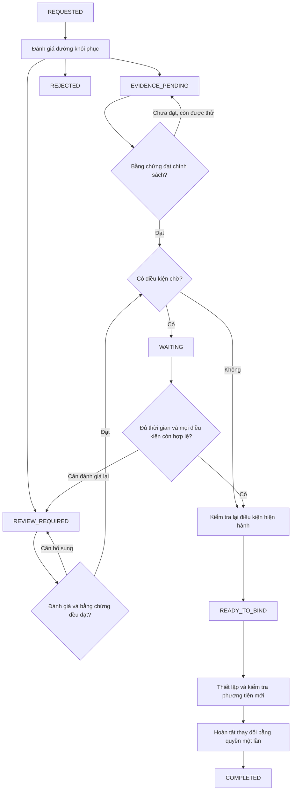

# Phương án khôi phục dự phòng khi không thể hoàn thành step-up

**Step-up recovery fallback** là đường xử lý đã được thiết kế trước khi người dùng không thể cung cấp bằng chứng xác minh bổ sung theo cách thông thường. Trong module `SECURITY_AUTHENTICATION_ACCOUNT_RECOVERY`, đường này giúp người dùng lấy lại quyền kiểm soát khi mất mật khẩu, MFA, passkey hoặc thiết bị xác thực, đồng thời hạn chế việc kẻ tấn công lợi dụng quy trình khôi phục.

Ví dụ, hệ thống yêu cầu xác thực bằng passkey trước khi thay MFA, nhưng người dùng vừa mất thiết bị chứa passkey. Một thiết kế đầy đủ cần có cách đánh giá bằng chứng khác, phạm vi quyền trong lúc khôi phục và điều kiện hoàn tất. Chỉ thêm nút “Không làm được bước này” rồi bỏ yêu cầu xác minh sẽ tạo đường chiếm đoạt tài khoản.

Bài học tập trung vào **cách chuyển luồng an toàn**, cách quản lý yêu cầu khôi phục và cách xử lý khi mọi phương án tự phục vụ đều không còn phù hợp.

## 1. Phân biệt ba loại đường xử lý thay thế

| Loại xử lý | Khi nào dùng? | Ví dụ |
| --- | --- | --- |
| Dùng authenticator khác | Người dùng vẫn còn phương tiện đã đăng ký đáp ứng yêu cầu. | Dùng khóa bảo mật dự phòng thay passkey trên máy bị mất. |
| Chuyển sang quy trình khôi phục | Người dùng không còn khả năng xác thực theo yêu cầu hiện tại. | Dùng tổ hợp recovery code và bằng chứng còn lại theo chính sách. |
| Thử lại hoặc chờ hệ thống phục hồi | Vấn đề nằm ở giao thức, kết nối hoặc nhà cung cấp. | Giữ nguyên yêu cầu xác minh và cho thử lại khi dịch vụ sẵn sàng. |

Ba trường hợp có thể xuất hiện trên cùng giao diện nhưng có kết quả bảo mật khác nhau.

Dùng authenticator khác có thể hoàn thành một lần xác thực thông thường. Quy trình khôi phục có thể chỉ cấp quyền giới hạn để thiết lập phương tiện thay thế. Thử lại sau lỗi hệ thống chưa tạo thêm bằng chứng nào.

Cũng cần phân biệt khôi phục tài khoản người dùng với quyền truy cập khẩn cấp của quản trị viên. Một cơ chế vận hành khẩn cấp không nên trở thành nút bỏ MFA trong mọi yêu cầu khôi phục cá nhân.

## 2. Xác định nguyên nhân không hoàn thành step-up

Lời khai “tôi không thể xác minh” là dữ liệu đầu vào cần xử lý, chưa phải bằng chứng về quyền sở hữu tài khoản.

| Nguyên nhân | Điều có thể đang xảy ra | Hướng xử lý |
| --- | --- | --- |
| Challenge hết hạn | Người dùng thao tác chậm hoặc quay lại trang cũ. | Tạo challenge mới nếu yêu cầu và giới hạn thử còn cho phép. |
| Phản hồi không hợp lệ nhiều lần | Nhập nhầm, đồng hồ OTP lệch hoặc hành vi dò mã. | Áp dụng giới hạn, hướng dẫn phù hợp và đánh giá rủi ro. |
| Trình duyệt không hỗ trợ phương tiện | Môi trường hiện tại không tương thích. | Đề xuất phương tiện khác đã đủ điều kiện hoặc môi trường được hỗ trợ. |
| Mất điện thoại hoặc khóa bảo mật | Phương tiện không còn trong tay người dùng. | Chọn authenticator còn lại hoặc quy trình khôi phục phù hợp. |
| Nghi ngờ phương tiện bị lộ | Kẻ khác có thể sử dụng cùng bằng chứng. | Loại bằng chứng liên quan khỏi đường khôi phục cần nguồn tin cậy khác. |
| Dịch vụ SMS, push hoặc xác minh gặp lỗi | Chưa thể kiểm tra bằng chứng. | Chờ, thử lại hoặc dùng đường khác đã được chính sách cho phép. |
| Mất mọi bằng chứng được hỗ trợ | Không đủ căn cứ cho khôi phục tự động. | Chuyển đánh giá theo quy trình hoặc từ chối khôi phục tự động. |

Không tăng quyền chỉ vì người dùng thất bại nhiều lần. Kẻ tấn công có thể chủ động làm challenge thất bại để tìm đường ít kiểm soát hơn.

OWASP mô tả nguy cơ hạ yêu cầu MFA qua các luồng thay thế yếu và khuyến nghị kiểm soát việc chuyển sang phương thức có mức bảo đảm thấp hơn. [OWASP Multifactor Authentication Cheat Sheet — MFA Downgrade Attacks](https://cheatsheetseries.owasp.org/cheatsheets/Multifactor_Authentication_Cheat_Sheet.html#mfa-downgrade-attacks)

## 3. Những điều kiện phải giữ khi chuyển luồng

### 3.1. Chỉ mở các đường đã được định nghĩa

Backend quyết định những đường nào được phép cho tài khoản và hành động đang xét.

Không để client gửi `fallback=true`, `skipMfa=true` hoặc `supportApproved=true` rồi coi đó là căn cứ cấp quyền. Giao diện chỉ thể hiện những lựa chọn backend cho phép.

### 3.2. Giữ rõ mục tiêu bảo vệ

Đường thay thế có thể sử dụng bằng chứng khác với đăng nhập thường ngày. Điều kiện, rủi ro còn lại và quyền được cấp phải được đánh giá trong chính sách khôi phục.

Không suy ra rằng một bước khôi phục có tên “nâng cao” đã đạt cùng AAL với một lần xác thực mạnh. Cũng không tự thay đổi yêu cầu bắt buộc chỉ để người dùng hoàn thành nhanh hơn.

### 3.3. Dùng căn cứ có nguồn gốc phù hợp

Bằng chứng phải được liên kết đáng tin cậy với tài khoản. Kênh vừa thêm bởi người đang yêu cầu không tự tạo bằng chứng về quyền sở hữu trước đó.

Ví dụ, nhập email mới rồi nhận mã ở email mới chỉ cho thấy người yêu cầu kiểm soát địa chỉ đó. Nó chưa chứng minh họ có quyền thay MFA của tài khoản đích.

### 3.4. Cấp quyền theo từng giai đoạn

Có quyền gửi yêu cầu khôi phục không đồng nghĩa có quyền xem dữ liệu riêng tư. Có quyền nộp bằng chứng không đồng nghĩa có quyền thay authenticator. Có quyền thiết lập authenticator mới chưa chắc đồng nghĩa được thực hiện mọi thao tác của tài khoản.

### 3.5. Có trạng thái kết thúc rõ ràng

Một yêu cầu có thể hoàn tất, hết hạn, bị hủy hoặc bị từ chối. Mỗi trạng thái phải có quy tắc đối với challenge, token, quyền tạm thời và dữ liệu đang chờ.

Nếu không còn căn cứ đủ điều kiện, việc dừng khôi phục tự động là một kết quả được thiết kế trước.

## 4. Các đường khôi phục có thể hỗ trợ

### 4.1. Authenticator dự phòng đã đăng ký

Đây thường là đường ít làm gián đoạn nhất nếu người dùng còn một phương tiện đáp ứng chính sách.

Ví dụ, mất passkey trên điện thoại nhưng vẫn có khóa bảo mật đăng ký từ trước. Backend yêu cầu chứng minh bằng khóa đó cho đúng tài khoản và thao tác.

Không chỉ kiểm tra credential có tồn tại trong danh sách. Cần xác minh phản hồi thực tế, trạng thái thu hồi và các điều kiện bảo mật liên quan.

### 4.2. Bằng chứng khôi phục đã chuẩn bị trước

Dịch vụ có thể hỗ trợ recovery code đã lưu, mã khôi phục phát tới địa chỉ đã thiết lập hoặc recovery contact đã cấu hình.

NIST phân loại các phương pháp khôi phục gồm saved recovery code, issued recovery code, recovery contact và repeated identity proofing. Tổ hợp được chấp nhận phụ thuộc yêu cầu của tài khoản; một mã đơn lẻ không mặc định đủ cho mọi trường hợp. [NIST SP 800-63B-4 — Account Recovery](https://pages.nist.gov/800-63-4/sp800-63b/events/#account-recovery)

Chính sách cần chỉ rõ bằng chứng nào phải kết hợp với bằng chứng nào. Hai mã gửi vào cùng hộp thư hoặc hai mã trong cùng bộ mã đã lưu không tự trở thành hai nguồn độc lập.

Recovery contact phải có quan hệ và địa chỉ đã thiết lập theo quy trình. Không cho người yêu cầu tự chỉ định một người mới ngay trong sự cố rồi dùng lời xác nhận của người đó để lấy tài khoản.

### 4.3. Xác minh lại danh tính

Đường này cần một cơ sở đối chiếu đáng tin cậy giữa danh tính và tài khoản.

Ví dụ, một dịch vụ đã xác minh danh tính khi mở tài khoản có thể có quy trình lặp lại phần kiểm tra phù hợp. Một tài khoản bí danh chưa từng gắn với danh tính thật không thể được chứng minh quyền sở hữu chỉ bằng ảnh giấy tờ mới gửi.

Không thu thập giấy tờ hoặc sinh trắc học theo mặc định cho mọi dịch vụ. Phải xác định dữ liệu đó có giúp chứng minh mối liên hệ với tài khoản hay không và quy trình nào được phép xử lý nó.

### 4.4. Hỗ trợ có kiểm soát

Nhân viên hỗ trợ có thể điều phối việc thu thập và đánh giá bằng chứng theo quy trình. Họ không tự trở thành một yếu tố xác thực thay cho chủ tài khoản.

Với thao tác nhạy cảm, dịch vụ có thể yêu cầu người đánh giá và người phê duyệt khác nhau. Hai người cùng đồng ý vẫn không làm một hồ sơ thiếu bằng chứng trở thành đủ điều kiện.

### 4.5. Chờ hoặc từ chối khôi phục tự động

Đây là lựa chọn cần có khi không còn bằng chứng đáp ứng yêu cầu.

Thông báo cần giúp người dùng hiểu trạng thái và đường hỗ trợ hợp lệ. Không cam kết chắc chắn lấy lại được tài khoản khi hệ thống chưa có cơ sở xác minh.

## 5. Thiết kế điều kiện chuyển đường

Mỗi đường khôi phục nên có một hồ sơ chính sách đủ cụ thể để backend thực thi.

| Nội dung | Ví dụ câu hỏi cần trả lời |
| --- | --- |
| Phạm vi | Đường này cho phép đặt mật khẩu, thay TOTP hay thay passkey nào? |
| Điều kiện đầu vào | Tài khoản thuộc nhóm nào? Có nghi ngờ chiếm đoạt không? |
| Bằng chứng | Những bằng chứng nào bắt buộc và nguồn gốc nào được chấp nhận? |
| Điều kiện loại trừ | Email bị nghi ngờ chiếm đoạt có bị loại không? Phương tiện vừa thêm có được dùng không? |
| Độ mới | Quyết định khôi phục và các bằng chứng tiếp tục có hiệu lực bao lâu? |
| Thời gian chờ | Khi nào phải chờ và điều gì phải được kiểm tra lại sau chờ? |
| Đánh giá thủ công | Ai được xem, đánh giá và phê duyệt? |
| Quyền sau xác minh | Chỉ được thiết lập phương tiện mới hay còn quyền nào khác? |
| Hết hạn và thử lại | Có thể tiếp tục yêu cầu cũ bằng cách nào? Khi nào phải bắt đầu lại? |
| Hoàn tất | Session, token và phương tiện liên quan được xử lý ra sao? |

Không thiết kế một chuỗi mặc định như:

```text
Passkey không dùng được
    -> Thử TOTP
    -> Thử SMS
    -> Hỏi thông tin cá nhân
    -> Cho bỏ MFA
```

Một chuỗi an toàn hơn cần có quyết định chính sách ở từng điểm:

```text
Không hoàn thành phương án hiện tại
    -> Xác định lý do và bối cảnh
    -> Tìm đường khác đủ điều kiện
    -> Thu thập và xác minh bằng chứng của đường đó
    -> Cấp quyền giới hạn cho đúng yêu cầu
    -> Hoàn tất hoặc chuyển trạng thái chờ/từ chối
```

Lỗi ở một phương án không phải giấy phép chuyển sang bất kỳ phương án còn lại nào.

## 6. Quản lý yêu cầu bằng trạng thái phía server

Ví dụ dưới đây mô hình hóa một yêu cầu thay authenticator sau khôi phục. Tên trạng thái là minh họa, không phải chuẩn bắt buộc.

| Trạng thái | Ý nghĩa | Quyền tối đa trong ví dụ |
| --- | --- | --- |
| `REQUESTED` | Đã nhận yêu cầu nhưng chưa đủ bằng chứng. | Theo dõi ngữ cảnh và xem hướng dẫn phù hợp. |
| `EVIDENCE_PENDING` | Đang thu thập bằng chứng theo đường được phép. | Nộp bằng chứng cho chính yêu cầu đó. |
| `REVIEW_REQUIRED` | Cần đánh giá theo quy trình hỗ trợ. | Bổ sung hồ sơ và xem trạng thái được phép công khai. |
| `WAITING` | Điều kiện bằng chứng hiện tại đã đạt nhưng còn kiểm soát chờ. | Theo dõi hoặc phản hồi yêu cầu trong phạm vi cho phép. |
| `READY_TO_BIND` | Được phép thiết lập phương tiện thay thế. | Thiết lập đúng phương tiện trong yêu cầu. |
| `COMPLETED` | Thay đổi đã được chấp nhận và ghi nhận nhất quán. | Kết thúc luồng; đăng nhập mới theo chính sách. |
| `EXPIRED`, `CANCELLED`, `REJECTED` | Yêu cầu đã kết thúc mà không hoàn tất thay đổi. | Xem thông báo phù hợp hoặc khởi tạo yêu cầu mới. |



Mọi bước chưa hoàn tất phải chịu quy tắc hết hạn và hủy, dù sơ đồ không vẽ hết các cạnh đó.

Đặc biệt, chỉ đi từ `WAITING` tới bước thiết lập khi **các điều kiện vẫn còn hợp lệ**. Đồng hồ hết thời gian không tự xác minh danh tính.

## 7. Ngữ cảnh khôi phục cần lưu gì?

Một bản ghi minh họa:

```json
{
  "requestId": "recovery-request-731",
  "subjectId": "account-123",
  "action": "REPLACE_TOTP",
  "targetAuthenticatorId": "totp-old",
  "contextRef": "restricted-context-902",
  "routeId": "existing-secret-and-saved-code",
  "policyVersion": "recovery-v4",
  "baselineSecurityVersion": 18,
  "evidenceRefs": [
    "evidence-281",
    "evidence-282"
  ],
  "state": "WAITING",
  "waitUntil": "2026-11-23T04:00:00Z",
  "requestExpiresAt": "2026-11-23T05:00:00Z",
  "version": 6
}
```

Các định danh và mốc thời gian chỉ để minh họa. Một giờ chờ không phải yêu cầu chung cho mọi tài khoản.

Các điểm cần chú ý:

- `subjectId` và hành động được backend liên kết với bằng chứng, không lấy kết luận từ client.
- `contextRef` trỏ tới ngữ cảnh giới hạn; bản thân mã yêu cầu công khai không được dùng như quyền truy cập.
- `routeId` xác định bộ điều kiện đã chọn, không chỉ ghi chung “đã fallback”.
- `evidenceRefs` trỏ tới kết quả xác minh, không chứa mật khẩu hoặc mã khôi phục bản rõ.
- `baselineSecurityVersion` giúp nhận ra cấu hình bảo mật đã thay đổi trong lúc yêu cầu đang chờ.
- `version` phục vụ kiểm soát cập nhật đồng thời của chính yêu cầu.

Nếu cấu hình tài khoản thay đổi, cần đánh giá lại thay đổi nào ảnh hưởng đến quyết định. Không tiếp tục với ảnh chụp cũ một cách mù quáng, cũng không coi email vừa xuất hiện là kênh đủ tin cậy cho chính yêu cầu đang chờ.

## 8. Bảo vệ token và bằng chứng dùng một lần

Một luồng fallback có thể dùng challenge, recovery code và quyền thực thi ngắn hạn. Phải xác định vai trò của từng loại.

| Dữ liệu | Vai trò | Điều không được suy ra |
| --- | --- | --- |
| Mã yêu cầu | Tra cứu quy trình trong ngữ cảnh được phép. | Biết mã yêu cầu không đồng nghĩa được thay tài khoản. |
| Challenge | Yêu cầu một phép chứng minh. | Có challenge không có nghĩa đã xác minh thành công. |
| Recovery code | Tham gia vào đường khôi phục được định nghĩa. | Mã hợp lệ không tự cho quyền đối với mọi chức năng. |
| Grant thực thi | Cho phép một thao tác đã được duyệt trong phạm vi và thời hạn cụ thể. | Grant không phải session thông thường đầy đủ quyền. |

Thiết kế cần dùng bí mật được sinh bằng cơ chế ngẫu nhiên phù hợp, lưu an toàn và có thời hạn. Các mã ngắn cần kiểm soát thử đoán và bảo vệ dữ liệu lưu trữ tương ứng; băm một mã ngắn không tự làm nó khó dò khi dữ liệu bị lộ.

Khi một recovery code được xác minh thành công:

1. Đánh dấu mã đã sử dụng và ghi kết quả cho đúng yêu cầu bằng cơ chế nguyên tử.
2. Không cho mã đó được xác minh thành công đồng thời ở yêu cầu khác.
3. Tiếp tục dựa trên trạng thái đã lưu và ngữ cảnh hợp lệ.
4. Không đưa mã về trạng thái chưa dùng chỉ vì người dùng đóng trình duyệt.

Cần có đường tiếp tục nếu mã đã được tiêu thụ nhưng người dùng chưa thiết lập xong phương tiện mới. Nếu ngữ cảnh tiếp tục hết hạn, hệ thống yêu cầu bằng chứng phù hợp khác hoặc đánh giá theo chính sách; không mở lại mã cũ tùy tiện.

Không ghi OTP, recovery code, session cookie hoặc token thực thi vào log và nội dung ticket hỗ trợ.

## 9. Thực thi thay đổi một cách nhất quán

Đoạn mã giả dưới đây minh họa bước hoàn tất sau khi đường khôi phục đã được chấp thuận. Nó không thể hiện đầy đủ mọi chi tiết triển khai.

```text
completeFallback(serverContext, requestId, grantRef, candidateCredential):
    requireValidRestrictedContext(serverContext)
    enforceRequestIntegrity(serverContext)
    enforceAbuseLimits(serverContext, requestId)

    transaction:
        request = loadAndLockRecoveryRequest(requestId)
        account = loadAndLockAccount(request.subjectId)
        grant = loadAndLockExecutionGrant(grantRef)

        requireContextOwnsRequest(serverContext, request)
        requireState(request, READY_TO_BIND)
        requireNotExpired(request, serverTime())
        requireGrantMatchesActionAndContext(grant, request, serverContext)
        requireGrantAvailableAndFresh(grant, serverTime())
        requireRecoveryDecisionStillValid(account, request)
        requireAuthorizationForTarget(account, request)
        requireCandidateBoundToApprovedEnrollment(candidateCredential, request)
        requireCandidateProtocolVerification(candidateCredential)

        activateApprovedReplacement(account, request, candidateCredential)
        applyAuthenticatorAndSessionPolicy(account, request)
        consumeGrant(grant)
        markCompleted(request)
        enqueueAuditAndNotificationEvents(account, request)

    return completionResultWithoutGeneralLoginSession()
```

Các ràng buộc quan trọng:

- Grant gắn với đúng tài khoản, hành động, phương tiện đích và ngữ cảnh thực hiện.
- Nếu dữ liệu thao tác thay đổi, phần ràng buộc liên quan phải được đánh giá lại.
- Việc kiểm tra và tiêu thụ grant phải nhất quán với thay đổi tài khoản.
- Request gửi lại sau khi thành công cần có kết quả xử lý lặp an toàn; không thực hiện lần thay thế thứ hai.
- Lỗi gửi thông báo không được khiến thay đổi đã hoàn tất bị chạy lại.

Outbox có thể lưu sự kiện cùng giao dịch rồi chuyển cho hệ thống gửi thông báo sau. Nếu authenticator và session nằm ở nhiều dịch vụ, kiến trúc cần một cơ chế bảo đảm nhất quán tương ứng, không giả định một giao dịch cơ sở dữ liệu bao phủ toàn bộ hệ thống.

Phương tiện mới cần được xác minh đúng giao thức trước khi kích hoạt. Tuy nhiên, việc người yêu cầu điều khiển được phương tiện mới chỉ chứng minh thiết lập đó hoạt động; quyền thay thế phải đến từ quyết định khôi phục trước đó.

OWASP lưu ý rằng luồng khôi phục và đăng ký lại có thể làm suy yếu bảo vệ của tài khoản passkey nếu việc tạo credential mới không được kiểm soát. [OWASP Passkey Security Cheat Sheet — Account Recovery and Bootstrap](https://cheatsheetseries.owasp.org/cheatsheets/Passkey_Security_Cheat_Sheet.html#account-recovery-and-bootstrap)

## 10. Thời gian chờ và thông báo

Thời gian chờ có thể tạo cơ hội để phát hiện yêu cầu lạ, nhận phản hồi từ chủ tài khoản hoặc hoàn tất đánh giá. Nó không tạo thêm bằng chứng về người đang yêu cầu.

Chính sách cần xác định:

- Khi nào áp dụng chờ và sự kiện nào bắt đầu tính thời gian.
- Yêu cầu có thể thay đổi trong khi chờ hay không.
- Cảnh báo nào khiến yêu cầu phải quay lại đánh giá.
- Kết quả khôi phục còn hiệu lực bao lâu.
- Cần bằng chứng tiếp tục nào khi người dùng quay lại.
- Hành vi khi hết hạn hoặc mất ngữ cảnh trình duyệt.

Không dùng một grant ngắn hạn ban đầu rồi kéo dài liên tục suốt nhiều ngày chờ. Có thể lưu quyết định khôi phục có thời hạn ở server và chỉ cấp quyền thực thi ngắn hạn khi đủ điều kiện.

Đối với recovery code đã tiêu thụ, không yêu cầu nhập lại chính mã đó để tiếp tục. Backend phải kiểm tra hiệu lực của quyết định đã lưu và quy tắc tiếp tục. Khi cần bằng chứng mới, phải nêu rõ loại bằng chứng được phép thay vì tự cập nhật thời điểm xác thực.

Thông báo nên cho biết:

- Có yêu cầu khôi phục hoặc thay phương thức xác thực.
- Thời điểm và ngữ cảnh cần thiết ở mức dữ liệu phù hợp.
- Cách báo cáo yêu cầu không phải do mình tạo.
- Kênh hỗ trợ chính thức.

Địa chỉ vừa được thay đổi có thể không phải kênh đáng tin cậy duy nhất để gửi cảnh báo. Cũng không tự khôi phục địa chỉ cũ chỉ vì nó từng tồn tại: địa chỉ đó có thể đã được thay vì mất quyền kiểm soát.

Liên kết phản hồi trong thông báo cần được giới hạn mục đích. Một token chỉ để báo cáo yêu cầu đáng ngờ không được đồng thời cấp quyền đăng nhập hoặc thay cấu hình tài khoản.

Im lặng sau thông báo không tự chứng minh người yêu cầu là chủ tài khoản.

## 11. Hỗ trợ thủ công mà vẫn kiểm soát được

Một quy trình hỗ trợ cần có tiêu chí đầu vào, các bước đánh giá và giới hạn thẩm quyền.

| Điểm kiểm soát | Cách áp dụng trong thiết kế minh họa |
| --- | --- |
| Tách xác minh người yêu cầu và phân quyền nhân viên | Nhân viên đăng nhập vào công cụ hỗ trợ không có nghĩa người gọi đã được xác minh. |
| Hồ sơ có cấu trúc | Ghi loại bằng chứng, nguồn kiểm tra và lý do quyết định bằng mã tham chiếu. |
| Quyền tối thiểu | Cho phép phê duyệt đúng loại khôi phục thay vì sửa trực tiếp mọi trường tài khoản. |
| Phê duyệt bổ sung theo rủi ro | Yêu cầu người phê duyệt độc lập cho tài khoản hoặc thao tác nhạy cảm khi chính sách quy định. |
| Chống giả mạo và gây áp lực | Không dùng chức danh, lời thúc giục hoặc thông tin công khai làm bằng chứng quyết định. |
| Khả năng truy vết | Liên kết quyết định với yêu cầu, phiên bản chính sách và người có thẩm quyền. |
| Bảo vệ dữ liệu | Chỉ thu thập và lưu tài liệu cần thiết theo phạm vi xử lý được phép. |

Không yêu cầu người dùng đọc recovery code hoặc OTP cho nhân viên nếu quy trình có kênh nộp an toàn do hệ thống kiểm tra. Việc nhân viên nhìn thấy bí mật làm tăng số nơi có thể lộ bí mật.

Nếu có quy trình dành riêng cho lực lượng lao động nội bộ, phải xác định nguồn dữ liệu nhân sự hoặc kênh xác nhận nào có giá trị và nguy cơ bị giả mạo. Không áp dụng một lời xác nhận qua điện thoại cho mọi dịch vụ công cộng.

Nếu yêu cầu ngoại lệ vượt chính sách thông thường, cần có đường quản trị ngoại lệ được định nghĩa rõ. Không dùng quyền sửa cơ sở dữ liệu trực tiếp để giải quyết từng ticket rồi bỏ qua nhật ký và giới hạn quyền.

## 12. Xử lý lỗi dịch vụ và chống lạm dụng

### 12.1. Lỗi nhà cung cấp không phải bằng chứng xác minh

Khi dịch vụ SMS hoặc push gặp lỗi, backend có thể giữ yêu cầu ở trạng thái chờ, cho thử lại trong giới hạn hoặc đề xuất đường khác đã đủ điều kiện.

Không đổi `verificationStatus` thành thành công do timeout. Kết quả không kiểm tra được phải giữ trạng thái chưa xác minh.

Nếu dịch vụ đánh giá rủi ro không hoạt động, hành vi cần được định nghĩa trước. Với thay đổi nhạy cảm, có thể yêu cầu đường bằng chứng đủ điều kiện độc lập với dịch vụ đó hoặc tạm dừng; không mặc định coi lỗi là rủi ro thấp.

### 12.2. Chuyển đường không được xóa lịch sử thử

Cần giới hạn cả ở cấp challenge, yêu cầu và tài khoản phù hợp với thiết kế.

Một người thử sai TOTP nhiều lần rồi chuyển sang recovery code vẫn đang trong cùng bối cảnh lạm dụng. Mỗi challenge có bộ đếm riêng chưa đủ để bảo vệ toàn quy trình.

Tạo yêu cầu mới cũng không nên trở thành cách đặt lại mọi ngân sách chống dò mã.

### 12.3. Không cho người ngoài dễ khóa chủ tài khoản

Một yêu cầu khôi phục chưa xác minh không nên tự xóa authenticator, hủy mọi session hoặc khóa toàn bộ đăng nhập.

Cần phân biệt:

- Không đề xuất một phương tiện trong yêu cầu hiện tại vì người yêu cầu nói đã mất.
- Thực hiện đình chỉ hoặc thu hồi phương tiện ở cấp tài khoản theo quy trình báo mất và chính sách được chứng thực.
- Áp dụng biện pháp ứng phó sự cố từ tín hiệu tin cậy của hệ thống.

Các hành động có mức tác động khác nhau nên cần căn cứ khác nhau.

### 12.4. Hạn chế dò tài khoản và gửi thông báo hàng loạt

Ở điểm vào công khai, dùng thông báo phù hợp cho cả tài khoản tồn tại và không tồn tại, đồng thời tránh khác biệt thời gian dễ quan sát.

Giới hạn tần suất gửi email, SMS và push. Có thể thông báo trạng thái nhiều lần cho cùng người dùng mà không gửi lại một bí mật mới mỗi lần họ tải lại trang.

## 13. Ví dụ: khôi phục sau khi mất điện thoại

Giả sử một dịch vụ lưu tài liệu cá nhân có tài khoản dùng mật khẩu và TOTP. Người dùng mất điện thoại, còn nhớ mật khẩu và có recovery code đã cất riêng.

Trong ví dụ, chính sách dịch vụ chấp nhận tổ hợp mật khẩu hợp lệ cùng recovery code đã cấp trước để mở quyền thay TOTP, khi không có chỉ báo làm mất độ tin cậy của các bằng chứng này.

Luồng xử lý:

1. Người dùng chọn “Tôi không còn dùng được ứng dụng xác thực”.
2. Backend tạo ngữ cảnh giới hạn, chưa cấp quyền đọc tài liệu.
3. Backend đánh giá đường khôi phục và xác minh các bằng chứng bắt buộc.
4. Recovery code hợp lệ được tiêu thụ một lần, kết quả được gắn với yêu cầu.
5. Nếu cần chờ hoặc đánh giá bổ sung theo chính sách, yêu cầu đi vào trạng thái tương ứng.
6. Khi mọi điều kiện đạt, backend cấp quyền ngắn hạn để thiết lập TOTP thay thế.
7. Người dùng xác nhận thiết lập mới; backend hoàn tất thay đổi nhất quán và xử lý thông tin liên quan.
8. Luồng khôi phục kết thúc. Người dùng đăng nhập bằng cấu hình mới trước khi dùng chức năng thông thường.
9. Hệ thống gửi thông báo về thay đổi và cách phản hồi nếu không được cho phép.

Các biến thể làm thay đổi quyết định:

| Biến thể | Điều cần thay đổi |
| --- | --- |
| Còn khóa bảo mật dự phòng đáp ứng yêu cầu | Có thể dùng authenticator đó thay vì đi sâu vào khôi phục. |
| Recovery code nằm trong kho đồng bộ đã bị nghi ngờ chiếm đoạt | Không tự coi mã đó là nguồn tách biệt với sự cố. |
| Không còn mật khẩu và recovery code | Chỉ mở đường khác mà tài khoản thực sự đủ điều kiện; không bỏ yêu cầu bằng chứng. |
| Email khôi phục vừa bị thay đổi trước sự cố | Đánh giá lịch sử và nguồn gốc thay đổi; không dựa duy nhất vào email mới. |
| Người dùng đóng trang sau khi mã đã bị tiêu thụ | Tiếp tục bằng ngữ cảnh hợp lệ hoặc theo chính sách bắt đầu lại, không phục hồi mã đã dùng. |

Ví dụ này không khẳng định mọi dịch vụ phải dùng cùng tổ hợp hoặc có cùng mức AAL. Điểm cần giữ là chuyển đường có căn cứ, quyền giới hạn và thay đổi được kiểm soát đến lúc kết thúc.

## 14. Session và quyền truy cập sau khôi phục

Recovery context không nên được các API thông thường chấp nhận như một session đăng nhập đầy đủ. Phải kiểm soát loại ngữ cảnh và scope tại backend, không chỉ ẩn nút trên giao diện.

Khi chuyển qua ranh giới xác thực hoặc thay đổi mức quyền, cần đổi định danh hoặc bí mật session phù hợp để giảm nguy cơ session fixation. Session cũ phải được xử lý phía server theo chính sách. [OWASP Session Management Cheat Sheet](https://cheatsheetseries.owasp.org/cheatsheets/Session_Management_Cheat_Sheet.html#renew-the-session-id-after-any-privilege-level-change)

Nếu tài khoản có dấu hiệu đã bị chiếm đoạt, chỉ đổi mật khẩu có thể chưa loại bỏ quyền của kẻ tấn công. Cần xét session còn sống, các phương tiện bị lộ, thay đổi trái phép và yêu cầu khôi phục đang chờ. [OWASP Forgot Password Cheat Sheet — Account Recovery After Suspected Compromise](https://cheatsheetseries.owasp.org/cheatsheets/Forgot_Password_Cheat_Sheet.html#account-recovery-after-suspected-compromise)

Trong một thiết kế minh họa, bước hoàn tất có thể:

- Thu hồi các phương tiện được xác định là bị lộ theo chính sách.
- Vô hiệu hóa session và refresh token liên quan.
- Vô hiệu hóa grant, liên kết đặt lại mật khẩu và yêu cầu khôi phục cũ có thể mở lại quyền trái phép.
- Yêu cầu đăng nhập mới bằng cấu hình đã cập nhật.
- Cho chủ tài khoản đã được xác minh rà soát phương thức khôi phục và các thay đổi liên quan.

Với access token tự chứa, thu hồi refresh token không tự làm access token đã cấp hết hiệu lực ngay. Cần cơ chế kiểm tra trạng thái hoặc phiên bản bảo mật, hay một cửa sổ hiệu lực ngắn được chấp nhận rõ ràng trong kiến trúc.

Không hiển thị “đã an toàn” chỉ vì mật khẩu mới đã được lưu trong khi session của kẻ tấn công vẫn có thể sử dụng.

## 15. Quan sát hiệu quả của đường fallback

Cần theo dõi cả khả năng hoàn thành của người dùng và nguy cơ bị lạm dụng.

| Chỉ số | Cách diễn giải |
| --- | --- |
| Tỷ lệ chuyển sang fallback | Số yêu cầu chuyển đường chia cho số yêu cầu step-up trong cùng nhóm thao tác và thời gian. |
| Tỷ lệ hoàn tất từng đường | Số yêu cầu hoàn tất chia cho số yêu cầu bắt đầu đường tương ứng; tách lỗi người dùng và lỗi dịch vụ. |
| Số yêu cầu không còn đường đủ điều kiện | Cho biết nhu cầu chuẩn bị phương tiện dự phòng hoặc cải thiện quy trình hỗ trợ. |
| Thời gian chờ và thời gian xử lý thủ công | Giúp phát hiện điểm nghẽn làm người dùng mất quyền truy cập kéo dài. |
| Số lần chuyển đường trước khi thành công | Có thể gợi ý lỗi giao diện hoặc hành vi tìm đường hạ yêu cầu. |
| Số lần sử dụng lại mã hoặc grant bị chặn | Cần đối chiếu request đồng thời, gửi lại hợp lệ và dấu hiệu tấn công. |
| Thay đổi bị chủ tài khoản báo cáo | Phải kết hợp kết quả điều tra để đánh giá nguy cơ chiếm đoạt sau khôi phục. |

Không tăng tỷ lệ hoàn tất bằng cách tự bỏ một điều kiện bắt buộc. Cũng không coi nhiều người bị chặn là bằng chứng rằng hệ thống bảo vệ tốt.

Khi mô tả một đường fallback, tài liệu thiết kế cần thể hiện được **điều kiện chuyển đường, bằng chứng cần có, quyền trong từng trạng thái, điều kiện kết thúc và xử lý session sau cùng**. Các mô hình và mã giả trong bài là ví dụ học tập; khi áp dụng tiêu chuẩn cụ thể, phải đối chiếu đầy đủ yêu cầu về khôi phục, authenticator và session của tiêu chuẩn đó.
