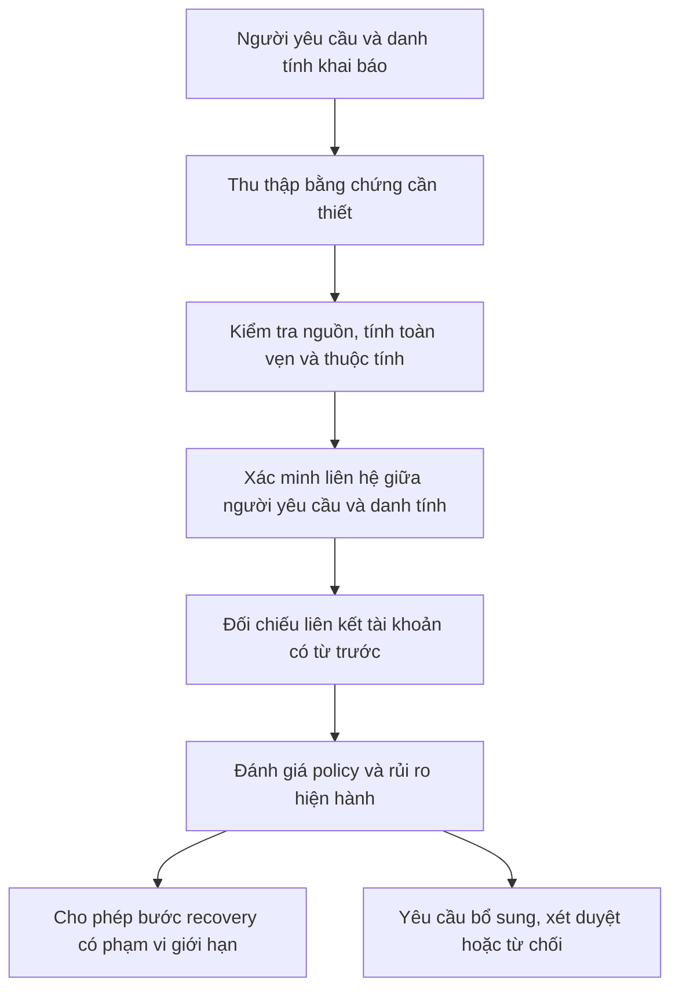

# Bằng chứng xác minh danh tính trong khôi phục tài khoản

## 1. Bằng chứng cần trả lời câu hỏi nào?

Trong chương **Identity Proofing** của module `SECURITY_AUTHENTICATION_ACCOUNT_RECOVERY`, bài học này giải thích cách lựa chọn, kiểm tra và sử dụng **identity proofing evidence** khi người dùng mất mật khẩu, MFA, passkey hoặc thiết bị xác thực.

Một người gửi ảnh giấy tờ thật chưa chắc là chủ giấy tờ. Một người là chủ giấy tờ cũng chưa chắc là chủ tài khoản cần khôi phục. Vì vậy, quyết định recovery cần làm rõ các quan hệ sau:

1. Danh tính được khai báo có tồn tại và đủ phân biệt trong phạm vi dịch vụ không?
2. Bằng chứng và các thuộc tính được cung cấp có đáng tin cậy không?
3. Người đang yêu cầu có liên hệ được kiểm chứng với danh tính đó không?
4. Danh tính đó đã có liên hệ đáng tin cậy với tài khoản cần khôi phục từ trước chưa?

Ví dụ xuyên suốt: **Mai mất điện thoại chứa MFA và không còn mã khôi phục**. Dịch vụ từng xác minh danh tính của Mai khi tạo tài khoản. Mai có giấy tờ được cấp lại và đề nghị đối chiếu danh tính. Backend cần kiểm tra giấy tờ mới, xác minh người xuất trình và nối kết quả với hồ sơ danh tính trước sự cố. Không thể chỉ so tên hiển thị rồi cho đặt lại mọi yếu tố xác thực.

Sau bài học, bạn có thể phân loại các loại bằng chứng, nhận diện quan hệ phụ thuộc giữa chúng, thiết kế kết quả xác minh có nguồn gốc và giới hạn phạm vi, đồng thời bảo vệ dữ liệu nhạy cảm trong quá trình recovery.

Các bảng, tên trường, trạng thái và mã giả trong bài là mô hình thiết kế minh họa. Chúng không tự tạo thành một quy trình đạt chuẩn hay một tuyên bố tuân thủ pháp luật.

## 2. Phân biệt resolution, validation, verification và liên kết tài khoản

NIST mô tả identity proofing qua ba phần: **resolution** để phân biệt danh tính, **validation** để kiểm tra bằng chứng và thuộc tính, **verification** để nối người xuất trình với danh tính đã được kiểm tra. Xem [NIST SP 800-63A-4, Identity Proofing Overview](https://pages.nist.gov/800-63-4/sp800-63a/proofing/).

| Phần việc | Câu hỏi | Ví dụ kết quả |
| --- | --- | --- |
| Identity resolution | Có đủ dữ liệu để phân biệt danh tính trong quần thể phục vụ không? | Xác định một danh tính cụ thể, xử lý trường hợp trùng tên |
| Evidence và attribute validation | Nguồn và nội dung có thật, chính xác, có thể chấp nhận không? | Kết quả kiểm tra giấy tờ, chữ ký số hoặc đối chiếu nguồn được phép |
| Identity verification | Người đang tham gia có phải người gắn với danh tính đã được kiểm tra không? | Kết quả xác minh quyền sở hữu bằng chứng hoặc đối chiếu phù hợp |
| Liên kết với tài khoản cũ | Danh tính này có phải danh tính đã gắn với tài khoản trước sự cố không? | Khớp với hồ sơ gốc đã được xác minh, có nguồn gốc và phiên bản |

Phần liên kết tài khoản là yêu cầu của bài toán recovery. Nó không được thay bằng việc người yêu cầu tự nói “đây là tài khoản của tôi”.



Không bước nào trong sơ đồ mặc nhiên tạo session đầy quyền. Kết quả identity proofing là một đầu vào cho quyết định recovery; việc gắn credential mới, thu hồi quyền cũ và tái xác thực là các quyết định tiếp theo.

## 3. Những loại bằng chứng dễ bị gộp nhầm

Trong giao tiếp thông thường, mọi thông tin người dùng gửi đều có thể bị gọi là “bằng chứng”. Trong thiết kế bảo mật, cần ghi rõ thông tin đó chứng minh được điều gì.

| Loại thông tin | Có thể hỗ trợ điều gì? | Giới hạn quan trọng |
| --- | --- | --- |
| Giấy tờ danh tính vật lý được chấp nhận | Thuộc tính danh tính và nguồn phát hành | Ảnh chụp chưa tự chứng minh giấy tờ thật hoặc người gửi là chủ giấy tờ |
| Bằng chứng danh tính số có bảo vệ mật mã | Nguồn, tính toàn vẹn và các thuộc tính được issuer khẳng định | Cần đánh giá issuer, hiệu lực, cách xuất trình và liên kết người giữ |
| Hồ sơ identity proofing trước sự cố | Điểm đối chiếu danh tính với tài khoản | Cần biết hồ sơ được xác minh bằng cách nào và có bị thay đổi trái phép không |
| Passkey hoặc yếu tố còn dùng được | Quyền kiểm soát credential đã gắn với tài khoản | Không mặc nhiên chứng minh danh tính ngoài đời nếu tài khoản chưa từng có liên kết đó |
| Mã khôi phục đã thiết lập | Quyền tham gia nhánh recovery theo policy | Là bí mật recovery, không phải giấy tờ danh tính; cần tiêu thụ đúng cách |
| Quyền kiểm soát email hoặc số điện thoại | Khả năng nhận phản hồi ở một kênh cụ thể | Kênh có thể bị chiếm, tái cấp hoặc vừa bị thay đổi |
| Lịch sử giao dịch, hóa đơn, mã đơn hàng | Liên hệ với hoạt động tài khoản khi được đối chiếu từ nguồn nội bộ | Ảnh chụp và thông tin rò rỉ có thể bị người khác sử dụng |
| IP, cookie hoặc dấu vết thiết bị | Ngữ cảnh và tín hiệu rủi ro | Có thể bị chia sẻ, sao chép hoặc thay đổi; không đủ để tự xác minh danh tính |
| Tên, ngày sinh, địa chỉ, thông tin công khai | Hỗ trợ tìm hồ sơ hoặc giải quyết mâu thuẫn | Biết một thuộc tính không chứng minh là người mang thuộc tính đó |
| Lời trình bày với nhân viên hỗ trợ | Giải thích hoàn cảnh và định tuyến hỗ trợ | Một câu chuyện thuyết phục không thay thế phép kiểm tra được quy định |

Ảnh giấy tờ và ảnh selfie thường phục vụ hai phần khác nhau của cùng một phương án xác minh. Không tự đếm chúng thành hai nguồn bằng chứng độc lập chỉ vì có hai file.

Tương tự, xác thực bằng passkey mạnh có thể đủ cho một nhánh quản lý credential mà không cần hỏi giấy tờ. Thu thập thêm dữ liệu danh tính khi không cần thiết làm tăng gánh nặng và hậu quả nếu dữ liệu bị lộ.

## 4. Đánh giá độ mạnh theo khả năng kiểm chứng

Độ phân giải ảnh, số trang tài liệu hoặc vẻ trang trọng của giấy tờ không phải thước đo đầy đủ. Một chính sách bằng chứng cần đánh giá ít nhất các chiều sau:

- **Nguồn phát hành:** ai đưa ra khẳng định, quy trình phát hành có đáng tin cho mục đích này không?
- **Tính xác thực:** có thể phát hiện tài liệu giả hoặc bị sửa bằng phương thức phù hợp không?
- **Độ chính xác:** các thuộc tính quan trọng có thể được kiểm tra qua nguồn được phép không?
- **Khả năng xác minh người xuất trình:** cơ chế nào nối người đang tham gia với chủ thể trên bằng chứng?
- **Tính phù hợp theo thời gian:** bằng chứng, khóa xác minh và thông tin liên quan có còn được policy chấp nhận không?
- **Liên kết lịch sử:** bằng chứng giúp nối với tài khoản trước sự cố bằng cách nào?
- **Phạm vi xâm phạm:** nó có phụ thuộc vào thiết bị, email hoặc nhà cung cấp đang bị nghi chiếm không?

NIST phân loại bằng chứng thành `FAIR`, `STRONG`, `SUPERIOR` theo điều kiện cụ thể; độ mạnh phụ thuộc cả quy trình phát hành và khả năng kiểm tra. Không tự gán mức chỉ từ tên loại giấy tờ. Xem [NIST, Evidence Strength Requirements](https://pages.nist.gov/800-63-4/sp800-63a/proofing/#evidence-strength-requirements).

Một hộ chiếu có chip được kiểm tra chữ ký bằng chuỗi tin cậy phù hợp khác với một ảnh chụp trang hộ chiếu. Tên loại tài liệu giống nhau không làm hai phương án có cùng khả năng phát hiện giả mạo.

**IAL** mô tả mức bảo đảm về danh tính; **AAL** mô tả mức bảo đảm của xác thực. Gửi giấy tờ không tự tạo một lần xác thực MFA, và xác thực MFA không tự chứng minh danh tính ngoài đời. Nếu sản phẩm tuyên bố đáp ứng một mức cụ thể, phải đối chiếu toàn bộ yêu cầu của quy trình tương ứng thay vì dựa vào bảng minh họa trong bài.

## 5. Kiểm tra bằng chứng và thuộc tính

### 5.1. Tách trích xuất dữ liệu khỏi kiểm chứng

OCR trả về tên và số giấy tờ chỉ cho biết hệ thống đã đọc được ký tự. Nó không chứng minh giấy tờ do đúng cơ quan cấp, chưa bị sửa hoặc thuộc về người gửi.

Tương tự, một QR code đọc được chỉ cho biết có dữ liệu theo một định dạng. Nếu nội dung cần chữ ký số hoặc truy vấn nguồn, phải thực hiện các kiểm tra đó. Không tin một URL hoặc nhãn “đã xác thực” nằm trong ảnh do người dùng tải lên.

### 5.2. Chọn phương thức phù hợp với vật mang bằng chứng

Với tài liệu vật lý, có thể cần kiểm tra đặc điểm bảo an qua công nghệ phù hợp hoặc nhân sự được đào tạo. Một ảnh quá mờ không cho phép kết luận tài liệu giả, nhưng cũng không đủ để chấp nhận nếu thiếu đặc điểm bắt buộc.

Với bằng chứng số, cần kiểm tra cơ chế bảo vệ nội dung, khóa hoặc chuỗi tin cậy, nguồn phát hành, thời hạn và trạng thái khi cơ chế đó yêu cầu. Một chữ ký đúng bằng khóa do chính người yêu cầu đưa ra chưa tạo lòng tin với issuer.

Nếu đối chiếu thuộc tính qua dịch vụ khác, nguồn cần được xác định trước, truy cập qua kênh được bảo vệ và có quyền sử dụng cho mục đích đã nêu. Không suy diễn rằng một kết quả tìm kiếm công khai là nguồn xác minh có thẩm quyền.

### 5.3. Ghi rõ giới hạn của kết quả

Kết quả nên phân biệt:

- Dữ liệu đọc được nhưng chưa kiểm tra.
- Đã kiểm tra cấu trúc hoặc một số đặc điểm tài liệu.
- Đã kiểm tra nguồn và tính toàn vẹn theo một cơ chế cụ thể.
- Đã đối chiếu các thuộc tính bắt buộc.
- Chưa kết luận vì thiếu chất lượng, lỗi nguồn hoặc không hỗ trợ định dạng.

Một boolean `documentValid = true` dễ làm service sau hiểu nhầm rằng tất cả những việc trên đều đã hoàn tất.

### 5.4. Giấy tờ hết hạn hoặc được cấp lại

Không nên gộp “hết hạn sử dụng hành chính” với “không còn giá trị thông tin trong mọi tình huống”. Policy phải quy định rõ tài liệu nào được chấp nhận, cách xử lý tài liệu cũ, việc thay số định danh và nguồn kiểm tra cần thiết.

Nếu policy yêu cầu tài liệu hiện hành mà người dùng chỉ có tài liệu cũ, kết quả có thể là cần phương án khác hoặc xét duyệt. Nhân viên không tự nới quy tắc vì hình ảnh trông quen thuộc; cũng không tự xóa liên kết lịch sử chỉ vì số tài liệu mới khác số cũ.

## 6. Xác minh người xuất trình và bằng chứng số

### 6.1. Tài liệu thật có thể bị người khác sử dụng

Kẻ tấn công có thể có bản scan thật từ một vụ rò rỉ. Vì vậy, xác thực tài liệu và xác minh người xuất trình cần được ghi thành các kết quả riêng.

Trong phương án dùng ảnh khuôn mặt, hệ thống cần xác định ảnh tham chiếu đến từ nguồn nào, chất lượng có phù hợp không, cách thu nhận mẫu hiện tại và cơ chế giảm giả mạo. Điểm so khớp chỉ là kết quả của một phép so sánh với ngưỡng và điều kiện cụ thể.

Liveness hoặc presentation attack detection có thể giảm một số kiểu giả mạo, nhưng không bảo đảm tuyệt đối trước deepfake, ảnh chèn vào pipeline hoặc thiết bị bị kiểm soát. Một tín hiệu “có người thật” cũng không chứng minh đó là chủ tài khoản.

Không nên tự viết một phép so ảnh đơn giản rồi gọi kết quả là xác minh danh tính hoàn chỉnh. Cần lựa chọn phương án được đánh giá, định nghĩa lỗi và có đường hỗ trợ phù hợp khi người dùng không thực hiện được.

### 6.2. Chữ ký số xác minh nguồn, không tự xác minh mọi khẳng định

W3C lưu ý rằng kiểm chứng một verifiable credential không đồng nghĩa xác định mọi khẳng định trong đó là đúng. Verifier còn phải áp dụng quy tắc tin cậy với issuer, chủ thể và nội dung. Xem [W3C Verifiable Credentials Data Model v2.0](https://www.w3.org/TR/vc-data-model-2.0/#terminology).

Ví dụ, một issuer có thể được tin để xác nhận tư cách học viên nhưng không được tin để xác nhận số định danh pháp lý. Một credential đúng chữ ký từ issuer ngoài tập được chấp nhận không đáp ứng policy chỉ vì định dạng kỹ thuật hợp lệ.

Người giữ credential không luôn là chủ thể mà credential mô tả. Quy trình xuất trình cần xác định holder binding hoặc quyền xuất trình thích hợp, tính mới của phiên và biện pháp chống phát lại theo giao thức được dùng. Không suy ra các thuộc tính này chỉ từ việc người dùng sở hữu một file.

### 6.3. Không thu hẹp mọi người dùng vào một cách xác minh

Thiết bị không có camera phù hợp, điều kiện ánh sáng, thay đổi ngoại hình hoặc tài liệu không được hệ thống tự động hỗ trợ có thể làm kết quả chưa kết luận. Cần có phương án thay thế được đánh giá và giữ mức bảo đảm tương ứng, không phải nút bỏ qua.

Một bước xét duyệt thủ công phải có tiêu chí, nhân sự đủ quyền và dấu vết quyết định. Chuyển sang thủ công không biến mọi kiểm tra còn thiếu thành đã đạt.

## 7. Liên kết với tài khoản trước sự cố

Đây là ranh giới quan trọng nhất khi áp dụng identity evidence vào recovery.

### 7.1. Tài khoản từng được xác minh danh tính

Hệ thống cần một liên kết đã thiết lập trước đó, ví dụ định danh nội bộ của hồ sơ danh tính hoặc subject ổn định từ dịch vụ proofing đã được chấp nhận. Kết quả mới phải được đối chiếu với liên kết đó, theo quy tắc xử lý thay đổi chính đáng.

Trong ví dụ của Mai, ảnh giấy tờ mới và kết quả xác minh người xuất trình chỉ tạo đầu vào. Backend còn cần xác nhận danh tính mới được đối chiếu đúng với hồ sơ đã gắn vào tài khoản từ trước khi mất MFA.

NIST cho phép nhánh lặp lại identity proofing dựa trên danh tính đã được xác minh trước đó; tài khoản chưa từng identity-proofed không có sẵn cơ sở để dùng reproofing như một nhánh recovery theo mô hình này. Xem [NIST SP 800-63B-4, Account Recovery](https://pages.nist.gov/800-63-4/sp800-63b/events/#account-recovery).

### 7.2. Tài khoản dùng bí danh hoặc chưa từng có liên kết danh tính

Giả sử tài khoản `mayxanh` chỉ có email và tên hiển thị. Một người gửi giấy tờ hợp lệ mang tên Nguyễn Văn An không tự chứng minh tài khoản đó thuộc về An, kể cả khi tên hiển thị hiện tại trùng tên.

Quy trình cần dựa vào các phương án recovery đã thiết lập hoặc bằng chứng liên hệ tài khoản phù hợp với policy. Không được tạo liên kết danh tính mới từ lời khai trong recovery rồi dùng chính liên kết vừa tạo để kết luận đã khớp chủ tài khoản cũ.

### 7.3. Tài khoản tổ chức

Với tài khoản doanh nghiệp, nguồn nhân sự hoặc quản trị danh tính tổ chức có thể là một phần của quy trình được thiết lập trước. Cần kiểm tra đúng đơn vị, trạng thái nhân sự, người phê duyệt và phạm vi ủy quyền.

Thông tin nhân viên công khai hoặc một email mang logo công ty chưa đủ. Danh tính của người gọi helpdesk và thẩm quyền khôi phục tài khoản phải được kiểm tra qua kênh độc lập đã được quy định.

### 7.4. Xử lý thay đổi tên và giấy tờ

Tên có dấu, thứ tự họ tên, phiên âm hoặc thay đổi tên có thể gây khác biệt hợp lệ. Không dùng phép so chuỗi duy nhất để quyết định; cũng không bỏ dấu và gộp mọi hồ sơ giống nhau rồi tự coi là cùng một người.

Liên kết nên dựa vào định danh được quản lý cùng các thuộc tính cần thiết. Những mâu thuẫn còn lại cần quy trình giải quyết có bằng chứng và lịch sử, không cho người yêu cầu sửa trực tiếp hồ sơ gốc để làm kết quả mới khớp.

## 8. Kết hợp bằng chứng mà không cộng điểm mù quáng

Ba ảnh chụp được lấy từ cùng một hộp thư bị chiếm không trở thành ba nguồn độc lập. Một hóa đơn và email xác nhận hóa đơn có thể cùng bắt nguồn từ một giao dịch và cùng được truy cập bằng một session đã bị đánh cắp.

Nên đánh giá quan hệ phụ thuộc theo các câu hỏi:

- Cùng một kẻ tấn công có thể thu được tất cả bằng chứng qua một nguồn không?
- Các khẳng định có xuất phát từ những đơn vị khác nhau nhưng cùng dữ liệu gốc không?
- Có bằng chứng nào được thiết lập trước sự cố và không phụ thuộc vào kênh đang bị nghi lộ không?
- Bằng chứng mới có chỉ lặp lại thông tin do người yêu cầu tự khai không?
- Có mâu thuẫn quan trọng nào chưa được giải quyết không?

| Bộ thông tin | Cách hiểu phù hợp |
| --- | --- |
| Hai bản scan của cùng một giấy tờ | Hai bản biểu diễn của một nguồn, không phải hai bằng chứng độc lập |
| Scan giấy tờ và selfie | Đầu vào cho kiểm tra tài liệu và kiểm tra người xuất trình; cần đánh giá cả phương án |
| Email và SMS cùng nhận trên điện thoại bị mất | Có thể cùng chịu tác động của sự cố; không tự coi là hai miền an toàn |
| Kết quả proofing mới và hồ sơ gốc trước sự cố | Có thể hỗ trợ liên kết danh tính nếu cả nguồn và cơ chế đối chiếu đều đáng tin |
| Hóa đơn do người dùng gửi và dữ liệu giao dịch server | Có thể đối chiếu nội dung, nhưng quyền biết giao dịch chưa chắc đủ cho việc thay MFA |
| Tên, ngày sinh và địa chỉ | Thuộc tính hỗ trợ resolution; không nên cộng thành quyền sở hữu tài khoản |

Một điểm rủi ro tổng hợp có thể giúp định tuyến, nhưng không được bù cho điều kiện bắt buộc còn thiếu. Ví dụ, IP quen thuộc và lịch sử sử dụng dài không làm chữ ký issuer sai trở thành đúng.

Nên có các cổng kiểm tra tách biệt: nguồn được chấp nhận, validation đạt yêu cầu, người xuất trình được xác minh, liên kết tài khoản có trước, ngữ cảnh hiện hành và policy cho phép. Điểm số chỉ hỗ trợ bên trong một quyết định đã định nghĩa rõ.

## 9. Quy trình thu thập và đánh giá bằng chứng

### Bước 1: Chọn nhánh recovery trước khi hỏi dữ liệu

Xác định tài khoản có cơ sở dùng reproofing không, quyền cần khôi phục là gì và còn phương tiện an toàn nào khác. Nếu passkey dự phòng đủ cho nhánh hiện tại, không mặc định bắt người dùng gửi giấy tờ.

### Bước 2: Thông báo yêu cầu tối thiểu

Giải thích loại bằng chứng được chấp nhận, dữ liệu cần có, mục đích, phương án thay thế và cách gửi qua kênh chính thức. Không yêu cầu mật khẩu, recovery code hoặc ảnh giấy tờ trong hộp chat hỗ trợ không được thiết kế để tiếp nhận chúng.

### Bước 3: Tạo hồ sơ và phiên bản yêu cầu

Gắn việc thu thập với `recoveryCaseId`, phiên người yêu cầu, mục đích, thời hạn và policy. Mỗi lần thay bộ bằng chứng cần có phiên bản để kết quả từ bộ cũ không bị dùng nhầm cho bộ mới.

### Bước 4: Tiếp nhận qua kênh có kiểm soát

Kiểm tra quyền tải lên, loại và kích thước file, định dạng thực tế, nội dung nguy hiểm và nơi lưu. Tài liệu chưa được kiểm tra không được mở trực tiếp như nội dung tin cậy trên miền ứng dụng chính.

### Bước 5: Validation và verification

Gọi thành phần kiểm tra thích hợp, lưu tham chiếu kết quả, phương thức, thời gian và giới hạn. Lỗi nhà cung cấp hoặc ảnh không đọc được là kết quả chưa kết luận, không phải tự động đạt hoặc tự động gian lận.

### Bước 6: Đối chiếu liên kết có từ trước

Tải hồ sơ gốc ở trạng thái trước thay đổi đáng ngờ, kiểm tra nguồn và xử lý mâu thuẫn. Không để dữ liệu vừa do người yêu cầu bổ sung trở thành điểm đối chiếu duy nhất.

### Bước 7: Chốt quyết định theo trạng thái hiện hành

Trước khi phê duyệt, kiểm tra hồ sơ chưa hủy, evidence set và policy vẫn phù hợp, kết quả chưa quá cũ, tài khoản chưa có sự kiện làm vô hiệu quyết định. Callback tới muộn không được tự khôi phục một hồ sơ đã đóng.

### Bước 8: Cấp đúng quyền tiếp theo

Nếu đạt yêu cầu, cấp quyền giới hạn cho bước gắn lại credential đã được phê duyệt. Tiếp tục kiểm soát token dùng một lần, session, thông báo và tái xác thực theo luồng recovery. Không trả session đầy quyền chỉ từ một nhãn `identity_verified`.

## 10. Lưu nguồn gốc của kết quả

Một result phục vụ quyết định cần diễn đạt rõ đã kiểm tra những gì. Ví dụ dưới đây không chứa ảnh, số giấy tờ hoặc bí mật thật:

```json
{
  "proofingResultId": "pr-204",
  "recoveryCaseId": "rc-81",
  "caseVersion": 4,
  "evidenceSetVersion": 2,
  "subjectReference": "identity-ref-26",
  "accountLinkReference": "established-link-18",
  "checks": {
    "sourceAccepted": "PASS",
    "evidenceValidation": "PASS",
    "requiredAttributes": "PASS",
    "applicantVerification": "PASS",
    "preExistingAccountLink": "PASS"
  },
  "providerReference": "provider-event-672",
  "methodProfile": "approved-reproofing-profile-v3",
  "policyVersion": "recovery-policy-v7",
  "verifiedAt": "2026-11-23T03:00:00Z",
  "decision": "ELIGIBLE_FOR_RESTRICTED_RECOVERY"
}
```

Đây là bản ghi do backend tạo sau khi xác minh các kết quả đáng tin cậy. Client không được gửi JSON tương tự để tự tuyên bố đã qua kiểm tra.

Một `providerReference` giúp truy vết nhưng không tự mang quyền. Cần xác minh kết quả đến từ đúng nhà cung cấp qua cơ chế bảo vệ của họ, gắn đúng giao dịch, không bị phát lại và không bị thay subject trong lúc ánh xạ.

HMAC hoặc digest có thể hỗ trợ kiểm tra tính toàn vẹn và tương quan, nhưng không chứng minh tài liệu là thật hoặc người gửi là chủ tài khoản. Hash một ảnh giả chỉ tạo một định danh ổn định cho ảnh giả đó.

### Mã giả Java cho các điều kiện bắt buộc

```java
RecoveryDecision evaluate(
        TrustedProofingResult result,
        RecoveryCase currentCase,
        EstablishedIdentityLink originalLink,
        RecoveryPolicy policy,
        Instant now) {

    if (!currentCase.isOpenAt(now)
            || !result.matchesCaseAndEvidenceVersion(currentCase)) {
        return RecoveryDecision.restartRequired("STALE_CONTEXT");
    }

    if (!result.isFromAcceptedSource(policy)
            || !result.isFreshEnough(policy, now)) {
        return RecoveryDecision.moreEvidenceRequired("UNUSABLE_RESULT");
    }

    if (result.hasConfirmedIntegrityFailure()) {
        return RecoveryDecision.reject("EVIDENCE_INTEGRITY_FAILURE");
    }

    if (!result.requiredValidationPassed(policy)
            || !result.applicantVerificationPassed(policy)) {
        return RecoveryDecision.reviewRequired("PROOFING_INCOMPLETE");
    }

    if (!originalLink.wasEstablishedBeforeIncident(currentCase)
            || !result.matchesEstablishedIdentity(originalLink, policy)) {
        return RecoveryDecision.reviewRequired("ACCOUNT_LINK_UNRESOLVED");
    }

    return policy.decideRestrictedRecovery(currentCase, result, now);
}
```

Đây là mã giả theo cú pháp Java. `TrustedProofingResult` phải do adapter xác minh kết quả nhà cung cấp hoặc bộ phận kiểm tra được ủy quyền tạo, không phải DTO nhận trực tiếp từ request. Hàm đánh giá không tự thực hiện OCR, kiểm tra chữ ký hay so sinh trắc học.

Khi áp dụng quyết định, backend cần đọc trạng thái hiện hành và ghi chuyển trạng thái bằng giao dịch hoặc cơ chế version phù hợp. Kết quả `ELIGIBLE` đã tính trước không được bỏ qua một lần hủy recovery xảy ra sau đó.

## 11. Xử lý mâu thuẫn và kết quả chưa kết luận

| Tình huống | Diễn giải ban đầu | Hướng xử lý |
| --- | --- | --- |
| Ảnh mờ, mất góc hoặc không đọc được | Không đủ chất lượng để kiểm tra | Hướng dẫn gửi lại phần cần thiết hoặc dùng phương án khác |
| Nhà cung cấp không trả kết quả | Lỗi hoặc chưa biết kết quả | Chờ/tra cứu qua kênh server, giữ nguyên giới hạn quyền |
| Tên khác do phiên âm hoặc thay đổi hợp lệ | Có mâu thuẫn cần giải quyết | Đối chiếu theo policy và lịch sử, không tự gộp tài khoản |
| Số giấy tờ thay sau cấp lại | Có thể là thay đổi hợp lệ | Kiểm tra liên kết danh tính và nguồn xác nhận phù hợp |
| Phát hiện sửa nội dung đã được xác nhận | Vấn đề về tính toàn vẹn | Từ chối bằng chứng và xử lý theo quy trình chống gian lận |
| Danh tính mới hợp lệ nhưng không nối được với tài khoản | Chưa chứng minh quyền đối với tài khoản cũ | Không chuyển quyền; yêu cầu nhánh recovery phù hợp |
| Callback thuộc evidence set cũ | Ngữ cảnh đã bị thay | Không áp dụng vào bộ bằng chứng mới |
| Người dùng không có tài liệu được chấp nhận | Khoảng trống của phương án hiện tại | Chuyển phương án thay thế hoặc xử lý ngoại lệ có kiểm soát |

Không nên biến mọi kết quả `INCONCLUSIVE` thành `REJECTED_FOR_FRAUD`. Cách phân loại sai vừa gây khó cho người dùng hợp lệ vừa làm dữ liệu vận hành không phản ánh đúng nguyên nhân.

Nhân viên hỗ trợ cần thấy lý do đủ để xử lý, nhưng không nên được xem hoặc tải mọi tài liệu của mọi hồ sơ. Với quyết định rủi ro cao, có thể áp dụng phân tách nhiệm vụ hoặc phê duyệt bổ sung theo policy. Một ghi chú “đã kiểm tra qua điện thoại” không thay thế các kết quả bắt buộc.

## 12. Bảo vệ bằng chứng và dữ liệu cá nhân

Giấy tờ, ảnh khuôn mặt, video và thuộc tính định danh là dữ liệu có thể gây thiệt hại lâu dài nếu bị lộ. Việc thu thập nhiều hơn không luôn làm recovery an toàn hơn.

NIST yêu cầu đánh giá rủi ro riêng tư, giới hạn dữ liệu cần thiết và thông báo mục đích thu thập. Việc lưu giữ và xử lý qua bên thứ ba cũng nằm trong phạm vi đánh giá. Xem [NIST, General Privacy Requirements](https://pages.nist.gov/800-63-4/sp800-63a/ial-general/#general-privacy-requirements).

### 12.1. Thu thập có mục đích

Chỉ yêu cầu thuộc tính mà phương án cần để kiểm tra và liên kết tài khoản. Nêu rõ phần nào cần nhìn thấy và phần nào có thể che nếu policy và phương thức validation cho phép. Không hướng dẫn che tùy ý những vùng bảo an mà quy trình bắt buộc phải kiểm tra.

Không lấy lý do recovery để thu thêm dữ liệu cho quảng cáo hoặc phân tích hành vi ngoài mục đích đã xác định. Việc đồng ý tải ảnh lên không tự giải quyết mọi vấn đề về xử lý dữ liệu.

### 12.2. Lưu trữ và truy cập

Tách kho tài liệu khỏi log và dữ liệu session thông thường; mã hóa truyền tải và lưu trữ, giới hạn quyền theo vai trò và hồ sơ. URL tải/xem nếu được cấp phải có phạm vi và thời hạn thích hợp; không đưa URL có quyền truy cập vào analytics hoặc kênh công khai.

Các bản preview, file tạm, kết quả OCR, bản sao tại nhà cung cấp và bản backup cũng cần chính sách. Xóa hàng tham chiếu trong database không đồng nghĩa dữ liệu đã biến mất ở mọi nơi.

Ưu tiên giữ kết quả tối thiểu và tham chiếu cần thiết khi không có lý do giữ bản thô. Thời gian lưu phải được xác định theo mục đích, yêu cầu áp dụng và khả năng giải quyết tranh chấp; không dùng một con số minh họa làm quy tắc pháp lý chung.

### 12.3. Log và định danh tương quan

Audit log nên ghi loại kiểm tra, thời gian, mã lý do, phiên bản policy và định danh tham chiếu nội bộ. Không ghi ảnh, video, số giấy tờ đầy đủ, mẫu sinh trắc học, OTP, recovery token hoặc bí mật phiên.

Hash số định danh không tự làm dữ liệu vô danh, nhất là khi không gian giá trị dễ dò hoặc có thể liên kết qua nhiều nguồn. Một mã tham chiếu giả danh vẫn cần được quản lý như dữ liệu có khả năng liên hệ với cá nhân.

## 13. Chống lạm dụng và gian lận trong kênh evidence

Các rủi ro cần đưa vào mô hình đe dọa gồm sử dụng tài liệu bị đánh cắp, chỉnh sửa thuộc tính, phát lại kết quả proofing, chèn ảnh/video giả, đánh lừa helpdesk và lạm dụng quyền nhân viên.

Biện pháp bảo vệ cần gắn vào từng điểm:

- **Tại tiếp nhận:** giới hạn số yêu cầu, dung lượng và tần suất; kiểm tra nội dung nguy hiểm; chống người dùng truy cập evidence của hồ sơ khác.
- **Tại nhà cung cấp:** xác thực kết quả, ràng buộc giao dịch và subject, xử lý callback trùng hoặc đến muộn, không tin trường `verified` từ client.
- **Tại quyết định:** đối chiếu evidence set, phiên bản hồ sơ, liên kết tài khoản và policy hiện hành; không cộng điểm để bỏ qua điều kiện bắt buộc.
- **Tại cấp quyền:** grant ngắn hạn, đúng hồ sơ và thao tác; không cho một result dùng mở khóa nhiều tài khoản không được phép.
- **Tại hỗ trợ:** kiểm soát truy cập, phân tách nhiệm vụ khi cần và audit các lần xem, tải hoặc thay đổi quyết định.

Rate limit chỉ theo IP có thể bỏ sót tấn công phân tán và ảnh hưởng người dùng dùng chung mạng. Cần các giới hạn phù hợp theo hồ sơ, tài khoản, nguồn và nhà cung cấp; không khóa toàn bộ tài khoản chỉ từ một yêu cầu công khai chưa xác minh.

Không đưa chi tiết như số giấy tờ đang khớp, địa chỉ gốc hoặc hồ sơ danh tính tồn tại vào response công khai. Luồng recovery không được trở thành công cụ tra cứu dữ liệu cá nhân.

Một yêu cầu đáng ngờ có thể cần giữ lại dấu vết điều tra trong phạm vi được phép, nhưng không phải lý do mặc định lưu mọi tài liệu vĩnh viễn hoặc tự động gửi toàn bộ nội dung cho nhiều bên.

## 14. Ba tình huống áp dụng

### Tình huống A: Mai có hồ sơ danh tính từ trước

Mai mất toàn bộ yếu tố thông thường và đi vào nhánh reproofing đã được sản phẩm thiết kế. Backend:

1. Xác định hồ sơ và liên kết danh tính trước sự cố.
2. Chọn bộ bằng chứng phù hợp, giải thích cách gửi và dữ liệu cần thiết.
3. Kiểm tra nguồn, nội dung và người xuất trình theo phương án được chấp nhận.
4. Đối chiếu danh tính đã kiểm tra với liên kết tài khoản gốc.
5. Đánh giá dấu hiệu chiếm đoạt, mâu thuẫn và trạng thái recovery hiện hành.
6. Nếu đạt, cấp quyền giới hạn để gắn lại credential, rồi tiếp tục các bước kiểm soát session và tái xác thực.

Nếu email hiện tại vừa bị thay bởi kẻ tấn công, việc Mai nhận được mã ở email đó không được coi là căn cứ độc lập để hợp thức hóa toàn bộ hồ sơ.

### Tình huống B: An gửi giấy tờ cho tài khoản bí danh

Tài khoản `mayxanh` chưa từng được liên kết với danh tính ngoài đời. Giấy tờ của An được xác minh là thật và An là người trên giấy tờ, nhưng hệ thống vẫn chưa biết An có phải chủ tài khoản `mayxanh` hay không.

Kết quả đúng là ghi nhận phạm vi đã chứng minh, giữ giới hạn và chuyển sang phương án chứng minh quan hệ tài khoản được policy chấp nhận. Không tự đặt tên pháp lý của An vào hồ sơ rồi kết luận khôi phục thành công.

### Tình huống C: Giấy tờ đúng, nguồn kết quả sai

Một request gửi `providerReference` cùng trạng thái “đã xác minh”, nhưng callback không được xác thực hoặc không khớp giao dịch do backend tạo. Hệ thống không được dùng kết quả đó để cấp quyền, dù dữ liệu trông giống một response thật của nhà cung cấp.

Cần lấy kết quả qua kênh đáng tin cậy hoặc xác minh bằng cơ chế đã tích hợp. Chỉ khi nguồn, nội dung và ngữ cảnh đều hợp lệ mới chuyển sang đánh giá policy.

## 15. Tiêu chí nghiệm thu hành vi

Các tiêu chí sau phục vụ việc triển khai và kiểm chứng sau này; chúng không phải tuyên bố một hệ thống cụ thể đã được kiểm thử:

1. Bản scan đọc được bằng OCR không tự được coi là bằng chứng đã validation đầy đủ.
2. Giấy tờ thật nhưng chưa xác minh người xuất trình không đủ để tự hoàn tất recovery.
3. Người có danh tính hợp lệ nhưng không nối được với tài khoản cũ không được chuyển quyền tài khoản.
4. Dữ liệu danh tính vừa thêm trong recovery không trở thành điểm đối chiếu duy nhất cho chính recovery đó.
5. Hai bản tài liệu cùng nguồn không được tự đếm như hai miền bằng chứng độc lập.
6. Callback của hồ sơ khác, subject khác hoặc evidence set cũ không được áp dụng.
7. Kết quả timeout hoặc chưa kết luận không được xử lý như thành công hoặc gian lận đã xác nhận.
8. Tài liệu bị thay sau khi kiểm tra làm kết quả cũ không còn áp dụng cho nội dung mới.
9. Nhân viên không có quyền với hồ sơ không thể xem tài liệu bằng cách thay ID hoặc dùng URL cũ.
10. Identity proofing thành công chỉ cấp bước recovery đúng phạm vi; không tự phát session đầy quyền.
11. Hủy hồ sơ hoặc thay đổi policy bắt buộc trước khi cấp quyền được kiểm tra lại tại backend.
12. Log và hệ thống quan sát không chứa bí mật recovery hoặc dữ liệu evidence thô ngoài phạm vi đã thiết kế.

Một hồ sơ evidence hữu ích phải cho phép giải thích **khẳng định nào đã được kiểm tra, bằng nguồn và phương thức nào, gắn với người và tài khoản nào, còn thiếu điều kiện gì và quyết định đó cho phép bước tiếp theo nào**. Sự rõ ràng này giúp dùng identity proofing đúng vai trò trong recovery mà không tạo thêm đường chiếm đoạt tài khoản hoặc một kho dữ liệu cá nhân không cần thiết.
