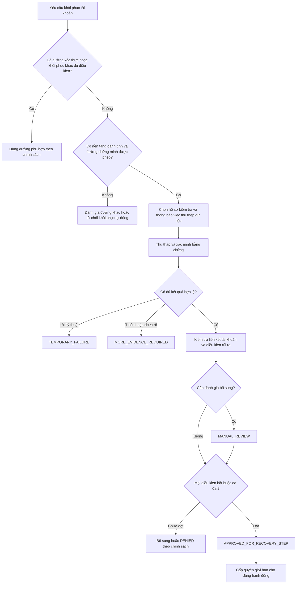

# Quyết định chứng minh danh tính trong khôi phục tài khoản

**Identity proofing decision** là quyết định về việc có cần chứng minh danh tính hay không, cần kiểm tra những gì và kết quả có đủ để mở một bước khôi phục cụ thể hay chưa. Trong module `SECURITY_AUTHENTICATION_ACCOUNT_RECOVERY`, quyết định này giúp xử lý trường hợp người dùng mất mật khẩu, MFA, passkey hoặc thiết bị xác thực mà các bằng chứng thông thường không còn đủ.

Điểm quan trọng nhất là: **chứng minh một người có danh tính thật không tự chứng minh người đó sở hữu tài khoản đang yêu cầu khôi phục**. Hệ thống cần có căn cứ liên kết danh tính đã được chứng minh với đúng tài khoản, sau đó mới đánh giá quyền thực hiện thay đổi.

Bài học tập trung vào hai thời điểm ra quyết định: trước khi thu thập bằng chứng danh tính và sau khi có kết quả kiểm tra.

## 1. Phân biệt chứng minh danh tính, xác thực và quyền khôi phục

| Khái niệm | Câu hỏi cần trả lời | Ví dụ |
| --- | --- | --- |
| Identity proofing — chứng minh danh tính | Người yêu cầu có phải cá nhân mang danh tính được khai báo ở mức tin cậy cần thiết không? | Kiểm tra bằng chứng danh tính và mối liên hệ giữa bằng chứng với người đang tham gia quy trình. |
| Authentication — xác thực | Người yêu cầu có kiểm soát authenticator đã gắn với tài khoản không? | Xác thực bằng mật khẩu, TOTP hoặc passkey. |
| Account linkage — liên kết với tài khoản | Danh tính được chứng minh có tương ứng với danh tính đã được thiết lập cho tài khoản đích không? | Đối chiếu với hồ sơ danh tính đáng tin cậy đã gắn trước đó. |
| Recovery authorization — cho phép khôi phục | Người đã được kiểm tra có được thực hiện đúng thay đổi đang yêu cầu không? | Chỉ cho phép thay TOTP của tài khoản đã xác định. |

NIST mô tả chứng minh danh tính qua các hoạt động resolution, validation và verification: xác định danh tính, kiểm tra bằng chứng cùng thuộc tính và kiểm tra mối liên hệ giữa người tham gia với danh tính đó. [NIST SP 800-63A-4 — Identity Proofing Overview](https://pages.nist.gov/800-63-4/sp800-63a/proofing/)

**IAL** mô tả mức bảo đảm của quy trình chứng minh danh tính; **AAL** mô tả mức bảo đảm xác thực. Không lấy điểm nhận diện khuôn mặt, số giấy tờ được tải lên hoặc nhãn “đã KYC” để tự suy ra một trong hai mức.

Trong khôi phục, kết quả chứng minh danh tính thường là đầu vào cho một quyết định nghiệp vụ tiếp theo. Nó không nên tự tạo session đầy đủ quyền hoặc tự xóa MFA.

## 2. Quyết định thứ nhất: có nên yêu cầu chứng minh danh tính?

Trước khi yêu cầu người dùng tải tài liệu, cần làm rõ bốn điều.

### 2.1. Có thực sự cần đường này không?

Nếu người dùng còn authenticator đáp ứng chính sách, có thể dùng phương tiện đó để xác minh thao tác. Nếu có tổ hợp bằng chứng khôi phục khác đủ điều kiện, không mặc định phải thu thập thêm giấy tờ.

Ví dụ, người dùng mất điện thoại nhưng còn khóa bảo mật dự phòng đã đăng ký. Dịch vụ nên đánh giá khóa dự phòng trước khi yêu cầu một quy trình thu thập tài liệu danh tính tốn thời gian và dữ liệu.

### 2.2. Có nền tảng danh tính để đối chiếu không?

Một tài khoản chỉ có email và tên hiển thị tự nhập chưa chắc có liên kết đáng tin cậy với danh tính thật.

Nếu người yêu cầu nộp giấy tờ hợp lệ mang tên của họ, hệ thống có thể biết thêm về người đó nhưng vẫn chưa biết tài khoản bí danh trước đây thuộc về họ.

NIST cho phép repeated identity proofing trong khôi phục khi có nền tảng chứng minh danh tính phù hợp, và yêu cầu xác nhận danh tính người yêu cầu nhất quán với tài khoản đã thiết lập. Tài khoản chưa từng được chứng minh danh tính không có sẵn đường reproofing như vậy. [NIST SP 800-63B-4 — Repeated Identity Proofing](https://pages.nist.gov/800-63-4/sp800-63b/events/#repeated-identity-proofing)

Đăng ký danh tính mới và khôi phục tài khoản cũ là hai quyết định khác nhau. Không tự gộp chúng thành một bước.

### 2.3. Chính sách có cho phép đường chứng minh này không?

Cần xác định:

- Thao tác nào được mở sau khi đạt yêu cầu.
- Loại tài khoản và tình huống nào được sử dụng đường này.
- Các bước cần thực hiện lại dựa trên hồ sơ ban đầu và rủi ro hiện tại.
- Nguồn dữ liệu nào được phép dùng để đối chiếu.
- Trường hợp nào phải có đánh giá bổ sung.
- Kết quả có hiệu lực trong bao lâu.

Không tự bỏ một bước bắt buộc vì nhà cung cấp trả nhãn “approved”. Cũng không yêu cầu lại toàn bộ hồ sơ chỉ vì thiết kế chưa phân biệt được dữ liệu nào còn phù hợp để tái sử dụng.

### 2.4. Việc thu thập có phù hợp với mục đích không?

Mỗi dữ liệu cần thu thập phải phục vụ một phép kiểm tra có giá trị đối với quyết định.

Ví dụ, nếu dịch vụ không có cơ sở liên kết danh tính thật với tài khoản, yêu cầu thêm ảnh mặt trước, mặt sau và video không tự giải quyết được khoảng trống liên kết đó.

Cần thông báo mục đích, dữ liệu cần cung cấp và đường hỗ trợ trước khi bắt đầu. Không dùng việc người dùng đang bị khóa ngoài tài khoản để thu thập thêm dữ liệu không liên quan.

## 3. Ma trận quyết định ở điểm vào

Bảng dưới đây là mô hình thiết kế minh họa, không phải tập yêu cầu áp dụng chung cho mọi dịch vụ.

| Bối cảnh | Quyết định phù hợp |
| --- | --- |
| Còn authenticator đã đăng ký đáp ứng yêu cầu | Dùng đường xác thực phù hợp; chưa cần mở quy trình chứng minh danh tính mới. |
| Không còn authenticator cần thiết nhưng còn bằng chứng khôi phục đủ điều kiện | Dùng đường khôi phục tương ứng theo chính sách. |
| Không còn phương án thông thường, có hồ sơ danh tính ban đầu đáng tin cậy và đường reproofing được hỗ trợ | Xác định hồ sơ kiểm tra cần áp dụng rồi mở quy trình chứng minh lại. |
| Tài khoản bí danh chưa từng gắn với danh tính thật | Không coi giấy tờ mới là căn cứ trực tiếp để lấy tài khoản; đánh giá đường khôi phục khác đã có. |
| Có hồ sơ cũ nhưng dữ liệu đối chiếu không đủ hoặc không còn sử dụng được | Chuyển đánh giá phương án hợp lệ khác; không suy đoán danh tính tương ứng. |
| Có dấu hiệu chiếm đoạt hoặc mâu thuẫn đáng kể | Đánh giá bổ sung theo chính sách trước khi cho thay phương thức xác thực. |
| Nhà cung cấp không hoạt động | Giữ trạng thái chưa xác minh, cho thử lại hoặc dùng đường đã được cho phép. |
| Không có đường nào đáp ứng yêu cầu | Từ chối khôi phục tự động hoặc chuyển quy trình hỗ trợ có tiêu chí rõ. |

Việc chuyển hỗ trợ không đồng nghĩa hạ yêu cầu bằng chứng. Nhân viên phải biết họ cần giải quyết khoảng trống nào, thay vì được cấp một nút “bỏ qua”.

## 4. Quyết định thứ hai: kết quả có đủ để cho khôi phục không?

Không nên gom tất cả kết quả thành một cờ `identityVerified=true`.

Cần tách các lớp kiểm tra và vai trò của chúng:

| Lớp kiểm tra | Điều cần xác định | Điều không được suy ra |
| --- | --- | --- |
| Phạm vi yêu cầu | Kết quả thuộc đúng quy trình và đúng tài khoản đích. | Một kết quả hợp lệ ở tài khoản A không dùng được cho B. |
| Danh tính được khai báo | Có đủ dữ liệu theo hồ sơ kiểm tra để xác định danh tính cần chứng minh. | Họ tên trùng nhau chưa chứng minh cùng một người. |
| Bằng chứng và thuộc tính | Những kiểm tra bắt buộc về bằng chứng đã được thực hiện và đạt. | OCR đọc được dữ liệu không đồng nghĩa tài liệu là thật. |
| Người tham gia quy trình | Có mối liên hệ được kiểm tra giữa người tham gia với danh tính hoặc bằng chứng. | Có ảnh giấy tờ không đồng nghĩa người tải lên là người trong giấy tờ. |
| Liên kết tài khoản | Danh tính đã được chứng minh tương ứng với nền tảng danh tính của tài khoản. | Danh tính thật nhưng thuộc người khác không tạo quyền khôi phục. |
| Kiểm soát gian lận | Những tín hiệu liên quan đã được xử lý theo chính sách. | Không có cảnh báo không đồng nghĩa chắc chắn không có gian lận. |
| Hiệu lực quyết định | Kết quả còn hạn và không bị thay đổi liên quan làm mất căn cứ. | Kết quả cũ không tự tiếp tục có hiệu lực vô hạn. |
| Phân quyền khôi phục | Đúng hành động, phạm vi và điều kiện thực thi. | Đạt chứng minh danh tính không cho phép mọi thay đổi bảo mật. |

Các kiểm tra cụ thể phụ thuộc hồ sơ được áp dụng. Không phải mọi đường chứng minh đều bắt buộc dùng sinh trắc học hoặc cùng một loại tài liệu.

Một kiểm tra không áp dụng phải có lý do từ chính sách. Không chuyển trạng thái “chưa chạy” thành “không cần chạy” để hồ sơ được duyệt.

## 5. Sử dụng trạng thái kiểm tra rõ ràng

Một mô hình hữu ích cho kết quả từng kiểm tra là:

| Trạng thái | Ý nghĩa | Cách xử lý |
| --- | --- | --- |
| `PASS` | Kiểm tra đã chạy và đạt điều kiện đã định. | Có thể đóng góp cho quyết định nếu nguồn kết quả hợp lệ. |
| `FAIL` | Kiểm tra có kết quả không đáp ứng điều kiện. | Xử lý theo mức độ và nguyên nhân; có thể cần đánh giá hoặc từ chối. |
| `INCONCLUSIVE` | Chưa đủ cơ sở kết luận. | Yêu cầu bổ sung hoặc chuyển phương án đánh giá khác. |
| `ERROR` | Không thực hiện được do lỗi kỹ thuật. | Giữ trạng thái chưa xác minh; thử lại theo chính sách. |
| `NOT_RUN` | Chưa thực hiện. | Không coi là đạt nếu kiểm tra đó bắt buộc. |
| `NOT_APPLICABLE` | Không thuộc yêu cầu của hồ sơ đang áp dụng. | Chỉ chấp nhận khi được chính sách xác định rõ. |

Ví dụ, ảnh tài liệu bị lóa có thể tạo kết quả `INCONCLUSIVE`. Nó không tự chứng minh có gian lận.

Ngược lại, kết quả xác định tài liệu bị sửa không nên được chuyển thành “ảnh chưa rõ, cứ thử lại đến khi đạt” mà không giữ bối cảnh và áp dụng chính sách liên quan.

Đặc biệt, timeout của API không phải `PASS`, và lỗi hệ thống không nên được ghi thành một kết luận người dùng giả mạo.

## 6. Những đầu ra quyết định cần có

Ví dụ về tập quyết định ở cấp quy trình:

| Quyết định | Khi nào sử dụng? | Quyền được cấp |
| --- | --- | --- |
| `APPROVED_FOR_RECOVERY_STEP` | Các điều kiện cần thiết cho bước khôi phục đã đạt. | Chỉ quyền được nêu rõ trong quyết định. |
| `MORE_EVIDENCE_REQUIRED` | Thiếu hoặc chưa đủ chất lượng bằng chứng mà người dùng có thể bổ sung. | Nộp bổ sung cho đúng yêu cầu, chưa được thay tài khoản. |
| `MANUAL_REVIEW` | Có mâu thuẫn, ngoại lệ hoặc rủi ro cần người có thẩm quyền đánh giá. | Theo dõi và bổ sung hồ sơ trong phạm vi được phép. |
| `TEMPORARY_FAILURE` | Không thể kết luận do sự cố kỹ thuật. | Thử lại hoặc chuyển đường hợp lệ khác, chưa được tăng quyền. |
| `DENIED` | Hồ sơ hiện tại không đáp ứng chính sách và không được cho tiếp tục bước này. | Nhận hướng dẫn phù hợp và quyền yêu cầu xem xét theo quy trình. |

Hết hạn, hủy yêu cầu hoặc hoàn tất thay đổi là các trạng thái vòng đời khác, không nhất thiết là kết luận về danh tính.

`DENIED` nên có phạm vi rõ: từ chối yêu cầu hoặc đường đang xét. Không mặc định biến một lần từ chối thành cấm vĩnh viễn mọi phương án khôi phục của chủ tài khoản.

Các mã lý do nội bộ có thể chi tiết hơn thông báo cho người dùng. Ví dụ, hệ thống cần phân biệt “không đủ liên kết tài khoản” và “nguồn xác minh chưa phản hồi”, nhưng không cần công khai mọi thuộc tính đã đúng hay sai.

## 7. Không thay điều kiện bắt buộc bằng tổng điểm

Các dịch vụ kiểm tra có thể trả về:

- Độ tin cậy của dữ liệu OCR.
- Điểm tương đồng của phép so sánh khuôn mặt.
- Điểm chất lượng ảnh.
- Kết quả phát hiện trình diễn hoặc giả mạo.
- Điểm rủi ro tổng hợp.

Những giá trị này đo các khía cạnh khác nhau. Điểm OCR cao không bù cho việc tài liệu không hợp lệ. Điểm so sánh khuôn mặt cao không bù cho việc danh tính không gắn với tài khoản.

Đặc biệt, giá trị `0.97` do mô hình trả về không mặc định có nghĩa “97% khả năng đây là chủ tài khoản”. Cách diễn giải phụ thuộc định nghĩa của điểm, dữ liệu hiệu chuẩn và ngữ cảnh áp dụng.

Một biểu thức quyết định minh họa:

```text
được_mở_bước_khôi_phục =
    đường_chứng_minh_được_phép
    AND yêu_cầu_còn_hiệu_lực
    AND nguồn_kết_quả_hợp_lệ
    AND tất_cả_kiểm_tra_bắt_buộc_đạt
    AND danh_tính_liên_kết_đúng_tài_khoản
    AND rủi_ro_chưa_giải_quyết_không_chặn_quyết_định
    AND đánh_giá_bổ_sung_đã_hoàn_tất_nếu_bắt_buộc
```

Ngưỡng cho từng thành phần phải dựa trên đặc tính của giải pháp và nhóm người dùng thực tế. Không đưa ra một ngưỡng điểm khuôn mặt chung rồi áp dụng cho mọi nhà cung cấp.

Nếu quy trình sử dụng phát hiện người thật hoặc chống trình diễn, cần hiểu phạm vi của phép kiểm tra đó. Kết quả đạt ở một lớp không bảo đảm toàn bộ kênh thu nhận, tài liệu và liên kết tài khoản đều an toàn.

## 8. Luồng ra quyết định tham khảo



Sơ đồ không có cạnh “đã đợi đủ lâu thì tự duyệt”. Nếu quy trình có thời gian chờ, đó là một điều kiện bổ sung bên cạnh bằng chứng, không thay thế bằng chứng.

Tương tự, việc có người xem hồ sơ không tự khiến yêu cầu đạt. Phải ghi nhận kết quả đánh giá và căn cứ đáp ứng chính sách.

## 9. Tiếp nhận kết quả từ nhà cung cấp

Trong triển khai thực tế, hệ thống khôi phục có thể nhận kết quả qua webhook hoặc API từ một dịch vụ chuyên xử lý chứng minh danh tính.

Cần bảo vệ cả tính toàn vẹn của kết quả và cách liên kết nó với yêu cầu.

### 9.1. Ràng buộc từ lúc tạo phiên kiểm tra

Backend tạo phiên kiểm tra cho đúng yêu cầu khôi phục và lưu liên kết tới tài khoản đích.

Không để người dùng tự gửi một mã phiên của người khác rồi yêu cầu dùng kết quả đó cho tài khoản hiện tại.

Liên kết phải do server quản lý, chẳng hạn:

```text
recoveryRequestId
    -> proofingSessionId nội bộ
    -> providerSessionReference
    -> tài khoản và hành động đã cố định
```

Một kết quả chứng minh có thể có phạm vi sử dụng khác nếu kiến trúc đã định nghĩa rõ cơ chế đó. Không tự tái sử dụng giữa các tài khoản chỉ vì trùng email hoặc trùng họ tên.

### 9.2. Xác thực nguồn và trạng thái kết quả

Tùy giao thức, có thể cần kiểm tra chữ ký, thông tin xác thực dịch vụ, thời điểm sự kiện và trạng thái qua API được xác thực.

Ảnh chụp màn hình “đã xác minh” hoặc một trường JSON do trình duyệt gửi không đủ làm nguồn kết quả đáng tin cậy.

Chữ ký hợp lệ chỉ chứng minh nguồn phát hành và tính toàn vẹn theo giao thức. Nó không chứng minh nhà cung cấp đã kiểm tra đúng hồ sơ mà dịch vụ của mình yêu cầu.

### 9.3. Xử lý kết quả thiếu, lặp và đến muộn

- Kết quả thiếu kiểm tra bắt buộc không được tự coi là đạt.
- Một event được gửi lại cần được xử lý lặp an toàn.
- Kết quả của phiên cũ không được ghi đè yêu cầu mới.
- Webhook đến sau khi yêu cầu hết hạn hoặc bị hủy không được tự mở lại quyền.
- Kết quả cập nhật cần có quy tắc về phiên bản và thứ tự xử lý.
- Chính sách nội bộ phải đánh giá dữ liệu đầu vào, thay vì sao chép nguyên trạng nhãn `approved` của nhà cung cấp.

Không ghi toàn bộ payload chứa tài liệu hoặc dữ liệu sinh trắc học vào log chỉ để tiện tìm lỗi.

## 10. Mô hình quyết định có thể truy vết

Ví dụ sau mô tả một quyết định đã đủ điều kiện mở bước thay TOTP:

```json
{
  "decisionId": "proofing-decision-582",
  "recoveryRequestId": "recovery-request-731",
  "subjectId": "account-123",
  "action": "REPLACE_TOTP",
  "proofingSessionRef": "proofing-session-912",
  "baselineIdentityRef": "established-identity-24",
  "profileId": "recovery-reproofing-profile-v3",
  "policyVersion": "recovery-policy-v8",
  "checks": {
    "requiredEvidence": "PASS",
    "applicantVerification": "PASS",
    "accountLinkage": "PASS",
    "requiredFraudControls": "PASS"
  },
  "reviewRef": "review-104",
  "outcome": "APPROVED_FOR_RECOVERY_STEP",
  "reasonCodes": [
    "RECOVERY_REQUIREMENTS_MET"
  ],
  "allowedScope": [
    "ENROLL_REPLACEMENT_TOTP"
  ],
  "accountSecurityVersion": 18,
  "decidedAt": "2026-11-23T03:00:00Z",
  "validUntil": "2026-11-23T03:15:00Z"
}
```

Các định danh, thời điểm và thời hạn mười lăm phút chỉ là ví dụ. Tên hồ sơ không khẳng định một mức IAL.

Mô hình này có các mục đích:

- Liên kết quyết định với đúng yêu cầu và nền tảng danh tính.
- Cho biết hồ sơ kiểm tra cùng chính sách được áp dụng.
- Ghi các kết quả bắt buộc ở mức có thể đánh giá lại.
- Giới hạn thao tác được mở sau khi chấp nhận.
- Phát hiện cấu hình bảo mật đã thay đổi từ lúc ra quyết định.

`decisionId` là tham chiếu tới quyết định, không tự là bearer token cho phép đổi tài khoản. Nếu cần grant thực thi, grant phải có liên kết ngữ cảnh, thời hạn và cơ chế ngăn dùng lại riêng.

Không đặt số giấy tờ, ảnh khuôn mặt hoặc bản sao tài liệu trong bản ghi quyết định thông thường chỉ vì chúng đã xuất hiện trong quy trình.

## 11. Ví dụ logic đánh giá tại backend

Mã giả dưới đây thể hiện thứ tự xử lý, không phải bộ quy tắc hoàn chỉnh cho một mức bảo đảm cụ thể.

```text
decideProofingForRecovery(requestId, proofingSessionRef):
    request = loadRecoveryRequest(requestId)
    requireRequestActive(request)

    profile = loadApplicableProofingProfile(request)
    if profile is absent:
        return routeToAnotherPermittedRecoveryPath(request)

    baseline = loadEstablishedIdentityLink(request.subjectId)
    if not profile.canUseBaseline(baseline):
        return decision(MANUAL_REVIEW, BASELINE_NOT_SUITABLE)

    result = fetchAuthenticatedProofingResult(proofingSessionRef)
    requireSessionBoundToRequest(result, request)

    if result.hasTechnicalFailure():
        return decision(TEMPORARY_FAILURE, RESULT_UNAVAILABLE)

    if result.hasMissingOrInconclusiveRequiredChecks(profile):
        return decision(MORE_EVIDENCE_REQUIRED, REQUIRED_CHECKS_INCOMPLETE)

    if result.hasAdverseRequiredCheck(profile):
        return handleAdverseResultUnderPolicy(result, profile)

    linkage = evaluateAccountLinkage(baseline, result, profile)
    if linkage.isUnresolved():
        return decision(MANUAL_REVIEW, ACCOUNT_LINKAGE_UNRESOLVED)

    if linkage.isConfirmedMismatch():
        return decision(DENIED, ACCOUNT_LINKAGE_NOT_MET)

    risk = evaluateRecoveryRisk(request, result)
    if risk.requiresReview() or profile.requiresManualReview():
        return decision(MANUAL_REVIEW, REVIEW_REQUIRED)

    return persistLimitedApproval(
        request,
        profile,
        result,
        linkage,
        currentAccountSecurityVersion()
    )
```

Một số điểm cần hiểu:

- Lỗi xác thực nguồn hoặc sai liên kết phiên phải bị chặn; không chấp nhận dữ liệu đó như kết quả kiểm tra.
- `MANUAL_REVIEW` chưa phải phê duyệt. Cần quy trình đánh giá và quyết định tiếp theo riêng.
- Cả trạng thái thuận lợi lẫn bất lợi của nhà cung cấp đều cần diễn giải theo ý nghĩa kiểm tra và chính sách.
- Khi không có baseline phù hợp, người đánh giá không được tự tạo liên kết danh tính chỉ bằng nhận xét chủ quan.
- Trước khi cấp hoặc sử dụng quyền thực thi, phải kiểm tra lại trạng thái yêu cầu, thời hạn và các thay đổi liên quan.

Việc lưu quyết định, cấp grant và thực thi thay đổi cần kiểm soát đồng thời để hai request không cùng sử dụng một quyền dùng một lần. Nếu trạng thái tài khoản thay đổi trong lúc đánh giá, hệ thống phải xử lý thay đổi đó trước khi cho tiếp tục.

## 12. Ba tình huống minh họa

### 12.1. Tài khoản có nền tảng danh tính, người dùng mất các phương tiện xác thực

Một dịch vụ lưu hồ sơ cá nhân đã chứng minh danh tính khi tạo tài khoản và lưu tham chiếu danh tính đáng tin cậy theo chính sách.

Người dùng mất thiết bị chứa passkey, không còn recovery code và không có phương tiện khác đáp ứng yêu cầu. Đường chứng minh lại được chính sách cho phép.

Quyết định có thể được chấp nhận khi:

1. Bằng chứng mới đáp ứng hồ sơ kiểm tra đã chọn.
2. Người tham gia được kiểm tra theo phương pháp phù hợp.
3. Danh tính tương ứng với nền tảng đã gắn với tài khoản.
4. Các điều kiện rủi ro và đánh giá bổ sung đã được giải quyết.
5. Quyền sau cùng chỉ cho phép thiết lập phương tiện thay thế của yêu cầu đó.

Sau khi thiết lập, hệ thống vẫn cần xử lý session và yêu cầu đăng nhập mới theo chính sách. Chứng minh danh tính không tự hoàn thành mọi bước của khôi phục.

### 12.2. Tài khoản bí danh, người yêu cầu nộp giấy tờ thật

Tài khoản được tạo bằng email, không có chứng minh danh tính ban đầu. Người yêu cầu nộp tài liệu hợp lệ và vượt qua bước kiểm tra người tham gia.

Kết quả này có thể xác nhận thông tin về người đang tham gia, nhưng chưa đủ liên kết họ với tài khoản bí danh.

Quyết định phù hợp là không tự duyệt việc lấy tài khoản bằng đường chứng minh lại. Hệ thống phải xét bằng chứng khôi phục đã thiết lập hoặc đường khác thực sự có căn cứ.

Tạo một hồ sơ danh tính mới rồi gắn ngay vào tài khoản cũ sẽ che giấu khoảng trống quyền sở hữu, thay vì giải quyết nó.

### 12.3. Chủ tài khoản đổi tên hoặc có tài liệu mới

Thông tin mới khác hồ sơ ban đầu không tự chứng minh có gian lận. Nguyên nhân có thể là thay đổi hợp lệ, lỗi nhập liệu trước đây hoặc khác cách biểu diễn.

Tuy nhiên, không được tự coi mọi tên gần giống là cùng một người.

Đường đánh giá cần xác định bằng chứng chuyển tiếp hoặc nguồn đối chiếu nào được chấp nhận, ai có thẩm quyền đánh giá và kết quả phải được lưu ra sao. Có thể cần hồ sơ bổ sung hoặc phương pháp khác đã được phê duyệt.

Trường hợp danh tính thật của người yêu cầu được xác nhận là người khác với danh tính đã gắn cho tài khoản phải được xử lý theo chính sách, dù tài liệu của họ hoàn toàn hợp lệ.

## 13. Đánh giá thủ công, quyền riêng tư và quyền yêu cầu xem xét

### 13.1. Đánh giá thủ công cần có phạm vi

Người hỗ trợ tiếp nhận hồ sơ, người đánh giá danh tính và người cho phép thay đổi tài khoản có thể là các vai trò khác nhau.

Nhân viên cần thấy:

- Hồ sơ kiểm tra đang áp dụng.
- Các phép kiểm tra đã hoàn tất và chưa hoàn tất.
- Mâu thuẫn cần giải quyết.
- Loại bằng chứng có thể chấp nhận thêm.
- Phạm vi quyết định mà họ được phép đưa ra.

Không thay một kết quả bất lợi thành đạt chỉ bằng ghi chú “đã nói chuyện với khách hàng”. Nếu cần ngoại lệ, phải có quy trình, căn cứ và thẩm quyền được xác định.

### 13.2. Giới hạn dữ liệu ở mức cần thiết

Quyết định thu thập dữ liệu cần đi cùng quyết định lưu, truy cập và xóa dữ liệu.

Ví dụ trong một kiến trúc:

- Bản ghi quyết định chỉ giữ tham chiếu cùng kết quả cần thiết.
- Tài liệu gốc, nếu cần lưu, nằm trong kho được bảo vệ và có quyền truy cập riêng.
- Công cụ hỗ trợ không hiển thị toàn bộ dữ liệu theo mặc định.
- Log vận hành loại bỏ ảnh, số giấy tờ và thông tin sinh trắc học.
- Thời hạn lưu được xác định theo mục đích và chính sách áp dụng, không tự đặt một thời hạn vô hạn để “có thể cần sau này”.
- Hợp đồng và tích hợp với nhà cung cấp làm rõ phạm vi xử lý cùng trách nhiệm về dữ liệu.

Không mặc định lưu ảnh khuôn mặt để chuẩn bị cho mọi lần khôi phục tương lai nếu hệ thống chưa có căn cứ và chính sách phù hợp.

### 13.3. Có đường sửa sai và phương án tiếp cận

Người dùng có thể gặp lỗi nhận dạng tài liệu, chất lượng camera thấp, khó khăn khi thực hiện thao tác hoặc dữ liệu cũ không còn chính xác.

NIST nhấn mạnh tối thiểu hóa dữ liệu và cơ chế giải quyết khó khăn, chậm trễ hoặc thất bại trong chứng minh danh tính. [NIST SP 800-63A-4](https://pages.nist.gov/800-63-4/sp800-63a.html#redress-requirements)

Đường hỗ trợ cần dễ tìm, có trạng thái xử lý rõ và không yêu cầu lặp vô hạn cùng một phép kiểm tra đang thất bại.

Phương án thay thế vẫn phải đáp ứng chính sách. Mục tiêu là giải quyết rào cản bằng cách hợp lệ, không tự xóa các điều kiện bảo vệ.

## 14. Chống lạm dụng và kiểm soát quyền sau quyết định

Các điểm cần kiểm soát trong luồng khôi phục:

- Giới hạn số lần tạo phiên, nộp bằng chứng và thử lại theo các cấp phù hợp.
- Không để đổi nhà cung cấp hoặc tạo request mới xóa toàn bộ lịch sử thử.
- Không trả chi tiết thuộc tính đối chiếu cho người chưa được xác minh để họ dò dữ liệu đúng.
- Bảo vệ việc nộp hồ sơ và API quyết định theo cơ chế toàn vẹn yêu cầu phù hợp.
- Không khóa hoặc xóa authenticator của chủ tài khoản chỉ vì có yêu cầu chứng minh chưa được xác minh.
- Ghi nhận quyết định cùng căn cứ, nhưng không dùng log làm nơi lưu bí mật hoặc hồ sơ danh tính đầy đủ.

OWASP khuyến nghị thông báo nhất quán ở điểm vào khôi phục và kiểm soát việc thay đổi tài khoản trước khi có căn cứ hợp lệ. [OWASP Forgot Password Cheat Sheet](https://cheatsheetseries.owasp.org/cheatsheets/Forgot_Password_Cheat_Sheet.html)

Khi chấp nhận kết quả, quyền được cấp cần giới hạn theo tài khoản, hành động, ngữ cảnh và thời hạn. Trước khi thực thi, backend phải xác nhận quyền chưa dùng, chưa hết hạn và vẫn còn phù hợp với trạng thái hiện hành.

Đối với khôi phục sau nghi ngờ chiếm đoạt, phải xét cả session còn sống, refresh token, authenticator bị lộ và những yêu cầu khôi phục khác có thể mở lại quyền trái phép. Không chỉ lưu mật khẩu mới rồi coi quy trình đã xong.

Việc đăng ký phương tiện mới chứng minh người yêu cầu điều khiển phương tiện đó. Nó không được sử dụng ngược lại như bằng chứng duy nhất cho việc cho phép lấy tài khoản.

## 15. Đo chất lượng quyết định

Cần phân biệt chỉ số của một thành phần, chẳng hạn phép so sánh sinh trắc học, với chất lượng của toàn bộ quyết định khôi phục.

| Chỉ số | Cách sử dụng |
| --- | --- |
| Tỷ lệ chấp nhận sai ở cấp quy trình | Số yêu cầu được xác định là không có quyền nhưng bị duyệt chia cho số yêu cầu không có quyền trong tập đánh giá có nhãn tin cậy. |
| Tỷ lệ từ chối sai | Số chủ tài khoản hợp lệ bị từ chối sai chia cho số yêu cầu hợp lệ trong tập đánh giá tương ứng. |
| Tỷ lệ cần bổ sung hoặc đánh giá thủ công | Phát hiện điểm thiếu dữ liệu, hồ sơ kiểm tra khó thực hiện hoặc quyết định chưa rõ. |
| Tỷ lệ lỗi kỹ thuật | Tách vấn đề hệ thống khỏi kết quả không đạt về bằng chứng. |
| Thời gian có quyết định | Theo dõi độ trễ tự động, thời gian chờ và thời gian xử lý thủ công. |
| Tỷ lệ quyết định bị sửa sau khi xem xét | Đánh giá khả năng sửa sai và những quy tắc đang gây kết luận chưa phù hợp. |
| Sự cố sau khi được duyệt | Kết hợp điều tra để nhận ra quyết định sai hoặc lỗ hổng ở bước cấp quyền và session. |

Các chỉ số cần mẫu số rõ, cửa sổ thời gian và nguồn nhãn phù hợp. Không coi mọi trường hợp chưa bị khiếu nại là đã được duyệt đúng.

Khi thay đổi nhà cung cấp, mô hình hoặc hồ sơ kiểm tra, cần đánh giá lại hiệu quả trong nhóm người dùng được phục vụ. Không chỉ tối ưu tỷ lệ hoàn thành hoặc giảm chi phí đánh giá thủ công.

Một hồ sơ quyết định đầy đủ cần trả lời được: **vì sao áp dụng chứng minh danh tính, điều gì đã được kiểm tra, danh tính liên kết với tài khoản ra sao, ai hoặc chính sách nào chấp nhận kết quả, và kết quả cho phép đúng thao tác nào**. Các mô hình dữ liệu, sơ đồ và mã giả trong bài là ví dụ thiết kế; chúng không tự chứng nhận mức IAL, AAL hoặc sự tuân thủ toàn bộ một tiêu chuẩn.
