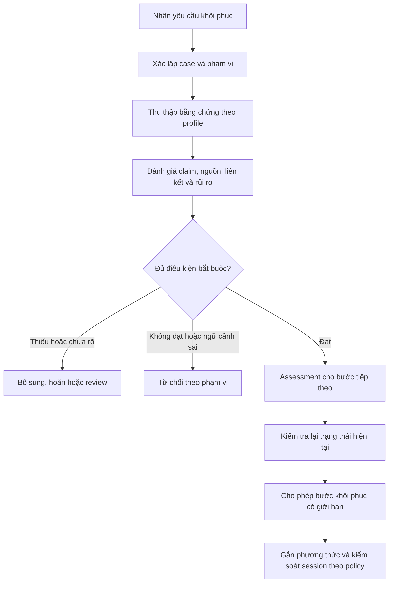

# Identity proofing confidence

## 1. Mục tiêu và bối cảnh

Trong chương **Identity Proofing** của module `SECURITY_AUTHENTICATION_ACCOUNT_RECOVERY`, bài này giải thích cách đánh giá **mức tin cậy của kết quả chứng minh danh tính** trước khi sử dụng nó trong khôi phục tài khoản.

Module đề cập việc mất mật khẩu, MFA, passkey hoặc thiết bị xác thực, kết hợp đánh giá rủi ro, token dùng một lần, xác minh danh tính, chống lạm dụng và kiểm soát session. Khi người dùng không còn phương thức xác thực thông thường, hệ thống có thể phải xem xét những bằng chứng khác. Câu hỏi trung tâm là: **những bằng chứng này đủ hỗ trợ kết luận nào, còn thiếu điều gì và cho phép bước tiếp theo nào?**

Ví dụ xuyên suốt: Lan mất điện thoại và khóa bảo mật, muốn khôi phục một tài khoản từng được chứng minh danh tính. Lan gửi giấy tờ và thực hiện bước xác minh từ xa. Một dịch vụ trả kết quả so khớp khuôn mặt cao. Backend vẫn cần xác định giấy tờ có đáng tin không, người tham gia có gắn với giấy tờ không, danh tính đó có đúng danh tính đã gắn với tài khoản cũ không và quy trình có dấu hiệu bị can thiệp không.

Sau bài học, người đọc có thể:

- Tách kết luận về danh tính khỏi kết luận về quyền sở hữu tài khoản và quyền thực hiện thao tác.
- Đánh giá chất lượng, nguồn gốc, tính độc lập, độ mới và giới hạn của bằng chứng.
- Tránh diễn giải điểm số của nhà cung cấp thành xác suất đúng người.
- Thiết kế quyết định có điều kiện bắt buộc, nhánh chưa đủ bằng chứng và cơ chế xét duyệt.
- Ghi nhận kết quả có thể giải thích, kiểm tra lại và giới hạn phạm vi sử dụng.

Các schema, trạng thái và mã giả trong bài là mô hình thiết kế minh họa, không phải một chứng nhận tuân thủ tiêu chuẩn hay mô tả hệ thống đã được kiểm thử.

## 2. Confidence phải gắn với một mệnh đề cụ thể

“Độ tin cậy cao” không có ý nghĩa đầy đủ nếu thiếu đối tượng của kết luận. Trong khôi phục tài khoản, cần phân biệt ít nhất các mệnh đề sau:

| Mệnh đề | Bằng chứng có thể hỗ trợ | Kết luận chưa được phép suy ra |
| --- | --- | --- |
| Danh tính được khai có tồn tại trong phạm vi cần phân biệt | Thuộc tính và bằng chứng được kiểm tra với nguồn phù hợp | Người đang gửi yêu cầu chính là người đó |
| Bằng chứng danh tính là xác thực và còn giá trị cho mục đích kiểm tra | Chữ ký, đặc tính bảo an, dữ liệu từ bên phát hành | Người nộp có quyền sử dụng bằng chứng |
| Người tham gia gắn với danh tính đã xác thực | Phương thức verification phù hợp | Danh tính ấy sở hữu tài khoản đích |
| Danh tính này gắn với tài khoản từ trước | Hồ sơ liên kết được xác lập trước sự cố và có nguồn gốc đáng tin | Mọi thay đổi tài khoản đều được phép |
| Quy trình hiện tại chưa bị thay thế hoặc can thiệp đã biết | Ràng buộc phiên thu thập, kiểm tra tính toàn vẹn, kết quả xác minh đáng tin | Không còn mọi rủi ro gian lận |
| Bằng chứng đủ cho bước khôi phục được yêu cầu | Policy xem xét toàn bộ điều kiện và ngữ cảnh | Tự động có session đầy đủ hoặc quyền xóa mọi MFA |

Một giấy tờ thật có thể bị đánh cắp. Người thật có thể nộp giấy tờ thật của chính mình để xin lấy tài khoản của người khác. Một khuôn mặt khớp có thể được thu thập trong ngữ cảnh không liên quan rồi bị phát lại.

Vì vậy, kết quả nên được diễn đạt như:

> Bằng chứng hiện có đáp ứng các điều kiện đã định cho việc tiếp tục bước gắn lại một phương thức xác thực của tài khoản A trong hồ sơ khôi phục R, cho đến thời điểm T, nếu ngữ cảnh bảo mật không thay đổi.

Cách diễn đạt này nêu rõ mệnh đề, phạm vi và giới hạn. Nó không đồng nghĩa “chắc chắn đây là chủ tài khoản trong mọi hoàn cảnh”.

## 3. Phân biệt identity proofing, IAL, AAL và rủi ro

### 3.1. Những công việc khác nhau trong proofing

NIST mô tả identity resolution, validation và verification: phân biệt danh tính trong tập người dùng; kiểm tra bằng chứng, thuộc tính; rồi xác lập người tham gia gắn với danh tính đó. [Nguồn: NIST SP 800-63A-4 — Identity Proofing Overview](https://pages.nist.gov/800-63-4/sp800-63a/proofing/).

Áp dụng vào ví dụ của Lan:

- Họ tên và ngày sinh hỗ trợ tìm hồ sơ, nhưng có thể không đủ để phân biệt người trùng thông tin.
- Dữ liệu trên giấy tờ đọc được không tự chứng minh giấy tờ là thật.
- Giấy tờ xác thực không tự chứng minh người đang nộp là người được cấp.
- Verification thành công vẫn cần liên kết với đúng tài khoản lịch sử.

Các bước này có thể sử dụng nhiều công nghệ hoặc nhân sự khác nhau. Kết quả của một bước không thay thế kết quả còn thiếu của bước khác.

### 3.2. Mức bảo đảm không phải điểm phần trăm

**Identity Assurance Level — IAL** mô tả mức bảo đảm của quy trình chứng minh danh tính. **Authentication Assurance Level — AAL** liên quan đến quy trình xác thực bằng authenticator. Hai trục trả lời các câu hỏi khác nhau.

Một tài khoản dùng phương thức xác thực mạnh chưa chắc đã được liên kết với danh tính ngoài đời. Ngược lại, một người đã được chứng minh danh tính chưa chắc đang có phiên xác thực đáp ứng yêu cầu thao tác nhạy cảm.

Trong SP 800-63A-4, “không identity proofing” được tách khỏi IAL1. IAL1 có yêu cầu kiểm tra danh tính; IAL2 tăng yêu cầu bằng chứng và xác minh; IAL3 bổ sung các điều kiện nghiêm ngặt hơn, gồm proofing có nhân sự tham gia tại địa điểm được kiểm soát và sinh trắc học. Không mang cách hiểu IAL1 của bản 3 sang bản 4. [Nguồn: NIST — Introduction, Identity Assurance Levels](https://pages.nist.gov/800-63-4/sp800-63a/introduction/).

Một nhãn nội bộ như `HIGH_CONFIDENCE` không tự tương đương IAL2. Muốn tuyên bố đạt một IAL cần đối chiếu toàn bộ yêu cầu liên quan, không chỉ điểm khuôn mặt hoặc số lượng giấy tờ.

### 3.3. Confidence và fraud risk không phải cùng một biến

Một assessment có thể đủ bằng chứng về danh tính nhưng vẫn có rủi ro bị cưỡng ép hoặc chuyển quyền truy cập cho kẻ khác. Một request đến từ mạng quen thuộc có thể ít bất thường hơn nhưng vẫn thiếu bằng chứng danh tính.

Nên giữ riêng:

```text
proofingFindings     Bằng chứng hỗ trợ những mệnh đề nào?
accountLinkFindings  Danh tính liên quan thế nào đến tài khoản đích?
fraudFindings        Có dấu hiệu tấn công hoặc bất thường nào?
recoveryDecision     Được phép làm bước nào theo policy hiện tại?
```

Không lấy một điểm rủi ro thấp để bù cho bằng chứng bắt buộc chưa có. Không lấy proofing mạnh làm lý do bỏ qua dấu hiệu chiếm đoạt đang được xác nhận.

## 4. Liên kết danh tính với tài khoản là điều kiện riêng

Đây là chỗ dễ nhầm nhất trong account recovery. Việc chứng minh một người là Nguyễn Thị Lan không tự chứng minh họ sở hữu một tài khoản có tên hiển thị “Lan”.

Liên kết với tài khoản cần dựa trên quan hệ đã được xác lập theo quy trình đáng tin trước đó, chẳng hạn hồ sơ identity proofing ban đầu gắn với subscriber account, định danh nội bộ hoặc dấu vết quản lý thay đổi đã được bảo vệ.

Không dùng các yếu tố sau làm liên kết quyết định một cách đơn lẻ:

- Họ tên hoặc ảnh đại diện mà người dùng tự nhập.
- Email do người yêu cầu vừa khai báo.
- Số điện thoại vừa được đổi trong thời gian nghi ngờ tài khoản bị chiếm.
- Thông tin hồ sơ công khai hoặc câu trả lời có thể tìm được trên mạng.
- Một tài liệu mới chỉ khớp tên hiển thị của tài khoản.

Trong phạm vi NIST SP 800-63B-4, repeated identity proofing áp dụng khi tài khoản đã được identity-proofed, và cần xác nhận danh tính nhất quán với tài khoản đã thiết lập. Với tài khoản chưa qua proofing, không có cơ sở để dùng reproofing như thể đã tồn tại liên kết đó. [Nguồn: NIST — Account Recovery và Repeated Identity Proofing](https://pages.nist.gov/800-63-4/sp800-63b/events/).

Điều này đặc biệt quan trọng với tài khoản bút danh. Bắt một người gửi căn cước lần đầu có thể thu thập thêm dữ liệu nhạy cảm nhưng vẫn không chứng minh căn cước ấy liên quan đến tài khoản.

Với loại tài khoản đó, hệ thống cần các phương thức khôi phục đã được thiết kế phù hợp, như recovery code hoặc quan hệ khôi phục được thiết lập trước, theo policy áp dụng. Bằng chứng ngoài đời chỉ hữu ích khi hệ thống có cách nối nó với tài khoản một cách đáng tin.

Nếu dữ liệu lịch sử có mâu thuẫn, không tự ghi đè hồ sơ cũ bằng thông tin mới để làm cho hai bên khớp nhau. Phải xác định mâu thuẫn đến từ cập nhật hợp lệ, lỗi dữ liệu hay sự kiện xâm phạm, rồi giải quyết theo quy trình.

## 5. Đánh giá từng bằng chứng thay vì chỉ giữ một điểm tổng

Một evidence assessment nên mô tả ít nhất:

| Thuộc tính | Câu hỏi đánh giá |
| --- | --- |
| Mệnh đề được hỗ trợ | Bằng chứng đang chứng minh danh tính, kênh liên lạc hay liên kết tài khoản? |
| Nguồn và provenance | Ai phát hành, ai thu thập, ai kiểm tra, kết quả đến từ đâu? |
| Tính xác thực và toàn vẹn | Có phát hiện sửa đổi, giả mạo hoặc tráo dữ liệu không? |
| Phương pháp kiểm tra | OCR, kiểm tra chữ ký, đối chiếu nguồn hay con người xem xét? |
| Phạm vi kết quả | Nhà cung cấp thực sự kiểm tra gì, có bỏ qua phần nào không? |
| Độ mới | Thu thập lúc nào, đối chiếu lúc nào, hết hiệu lực khi nào? |
| Tính độc lập | Các kết quả có cùng nguồn gốc hoặc cùng điểm bị kiểm soát không? |
| Chất lượng đầu vào | Ảnh mờ, thiếu mặt giấy tờ, lỗi chụp hay không hỗ trợ định dạng? |
| Điều kiện vận hành | Phiên bản mô hình, cấu hình ngưỡng, nhóm dữ liệu và kênh thu thập? |
| Ràng buộc request | Kết quả có thuộc đúng recovery case, subject và lần thu thập không? |

Một số phân biệt thực tế:

- **OCR thành công** nghĩa là đọc được ký tự; chưa đồng nghĩa xác thực giấy tờ.
- **Mã vạch khớp phần in** là một kiểm tra nhất quán; bản giả có thể làm cả hai cùng khớp.
- **Chữ ký số hợp lệ** hỗ trợ tính xác thực dữ liệu theo trust chain; vẫn cần kiểm tra issuer, phạm vi, thời hạn và tình trạng liên quan.
- **Mã nhận qua email** hỗ trợ khả năng truy cập kênh tại thời điểm đó; chưa chứng minh người dùng là chủ thể ngoài đời.
- **Lịch sử thiết bị quen thuộc** có giá trị ngữ cảnh; thiết bị hoặc session đó có thể đã bị đánh cắp.

Các kết quả nên có trạng thái rõ ràng:

```text
PASS            Đã thực hiện kiểm tra và đạt yêu cầu cụ thể
FAIL            Đã thực hiện kiểm tra và không đạt yêu cầu đó
INCONCLUSIVE    Có kiểm tra nhưng chưa đủ để kết luận
UNAVAILABLE     Chưa lấy được kết quả vì nguồn hoặc dịch vụ không sẵn sàng
NOT_ASSESSED    Chưa thực hiện kiểm tra
NOT_APPLICABLE  Policy xác định kiểm tra này không áp dụng
```

`UNAVAILABLE` không phải `PASS`; `INCONCLUSIVE` không đồng nghĩa người dùng gian lận. Chỉ policy server mới được xác định `NOT_APPLICABLE`, người gọi không được tự đánh dấu để bỏ qua điều kiện.

Không biến một ảnh mờ thành “danh tính giả”. Có thể yêu cầu thu thập lại hoặc chuyển sang phương thức phù hợp khác. Ngược lại, khi có kết quả xác thực cho thấy bằng chứng bị giả mạo, hệ thống cần xử lý phát hiện đó thay vì chỉ cộng thêm một điểm âm nhỏ.

## 6. Tính độc lập: nhiều kết quả chưa chắc là nhiều bằng chứng

Giả sử một người gửi ảnh giấy tờ. Hệ thống chạy OCR, đọc mã vạch và so khớp tên trong hai biểu mẫu đều do người đó điền. Bốn kết quả khớp có thể vẫn chỉ xoay quanh một dữ liệu gốc do cùng một người kiểm soát.

| Tập tín hiệu | Phụ thuộc cần nhận biết |
| --- | --- |
| OCR, mã vạch và phần in của cùng một ảnh | Cùng giấy tờ đầu vào; không phải ba nguồn phát hành độc lập |
| Hai nhà cung cấp tra cùng cơ sở dữ liệu | Có thể chung lỗi, độ trễ hoặc dữ liệu gốc |
| SMS và cuộc gọi vào cùng một SIM | Chung kênh kiểm soát và nguy cơ chuyển quyền SIM |
| Email và bản sao tài liệu lấy từ chính hộp thư đó | Kẻ kiểm soát hộp thư có thể có cả hai |
| Selfie và video được nộp qua cùng pipeline bị chèn dữ liệu | Đa dạng định dạng chưa tạo ra độc lập về thu thập |
| Hồ sơ cũ bất biến và xác minh mới với nguồn phát hành | Có thể bổ sung nhau, nhưng vẫn phải kiểm tra nguồn và cách liên kết |

Một cách mô hình hóa là ghi `dependencyGroup`, `sourceSystem` và `controlDomain`. Những nhãn này giúp reviewer thấy các tín hiệu có chung điểm thất bại; chúng không phải phép chứng minh toán học rằng hai nguồn độc lập.

Không tự tính:

```text
P(gian lận sau ba bằng chứng) = p1 × p2 × p3
```

Phép nhân đó cần các giả định xác suất có điều kiện và mô hình phụ thuộc phù hợp. Điểm do ba API trả về không tự đáp ứng các giả định ấy.

Một quy tắc thiết kế hữu ích là yêu cầu bằng chứng bổ sung **đóng được khoảng trống cụ thể**. Nếu đang thiếu liên kết tài khoản, thêm một ảnh selfie có thể không giúp. Nếu giấy tờ chưa được xác thực, chỉ chụp selfie rõ hơn cũng không giải quyết được vấn đề đó.

## 7. Điểm so khớp không phải xác suất đúng người

Một dịch vụ trả `faceSimilarity=0.97` có thể đang cung cấp điểm tương đồng trên thang riêng. Giá trị đó không tự có nghĩa “97% khả năng đúng chủ tài khoản”.

Cần biết:

- Điểm số có ý nghĩa và chiều tăng giảm như thế nào?
- Phiên bản mô hình, ngưỡng và tiền xử lý nào tạo ra kết quả?
- Kết quả được đánh giá trên tập dữ liệu và điều kiện nào?
- Đây là đối sánh 1:1 hay tìm kiếm 1:N?
- Có calibration để hỗ trợ diễn giải xác suất không?
- Đối tượng được dự đoán là khuôn mặt trùng người hay yêu cầu khôi phục hợp lệ?

Ngay cả một xác suất đã hiệu chỉnh cũng chỉ có ý nghĩa cho biến đích và phân phối dữ liệu đã được đánh giá. Không chuyển xác suất “hai ảnh cùng người” thành xác suất “yêu cầu này được phép thay MFA”.

### 7.1. Ví dụ số về tỷ lệ chấp nhận

Giả sử một quy trình minh họa có 10.000 yêu cầu, gồm 9.000 yêu cầu hợp lệ và 1.000 yêu cầu giả mạo. Quy trình chấp nhận 99% yêu cầu hợp lệ nhưng cũng chấp nhận 1% yêu cầu giả mạo.

| Nhóm giả định | Tổng yêu cầu | Được chấp nhận | Không được chấp nhận |
| --- | ---: | ---: | ---: |
| Hợp lệ | 9.000 | 8.910 | 90 |
| Giả mạo | 1.000 | 10 | 990 |
| Tổng | 10.000 | 8.920 | 1.080 |

Tỷ lệ giả mạo trong nhóm được chấp nhận là:

```text
10 / 8.920 ≈ 0,112%
```

Các con số hoàn toàn giả định để minh họa phép tính, không phải hiệu năng của sản phẩm hay ngưỡng khuyến nghị. Kết quả cho thấy cần xem tỷ lệ yêu cầu giả mạo, khả năng chấp nhận nhầm và khả năng từ chối nhầm cùng nhau.

Không được dùng “99% yêu cầu hợp lệ vượt qua” để kết luận “mọi yêu cầu vượt qua có 99% xác suất hợp lệ”. Hai xác suất có điều kiện khác nhau.

### 7.2. Calibration và giới hạn đánh giá

Nếu hệ thống thực sự dự đoán xác suất yêu cầu hợp lệ, calibration có thể kiểm tra xem nhóm được dự đoán gần 0,9 có tỷ lệ hợp lệ thực tế gần 90% hay không, trên dữ liệu có nhãn đáng tin và tách biệt với dữ liệu huấn luyện.

Tuy vậy:

- Nhãn “khôi phục thành công” không tự chứng minh đó là chủ tài khoản; gian lận có thể được phát hiện muộn.
- Dữ liệu chỉ gồm trường hợp đã được duyệt tạo ra thiên lệch lựa chọn.
- Kẻ tấn công chủ động lựa chọn mục tiêu và thay đổi phương pháp, không nhất thiết giống mẫu thử ngẫu nhiên.
- Một phiên bản mô hình mới hoặc kênh thu thập mới cần được đánh giá lại.
- Không có sự cố quan sát được không đồng nghĩa rủi ro bằng không.

Điểm số có thể hỗ trợ phân luồng hoặc phát hiện mâu thuẫn. Các điều kiện bảo mật bắt buộc vẫn cần được biểu diễn và kiểm tra riêng.

## 8. Sinh trắc học: đánh giá từng lớp thay vì một kết quả “liveness passed”

Trong đối sánh khuôn mặt 1:1, **false match rate — FMR** mô tả tỷ lệ cặp ảnh khác người vượt ngưỡng; **false non-match rate — FNMR** mô tả tỷ lệ cặp ảnh cùng người không vượt ngưỡng. Các tỷ lệ phụ thuộc ngưỡng và điều kiện đánh giá; điểm của một cặp ảnh không tự là xác suất đúng người. NIST FRTE cũng cho thấy chất lượng ảnh và khác biệt giữa các nhóm ảnh hưởng đến hiệu năng. [Nguồn: NIST — FRTE 1:1 Verification](https://pages.nist.gov/frvt/html/frvt11.html).

Không đồng nhất FMR của thuật toán với tỷ lệ chiếm đoạt tài khoản trong toàn bộ recovery flow. Luồng thực tế còn có giấy tờ giả, tráo subject, phát lại kết quả, thao túng nhân sự và nhiều điểm tích hợp khác.

Cần tách các câu hỏi:

| Lớp kiểm tra | Câu hỏi |
| --- | --- |
| Chất lượng ảnh | Dữ liệu có đủ để thực hiện phép so khớp không? |
| So khớp | Hai mẫu có đáp ứng ngưỡng của phép so khớp được chọn không? |
| Presentation attack detection — PAD | Có dấu hiệu trình diễn vật giả hoặc phương tiện giả trước cảm biến không? |
| Chống injection | Dữ liệu có bị chèn hoặc thay thế trên đường thu thập không? |
| Ràng buộc phiên | Mẫu và kết quả có thuộc đúng người, case và lần thu thập này không? |
| Liên kết tài khoản | Danh tính đã xác minh có khớp quan hệ lịch sử đáng tin không? |

Một người thật xuất hiện trước camera vẫn có thể là người đang xin lấy tài khoản của người khác. Một kết quả PAD đạt không tự chứng minh tài khoản thuộc người đó.

NIST phân biệt các mối đe dọa như dùng giấy tờ đánh cắp, danh tính tổng hợp, social engineering và chèn video hoặc ảnh. Kiểm soát cần phối hợp theo điểm tấn công, không chỉ dựa vào một lớp phát hiện. [Nguồn: NIST — Threats and Security Considerations](https://pages.nist.gov/800-63-4/sp800-63a/security/).

Trong mô hình của bài, backend gắn mỗi lần thu thập với recovery case và capture session; xác minh kết quả qua kênh tích hợp đáng tin; từ chối kết quả bị tráo sang subject hoặc case khác. Client không được tự gửi `livenessPassed=true` để thay cho kết quả verifier.

Không coi yêu cầu “quay đầu” hoặc “chớp mắt” là bảo đảm chung chống mọi nội dung tạo sinh. Cần đánh giá cả pipeline thu thập, kiểu tấn công, dữ liệu thử và giới hạn của cơ chế được dùng.

## 9. Quyết định bằng điều kiện bắt buộc trước khi dùng điểm số

Một quy tắc cộng điểm đơn giản có thể dẫn đến kết luận sai:

```text
+40 điểm giấy tờ
+30 điểm selfie
+20 điểm thiết bị quen
+10 điểm email nhận được
Tổng từ 80: cho khôi phục
```

Nếu giấy tờ chưa được xác thực nhưng các tín hiệu còn lại đạt điểm cao, hệ thống vẫn có thể cho qua. Tương tự, không có liên kết với tài khoản cũ có thể bị che bởi điểm khuôn mặt cao.

Thay vào đó, định nghĩa một **evidence profile** cho từng phương thức khôi phục và thao tác. Profile mô tả:

- Những mệnh đề bắt buộc phải được chứng minh.
- Các tổ hợp bằng chứng được chấp nhận để chứng minh từng mệnh đề.
- Nguồn, phương pháp, điều kiện thu thập và thời hạn tương ứng.
- Trường hợp nào cần thêm bằng chứng, hoãn hoặc xét duyệt.
- Phạm vi bước tiếp theo được phép nếu mọi điều kiện đều đạt.

Không phải mọi profile đều dùng sinh trắc học. Chỉ đặt kiểm tra PAD là bắt buộc khi nó thuộc phương thức đang áp dụng; không ép một nhánh khôi phục hợp lệ khác phải có dữ liệu không liên quan.

Một ma trận quyết định minh họa:

| Kết quả | Quyết định | Hướng xử lý |
| --- | --- | --- |
| Điều kiện bắt buộc đều đạt, liên kết tài khoản đạt, rủi ro được xử lý | `QUALIFIED_FOR_NEXT_STEP` | Cho tiếp tục đúng bước đã định, còn kiểm tra trạng thái cuối |
| Thiếu một điều kiện có thể bổ sung | `REQUIRE_ADDITIONAL_EVIDENCE` | Chỉ rõ nhóm bước cần hoàn tất ở mức an toàn |
| Nguồn xác minh bắt buộc đang lỗi | `DEFERRED` | Giữ yêu cầu chưa được duyệt, hỗ trợ thử lại hoặc phương án đã được policy cho phép |
| Có mâu thuẫn cần phân xử | `REVIEW_REQUIRED` | Chuyển reviewer có thẩm quyền |
| Xác nhận bằng chứng giả hoặc vi phạm điều kiện không thể chấp nhận | `REJECT_EVIDENCE_OR_ATTEMPT` | Từ chối đúng phạm vi, lưu lý do và hướng xử lý |
| Recovery case hết hạn hoặc bị hủy | `INVALID_CONTEXT` | Không sử dụng assessment để cấp quyền |

Việc từ chối một bằng chứng không luôn đồng nghĩa khóa tài khoản hoặc kết luận người nộp gian lận. Phạm vi phản ứng phụ thuộc bản chất phát hiện và policy.

Điểm số có thể giúp phân luồng sau khi kiểm tra các điều kiện không được bù trừ. Nó không được biến một `FAIL` hoặc `NOT_ASSESSED` bắt buộc thành `PASS`.

## 10. Mã giả đánh giá confidence

Đoạn dưới minh họa một bộ quyết định phía server. Nó không phải một bộ trọng số hoặc thuật toán để tuyên bố đạt IAL.

```java
AssessmentDecision evaluate(
        RecoveryContext context,
        EvidenceProfile profile,
        EvidenceSnapshot evidence,
        RiskSnapshot risk,
        Instant now) {

    if (!context.isCurrentAndPermitted(now)) {
        return AssessmentDecision.invalidContext();
    }

    if (!evidence.isBoundTo(context)
            || !evidence.hasTrustedProvenance()) {
        return AssessmentDecision.reviewRequired("UNTRUSTED_OR_MISBOUND");
    }

    if (evidence.hasConfirmedTampering()) {
        return AssessmentDecision.rejectEvidence("CONFIRMED_TAMPERING");
    }

    if (profile.hasRequiredCheckUnavailable(evidence)) {
        return AssessmentDecision.deferred("REQUIRED_SOURCE_UNAVAILABLE");
    }

    if (profile.hasFailedMandatoryCheck(evidence)) {
        return AssessmentDecision.reviewRequired("MANDATORY_CHECK_FAILED");
    }

    if (!profile.allRequiredClaimsSatisfied(evidence, now)) {
        return AssessmentDecision.additionalEvidence("UNSATISFIED_CLAIM");
    }

    if (!evidence.historicalAccountLinkPassed()) {
        return AssessmentDecision.additionalEvidence("ACCOUNT_LINK_MISSING");
    }

    if (!risk.isAcceptableFor(context.requestedAction())) {
        return AssessmentDecision.reviewRequired("UNRESOLVED_RISK");
    }

    return AssessmentDecision.qualifiedForNextStep(
            context.caseId(),
            context.requestedAction(),
            context.securityVersion(),
            profile.version(),
            evidence.snapshotId()
    );
}
```

Hợp đồng của các hàm quan trọng hơn tên hàm:

- `allRequiredClaimsSatisfied` chỉ chấp nhận những tổ hợp bằng chứng được profile cho phép, còn hiệu lực và không bị tính lặp sai.
- `hasTrustedProvenance` bao gồm kiểm tra nguồn kết quả và ràng buộc nội dung, không chỉ kiểm tra request có đi qua HTTPS.
- `historicalAccountLinkPassed` kiểm tra quan hệ tài khoản đã được xác lập; không chỉ so chuỗi tên.
- `isAcceptableFor` xem xét phát hiện rủi ro hiện tại cho hành động cụ thể, không coi không có dữ liệu là rủi ro thấp.
- `qualifiedForNextStep` chỉ trả quyết định assessment; không đổi MFA, cấp session hoặc tạo token trong hàm đánh giá.

Đường xét duyệt không được phép sửa một cờ `PASS` cho tiện mà không có căn cứ. Reviewer có thể bổ sung hoặc xác nhận một bằng chứng khác theo tổ hợp được phê duyệt, ghi rõ lý do và tạo assessment mới. Quy trình ngoại lệ cũng phải xác định điều kiện tương đương hoặc phạm vi được phép, thay vì một nút override vô điều kiện.

## 11. Lưu kết quả có cấu trúc và có thể giải thích

Ví dụ một assessment mà identity verification đã đạt nhưng chưa chứng minh được liên kết với tài khoản cũ:

```json
{
  "assessmentId": "assessment-internal-reference",
  "recoveryCaseId": "case-internal-reference",
  "accountId": "account-internal-reference",
  "requestedAction": "REBIND_AUTHENTICATOR",
  "caseVersion": 7,
  "accountSecurityVersion": 18,
  "evidenceSnapshotId": "snapshot-internal-reference",
  "checks": {
    "identityResolution": "PASS",
    "evidenceValidation": "PASS",
    "applicantVerification": "PASS",
    "historicalAccountLink": "INCONCLUSIVE",
    "collectionIntegrity": "PASS"
  },
  "assuranceClaim": "NOT_ASSERTED",
  "decision": "REQUIRE_ADDITIONAL_EVIDENCE",
  "reasonCodes": ["ACCOUNT_LINK_NOT_ESTABLISHED"],
  "policyVersion": "recovery-policy-v8",
  "profileVersion": "reproofing-profile-v3",
  "evaluatedAt": "2026-11-23T03:00:00Z",
  "validUntil": "2026-11-23T03:10:00Z"
}
```

Các định danh, phiên bản và thời hạn mười phút chỉ là ví dụ. `validUntil` cho biết đến khi nào assessment còn có thể được xem xét theo chính sách, không có nghĩa nó đã cấp quyền hoặc được dùng bất chấp sự kiện thu hồi.

Nếu lưu nhãn `LOW`, `MEDIUM`, `HIGH`, phải có định nghĩa nội bộ về mệnh đề, profile và cách xác lập nhãn. Tránh một trường `confidence=HIGH` không có findings đi kèm.

Thông tin chi tiết có thể nằm trong các evidence record riêng:

```text
evidenceRef
claimSupported
sourceRef
sourceEventId
collectionSessionRef
validationMethod
providerModelVersion
decisionThresholdVersion
dependencyGroup
capturedAt
checkedAt
expiresAt
outcome
limitations
```

Không cần nhân bản ảnh giấy tờ hoặc dữ liệu sinh trắc học vào mọi bản ghi assessment. Các tham chiếu phải trỏ đến kho có quyền truy cập và thời hạn lưu phù hợp.

Kết quả từ nhà cung cấp cần được backend xác minh theo cơ chế tích hợp: nguồn gửi, tính toàn vẹn, định danh request, subject, thời hạn và chống dùng lại sai ngữ cảnh. Chữ ký hợp lệ chưa đủ nếu nội dung có audience hoặc subject không khớp.

Không cho client tự gửi `decision=QUALIFIED_FOR_NEXT_STEP`, sửa reason code hoặc chọn policy version có lợi. Quyết định phải được suy ra từ snapshot và trạng thái có thẩm quyền.

## 12. Confidence có thời điểm và có thể thay đổi

Bằng chứng không duy trì giá trị như nhau mãi mãi. Cần phân biệt:

- Thời điểm bằng chứng được phát hành.
- Thời điểm nó được thu thập cho hồ sơ này.
- Thời điểm nguồn được đối chiếu.
- Thời điểm assessment được tính.
- Thời hạn được phép dùng kết quả.
- Sự kiện làm kết quả không còn áp dụng.

Ví dụ: bản ghi proofing cũ có thể vẫn giúp liên kết danh tính với tài khoản, nhưng không chứng minh người yêu cầu hiện đang kiểm soát một kênh đã bị thay đổi. Một lần đối chiếu mới có thể phát hiện bằng chứng bị thu hồi hoặc thuộc tính đã thay đổi.

Không dùng một công thức “mỗi ngày giảm một điểm” cho mọi bằng chứng nếu không có cơ sở đánh giá. Có những thay đổi cần làm mất hiệu lực ngay; có những thuộc tính thay đổi chậm; có những thời hạn do phương thức hoặc policy quy định.

Các sự kiện cần xem xét lại có thể gồm:

- Recovery case bị hủy, bị thay thế hoặc hết hạn.
- Chủ tài khoản báo không thực hiện yêu cầu.
- Kênh khôi phục hoặc phương thức vừa bị thu hồi do nghi ngờ xâm phạm.
- Phát hiện kết quả nhà cung cấp bị gắn sai subject.
- Thay đổi thông số mô hình làm giả định đánh giá cũ không còn phù hợp.
- Thao tác xin thực hiện thay đổi từ phạm vi hẹp sang phạm vi tác động lớn hơn.

Confidence không nhất thiết tăng khi bổ sung dữ liệu. Một bằng chứng mới có thể chỉ ra mâu thuẫn với bằng chứng cũ. Không cộng dồn không giới hạn theo số lượng lần nộp.

Trong mô hình minh họa, trước khi dùng assessment để cho phép bước gắn lại authenticator, server đối chiếu lại phiên bản case, trạng thái tài khoản, action và policy áp dụng. Kết quả lỗi thời cần được đánh giá lại, không tự chuyển thành grant.

## 13. Xét duyệt con người, hỗ trợ và khả năng tiếp cận

Con người có thể giải quyết tình huống dữ liệu không phản ánh đầy đủ thực tế, chẳng hạn đổi tên hợp lệ, định dạng giấy tờ chưa được hệ thống hỗ trợ hoặc điều kiện chụp không phù hợp. Tuy nhiên, sự tin tưởng cá nhân của nhân viên không tự tạo thành bằng chứng.

Một luồng review cần xác định:

- Reviewer được xem loại dữ liệu nào và được đưa ra kết luận nào.
- Claim nào còn thiếu hoặc mâu thuẫn cần giải quyết.
- Phương pháp thay thế nào được chấp nhận và căn cứ của nó.
- Khi nào cần người thứ hai xem xét độc lập.
- Cách ghi nhận phát hiện, lý do và phiên bản quyết định.
- Lối yêu cầu xem xét lại khi người dùng không đồng ý với kết quả.

NIST yêu cầu các quy trình proofing được tài liệu hóa, gồm xử lý ngoại lệ, giới hạn của công nghệ và hỗ trợ những người thiếu bằng chứng thông thường. Các phương án thay thế cần được đánh giá theo mức bảo đảm mà chúng cung cấp. [Nguồn: NIST — Identity Proofing Requirements](https://pages.nist.gov/800-63-4/sp800-63a/ial-general/).

Không để nội dung người dùng tự viết như “đã được quản lý duyệt”, chức danh hoặc mức độ khẩn cấp trở thành căn cứ bỏ điều kiện. Thông tin ấy có thể phục vụ hỗ trợ, nhưng quyền quyết định phải dựa trên bằng chứng và thẩm quyền đã xác lập.

Hệ thống cần phân biệt không thể hoàn thành một phương thức với không có danh tính hợp lệ. Người dùng có thể gặp hạn chế về camera, thiết bị, khả năng vận động, ngôn ngữ hoặc chất lượng tài liệu.

Có thể cung cấp phương thức khác hoặc quy trình có nhân sự hỗ trợ nếu policy cho phép. Phương án đó cần đáp ứng những mệnh đề còn thiếu; không chỉ đổi tên một bước yếu hơn thành “manual verification”.

Không tuyên bố không có sai lệch chỉ vì tỷ lệ vượt qua trung bình cao. Cần xem các nhóm điều kiện sử dụng khác nhau, tỷ lệ bị yêu cầu chụp lại và khả năng tiếp cận lối xét duyệt.

## 14. Dùng kết quả confidence trong luồng khôi phục an toàn

Một diễn tiến thiết kế:



Ở bước cho phép tiếp tục, có thể tạo recovery capability hoặc token ngắn hạn, dùng một lần, gắn với:

```text
recoveryCaseId
accountId
allowedNextAction
assessmentId
caseVersion
accountSecurityVersion
expiresAt
consumedAt
```

Token chỉ có hiệu lực khi các điều kiện sử dụng còn đúng. Việc đánh giá confidence không thay thế sinh token an toàn, kiểm tra quyền, giới hạn tốc độ và tiêu thụ nguyên tử.

Một kết quả proofing không nên tự mở toàn bộ session quyền cao. Có thể chỉ cho phép đăng ký một authenticator mới theo quy trình. Việc xác nhận phương thức mới hoạt động, vô hiệu hóa phương thức bị mất, thu hồi session hoặc refresh token liên quan và gửi thông báo thuộc các bước bảo mật tiếp theo.

Thời gian chờ và thông báo giúp phát hiện hoặc hạn chế tác động, nhưng chờ đủ lâu không tự biến bằng chứng thiếu thành đủ. Tương tự, không có người phản đối thông báo không phải bằng chứng quyết định về danh tính.

NIST quy định account recovery phải có thông báo cho subscriber hoặc người được chỉ định, đồng thời có các yêu cầu phương thức khác nhau theo mức bảo đảm liên quan. Không thể suy ra toàn bộ điều kiện khôi phục chỉ từ một nhãn confidence. [Nguồn: NIST — Authenticator Event Management](https://pages.nist.gov/800-63-4/sp800-63b/events/).

Khi người dùng vẫn còn authenticator đủ điều kiện, hệ thống có thể có một đường thay phương thức thích hợp mà không cần bắt họ nộp giấy tờ. Chọn đúng nhánh giúp giảm dữ liệu thu thập và tránh biến mọi sự cố thiết bị thành một quy trình proofing ngoài đời.

## 15. Ba tình huống minh họa

| Tình huống | Findings | Quyết định phù hợp với mô hình |
| --- | --- | --- |
| Giấy tờ được kiểm tra, người tham gia gắn với giấy tờ, liên kết tài khoản lịch sử đáng tin, không còn phát hiện rủi ro chưa giải quyết | Đủ các điều kiện của profile đang áp dụng | Cho bước khôi phục có giới hạn, còn kiểm tra lại trạng thái |
| Face score cao nhưng dữ liệu tài khoản trước đây chỉ là tên tự khai | Có bằng chứng về người nộp, chưa có account link đáng tin | Chưa đủ cho reproofing tài khoản; cần phương thức khôi phục thích hợp khác |
| Nguồn kiểm tra giấy tờ bắt buộc đang lỗi, email mới nhận được mã | Validation chưa có kết quả; kênh mới chưa bù được khoảng trống | Hoãn hoặc dùng phương án thay thế đã được policy chấp nhận |

Ở tình huống đầu, “không còn phát hiện rủi ro chưa giải quyết” không có nghĩa xác suất tấn công bằng không. Đó là điều kiện quyết định theo tập dữ liệu và biện pháp hiện tại.

Nếu Lan thực sự là chủ tài khoản nhưng giấy tờ mới có thay đổi tên, một phép so chuỗi có thể không đủ. Luồng review cần bằng chứng hợp lệ về quan hệ giữa thông tin trước và sau, thay vì tự sửa tên cũ để làm kết quả khớp.

Nếu người tấn công biết chính xác câu trả lời mà reviewer mong đợi, việc lặp lại cùng thông tin không tạo thêm bằng chứng độc lập. Chính sách nên yêu cầu nguồn hoặc phương pháp xác minh phù hợp, không tăng confidence theo mức độ thuyết phục của cuộc trò chuyện.

## 16. Quyền riêng tư, quan sát vận hành và giới hạn kết luận

### 16.1. Thu thập tối thiểu và bảo vệ dữ liệu

Không thu thêm giấy tờ hoặc video chỉ để làm số lượng bằng chứng trông thuyết phục hơn. Mỗi dữ liệu cần gắn với mục đích kiểm tra cụ thể, phạm vi sử dụng, người được truy cập và thời hạn lưu.

NIST nhấn mạnh tối thiểu hóa dữ liệu, thông báo mục đích thu thập, kiểm soát việc dùng sinh trắc học và có cơ chế giải quyết vấn đề khi proofing không thành công. [Nguồn: NIST — Privacy Considerations](https://pages.nist.gov/800-63-4/sp800-63a/privacy/).

Trong thiết kế minh họa:

- Evidence thô được đặt trong kho riêng, mã hóa và phân quyền.
- Assessment lưu kết luận và tham chiếu, hạn chế sao chép dữ liệu nhạy cảm.
- Audit log ghi actor, thời điểm, policy, nguồn kết quả và reason code; không ghi ảnh, OTP, cookie hoặc recovery token.
- Thời hạn lưu được xác định theo mục đích và yêu cầu áp dụng; không mặc định lưu vĩnh viễn.
- Giao diện hỗ trợ người dùng biết bước tiếp theo mà không tiết lộ thuộc tính nội bộ có thể dùng để dò tài khoản.

Thông báo “cần bổ sung bằng chứng” có thể hữu ích hơn việc công khai chính xác trường nào khớp hồ sơ và trường nào chưa khớp. Chi tiết cần được cung cấp qua quy trình hỗ trợ có kiểm soát.

### 16.2. Đo cả chấp nhận nhầm, từ chối nhầm và trải nghiệm

Các chỉ số nên xem xét cùng nhau:

| Nhóm chỉ số | Ý nghĩa và giới hạn |
| --- | --- |
| Yêu cầu giả mạo được duyệt đã xác nhận | Đo tác hại, nhưng thường có độ trễ nhãn và thiếu trường hợp chưa phát hiện |
| Yêu cầu hợp lệ bị từ chối hoặc phải review | Đo tổn thất trải nghiệm, cần nhãn đáng tin |
| Tỷ lệ `INCONCLUSIVE`, `UNAVAILABLE` | Phân biệt chất lượng đầu vào với lỗi dịch vụ |
| Hoàn tất, bỏ dở, số lần nộp lại | Phát hiện luồng khó dùng; chưa tự kết luận an toàn |
| Hiệu năng theo phương thức, thiết bị, điều kiện và nhóm phù hợp | Phát hiện chênh lệch; cần bảo vệ dữ liệu và đủ cỡ mẫu |
| Thay đổi kết luận sau review hoặc khiếu nại | Đánh giá sai sót và chất lượng quyết định |
| Sự cố sau thay đổi model, policy hoặc nhà cung cấp | Phát hiện drift và thay đổi hành vi |

Không chọn ngưỡng chỉ để tối đa tỷ lệ khôi phục thành công. Cũng không chọn ngưỡng chỉ để số gian lận quan sát được bằng không bằng cách từ chối gần hết người dùng.

Đánh giá cần bao phủ toàn bộ pipeline, các trường hợp chất lượng thấp, tấn công có chủ đích và quan hệ với tài khoản. Một báo cáo tốt của mô hình khuôn mặt không thay thế đánh giá hệ thống khôi phục.

### 16.3. Confidence không phải bảo đảm tuyệt đối

Một quyết định có thể đúng theo bằng chứng hiện tại rồi cần được thu hồi sau phát hiện mới. Thiết kế tốt giữ được lý do và phạm vi sử dụng để điều tra, sửa quyết định và hạn chế tác động.

Các giới hạn phải được nêu rõ:

- Không đủ dữ liệu để khẳng định xác suất chính xác.
- Chưa kiểm tra một loại tấn công hoặc điều kiện vận hành.
- Không thể xác lập liên kết với tài khoản.
- Có nguồn tạm lỗi hoặc bằng chứng chưa được đánh giá.
- Kết quả chỉ áp dụng cho policy, snapshot và thời điểm đã ghi.

Những giới hạn này là dữ liệu phục vụ quyết định. Không được ẩn chúng sau một nhãn “verified”.

## 17. Những sai lầm cần tránh

| Sai lầm | Hậu quả | Cách thiết kế phù hợp |
| --- | --- | --- |
| Dùng face score như xác suất đúng chủ tài khoản | Kết luận vượt phạm vi mô hình | Xác định ý nghĩa điểm và đánh giá từng claim |
| Đồng nhất IAL với AAL | Gán mức xác thực sai | Quản lý hai trục và yêu cầu thao tác riêng |
| Cộng điểm để bù điều kiện bắt buộc thiếu | Cho qua luồng chưa đủ bằng chứng | Dùng gate và evidence profile |
| Đếm cùng nguồn dữ liệu nhiều lần | Confidence bị phóng đại | Ghi provenance và quan hệ phụ thuộc |
| Giấy tờ thật là được lấy tài khoản có cùng tên | Chiếm đoạt qua liên kết sai | Kiểm tra account link lịch sử |
| Nguồn lỗi được coi là đạt | Sự cố trở thành đường bỏ kiểm tra | Giữ trạng thái chưa kết luận hoặc hoãn |
| Mọi trường hợp ảnh mờ đều gắn nhãn gian lận | Từ chối nhầm và gây khó cho người dùng | Tách chất lượng khỏi phát hiện giả mạo |
| Reviewer duyệt không có lý do hoặc giới hạn | Social engineering và khó truy vết | Phân quyền, ghi căn cứ và kiểm soát ngoại lệ |
| Tăng confidence theo số lần nộp | Khuyến khích thử lặp và thao túng nguồn | Chỉ ghi nhận bằng chứng bổ sung có ý nghĩa |
| Giữ kết quả cũ sau khi case bị hủy | Dùng assessment lỗi thời để cấp quyền | Ràng buộc phiên bản và kiểm tra trước sử dụng |
| Proofing đạt là cấp session đầy đủ | Quyền vượt phạm vi khôi phục | Chỉ cho bước tiếp theo đã được policy cho phép |
| Thu thập dữ liệu tối đa để “an toàn hơn” | Tăng rủi ro riêng tư và rò rỉ | Thu theo claim cần chứng minh |

Identity proofing confidence cần được thể hiện bằng những mệnh đề có bằng chứng, giới hạn và nguồn gốc rõ ràng. Trong account recovery, giá trị của kết quả nằm ở việc hỗ trợ đúng quyết định cho đúng tài khoản và đúng bước, đồng thời bảo toàn những điều hệ thống chưa thể kết luận.

## 18. Tài liệu tham khảo

- [NIST SP 800-63A-4 — Introduction](https://pages.nist.gov/800-63-4/sp800-63a/introduction/): mức bảo đảm danh tính và cách hiểu IAL theo bản 4.
- [NIST SP 800-63A-4 — Identity Proofing Overview](https://pages.nist.gov/800-63-4/sp800-63a/proofing/): resolution, validation và verification.
- [NIST SP 800-63A-4 — Identity Proofing Requirements](https://pages.nist.gov/800-63-4/sp800-63a/ial-general/): quy trình, công nghệ, nguồn và xử lý ngoại lệ.
- [NIST SP 800-63A-4 — Threats and Security Considerations](https://pages.nist.gov/800-63-4/sp800-63a/security/): giả mạo, social engineering và injection.
- [NIST SP 800-63A-4 — Privacy Considerations](https://pages.nist.gov/800-63-4/sp800-63a/privacy/): tối thiểu hóa dữ liệu và cơ chế xử lý vấn đề.
- [NIST SP 800-63B-4 — Authenticator Event Management](https://pages.nist.gov/800-63-4/sp800-63b/events/): account recovery, repeated identity proofing và thông báo.
- [NIST — FRTE 1:1 Verification](https://pages.nist.gov/frvt/html/frvt11.html): cách diễn giải FMR, FNMR và điều kiện đánh giá đối sánh khuôn mặt.

Các quyết định, evidence profile, trường dữ liệu và số liệu ví dụ trong bài là đề xuất minh họa. Việc tuyên bố đạt mức bảo đảm hoặc áp dụng trong sản phẩm cần đối chiếu đầy đủ tiêu chuẩn và điều kiện triển khai liên quan.
