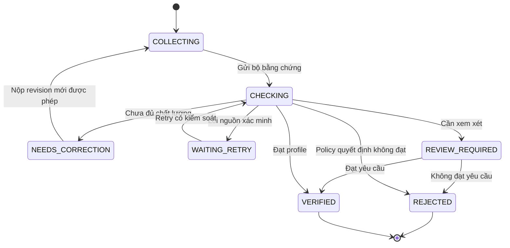

# Identity proofing rejection

## Mục tiêu và phạm vi

**Identity proofing rejection** là quyết định không chấp nhận một hồ sơ xác minh danh tính theo những yêu cầu đã định. Trong khôi phục tài khoản, quyết định này có nghĩa nhánh bằng chứng đang xét chưa đủ căn cứ để tiếp tục hoặc hoàn tất thao tác recovery được yêu cầu.

Trong chương **Identity Proofing** của module `SECURITY_AUTHENTICATION_ACCOUNT_RECOVERY`, bài học đặt rejection vào luồng người dùng mất mật khẩu, MFA, passkey hoặc thiết bị xác thực. Mục tiêu là bảo vệ tài khoản trước bằng chứng giả, không phù hợp hoặc chưa đủ, đồng thời tạo đường xử lý rõ ràng cho người dùng hợp lệ gặp lỗi hoặc bị từ chối nhầm.

Sau bài này, người học cần có khả năng:

- Phân biệt từ chối hồ sơ với thiếu dữ liệu, lỗi kỹ thuật và chờ xem xét.
- Xác định bước proofing nào không đạt và hệ quả đối với recovery.
- Ngăn kết quả xác minh một con người bị dùng sai để chiếm tài khoản khác.
- Thiết kế trạng thái, reason code, thông báo, retry và redress có kiểm soát.
- Giữ giới hạn session, token dùng một lần và quyền thay đổi authenticator khi proofing chưa được chấp nhận.
- Lưu dấu vết đủ để điều tra mà không làm lộ giấy tờ hoặc dữ liệu sinh trắc học.

Các trạng thái, API, cấu trúc bản ghi và chính sách dưới đây là thiết kế minh họa. Chúng không phải bộ tiêu chí bắt buộc cho mọi hệ thống hoặc bằng chứng hệ thống đã đạt một IAL/AAL cụ thể. Bài không quy định một thời hạn lưu trữ hay loại giấy tờ áp dụng chung cho mọi khu vực.

## 1. Từ chối điều gì, trong phạm vi nào?

### 1.1. Kết quả proofing khác kết luận gian lận

Không chấp nhận hồ sơ có thể xuất phát từ nhiều nguyên nhân: tài liệu không đạt yêu cầu, thông tin không thể xác nhận, không chứng minh được người trình là chủ của bằng chứng, hoặc không liên kết được danh tính với tài khoản cần phục hồi.

Những nguyên nhân này không đồng nghĩa người gửi cố ý gian lận. Một ảnh mờ, thay đổi tên hợp lệ hoặc nguồn xác minh không khả dụng có ý nghĩa khác với bằng chứng đã được xác nhận là giả mạo.

Có thể ghi rõ phạm vi quyết định:

```text
Quyết định: không chấp nhận hồ sơ proofing phiên bản 3
Mục đích: cung cấp bằng chứng cho yêu cầu thay MFA
Phạm vi: recovery transaction hiện tại của đúng tài khoản
Hệ quả: không cấp quyền thay MFA từ hồ sơ này
Không tự suy ra: người gửi là tội phạm hoặc mọi phiên hợp lệ phải bị khóa
```

Nếu có dấu hiệu compromise riêng, hệ thống có thể áp dụng biện pháp bảo vệ tài khoản theo policy sự cố. Biện pháp đó cần căn cứ và phạm vi riêng, không được phát sinh chỉ vì một file tải lên không đọc được.

### 1.2. Ba lớp kết quả phải được tách

| Lớp | Câu hỏi | Ví dụ |
| --- | --- | --- |
| Kết quả kiểm tra bằng chứng | Thành phần nào đã được kiểm tra và kết quả là gì? | Tài liệu hợp lệ nhưng chưa xác nhận được người trình |
| Quyết định proofing | Tổ hợp kết quả có đạt profile đã yêu cầu không? | Chưa đạt, cần xem xét hoặc bị từ chối |
| Quyết định recovery | Bằng chứng hiện có có đủ cho hành động và tài khoản này không? | Chưa cho gỡ MFA dù một danh tính đã được xác minh |

NIST mô tả proofing qua resolution, validation và verification: xác định danh tính, kiểm tra bằng chứng/thuộc tính, rồi xác nhận người trình là người gắn với bằng chứng đó. Những bước này giúp phân biệt loại thất bại thay vì gộp tất cả thành một cờ `verified=false`. [NIST SP 800-63A-4 — Identity Proofing Overview](https://pages.nist.gov/800-63-4/sp800-63a/proofing/)

Một nhà cung cấp trả `verified=true` không tự quyết định người đó được lấy lại tài khoản nào. Hệ thống recovery còn phải kiểm tra account binding, trạng thái bảo mật, thời hạn và phạm vi hành động.

## 2. Phân loại kết quả để tránh từ chối sai nguyên nhân

Một mô hình kết quả nội bộ có thể gồm:

| Kết quả | Ý nghĩa | Xử lý tiếp theo minh họa |
| --- | --- | --- |
| `NEEDS_CORRECTION` | Dữ liệu chưa đủ chất lượng hoặc chưa hoàn chỉnh | Hướng dẫn bổ sung trong hạn mức cho phép |
| `UNAVAILABLE` | Chưa có kết luận do lỗi hệ thống hoặc nguồn xác minh | Retry kỹ thuật có giới hạn; chưa cấp quyền |
| `REVIEW_REQUIRED` | Tình huống cần đánh giá theo quy trình riêng | Chuyển reviewer đủ thẩm quyền |
| `REJECTED` | Hồ sơ đã được đánh giá và không đạt yêu cầu của nhánh này | Lưu quyết định, hướng dẫn bước tiếp theo được phép |
| `VERIFIED` | Đạt profile proofing đã định | Chuyển kết quả cho policy recovery đánh giá |

Không đổi `UNAVAILABLE` thành `VERIFIED` khi nhà cung cấp lỗi, cũng không ghi thành “sai danh tính” chỉ để có một kết quả cuối. Quyền nhạy cảm chưa được cấp trong cả hai trường hợp, nhưng dữ liệu vận hành và cách hỗ trợ người dùng phải khác nhau.

Một số reason code nội bộ minh họa:

| Nhóm | Reason code | Điều cần lưu ý |
| --- | --- | --- |
| Chất lượng đầu vào | `CAPTURE_UNREADABLE` | Chưa đủ dữ liệu để kết luận bằng chứng giả |
| Khả năng đáp ứng profile | `EVIDENCE_TYPE_NOT_SUPPORTED` | Loại bằng chứng không được nhánh này chấp nhận |
| Validation | `EVIDENCE_VALIDATION_FAILED` | Phải biết nguồn kiểm tra và tiêu chí đã áp dụng |
| Verification | `PRESENTER_BINDING_NOT_ESTABLISHED` | Không tự diễn giải thành người gửi đã gian lận |
| Liên kết tài khoản | `ACCOUNT_LINK_NOT_ESTABLISHED` | Danh tính được xác minh chưa đủ gắn với tài khoản đích |
| Tính hợp lệ của tiến trình | `PROOFING_CONTEXT_EXPIRED` | Bằng chứng có thể đúng nhưng yêu cầu hiện tại không còn hiệu lực |
| Hạ tầng | `VALIDATION_SOURCE_TIMEOUT` | Không đưa vào thống kê từ chối danh tính như một kết luận thực chất |

Reason code phải có định nghĩa, mức độ chắc chắn, khả năng retry, khả năng redress và mức thông tin được phép công khai. Chuỗi lỗi tùy ý từ vendor không nên trở thành policy hoặc thông báo trực tiếp cho người dùng.

## 3. Không xác minh nhầm con người cho nhầm tài khoản

Giả sử Mai có giấy tờ thật và vượt qua bước xác nhận người trình. Mai yêu cầu phục hồi tài khoản của Lan bằng cách cung cấp email của Lan.

Nếu hệ thống chỉ kiểm tra “có một người thật với giấy tờ thật” rồi cấp quyền đặt lại MFA, proofing đã bị sử dụng sai. Còn thiếu mối liên hệ đáng tin cậy giữa danh tính vừa xác minh và tài khoản cần khôi phục.

NIST yêu cầu repeated identity proofing trong recovery xác nhận danh tính nhất quán với tài khoản đã được thiết lập trước đó. Không có proofing ban đầu thì không thể mặc nhiên dùng reproofing như một đường phục hồi tài khoản theo mô hình này. [NIST SP 800-63B-4 — Repeated Identity Proofing](https://pages.nist.gov/800-63-4/sp800-63b/events/#repeated-identity-proofing)

Thiết kế cần trả lời:

1. Tài khoản trước đây đã được gắn với danh tính nào, bằng cơ sở tin cậy nào?
2. Hồ sơ mới đang chứng minh điều gì và có đạt yêu cầu của hành động không?
3. Các thuộc tính khác nhau có thể do thay đổi hợp lệ, dữ liệu cũ, hay một chủ thể khác?
4. Có đường recovery khác đã được thiết lập trước, chẳng hạn authenticator còn lại hoặc recovery code, mà policy cho phép không?

Không bắt mọi tài khoản vốn chưa có quan hệ định danh phải nộp giấy tờ để “chứng minh sở hữu”. Thu thập thêm dữ liệu cá nhân không tự tạo ra lịch sử liên kết tài khoản. Khi không có account link phù hợp, phải giữ kết quả chưa đủ căn cứ và dùng nhánh recovery được thiết kế cho loại tài khoản đó.

Việc đọc được một email mới nhập trong recovery cũng chỉ chứng minh quyền tiếp cận kênh mới theo cơ chế kiểm tra. Nó không sửa được lỗi thiếu account binding của hồ sơ bị từ chối.

## 4. Quyết định rejection phải có nguồn và phiên bản

### 4.1. Luồng đánh giá

```text
Đầu vào trong recovery context có giới hạn
    -> kiểm tra quyền nộp và binding của hồ sơ
    -> kiểm tra chất lượng và tính đầy đủ
    -> validation/verification theo profile
    -> đánh giá liên kết với tài khoản đã biết
    -> áp dụng policy, thời hạn và tín hiệu rủi ro
    -> ghi quyết định có phiên bản
    -> trả thông báo và bước tiếp theo theo quyền được biết
```

Tín hiệu rủi ro có thể dẫn tới tăng kiểm tra hoặc chuyển review. Một score không có ngữ nghĩa và nguồn rõ ràng không đủ thay thế điều kiện bắt buộc của proofing. Ngược lại, nhiều tín hiệu thuận lợi không bù được account binding sai.

Không dùng kết quả OCR đọc được họ tên như bằng chứng rằng giấy tờ là thật. Cũng không dùng một lần face match thành công để bỏ qua các yêu cầu validation còn thiếu của profile.

### 4.2. Bản ghi quyết định minh họa

```json
{
  "decisionId": "decision_opaque_reference",
  "proofingCaseId": "case_opaque_reference",
  "recoveryContextRef": "recovery_internal_reference",
  "accountRef": "account_internal_reference",
  "tenantRef": "tenant_internal_reference",
  "submissionRevision": 3,
  "decisionRevision": 2,
  "requestedAction": "REPLACE_MFA_CREDENTIAL",
  "requiredProofingProfile": "ACCOUNT_REPROOFING_PROFILE_V2",
  "disposition": "REJECTED",
  "internalReasonCodes": ["ACCOUNT_LINK_NOT_ESTABLISHED"],
  "publicMessageCode": "PROOFING_NOT_ACCEPTED",
  "policyVersion": "recovery-policy-v12",
  "accountSecurityVersion": 41,
  "evidenceBundleRef": "restricted_evidence_reference",
  "decisionSource": "POLICY_ENGINE",
  "decidedAt": "2026-11-23T08:00:00Z",
  "redressEligible": true
}
```

Đây là dữ liệu nội bộ, không phải response mặc định của API. Không sao chép ảnh giấy tờ, selfie, số định danh hoặc raw vendor payload vào bản ghi quyết định và log chỉ để tiện truy vết.

`submissionRevision` xác định bộ bằng chứng đã được xét. `decisionRevision` xác định lần ra quyết định. Nếu sau đó có xem xét lại, giữ bản ghi cũ và thêm quyết định mới tham chiếu quyết định được thay thế; không sửa lịch sử thành “chưa từng bị từ chối”.

`decisionSource` cũng không đồng nghĩa người gọi có thể tự khai nguồn tin cậy. Server phải xác thực callback hoặc reviewer, kiểm tra quyền và ánh xạ nguồn vào một danh tính dịch vụ/nhân sự đã được quản lý.

## 5. Áp dụng rejection vào trạng thái recovery một cách nhất quán

### 5.1. Vòng đời hồ sơ và quyết định cấp quyền



Sơ đồ mô tả một vòng xử lý hồ sơ, chưa phải toàn bộ quy trình recovery. `VERIFIED` không trực tiếp có nghĩa `RECOVERY_COMPLETED`. `REJECTED` không tự có nghĩa `ACCOUNT_DISABLED`.

Redress là tiến trình xem xét lại quyết định, có quyền và audit riêng. Trong lúc redress đang chờ, quyết định rejection hiện hành vẫn không cung cấp quyền thay MFA. Nếu có kết luận mới, server áp dụng revision mới qua quy trình được kiểm soát và đánh giá lại điều kiện recovery.

### 5.2. Những hiệu ứng phải xảy ra khi từ chối

Một transaction xử lý rejection có thể cần:

- Lưu quyết định, revision bằng chứng và reason code nội bộ.
- Cập nhật kết quả hiện hành của hồ sơ đúng phiên bản.
- Chặn việc cấp grant dựa trên bộ bằng chứng bị từ chối.
- Vô hiệu hóa quyền tạm được tạo riêng để chờ quyết định của hồ sơ này, nếu policy có loại quyền đó.
- Ghi audit và công việc thông báo qua outbox nếu có side effect ngoài transaction.

Không cấp trước grant thay MFA rồi trông chờ job rejection thu hồi kịp. Các quyền nhạy cảm phải phụ thuộc vào quyết định hiện hành ngay tại điểm cấp và điểm sử dụng.

Cũng không thu hồi tùy tiện mọi phiên của chủ tài khoản chỉ vì một người chưa đáng tin nộp hồ sơ thất bại. Nếu việc gửi yêu cầu dễ làm chủ tài khoản bị khóa, endpoint rejection có thể trở thành công cụ từ chối dịch vụ.

### 5.3. Mã giả về ranh giới xử lý

```text
applyProofingResult(trustedResult):
    requireAuthenticatedResultSource(trustedResult)
    requireValidSchemaAndKnownResultType(trustedResult)

    transaction:
        recovery = lockRecovery(trustedResult.recoveryContextRef)
        case = lockProofingCase(trustedResult.caseRef)
        requireSameTenantAccountAndPurpose(recovery, case, trustedResult)

        if sourceEventAlreadyProcessed(trustedResult.eventId):
            return currentDecisionWithoutNewSideEffects(case)

        requireExpectedSubmissionRevision(case, trustedResult.submissionRevision)
        requireCaseStillAcceptsThisResult(case)
        requireRecoveryContextStillPermitsProcessing(recovery)

        decision = policy.evaluate(case, trustedResult, currentSecurityState)
        appendImmutableDecision(decision)
        updateCurrentDecisionWithVersionCheck(case, decision)
        recordSourceEventAsProcessed(trustedResult.eventId)

        if decision.disposition == REJECTED:
            preventGrantFromThisProofingDecision(case, decision)
            invalidateDependentProvisionalRightsIfPolicyRequires(case)

        appendAuditAndMinimalNotificationOutbox(decision)
    commit

    return publicProjectionForAuthorizedCaller(decision)
```

Đây là mã giả về hợp đồng và transaction, không phải thư viện chạy sẵn. `trustedResult` phải đến từ verifier hoặc nhân sự có quyền, không phải JSON `verified=true` do client gửi. Khóa và kiểm tra version phải phối hợp với đường cấp grant để không có request cạnh tranh vượt qua bằng quyết định cũ.

Nếu callback của submission cũ tới sau một quyết định mới, ghi nhận sự kiện đến muộn theo policy; không cho nó ghi đè kết quả hiện hành. Hai callback trùng nhau không được tạo hai thông báo, hai revision có ý nghĩa khác nhau hoặc một lần cấp quyền mới.

Một lỗi lưu trữ hoặc timeout xử lý chưa phải một quyết định rejection được commit. API cần biểu diễn trạng thái chưa rõ kết quả và hỗ trợ tra cứu idempotent; không trả “đã bị từ chối danh tính” nếu transaction thực tế chưa lưu thành công.

## 6. Thông báo đủ rõ nhưng không tạo công cụ dò dữ liệu

### 6.1. Ba đối tượng nhận ba mức thông tin

| Đối tượng | Thông tin có thể phù hợp | Thông tin không nên trả mặc định |
| --- | --- | --- |
| Người gọi endpoint công khai, chưa có quyền với hồ sơ | Hướng dẫn bắt đầu hoặc tiếp tục qua kênh hợp lệ | Tài khoản có tồn tại, có giấy tờ gì, đã bị gắn cờ nào |
| Người có quyền truy cập recovery case giới hạn | Trạng thái case và bước tiếp theo có thể thực hiện | Thuộc tính bí mật trong tài khoản đích hoặc ngưỡng phát hiện gian lận |
| Reviewer được phân công | Reason code, evidence reference và dữ kiện cần xét | Dữ liệu ngoài case, quyền xem toàn bộ giấy tờ của mọi tài khoản |

OWASP lưu ý lỗi của login và recovery có thể làm lộ sự tồn tại hoặc trạng thái tài khoản qua nội dung, mã HTTP và thời gian phản hồi. Với proofing rejection, cần xem xét cùng rủi ro ở các endpoint chưa xác lập quyền truy cập hồ sơ. [OWASP — Authentication and Error Messages](https://cheatsheetseries.owasp.org/cheatsheets/Authentication_Cheat_Sheet.html#authentication-and-error-messages)

Một thông báo an toàn cho người có quyền với hồ sơ có thể là:

> Hồ sơ hiện tại chưa đáp ứng yêu cầu xác minh để tiếp tục khôi phục tài khoản. Bạn có thể xem hướng dẫn bổ sung hoặc yêu cầu xem xét lại trong mục hỗ trợ của hồ sơ.

Nếu nguyên nhân chỉ là ảnh không đọc được, có thể hướng dẫn cụ thể hơn: chụp đủ góc, tránh lóa, dùng file gốc theo yêu cầu được công bố. Không cần tiết lộ trường thông tin nào khớp dữ liệu của tài khoản đích.

Tránh thông báo như “ngày sinh đúng nhưng số giấy tờ khác hai chữ số” hoặc hiển thị email recovery đầy đủ của chủ tài khoản cho một người chưa chứng minh quyền. Những phản hồi này có thể giúp điều chỉnh hồ sơ giả qua nhiều lần thử.

### 6.2. Response API minh họa

```json
{
  "caseId": "opaque_case_reference",
  "status": "REJECTED",
  "messageCode": "PROOFING_NOT_ACCEPTED",
  "nextActions": ["VIEW_GUIDANCE", "REQUEST_REVIEW"],
  "canReplaceAuthenticator": false,
  "caseAccessExpiresAt": "2026-11-23T08:15:00Z"
}
```

Response chỉ dành cho caller đã được kiểm tra quyền với case. Cờ giao diện như `canReplaceAuthenticator=false` không thay kiểm tra quyền ở endpoint thực thi. Client sửa cờ thành `true` cũng không được làm thay đổi quyết định của server.

Một case ID khó đoán giúp giảm dò tìm nhưng chưa phải quyền truy cập. Xem trạng thái, tải bằng chứng và yêu cầu review đều phải được gắn với context, chống CSRF khi dùng cookie và kiểm tra quyền ở server.

## 7. Retry và bổ sung bằng chứng không được xóa lịch sử

### 7.1. Chọn hành động theo loại thất bại

| Loại kết quả | Retry phù hợp | Điều cần giữ |
| --- | --- | --- |
| Ảnh không đọc được | Nộp bản chụp mới đúng hướng dẫn | Case binding, hạn nộp và hạn mức |
| Nguồn validation bị timeout | Retry kỹ thuật có backoff | Không biến thành thất bại danh tính thực chất |
| Thiếu bằng chứng theo profile | Bổ sung loại được policy chấp nhận | Không tự thay bằng dữ liệu dễ lấy hơn |
| Thuộc tính có thể thay đổi hợp lệ | Review hoặc bằng chứng giải thích được chấp nhận | Quan hệ với danh tính và tài khoản trước đó |
| Không đạt validation/verification | Redress hoặc phương án được thiết kế | Quyết định cũ, nguồn kiểm tra và giới hạn rủi ro |
| Context đã hết hạn | Khởi tạo hoặc tiếp tục theo cơ chế riêng | Không tự gia hạn token hay quyền của context cũ |

Mỗi bộ bằng chứng mới cần revision mới để biết kết quả thuộc bộ nào. Không sửa file evidence cũ tại chỗ rồi để audit nói rằng quyết định trước đã đánh giá chính file mới.

Không hướng dẫn người dùng chỉnh sửa nội dung giấy tờ hoặc biến đổi ảnh để vượt qua detector. Hướng dẫn bổ sung nên tập trung vào chất lượng thu nhận, loại bằng chứng được chấp nhận và đường hỗ trợ phù hợp.

### 7.2. Hạn mức ngoài từng submission

Giới hạn nên xét nhiều phạm vi: case, recovery transaction, tài khoản đích, phương thức, nguồn truy cập và chi phí nhà cung cấp. Chỉ đếm theo một submission sẽ cho phép tạo submission mới để thử không giới hạn.

Lỗi kỹ thuật có thể tiêu tốn ngân sách tài nguyên hoặc retry, nhưng không nên tự tăng cùng bộ đếm kết luận “sai danh tính”. Ngược lại, tách hai bộ đếm không có nghĩa cho phép gọi vendor vô hạn khi lỗi kéo dài.

Tạo case mới, đổi reviewer hoặc mở ticket mới không được tự xóa các hạn mức đang áp dụng. Cần liên kết các tiến trình theo tham chiếu nội bộ phù hợp, tránh lan truyền dữ liệu cá nhân vượt nhu cầu.

Nếu dùng token tiếp tục hồ sơ hoặc token xác nhận bước recovery, token phải có phạm vi, thời hạn và quy tắc dùng một lần khi phù hợp. Việc biết hoặc dùng token đúng không tự biến một quyết định rejection thành approval; token chỉ chứng minh quyền làm bước mà nó được cấp.

## 8. Redress và review là quy trình bảo đảm, không phải bỏ qua policy

NIST yêu cầu cơ chế redress cho các vấn đề proofing, gồm thất bại, chậm trễ và khó khăn; cơ chế cần dễ tìm, dễ dùng và được đánh giá hiệu quả. Đây là cơ sở để thiết kế đường xử lý người dùng hợp lệ bị từ chối nhầm. [NIST SP 800-63A-4 — Redress Requirements](https://pages.nist.gov/800-63-4/sp800-63a/ial-general/#redress-requirements)

Một yêu cầu xem xét lại nên có:

1. Tham chiếu case và quyết định đang được yêu cầu xem xét.
2. Quyền gửi yêu cầu, kênh trao đổi được bảo vệ và thời hạn xử lý rõ ràng.
3. Lý do xem xét lại hoặc bằng chứng bổ sung đúng phạm vi.
4. Reviewer có đào tạo, quyền hạn và dữ liệu cần thiết để áp dụng policy.
5. Kết luận mới có lý do, người chịu trách nhiệm và quan hệ với quyết định cũ.

Việc một người gọi điện và kể đúng thông tin có thể tìm công khai không đủ để support bấm “bỏ qua proofing”. Áp lực về thời gian, chức danh hay giá trị tài khoản cũng không tự trở thành bằng chứng danh tính.

Với thao tác có tác động cao, hệ thống có thể yêu cầu phê duyệt độc lập hoặc phân tách người thu nhận hồ sơ và người quyết định ngoại lệ. Đây là lựa chọn quản trị rủi ro cần được ghi rõ, không phải giả định mọi review thủ công đều mạnh hơn hệ thống tự động.

Một kết quả tìm kiếm sinh trắc học trùng ứng viên cũng có thể là false positive. Trong phạm vi NIST, kết quả nhận dạng 1:N không được dùng để từ chối enrollment mà thiếu review thủ công xác nhận. Không diễn giải quy tắc này thành “mọi loại rejection đều phải có người duyệt”; phải xác định đúng cơ chế và phạm vi áp dụng. [NIST SP 800-63A-4 — Requirements for the Use of Biometrics](https://pages.nist.gov/800-63-4/sp800-63a/ial-general/#requirements-for-the-use-of-biometrics)

Nếu review chuyển kết luận thành đạt, không chỉ sửa một trường `approved=true`. Cần tạo revision quyết định mới, kiểm tra bằng chứng còn phù hợp, trạng thái bảo mật chưa thay đổi và recovery context vẫn được phép tiếp tục. Nếu context cũ đã hết hạn, việc tiếp tục phải qua cơ chế tái lập quyền truy cập được thiết kế.

## 9. Giữ session và authenticator ở trạng thái an toàn

Sau rejection, phiên recovery có thể còn quyền xem hướng dẫn hoặc gửi redress trong phạm vi cho phép. Nó không được tự nâng thành phiên đăng nhập đầy đủ.

Các thao tác sau vẫn phải bị chặn nếu chưa có quyết định cấp quyền đáp ứng policy:

- Đặt mật khẩu mới thay cho chủ tài khoản.
- Gỡ hoặc thay MFA hiện hành.
- Gắn passkey mới vào tài khoản đích.
- Đổi email, số điện thoại hoặc recovery contact.
- Xuất recovery code hoặc tạo API key.

Dữ liệu authenticator đang chuẩn bị, chẳng hạn một secret TOTP chưa liên kết, phải có vòng đời riêng. Hồ sơ bị từ chối không được khiến dữ liệu tạm trở thành credential hoạt động; job dọn chậm cũng không tạo quyền sử dụng.

Nếu proofing thất bại nhưng người dùng còn một authenticator độc lập mà policy chấp nhận, hệ thống có thể cho dùng đường xác thực hoặc recovery tương ứng. Điều đó không phải đổi nhãn hồ sơ rejection thành thành công; đường khác phải tự đáp ứng yêu cầu của nó và không bỏ qua một security hold còn hiệu lực.

Các thông báo bảo mật nên đi qua cơ chế và kênh được policy cho phép, với nội dung tối thiểu. Không gửi ảnh giấy tờ, lý do gian lận chi tiết hoặc dữ liệu tài khoản vào một email mới nhập chỉ vì nó xuất hiện trong form proofing. Nếu cần thông báo chủ tài khoản về yêu cầu đáng ngờ, phải cân nhắc quyền riêng tư, spam và tính đáng tin của kênh đã có.

## 10. Bảo vệ dữ liệu của cả hồ sơ bị từ chối

Rejection không làm dữ liệu cá nhân trở thành dữ liệu ít nhạy cảm hơn. Ảnh giấy tờ, video và dữ liệu sinh trắc học của người không được chấp nhận vẫn cần kiểm soát truy cập và vòng đời lưu trữ rõ ràng.

Một thiết kế có thể tách:

| Kho dữ liệu | Nội dung | Kiểm soát chính |
| --- | --- | --- |
| Case store | Trạng thái, revision, binding và reason code | Kiểm tra quyền theo case và tenant |
| Evidence store | Tài liệu hoặc dữ liệu thu nhận thực sự cần giữ | Mã hóa, quyền đọc tối thiểu, hạn lưu riêng |
| Audit store | Ai quyết định, theo policy nào, lúc nào | Bảo vệ tính toàn vẹn và truy vết |
| Notification outbox | Tham chiếu và template thông báo | Không chứa bản sao giấy tờ hoặc token nhạy cảm dư thừa |

Quyền của reviewer nên gắn với nhiệm vụ và được ghi nhận khi truy cập bằng chứng. Một đường dẫn tải có chữ ký và thời hạn ngắn vẫn cần được phát hành sau kiểm tra quyền; không coi URL dài là cách thay thế toàn bộ authorization.

Không đặt giấy tờ vào ticket công khai, email chuyển tiếp rộng hoặc log ứng dụng. Không lưu thêm toàn bộ dữ liệu chỉ vì “có thể cần khiếu nại”, cũng không xóa ngay mọi dấu vết khiến việc xem xét lại không còn căn cứ.

Lịch giữ và xóa cần phân biệt bản gốc nhạy cảm, kết quả kiểm tra và audit tối thiểu; xác định theo nhu cầu, rủi ro và yêu cầu áp dụng cho dịch vụ. Nếu có nhà cung cấp xử lý bằng chứng, phạm vi lưu bản sao, xóa và truy cập bên họ cũng phải được quản lý. Không thể suy ra nghĩa vụ lưu trữ cụ thể chỉ từ trạng thái `REJECTED`.

## 11. Hai tình huống giúp kiểm tra cách hiểu

### 11.1. Người dùng hợp lệ đổi tên nhưng dữ liệu cũ chưa cập nhật

Lan mất điện thoại MFA. Hồ sơ proofing mới có tên khác hồ sơ đã gắn với tài khoản vì một thay đổi hợp lệ. Hệ thống tự động chưa thể thiết lập tính nhất quán.

Một cách xử lý phù hợp là ghi lý do chưa xác lập account link, giữ quyền thay MFA chưa được cấp, và đưa Lan tới hướng review hoặc bổ sung bằng chứng được chấp nhận. Reviewer xem dữ liệu có liên quan, áp dụng policy về thay đổi thuộc tính và ghi kết luận mới có căn cứ.

Không nên yêu cầu Lan nộp đi nộp lại cùng tài liệu mà không có thay đổi nào có thể giải quyết nguyên nhân. Cũng không nên bỏ qua mọi khác biệt chỉ vì Lan giải thích bằng lời. Đường review phải có khả năng xử lý thay đổi hợp lệ mà vẫn bảo vệ tài khoản khỏi người khác biết tên cũ.

Nếu revision mới đạt yêu cầu, policy recovery tiếp tục đánh giá các điều kiện còn lại, chẳng hạn trạng thái hold và quyền liên kết MFA mới. Kết quả proofing không tự hoàn tất toàn bộ recovery.

### 11.2. Giấy tờ thật nhưng người trình chưa được xác nhận

Một người có bản sao giấy tờ thật của chủ tài khoản nhưng không vượt qua bước xác nhận người trình. Hệ thống phải giữ hồ sơ không đạt hoặc chuyển review theo tiêu chí đã định; việc giấy tờ thật không bù cho bước verification còn thiếu.

Nếu người đó yêu cầu support gửi mã tới email mới để “xác nhận thay”, mã đúng chỉ chứng minh khả năng nhận thư ở kênh mới. Nó không giải quyết thất bại verification ban đầu.

Trong cả hai tình huống, thông báo nên giúp người dùng hiểu bước có thể làm tiếp mà không công khai dữ liệu đối chiếu bí mật hay ngưỡng kiểm tra. Quyết định, quyền được cấp và audit phải nhất quán giữa API, reviewer và nhà cung cấp.

## 12. Theo dõi chất lượng rejection mà không đánh đổi an toàn

| Chỉ số | Câu hỏi hỗ trợ vận hành |
| --- | --- |
| Tỷ lệ từng nhóm reason code | Hệ thống đang gặp chất lượng ảnh, validation hay account binding? |
| Tỷ lệ lỗi kỹ thuật tách riêng | Vendor hoặc hạ tầng có đang bị nhầm thành rejection? |
| Số lần nộp và tạo case cho cùng tiến trình | Có vòng lặp UX hoặc lạm dụng để reset hạn mức không? |
| Thời gian chờ review/redress | Người hợp lệ có bị giữ trong trạng thái không rõ kết quả không? |
| Tỷ lệ quyết định thay đổi sau review | Policy, công nghệ hoặc dữ liệu nào cần được khảo sát thêm? |
| Sự cố chiếm tài khoản sau recovery | Một đường approval có đang bỏ qua loại thất bại quan trọng không? |
| Số truy cập và vòng đời evidence | Có quyền đọc hoặc lưu trữ vượt nhu cầu không? |

Tỷ lệ đổi quyết định sau redress không tự là tỷ lệ false rejection của toàn bộ người dùng: chỉ một phần người bị từ chối có thể yêu cầu review, và bản review cũng cần được đánh giá chất lượng. Tương tự, tăng tỷ lệ approval không tự chứng minh hệ thống tốt hơn nếu rủi ro chiếm tài khoản tăng.

Khi phân tích khác biệt về thiết bị, kênh hoặc nhu cầu tiếp cận, dùng dữ liệu tối thiểu và quy trình bảo vệ riêng tư phù hợp. Mục tiêu là tìm nguyên nhân có thể khắc phục và đường thay thế đạt bảo đảm tương đương, không tùy tiện hạ yêu cầu cho một nhóm hoặc thu thập thêm thuộc tính nhạy cảm để làm đẹp báo cáo.

Một quyết định rejection có thể được giải thích tốt khi hệ thống biết bộ bằng chứng nào đã được xét, yêu cầu nào chưa đạt, ai hoặc dịch vụ nào quyết định, quyền recovery nào đang bị chặn và người dùng còn đường xử lý nào được phép. Giữ rõ các mối liên hệ này giúp bảo vệ chủ tài khoản mà vẫn tạo cơ hội sửa lỗi có căn cứ cho người dùng hợp lệ.