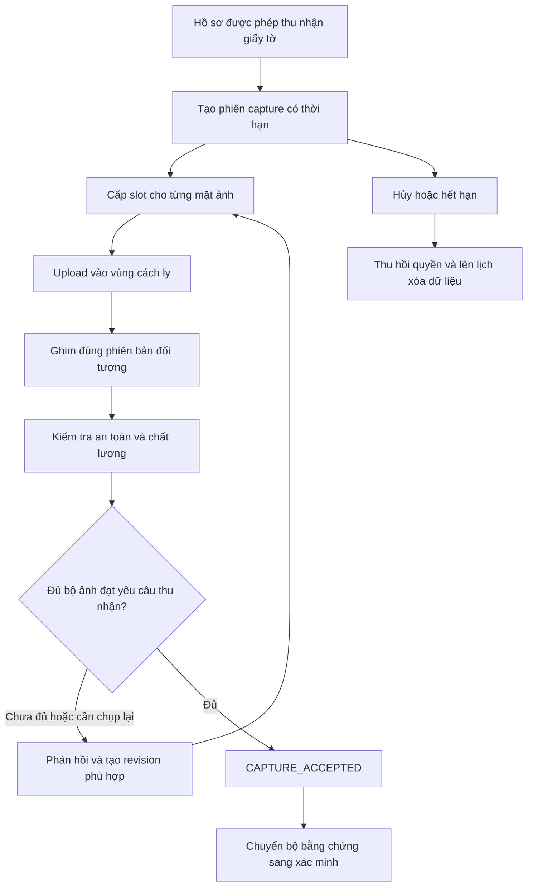

# Identity document capture — Thu nhận ảnh giấy tờ định danh

Trong khôi phục tài khoản, **identity document capture** là bước hướng dẫn người yêu cầu cung cấp hình ảnh giấy tờ và tiếp nhận hình ảnh đó vào một hồ sơ có kiểm soát. Đầu ra của bước này là bộ bằng chứng có nguồn gốc, đủ chất lượng cho bước xử lý tiếp theo và được bảo vệ trong suốt vòng đời. Việc tải ảnh lên thành công chưa xác nhận giấy tờ thật, người gửi là chủ giấy tờ hay người đó có quyền lấy lại tài khoản.

Ví dụ, một người dùng mất điện thoại chứa ứng dụng MFA và không còn dùng được passkey trên thiết bị cũ. Nếu chính sách của dịch vụ cho phép xác minh lại danh tính đã được thiết lập trước đó, hệ thống có thể yêu cầu thu nhận giấy tờ. Thiết kế cần ngăn hai hậu quả đồng thời: kẻ tấn công dùng ảnh giấy tờ bị lộ để chiếm tài khoản, và ảnh định danh của người dùng thật bị phát tán qua hạ tầng khôi phục.

## 1. Xác định capture đang chứng minh điều gì

Cần tách bốn câu hỏi:

| Công đoạn | Câu hỏi cần trả lời | Điều chưa thể kết luận |
| --- | --- | --- |
| Thu nhận ảnh | Đã nhận đúng các mặt ảnh cần thiết, gắn với đúng hồ sơ và có thể xử lý chưa? | Giấy tờ có thật hay không |
| Kiểm tra giấy tờ | Bằng chứng có dấu hiệu giả mạo, sửa đổi hoặc dữ liệu không nhất quán không? | Người đang yêu cầu có phải chủ giấy tờ không |
| Xác minh người yêu cầu | Có đủ bằng chứng liên kết người đang tham gia với danh tính được trình bày không? | Danh tính này có liên hệ hợp lệ với tài khoản đích không |
| Quyết định recovery | Danh tính và các bằng chứng khác có đáp ứng chính sách lấy lại tài khoản không? | Mọi thao tác nhạy cảm sau recovery đều được phép ngay lập tức |

NIST phân biệt kiểm tra tính xác thực của bằng chứng với xác minh người sở hữu bằng chứng. Vì vậy, ảnh rõ và OCR đọc được không đồng nghĩa đã xác minh con người. [NIST SP 800-63A-4](https://pages.nist.gov/800-63-4/sp800-63a.html#expected-outcomes-of-identity-proofing)

Một tài khoản chỉ đăng ký bằng biệt danh và email có thể chưa từng được liên kết với danh tính ngoài đời. Yêu cầu người gửi xuất trình giấy tờ mang một cái tên bất kỳ không tự tạo ra liên hệ lịch sử với tài khoản ấy. Trong hướng dẫn recovery bằng xác minh lại danh tính, NIST yêu cầu đối chiếu với danh tính đã thiết lập trước đó. [NIST SP 800-63B-4, mục 4.2](https://pages.nist.gov/800-63-4/sp800-63b.html#account-recovery)

Trong bài này, các mô hình dữ liệu, API và ngưỡng kỹ thuật là **thiết kế minh họa cho một dịch vụ recovery**. Chúng không phải bộ tiêu chí tự chứng nhận đạt một mức bảo đảm danh tính.

## 2. Quyết định có cần thu nhận giấy tờ

Không nên biến upload giấy tờ thành lối vào mặc định cho mọi yêu cầu quên mật khẩu. Trước khi mở bước capture, dịch vụ recovery cần có chính sách trả lời được:

- Tài khoản thuộc nhóm nào, đã có loại liên kết danh tính nào và liên kết đó được thiết lập bằng quy trình nào?
- Người yêu cầu còn recovery code, thiết bị tin cậy hoặc phương thức khác đã được đăng ký không?
- Loại sự cố là mất mật khẩu, mất một yếu tố MFA, mất toàn bộ thiết bị hay nghi bị chiếm tài khoản?
- Loại giấy tờ và phương thức capture nào được chấp nhận cho trường hợp này?
- Nếu người dùng không có giấy tờ phù hợp hoặc không dùng được camera, có quy trình thay thế nào đã được thiết kế trước?

Việc có email liên hệ mới hoặc khai đúng tên hiển thị không đủ để tự chọn tài khoản cần khôi phục. Ở phía máy chủ, hồ sơ recovery phải tham chiếu tài khoản đích đã xác định theo quy trình của dịch vụ; client không được đổi tham chiếu ấy khi nộp ảnh.

Ví dụ, một dịch vụ có tài khoản đã xác minh danh tính từ trước có thể cho phép thu nhận lại giấy tờ theo chính sách. Một diễn đàn sử dụng biệt danh có thể cần cơ chế recovery khác. Hai dịch vụ không nên dùng cùng quy tắc “ảnh giấy tờ hợp lệ thì reset MFA”.

## 3. Thiết kế trải nghiệm trước khi mở camera

### 3.1. Giải thích yêu cầu bằng ngôn ngữ người dùng hiểu được

Ngay trước bước thu nhận, giao diện cần trình bày:

- Vì sao hồ sơ này cần giấy tờ và ảnh sẽ phục vụ bước nào.
- Những loại giấy tờ, quốc gia hoặc vùng cấp và mặt ảnh được hỗ trợ.
- Dữ liệu nào cần thấy rõ, có được che trường nào không và cách che được chấp nhận.
- Ai hoặc đơn vị nào sẽ xử lý ảnh, thời gian lưu theo chính sách của dịch vụ và cách nhận hỗ trợ.
- Cách hủy bước thu nhận và lựa chọn thay thế nếu không hoàn thành được.

Không yêu cầu gửi giấy tờ qua email, ứng dụng chat hoặc vé hỗ trợ thông thường để “làm nhanh”. Nếu có hỗ trợ trực tiếp, nhân viên hướng dẫn người dùng quay lại kênh thu nhận được kiểm soát.

Thông báo chấp thuận trên giao diện cũng không thay thế việc tổ chức xác định mục đích xử lý, quyền truy cập và chính sách lưu dữ liệu. Khi quy trình có thu thêm dữ liệu sinh trắc học, cần giải thích riêng thay vì gộp vào một nút upload giấy tờ.

### 3.2. Yêu cầu đúng những gì cần thiết

Ví dụ về chính sách đầu vào:

| Loại bằng chứng được hỗ trợ | Bộ ảnh theo mẫu capture | Hướng dẫn |
| --- | --- | --- |
| Thẻ định danh hai mặt | Mặt trước và mặt sau khi chính sách yêu cầu cả hai | Chụp từng mặt, không ghép thành một ảnh |
| Hộ chiếu | Trang thông tin theo loại hộ chiếu được hỗ trợ | Giữ đầy đủ vùng trang cần đọc |
| Giấy tờ thay thế | Theo mẫu đã được dịch vụ phê duyệt | Không để nhân viên tự yêu cầu thêm tùy ý |

Đây là ví dụ phân loại, không khẳng định mọi thẻ hoặc hộ chiếu đều được chấp nhận. Bộ mặt ảnh phải được chọn từ mẫu chính sách của máy chủ. Không để client gửi một danh sách tự do rồi tự khai rằng đã đủ bằng chứng.

Không yêu cầu tất cả các trang hộ chiếu khi chỉ một trang thông tin là đủ cho quy trình. Cũng không hướng dẫn người dùng tùy ý che trường dữ liệu nếu bước kiểm tra sau đó cần trường ấy. Nếu hỗ trợ che dữ liệu, quy định phải rõ và nhất quán với khả năng xử lý thực tế.

### 3.3. Hướng dẫn chụp để giảm lỗi có thể sửa

Giao diện có thể nhắc người dùng:

1. Đặt giấy tờ trên nền tương phản, đủ ánh sáng.
2. Giữ toàn bộ vùng giấy tờ trong khung, tránh cắt góc hoặc ngón tay che thông tin.
3. Tránh đèn phản chiếu vào vùng chữ hoặc ảnh.
4. Giữ thiết bị ổn định, chờ lấy nét rồi chụp.
5. Xem lại ảnh trước khi gửi và chụp lại khi bị mờ.

Không tự áp dụng bộ lọc làm đẹp, tạo thêm chi tiết hoặc làm nét bằng công cụ có thể thay đổi nội dung bằng chứng. Ảnh xem trước có thể xoay cho dễ đọc; mọi biến đổi dùng trong xử lý cần có mục đích và nguồn gốc rõ ràng.

Chất lượng thấp thường là vấn đề thao tác hoặc thiết bị. Một ảnh mờ chưa đủ cơ sở kết luận gian lận.

## 4. Chụp trực tiếp và upload ảnh có sẵn có mức tin cậy khác nhau

**Chụp trực tiếp** nghĩa là thu nhận trong phiên hiện tại theo cơ chế mà hệ thống thiết kế. **Upload ảnh có sẵn** nghĩa là tiếp nhận một tệp mà người yêu cầu đã có. Cần ghi nhận hai hình thức này riêng, vì chúng cung cấp thông tin khác nhau về nguồn ảnh.

Thuộc tính HTML như `capture`, một timestamp từ client hay lời khai “vừa chụp” không phải bằng chứng đáng tin về sự hiện diện của giấy tờ. Một nonce gắn vào yêu cầu upload có thể liên kết lượt gửi với hồ sơ, nhưng không chứng minh ảnh được tạo sau nonce.

Nếu quy trình yêu cầu chứng minh giấy tờ đang hiện diện, cần cơ chế kiểm tra tương ứng và đối phó việc chèn ảnh vào luồng thu nhận. NIST mô tả live capture, document presence checks và kiểm soát injection; một nút mở camera không tự đáp ứng các yêu cầu đó. [NIST SP 800-63A-4, mục 3.13–3.14](https://pages.nist.gov/800-63-4/sp800-63a.html#requirements-for-the-validation-of-physical-evidence)

Trong thiết kế minh họa, máy chủ lưu `captureMode` cùng nguồn xác nhận của nó:

| Giá trị | Ý nghĩa |
| --- | --- |
| `FILE_UPLOAD` | Tiếp nhận tệp có sẵn |
| `CAMERA_UNATTESTED` | Giao diện dùng camera nhưng máy chủ chưa có bằng chứng đáng tin về nguồn thu |
| `PROVIDER_CAPTURE` | Thu nhận qua phiên nhà cung cấp; vẫn cần kiểm tra kết quả và thuộc tính bảo đảm thực sự |

Không cho client tự gửi `captureMode=VERIFIED_LIVE` rồi dùng giá trị ấy để bỏ qua kiểm tra. Nếu người dùng không thể chụp trực tiếp, chuyển sang phương án được chính sách cho phép; không âm thầm giữ nguyên mức tin cậy của phương án ban đầu.

## 5. Gắn mỗi ảnh với một hồ sơ recovery cụ thể

Một mô hình dữ liệu đủ rõ có thể gồm:

| Thực thể | Các thuộc tính quan trọng |
| --- | --- |
| `RecoveryCase` | ID ngẫu nhiên, tham chiếu tài khoản và tenant, trạng thái, thời hạn, phiên bản chính sách, thế hệ recovery hiện tại |
| `CaptureSession` | Hồ sơ cha, phương thức capture, thời hạn, quyền hạn hẹp, trạng thái, số lượt thử |
| `UploadSlot` | Session cha, mặt ảnh, revision, hạn upload, khóa đối tượng do máy chủ cấp, trạng thái sử dụng |
| `EvidenceObject` | Slot cha, phiên bản đối tượng bất biến, kích thước thực, digest, vùng lưu, trạng thái cách ly và xử lý |
| `CaptureSubmission` | Danh sách chính xác các phiên bản ảnh được nộp cùng nhau, phiên bản mẫu đầu vào và trạng thái thu nhận |

Các ràng buộc cần nằm ở phía máy chủ:

- Một slot chỉ thuộc một session và một mặt ảnh đã được chính sách cho phép.
- Session tham chiếu một hồ sơ cố định; không đổi tài khoản hoặc tenant bằng request upload.
- Một submission tham chiếu chính xác bộ ảnh của lượt nộp đó.
- Ảnh chụp lại tạo revision mới; không thay âm thầm dữ liệu đang được xét.
- Kết quả kiểm tra bất đồng bộ luôn chỉ rõ phiên bản ảnh đã xử lý.

ID khó đoán giúp giảm khả năng dò tìm, nhưng không thay thế kiểm tra quyền. Biết một `captureSessionId` không được coi là đã có quyền xem hoặc nộp bằng chứng.

### Quyền capture phải hẹp hơn quyền truy cập tài khoản

Người mất toàn bộ yếu tố xác thực có thể chưa đăng nhập được. Dịch vụ vẫn có thể cấp một capability dành riêng cho hồ sơ recovery sau bước mở hồ sơ theo chính sách.

Capability này chỉ cho phép các thao tác như tạo slot, gửi ảnh hoặc xem tiến độ capture. Nó không được phép đọc dữ liệu tài khoản, đổi email, tắt MFA, đăng ký passkey mới hoặc lấy access token đăng nhập.

Một capability tốt cần có:

- Giá trị đủ khó đoán do máy chủ sinh; nếu là secret ngẫu nhiên, có thể chỉ lưu dạng băm để tra cứu.
- Ràng buộc purpose, hồ sơ, session, thời hạn và trạng thái còn hiệu lực.
- Cách thu hồi khi hồ sơ bị hủy hoặc thế hệ recovery thay đổi.
- Cơ chế giảm lộ qua URL, log, referrer và bộ nhớ trình duyệt.

Nếu dùng cookie cho phiên capture, cần cấu hình cookie phù hợp và bảo vệ CSRF cho thao tác thay đổi trạng thái. Nếu dùng bearer token, cần kiểm soát nơi lưu và tránh chuyển secret vào query string. Cả hai phương án đều cần kiểm tra quyền ở mỗi request.

## 6. Luồng thu nhận và trạng thái đầu ra



`CAPTURE_ACCEPTED` chỉ có nghĩa bộ ảnh đã đạt yêu cầu tiếp nhận của dịch vụ. Có thể lưu trạng thái quyết định recovery trong trường hoặc thực thể riêng để tránh nhầm lẫn.

Ví dụ các trạng thái thu nhận:

| Trạng thái | Diễn giải | Hành động tiếp theo |
| --- | --- | --- |
| `OPEN` | Phiên còn hiệu lực, đang chờ ảnh | Cho gửi những mặt còn thiếu |
| `PROCESSING` | Đang xử lý các phiên bản ảnh đã ghi nhận | Chờ kết quả, không coi là đã đạt |
| `RECAPTURE_REQUIRED` | Có lỗi có thể sửa bằng cách chụp lại | Hướng dẫn lỗi chất lượng và cấp revision mới |
| `CAPTURE_ACCEPTED` | Đủ bộ ảnh được tiếp nhận | Chuyển sang công đoạn xác minh |
| `CANCELLED` | Người dùng hoặc hệ thống đã hủy | Chặn nộp mới và thu hồi capability |
| `EXPIRED` | Đã quá thời hạn | Chặn kết quả đến muộn làm sống lại phiên |

Một revision đang xử lý không được ghi đè trạng thái của revision mới hơn. Khi phiên hết hạn, việc tác vụ nền đã bắt đầu từ trước không cho phép nó tiếp tục cấp quyền.

## 7. API minh họa cho quy trình capture

### 7.1. Tạo phiên theo chính sách máy chủ

```http
POST /recovery/capture-sessions
Authorization: Bearer <recovery-capability>
Content-Type: application/json

{
  "documentType": "SUPPORTED_ID_CARD",
  "issuingRegion": "VN"
}
```

Máy chủ kiểm tra loại giấy tờ có được chấp nhận cho hồ sơ này không rồi trả mẫu đầu vào:

```json
{
  "captureSessionId": "cs_example_opaque",
  "status": "OPEN",
  "requiredSides": ["FRONT", "BACK"],
  "expiresAt": "2026-11-23T11:30:00Z",
  "limits": {
    "maxBytesPerImage": 8388608,
    "maxPixelsPerImage": 20000000,
    "acceptedMediaTypes": ["image/jpeg", "image/png"]
  }
}
```

Hai mặt ảnh, 8 MiB và 20 triệu pixel chỉ là cấu hình minh họa. Giới hạn thực tế cần phù hợp với mẫu giấy tờ, thiết bị được hỗ trợ và năng lực xử lý. Không lấy các con số này làm tiêu chuẩn nhận dạng.

Thời điểm hết hạn do máy chủ quyết định. UI có thể hiển thị đếm ngược nhưng không tự kéo dài phiên.

### 7.2. Cấp slot upload

```http
POST /recovery/capture-sessions/cs_example_opaque/upload-slots
Authorization: Bearer <capture-capability>
Content-Type: application/json

{
  "side": "FRONT"
}
```

Máy chủ tự cấp object key và revision. Request không chứa đường dẫn lưu trữ, tên tài khoản đích hoặc URL ngoài để máy chủ tải ảnh về.

Có thể upload qua API của dịch vụ hoặc dùng URL ký sẵn tới kho riêng. Với URL ký sẵn, cần hiểu rằng **có thời hạn không đồng nghĩa chỉ dùng được một lần**. Tùy cơ chế lưu trữ, cùng URL có thể bị dùng lại hoặc ghi thay đối tượng trong thời gian còn hiệu lực.

Thiết kế minh họa xử lý điều này bằng cách:

1. Mỗi slot dùng key riêng và không cho client liệt kê kho.
2. Cơ chế lưu trữ ngăn ghi đè hoặc cung cấp phiên bản đối tượng cụ thể.
3. Khi nhận hoàn tất, máy chủ ghim đúng phiên bản đã nhận, không đọc “phiên bản mới nhất”.
4. Submission chỉ tham chiếu bản đã ghim.
5. Slot đã tiêu thụ không được tạo submission mới; gửi lặp lại hợp lệ trả kết quả cũ.

Nếu kho không cung cấp cách ghim phiên bản đáng tin, có thể đưa upload qua gateway kiểm soát hoặc sao chép sang vùng bất biến với điều kiện bảo đảm sao chép đúng đối tượng đã kiểm tra. Không giả định một object key ổn định đồng nghĩa nội dung bất biến.

### 7.3. Xác nhận hoàn tất và nộp bộ ảnh

Sau khi upload, client gọi endpoint hoàn tất. Máy chủ tra slot của mình, kiểm tra đối tượng thực tế và đưa đúng phiên bản vào xử lý. Không tin các trường client khai như `scanPassed`, `qualityPassed` hoặc `ownerVerified`.

Khi đủ ảnh, thao tác nộp bộ ảnh tạo snapshot gồm các evidence revision chính xác. Nếu client gửi lại cùng idempotency key và cùng nội dung, trả cùng kết quả. Nếu dùng lại key cho bộ ảnh khác, từ chối xung đột.

Giao diện nên hiển thị “Đã nhận ảnh, đang xử lý” trong giai đoạn bất đồng bộ. Tránh dùng thông báo “Xác minh thành công” trước khi quy trình xác minh thực sự kết thúc.

## 8. Xử lý tệp đầu vào như dữ liệu không tin cậy

Một tệp mang tên `front.jpg` chưa chắc là ảnh JPEG. Header `Content-Type` cũng do bên gửi kiểm soát. OWASP đề xuất nhiều lớp kiểm tra: danh sách định dạng cho phép, loại tệp thực, giới hạn kích thước, tên do hệ thống sinh, lưu riêng và kiểm soát quyền truy cập. [OWASP File Upload Cheat Sheet](https://cheatsheetseries.owasp.org/cheatsheets/File_Upload_Cheat_Sheet.html)

Áp dụng cho pipeline minh họa:

1. **Tiếp nhận có giới hạn:** gateway đếm byte thực tế trong luồng nhận; không chỉ tin `Content-Length`. Có timeout, giới hạn đồng thời và ngân sách lưu theo hồ sơ.
2. **Cách ly:** đối tượng mới chưa được đưa vào khu vực hiển thị cho nhân viên hoặc trình duyệt người dùng.
3. **Phân tích có giới hạn tài nguyên:** tiến trình xử lý ảnh có giới hạn bộ nhớ, thời gian CPU và kích thước giải mã; không có quyền truy cập kho bằng chứng khác.
4. **Ghim kết quả:** mọi kết quả đều tham chiếu evidence ID, object version và phiên bản pipeline.
5. **Chấp nhận có điều kiện:** chỉ ảnh được xử lý thành công mới có thể vào bộ bằng chứng được tiếp nhận.

Nếu dịch vụ chỉ hỗ trợ JPEG và PNG, tệp PDF, SVG, ảnh động hoặc kho nén bị từ chối theo chính sách đầu vào. Thông báo cần nói rõ định dạng được hỗ trợ để người dùng sửa được.

Dung lượng nén nhỏ không đảm bảo chi phí giải mã nhỏ. Ví dụ, pipeline kiểm giới hạn số pixel trước khi tạo bitmap lớn; decoder cũng phải chạy trong môi trường có giới hạn vì việc đọc metadata tự nó có thể lỗi.

### Giữ bản gốc và bản dẫn xuất có mục đích khác nhau

Có thể cần ảnh gốc để phân tích dấu vết chỉnh sửa, trong khi giao diện chỉ cần bản xem trước an toàn. Vì thế, thiết kế có thể lưu:

- Bản gốc trong vùng hạn chế, chỉ cho công đoạn có lý do truy cập.
- Bản dẫn xuất để xem trước hoặc OCR, gắn với evidence nguồn và phép biến đổi.
- Metadata vận hành tối thiểu để theo dõi xử lý.

Không xóa hoặc tái mã hóa bản gốc trước khi xác định bước xác minh còn cần dữ liệu nào. Ngược lại, không giữ mọi metadata vô thời hạn chỉ vì “có thể hữu ích”. Các dữ liệu không cần dùng, như vị trí chụp trong bản hiển thị, cần được xử lý theo chính sách giảm thiểu dữ liệu.

Khi thành phần quét hoặc giải mã không hoạt động, trạng thái phù hợp là đang chờ, lỗi xử lý hoặc yêu cầu thử lại. Sự cố của pipeline không được biến thành kết quả đạt.

## 9. Chất lượng ảnh là điều kiện tiếp nhận

Pipeline chất lượng có thể kiểm tra:

| Nhóm kiểm tra | Ví dụ lỗi | Phản hồi cho người dùng |
| --- | --- | --- |
| Khung hình | Mất góc, cắt vùng cần đọc | “Đặt toàn bộ giấy tờ trong khung và chụp lại.” |
| Độ rõ | Rung hoặc mất nét | “Giữ máy ổn định, chờ lấy nét trước khi chụp.” |
| Ánh sáng | Lóa tại vùng thông tin | “Đổi góc chiếu sáng để giảm phản chiếu.” |
| Hướng ảnh | Quay sai hoặc đặt mặt không đúng | “Chụp đúng mặt đang được yêu cầu.” |
| Đủ bộ | Chưa có mặt sau theo mẫu | “Cần bổ sung mặt sau để tiếp tục.” |

OCR có thể hỗ trợ phát hiện vùng khó đọc, nhưng OCR thành công không chứng minh giấy tờ thật. Tương tự, OCR thất bại không tự chứng minh gian lận.

Không tạo một điểm số chung tên `identityScore` bằng cách cộng độ sáng, độ nét và kết quả OCR. Trong mô hình này, có thể ghi riêng `captureQuality`, trạng thái xử lý tệp và kết quả xác minh sau đó. Cách tách giúp người vận hành hiểu hệ thống đã kết luận điều gì.

Lỗi chất lượng có thể giải thích cụ thể. Với tín hiệu nghi gian lận, phản hồi công khai không nên tiết lộ chi tiết ngưỡng hoặc cách vượt kiểm tra. Chuyển sang quy trình đánh giá thích hợp mà vẫn cho người dùng biết trạng thái và cách nhận hỗ trợ.

Một dịch vụ phục vụ người dùng có thiết bị cũ cần có phương án xử lý đã được đánh giá trước. Cho phép gửi qua hộp thư cá nhân của nhân viên không phải phương án thay thế tương đương.

## 10. Chống tráo ảnh, gửi lặp và kết quả đến muộn

Ba tình huống thường bị bỏ sót:

### 10.1. Thay ảnh sau khi đã kiểm tra

Nếu scanner kiểm `objectKey=K`, rồi bên gửi ghi đè K trước khi nhân viên mở ảnh, hai công đoạn đang xem hai nội dung khác nhau.

Cần tham chiếu `K + objectVersion` hoặc một bản bất biến tương đương. Digest giúp phát hiện thay đổi khi được tính từ byte thực tế, nhưng bản thân digest không ngăn ghi đè và không thay thế kiểm soát quyền.

### 10.2. Kết hợp hai bộ giấy tờ khác nhau

Mặt trước từ revision 1 có thể đã đạt, trong khi mặt sau của revision 2 thuộc một lượt nộp khác. Không lấy “mặt trước mới nhất đã đạt” ghép với “mặt sau mới nhất đã đạt” mà không kiểm tra bộ ảnh đang được xét.

Submission phải chứa danh sách evidence cụ thể. Bước xác minh tiếp theo còn cần kiểm tra sự nhất quán giữa các mặt, thay vì tin rằng cùng session thì chắc chắn cùng một giấy tờ.

### 10.3. Chấp nhận kết quả của hồ sơ đã bị hủy

Callback đến muộn có thể xảy ra sau khi người dùng hủy hoặc nhân viên đóng hồ sơ. Dịch vụ nhận callback cần xác thực nguồn theo cơ chế tích hợp, chống replay và ánh xạ công việc bằng dữ liệu máy chủ đã lưu.

Trước khi áp dụng kết quả, kiểm lại thời hạn, trạng thái, thế hệ recovery và revision. Không cho callback tự mang một `accountId` rồi cập nhật tài khoản đó.

Pseudocode sau chỉ minh họa điều kiện chuyển trạng thái; không phải mã triển khai đầy đủ:

```text
onImageProcessingResult(trustedResult):
    job = findJobFromServerMapping(trustedResult.jobId)
    require trustedResult refers to job.expectedEvidenceVersion

    begin transaction
        case = lockRecoveryCase(job.caseId)
        session = lockCaptureSession(job.sessionId)
        evidence = lockEvidence(job.evidenceId)

        require case is still eligible for capture
        require case.recoveryGeneration == session.recoveryGeneration
        require session is not cancelled
        require serverNow < session.expiresAt
        require evidence.objectVersion == job.expectedEvidenceVersion
        require evidence.revision is still eligible for this submission

        if job.resultAlreadyApplied:
            return previouslyStoredResult

        record processing result for this evidence version
        mark job result applied

        if the exact submitted set has all required images accepted:
            mark capture CAPTURE_ACCEPTED
            append VerificationRequested to transactional outbox
    commit
```

Việc xử lý ảnh tốn thời gian diễn ra ngoài transaction. Transaction chỉ áp dụng kết quả và tạo sự kiện bàn giao. Consumer của outbox cũng cần idempotency và kiểm tra hồ sơ còn hợp lệ trước khi bắt đầu bước xác minh.

Không có thao tác reset mật khẩu, gỡ MFA hoặc cấp session đăng nhập trong handler thu nhận ảnh này.

## 11. Chuyển từ máy tính sang điện thoại một cách có kiểm soát

Một người dùng mở hồ sơ trên máy tính nhưng cần camera điện thoại. Nếu hỗ trợ chuyển thiết bị, liên kết hoặc QR phải mang quyền hẹp cho đúng phiên capture, không chứa thông tin giấy tờ hay quyền đăng nhập đầy đủ.

Một phương án minh họa:

1. Máy chủ tạo mã handoff ngắn hạn, ngẫu nhiên và dùng một lần để đổi lấy phiên capture trên thiết bị mới.
2. Người dùng mở QR trên điện thoại và xác nhận tiếp tục hồ sơ.
3. Máy chủ kiểm tra mã còn hiệu lực, tiêu thụ mã bằng thao tác nguyên tử và cấp capability capture riêng.
4. Máy tính chỉ nhận tiến độ; không tự được cấp quyền xem ảnh gốc qua kênh cập nhật.
5. Khi hồ sơ đóng, cả quyền trên điện thoại và mã handoff còn lại đều bị thu hồi ở lớp ứng dụng.

Không yêu cầu điện thoại có cùng IP với máy tính: mạng di động và Wi-Fi thường khác nhau. Ngược lại, cùng IP cũng không chứng minh cùng người.

Một mã handoff là bearer secret trong lúc còn hiệu lực. Vì vậy, tránh đưa nó vào log, analytics hoặc trang có tài nguyên bên thứ ba không cần thiết. Nếu mã bị chụp hoặc chuyển tiếp, người khác có thể sử dụng quyền hẹp đó; quy trình vẫn phải có các bước xác minh sau capture.

## 12. Bảo vệ bằng chứng trong lưu trữ và vận hành

### 12.1. Quyền xem và phân tách vai trò

Trong thiết kế minh họa, bộ phận hỗ trợ chỉ xem hồ sơ đã được phân công và chỉ mở ảnh khi tác vụ cần. Người có quyền hỗ trợ tài khoản nói chung không mặc nhiên được tải toàn bộ giấy tờ.

Kho ảnh dùng quyền riêng; đường dẫn không công khai và không suy từ email hay số giấy tờ. Nếu phát URL xem ngắn hạn, chỉ phát sau kiểm tra quyền, giới hạn đúng đối tượng và tránh cache công khai. Với bản xem trước, có thể dùng watermark phù hợp mà không làm hỏng bằng chứng gốc.

Mã hóa khi truyền và khi lưu cần đi cùng phân quyền và quản lý khóa. Mã hóa kho không ngăn một nhân viên có quyền quá rộng xuất ảnh ra ngoài.

### 12.2. Log phục vụ truy vết mà không tạo kho giấy tờ thứ hai

OWASP khuyến cáo tránh ghi trực tiếp token, bí mật và dữ liệu cá nhân nhạy cảm vào log, đồng thời kiểm soát quyền truy cập log. [OWASP Logging Cheat Sheet](https://cheatsheetseries.owasp.org/cheatsheets/Logging_Cheat_Sheet.html#data-to-exclude)

Một sự kiện cho pipeline minh họa có thể là:

```json
{
  "event": "capture.image_received",
  "caseRef": "rc_example_opaque",
  "captureRef": "cs_example_opaque",
  "evidenceRef": "ev_example_opaque",
  "side": "FRONT",
  "revision": 2,
  "result": "QUARANTINED"
}
```

Không gắn ảnh base64, toàn bộ OCR, số giấy tờ, capability hay URL ký sẵn vào sự kiện. Log bằng ID nội bộ vẫn có thể liên kết với dữ liệu cá nhân, nên cũng cần thời hạn lưu và quyền đọc.

Đối với hành vi xem hoặc xuất ảnh, audit có thể ghi chủ thể truy cập, thời điểm, hồ sơ, mục đích nghiệp vụ và kết quả. Không đưa nội dung ảnh vào audit để chứng minh rằng đã xem.

### 12.3. Chống lạm dụng theo chi phí thực tế

Mỗi lần upload có thể phát sinh lưu trữ, giải mã, OCR hoặc chi phí nhà cung cấp. Thiết kế cần ngân sách theo hồ sơ, phiên, thiết bị và các tín hiệu hạ tầng phù hợp; không chỉ giới hạn theo IP.

Tách số lần sửa lỗi chất lượng với tín hiệu tấn công để tránh khóa người dùng thật quá nhanh. Đồng thời, việc tạo hồ sơ mới không được tự động xóa mọi giới hạn cũ.

Có thể theo dõi tỷ lệ chụp lại, lỗi xử lý, dung lượng cách ly, độ trễ hàng đợi và chi phí theo lượt. Những chỉ số này giúp phát hiện sự cố mà không cần thu thêm nội dung giấy tờ vào hệ thống analytics.

### 12.4. Thời hạn lưu và xóa

Chính sách cần phân biệt ảnh chưa nộp, ảnh bị thay thế, hồ sơ bị hủy, hồ sơ đã kết thúc và bằng chứng phải giữ theo mục đích đã được xác định.

Một thao tác “xóa ảnh” phải xem xét các bản liên quan: bản gốc, preview, kết quả OCR, bản ở nhà cung cấp, vùng tạm, phiên bản đối tượng và bản sao lưu theo vòng đời tương ứng. Không hứa xóa tức thì mọi bản backup nếu hệ thống thực tế chỉ loại bỏ khi backup hết hạn.

Khi người dùng hủy, lớp ứng dụng phải dừng chấp nhận bằng chứng ngay. Với URL upload đã ký sẵn mà kho chưa hỗ trợ thu hồi tức thời, cần chặn việc tiêu thụ slot tại ứng dụng và xử lý những đối tượng đến muộn bằng quy trình dọn dữ liệu. Không mô tả việc đóng hồ sơ là đã vô hiệu hóa vật lý mọi URL đang còn hạn.

## 13. Ví dụ xuyên suốt: mất điện thoại chứa MFA

Giả sử Mai có tài khoản đã được dịch vụ liên kết với danh tính từ trước. Mai mất điện thoại và không còn phương thức đăng nhập đáp ứng chính sách. Sau khi mở hồ sơ, dịch vụ xác định trường hợp này được phép thu nhận lại giấy tờ.

1. Mai nhận quyền capture cho hồ sơ hiện tại. Quyền này chỉ dùng nộp ảnh và xem tiến độ.
2. Máy chủ chọn mẫu giấy tờ hỗ trợ và cấp slot mặt trước.
3. Ảnh đầu bị lóa. Hệ thống trả yêu cầu chụp lại, không kết luận Mai đang gian lận.
4. Mai gửi revision mới và mặt sau. Hai ảnh được lưu trong vùng cách ly, gắn với các phiên bản bất biến.
5. Bộ ảnh cụ thể được nộp; pipeline hoàn thành kiểm tra tiếp nhận.
6. Hồ sơ chuyển sang `CAPTURE_ACCEPTED`, rồi được bàn giao cho công đoạn xác minh giấy tờ, xác minh người yêu cầu và đối chiếu danh tính với tài khoản.

Nếu ai đó gửi ảnh giấy tờ của Mai đã bị lộ, pipeline có thể vẫn đọc được ảnh rõ. Đây chính là lý do chất lượng ảnh không được dùng để quyết định recovery.

Nếu Mai hủy hồ sơ ở bước 4 nhưng kết quả xử lý đến sau đó, handler kiểm tra trạng thái và không bàn giao tiếp. Những đối tượng đã nhận vẫn đi theo lịch xóa phù hợp.

Nếu toàn bộ quy trình recovery sau này được phê duyệt, hệ thống mới thực hiện kế hoạch thay yếu tố xác thực, thông báo và xử lý session theo chính sách. Các hành động đó không thuộc quyền của bước capture.

## 14. Những quyết định thiết kế cần nhớ

- Ảnh được tiếp nhận là bằng chứng đầu vào; quyền khôi phục cần một quyết định riêng.
- Bộ ảnh phải gắn với đúng tài khoản, hồ sơ, session, mặt ảnh, revision và phiên bản đối tượng.
- Quyền upload có phạm vi hẹp; URL ký sẵn ngắn hạn chưa chắc dùng một lần.
- Kiểm tra ở client giúp thao tác dễ hơn; máy chủ vẫn là nơi quyết định điều kiện tiếp nhận.
- Lỗi chất lượng cần đường sửa, lỗi pipeline cần trạng thái rõ và tín hiệu gian lận cần xử lý có kiểm soát.
- Bằng chứng phải được bảo vệ từ lúc mở camera đến lúc hết mục đích lưu, bao gồm các bản dẫn xuất và hệ thống của bên xử lý.

Một bước capture được thiết kế rõ ràng giúp công đoạn xác minh nhận đúng bộ bằng chứng có thể truy vết, đồng thời giữ quyền truy cập tài khoản ở đúng ranh giới quyết định recovery.