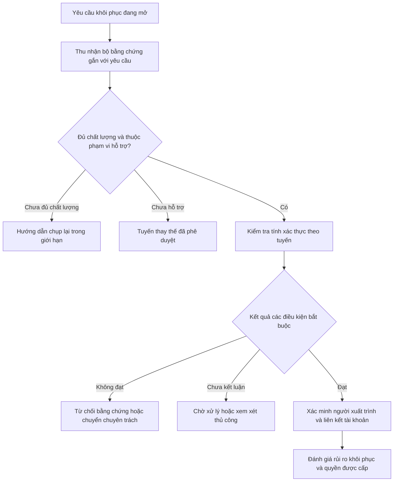

# Document authenticity checks — Kiểm tra tính xác thực của giấy tờ

## 1. Mục tiêu trong luồng khôi phục tài khoản

Khi người dùng mất mật khẩu, thiết bị MFA hoặc passkey, một số dịch vụ có thể cho phép xuất trình giấy tờ để bổ sung bằng chứng danh tính. Câu hỏi đầu tiên của bước này là: **giấy tờ được xuất trình có dấu hiệu được cơ quan phát hành hợp lệ cấp, và dữ liệu đang kiểm tra có bị sửa đổi hay không?**

Đó là mục tiêu của document authenticity checks. Một ảnh căn cước đọc được đầy đủ thông tin chưa đủ để trả lời câu hỏi này. Kẻ tấn công có thể có ảnh giấy tờ thật bị đánh cắp, ảnh đã thay chân dung, hoặc một tài liệu giả được tạo sao cho OCR vẫn trích xuất thành công.

Trong bài này, “giấy tờ” bao gồm giấy tờ vật lý được chụp lại và giấy tờ có thành phần điện tử phù hợp với loại tài liệu đó. Các cơ chế như MRZ, QR có chữ ký hoặc chip NFC chỉ được dùng khi đúng loại giấy tờ, phiên bản và hệ sinh thái phát hành có hỗ trợ.

Sau bài học, người học có thể:

- Chọn các lớp kiểm tra phù hợp thay vì coi một tín hiệu đơn lẻ là kết luận giấy tờ thật.
- Phân biệt kết quả không đạt với tình trạng chưa kiểm tra được.
- Thiết kế đầu ra kiểm tra để dịch vụ khôi phục tài khoản sử dụng an toàn.
- Giải thích vì sao giấy tờ thật vẫn chưa đủ để cấp lại quyền truy cập.

## 2. Bốn câu hỏi cần tách biệt

| Câu hỏi | Ví dụ cần làm rõ | Kết quả không tự chứng minh |
| --- | --- | --- |
| Tính xác thực và toàn vẹn | Giấy tờ có bị làm giả, thay ảnh hoặc sửa dữ liệu không? | Người đang gửi là chủ giấy tờ |
| Hiệu lực theo chính sách | Giấy tờ đã hết hạn hoặc bị cơ quan cấp báo mất, thu hồi chưa? | Giấy tờ hết hạn chắc chắn là giả |
| Người xuất trình | Người đang thực hiện yêu cầu có phải người được cấp giấy tờ không? | Người đó sở hữu tài khoản mục tiêu |
| Liên kết với tài khoản | Danh tính đã xác minh có quan hệ đáng tin cậy với tài khoản từ trước không? | Người đó được phép thực hiện mọi thay đổi nhạy cảm |

NIST phân biệt bước validation của bằng chứng với bước verification người xuất trình. Bước đầu đánh giá bằng chứng; bước sau xác nhận người xuất trình là người mà bằng chứng được cấp cho. Sự phân biệt này giúp tránh việc dùng kết quả kiểm tra tài liệu thay cho toàn bộ quá trình chứng minh danh tính. [NIST SP 800-63A-4 — Identity Proofing Overview](https://pages.nist.gov/800-63-4/sp800-63a/proofing/)

Ví dụ, tài khoản chỉ đăng ký bằng email và chưa từng có liên kết danh tính được kiểm chứng. Người yêu cầu đưa ra giấy tờ thật mang tên trùng với tên hiển thị không tạo ra liên kết tài khoản đủ mạnh. Tên hiển thị thường có thể tự chọn và nhiều người có cùng tên.

Vì vậy, đầu ra hợp lý của bước này là “bằng chứng tài liệu đạt yêu cầu của phương thức kiểm tra đã chọn”, kèm giới hạn và dữ liệu liên quan. Nó chưa phải lệnh đặt lại mật khẩu, bỏ MFA hoặc thêm passkey mới.

## 3. Các tình huống đe dọa

| Tình huống | Điều có thể đánh lừa hệ thống | Hướng kiểm soát |
| --- | --- | --- |
| Làm giả toàn bộ tài liệu | Bố cục và nội dung trông hợp lý | Nhận diện đúng mẫu, kiểm tra đặc điểm bảo an và nguồn phát hành khi có |
| Sửa một vùng trên giấy tờ thật | Phần lớn tài liệu vẫn giữ nguyên | Đánh giá dấu hiệu can thiệp và đối chiếu các vùng chứa cùng thuộc tính |
| Dùng ảnh giấy tờ thật bị lộ | Giấy tờ có thể vượt qua kiểm tra xác thực | Xác minh người xuất trình và liên kết tài khoản ở các bước riêng |
| Nộp ảnh màn hình hoặc bản in lại | Ảnh rõ nhưng không chứng minh đang có bản gốc | Thu nhận phù hợp với phương thức và đánh giá nguy cơ tái trình bày |
| Đọc dữ liệu điện tử rồi bỏ qua chữ ký | Dữ liệu có đủ trường, trông như do chip trả về | Kiểm tra mật mã và chuỗi tin cậy đúng giao thức |
| Tái sử dụng kết quả của yêu cầu khác | Kết quả cũ từng được nhà cung cấp chấp nhận | Ràng buộc kết quả với yêu cầu, lần thu nhận và mục đích cụ thể |
| Gửi nhiều biến thể để thăm dò | Mỗi lần thất bại làm lộ thêm quy tắc | Giới hạn thử, thông báo có kiểm soát và theo dõi lạm dụng |

Những tình huống này giải thích vì sao tỷ lệ OCR thành công hoặc một điểm “document score” duy nhất không đủ mô tả mức tin cậy.

## 4. Chuẩn bị bằng chứng có thể đánh giá

### 4.1. Xác định phạm vi giấy tờ được hỗ trợ

Trước khi yêu cầu người dùng chụp ảnh, dịch vụ cần có danh mục giấy tờ được chấp nhận: cơ quan hoặc quốc gia cấp, loại giấy tờ, phiên bản mẫu, mặt cần thu nhận và khả năng kiểm tra tương ứng.

Một tài liệu nằm ngoài danh mục không đồng nghĩa là giả. Nó có thể thuộc mẫu mới, loại giấy tờ chưa được tích hợp hoặc cơ quan cấp mà nhà cung cấp chưa hỗ trợ. Trường hợp đó cần kết quả “không được hỗ trợ” hoặc một phương thức thay thế đã được thiết kế trước.

Đặc biệt, không áp dụng mẫu hộ chiếu cho thẻ căn cước, không yêu cầu mọi giấy tờ có MRZ, và không suy rằng mọi mã QR đều có chữ ký số.

### 4.2. Kiểm tra chất lượng trước khi kết luận gian lận

Ảnh cần thể hiện đủ vùng cần thiết: cạnh tài liệu, ảnh chân dung và các trường liên quan đến phương thức kiểm tra. Mờ, lóa, cắt mất dữ liệu hoặc góc chụp quá lệch làm giảm khả năng đánh giá.

Một pipeline nên tách hai loại phát hiện:

- **Không đủ chất lượng:** không đọc hoặc quan sát được đặc điểm cần kiểm tra; hướng xử lý là hướng dẫn chụp lại.
- **Có dấu hiệu không nhất quán:** dữ liệu hoặc cấu trúc không phù hợp sau khi đã có ảnh đủ chất lượng; hướng xử lý là kiểm tra bổ sung hoặc xem xét thủ công.

Không biến việc camera yếu thành cáo buộc giấy tờ giả. Đồng thời, không cho ảnh không đủ chất lượng đi tiếp chỉ vì người dùng đã thử nhiều lần.

### 4.3. Bảo vệ quá trình tiếp nhận

Tệp tải lên là đầu vào không đáng tin cậy. Cần kiểm tra loại tệp thực tế, giới hạn kích thước và tài nguyên giải mã, đặt tên lưu trữ do máy chủ tạo, xử lý bằng thành phần được cô lập và lưu ngoài vùng công khai. Đây là các biện pháp phòng vệ phù hợp với hướng dẫn tải tệp của OWASP. [OWASP — File Upload Cheat Sheet](https://cheatsheetseries.owasp.org/cheatsheets/File_Upload_Cheat_Sheet.html)

Với tài liệu phục vụ đánh giá gian lận, cần giữ rõ nguồn gốc giữa bản thu nhận và bản dẫn xuất dùng để xem hoặc OCR. Nếu pipeline cắt, xoay hoặc nén ảnh, hãy ghi lại phép biến đổi; đừng để bản đã biến đổi trở thành “bản gốc” mà không có dấu vết. Trình xem an toàn cho nhân viên có thể dùng bản dẫn xuất, trong khi bản thu nhận được bảo quản theo chính sách truy cập và lưu giữ riêng.

Mã băm giúp nhận biết tệp đã thay đổi trong hệ thống, nhưng không chứng minh ảnh đó là giấy tờ thật. Một ảnh giả cũng có mã băm hợp lệ.

## 5. Các lớp kiểm tra tính xác thực

### 5.1. Lớp cấu trúc và mẫu tài liệu

Sau khi xác định đúng họ giấy tờ và phiên bản, hệ thống có thể so sánh:

- Sự hiện diện và vị trí tương đối của những vùng thông tin cần thiết.
- Cấu trúc số giấy tờ, mã cơ quan cấp hoặc trường ngày tháng theo mẫu được hỗ trợ.
- Quan hệ hợp lý giữa ngày cấp, ngày hết hạn và các thuộc tính khác theo quy tắc của loại giấy tờ đó.
- Mức nhất quán giữa mặt trước, mặt sau và những lần chụp trong cùng bộ bằng chứng.

Các kiểm tra này phát hiện tài liệu không phù hợp với mẫu đã biết, nhưng không tạo ra bằng chứng mật mã về cơ quan cấp. Hình thức đúng là điều kiện hỗ trợ đánh giá, không phải kết luận cuối cùng.

Không dùng quy tắc cảm tính như “mọi thẻ phải có cùng phông chữ” khi chưa xét phiên bản. Mẫu cũ, mẫu mới và tài liệu được cấp lại có thể khác nhau hợp lệ.

### 5.2. Lớp dữ liệu và tính nhất quán

OCR chuyển ảnh thành dữ liệu máy đọc được. Sau đó, hệ thống đối chiếu những thuộc tính xuất hiện ở nhiều nơi, chẳng hạn số giấy tờ trên vùng nhìn bằng mắt và trong vùng đọc máy, nếu loại tài liệu hỗ trợ.

MRZ là vùng đọc máy thường gặp trên giấy tờ đi lại. Các chữ số kiểm tra trong MRZ hỗ trợ phát hiện một số lỗi nhập hoặc đọc dữ liệu. Chúng không phải chữ ký số: việc tính lại được chữ số kiểm tra không chứng minh cơ quan phát hành đã cấp tài liệu.

Khi có sai khác, cần giữ cả giá trị trích xuất, nguồn và độ tin cậy phù hợp trong hồ sơ đánh giá. Ví dụ, ký tự bị đọc nhầm giữa `O` và `0` có thể do chất lượng ảnh. Không được sửa dữ liệu âm thầm cho đến khi mọi vùng “khớp”, rồi dùng chính sự khớp đã tạo ra làm bằng chứng xác thực.

Việc chuẩn hóa tên, dấu tiếng Việt hoặc cách biểu diễn ngày tháng cũng cần quy tắc rõ ràng. Chuẩn hóa phục vụ so sánh, còn giá trị nguyên bản vẫn cần được bảo toàn trong phạm vi được phép lưu.

### 5.3. Lớp đặc điểm vật lý và dấu hiệu can thiệp

Tùy giấy tờ và phương thức thu nhận, có thể đánh giá đặc điểm in bảo an, cấu trúc nền, vùng ảnh chân dung, vùng dữ liệu và các dấu hiệu chỉnh sửa. Các dấu hiệu như đường biên bất thường hoặc mức chi tiết không đồng đều cần được hiểu trong bối cảnh chụp, nén và xử lý ảnh.

Ảnh RGB thông thường có giới hạn. Nó không tự cung cấp khả năng quan sát đặc điểm chỉ hiện dưới tia UV, hồng ngoại hoặc khi sờ trực tiếp. Một ảnh tĩnh cũng không luôn đủ để đánh giá đặc điểm quang học thay đổi theo góc nhìn. Nếu phương thức không quan sát được một đặc điểm thì kết quả phải thể hiện giới hạn đó.

NIST mô tả các phương thức kiểm tra bằng chứng gồm kiểm tra trực quan hoặc trực tiếp bởi người được đào tạo, công nghệ tự động phù hợp, và kiểm tra mật mã đối với bằng chứng số. Không nên coi các phương thức có khả năng quan sát khác nhau là tương đương trong mọi trường hợp. [NIST SP 800-63A-4 — Evidence Validation](https://pages.nist.gov/800-63-4/sp800-63a.html#evidence-validation)

Nếu dùng mô hình học máy, điểm số của nó cần được diễn giải theo điều kiện đã đánh giá: loại tài liệu, thiết bị, chất lượng ảnh và nhóm trường hợp sử dụng. Điểm cao không có nghĩa là xác suất giấy tờ thật bằng đúng con số đó, trừ khi đã có cơ sở hiệu chuẩn cho cách hiểu này.

### 5.4. Lớp QR hoặc dữ liệu có chữ ký

Đọc thành công mã QR chỉ chứng minh bộ giải mã đọc được nội dung của mã. Cần phân biệt:

| Nội dung QR | Điều có thể làm | Điều chưa thể kết luận |
| --- | --- | --- |
| Văn bản hoặc thuộc tính thuần túy | Trích xuất và so sánh dữ liệu | Nội dung do cơ quan cấp tạo ra |
| Đường dẫn | Xử lý theo chính sách nguồn được phép | Website trong mã là nguồn xác minh đáng tin |
| Đối tượng dữ liệu có chữ ký theo giao thức được hỗ trợ | Kiểm chữ ký, bên ký, phạm vi dữ liệu và chuỗi tin cậy | Người gửi là chủ giấy tờ hoặc đang cầm bản vật lý gốc |

Với dữ liệu có chữ ký, bộ xác minh cần kiểm tra đúng dạng dữ liệu được ký và khóa của bên phát hành đã được tin cậy. Một chữ ký kiểm tra được bằng khóa công khai do chính người gửi đính kèm không tự tạo ra lòng tin vào bên phát hành.

Chỉ những thuộc tính nằm trong phạm vi chữ ký hợp lệ mới được hưởng sự bảo vệ đó. Nếu QR ký số giấy tờ và ngày sinh nhưng không ký ảnh chân dung, không được suy rộng rằng chữ ký đã xác thực ảnh đang hiển thị bên ngoài mã.

Không tự động mở hoặc gọi một URL bất kỳ lấy từ QR ở phía máy chủ. Kênh tra cứu nguồn phát hành phải được cấu hình tin cậy; tài liệu đầu vào không được quyết định nơi máy chủ gửi dữ liệu nhạy cảm.

### 5.5. Lớp chip NFC và kiểm tra mật mã

Đối với hộ chiếu điện tử theo hệ sinh thái ICAO, cần phân biệt việc đọc chip với việc xác minh dữ liệu chip. Passive Authentication kiểm tra chữ ký và tính toàn vẹn dữ liệu; các cơ chế bổ sung như Active Authentication hoặc Chip Authentication, khi được hỗ trợ và xác minh đúng, giải quyết thêm nguy cơ thay thế hoặc sao chép chip. ICAO cũng yêu cầu hiểu kết quả trong quan hệ với tài liệu vật lý được xuất trình. [ICAO — ePassport Validation Roadmap: System Requirements](https://www.icao.int/icao-pkd/epassport-validation-roadmap-tool-system-requirements)

Ở mức thiết kế tích hợp, bộ xác minh cần thể hiện rõ:

1. Đã đọc được những nhóm dữ liệu nào và nhóm nào được bảo vệ bởi đối tượng ký.
2. Các giá trị băm của dữ liệu có khớp với thông tin được ký hay không.
3. Chữ ký có hợp lệ và đường tin cậy đến cơ quan phát hành có được thiết lập hay không.
4. Cơ chế kiểm tra chip bổ sung nào được hỗ trợ, đã thực hiện và đạt hay chưa.
5. Dữ liệu điện tử có nhất quán với tài liệu vật lý đang được đánh giá không.

Chi tiết chứng thư, vòng đời khóa và thuật toán phải do bộ triển khai đúng giao thức xử lý. Không tự áp dụng một quy tắc chứng thư TLS chung cho mọi loại chứng thư giấy tờ điện tử.

Không đọc được NFC có thể do tài liệu không có chip, chip hỏng, thiết bị không hỗ trợ hoặc lỗi giao tiếp. Trạng thái đó khác với việc đã đọc đủ dữ liệu và xác nhận chữ ký không hợp lệ. Hai tình huống không nên bị gom thành một cờ `nfcFailed`.

### 5.6. Lớp đối chiếu nguồn phát hành và tình trạng giấy tờ

Nếu có kênh được phép tích hợp, dịch vụ có thể kiểm tra thuộc tính hoặc tình trạng giấy tờ qua nguồn phát hành đáng tin cậy. Cần hiểu chính xác câu trả lời của nguồn đó.

“Có một số giấy tờ như vậy trong cơ sở dữ liệu” không tự chứng minh ảnh đang gửi là tài liệu nguyên vẹn. “Dữ liệu trùng” cũng không chứng minh người gửi có quyền dùng dữ liệu. Ngược lại, không tra cứu được do lỗi hạ tầng không có nghĩa là số giấy tờ không tồn tại.

Không mặc định mọi quốc gia hoặc cơ quan cấp đều cung cấp API cho ứng dụng. Khi thiếu khả năng tra cứu, đầu ra phải nói rõ kiểm tra nào chưa được thực hiện; không được ghi giả một kết quả thành công.

Giấy tờ hết hạn có thể vẫn là giấy tờ thật. Việc chấp nhận nó làm bằng chứng phụ thuộc chính sách đã công bố cho trường hợp sử dụng. Tài liệu bị báo mất hoặc thu hồi đặt ra câu hỏi khác và có thể làm bằng chứng không còn phù hợp cho luồng đang xét.

## 6. Biểu diễn kết quả mà không làm mất ý nghĩa

Mỗi phép kiểm nên có trạng thái rõ ràng thay vì chỉ `true/false`:

| Trạng thái | Ý nghĩa | Hệ quả cần tránh |
| --- | --- | --- |
| `PASS` | Phép kiểm đã thực hiện và đạt tiêu chí của nó | Suy thành toàn bộ hồ sơ đạt |
| `FAIL` | Phép kiểm thực hiện được và xác định không đạt | Dùng điểm tốt ở phép kiểm khác để che lỗi bắt buộc |
| `INDETERMINATE` | Chưa đủ dữ liệu hoặc điều kiện để kết luận | Đổi thành `PASS` khi timeout |
| `NOT_SUPPORTED` | Phương thức hoặc loại giấy tờ không được hỗ trợ | Tự coi là `FAIL` gian lận hoặc tự cho qua |
| `NOT_PERFORMED` | Phép kiểm chưa được chạy | Hiểu nhầm là không phát hiện vấn đề |

Tính áp dụng của phép kiểm nên nằm trong chính sách riêng. Một giấy tờ hợp lệ không có chip có thể đi theo tuyến đã phê duyệt không dùng NFC. Nhưng một tuyến yêu cầu chữ ký chip không thể đạt chỉ vì bộ đọc chưa thực hiện bước đó.

Đầu ra tổng hợp nên giữ được kết quả từng lớp, mã lý do, phương thức và phiên bản chính sách. Một giá trị `authenticityScore = 0.98` không thể hiện được việc chữ ký bị sai, phép kiểm chưa chạy hoặc loại giấy tờ nằm ngoài phạm vi hỗ trợ.

### Ví dụ kết quả nội bộ

Đây là cấu trúc minh họa, không phải schema bắt buộc của một nhà cung cấp:

```json
{
  "recoveryRequestId": "rr_example",
  "captureId": "cap_example",
  "artifactRef": "private_artifact_example",
  "artifactVersion": 1,
  "providerTransactionId": "txn_example",
  "policyVersion": "doc-policy-example-v1",
  "documentProfile": "supported-electronic-passport",
  "checks": {
    "captureQuality": "PASS",
    "templateConsistency": "PASS",
    "dataConsistency": "PASS",
    "signedDataIntegrity": "PASS",
    "issuerTrust": "PASS",
    "chipAntiCloning": "NOT_SUPPORTED",
    "issuerStatusLookup": "NOT_PERFORMED"
  },
  "documentDecision": "CONTINUE_WITH_LIMITATIONS",
  "reasonCodes": ["CHIP_ANTI_CLONING_UNAVAILABLE"],
  "nextStage": "HOLDER_AND_ACCOUNT_BINDING"
}
```

Kết quả trên chỉ hợp lệ nếu tuyến đã chọn cho phép các giới hạn được ghi nhận. Với tuyến bắt buộc cơ chế chống sao chép chip, cùng dữ liệu đầu vào phải dẫn tới chuyển tuyến hoặc chưa đủ điều kiện, thay vì `CONTINUE_WITH_LIMITATIONS`.

Thông tin này thuộc hồ sơ nội bộ có kiểm soát truy cập. Nó không phải token mà client được tự gửi lại để chứng minh đã đạt xác minh.

## 7. Gắn bước kiểm tra vào quyết định khôi phục

Một luồng tham khảo có thể tổ chức như sau:



Đây là gợi ý thiết kế cho hệ thống khôi phục, không phải tuyên bố rằng một tiêu chuẩn bắt buộc dùng đúng các trạng thái trong sơ đồ.

### 7.1. Ràng buộc bằng chứng với đúng yêu cầu

Máy chủ tạo yêu cầu khôi phục, lần thu nhận và giao dịch xác minh. Kết quả của nhà cung cấp phải được gắn với các định danh đó ở phía máy chủ, cùng phiên bản tài liệu đầu vào và thời hạn được phép sử dụng.

Khi nhận callback hoặc truy vấn kết quả, hệ thống cần:

- Xác thực nguồn kết quả theo giao thức của nhà cung cấp.
- Đối chiếu giao dịch, yêu cầu, bộ bằng chứng và mục đích sử dụng.
- Kiểm tra yêu cầu còn mở, chưa bị thay thế, hủy hoặc tiêu thụ.
- Xử lý sự kiện lặp một cách idempotent; kết quả cũ không ghi đè quyết định mới.
- Không nhận `documentPassed=true` từ trình duyệt làm bằng chứng.

Việc gắn `captureId` giúp quản lý lần thu nhận, nhưng không tự chứng minh ảnh là mới chụp. Khả năng chống phát lại và chèn dữ liệu vào kênh thu nhận cần được đánh giá riêng theo phương thức.

### 7.2. Quy tắc quyết định minh họa

Mã giả sau chỉ mô tả việc cho phép chuyển sang bước tiếp theo, chưa cấp quyền khôi phục:

```text
evaluateDocumentStage(request, evidence, result, route):
    require authenticatedServerSideResult(result)
    require result.matches(request, evidence, route.policyVersion)
    require request.isOpenAndResultIsFresh()

    if result.captureQuality != PASS:
        return RESUBMIT_OR_REVIEW_WITHIN_LIMITS

    if not route.supports(result.documentProfile):
        return APPROVED_ALTERNATIVE_ROUTE

    for check in route.mandatoryChecks:
        status = result.checks.getOrDefault(check, NOT_PERFORMED)

        if status == FAIL:
            return REJECT_EVIDENCE_OR_SPECIALIST_REVIEW

        if status != PASS:
            return PENDING_OR_APPROVED_ALTERNATIVE_ROUTE

    if result.hasUnresolvedSuspiciousSignals():
        return SPECIALIST_REVIEW

    return CONTINUE_TO_HOLDER_AND_ACCOUNT_BINDING
```

Hàm kiểm tra độ mới ở đây phải dựa trên dữ liệu giao dịch do máy chủ quản lý và thời hạn theo chính sách. Nó không được chỉ tin thời gian do client khai báo.

Một điều kiện bắt buộc thất bại không được chuyển thành đạt bằng cách lấy trung bình với các điểm OCR hoặc chất lượng ảnh cao. Tương tự, timeout của nhà cung cấp phải giữ trạng thái chưa kết luận; không tạo nhánh tự động bỏ qua điều kiện để tăng tỷ lệ thành công.

### 7.3. Chỉ cấp quyền sau toàn bộ quyết định khôi phục

Sau khi hoàn tất các bước còn lại, hệ thống mới quyết định có cho phép đặt lại mật khẩu, đăng ký yếu tố mới hoặc thu hồi yếu tố cũ hay không. Quyền chuyển bước và quyền thay đổi tài khoản cần được phân biệt.

Nếu cấp một quyền khôi phục tạm thời, quyền đó nên giới hạn theo hành động, tài khoản, thời hạn và một lần sử dụng; việc tiêu thụ cần được kiểm soát nguyên tử. OWASP cũng khuyến nghị token đặt lại mật khẩu có thời hạn và dùng một lần. Khi mở rộng mô hình này sang luồng xác minh giấy tờ, cần ràng buộc thêm với quyết định khôi phục đã được máy chủ phê duyệt. [OWASP — Forgot Password Cheat Sheet](https://cheatsheetseries.owasp.org/cheatsheets/Forgot_Password_Cheat_Sheet.html)

Khi khôi phục thành công, chính sách xử lý session, refresh token và yếu tố xác thực đã mất hoặc nghi bị xâm phạm phải được thực thi ở bước hoàn tất. Riêng kết quả tài liệu `PASS` không được tự động mở một phiên đăng nhập đầy đủ.

## 8. Xử lý thủ công và chống lạm dụng

Xem xét thủ công phù hợp khi tài liệu khó đánh giá, có khác biệt cần giải thích hoặc tuyến tự động không hỗ trợ. Nó cần nhân viên được đào tạo, nguồn tham chiếu đúng loại giấy tờ và ghi nhận lý do quyết định.

Nhân viên không nên có một nút “cho qua mọi lỗi” mà thiếu phân quyền và dấu vết. Trường hợp kiểm tra mật mã đã xác nhận không đạt cần được phân biệt với thiếu trust anchor, lỗi đọc hoặc lỗi triển khai. Nếu cần tiếp tục, phải xử lý nguyên nhân hoặc dùng tuyến bằng chứng khác đã phê duyệt; không sửa lịch sử phép kiểm thành `PASS`.

Để giảm thăm dò và gây quá tải:

- Giới hạn số lần thu nhận và yêu cầu xác minh theo nhiều chiều phù hợp như yêu cầu khôi phục, nguồn truy cập và tín hiệu thiết bị.
- Kiểm soát hành vi lặp mà không để một kẻ lạ dễ dàng khóa tài khoản của nạn nhân chỉ bằng cách gửi giấy tờ sai.
- Cho người dùng biết cách sửa lỗi chất lượng, nhưng không công bố chi tiết ngưỡng hoặc đặc điểm đã phát hiện gian lận.
- Có tuyến hỗ trợ cho người dùng không dùng được phương thức tự động, với mức bảo đảm được đánh giá riêng.

Thất bại của bộ bằng chứng hiện tại không tự đồng nghĩa phải khóa vĩnh viễn tài khoản. Mục tiêu là ngăn cấp quyền khi chưa đủ cơ sở, đồng thời tránh biến endpoint khôi phục thành công cụ từ chối dịch vụ.

## 9. Dữ liệu nhạy cảm và khả năng giải thích

Giấy tờ thường chứa dữ liệu có thể bị lạm dụng để mạo danh. Thiết kế kiểm tra cần xác định rõ ai được xem ảnh gốc, ai chỉ cần xem kết luận, dữ liệu được giữ trong bao lâu và việc xóa có bao gồm bản dẫn xuất cùng dữ liệu tại nhà cung cấp hay không.

Nhật ký vận hành nên ưu tiên định danh hồ sơ mờ, trạng thái, mã lý do và phiên bản bộ kiểm tra. Không ghi toàn bộ ảnh, số định danh, nội dung OCR hoặc payload có dữ liệu cá nhân vào log thông thường. Mã băm hoặc mã giả của dữ liệu vẫn có thể tạo khả năng liên kết và cần được bảo vệ phù hợp.

Đối với quyết định, cần trả lời được các câu hỏi: tuyến nào đã chạy, phép kiểm bắt buộc nào đã đạt, phép kiểm nào chưa thực hiện, ai xem xét ngoại lệ và kết quả được dùng cho yêu cầu khôi phục nào. Khả năng giải thích không đòi hỏi sao chép mọi dữ liệu nhạy cảm vào mọi hệ thống quan sát.

## 10. Những tình huống áp dụng

### Tình huống A — OCR chính xác, giấy tờ đã bị thay ảnh

Kẻ tấn công gửi một thẻ mà số giấy tờ và ngày sinh vẫn nguyên vẹn, nhưng vùng chân dung đã bị thay. OCR và kiểm tra cấu trúc có thể đạt. Nếu hệ thống chỉ dùng hai lớp này thì bỏ sót câu hỏi về tính toàn vẹn của vùng ảnh.

Hướng xử lý là đánh giá dấu hiệu can thiệp và đối chiếu với nguồn hoặc thành phần điện tử được xác thực nếu có. Dù chưa phát hiện can thiệp, vẫn phải xác minh người xuất trình ở bước riêng.

### Tình huống B — QR đọc được, không có chữ ký được xác minh

Ứng dụng đọc được tên và số giấy tờ từ QR, rồi so sánh thấy trùng với phần in. Hai vùng có thể cùng xuất phát từ một nội dung giả, nên sự trùng khớp chỉ chứng minh tính nhất quán nội bộ.

Hướng xử lý là giữ đúng mức kết luận. Nếu tuyến yêu cầu dữ liệu được ký, cần xác minh chữ ký theo giao thức hỗ trợ. Nếu QR chỉ chứa văn bản, không gán cho nó mức tin cậy của chữ ký số.

### Tình huống C — Dữ liệu chip xác thực, ảnh giấy tờ là của nạn nhân

Một bộ dữ liệu có nguồn phát hành được xác minh vẫn chưa chứng minh người yêu cầu có quyền với tài khoản. Nếu không có bằng chứng về người xuất trình hoặc liên kết tài khoản, quyết định khôi phục vẫn chưa đủ điều kiện.

Hướng xử lý là cho kết quả tài liệu tham gia hồ sơ tổng thể và giữ nguyên các bước còn thiếu. Không cấp quyền bỏ MFA chỉ từ một kết quả xác thực tài liệu thành công.

### Tình huống D — Nhà cung cấp không trả kết quả

Người dùng đã nộp ảnh đủ chất lượng, nhưng dịch vụ kiểm tra đang gián đoạn. Ứng dụng nhận timeout không có bằng chứng tài liệu giả và cũng không có bằng chứng tài liệu đạt.

Hướng xử lý là giữ trạng thái chờ, retry có kiểm soát hoặc chuyển tuyến đã phê duyệt. Không trả quyền khôi phục tạm thời chỉ vì hệ thống muốn kết thúc yêu cầu nhanh.

### Tình huống E — Giấy tờ thật đã hết hạn

Giấy tờ có thể không bị sửa đổi nhưng không đáp ứng chính sách về thời hạn của tuyến khôi phục. Đây là khác biệt giữa tính xác thực và điều kiện chấp nhận.

Hướng xử lý là ghi đúng lý do, yêu cầu bằng chứng phù hợp hoặc dùng tuyến ngoại lệ được phép. Không tự ghi “giấy tờ giả” để mô tả việc hết hạn.

## 11. Các nguyên tắc cần ghi nhớ

- OCR, checksum và sự giống mẫu cung cấp thông tin hữu ích nhưng không thay thế kiểm tra nguồn phát hành và tính toàn vẹn.
- Đọc QR hoặc chip thành công khác với xác minh được dữ liệu do bên phát hành đáng tin ký.
- Kết luận cần phản ánh phép kiểm đã thực hiện, phạm vi được hỗ trợ và các giới hạn còn lại.
- Kết quả phải gắn với đúng bằng chứng và yêu cầu khôi phục; lỗi hạ tầng không được tự biến thành kết quả đạt.
- Giấy tờ thật chỉ là một phần bằng chứng. Việc xác minh người xuất trình, liên kết với tài khoản và quyết định cấp quyền vẫn cần hoàn tất trước khi thay đổi mật khẩu, MFA, passkey hoặc session.
