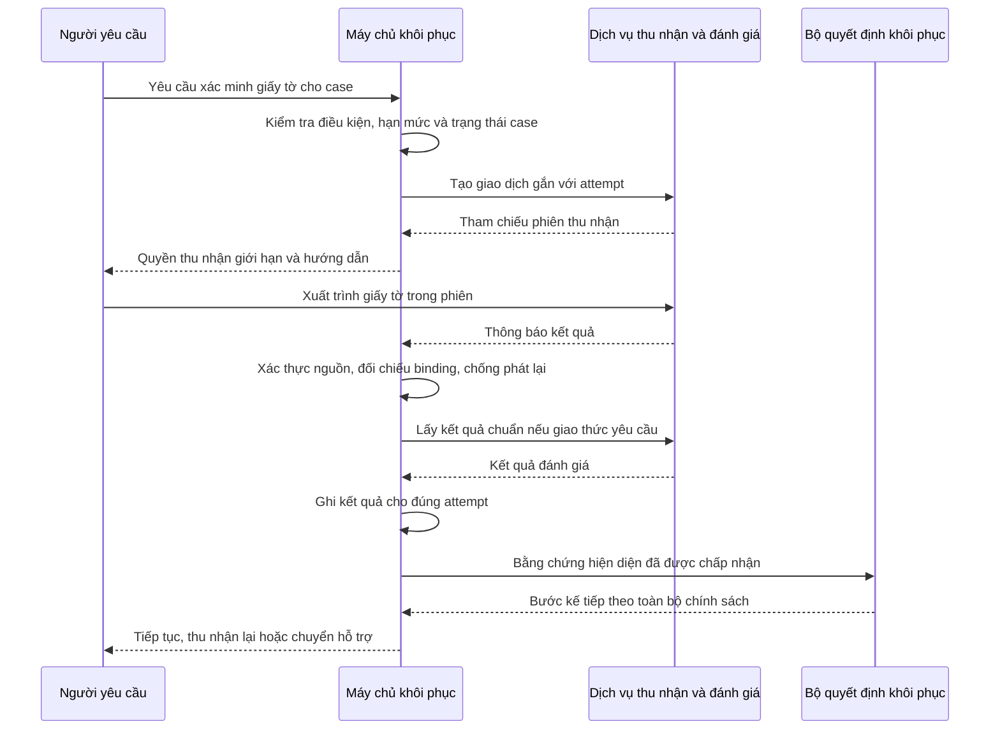

# Document liveness checks

## 1. Vì sao luồng khôi phục cần kiểm tra giấy tờ đang hiện diện?

Khi mất mật khẩu, MFA, passkey hoặc thiết bị xác thực, người dùng có thể được chuyển sang một quy trình khôi phục có xác minh giấy tờ. Tuy nhiên, ảnh giấy tờ đọc rõ thông tin chưa đủ để chứng minh người yêu cầu đang cầm giấy tờ đó. Ảnh có thể được lấy từ một vụ rò rỉ, hồ sơ hỗ trợ cũ hoặc bản sao do chính chủ từng gửi cho bên khác.

**Document liveness checks**, còn gọi là **document presence checks**, là nhóm kiểm tra nhằm tăng độ tin cậy rằng giấy tờ vật lý được xuất trình trong sự kiện thu nhận hiện tại. “Liveness” ở đây nói về sự hiện diện và tính phù hợp của quá trình xuất trình; giấy tờ không phải một đối tượng sinh học.

Ví dụ, một dịch vụ đã có hồ sơ định danh của người dùng cần xử lý yêu cầu thay MFA. Người yêu cầu nhập đúng họ tên và gửi ảnh căn cước khớp hồ sơ. Nếu hệ thống chỉ đọc OCR rồi cho phép đăng ký MFA mới, bất kỳ ai sở hữu bản ảnh đó cũng có cơ hội chiếm tài khoản. Kiểm tra hiện diện bổ sung bằng chứng về việc xuất trình giấy tờ trong phiên này, nhưng vẫn cần những bước xác minh khác trước khi cho phép thay yếu tố xác thực.

Trong phạm vi xác thực giấy tờ vật lý bằng thu nhận và kiểm tra quang học, NIST SP 800-63A-4 yêu cầu live capture kết hợp kiểm tra hiện diện chủ động hoặc thụ động. Yêu cầu này không có nghĩa một ảnh chụp từ camera tự nó chứng minh giấy tờ thật. [Nguồn: NIST, Requirements for the Validation of Physical Evidence](https://pages.nist.gov/800-63-4/sp800-63a/ial-general/#requirements-for-the-validation-of-physical-evidence).

Bài học tập trung vào cách sử dụng lớp bằng chứng này trong khôi phục tài khoản. Việc lựa chọn chính sách và các cấu trúc dữ liệu minh họa bên dưới là đề xuất thiết kế, không phải một giao thức hay ngưỡng bắt buộc của NIST.

## 2. Bốn câu hỏi cần có câu trả lời riêng

Không gom mọi kết quả vào một cờ chung như `verified = true`. Mỗi lớp bằng chứng trả lời một câu hỏi khác nhau.

| Lớp kiểm tra | Câu hỏi chính | Điều chưa thể kết luận chỉ từ lớp này |
| --- | --- | --- |
| Hiện diện giấy tờ | Có bằng chứng giấy tờ vật lý được xuất trình trong phiên thu nhận này không? | Giấy tờ do cơ quan hợp lệ phát hành hay người cầm là chủ giấy tờ |
| Tính xác thực và tính hợp lệ | Đặc điểm, dữ liệu và trạng thái giấy tờ có đáp ứng phương thức xác thực được chọn không? | Người yêu cầu là người có danh tính trên giấy tờ |
| Liên kết người với giấy tờ | Người đang tham gia quy trình có phải chủ danh tính được giấy tờ thể hiện không? | Danh tính đó có quyền khôi phục tài khoản cụ thể |
| Liên kết danh tính với tài khoản | Bằng chứng hiện tại có nối được với hồ sơ đáng tin đã gắn với tài khoản không? | Mọi điều kiện cho việc thay MFA hoặc passkey đều đã được đáp ứng |

Một giấy tờ thật bị đánh cắp có thể vượt qua kiểm tra hiện diện và tính xác thực. Điều đó không biến kẻ cầm giấy tờ thành chủ tài khoản.

Tương tự, nếu tài khoản ban đầu chỉ có email và chưa từng thiết lập quan hệ đáng tin với một danh tính pháp lý, việc trình giấy tờ lần đầu không tự tạo ra quyền sở hữu tài khoản. Tên giống nhau, địa chỉ email gần giống hoặc lời khai trong ticket hỗ trợ không giải quyết được khoảng trống liên kết này.

Selfie liveness và document liveness cũng cần được phân biệt. Selfie liveness xem xét bằng chứng về người đang xuất hiện trước cảm biến; document liveness xem xét giấy tờ được xuất trình. Một lớp không mặc nhiên thay thế lớp còn lại.

## 3. Các nguy cơ mà kiểm tra hiện diện cần đối mặt

Tư duy thiết kế nên bắt đầu từ những gì đối phương có thể đưa vào đường thu nhận.

| Tình huống | Bằng chứng quan sát được có thể gây nhầm lẫn | Hướng giảm rủi ro |
| --- | --- | --- |
| Đưa ảnh giấy tờ lên màn hình khác rồi quay lại | Có hình chữ nhật và thông tin OCR hợp lệ | Phân tích dấu hiệu màn hình, chuỗi khung hình và đặc điểm quang học phù hợp |
| In ảnh giấy tờ ra giấy | Có vật thể thật trước camera | Kiểm tra đặc trưng vật liệu, hiệu ứng bảo an và tính xác thực theo loại giấy tờ |
| Phát lại video của phiên trước | Có chuyển động nghiêng giấy tờ rất tự nhiên | Thử thách mới, thời hạn ngắn và ràng buộc bằng chứng với phiên hiện tại |
| Chèn ảnh hoặc video vào luồng thu nhận | Dữ liệu đến đúng endpoint nhưng không đến từ quá trình camera mong đợi | Bảo vệ đường thu nhận, xác thực kết quả phía máy chủ và kiểm soát nguy cơ chèn phương tiện |
| Cầm giấy tờ thật của người khác | Giấy tờ hiện diện và có thể là giấy tờ thật | Xác minh người với giấy tờ và liên kết với tài khoản |
| Dùng kết quả đạt của hồ sơ A cho hồ sơ B | Kết quả nhà cung cấp là thật | Kiểm tra ràng buộc case, attempt, giao dịch và mục đích sử dụng |

Các dấu hiệu như phản xạ ánh sáng hoặc chuyển động không phải bằng chứng tuyệt đối. Một bản in cũng di chuyển được; một màn hình cũng đổi phối cảnh khi được nghiêng. Một đoạn video liên tục vẫn có thể được phát lại hoặc tạo ra bằng công cụ tổng hợp.

NIST cũng phân biệt kiểm soát chống chèn phương tiện với live capture và phát hiện tấn công trình diện: các cơ chế này hỗ trợ nhau, nhưng không xử lý được mọi trường hợp thay thế phương tiện. [Nguồn: NIST, Injection Protection and Modified Media](https://pages.nist.gov/800-63-4/sp800-63a/ial-general/#injection-protection-and-modified-media).

## 4. Kiểm tra thụ động và kiểm tra chủ động

### 4.1. Kiểm tra thụ động

Trong kiểm tra thụ động, hệ thống phân tích dữ liệu thu nhận mà không nhất thiết yêu cầu người dùng hoàn thành một chuỗi động tác riêng. Các tín hiệu có thể liên quan đến cấu trúc ảnh, dấu hiệu chụp lại màn hình, bản sao, hình học hoặc đặc tính bảo an quan sát được.

Tài liệu của Regula liệt kê những nhóm kiểm tra như thiết bị điện tử, bản sao đen trắng, hologram, mực đổi màu và hình học. Đây là ví dụ về khả năng của một sản phẩm; khả năng thực tế phụ thuộc loại giấy tờ, đầu vào, cấu hình và công nghệ được triển khai. [Nguồn: Regula, Liveness Checks](https://docs.regulaforensics.com/develop/doc-reader-sdk/web-service/development/usage/authenticity/#liveness-checks).

Ưu điểm của cách tiếp cận thụ động là ít thao tác hơn. Hạn chế là một đầu vào thiếu sáng, quá mờ hoặc không bộc lộ được đặc trưng cần quan sát có thể không cung cấp đủ bằng chứng. “Không phát hiện dấu hiệu giả” không đồng nghĩa “đã thu được bằng chứng hiện diện đạt yêu cầu”.

### 4.2. Kiểm tra chủ động

Trong kiểm tra chủ động, hệ thống yêu cầu một hành động phù hợp với loại giấy tờ và cách thu nhận, chẳng hạn nghiêng giấy tờ theo hướng được chỉ dẫn để quan sát thay đổi quang học.

Một thử thách minh họa có thể yêu cầu:

1. Đưa mặt trước vào khung hướng dẫn.
2. Giữ đủ rõ để nhận biết loại giấy tờ.
3. Nghiêng theo chỉ dẫn được tạo cho lượt hiện tại.
4. Hoàn tất thu nhận trong khoảng thời gian được cấp.

Không áp dụng cùng một động tác cho mọi giấy tờ. Một loại không có đặc điểm bảo an quang học tương ứng không thể bị đánh trượt chỉ vì thiếu hiệu ứng của một loại khác. Giấy tờ bị cong, lớp bảo vệ bị xước và camera chất lượng thấp cũng có thể ảnh hưởng quan sát.

Tính ngẫu nhiên và thời hạn của thử thách làm giảm khả năng tái sử dụng một đoạn quay cũ. Tuy nhiên, thử thách chỉ có ý nghĩa khi bên đánh giá xác minh dữ liệu đã đáp ứng thử thách của lượt đó. Gửi một nonce bên cạnh một tệp video không tự chứng minh nội dung video được tạo sau nonce.

### 4.3. Chọn cách kết hợp

Có thể dùng thu nhận ít thao tác cho những trường hợp phù hợp, sau đó chuyển sang yêu cầu bổ sung khi bằng chứng chưa đủ. Việc chuyển bước phải dựa trên chính sách rõ ràng.

Không cho người yêu cầu thử lại không giới hạn đến khi bộ phát hiện tình cờ trả kết quả đạt. Cũng không giải quyết lỗi camera bằng cách tự động bỏ kiểm tra hiện diện. Cần có đường hỗ trợ hoặc phương thức thay thế với mức bằng chứng tương xứng.

## 5. Ràng buộc bằng chứng với đúng phiên khôi phục

Một hệ thống nhận ảnh tốt vẫn có thể thất bại nếu chấp nhận kết quả đúng cho sai phiên. Phía máy chủ nên giữ một quan hệ rõ ràng:

```text
recovery_case_id
    └── document_attempt_id
          ├── capture_session_id
          ├── provider_transaction_id
          ├── challenge_id
          ├── issued_at / expires_at
          ├── capture_binding_reference
          └── purpose = ACCOUNT_RECOVERY_DOCUMENT_PRESENCE
```

Các tên trường trên chỉ là mô hình minh họa. Một nhà cung cấp có thể quản lý thử thách và thu nhận bằng cơ chế riêng. Điều quan trọng là máy chủ có bằng chứng đáng tin về quan hệ giữa các định danh, thay vì nhận lại toàn bộ quan hệ đó từ trình duyệt.

Các ràng buộc cần được xác định ngay khi tạo lượt thu nhận:

- **Đúng hồ sơ:** lượt thu nhận thuộc một case và một chủ thể đích đã được máy chủ xác định.
- **Đúng lượt:** kết quả thuộc lần thử đang còn hiệu lực; một lần thử đã bị thay thế không được hồi sinh.
- **Đúng sự kiện thu nhận:** kết quả đánh giá trỏ về dữ liệu và thử thách của phiên tương ứng theo cơ chế tích hợp đáng tin.
- **Đúng thời hạn:** phiên có hạn sử dụng do máy chủ quản lý; dữ liệu quá hạn không được dùng như bằng chứng mới.
- **Đúng mục đích:** kết quả cho đăng ký hoặc xử lý một ticket khác không tự chuyển thành bằng chứng khôi phục.
- **Đúng số lần sử dụng:** kết quả có thể được nhận lại do retry kỹ thuật, nhưng việc áp dụng nó để chuyển trạng thái phải idempotent và không cấp quyền lặp.

Không dùng địa chỉ IP làm khóa ràng buộc duy nhất. Người dùng có thể đổi mạng giữa chừng; nhiều người cũng có thể dùng chung một IP. IP là một tín hiệu rủi ro phụ, không phải định danh chắc chắn của người hoặc phiên.

Nếu cần chuyển từ máy tính sang điện thoại, máy chủ có thể phát một quyền chuyển tiếp ngắn hạn, gắn với đúng case và đúng phạm vi thu nhận. Không để mã QR chứa dữ liệu giấy tờ, thông tin bí mật của tài khoản hoặc quyền đăng nhập đầy đủ. Luồng chuyển tiếp cần chống việc người dùng vô tình hoàn thành một yêu cầu do kẻ khác khởi tạo.

## 6. Luồng xử lý tham khảo



Trình duyệt chỉ trình bày trải nghiệm thu nhận và trạng thái dành cho người dùng. Một thông điệp như `documentLivenessPassed: true` do JavaScript gửi lên không phải kết quả đáng tin.

Tùy giao thức của nhà cung cấp, máy chủ có thể xác minh chữ ký của webhook, xác thực thông báo bằng cơ chế được hỗ trợ, hoặc dùng thông báo như tín hiệu để chủ động lấy kết quả qua kênh máy chủ đã xác thực. Không mặc định mọi nhà cung cấp đều cung cấp cùng một dạng chữ ký.

Webhook hợp lệ vẫn cần được kiểm tra quan hệ với giao dịch đã tạo. Chữ ký chứng minh nguồn và tính toàn vẹn theo giao thức, không chứng minh kết quả đó thuộc case mà bên gọi đang yêu cầu cập nhật.

Một thông báo đến trễ sau khi case bị hủy hoặc đã được thay thế không được tiếp tục mở quyền khôi phục. Máy chủ phải đọc trạng thái hiện tại khi áp dụng kết quả, không chỉ tin trạng thái đã có lúc tạo phiên.

## 7. Biểu diễn kết quả mà không đánh mất sự không chắc chắn

Một mô hình dễ vận hành nên giữ riêng kết quả hiện diện, chất lượng đầu vào và trạng thái kỹ thuật.

| Trạng thái hiện diện | Ý nghĩa trong mô hình minh họa | Hành động có thể áp dụng |
| --- | --- | --- |
| `PASS` | Đạt tiêu chí hiện diện của phương thức đang dùng | Chuyển bằng chứng sang bộ quyết định; chưa cấp quyền đăng nhập |
| `FAIL` | Không đạt tiêu chí, có thể kèm dấu hiệu giả mạo | Chặn việc tự động tiếp tục từ lượt này và xử lý theo mức rủi ro |
| `INCONCLUSIVE` | Dữ liệu đã được xử lý nhưng chưa đủ kết luận | Thu nhận lại có giới hạn hoặc chuyển phương thức khác |
| `NOT_SUPPORTED` | Phương thức không đánh giá được đầu vào này | Định tuyến sang phương thức đã được phê duyệt |
| `TECHNICAL_ERROR` | Không có kết quả sử dụng được vì lỗi kỹ thuật | Khôi phục dịch vụ hoặc chuyển hỗ trợ; không tự coi là đạt |

Đây là trạng thái chuẩn hóa của ứng dụng, không khẳng định API nhà cung cấp dùng các tên tương tự. Cần có quy tắc ánh xạ cho từng phiên bản tích hợp; giá trị lạ phải được xử lý an toàn.

Có thể ghi một bản ghi kết quả tối thiểu như sau:

```json
{
  "caseId": "rc_example",
  "attemptId": "da_example",
  "providerTransactionId": "pt_example",
  "presence": "INCONCLUSIVE",
  "quality": "INSUFFICIENT_LIGHT",
  "captureBinding": "VERIFIED",
  "policyVersion": "document-presence-policy-v3",
  "nextAction": "RECAPTURE"
}
```

`captureBinding: VERIFIED` có nghĩa quan hệ kỹ thuật của lượt đã được xác minh theo cơ chế tích hợp. Nó không đổi kết quả `INCONCLUSIVE` thành `PASS`.

Không có ngưỡng điểm “chuẩn cho mọi hệ thống”. Nếu một sản phẩm trả số điểm, cần hiểu chiều của thang điểm, ý nghĩa từng kiểm tra, cách xử lý kiểm tra không chạy và điều kiện áp dụng. Không so sánh trực tiếp điểm của hai sản phẩm như thể cùng một xác suất.

## 8. Ví dụ quyết định phía máy chủ

Đoạn Java dưới đây là **mã giả theo cú pháp Java** để minh họa thứ tự kiểm tra. Nó không triển khai bộ phát hiện giấy tờ và không mô tả API thật của một nhà cung cấp.

Đầu vào `result` phải được một lớp tích hợp đáng tin tạo ra sau khi xác thực kết quả phía máy chủ. Không giải tuần tự trực tiếp dữ liệu từ trình duyệt thành đối tượng “đã xác minh”.

```java
enum Presence {
    PASS, FAIL, INCONCLUSIVE, NOT_SUPPORTED, TECHNICAL_ERROR
}

enum NextAction {
    CONTINUE_IDENTITY_VERIFICATION,
    RECAPTURE,
    ALTERNATIVE_REVIEW,
    HOLD_FOR_RISK_REVIEW,
    RETRY_SERVICE,
    IGNORE_STALE_RESULT,
    REJECT_UNBOUND_RESULT
}

// Pseudocode: repository and policy are application-specific.
NextAction acceptDocumentResult(
        String caseId,
        TrustedDocumentResult result,
        Instant now) {

    // Transaction + row lock, or equivalent compare-and-set.
    return repository.inTransactionWithCaseLock(caseId, recoveryCase -> {
        var attempt = repository.currentDocumentAttempt(caseId);

        if (attempt == null
                || !attempt.id().equals(result.attemptId())
                || !attempt.providerTransactionId()
                    .equals(result.providerTransactionId())
                || !result.captureBindingVerified()
                || !result.matchesExpectedPurpose()) {
            return NextAction.REJECT_UNBOUND_RESULT;
        }

        // Retry of an already applied result returns the stored outcome.
        if (attempt.hasAppliedResult()) {
            if (!attempt.sameAuthenticatedResult(result)) {
                return NextAction.HOLD_FOR_RISK_REVIEW;
            }
            return attempt.storedNextAction();
        }

        if (!recoveryCase.awaitingDocumentEvidence()
                || attempt.superseded()
                || !now.isBefore(attempt.expiresAt())) {
            return NextAction.IGNORE_STALE_RESULT;
        }

        NextAction next = switch (result.presence()) {
            case PASS ->
                NextAction.CONTINUE_IDENTITY_VERIFICATION;
            case FAIL ->
                NextAction.HOLD_FOR_RISK_REVIEW;
            case INCONCLUSIVE ->
                policy.mayRecapture(recoveryCase)
                    ? NextAction.RECAPTURE
                    : NextAction.ALTERNATIVE_REVIEW;
            case NOT_SUPPORTED ->
                NextAction.ALTERNATIVE_REVIEW;
            case TECHNICAL_ERROR ->
                NextAction.RETRY_SERVICE;
        };

        repository.storeResultAndNextAction(attempt, result, next);
        repository.recordBoundedAuditEvent(caseId, attempt.id(), next);
        return next;
    });
}
```

Ba chi tiết của ví dụ cần được giữ khi chuyển sang một triển khai cụ thể:

1. **Kết quả được xác thực trước khi đi vào hàm quyết định.** Một kiểu dữ liệu đặt tên `TrustedDocumentResult` không tự tạo ra tính đáng tin; lớp tích hợp phải thực hiện điều đó.
2. **Chuyển trạng thái được bảo vệ khỏi tranh chấp.** Khóa một bản ghi hoặc cập nhật có điều kiện ngăn hai callback đồng thời áp dụng cùng bằng chứng hai lần.
3. **Kết quả đạt chỉ cho phép đi tiếp bước xác minh.** Hàm không phát access token, không xóa MFA và không đăng ký passkey mới.

Trong một hệ thống nhiều dịch vụ, bản ghi quyết định và sự kiện chuyển bước cần có cách phát hành đáng tin, chẳng hạn transactional outbox. Bên nhận sự kiện cũng phải kiểm tra trạng thái case và chống xử lý lặp. Việc ghi cơ sở dữ liệu rồi gửi sự kiện một cách rời rạc có thể tạo tình huống đã đổi trạng thái nhưng bước tiếp theo không nhận được thông tin.

Nếu cần thu nhận lại, hãy tạo attempt mới và đánh dấu lượt cũ đã kết thúc hoặc bị thay thế. Không sửa âm thầm binding của attempt cũ để chứa một video khác.

## 9. Từ hiện diện giấy tờ đến quyền khôi phục

Bộ quyết định khôi phục cần kết hợp bằng chứng hiện diện với những điều kiện độc lập. Một cách diễn đạt điều kiện ở mức thiết kế là:

```text
Có thể xem xét cho bước khôi phục tiếp theo
    = bằng chứng hiện diện phù hợp
    + xác thực giấy tờ theo phương thức được chọn
    + xác minh người với danh tính
    + liên kết đáng tin với tài khoản
    + các điều kiện rủi ro và chính sách đã đáp ứng
```

Dấu cộng biểu thị các điều kiện cần được xét cùng nhau, không phải cộng điểm để một tín hiệu tốt bù tùy ý cho một điều kiện bắt buộc bị thiếu.

Sau khi đáp ứng toàn bộ điều kiện, hệ thống vẫn nên phân biệt quyền **hoàn tất khôi phục** với quyền **sử dụng tài khoản thông thường**. Một quyền khôi phục có thể chỉ cho phép thao tác cụ thể như thiết lập lại phương thức xác thực trong thời gian ngắn, gắn với case và chỉ được tiêu thụ một lần.

Các quyết định như thời gian chờ, thông báo qua kênh đã có, xử lý phiên đang hoạt động và hạn chế thao tác nhạy cảm cần thuộc chính sách khôi phục tổng thể. Document liveness không tự quyết định những điều đó. Chẳng hạn, một phiên bị nghi chiếm đoạt không nên tiếp tục có toàn quyền chỉ vì người yêu cầu vừa hoàn thành thu nhận giấy tờ.

Nếu máy chủ không có cách liên kết danh tính đã xác minh với tài khoản, cần xử lý khoảng trống đó bằng quy trình phù hợp. Yêu cầu thêm nhiều video của cùng giấy tờ không sửa được thiếu sót về liên kết tài khoản.

## 10. Hạn mức, hỗ trợ và bảo vệ dữ liệu

### 10.1. Ngăn thử liên tục mà vẫn cho phép người dùng sửa lỗi

Có thể giới hạn theo case, tài khoản đích, thiết bị và nguồn yêu cầu; mỗi chiều có vai trò riêng. Chỉ giới hạn IP không đủ, trong khi chỉ khóa tài khoản sau nhiều lần thử có thể bị lợi dụng để làm gián đoạn người dùng thật.

Cần phân biệt lần thử thất bại có kết quả với lần gọi kỹ thuật bị lặp do mạng. Một webhook gửi lại không được tính như người dùng xuất trình thêm một giấy tờ. Lỗi dịch vụ không nên mặc nhiên bị ghi nhận thành hành vi giả mạo.

Hướng dẫn dành cho người dùng có thể nói “đưa toàn bộ giấy tờ vào khung” hoặc “chuyển tới nơi đủ sáng”. Tránh công bố các ngưỡng nội bộ và chi tiết phát hiện gian lận có thể dùng để tối ưu đầu vào đối kháng.

### 10.2. Cung cấp lối đi cho trường hợp không kết luận được

Một người có thể không giữ giấy tờ được hỗ trợ, không có camera phù hợp hoặc khó thực hiện động tác được yêu cầu. Kết quả `INCONCLUSIVE` phản ánh chất lượng bằng chứng, không phải kết luận người đó gian lận.

Đường hỗ trợ có thể sử dụng một loại bằng chứng khác đã được chấp thuận, phiên có người hỗ trợ hoặc quy trình trực tiếp tùy dịch vụ. Mỗi đường thay thế cần xác định rõ bằng chứng và quyền quyết định. Nhân viên hỗ trợ không nên bỏ toàn bộ yêu cầu xác minh chỉ vì người gọi cung cấp được tên, ngày sinh và ảnh giấy tờ.

### 10.3. Thu thập tối thiểu và giới hạn truy cập

Video giấy tờ có thể chứa nhiều dữ liệu hơn mức cần cho quyết định. Thiết kế nên xác định mục đích sử dụng, thông báo cho người dùng, quyền xem dữ liệu và thời hạn lưu phù hợp với dịch vụ trước khi mở thu nhận.

Nên lưu kết quả, phiên bản chính sách và các định danh đối chiếu cần thiết cho điều tra. Chỉ giữ ảnh hoặc video gốc khi có nhu cầu được xác định; đặt thời hạn riêng cho dữ liệu gốc thay vì mặc định giữ cùng thời gian với tài khoản.

Các biện pháp triển khai có thể gồm:

- Mã hóa dữ liệu lưu trữ và truyền tải theo kiến trúc dịch vụ.
- Tách quyền truy cập hồ sơ hỗ trợ thông thường khỏi quyền xem chứng cứ nhạy cảm.
- Ghi nhận việc truy cập bằng chứng và bảo vệ các liên kết tải xuống.
- Loại dữ liệu OCR đầy đủ, ảnh giấy tờ và token thu nhận khỏi log ứng dụng, URL, analytics và thông báo lỗi.
- Quản lý vòng đời của bản sao ở nhà cung cấp, kho lưu trữ và hệ thống phục hồi dữ liệu.

Nếu sử dụng thêm ảnh khuôn mặt hoặc dữ liệu sinh trắc học, cần quản lý chúng theo chính sách tương ứng. Không coi việc người dùng đồng ý gửi giấy tờ là quyền dùng dữ liệu cho mọi mục đích khác.

## 11. Đọc các tình huống thực tế

**Ảnh chụp lại từ màn hình có OCR rất tốt:** dữ liệu đọc rõ chỉ cho biết chất lượng đọc. Nếu kiểm tra hiện diện không đạt hoặc chưa kết luận được, lượt đó không đủ điều kiện tiếp tục theo nhánh tự động yêu cầu bằng chứng hiện diện.

**Giấy tờ thật nhưng người xuất trình không khớp:** kết quả hiện diện có thể đạt. Quy trình vẫn phải xử lý thất bại ở bước xác minh người với giấy tờ; không được lấy điểm hiện diện cao để bỏ qua sự không khớp.

**Kết quả đạt đến sau khi tạo lượt mới:** máy chủ xác định đó là kết quả của attempt đã bị thay thế và không áp dụng cho attempt hiện tại. Người dùng không được cấp thêm quyền từ một lượt không còn hiệu lực.

**Nhà cung cấp tạm gián đoạn:** case giữ trạng thái chưa hoàn tất bằng chứng hoặc chuyển sang đường hỗ trợ phù hợp. Không phát quyền thay MFA chỉ để làm luồng trông như đã thành công.

**Giấy tờ hiện diện, người hợp lệ, tài khoản chưa có quan hệ định danh:** hệ thống còn thiếu bằng chứng nối danh tính với tài khoản. Vấn đề nằm ở quyền khôi phục tài khoản, không nằm ở việc quay thêm giấy tờ.

Giá trị của document liveness nằm ở việc bổ sung một bằng chứng có phạm vi rõ ràng, được thu nhận và ràng buộc đúng. Quyền khôi phục tài khoản chỉ hình thành khi toàn bộ chuỗi bằng chứng và chính sách cần thiết đã được đáp ứng.
