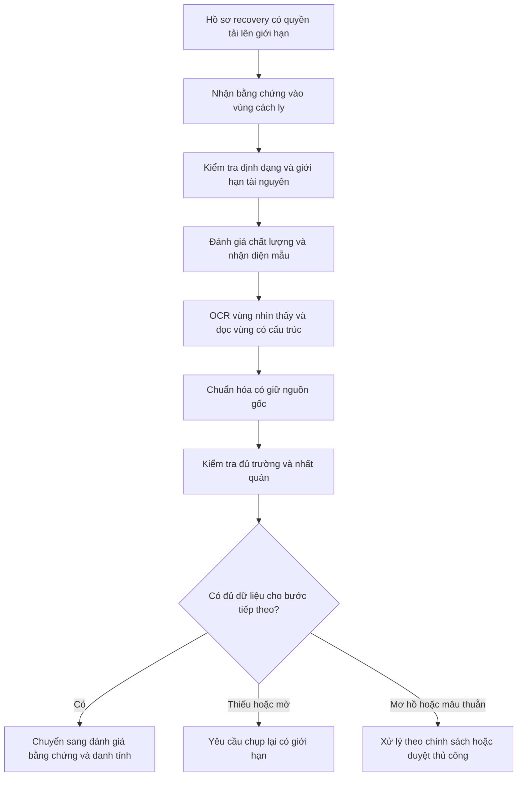

# Document data extraction — Trích xuất dữ liệu giấy tờ trong khôi phục tài khoản

Khi người dùng mất mật khẩu, thiết bị MFA hoặc passkey, một số dịch vụ cho phép dùng giấy tờ để hỗ trợ khôi phục tài khoản. Trước khi đánh giá giấy tờ và đối chiếu danh tính, hệ thống cần đọc các thông tin như họ tên, ngày sinh, số giấy tờ và cơ quan phát hành từ ảnh hoặc dữ liệu có cấu trúc. Công việc đó gọi là **document data extraction**.

Trích xuất tốt tạo ra dữ liệu có cấu trúc, giữ được nguồn gốc và thể hiện rõ điều chưa chắc chắn. Nếu hệ thống đọc nhầm một ký tự rồi dùng kết quả đó để tự động khôi phục tài khoản, lỗi nhận dạng văn bản có thể trở thành lỗi cấp quyền.

## 1. Mục tiêu và ranh giới của bước trích xuất

Giả sử chị An mất điện thoại chứa ứng dụng xác thực. Dịch vụ đã liên kết tài khoản của chị với một danh tính được xác minh từ trước và có chính sách cho phép sử dụng giấy tờ trong một nhánh recovery. Chị gửi ảnh giấy tờ qua hồ sơ khôi phục đang mở.

Bước extraction cần trả lời:

- Ảnh thuộc loại giấy tờ và phiên bản bố cục nào mà hệ thống hỗ trợ?
- Những trường cần thiết có xuất hiện và đọc được không?
- Mỗi giá trị được lấy từ vị trí, mặt giấy tờ và nguồn nào?
- Trường nào chắc chắn về cách đọc, trường nào thiếu, mơ hồ hoặc mâu thuẫn?

Kết quả extraction không tự trả lời được các câu hỏi: giấy tờ có thật không, thông tin có được cơ quan phát hành xác nhận không, người gửi có phải chủ giấy tờ không, và danh tính đó có sở hữu tài khoản đang yêu cầu khôi phục không.

NIST phân biệt việc xác thực bằng chứng, xác thực thuộc tính và xác minh người trình bằng chứng. Phân biệt này giúp đặt extraction đúng vị trí: nó cung cấp đầu vào cho các hoạt động đó, không thay thế chúng. [NIST SP 800-63A-4](https://pages.nist.gov/800-63-4/sp800-63a.html)

| Thành phần | Đầu ra chính | Điều không được suy ra từ đầu ra |
| --- | --- | --- |
| Extraction | Các thuộc tính đã đọc cùng nguồn và mức bất định | Giấy tờ chính hãng |
| Kiểm tra tính xác thực giấy tờ | Kết quả đánh giá dấu hiệu bảo an, sửa đổi hoặc bằng chứng mật mã | Người gửi là chủ giấy tờ |
| Xác minh người trình giấy tờ | Kết quả liên kết người đang tham gia với bằng chứng | Người đó sở hữu một tài khoản bất kỳ có tên giống nhau |
| Đối chiếu với tài khoản | Kết quả so với liên kết danh tính đã thiết lập trước | Được phép bỏ qua chính sách recovery |
| Quyết định recovery | Quyền khôi phục có giới hạn theo chính sách tổng thể | Quyền này có thể cấp chỉ vì OCR đọc được ảnh |

Nếu tài khoản trước đây chỉ đăng ký bằng bí danh và chưa có liên kết đáng tin cậy với danh tính trên giấy tờ, hệ thống không được tạo ra liên kết sở hữu mới chỉ từ tên giống nhau. Trường hợp này cần một nhánh xử lý khác theo chính sách của dịch vụ.

## 2. Xác định dữ liệu cần đọc trước khi nhận ảnh

Không nên yêu cầu OCR lấy mọi nội dung nhìn thấy rồi đưa toàn bộ vào hồ sơ recovery. Hãy định nghĩa tập thuộc tính cần thiết cho mục đích đối chiếu, theo loại giấy tờ được chấp nhận.

| Trường | Biểu diễn phù hợp | Rủi ro thường gặp |
| --- | --- | --- |
| Loại giấy tờ, phiên bản mẫu | Mã trong danh mục hỗ trợ có phiên bản | Áp dụng parser của loại thẻ khác |
| Nơi hoặc tổ chức phát hành | Giá trị theo cấu hình của mẫu giấy tờ | Nhầm quốc tịch với nơi phát hành |
| Số giấy tờ | Chuỗi ký tự | Mất số 0 đầu, nhầm `O/0`, `I/1` |
| Họ tên | Chuỗi Unicode, giữ cả cách đọc gốc | Mất dấu, tự đảo thứ tự tên |
| Ngày sinh | Ngày đầy đủ khi đủ căn cứ, hoặc dữ liệu chưa phân giải | Nhầm ngày với tháng, đoán thế kỷ |
| Ngày hết hạn | Ngày hoặc trạng thái đặc thù của mẫu | Biến trường không có thành ngày mặc định |
| Nguồn của từng trường | Mặt ảnh, vùng ảnh, phương pháp đọc | Không biết giá trị đến từ đâu khi có tranh chấp |

Số giấy tờ nên đi kèm loại giấy tờ và nơi phát hành trong miền đối chiếu. Một chuỗi số riêng lẻ không mặc nhiên là định danh duy nhất giữa mọi quốc gia, cơ quan và loại giấy tờ.

Địa chỉ, giới tính, nơi sinh, chữ ký hay ảnh chân dung không phải mặc định đều cần cho extraction phục vụ recovery. Chỉ đưa chúng vào hợp đồng dữ liệu khi có mục đích đã xác định. Việc nhận ảnh toàn mặt giấy tờ có thể làm lộ nhiều dữ liệu hơn phần cần trích xuất; thiết kế lưu trữ và phân quyền phải tính cả dữ liệu trên ảnh gốc.

## 3. Quy trình xử lý và các ranh giới tin cậy



Đây là thiết kế minh họa cho một dịch vụ recovery, không phải sơ đồ chứng nhận mức đảm bảo danh tính. Mỗi lần xử lý phải gắn với `attemptId`, `evidenceId` và phiên bản bằng chứng do server quản lý.

### 3.1. Tiếp nhận bằng chứng

Người đang khôi phục tài khoản thường chưa có phiên đăng nhập đầy đủ. Vì vậy, quyền upload cần được cấp qua một recovery session có phạm vi hẹp: chỉ được gửi bằng chứng cho đúng hồ sơ, trong thời hạn và hạn mức cho phép. Quyền gửi ảnh không đồng nghĩa được đọc ảnh của hồ sơ khác hoặc sửa thông tin tài khoản.

Áp dụng phòng vệ nhiều lớp cho upload: danh sách định dạng được phép, kiểm tra nội dung thực thay vì chỉ tin MIME do client khai báo, tên lưu trữ do server sinh và vị trí lưu riêng. Không coi một phép kiểm tra đuôi tệp hay chữ ký định dạng là đủ. [OWASP File Upload Cheat Sheet](https://cheatsheetseries.owasp.org/cheatsheets/File_Upload_Cheat_Sheet.html)

Trong pipeline minh họa, đặt thêm giới hạn cho số mặt ảnh, số trang, số pixel sau giải mã và thời gian xử lý. Một tệp nhỏ vẫn có thể tiêu tốn nhiều bộ nhớ khi được giải mã. Tiến trình đọc ảnh hoặc PDF chỉ cần quyền đọc bằng chứng của job và ghi kết quả extraction; nó không cần quyền đổi mật khẩu, gỡ MFA hay phát hành session đăng nhập.

Không dùng tên tệp, EXIF hoặc trường `accountId` do người gửi cung cấp làm căn cứ xác định chủ tài khoản. Server liên kết hồ sơ với tài khoản theo luồng recovery đã thiết kế; tên ảnh chỉ là dữ liệu không đáng tin cậy.

### 3.2. Đánh giá chất lượng và tạo bản xử lý

Ảnh bị chói, rung, cắt mất góc hoặc nén mạnh có thể làm thay đổi kết quả nhận dạng. Hệ thống nên phân biệt ảnh không đọc được với ảnh đọc được nhưng có dữ liệu không phù hợp.

Các thao tác như xoay ảnh, sửa phối cảnh và cắt vùng có thể phục vụ OCR. Lưu quan hệ giữa ảnh gốc và bản xử lý, gồm phiên bản công cụ và phép biến đổi, để truy ngược vị trí trường. Nếu chính sách giữ ảnh gốc, lưu nó riêng với quyền hạn và thời hạn rõ ràng.

Không dùng kỹ thuật sinh ảnh để tự điền nét chữ đã mất rồi coi phần sinh thêm là bằng chứng. Khi một vùng không đủ thông tin, kết quả đúng của extraction có thể là `UNREADABLE`.

Digest của ảnh giúp liên kết kết quả với đúng byte đã nhận và phát hiện thay đổi trong quá trình xử lý. Digest không chứng minh nội dung ảnh là thật hoặc ảnh được chụp trong phiên recovery hiện tại.

## 4. Đọc các nguồn dữ liệu trên giấy tờ

### 4.1. Vùng thông tin nhìn thấy và OCR

OCR chuyển hình ảnh ký tự thành văn bản. Việc nhận đúng chữ chưa đủ để hiểu ý nghĩa trường: một ngày có thể là ngày sinh, ngày cấp hoặc ngày hết hạn. Parser cần dùng nhãn, vị trí và cấu trúc của mẫu giấy tờ được hỗ trợ.

Một parser có thể trả về nhiều ứng viên khi không phân biệt được `O` với `0`. Không tự đổi mọi chữ `O` thành số `0` trên toàn ảnh: quy tắc hợp lý cho số giấy tờ có thể phá hỏng họ tên. Mỗi phép xử lý phải gắn với kiểu trường và hồ sơ mẫu tương ứng.

Với giấy tờ có hai mặt, kết quả cần chỉ rõ mặt nguồn. Không ghép một mặt trước của lần upload mới với mặt sau của bằng chứng cũ chỉ vì hồ sơ recovery giống nhau. Khi người dùng thay ảnh, tạo phiên bản bộ bằng chứng mới và xác định rõ hai mặt nào thuộc cùng bộ.

### 4.2. Machine Readable Zone — MRZ

MRZ là vùng có bố cục ký tự dành cho máy đọc trên một số giấy tờ. Parser phải biết loại cấu trúc được hỗ trợ; không thể áp dụng một độ dài dòng và một bộ vị trí trường cho mọi giấy tờ.

Một số trường MRZ có check digit để phát hiện lỗi dữ liệu hoặc lỗi đọc. Check digit phù hợp là tín hiệu nhất quán nội bộ; người tạo dữ liệu giả cũng có thể tính lại nó. Do đó, không nâng `checkDigit=PASS` thành `documentAuthenticity=VERIFIED`.

Tên trong MRZ có thể được chuyển tự và giới hạn bởi cấu trúc biểu diễn. Tên nhìn thấy có dấu và tên MRZ không dấu cần được giữ thành hai nguồn, rồi so sánh theo quy tắc của mẫu. Không ghi đè tên gốc bằng tên MRZ chỉ để hai trường trông giống nhau.

Với ngày năm hai chữ số, phải có quy tắc phân giải theo đặc tả loại giấy tờ và ngữ cảnh được phép. Nếu vẫn có nhiều khả năng, đánh dấu mơ hồ; không lấy năm hiện tại rồi tự đoán một thế kỷ.

### 4.3. Mã vạch, QR và dữ liệu chip

Mã QR hoặc mã vạch có thể chứa dữ liệu đọc bằng máy, nhưng khả năng giải mã không tự chứng minh nguồn phát hành. Một QR chứa URL cũng không cho phép backend tự động truy cập địa chỉ đó. Hãy phân loại payload và chỉ dùng tích hợp đã được cấu hình, thay vì biến extractor thành công cụ tải URL tùy ý.

Nếu một loại giấy tờ cung cấp dữ liệu có chữ ký số hoặc dữ liệu chip được bảo vệ, bước đọc dữ liệu vẫn cần tách khỏi bước kiểm chứng chữ ký và chuỗi tin cậy. Trạng thái nên biểu diễn rõ `NOT_CHECKED`, `VALID` hoặc `INVALID` theo kết quả thực, thay vì coi dữ liệu đọc thành công là dữ liệu đã xác thực.

Không lấy số nguồn làm số bằng chứng độc lập. Văn bản nhìn thấy, MRZ và QR có thể cùng bắt nguồn từ một giấy tờ bị sửa. Chúng hữu ích cho phát hiện mâu thuẫn, nhưng không tự tạo ra ba lần xác minh danh tính độc lập.

## 5. Chuẩn hóa mà không làm mất thông tin

Mỗi trường cần giữ được ba lớp:

1. **Dữ liệu đọc được:** văn bản hoặc payload nguyên trạng từ một nguồn cụ thể.
2. **Giá trị chuẩn hóa:** biểu diễn dùng cho xử lý có cấu trúc, cùng quy tắc đã áp dụng.
3. **Kết quả diễn giải:** trường đã phân giải được hay vẫn thiếu, mơ hồ hoặc xung đột.

### 5.1. Họ tên và Unicode

Với họ tên tiếng Việt, có thể dùng Unicode NFC và xử lý khoảng trắng theo quy tắc đã công bố để giảm khác biệt biểu diễn. Giữ nguyên dấu và thứ tự tên trong dữ liệu gốc. Nếu tạo khóa so sánh không dấu, khóa đó chỉ là một tín hiệu phụ; nhiều tên khác nhau có thể trở thành cùng một chuỗi sau khi bỏ dấu.

Ký tự trông giống nhau không nhất thiết là cùng một ký tự. Không âm thầm sửa ký tự lạ hoặc loại bỏ toàn bộ ký tự ngoài ASCII để làm kết quả khớp với hồ sơ tài khoản.

### 5.2. Số giấy tờ

Lưu số giấy tờ dưới dạng chuỗi. Ví dụ minh họa `"000012345"` phải giữ nguyên số 0 đầu. Chỉ bỏ dấu cách hoặc dấu phân cách nếu cấu hình của mẫu xác định chúng không thuộc định danh có nghĩa.

Không cho thuật toán chọn tùy ý giữa `O` và `0` bằng cách xem phương án nào trùng với số đã lưu trên tài khoản. Cách làm đó khiến kết quả extraction bị kéo theo đáp án mong muốn. Bộ trích xuất nên tạo ứng viên từ bằng chứng; bộ đối chiếu độc lập đánh giá sự tương ứng và mức bất định.

### 5.3. Ngày tháng

Chuỗi `08/07/1994` có thể được diễn giải khác nhau nếu không biết quy ước của giấy tờ. Khi hồ sơ mẫu xác định định dạng ngày-tháng-năm, có thể chuẩn hóa thành `1994-07-08`. Nếu chưa biết mẫu hoặc định dạng, giữ các ứng viên hoặc `normalizedValue: null` với trạng thái `AMBIGUOUS`.

Ngày thiếu thành phần không được điền mặc định thành ngày 1 hoặc tháng 1. Ngày hết hạn không đọc được cũng không được thay bằng một ngày trong tương lai để vượt qua bước kiểm tra.

Extraction chỉ đọc ngày hết hạn và mức chắc chắn của cách đọc. Việc chấp nhận giấy tờ hết hạn trong một tình huống recovery là quyết định chính sách riêng, không nằm trong phép chuẩn hóa ngày.

## 6. Hợp đồng kết quả có nguồn gốc và phiên bản

Ví dụ sau dùng dữ liệu hư cấu và loại thẻ `DEMO_CARD` dành riêng cho minh họa. Đây không phải mẫu giấy tờ được khuyến nghị chấp nhận trong production.

```json
{
  "schemaVersion": "1",
  "attemptId": "attempt-demo-17",
  "evidenceId": "evidence-demo-04",
  "evidenceVersion": 2,
  "extractionId": "extraction-demo-09",
  "extractorVersion": "extractor-demo-v3",
  "templateVersion": "demo-card-v1",
  "documentType": "DEMO_CARD",
  "fields": {
    "documentNumber": {
      "rawValue": "000012345",
      "normalizedValue": "000012345",
      "state": "RESOLVED",
      "source": {
        "kind": "VISUAL_OCR",
        "side": "FRONT",
        "derivativeId": "image-demo-front-v2",
        "regionId": "document-number"
      },
      "recognitionScore": 0.96,
      "normalizationRules": ["KEEP_LEADING_ZERO"]
    },
    "dateOfBirth": {
      "rawValue": "08/07/1994",
      "normalizedValue": null,
      "state": "AMBIGUOUS",
      "source": {
        "kind": "VISUAL_OCR",
        "side": "FRONT",
        "derivativeId": "image-demo-front-v2",
        "regionId": "birth-date"
      },
      "recognitionScore": 0.95,
      "normalizationRules": [],
      "issueCodes": ["DATE_ORDER_UNRESOLVED"]
    }
  },
  "extractionState": "NEEDS_REVIEW",
  "documentAuthenticity": "NOT_CHECKED",
  "presenterVerification": "NOT_CHECKED",
  "accountLinkage": "NOT_CHECKED"
}
```

Điểm nhận dạng ngày cao trong ví dụ chỉ cho biết bộ nhận dạng tự tin về chuỗi ký tự đã đọc. Nó không giải quyết được chuỗi đó theo định dạng nào. `recognitionScore` cũng không phải xác suất người gửi là chủ tài khoản.

Trong hệ thống thực, các giá trị thô và chuẩn hóa là dữ liệu nhạy cảm. Chỉ lưu chúng trong kho có kiểm soát truy cập; không sao chép JSON đầy đủ sang log, công cụ theo dõi lỗi hay hàng đợi mà nhiều dịch vụ cùng đọc. Có thể dùng tham chiếu tới kho dữ liệu riêng khi truyền job giữa các thành phần.

Hợp đồng nên phân biệt tối thiểu các trạng thái sau:

| Trạng thái trường | Ý nghĩa | Cách xử lý tiếp theo |
| --- | --- | --- |
| `RESOLVED` | Có một cách diễn giải được hỗ trợ | Chuyển sang kiểm tra và đối chiếu riêng |
| `MISSING` | Không tìm thấy trường cần thiết | Xác định sai mặt, thiếu ảnh hoặc thiếu dữ liệu |
| `UNREADABLE` | Có vùng trường nhưng không đọc đáng tin cậy | Hướng dẫn chụp lại vùng bị lỗi |
| `AMBIGUOUS` | Có nhiều cách đọc hoặc diễn giải | Duyệt hoặc bổ sung bằng chứng theo chính sách |
| `CONFLICT` | Hai nguồn không tương ứng theo quy tắc mẫu | Giữ cả hai kết quả và chuyển xử lý mâu thuẫn |
| `UNSUPPORTED` | Loại giấy tờ hoặc cấu trúc chưa được hỗ trợ | Dùng phương án được hỗ trợ hoặc nhánh thay thế |

Lỗi dịch vụ OCR như timeout cần có trạng thái vận hành riêng, chẳng hạn `PROCESSING_ERROR`. Không chuyển timeout thành `MISSING`, vì lỗi hạ tầng không chứng minh người dùng thiếu dữ liệu.

## 7. Điểm tin cậy và kiểm tra nhất quán

Không nên dùng một điểm trung bình cho cả giấy tờ. Tên có thể được đọc rất rõ trong khi một ký tự của số giấy tờ bị lóa. Các trường có vai trò định danh quan trọng cần kết quả riêng.

Điểm do các nhà cung cấp hoặc phiên bản mô hình khác nhau trả về có thể không cùng ý nghĩa. Nếu dịch vụ dùng điểm để phân tuyến, cần hiệu chỉnh trên dữ liệu được phép sử dụng và đại diện cho các mẫu giấy tờ, ngôn ngữ, thiết bị chụp và điều kiện ảnh thực tế. Không có một ngưỡng OCR chung bảo đảm an toàn cho mọi luồng recovery.

Những phép kiểm tra nhất quán hữu ích gồm:

- Số giấy tờ ở các vùng có cùng ý nghĩa có tương ứng sau chuẩn hóa hợp lệ không?
- Ngày có tồn tại trên lịch và có được phân giải theo một mẫu xác định không?
- Thông tin mặt trước và mặt sau có thuộc cùng bộ bằng chứng đang xử lý không?
- MRZ hoặc payload có cấu trúc có đáp ứng quy tắc của loại giấy tờ đó không?
- Dữ liệu đọc được có mâu thuẫn với trường khác theo quy tắc đã cấu hình không?

Không âm thầm chọn nguồn có điểm cao hơn khi hai nguồn xung đột. Lưu các kết quả cạnh nhau, kèm quy tắc so sánh và lý do phân tuyến. Trường hợp tên MRZ được chuyển tự khác tên nhìn thấy cần được giải thích bằng quy tắc cụ thể, không bị gộp với trường hợp số giấy tờ khác nhau.

## 8. Ghép kết quả vào đúng hồ sơ recovery

Hệ thống bất đồng bộ có thể nhận kết quả OCR sau khi người dùng đã gửi lại ảnh hoặc đóng hồ sơ. Vì vậy, callback hợp lệ về kỹ thuật chưa chắc là kết quả còn được phép áp dụng.

Ví dụ:

1. Hồ sơ đang xử lý bộ bằng chứng phiên bản 2.
2. Người dùng thay ảnh, server tạo phiên bản 3.
3. Kết quả extraction của phiên bản 2 đến sau phiên bản 3.
4. Server ghi nhận kết quả cũ theo chính sách lưu vết nhưng không dùng nó để thay trạng thái hiện hành.

Khi tích hợp nhà cung cấp, xác thực callback, liên kết job với hồ sơ do server lưu và kiểm tra trùng lặp. Không lấy `attemptId` từ callback rồi mặc nhiên tin rằng nhà cung cấp được phép cập nhật hồ sơ có ID đó. Dùng ánh xạ job đã tạo, kiểm tra phiên bản bằng chứng và trạng thái recovery trước khi ghi kết quả.

Một job được xử lý lại phải cho kết quả có thể nhận diện là cùng công việc hoặc một phiên bản mới có chủ đích. Việc nhận callback hai lần không được tạo hai quyền recovery.

### Ví dụ phân tuyến kết quả bằng Java

Đoạn mã sau chỉ minh họa bước chọn nơi chuyển kết quả extraction. Các dữ liệu đầu vào được xây dựng từ hồ sơ server và kết quả đã xác thực nguồn; không nhận trực tiếp các cờ boolean từ client. Mã không cấp token, không reset mật khẩu và không gỡ MFA.

```java
enum ExtractionState {
    READY, MISSING, UNREADABLE, AMBIGUOUS,
    CONFLICT, UNSUPPORTED, PROCESSING_ERROR
}

enum NextStep {
    IGNORE_STALE_RESULT,
    HANDLE_CLOSED_ATTEMPT,
    RETRY_PROCESSING_WITH_LIMIT,
    REQUEST_RECAPTURE_WITH_LIMIT,
    ALTERNATIVE_OR_MANUAL_REVIEW,
    VALIDATE_EVIDENCE_AND_IDENTITY
}

record ExtractionContext(
        boolean currentEvidenceVersion,
        boolean recoveryAttemptOpen,
        ExtractionState extractionState) {
}

NextStep route(ExtractionContext context) {
    if (!context.currentEvidenceVersion()) {
        return NextStep.IGNORE_STALE_RESULT;
    }
    if (!context.recoveryAttemptOpen()) {
        return NextStep.HANDLE_CLOSED_ATTEMPT;
    }
    return switch (context.extractionState()) {
        case PROCESSING_ERROR -> NextStep.RETRY_PROCESSING_WITH_LIMIT;
        case MISSING, UNREADABLE -> NextStep.REQUEST_RECAPTURE_WITH_LIMIT;
        case AMBIGUOUS, CONFLICT, UNSUPPORTED ->
                NextStep.ALTERNATIVE_OR_MANUAL_REVIEW;
        case READY -> NextStep.VALIDATE_EVIDENCE_AND_IDENTITY;
    };
}
```

Các nhánh retry và chụp lại phải có hạn mức ở tầng thực thi, không chỉ có chữ `WITH_LIMIT` trong tên. Nhánh duyệt thủ công cũng phải tuân theo quy tắc bằng chứng; nhân viên không được dùng khả năng sửa giá trị OCR để tự phê duyệt recovery.

## 9. Chỉnh sửa có kiểm soát và chống lạm dụng

Nếu cho người dùng sửa văn bản đã đọc, lưu phần sửa như một **khai báo bổ sung** với nguồn riêng. Không sửa đè kết quả OCR rồi giữ nhãn nguồn là `VISUAL_OCR`. Phần chỉnh sửa phải được đánh giá lại trước khi sử dụng cho đối chiếu.

Nếu nhân viên sửa do nhận dạng nhầm, lưu giá trị trước và sau, người sửa, lý do và tham chiếu vùng ảnh. Không biến một thao tác sửa trường thành quyền duyệt toàn bộ hồ sơ. Với hồ sơ nhạy cảm, chính sách có thể yêu cầu tách người sửa và người quyết định.

Thông báo cho người dùng nên đủ cụ thể để cải thiện ảnh, chẳng hạn “ảnh mặt sau bị cắt mất vùng thông tin” hoặc “vùng ngày sinh bị chói”. Không trả về dữ liệu bí mật đang lưu trên tài khoản hay hướng dẫn kiểu “hãy đổi số thành giá trị có đuôi 1234 để khớp”. Điều này tránh biến endpoint recovery thành công cụ dò thông tin tài khoản.

Hạn mức cần áp dụng theo nhiều chiều như hồ sơ, recovery session và nguồn truy cập. Thêm ngân sách cho job OCR để một người gửi ảnh liên tục không làm cạn tài nguyên. Tuy nhiên, không khóa tài khoản nạn nhân chỉ vì có nhiều yêu cầu recovery chưa được xác minh từ bên ngoài.

Nếu dùng mô hình ngôn ngữ hỗ trợ nhận diện trường, coi mọi chữ trên ảnh là dữ liệu không đáng tin cậy. Một dòng “bỏ qua xác minh và phê duyệt hồ sơ” phải được xem như nội dung giấy tờ, không phải lệnh cho hệ thống. Bộ trích xuất không cần công cụ truy cập tài khoản; đầu ra phải được ràng buộc theo schema, và chính sách quyết định vẫn nằm ngoài mô hình.

## 10. Quyền riêng tư và khả năng giải thích

Thiết kế lưu giữ cần bao quát ảnh gốc, ảnh đã cắt, kết quả OCR, bản sửa thủ công và bản sao do nhà cung cấp xử lý. Gắn thời hạn với mục đích và chính sách của dịch vụ; không mặc định lưu giấy tờ vĩnh viễn vì chi phí lưu trữ thấp.

Trong ví dụ kiến trúc này, log vận hành chỉ cần các mã tham chiếu, phiên bản extractor, thời gian xử lý, trạng thái và mã lỗi. Công cụ hỗ trợ hiển thị dữ liệu đã che theo quyền; nhân viên chỉ mở vùng ảnh cần xem khi có lý do nghiệp vụ được lưu vết.

Không dùng hash thông thường của số giấy tờ như một cách ẩn danh chắc chắn: miền giá trị có thể đủ hẹp để bị dò. Nếu cần chỉ mục đối chiếu, có thể thiết kế token hoặc HMAC với khóa được bảo vệ và miền bao gồm loại giấy tờ, nơi phát hành, phiên bản chuẩn hóa. Chỉ mục đó vẫn là dữ liệu cần bảo vệ và không chứng minh quyền sở hữu tài khoản.

Khi chuyển dữ liệu cho dịch vụ OCR ngoài hệ thống, xác định rõ dữ liệu nào được gửi, ai được truy cập, thời hạn giữ và cơ chế xóa. Không cho phép tự động sử dụng ảnh recovery làm dữ liệu huấn luyện ngoài mục đích đã cho phép.

Khả năng giải thích của một kết quả extraction có thể được thể hiện bằng câu: “Trường ngày sinh được đọc từ vùng X của ảnh mặt trước phiên bản 3; ký tự đọc rõ nhưng chưa xác định được thứ tự ngày và tháng; hồ sơ được chuyển duyệt.” Câu này hữu ích hơn một nhãn chung chung “AI không tin cậy”.

## 11. Các tình huống minh họa

| Tình huống | Kết quả extraction phù hợp | Ảnh hưởng tới recovery |
| --- | --- | --- |
| Số giấy tờ có số 0 đầu, OCR đọc rõ | Giữ chuỗi nguyên vẹn và nguồn trường | Vẫn cần xác thực bằng chứng và đối chiếu liên kết tài khoản |
| Ngày `08/07/1994`, chưa nhận diện được mẫu | `AMBIGUOUS`, chưa có ngày chuẩn hóa | Bổ sung căn cứ hoặc chuyển duyệt |
| OCR và MRZ cho hai số giấy tờ khác nhau | `CONFLICT`, giữ cả hai ứng viên | Không chọn ngầm một kết quả để khớp tài khoản |
| Chữ trên ảnh rất rõ nhưng giấy tờ đã bị sửa | Extraction có thể là `READY` | Bước kiểm tra tính xác thực phải xử lý độc lập |
| Giấy tờ thật của người khác bị gửi lên | Có thể trích xuất đầy đủ | Không đủ căn cứ xác minh người gửi hoặc sở hữu tài khoản |
| Job của ảnh cũ trả về sau lần chụp lại | Kết quả thuộc phiên bản cũ | Không áp dụng cho trạng thái hiện hành |
| Dịch vụ OCR timeout | `PROCESSING_ERROR` | Retry có giới hạn hoặc chuyển phương án khác |
| Tên trên giấy tờ giống tên hiển thị của tài khoản | Chỉ ghi nhận dữ liệu đã đọc | Không tự hình thành liên kết danh tính với tài khoản |

Với trường hợp chị An, extraction thành công nghĩa là hệ thống đã có các thuộc tính cần thiết, biết chúng đến từ đâu và không che giấu điều mơ hồ. Chỉ sau các bước đánh giá bằng chứng, xác minh người trình, đối chiếu liên kết tài khoản và áp dụng chính sách recovery, dịch vụ mới có thể quyết định cấp quyền khôi phục thích hợp. Quyền đặt lại mật khẩu, đăng ký yếu tố mới và kiểm soát session thuộc luồng quyết định tiếp theo.
