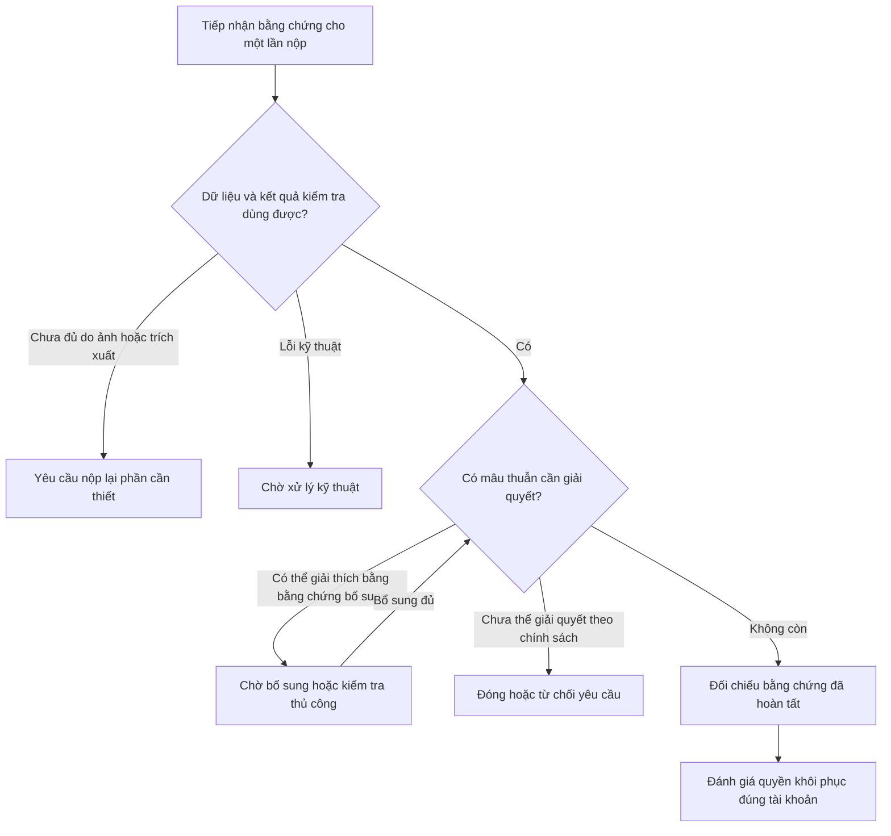

# Document mismatch handling

## 1. Không khớp giấy tờ là một vấn đề cần phân loại

Trong luồng khôi phục tài khoản, **document mismatch** là sự không nhất quán giữa thông tin từ giấy tờ được cung cấp và nguồn đang được dùng để đối chiếu. Nguồn đó có thể là hồ sơ định danh đã xác minh trước đây, dữ liệu từ đơn vị phát hành hoặc kết quả của một bước kiểm tra độc lập. Hai chuỗi ký tự khác nhau chưa đủ để kết luận người gửi đang gian lận.

Ví dụ, người dùng mất điện thoại chứa MFA và gửi giấy tờ để khôi phục quyền truy cập. Hồ sơ cũ ghi `Nguyễn Thị An`, còn OCR đọc `NGUYEN THI AN`. Đây có thể là khác biệt cách biểu diễn. Nếu ngày sinh trên giấy tờ cũng khác hồ sơ đã xác minh, hệ thống phải xử lý thêm một mâu thuẫn có ý nghĩa định danh; không thể dùng sự giống nhau của tên để bỏ qua.

Bài học này tập trung vào cách tiếp nhận, phân loại và xử lý các mâu thuẫn đó khi người dùng mất mật khẩu, MFA, passkey hoặc thiết bị xác thực. Mục tiêu là đưa hồ sơ đến quyết định có căn cứ, đồng thời giữ chặt ranh giới giữa việc kiểm tra giấy tờ và việc cho phép khôi phục tài khoản.

NIST phân biệt việc xác lập một danh tính duy nhất, kiểm tra bằng chứng và xác minh người trình bằng chứng. Các bước này trả lời những câu hỏi khác nhau. [NIST SP 800-63A-4 — Identity Proofing Overview](https://pages.nist.gov/800-63-4/sp800-63a/proofing/)

Từ đó, khi thiết kế recovery, cần trả lời riêng bốn câu hỏi:

1. Giấy tờ có được kiểm tra tính xác thực và khả năng sử dụng theo chính sách không?
2. Các thuộc tính trên giấy tờ có nhất quán với nguồn đối chiếu đáng tin cậy không?
3. Người đang yêu cầu có thực sự là người gắn với bằng chứng đó không?
4. Danh tính đã xác minh có liên kết đáng tin cậy với **đúng tài khoản** đang yêu cầu khôi phục không?

Một giấy tờ thật của người khác vẫn có thể bị dùng để chiếm tài khoản. Một giấy tờ thật của chính người gửi cũng không chứng minh họ sở hữu một tài khoản bất kỳ có cùng tên.

## 2. Chọn đúng nguồn đối chiếu trước khi so khớp

### 2.1. Hồ sơ tự khai và hồ sơ đã xác minh có giá trị khác nhau

Giả sử tài khoản chỉ yêu cầu email và tên hiển thị khi đăng ký. Người dùng từng đặt tên `An Nguyen` nhưng chưa trải qua bước gắn danh tính ngoài đời với tài khoản.

Sau này, giấy tờ mang tên `Nguyễn An` không tự tạo ra mối liên kết còn thiếu. Hệ thống không nên coi phép so khớp này là căn cứ duy nhất để thay email, bỏ MFA hoặc đăng ký passkey mới. Cần dùng cơ chế khôi phục đã thiết lập, hoặc một quy trình có khả năng chứng minh mối liên kết với tài khoản. Nếu không có bằng chứng đủ mạnh, yêu cầu có thể chưa được phép tiếp tục.

Ngược lại, một hồ sơ định danh đã được xác minh và gắn với tài khoản từ trước có thể là nguồn đối chiếu phù hợp. Tuy nhiên, cần biết hồ sơ được xác minh bằng cách nào, khi nào và có thay đổi gần thời điểm sự cố không.

| Nguồn dữ liệu | Có thể hỗ trợ điều gì? | Giới hạn cần giữ |
| --- | --- | --- |
| Tên hiển thị do người dùng tự nhập | Giải thích cách người dùng gọi mình | Không phải bằng chứng quyền sở hữu tài khoản |
| Thuộc tính đã được xác minh trước sự cố | Đối chiếu với danh tính từng gắn với tài khoản | Cần xem nguồn gốc, thời điểm và lịch sử thay đổi |
| Dữ liệu từ đơn vị phát hành hoặc nguồn có thẩm quyền | Hỗ trợ xác thực giấy tờ, kiểm tra thuộc tính | Không tự chứng minh người gửi là chủ tài khoản |
| Dữ liệu OCR | Trích xuất thuộc tính để xử lý | Có thể đọc sai; không phải kết luận giấy tờ thật |
| Email, số điện thoại vừa nhập trong yêu cầu | Nhận trao đổi trong phạm vi được cho phép | Chưa phải kênh đã gắn với tài khoản từ trước |

### 2.2. Không sửa dữ liệu chuẩn để làm cho hồ sơ “khớp”

Một vòng lặp nguy hiểm:

```text
Người gửi khai ngày sinh mới
→ hệ thống cập nhật hồ sơ tài khoản
→ giấy tờ được so với hồ sơ vừa cập nhật
→ kết luận khớp
```

Ở đây, nguồn đối chiếu đã bị thay bằng chính lời khai cần kiểm tra. Kết quả không còn ý nghĩa xác minh.

Thiết kế phù hợp hơn là chụp lại phiên bản hồ sơ dùng để đối chiếu khi mở yêu cầu. Giá trị mới được lưu riêng dưới dạng thuộc tính đang được đề nghị xác nhận. Quyết định đối chiếu phải chỉ rõ đã dựa vào phiên bản hồ sơ nào.

Nếu thông tin tài khoản thay đổi trong lúc xử lý, hệ thống đánh giá tác động và yêu cầu quyết định mới khi cần. Không tự chuyển một kết luận cũ sang dữ liệu mới.

## 3. Phân loại mismatch theo nguyên nhân và mức độ

Một mã `DOCUMENT_MISMATCH` duy nhất thường không đủ để điều phối. Nó trộn lẫn lỗi ảnh, lỗi trích xuất, thay đổi hợp lệ và mâu thuẫn thực sự.

| Nhóm | Ví dụ | Hướng xử lý |
| --- | --- | --- |
| Lỗi thu nhận | Ảnh lóa, cắt mất ngày sinh, thiếu mặt sau | Yêu cầu chụp lại đúng phần cần thiết |
| Lỗi trích xuất | OCR nhầm `O` với `0`, bỏ dấu tiếng Việt | Đọc lại từ bằng chứng gốc hoặc trích xuất lại |
| Khác cách biểu diễn | Chữ hoa, khoảng trắng, Unicode tương đương | Chuẩn hóa theo từng trường rồi đánh giá lại |
| Thay đổi có thể hợp lệ | Đổi họ tên, đổi nơi ở, giấy tờ được cấp lại | Yêu cầu bằng chứng phù hợp cho thay đổi cụ thể |
| Mâu thuẫn định danh | Ngày sinh khác sau khi đã loại trừ lỗi đọc | Chuyển đánh giá có kiểm soát hoặc dừng theo chính sách |
| Tính xác thực chưa đạt | Có dấu hiệu chỉnh sửa, kết quả kiểm tra không đáng tin cậy | Dừng nhánh tự động và chuyển xử lý phù hợp |
| Lỗi kỹ thuật | Nhà cung cấp timeout, callback không hợp lệ, thiếu dữ liệu | Chờ hoặc thử lại có kiểm soát; chưa kết luận người dùng sai |

Điểm quan trọng là phân biệt ba trạng thái: **khớp**, **không khớp** và **chưa đủ dữ liệu để biết**. Trường bị thiếu không được biến thành khớp; dịch vụ không trả lời không được biến thành “không phát hiện gian lận”.

Độ tin cậy của OCR cũng khác với độ tin cậy của quyết định. OCR tự tin rằng nó đọc đúng một ngày sinh chỉ có nghĩa hẹp về việc trích xuất. Nó không chứng minh ngày sinh đó thuộc về chủ tài khoản.

### Những trường cần được hiểu trong ngữ cảnh

- **Họ tên:** thứ tự họ tên, tên pháp lý và tên sử dụng có thể khác nhau. So khớp gần đúng chỉ nên tạo một ứng viên cần xem xét.
- **Ngày sinh:** chuỗi `03/04/1994` có thể gây nhầm định dạng. Cần biết quy ước của nguồn; không tự đảo ngày và tháng cho đến khi khớp.
- **Số giấy tờ:** phải so trong cùng loại giấy tờ và phạm vi đơn vị phát hành. Hai số giống nhau ở hai hệ thống cấp số khác nhau chưa chắc chỉ cùng một người.
- **Ngày hết hạn:** là điều kiện chấp nhận bằng chứng theo chính sách, không phải bằng chứng trực tiếp rằng danh tính khác.
- **Địa chỉ:** có thể thay đổi theo thời gian. Địa chỉ khác thường cần cách giải thích khác với một mâu thuẫn ngày sinh.
- **Ảnh chân dung hoặc kết quả đối chiếu khuôn mặt:** lỗi chất lượng và kết quả không xác định cần được phân biệt với bằng chứng rõ về việc không cùng người.

## 4. Chuẩn hóa để giảm lỗi, giữ lại thông tin để giải thích

Quy trình chuẩn hóa nên có ba lớp dữ liệu:

```text
Giá trị gốc từ từng nguồn
        ↓
Giá trị đã chuẩn hóa + phiên bản quy tắc
        ↓
Kết quả đối chiếu + lý do + phần chưa giải quyết
```

Không ghi đè giá trị gốc bằng giá trị đã chuẩn hóa. Người xử lý cần có khả năng biết một kết quả khớp đến từ việc bỏ khoảng trắng hay từ một quy tắc làm thay đổi ý nghĩa.

Một số nguyên tắc thiết kế:

1. Chuẩn hóa Unicode về dạng đã chọn và xử lý khoảng trắng theo đặc tính của trường.
2. Chỉ áp dụng quy tắc hoa/thường hoặc dấu phân cách khi quy tắc đó phù hợp với nguồn dữ liệu.
3. Với tên người, dạng không dấu có thể dùng để tìm ứng viên; không coi mọi tên trở nên giống nhau sau khi bỏ dấu là cùng danh tính.
4. Không tự thay `O ↔ 0` hoặc `I ↔ 1` trong số định danh rồi chấp nhận. Khi nghi lỗi OCR, cần kiểm tra lại bằng chứng gốc.
5. Không bỏ số `0` đầu, cắt bớt tiền tố hay so một phần số giấy tờ nếu chưa có quy tắc rõ ràng cho loại giấy tờ đó.
6. Không lấy tổng điểm giống nhau để che một mâu thuẫn bắt buộc phải giải quyết.

Ví dụ minh họa:

```text
Tên đã xác minh:      Nguyễn Thị An
Tên OCR:              NGUYEN THI AN
Ngày sinh đã xác minh: 1994-04-03
Ngày sinh từ giấy tờ:  1994-04-08

Kết quả:
- Tên: ứng viên tương đồng, cần đánh giá theo quy tắc.
- Ngày sinh: mâu thuẫn chưa được giải thích.
- Hồ sơ: chưa đủ điều kiện chuyển sang quyết định recovery.
```

Nếu hệ thống cộng điểm tên, ảnh và địa chỉ rồi tự duyệt vì vượt ngưỡng, nó có thể vô tình bỏ qua ngày sinh mâu thuẫn. Các điều kiện chặn cần được đánh giá riêng với tín hiệu hỗ trợ.

## 5. Điều phối hồ sơ bằng trạng thái rõ nghĩa

Các trạng thái dưới đây là ví dụ cho hệ thống recovery, không phải trường trạng thái của tài liệu bài học.



Có thể dùng các trạng thái nội bộ:

| Trạng thái | Ý nghĩa | Chưa được phép làm |
| --- | --- | --- |
| `NEEDS_RESUBMISSION` | Lần nộp chưa đáp ứng yêu cầu thu nhận | Phát quyền reset |
| `TECHNICAL_HOLD` | Chưa có kết quả kỹ thuật đáng tin cậy | Coi lỗi kiểm tra là đạt |
| `NEEDS_RECONCILIATION` | Còn thuộc tính hoặc quan hệ cần giải thích | Sửa hồ sơ gốc để hợp thức hóa |
| `MANUAL_REVIEW` | Người có thẩm quyền cần xem xét theo quy trình | Bỏ qua bằng chứng chỉ bằng ghi chú hỗ trợ |
| `EVIDENCE_RECONCILED` | Các mâu thuẫn trong phạm vi kiểm tra đã được giải quyết | Tự động cấp session đăng nhập |
| `REJECTED` | Yêu cầu không đáp ứng chính sách tại thời điểm quyết định | Tự kết luận người gửi đã gian lận |

Tên trạng thái cần phản ánh chính xác kết luận. `EVIDENCE_RECONCILED` không đồng nghĩa đã xác minh người trình giấy tờ, đã chứng minh quyền sở hữu tài khoản hoặc đã cho phép thay MFA.

Nếu có bằng chứng tấn công, quy trình chống gian lận có thể được kích hoạt riêng. Không dùng một lần mismatch đơn lẻ để gắn nhãn vĩnh viễn hoặc khóa tài khoản đang hoạt động của người khác.

## 6. Xử lý bổ sung và kiểm tra thủ công có giới hạn

### 6.1. Hỏi đúng thứ đang thiếu

Thông báo yêu cầu bổ sung phải gắn với một vấn đề cụ thể:

> Ảnh hiện tại bị lóa tại vùng thông tin cần kiểm tra. Vui lòng chụp lại mặt trước với đủ bốn góc và ánh sáng đều.

Hoặc:

> Chúng tôi chưa thể xác nhận thay đổi thông tin trong hồ sơ này. Bạn có thể cung cấp một loại bằng chứng thay đổi được chấp nhận qua kênh tải lên bảo mật.

Không yêu cầu hàng loạt giấy tờ “để chắc hơn” khi chưa biết cần chứng minh điều gì. Hai ảnh chụp cùng một giấy tờ cũng không mặc nhiên là hai nguồn độc lập.

Quy trình cần công bố các loại bằng chứng được chấp nhận, cách xử lý người không có loại giấy tờ thông thường và đường yêu cầu xem xét lại. NIST đề cập việc xác định quy trình xử lý ngoại lệ và sai sót trong hoạt động xác minh danh tính. [NIST SP 800-63A-4 — Identity Proofing Requirements](https://pages.nist.gov/800-63-4/sp800-63a/ial-general/)

### 6.2. Người kiểm tra cần xem được nguồn gốc, không chỉ điểm số

Màn hình xử lý nên cung cấp đúng dữ liệu cần thiết:

- Thuộc tính đang mâu thuẫn và nguồn của từng giá trị.
- Thời điểm xác minh hồ sơ đối chiếu, thời điểm cấp hoặc thay đổi thông tin nếu biết.
- Kết quả kiểm tra tính xác thực, chất lượng ảnh và lỗi trích xuất.
- Quan hệ giữa bằng chứng mới, bằng chứng bổ sung và tài khoản.
- Lịch sử các lần nộp trong cùng yêu cầu cùng lý do quyết định trước đó.
- Phiên bản chính sách và các điều kiện chưa đạt.

Người kiểm tra phải ghi lý do có cấu trúc và tham chiếu bằng chứng, chẳng hạn `NAME_CHANGE_SUPPORTED` hoặc `DATE_OF_BIRTH_CONFLICT_UNRESOLVED`. Một ghi chú “khách hàng giải thích hợp lý” không thay thế được căn cứ.

Quyền kiểm tra cũng cần giới hạn theo vai trò. Nếu chính sách yêu cầu hai người đối với trường hợp rủi ro cao, một người không được tự đóng cả hai vai trò. Bộ phận hỗ trợ không nên có nút biến hồ sơ thiếu bằng chứng thành session đăng nhập.

### 6.3. Có đường xem xét lại nhưng không cho thử vô hạn

Người dùng thật có thể cần nộp lại vì ảnh kém hoặc hồ sơ cũ sai. Cho phép sửa lỗi cần đi kèm ngân sách thử lại, thời hạn hồ sơ và cơ chế xem xét.

Ngân sách nên tính được các lần nộp liên quan trong cùng tài khoản hoặc yêu cầu, thay vì bị đặt lại chỉ bằng việc mở ticket mới. Tuy nhiên, việc hạn chế recovery không nên tự động vô hiệu hóa đăng nhập hợp lệ của chủ tài khoản; kẻ tấn công có thể cố ý tạo nhiều yêu cầu để gây từ chối dịch vụ.

Không hạ tiêu chuẩn bằng chứng chỉ vì người gửi thử nhiều lần, tạo áp lực khẩn cấp hoặc liên hệ nhiều nhân viên hỗ trợ.

## 7. Gắn kết quả với đúng hồ sơ và đúng lần nộp

Trong hệ thống dùng dịch vụ kiểm tra giấy tờ bên ngoài, mismatch có thể xuất hiện do ghép nhầm dữ liệu, không chỉ do người dùng gửi thông tin khác nhau.

Một kết quả kiểm tra cần được ràng buộc với:

```text
recoveryCaseId
accountRef nội bộ
attemptId
evidenceVersion
baselineVersion
providerRequestId
policyVersion
thời điểm xử lý và thời điểm hết hiệu lực
```

Các định danh này là ví dụ thiết kế. Trường nào do nhà cung cấp trả về, trường nào do hệ thống tự ánh xạ phải được xác định rõ. Không nhận `accountRef` tùy ý từ phía trình duyệt rồi tin rằng kết quả thuộc về tài khoản đó.

Các tình huống cần xử lý:

- **Callback giả:** xác thực nguồn và tính toàn vẹn theo giao thức tích hợp; không tin kết quả chỉ vì JSON có `passed: true`.
- **Callback trùng:** xử lý lặp lại có cùng hiệu quả, không phát thêm quyền khôi phục.
- **Kết quả đến muộn:** không áp vào một lần nộp mới hơn hoặc hồ sơ đã đóng.
- **Hai lần nộp song song:** mỗi lần có định danh riêng; kết quả của lần trước không được ghi đè lần đang được chọn.
- **Thay hồ sơ đối chiếu:** kết luận dựa trên phiên bản cũ phải được đánh giá lại trước bước cấp quyền.
- **Đổi mục tiêu recovery:** kết quả cho một tài khoản hoặc mục đích không được tái sử dụng cho tài khoản khác.

Đặc biệt, timeout phải dẫn đến trạng thái chưa xác định hoặc chờ kỹ thuật. Cơ chế dự phòng có thể là kênh xử lý khác đã được thiết kế, không phải tự coi kiểm tra đã đạt.

## 8. Mã giả cho quyết định đối chiếu

Ví dụ sau minh họa thứ tự các điều kiện. Đây là mã giả cho lớp quyết định bằng chứng; nó không thực hiện kiểm tra ảnh, xác thực callback hoặc cấp token.

```text
function evaluateEvidence(case, attempt, result, baseline, policy):
    if case.isClosed or case.isCancelled:
        return IGNORE_RESULT

    if not result.isAuthenticated:
        return TECHNICAL_HOLD("UNTRUSTED_RESULT")

    if not result.belongsTo(case, attempt):
        return TECHNICAL_HOLD("RESULT_BINDING_INVALID")

    if result.isStale or baseline.version != case.baselineVersion:
        return NEEDS_RECONCILIATION("STALE_CONTEXT")

    if result.isUnavailable:
        return TECHNICAL_HOLD("PROVIDER_UNAVAILABLE")

    if not result.captureIsUsable:
        return NEEDS_RESUBMISSION("CAPTURE_UNUSABLE")

    if result.documentAuthenticity == UNKNOWN:
        return MANUAL_REVIEW("AUTHENTICITY_UNRESOLVED")

    if result.documentAuthenticity == FAILED:
        return REJECTED("EVIDENCE_NOT_ACCEPTED")

    if not policy.acceptsEvidence(result):
        return NEEDS_RECONCILIATION("EVIDENCE_POLICY_NOT_MET")

    comparisons = compareFields(
        result.originalAttributes,
        baseline.verifiedAttributes,
        policy.fieldRules
    )

    if comparisons.hasUnresolvedRequiredAttribute:
        return NEEDS_RECONCILIATION("REQUIRED_ATTRIBUTE_UNRESOLVED")

    if comparisons.hasUnresolvedMaterialConflict:
        return MANUAL_REVIEW("MATERIAL_CONFLICT")

    if comparisons.requiresSupportingEvidence:
        return NEEDS_RECONCILIATION("SUPPORTING_EVIDENCE_REQUIRED")

    return EVIDENCE_RECONCILED
```

Việc ghi kết quả cần kiểm tra lại trạng thái và phiên bản hồ sơ trong thao tác cập nhật có kiểm soát đồng thời, chẳng hạn cập nhật có điều kiện theo phiên bản. Nếu hồ sơ thay đổi sau lúc tính toán, kết quả cũ không được ghi như một quyết định hiện hành.

Lớp cho phép recovery chạy sau đó và có hợp đồng riêng:

```text
Đối chiếu bằng chứng hoàn tất
+ xác minh người trình bằng chứng đạt yêu cầu
+ liên kết với đúng tài khoản đủ tin cậy
+ mục đích khôi phục được chính sách cho phép
+ kiểm tra rủi ro và điều kiện hiện hành đạt yêu cầu
→ mới có thể cấp quyền khôi phục giới hạn
```

Không cho tầng giao diện gọi trực tiếp một hàm “approve” bằng cách gửi kết quả so khớp tự khai.

## 9. Sau khi giải quyết mismatch, vẫn phải bảo vệ recovery

### 9.1. Quyền được cấp phải đúng mục đích

Quyền đặt lại mật khẩu không tự bao gồm quyền gỡ MFA hoặc đăng ký passkey. Với người mất thiết bị xác thực, việc thiết lập yếu tố mới cần quyết định tương ứng với mức rủi ro của hành động đó.

Nếu dùng token tiếp tục recovery, hệ thống nên ràng buộc token với một hồ sơ, một tài khoản và một mục đích. Token hết hạn hoặc đã dùng không được dùng lại. Việc tiêu thụ token và chuyển trạng thái cần chống tình huống hai yêu cầu cùng thành công.

OWASP khuyến nghị token reset có tính ngẫu nhiên an toàn, thời hạn phù hợp và chỉ dùng một lần; hoàn tất reset không nên tự động đăng nhập người dùng. [OWASP — Forgot Password Cheat Sheet](https://cheatsheetseries.owasp.org/cheatsheets/Forgot_Password_Cheat_Sheet.html)

Trong thiết kế minh họa, token có thể chỉ mở một phiên recovery giới hạn. Phiên này chưa cho phép đọc dữ liệu tài khoản, đổi kênh liên hệ tùy ý hoặc thực hiện giao dịch nhạy cảm.

### 9.2. Kênh liên hệ và session cần chính sách riêng

Không chuyển liên kết khôi phục sang email vừa được cung cấp chỉ vì giấy tờ đã khớp. Việc thay kênh liên hệ cũng là một hành động cần chứng minh và kiểm soát.

Khi có thể, gửi thông báo thay đổi bảo mật qua kênh đã được thiết lập từ trước, với nội dung không lộ giấy tờ hoặc thuộc tính đang mâu thuẫn. Thông báo là tín hiệu cảnh báo cho chủ tài khoản; nó không thay thế bằng chứng quyền sở hữu.

Sau khi thực sự hoàn tất recovery, áp dụng chính sách cho session, refresh token, yếu tố xác thực bị mất và phương thức khôi phục cũ. Nếu nghi tài khoản đã bị chiếm, chỉ đổi mật khẩu có thể chưa đủ để loại bỏ quyền truy cập còn tồn tại.

Ngược lại, không thu hồi tất cả session chỉ vì một người bất kỳ mở yêu cầu hoặc gửi giấy tờ không khớp. Cần tránh tạo cách phá phiên đăng nhập của nạn nhân từ bên ngoài.

### 9.3. Giảm khả năng đoán dữ liệu tài khoản

Thông báo cho người chưa được xác minh không nên trả lại giá trị chuẩn:

```text
Không phù hợp:
“Ngày sinh đúng trên tài khoản là 03/04/1994.”

Phù hợp hơn:
“Chúng tôi chưa thể xác nhận một số thông tin của yêu cầu này.
Bạn có thể tiếp tục qua phương án kiểm tra được cung cấp.”
```

Với lỗi chất lượng, có thể hướng dẫn cụ thể cách chụp lại. Với dữ liệu bí mật của tài khoản, không biến phản hồi thành công cụ thử từng giá trị để suy ra thông tin gốc.

## 10. Ba tình huống xuyên suốt

### Tình huống A — OCR đọc nhầm số

Người dùng mất điện thoại chứa ứng dụng MFA. Ảnh giấy tờ có số bị lóa; OCR đọc một ký tự thành `O` thay vì `0`.

**Xử lý:** đánh dấu phần trích xuất chưa đáng tin cậy, yêu cầu ảnh rõ hơn hoặc kiểm tra lại theo phương án được phép. Giữ cả kết quả cũ và kết quả mới theo từng lần nộp. Không sửa số tự động cho khớp.

**Điểm kết thúc:** nếu dữ liệu được trích xuất lại đúng và các điều kiện khác đạt, hoàn tất đối chiếu bằng chứng. Quyết định thay MFA tiếp tục được đánh giá riêng.

### Tình huống B — Tên pháp lý thay đổi

Hồ sơ đã xác minh trước đây mang tên cũ. Giấy tờ mới mang tên mới, còn một số thuộc tính khác nhất quán.

**Xử lý:** xác định chính xác thay đổi cần chứng minh; tiếp nhận loại bằng chứng thay đổi được chính sách chấp nhận qua kênh bảo mật. Người kiểm tra xem nguồn gốc, tính xác thực và quan hệ giữa hai tên, thay vì coi lời giải thích trong ticket là đủ.

**Điểm kết thúc:** ghi nhận lý do giải quyết mâu thuẫn và các phiên bản bằng chứng. Việc sửa tên trong hồ sơ chính thức tuân theo quy trình cập nhật riêng; không âm thầm sửa để phép đối chiếu thành công.

### Tình huống C — Giấy tờ thật, liên kết tài khoản không đạt

Người gửi có giấy tờ thật mang tên giống tên hiển thị của tài khoản. Tài khoản chưa từng gắn danh tính pháp lý; người gửi cũng không có phương thức khôi phục đã thiết lập.

**Xử lý:** ghi nhận giới hạn của bằng chứng. Không lấy việc tên giống nhau để kết luận họ sở hữu tài khoản. Chuyển sang phương án có thể chứng minh quyền khôi phục nếu dịch vụ đã thiết kế phương án đó.

**Điểm kết thúc:** nếu chưa có căn cứ đủ mạnh, giữ hoặc từ chối yêu cầu theo chính sách và cung cấp đường xem xét phù hợp. Hệ thống không phát quyền reset chỉ để làm cho ticket được đóng thành công.

## 11. Dữ liệu nhạy cảm và dấu vết quyết định

Bằng chứng định danh có thể gây hại lớn nếu bị lộ. Quy trình mismatch cần thu thập vừa đủ để giải quyết vấn đề và giới hạn việc sử dụng đúng mục đích.

Một bản ghi quyết định có thể gồm:

```text
caseRef
attemptRef
evidenceVersion
baselineVersion
decision
reasonCodes
policyVersion
reviewerRef nếu có
decidedAt
```

Tham chiếu nội bộ vẫn cần kiểm soát truy cập. Không đặt nguyên số giấy tờ, ngày sinh, ảnh chân dung hoặc token recovery vào log ứng dụng, email thông thường hay nội dung ticket có phạm vi người xem quá rộng.

Ảnh và tài liệu bổ sung nên được lưu trong kho riêng có kiểm soát quyền truy cập và thời hạn lưu giữ theo chính sách áp dụng. Liên kết truy cập cần giới hạn thời gian và người được dùng. Không sao chép bằng chứng sang nhiều hệ thống chỉ để thuận tiện xử lý.

Dấu vết quyết định phải đủ để giải thích: ai đã quyết định, trên bằng chứng nào, theo quy tắc nào và đã giải quyết mâu thuẫn gì. Giữ dấu vết không có nghĩa phải giữ vĩnh viễn mọi bản sao giấy tờ.

## 12. Những câu hỏi thiết kế cần trả lời được

Trước khi dùng kết quả đối chiếu trong recovery, nhóm phát triển cần giải thích rõ:

- Nguồn nào là hồ sơ đối chiếu đáng tin cậy, và nguồn nào chỉ là lời khai?
- Thuộc tính nào được chuẩn hóa, theo quy tắc và phiên bản nào?
- Trường hợp thiếu dữ liệu, lỗi kỹ thuật và mâu thuẫn thật được phân biệt ra sao?
- Khi nào cần nộp lại, khi nào cần bằng chứng bổ sung, khi nào phải dừng?
- Người xử lý thủ công có quyền gì và phải ghi căn cứ nào?
- Kết quả có bị dùng nhầm cho tài khoản, lần nộp hoặc phiên bản hồ sơ khác không?
- Điều kiện nào còn phải đạt sau `EVIDENCE_RECONCILED` trước khi cấp quyền khôi phục?
- Người dùng thật có đường sửa lỗi hoặc yêu cầu xem xét mà không làm hạ tiêu chuẩn bảo vệ tài khoản không?

Một quy trình xử lý mismatch hiệu quả cần giải thích được sự khác biệt, bảo toàn căn cứ đối chiếu và chỉ chuyển sang khôi phục khi mối liên kết giữa người yêu cầu, danh tính và tài khoản đã đạt điều kiện của dịch vụ.
