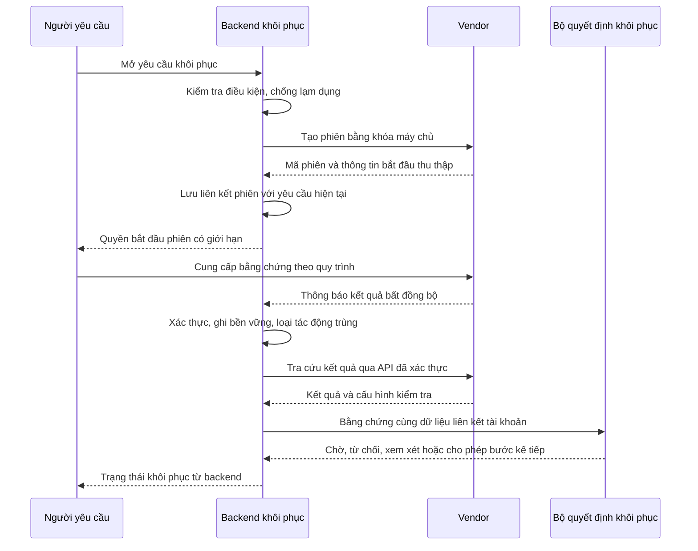

# Document verification vendor

Nhà cung cấp xác minh giấy tờ (document verification vendor) cung cấp công nghệ hoặc dịch vụ vận hành để thu thập, kiểm tra giấy tờ và trả về bằng chứng về danh tính. Trong luồng khôi phục tài khoản, dịch vụ này có thể hỗ trợ người dùng đã mất mật khẩu, MFA, passkey hoặc thiết bị xác thực. Tuy nhiên, một kết quả xác minh danh tính đạt yêu cầu chỉ là đầu vào cho quyết định khôi phục của hệ thống.

Bài học tập trung vào cách xác định trách nhiệm của nhà cung cấp, lựa chọn năng lực phù hợp và tích hợp kết quả vào luồng khôi phục an toàn. Các mô hình dữ liệu, trạng thái và chính sách bên dưới là thiết kế minh họa của hệ thống khôi phục, không phải giao thức chung hay cam kết tính năng của mọi vendor.

## 1. Phân biệt danh tính đã xác minh và quyền sở hữu tài khoản

Có ba câu hỏi độc lập cần trả lời:

1. **Giấy tờ có đáng tin không?** Ví dụ: loại giấy tờ được hỗ trợ, thông tin có nhất quán, có dấu hiệu bị sửa hay không.
2. **Người đang thực hiện có liên hệ với giấy tờ không?** Tùy sản phẩm và cấu hình, có thể cần đối chiếu khuôn mặt, kiểm tra sự hiện diện hoặc người vận hành xem xét.
3. **Danh tính đó có quyền khôi phục tài khoản mục tiêu không?** Đây là trách nhiệm của nền tảng sở hữu tài khoản.

Một vendor có thể trả lời tốt hai câu hỏi đầu mà vẫn không có dữ liệu để trả lời câu hỏi thứ ba. Người tấn công sử dụng giấy tờ thật của chính mình vẫn có thể vượt qua bước xác minh danh tính. Điều đó không trao cho họ quyền thay MFA của một tài khoản khác.

Ví dụ, tài khoản được tạo bằng email và chưa từng có danh tính pháp lý được xác minh. Người yêu cầu khôi phục nộp giấy tờ mang tên giống tên hiển thị của tài khoản. Hai tên giống nhau không tạo thành bằng chứng liên kết đủ mạnh: tên hiển thị có thể tự khai, trùng tên hoặc đã bị sửa. Hệ thống cần một phương án chứng minh quyền sở hữu khác hoặc quy trình xem xét riêng; không được tự biến tên hiển thị thành danh tính đã xác minh trước đây.

Nếu tài khoản đã có hồ sơ danh tính được xác minh từ trước, hệ thống có thể đối chiếu theo chính sách và nguồn dữ liệu đáng tin đó. Cần xử lý việc đổi tên, giấy tờ mới và khác biệt cách viết bằng quy trình có bằng chứng. Không tự động ghi đè hồ sơ cũ bằng thông tin mới do chính người đang xin khôi phục cung cấp.

## 2. Vendor có thể đảm nhiệm phần nào?

Phạm vi dịch vụ cần được xác định theo từng năng lực, thay vì một nhãn chung như “eKYC đạt”.

| Năng lực | Giá trị trong khôi phục | Điều cần làm rõ |
| --- | --- | --- |
| Nhận dạng và trích xuất thông tin | Giảm nhập liệu, hỗ trợ đối chiếu hồ sơ | Trích xuất đúng chữ không chứng minh giấy tờ thật |
| Kiểm tra giấy tờ | Phát hiện một số dấu hiệu không hợp lệ hoặc giả mạo | Loại giấy tờ, phiên bản, quốc gia và giới hạn kiểm tra |
| Đối chiếu người với giấy tờ | Bổ sung bằng chứng liên hệ giữa người và ảnh trên giấy tờ | Điều kiện chụp, sai số, cách xử lý kết quả không chắc chắn |
| Kiểm tra sự hiện diện và nguồn thu nhận | Giảm một số dạng trình chiếu, phát lại hoặc đưa dữ liệu giả vào luồng chụp | Kịch bản được đánh giá, giới hạn của SDK và thiết bị hỗ trợ |
| Xem xét thủ công | Xử lý trường hợp khó hoặc ngoại lệ | Quyền truy cập của nhân sự, thời gian xử lý, dấu vết quyết định |
| Quản lý phiên và kết quả | Giúp ứng dụng tích hợp một quy trình bất đồng bộ | API tra cứu, webhook, trạng thái, phiên bản và khả năng truy vết |

Không mặc định một gói kiểm tra giấy tờ đã bao gồm mọi bước trong bảng. Một vendor có nhiều cấu hình kiểm tra; kết quả “thành công” phải được hiểu theo cấu hình thực tế đã chạy.

Ví dụ cụ thể về mô hình phiên: Stripe Identity mô tả `VerificationSession` để theo dõi quy trình kiểm tra và cung cấp kết quả. Tài liệu cũng nêu client secret là dữ liệu nhạy cảm, không được ghi log hoặc đưa vào URL. Đây là đặc điểm của tích hợp Stripe, không phải tên trường bắt buộc cho các vendor khác. [Tài liệu Verification Sessions của Stripe](https://docs.stripe.com/identity/verification-sessions).

## 3. Xác định yêu cầu trước khi so sánh nhà cung cấp

Trước khi xem demo, đội sản phẩm và bảo mật cần thống nhất các câu hỏi sau:

- Những tình huống mất quyền truy cập nào được phép sử dụng xác minh giấy tờ?
- Tài khoản mục tiêu có hồ sơ danh tính đáng tin để đối chiếu hay chưa?
- Các nhóm người dùng sử dụng giấy tờ, ngôn ngữ và thiết bị nào?
- Hành động sau khôi phục nhạy cảm đến mức nào: đặt mật khẩu, gỡ MFA, thêm passkey hay truy cập tài sản?
- Dữ liệu nào thực sự cần thu thập và có thể được xử lý ở đâu?
- Khi người dùng không có giấy tờ phù hợp hoặc không thể chụp ảnh, phương án tiếp cận thay thế là gì?
- Ai chịu trách nhiệm xử lý khiếu nại, nghi ngờ gian lận và sự cố nhà cung cấp?

Không nên yêu cầu mọi người dùng nộp giấy tờ chỉ vì đã mua dịch vụ. Thu thập thêm dữ liệu nhạy cảm tạo thêm chi phí và nghĩa vụ vận hành, trong khi chưa chắc cải thiện bằng chứng sở hữu tài khoản.

Một chính sách có thể ưu tiên recovery code, thiết bị còn đăng nhập hoặc yếu tố dự phòng đủ tin cậy trước, rồi mới cân nhắc giấy tờ khi phù hợp với mô hình tài khoản. Việc chọn nhánh phải do máy chủ quyết định theo chính sách; người yêu cầu không được tự chọn một nhánh yếu hơn để né kiểm soát.

## 4. Đánh giá vendor bằng tiêu chí có thể kiểm chứng

### 4.1. Đặt điều kiện bắt buộc trước điểm số

Các điều kiện bắt buộc có thể gồm: hỗ trợ nhóm giấy tờ mục tiêu, khả năng xác thực thông báo kết quả, phân tách môi trường thử nghiệm và thật, kiểm soát truy cập nhân sự, cơ chế xóa dữ liệu và phương án khi dịch vụ gián đoạn.

Nếu một yêu cầu bắt buộc chưa đạt, giá thấp hoặc trải nghiệm đẹp không bù được thiếu sót đó. Khi một vendor không cung cấp cơ chế webhook phù hợp, có thể đánh giá phương án chỉ dùng API máy chủ đã xác thực để tra cứu; không được coi thông báo chưa xác thực là kết quả tin cậy.

Sau các điều kiện bắt buộc, có thể chấm điểm những tiêu chí như độ phủ, trải nghiệm, độ trễ, chất lượng xử lý ngoại lệ, khả năng tích hợp và tổng chi phí. Trọng số phải phản ánh người dùng và rủi ro của sản phẩm, không lấy trực tiếp từ tài liệu bán hàng.

### 4.2. Làm rõ mẫu số của các chỉ số

| Chỉ số | Cách hiểu cần thống nhất |
| --- | --- |
| Chấp nhận sai | Trong tập trường hợp không hợp lệ hoặc gian lận đã được xác định, bao nhiêu trường hợp được chấp nhận |
| Từ chối sai | Trong tập người dùng hợp lệ đã được xác định, bao nhiêu người bị từ chối |
| Tỷ lệ hoàn thành | Trong số người bắt đầu, bao nhiêu người hoàn tất; tách người bỏ cuộc khỏi người bị đánh trượt |
| Thời gian có kết quả | Tính từ mốc nào, có bao gồm chụp lại và xem xét thủ công không |
| Tỷ lệ xem xét thủ công | Bao nhiêu phiên cần người xử lý và tồn đọng bao lâu |
| Chi phí khôi phục thành công | Bao gồm phiên thất bại, thử lại, hỗ trợ và vận hành liên quan |

Một con số “độ chính xác” gộp không cho biết hệ thống có chấp nhận nhầm người gian lận hay gây khó cho người hợp lệ. Mẫu đánh giá cần phản ánh giấy tờ, điều kiện ánh sáng, camera, ngôn ngữ và nhu cầu tiếp cận thực tế. Các nhóm ít mẫu phải được ghi nhận là chưa đủ bằng chứng, thay vì kết luận chắc chắn từ tỷ lệ đẹp.

Đặc biệt, tỷ lệ vendor cho qua khác với tỷ lệ khôi phục đúng chủ tài khoản. Đội vận hành cần theo dõi khiếu nại và sự cố sau khôi phục để hiểu kết quả cuối cùng của toàn luồng. Thiết kế phép đo này phải bảo vệ dữ liệu cá nhân và sử dụng bộ dữ liệu được phép xử lý.

### 4.3. Xác định bằng chứng và trách nhiệm trong hợp đồng

Cần biết ai là đơn vị xử lý dữ liệu, những bên phụ trợ nào có thể tham gia, dữ liệu có thể đi qua khu vực nào và nhân sự nào có thể truy cập. Các tuyên bố chứng nhận cần được đối chiếu đúng phạm vi dịch vụ, thời hạn và bằng chứng hỗ trợ; một chứng nhận không tự bảo đảm luồng khôi phục của ứng dụng là an toàn.

Phải làm rõ cơ chế thông báo sự cố, thay đổi thuật toán hoặc cấu hình, thay đổi phiên bản API, hỗ trợ điều tra, xuất dữ liệu và kết thúc hợp đồng. Thời hạn lưu giữ và yêu cầu pháp lý cần được xác định theo bối cảnh triển khai, không lấy một số ngày cố định làm quy tắc cho mọi sản phẩm.

## 5. Chọn cách thu thập dữ liệu và xác định ranh giới tin cậy

Có ba cách tích hợp thường gặp về mặt kiến trúc:

| Cách thu thập | Lợi ích có thể có | Trách nhiệm cần đánh giá |
| --- | --- | --- |
| Trang thu thập do vendor lưu trữ | Giảm phần giao diện và xử lý ảnh trong ứng dụng | Chuyển hướng đúng miền, liên kết phiên, thông báo cho người dùng, giới hạn tùy biến |
| SDK nhúng trong ứng dụng | Trải nghiệm liền mạch, hỗ trợ quy trình chụp | Quyền camera, hành vi SDK, phiên bản phụ thuộc, dữ liệu truyền đi |
| Ứng dụng nhận tệp rồi gửi API | Chủ động giao diện và luồng dữ liệu | Tiếp nhận tệp không tin cậy, lưu trữ ảnh, kiểm soát truy cập và vòng đời bản sao |

Trang hosted không loại bỏ trách nhiệm quản lý dữ liệu của nền tảng. SDK cũng không làm thiết bị phía người dùng trở thành môi trường đáng tin tuyệt đối. Trong cả ba cách, quyết định khôi phục vẫn nằm ở máy chủ của nền tảng.

Các ranh giới tối thiểu cần bảo vệ gồm trình duyệt với backend khôi phục, backend với API vendor, webhook với bộ tiếp nhận sự kiện, và cổng quản trị vendor với nhân sự vận hành. Khóa API đặc quyền và khóa xác minh webhook được quản lý phía máy chủ, tách theo môi trường và phạm vi quyền. Token dành cho frontend chỉ có quyền tối thiểu cần cho phiên cụ thể.

## 6. Luồng tích hợp minh họa



### 6.1. Tạo yêu cầu trước, tạo phiên vendor sau

Backend cần tạo một yêu cầu khôi phục nội bộ, xác định tài khoản mục tiêu và mức rủi ro trước khi mở phiên xác minh. Phiên tiếp tục của người yêu cầu là phiên khôi phục hạn chế, không phải phiên đăng nhập đầy đủ.

Mỗi lần tạo phiên vendor cần có một mã thao tác ổn định để xử lý trường hợp gọi API bị timeout. Nếu vendor hỗ trợ idempotency, sử dụng theo hợp đồng của họ. Nếu chưa biết thao tác trước thành công hay chưa, cần đối soát trạng thái; không lập tức tạo hàng loạt phiên mới và phát sinh nhiều khoản phí.

Một thiết kế có thể chỉ cho phép một phiên đang có hiệu lực trên mỗi lần thử khôi phục. Người dùng cần chụp lại thì tiếp tục phiên hiện tại khi vendor hỗ trợ và chính sách cho phép. Khi cần thay phiên, phiên trước phải được đánh dấu hết hiệu lực đối với yêu cầu nội bộ.

### 6.2. Lưu liên kết phía máy chủ

Thông tin tối thiểu minh họa:

```text
VerificationBinding
  recoveryRequestId
  recoveryAttemptVersion
  accountId
  vendorName
  vendorTenantId
  environment
  vendorSessionId
  expectedVerificationProfile
  createdAt
  expiresAt
  bindingState
```

`vendorSessionId` phải được tra về liên kết do máy chủ đã tạo. Không lấy `accountId` từ query string quay về trình duyệt hoặc từ một trường tùy ý do frontend gửi rồi cập nhật trực tiếp tài khoản đó.

`recoveryAttemptVersion` phân biệt lần thử hiện tại với lần thử đã bị hủy hoặc thay thế. `expectedVerificationProfile` giúp phát hiện việc chạy thiếu kiểm tra cần thiết hoặc áp dụng nhầm cấu hình. `vendorTenantId` và `environment` ngăn kết quả từ tenant khác hoặc sandbox đi vào luồng thật.

Mã tham chiếu gửi sang vendor nên là định danh mờ, chỉ mang dữ liệu cần thiết. Có một trường metadata không có nghĩa là nên đưa email, số giấy tờ hoặc toàn bộ hồ sơ tài khoản vào đó.

### 6.3. Không lấy trang quay về làm bằng chứng hoàn thành

Người dùng có thể quay về ứng dụng khi vendor còn xử lý, đóng tab hoặc tự sửa URL. Một tham số như `verified=true` chỉ là dữ liệu phía client.

Trang kết quả phải hỏi backend về trạng thái yêu cầu khôi phục đã được ràng buộc với phiên hạn chế của người yêu cầu. Chuyển hướng chỉ phục vụ trải nghiệm. Nền tảng cần một nguồn kết quả đáng tin từ máy chủ để quyết định bước tiếp theo.

Stripe mô tả kiểm tra danh tính là quy trình bất đồng bộ, có các sự kiện thay đổi trạng thái và webhook để ứng dụng nhận kết quả. Khi tích hợp cụ thể, phải sử dụng đúng tên trạng thái và sự kiện của phiên bản API đang dùng. [Tài liệu xử lý kết quả xác minh của Stripe](https://docs.stripe.com/identity/handle-verification-outcomes).

## 7. Tiếp nhận webhook mà không mở đường cấp quyền sai

Webhook là dữ liệu đi qua mạng và phải được xác thực theo cơ chế của vendor. Chữ ký hợp lệ xác nhận nguồn gửi theo cơ chế đó; nó không tự chứng minh yêu cầu khôi phục còn hiệu lực hoặc danh tính đúng với tài khoản mục tiêu.

Quy trình tiếp nhận nên thực hiện các việc sau:

1. Giới hạn kích thước và tài nguyên xử lý request; giữ nguyên nội dung gốc nếu giao thức chữ ký yêu cầu.
2. Xác minh chữ ký, khóa, thời gian và các điều kiện chống phát lại theo đúng tài liệu vendor. Không tự đặt tên header hoặc thuật toán thay cho giao thức thật.
3. Kiểm tra loại sự kiện, môi trường và tenant; nhận diện phiên qua liên kết nội bộ.
4. Lưu sự kiện đã xác thực vào inbox bền vững với khóa duy nhất, chẳng hạn bộ `(vendor, tenant, environment, eventId)`.
5. Chỉ phản hồi nhận thành công sau khi đã lưu bền vững hoặc biết chắc sự kiện trùng đã được lưu. Nếu lưu thất bại, phản hồi theo hợp đồng retry thay vì âm thầm bỏ mất kết quả.
6. Xử lý nghiệp vụ qua worker nội bộ và cơ chế đối soát; không gỡ MFA ngay trong endpoint webhook.

Cách xác minh cần giữ nguyên byte đầu vào là yêu cầu cụ thể trong nhiều giao thức ký. Ví dụ, tài liệu Stripe yêu cầu truyền raw request body, giá trị `Stripe-Signature` và endpoint secret vào hàm xác minh tương ứng. Không parse JSON rồi tuần tự hóa lại trước khi kiểm chữ ký. [Tài liệu quản lý webhook và xử lý lỗi chữ ký của Stripe](https://docs.stripe.com/events/manage-webhook-endpoints).

### 7.1. Tách nhận sự kiện và áp dụng bằng chứng

Pseudocode dưới đây diễn tả ranh giới trách nhiệm, không phải mã có thể chạy trực tiếp với một SDK:

```text
receiveWebhook(rawBody, headers):
    event = vendorAdapter.verifyAndDecode(rawBody, headers)
    require event.type is supported
    require event.environment and event.tenant are expected

    transaction:
        insert inbox(event.key, minimizedEventData)
            with uniqueness constraint on event.key
        # Nếu trùng, giữ nguyên sự kiện đã lưu.
    acknowledge according to vendor contract

processInbox(eventKey):
    event = inbox.load(eventKey)
    binding = bindings.findByVendorSession(event.sessionId)
    if binding is absent:
        record restricted diagnostic; stop

    result = vendorAdapter.retrieveResult(binding.vendorSessionId)

    transaction:
        lock current recovery request and binding
        require binding still belongs to current request and attempt
        require request is active and binding has not expired
        require result matches tenant, environment and expected profile
        apply result only if its version/state transition is acceptable
        record normalized evidence and its provenance
        enqueue recovery policy evaluation in a transactional outbox
        mark inbox item processed
```

Việc tra cứu API diễn ra ngoài transaction dài; sau đó phải kiểm tra lại trạng thái nội bộ trong transaction vì người dùng có thể hủy yêu cầu trong lúc chờ mạng. Nếu bước xử lý lỗi, sự kiện vẫn còn để retry. Ghi bằng chứng, đánh dấu xử lý và lập outbox cần có tính nhất quán để tránh mất việc hoặc áp dụng lặp.

Tra cứu lại API là một lựa chọn thiết kế trong ví dụ này nhằm lấy trạng thái máy chủ có thẩm quyền. Nếu vendor dùng hợp đồng sự kiện khác, adapter phải xác định rõ nguồn kết quả chuẩn, quy tắc phiên bản và cách xử lý cập nhật. Không mặc định API nào cũng trả trạng thái mới nhất ngay sau webhook.

### 7.2. Xử lý trùng, đến muộn và sai thứ tự

Có thể nhận cùng một sự kiện nhiều lần, hai sự kiện khác nhau cho một phiên hoặc kết quả cũ sau khi yêu cầu đã bị hủy. Không dùng thứ tự request đến làm thứ tự nghiệp vụ duy nhất.

Persona công bố rằng thứ tự webhook nhận được có thể khác thứ tự tạo sự kiện và có cơ chế thử gửi lại. Vì vậy, tích hợp với dịch vụ này cần tính đến sự kiện lặp và sai thứ tự; các vendor khác phải được kiểm tra theo hợp đồng riêng. [Tài liệu webhook của Persona](https://docs.withpersona.com/webhooks).

Ngoài chống trùng theo event ID, trạng thái yêu cầu và hành động cấp quyền cũng phải idempotent. Hai sự kiện khác ID vẫn không được cấp hai recovery grant. Sự kiện thành công đến muộn có thể được lưu phục vụ truy vết theo chính sách, nhưng không mở lại một yêu cầu đã hết hạn hay bị hủy.

## 8. Chuẩn hóa kết quả mà vẫn giữ ý nghĩa

Một adapter có thể chuyển kết quả vendor thành các trạng thái bằng chứng nội bộ:

| Trạng thái nội bộ minh họa | Ý nghĩa | Hành vi khôi phục |
| --- | --- | --- |
| `PENDING` | Chưa có kết quả đầy đủ | Tiếp tục chờ trong thời hạn cho phép |
| `ACTION_REQUIRED` | Cần bổ sung thông tin hoặc chụp lại | Hướng dẫn trong giới hạn thử lại |
| `PASSED` | Các kiểm tra yêu cầu đã đạt | Chuyển bằng chứng sang bộ quyết định |
| `FAILED` | Không đạt theo kiểm tra đã chạy | Xử lý theo lý do và chính sách |
| `REVIEW_REQUIRED` | Kết quả chưa đủ để quyết định tự động | Chuyển quy trình xem xét phù hợp |
| `UNAVAILABLE` | Không xác định được do sự cố kỹ thuật | Giữ yêu cầu chưa được phê duyệt |

Các trạng thái này do ứng dụng định nghĩa; không ánh xạ theo tên gần giống rồi giả định cùng nghĩa. Đặc biệt, “đã gửi xong”, “đã xử lý xong” hoặc HTTP `200` không tự có nghĩa giấy tờ đã vượt qua kiểm tra.

Bản ghi bằng chứng nên giữ thời điểm kiểm tra, phiên vendor, mã cấu hình, phiên bản API hoặc chính sách có liên quan, nhóm kiểm tra đã chạy và mã lý do đã chuẩn hóa. Không cần sao chép mọi dữ liệu sinh trắc học hoặc nội dung giấy tờ để chứng minh một quyết định đã diễn ra.

Điểm số giữa hai vendor có thể khác thang đo, tập dữ liệu và ý nghĩa. Không lấy một ngưỡng của vendor A áp cho vendor B chỉ vì cả hai đều trả số từ 0 đến 100. Cần ánh xạ đã được đánh giá và có phiên bản; thiếu dữ liệu thì dùng trạng thái chưa đủ bằng chứng.

## 9. Từ bằng chứng đến quyết định khôi phục

Một mô hình suy luận minh họa là:

```text
Đủ điều kiện đi tiếp =
    bằng chứng vendor đạt đúng kiểm tra yêu cầu
    VÀ liên kết danh tính với tài khoản đủ tin cậy
    VÀ yêu cầu cùng lần thử còn hiệu lực
    VÀ chính sách rủi ro hiện tại cho phép
```

Biểu thức này giúp làm rõ các cổng kiểm soát; không phải công thức tính điểm chuẩn cho mọi hệ thống.

Ví dụ, người dùng có giấy tờ hợp lệ và liên kết với hồ sơ cũ, nhưng tài khoản vừa có yêu cầu thay email khôi phục từ một thiết bị lạ. Bộ quyết định có thể yêu cầu thời gian chờ, thông báo tới kênh đã có trước đó hoặc người có thẩm quyền xem xét. Một nhân viên hỗ trợ không được tự bỏ các cổng đó chỉ vì dashboard vendor hiển thị màu xanh.

Nếu đủ điều kiện, hệ thống có thể cấp một **recovery grant giới hạn mục đích**, thời hạn ngắn và dùng một lần. Grant phải ràng buộc với yêu cầu, tài khoản, phiên tiếp tục hợp lệ và hành động được phép, chẳng hạn thiết lập yếu tố xác thực mới. Mã phiên vendor hoặc ảnh chụp kết quả không đóng vai trò recovery token.

Việc tiêu thụ grant và thay đổi yếu tố cần có tính nguyên tử hoặc cơ chế tương đương để tránh hai request cùng dùng một quyền. Chính sách khôi phục cũng phải xử lý các phiên cũ, refresh token, recovery token đang tồn tại và thông báo bảo mật. Tín hiệu vendor không nên trực tiếp tạo phiên đăng nhập đầy đủ hoặc tự động gỡ mọi yếu tố xác thực.

## 10. Giảm dữ liệu nhạy cảm và quyền truy cập

Lập bản đồ dữ liệu cho cả đường chính lẫn các bản sao: ảnh ở thiết bị, dữ liệu truyền sang vendor, kết quả trong webhook, inbox, hệ thống log, công cụ hỗ trợ, bản xuất dashboard và bản sao lưu. Không chỉ kiểm tra cơ sở dữ liệu nghiệp vụ.

Các lựa chọn thiết kế cần cân nhắc gồm:

- Thu thập đúng thông tin cần cho mục đích khôi phục và giải thích cho người dùng trước khi bắt đầu.
- Ưu tiên không đưa ảnh giấy tờ, ảnh khuôn mặt, số giấy tờ đầy đủ hoặc client token vào log, analytics và ticket hỗ trợ.
- Khi cần lưu dữ liệu nhạy cảm, tách kho, mã hóa, giới hạn quyền và đặt thời hạn phù hợp cho từng loại dữ liệu.
- Cấu hình payload webhook tối thiểu nếu vendor hỗ trợ; dữ liệu sự kiện đã lưu cũng phải có vòng đời.
- Cấp quyền cổng quản trị theo vai trò, bảo vệ tài khoản nhân sự và theo dõi truy cập hoặc xuất dữ liệu.
- Làm rõ cách yêu cầu xóa được thực thi với nhà cung cấp, bên phụ trợ và các bản sao theo hợp đồng.

Giá trị băm thông thường của một số giấy tờ có miền giá trị dễ đoán không làm dữ liệu đó trở thành vô danh. Nếu cần một định danh đối chiếu, phải đánh giá mô hình tấn công, quản lý khóa và mục đích sử dụng; vẫn quản lý dữ liệu theo mức độ nhạy cảm thích hợp.

Thời hạn lưu ảnh gốc có thể khác thời hạn lưu dấu vết quyết định đã giảm dữ liệu. Một thiết kế cần biết bằng chứng nào đủ để xử lý tranh chấp sau khi ảnh đã được xóa, thay vì mặc định lưu ảnh vô thời hạn để tiện điều tra.

## 11. Vận hành khi vendor lỗi hoặc cần thay thế

### 11.1. Sự cố không trở thành quyền bỏ qua

Timeout, lỗi API, hạn mức hoặc webhook chậm phải dẫn tới trạng thái chờ hoặc chưa xác định. Không coi “không thấy lỗi giấy tờ” là “giấy tờ hợp lệ”, và không tự hạ xuống xác minh bằng câu hỏi bí mật chỉ vì vendor đang gián đoạn.

Cần có timeout theo giai đoạn, retry có backoff và giới hạn, cơ chế ngắt gọi khi dịch vụ lỗi kéo dài, đối soát các phiên mắc kẹt và thông tin rõ ràng cho người dùng. Việc thử lại phải xét chi phí, giới hạn của vendor và trạng thái của lần gọi trước.

Nếu có nhánh hỗ trợ thay thế, nhánh đó phải được thiết kế và phê duyệt theo mô hình rủi ro riêng. Nhân viên vận hành không tự tạo ngoại lệ trong lúc sự cố. Người dùng không thể sử dụng giấy tờ cần có đường tiếp cận phù hợp, nhưng đường đó cũng phải chứng minh được quyền sở hữu tài khoản.

### 11.2. Theo dõi tín hiệu của toàn luồng

Các chỉ số hữu ích gồm độ trễ có kết quả, tỷ lệ lỗi API, tỷ lệ webhook không xác thực, backlog inbox, phiên quá hạn, số lần thử trên một yêu cầu, tỷ lệ xem xét thủ công và khiếu nại sau khôi phục. Báo cáo cần tách theo môi trường và nhóm người dùng phù hợp, đồng thời tránh để dữ liệu phân tích làm lộ danh tính.

Hạn mức nên xét nhiều chiều như tài khoản, yêu cầu, phiên và nguồn truy cập. Chỉ giới hạn theo IP có thể ảnh hưởng người dùng chung mạng; chỉ giới hạn theo tài khoản có thể bị lợi dụng để gây gián đoạn cho nạn nhân. Việc thu thập thêm tín hiệu chống lạm dụng cũng phải có mục đích và thời hạn lưu rõ ràng.

### 11.3. Chuẩn bị khả năng chuyển nhà cung cấp

Adapter giúp tách giao thức vendor khỏi bộ quyết định, nhưng không bảo đảm thay thế tương đương. Khi chuyển vendor cần đánh giá lại ý nghĩa trạng thái, kiểm tra bắt buộc, nhóm giấy tờ, sai số, hành vi webhook và xử lý dữ liệu.

Không để người yêu cầu liên tục chuyển vendor để tìm nơi dễ vượt qua nhất. Số lần thử và quyết định sử dụng nhà cung cấp cần được quản lý ở cấp yêu cầu khôi phục. Với phiên đang chạy, phải có chính sách tiếp tục hoặc hủy rõ ràng; kết quả từ phiên cũ không được vô tình áp dụng cho phiên mới.

## 12. Ví dụ quyết định xuyên suốt

Một người dùng mất điện thoại chứa ứng dụng MFA và không còn recovery code. Tài khoản trước đây có hồ sơ danh tính đã xác minh. Backend cho phép mở phiên xác minh giấy tờ sau khi kiểm tra điều kiện và chống lạm dụng.

1. Hệ thống tạo yêu cầu `R1`, lần thử `A1`, rồi lưu phiên vendor `V1` gắn với tài khoản và cấu hình kiểm tra bắt buộc.
2. Người dùng hoàn thành quy trình. Trang quay về hiển thị đang xử lý dựa trên trạng thái backend.
3. Vendor gửi kết quả đạt. Backend xác thực, lưu inbox và lấy kết quả theo giao thức máy chủ.
4. Bộ xử lý xác nhận `R1/A1/V1` còn hiệu lực, các kiểm tra đã chạy đúng cấu hình, và danh tính có liên kết đáng tin với hồ sơ trước đó.
5. Bộ quyết định xét rủi ro và các yêu cầu bảo vệ bổ sung. Chỉ khi đủ điều kiện, backend cấp quyền giới hạn cho việc thiết lập yếu tố mới.
6. Sau khi quyền đó được tiêu thụ thành công, hệ thống xử lý phiên theo chính sách và gửi thông báo bảo mật qua các kênh phù hợp đã được xác lập trước.

Nếu người dùng đã hủy `R1` trước bước 3, webhook đạt đến sau không mở lại yêu cầu. Nếu giấy tờ là thật nhưng không khớp liên kết danh tính đáng tin, không cấp quyền khôi phục. Nếu vendor gián đoạn, yêu cầu ở trạng thái chưa đủ bằng chứng. Những kết quả này thể hiện đúng vai trò của nhà cung cấp: cung cấp bằng chứng chuyên môn trong một quy trình mà nền tảng vẫn chịu trách nhiệm về quyền khôi phục tài khoản.
