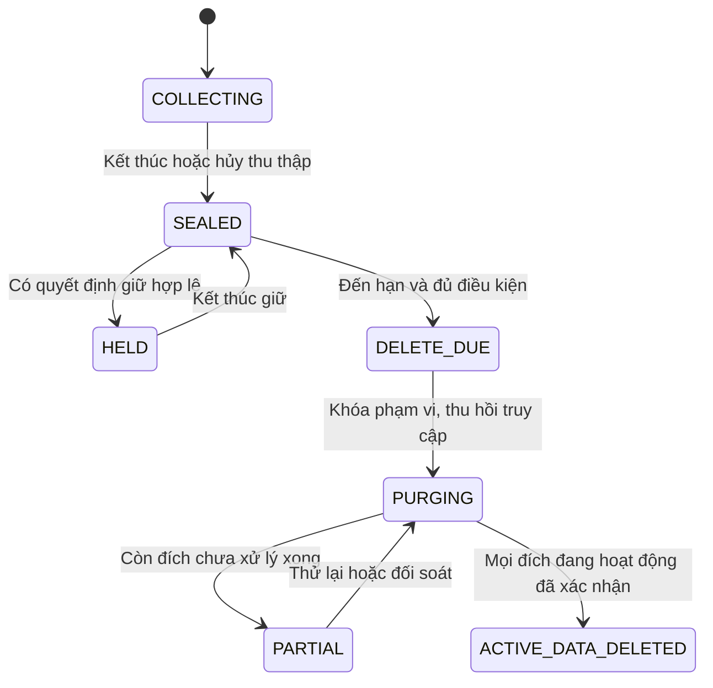

# Document evidence deletion

Xóa bằng chứng giấy tờ là quá trình kết thúc việc lưu giữ và sử dụng dữ liệu được thu thập để xác minh danh tính. Trong khôi phục tài khoản, dữ liệu này có thể gồm ảnh giấy tờ, ảnh khuôn mặt, video, nội dung OCR, báo cáo của nhà cung cấp và những bản sao phát sinh trong vận hành. Xóa một hàng trong cơ sở dữ liệu hoặc làm cho ảnh biến mất khỏi giao diện chưa đủ để kết luận toàn bộ bằng chứng đã được xóa.

Một thiết kế tốt cần trả lời rõ: dữ liệu nào đang tồn tại, vì sao còn phải giữ, khi nào đến hạn xóa, hệ thống nào phải thực hiện và bằng chứng nào xác nhận công việc đã hoàn thành. Đồng thời, việc xóa dữ liệu không được làm thay đổi sai quyết định khôi phục, mở lại yêu cầu cũ hoặc xóa mất các kiểm soát chống chiếm đoạt tài khoản.

Các trạng thái, cấu trúc dữ liệu và pseudocode trong bài là thiết kế minh họa cho hệ thống khôi phục; chúng không phải schema bắt buộc của một nhà cung cấp hay quy định thời hạn lưu giữ chung.

## 1. Tách dữ liệu gốc khỏi dấu vết quyết định

Giả sử một người dùng mất thiết bị MFA và nộp giấy tờ để hỗ trợ khôi phục. Hệ thống có thể cần ảnh gốc trong lúc xác minh, nhưng sau đó chỉ cần một bản ghi tối thiểu để giải thích quyết định: yêu cầu nào đã được xử lý, kiểm tra gì đã được thực hiện, chính sách nào được áp dụng và kết quả là gì.

Hai nhóm dữ liệu có mục đích và vòng đời khác nhau:

| Nhóm dữ liệu | Ví dụ | Cách tiếp cận vòng đời |
| --- | --- | --- |
| Bằng chứng gốc | Ảnh hai mặt giấy tờ, selfie, video | Chỉ giữ khi còn mục đích được xác định; lên lịch xóa theo chính sách |
| Dữ liệu dẫn xuất nhạy cảm | OCR, ảnh cắt khuôn mặt, đặc trưng sinh trắc học nếu có | Không mặc định được giữ lâu hơn ảnh gốc; quản lý từng mục đích |
| Kết quả xác minh tối thiểu | Nhóm kiểm tra đã chạy, kết quả, thời điểm, mã cấu hình | Giữ phần cần thiết để hỗ trợ quyết định và giải trình |
| Dấu vết khôi phục | Yếu tố nào được thay, grant nào đã được tiêu thụ, phiên nào bị thu hồi | Có vòng đời bảo mật riêng; không chứa bản sao giấy tờ |
| Dấu vết xóa | Phạm vi đã xử lý, trạng thái từng nơi lưu, thời điểm xác nhận | Giảm dữ liệu, bảo vệ tính toàn vẹn và đặt hạn lưu riêng |

Bản ghi quyết định tối thiểu vẫn có thể là dữ liệu cá nhân khi liên kết được với tài khoản. “Không còn ảnh” không đồng nghĩa “không còn dữ liệu cá nhân”. Cần kiểm soát cả quyền truy cập và thời hạn lưu của metadata.

Một mã băm ảnh hoặc số giấy tờ cũng không tự làm dữ liệu trở thành vô danh. Mã băm có thể cho phép đối chiếu giữa các hệ thống; số giấy tờ có miền giá trị dễ đoán còn có nguy cơ bị dò. Không giữ chúng chỉ để thay thế cho ảnh đã xóa mà chưa có mục đích rõ ràng.

## 2. Lập danh mục mọi nơi bằng chứng có thể xuất hiện

Phạm vi xóa phải được thiết kế từ đường đi dữ liệu, thay vì chỉ từ bảng nghiệp vụ chính.

| Nơi tồn tại | Dữ liệu có thể có | Điểm dễ bỏ sót |
| --- | --- | --- |
| Ứng dụng nhận tệp | Tệp tạm, ảnh chụp, dữ liệu xử lý trong bộ nhớ | Thư mục tạm, crash dump, tác vụ bị hủy giữa chừng |
| Kho đối tượng | Ảnh gốc, ảnh đã nén, thumbnail | Phiên bản cũ, bản sao vùng khác, multipart upload chưa hoàn tất |
| Cơ sở dữ liệu và chỉ mục | OCR, đường dẫn tệp, trường được trích xuất | Replica, bảng lịch sử, chỉ mục tìm kiếm, luồng CDC |
| Hàng đợi và xử lý nền | Payload webhook, tác vụ OCR, thông điệp lỗi | Retry queue, dead-letter queue, sự kiện được phát lại |
| Nhà cung cấp xác minh | Phiên xác minh, báo cáo, ảnh và dữ liệu dẫn xuất | Môi trường, tenant, bên xử lý phụ, bản xuất dashboard |
| Công cụ hỗ trợ | Tệp đính kèm, ảnh màn hình, dữ liệu xuất | Bản tải về máy nhân viên, ticket được sao chép |
| Quan sát hệ thống | Log, trace, lỗi ứng dụng, phân tích trải nghiệm | Request body, URL có token, ảnh bị ghi vào công cụ ghi lại phiên |
| Sao lưu và khôi phục | Snapshot, bản sao lưu cơ sở dữ liệu, kho lưu trữ | Bản cũ làm dữ liệu đã xóa xuất hiện trở lại |

Danh mục cần có chủ sở hữu cho từng nơi lưu, cơ chế nhận diện dữ liệu, quyền thực hiện xóa và cách xác nhận kết quả. Một nơi chưa xác định được chủ sở hữu là một phần phạm vi chưa được kiểm soát, không phải lý do bỏ qua khỏi báo cáo hoàn thành.

Tốt hơn hết là hạn chế tạo bản sao ngay từ đầu. Ví dụ, trang nhân viên có thể xem ảnh qua quyền truy cập giới hạn thay vì tự động tải ảnh vào mọi ticket. Các hệ thống phân tích trải nghiệm không nên nhận nội dung giấy tờ.

OWASP khuyến nghị tránh ghi trực tiếp token, định danh phiên và dữ liệu cá nhân nhạy cảm vào log. Điều này hỗ trợ thiết kế giảm dữ liệu từ đầu; không nên dựa vào một công việc dọn log về sau để sửa mọi lần ghi thừa. [OWASP Logging Cheat Sheet — Data to exclude](https://cheatsheetseries.owasp.org/cheatsheets/Logging_Cheat_Sheet.html#data-to-exclude).

## 3. Xác định chính sách giữ và xóa theo mục đích

Không có một thời hạn giữ ảnh phù hợp cho mọi luồng khôi phục. Chính sách cần được xác định theo dữ liệu, mục đích, rủi ro, bối cảnh pháp lý và cam kết với người dùng. Đội kỹ thuật triển khai chính sách đã được xác lập, đồng thời làm rõ các giới hạn kỹ thuật của từng nơi lưu.

### 3.1. Gắn hạn xóa với sự kiện có ý nghĩa

Các mốc có thể dùng để tính hạn gồm:

- Phiên thu thập bị bỏ dở hoặc hết hạn.
- Yêu cầu khôi phục bị hủy.
- Quyết định xác minh hoặc xem xét thủ công đã kết thúc.
- Dữ liệu đã hoàn thành mục đích xử lý và kết thúc thời gian giữ bổ sung được cho phép.
- Một yêu cầu xóa hợp lệ đã được xử lý theo quy trình thích hợp.

Mỗi loại dữ liệu có thể có quy tắc riêng. Tệp tạm phục vụ xử lý ảnh không nhất thiết phải tồn tại đến lúc mọi tranh chấp của tài khoản kết thúc. Một dấu vết quyết định tối thiểu cũng không cần có cùng hạn xóa với video gốc.

Nên lưu `retentionPolicyVersion`, mốc tính hạn và `deleteDueAt`. Khi chính sách thay đổi, cần có quy tắc áp dụng cho dữ liệu hiện có, thay vì chỉ sửa cấu hình rồi giả định các lịch xóa cũ đã được cập nhật.

### 3.2. Không kéo dài thời hạn bằng hoạt động không liên quan

Một lần đăng nhập mới, một webhook retry hoặc việc nhân viên mở hồ sơ không nên tự động đặt lại đồng hồ lưu ảnh. Nếu có lý do cần gia hạn, phải thể hiện thành một quyết định riêng có phạm vi, người chịu trách nhiệm và thời điểm xem xét lại.

Yêu cầu bị từ chối hoặc bỏ dở cũng cần hạn xóa. Giữ mãi vì “chưa khôi phục thành công” sẽ tạo một kho giấy tờ của những người không còn sử dụng luồng nữa.

### 3.3. Ngoại lệ giữ dữ liệu phải có giới hạn

Một số bối cảnh có thể cần giữ dữ liệu phục vụ tranh chấp hoặc điều tra. Ngoại lệ này cần được xác định theo thẩm quyền và chính sách phù hợp, không phải một cờ `keepForever` do bất kỳ nhân viên nào bật được.

Bản ghi ngoại lệ nên có lý do đã chuẩn hóa, phạm vi dữ liệu, người phê duyệt, thời điểm bắt đầu, hạn xem xét lại và điều kiện kết thúc. Chỉ giữ phần dữ liệu cần thiết; một hồ sơ đang được xem xét không nhất thiết đòi giữ mọi bản sao phát sinh.

Nếu công việc xóa đã vượt qua điểm không thể khôi phục, một quyết định giữ dữ liệu đến sau không thể tạo lại dữ liệu đó. Hệ thống cần thể hiện đúng ranh giới thời gian này, thay vì hứa rằng đặt cờ giữ luôn cứu được bằng chứng đang bị xóa.

## 4. Phân biệt các thao tác thường bị gọi chung là “xóa”

| Thao tác | Tác dụng | Giới hạn |
| --- | --- | --- |
| Thu hồi quyền xem | Chặn truy cập qua ứng dụng hoặc quyền phiên | Byte dữ liệu có thể vẫn còn trong kho và bản sao |
| Đánh dấu đã xóa | Ẩn dữ liệu khỏi truy vấn thông thường | Người có quyền khác hoặc quy trình phục hồi vẫn có thể truy cập |
| Xóa đối tượng hoặc phiên bản | Yêu cầu kho loại bỏ đối tượng được chỉ định | Cần xét phiên bản cũ, replica, cache và chính sách khóa lưu giữ |
| Redaction | Loại bỏ hoặc thay thế các trường nhạy cảm theo cơ chế cụ thể | Phạm vi và thời điểm hoàn tất phụ thuộc hệ thống thực hiện |
| Hủy khóa để làm dữ liệu không thể giải mã | Có thể hỗ trợ xử lý dữ liệu mã hóa trong một kiến trúc phù hợp | Không hiệu quả với bản rõ hoặc các bản khóa còn dùng được |
| Hết hạn bản sao lưu | Loại dữ liệu khỏi các thế hệ backup theo chính sách | Không đồng nghĩa bản sao biến mất ngay khi dữ liệu chính bị xóa |

Hết hạn URL ký sẵn chỉ hạn chế khả năng truy cập bằng URL đó; nó không xóa nội dung mà người nhận đã tải xuống. Việc xóa một hàng chứa URL cũng không chứng minh đối tượng phía sau URL đã bị loại bỏ.

Một ví dụ cụ thể: trong S3 bucket bật versioning, thao tác xóa không chỉ định version ID thường tạo delete marker. Truy cập thông thường có thể trả `404` dù phiên bản cũ vẫn tồn tại. Muốn xử lý các phiên bản phải dùng cơ chế tương ứng và quyền phù hợp. [Tài liệu AWS về xóa phiên bản đối tượng S3](https://docs.aws.amazon.com/AmazonS3/latest/userguide/DeletingObjectVersions.html).

Vì vậy, kết quả “không nhìn thấy ảnh” và “đã xử lý toàn bộ bản sao trong phạm vi” cần được ghi nhận riêng.

## 5. Tách vòng đời bằng chứng khỏi vòng đời khôi phục

Một tài khoản có thể đã khôi phục xong trong khi việc xóa tại vendor còn đang xử lý. Ngược lại, ảnh của một yêu cầu bị hủy có thể đã xóa nhưng dấu vết yêu cầu bị hủy vẫn cần tồn tại để chặn kết quả đến muộn.

Không nên dùng một trường `status` duy nhất cho cả hai quy trình. Có thể tách:

```text
RecoveryRequest
  requestId
  attemptVersion
  recoveryState
  decisionVersion
  closedAt

EvidenceBundle
  evidenceBundleId
  recoveryRequestId
  evidenceGeneration
  collectionState
  retentionPolicyVersion
  deleteDueAt
  accessRevokedAt
  operationalDeletionState
  vendorDeletionState
  backupDispositionState
```

`evidenceGeneration` phân biệt các đợt thu thập. Nếu một người dùng phải nộp lại ảnh, thế hệ mới cần định danh và vòng đời riêng. Tác vụ xóa thế hệ cũ không được xóa nhầm ảnh mới do tái sử dụng cùng đường dẫn hoặc mã bundle.

Sơ đồ minh họa cho phần dữ liệu đang hoạt động:



`ACTIVE_DATA_DELETED` trong sơ đồ không khẳng định backup đã hết hạn. Hệ thống cần hiển thị trạng thái backup và các ngoại lệ còn tồn tại riêng biệt.

Việc xóa bằng chứng không tự chuyển một yêu cầu bị từ chối thành được chấp nhận, không gỡ MFA và không tạo recovery grant mới. Nếu đã có quyết định hợp lệ, hệ thống sử dụng bản ghi quyết định được bảo vệ theo chính sách; không coi sự vắng mặt của ảnh là lý do tự cho qua hoặc bắt buộc nộp lại trong mọi trường hợp.

## 6. Xây dựng kế hoạch xóa có phạm vi cụ thể

Một công việc xóa cần nhận định danh nội bộ, sau đó tra các đích đã được máy chủ quản lý. Không cho frontend gửi một URL hoặc bucket bất kỳ để backend xóa theo.

Ví dụ cấu trúc:

```text
DeletionPlan
  planId
  evidenceBundleId
  evidenceGeneration
  policyVersion
  requestedAt
  dueAt
  scopeVersion
  state
  targets[]
    targetId
    targetType
    resourceReference
    resourceVersion
    state
    operationId
    lastAttemptAt
    confirmedAt
    reasonCode
```

`resourceReference` có thể là mã phiên vendor hoặc mã đối tượng trong kho. Đây là dữ liệu nội bộ có giới hạn truy cập, không phải nội dung giấy tờ và cũng không phải token cho phép khôi phục tài khoản.

Các trạng thái đích nên phân biệt `REQUESTED`, `IN_PROGRESS`, `CONFIRMED`, `RETRY_PENDING`, `BLOCKED` và `NOT_APPLICABLE` theo ngữ nghĩa đã xác định. Chỉ được dùng `NOT_APPLICABLE` khi có căn cứ rằng nơi đó không chứa dữ liệu thuộc phạm vi, không dùng để làm cho báo cáo nhanh chóng chuyển xanh.

Nếu gặp `not found`, cần xem hợp đồng của kho hoặc vendor: đó là đối tượng thực sự không tồn tại, đã được xóa, sai môi trường, thiếu quyền, hay chỉ đang bị ẩn? Không diễn giải mọi `404` thành xác nhận xóa hoàn tất.

### 6.1. Không xóa mất thông tin cần để tiếp tục công việc

Một lỗi phổ biến là xóa hàng liên kết với vendor trước, rồi phát hiện không còn mã phiên để yêu cầu vendor xóa ảnh. Kế hoạch xóa cần giữ các tham chiếu tối thiểu cho đến khi các đích đã được xử lý hoặc được bàn giao sang một cơ chế tiếp tục đáng tin cậy.

Sau khi hoàn tất, tham chiếu phục vụ điều phối cũng phải được giảm hoặc xóa theo vòng đời riêng. Không biến deletion plan thành một danh mục giấy tờ vĩnh viễn.

### 6.2. Kiểm soát phạm vi khi có quyết định giữ dữ liệu

Việc tạo kế hoạch, đặt hoặc giải phóng trạng thái giữ cần được phối hợp qua một nguồn trạng thái có thẩm quyền. Trước mỗi hành động không thể đảo ngược, worker kiểm tra lại quyền xử lý và phiên bản phạm vi theo giao thức của hệ thống.

Không thể dùng một transaction cơ sở dữ liệu để bảo đảm nguyên tử cho mọi lệnh xóa ở các dịch vụ độc lập. Vì vậy, hệ thống phải xác định rõ điểm bắt đầu xóa không thể hủy, xử lý xung đột với yêu cầu giữ đến đồng thời và ghi nhận phần nào đã thực sự bị loại bỏ. Khi một phần đã xóa, trạng thái phải phản ánh sự thật đó.

## 7. Ngăn dữ liệu xuất hiện trở lại sau khi bắt đầu xóa

Xóa các đối tượng đang biết là chưa đủ nếu một tác vụ OCR vẫn đang chạy và chuẩn bị ghi kết quả mới. Tương tự, webhook cũ hoặc sự kiện trong dead-letter queue có thể tạo lại bản ghi chứa dữ liệu nhạy cảm.

Trước khi bắt đầu purge, cần kết thúc hoặc khóa thế hệ thu thập tương ứng và thu hồi quyền truy cập thông thường. Các đường ghi phải kiểm tra trạng thái thế hệ, bao gồm upload, xử lý nền, nhập kết quả vendor và phát lại thông điệp.

Một cách minh họa:

```text
scheduleDeletion(bundleId, generation):
    transaction:
        bundle = lock bundleId and generation
        require policy permits deletion
        require no applicable hold blocks this operation
        seal this evidence generation
        revoke application access to its evidence
        create deletion plan with a stable target scope
        write deletion task to transactional outbox

consumeLateEvidence(event):
    binding = find exact bundle and generation from server mapping
    if generation no longer accepts writes:
        do not reactivate the evidence or recovery request
        register any newly materialized resource for cleanup
        keep only the minimal event outcome required by policy
        stop
    continue through the normal authorized ingestion path
```

Pseudocode thể hiện ranh giới xử lý; không giả định mọi tài nguyên bên ngoài đã ngừng ghi ngay khi transaction kết thúc.

Nếu URL upload đã được cấp và không thể thu hồi tức thời bằng cơ chế đang dùng, cần tính đến tệp được tải lên muộn: sử dụng đường dẫn không tái dùng, nhận diện thế hệ và có tác vụ dọn tệp muộn hoặc mồ côi. Với vendor, cần sử dụng khả năng hủy hoặc khóa phiên khi có, đồng thời đối soát tài nguyên tạo ra sau thời điểm lập kế hoạch.

Dấu chặn ghi lại dữ liệu có thể được lưu dưới dạng tombstone tối thiểu trong hệ thống nội bộ. Tombstone này là tín hiệu vòng đời của bằng chứng; nó khác với delete marker của kho lưu trữ. Hạn giữ dấu chặn cần bao phủ những đường replay, nguồn sự kiện và khoảng phục hồi mà hệ thống thực sự cho phép.

## 8. Thực thi xóa như một công việc có thể retry

Một yêu cầu khôi phục có thể liên quan nhiều nơi lưu, và từng nơi có thể hoàn thành vào thời điểm khác nhau. Cần coi đây là công việc bền vững, thay vì một chuỗi lệnh “gọi thử rồi quên”.

Worker xử lý từng đích theo kế hoạch đã xác định, dùng khóa thao tác ổn định nếu dịch vụ hỗ trợ và ghi lại kết quả từng bước. Khi worker bị dừng, lần chạy tiếp theo phải tiếp tục phần còn thiếu. Không cần tải ảnh gốc xuống chỉ để biết rằng một lệnh xóa trước đã hoàn thành.

```text
processDeletionTarget(planId, targetId):
    acquire bounded processing lease
    check plan scope and permission to continue
    target = load exact target reference and version

    if target already has confirmed completion:
        return

    outcome = adapter.requestOrInspectDeletion(target)

    if outcome is completed for the expected scope:
        save CONFIRMED and minimal completion reference
    else if outcome is accepted or still processing:
        save IN_PROGRESS and schedule bounded follow-up
    else if outcome is retryable:
        save RETRY_PENDING with retry policy
    else:
        save BLOCKED with a reason code and responsible owner
```

Không giữ transaction cơ sở dữ liệu mở trong lúc chờ vendor. Cần cơ chế lease, kiểm tra phiên bản hoặc tương đương để hai worker không áp dụng kết quả xung đột. Nếu lease hết hạn trong lúc lệnh bên ngoài đã thành công, worker mới phải đối soát hoặc thực hiện lại theo ngữ nghĩa idempotent đã xác định.

Retry cần có backoff, giới hạn tài nguyên và cảnh báo khi quá hạn. Đưa một công việc lỗi vào dead-letter queue không làm dữ liệu hết tồn tại; hàng đợi lỗi phải có chủ sở hữu và đường xử lý tiếp.

Một target bị `BLOCKED` không được khiến toàn plan báo đã xóa đầy đủ. Có thể báo dữ liệu chính đã xử lý, vendor đang chờ hoặc kho bị khóa lưu giữ, với phạm vi cụ thể cho từng kết quả.

## 9. Xác nhận xóa ở nhà cung cấp

Hợp đồng tích hợp cần xác định lệnh nào chỉ tiếp nhận yêu cầu, trạng thái nào thể hiện đã hoàn tất và phạm vi hoàn tất bao gồm những gì. Phạm vi có thể khác nhau giữa ảnh, báo cáo, metadata, log, bên xử lý phụ và bản sao lưu.

Ví dụ cụ thể: Stripe Identity có thao tác redact `VerificationSession`. Tài liệu mô tả xử lý bất đồng bộ với `redaction.status` từ `processing` sang `redacted` và có sự kiện thông báo hoàn tất. Đối tượng API có thể vẫn còn nhưng các trường dữ liệu cá nhân được thay bằng giá trị redacted. Vì vậy, còn thấy mã đối tượng không nhất thiết có nghĩa nội dung nhạy cảm còn nguyên. [Tài liệu Stripe về redact VerificationSession](https://docs.stripe.com/api/identity/verification_sessions/redact).

Ví dụ trên không chứng minh rằng gọi redact ở vendor cũng xóa được bản ảnh ứng dụng đã tải về, payload webhook đã ghi vào inbox hay tệp nhân viên đã xuất. Mỗi bản sao cần nằm trong kế hoạch của bên đang quản lý nó.

Quy trình xác nhận cần:

- Ràng buộc mã phiên với đúng tenant, môi trường, bundle và thế hệ bằng chứng.
- Lưu mã thao tác hoặc xác nhận tối thiểu cần thiết cho việc đối soát.
- Xác thực webhook hoàn tất theo cơ chế của vendor trước khi áp dụng.
- Có cách tra cứu hoặc đối soát khi không nhận được webhook.
- Phân biệt lỗi quyền truy cập với việc dữ liệu đã được xóa.
- Xử lý việc nhà cung cấp không thể hoàn tất đúng hạn bằng một trách nhiệm vận hành cụ thể.

Không cần lưu nguyên response có dữ liệu nhạy cảm làm “bằng chứng đã xóa”. Biên nhận chỉ nên chứa các trường cần để xác định phạm vi và kết quả; các trường đó cũng phải có quyền truy cập và thời hạn giữ phù hợp.

## 10. Xử lý cache, bản sao và backup

### 10.1. Dữ liệu đang phục vụ truy cập

Khi bắt đầu xóa, ứng dụng cần ngừng cấp quyền xem mới đối với bằng chứng thuộc phạm vi. Các quyền truy cập đã cấp phải được xử lý theo khả năng thực tế của cơ chế đang dùng; không mặc định xóa một bản ghi là lập tức vô hiệu mọi URL đã phát hành.

Nếu có cache hoặc bản sao phục vụ đọc, phải biết cơ chế vô hiệu hóa, thời gian lan truyền và cách phát hiện dữ liệu còn phục vụ ngoài dự kiến. Không chỉ kiểm tra một endpoint nếu người dùng còn có đường đọc qua replica hoặc dashboard khác.

### 10.2. Bản sao lưu cần trạng thái riêng

Một thiết kế có thể không sửa từng backup bất biến ngay lập tức mà để backup hết hạn theo chính sách được xác lập. Trong trường hợp đó, cần ghi rõ dữ liệu đã bị loại khỏi hệ thống đang hoạt động nhưng còn trong các thế hệ backup nào, đến khi nào và dưới những giới hạn truy cập nào.

Không báo “mọi bản sao đã xóa” khi còn backup chưa được xử lý. Đồng thời, backup không nên trở thành kho dữ liệu mà nhân viên có thể tìm và đọc giấy tờ tùy ý.

Quy trình phục hồi phải tránh đưa dữ liệu đã xóa quay trở lại sử dụng. Có thể phục hồi vào môi trường cách ly, áp dụng danh sách xóa có thẩm quyền và xử lý các bản sao tương ứng trước khi mở phục vụ. Danh sách này phải tồn tại đủ lâu so với những bản backup còn có thể phục hồi và không bị mất chỉ vì bản backup cũ được nạp lại.

Nếu có các luồng nhập lại từ CDC, sự kiện cũ hoặc hệ thống đối tác, chúng cũng cần tôn trọng quyết định xóa. Chỉ làm sạch cơ sở dữ liệu phục hồi mà bỏ qua hàng đợi được phát lại vẫn có thể làm dữ liệu xuất hiện trở lại.

### 10.3. Giới hạn của hủy khóa mã hóa

Hủy khóa có thể hỗ trợ kiến trúc xóa khi dữ liệu chỉ tồn tại dưới dạng mã hóa và mọi cách lấy lại khóa giải mã đều đã được xử lý. Cần đánh giá khóa được bọc, bản sao khóa, cache, backup khóa và những bản rõ đã từng được xuất ra.

Xóa một con trỏ khóa hoặc đặt lịch hủy khóa chưa đồng nghĩa mọi bản sao đã không thể giải mã. Dùng chung một khóa cho nhiều người cũng khiến việc hủy khóa để xử lý một bundle có thể ảnh hưởng dữ liệu ngoài phạm vi. Đây là quyết định kiến trúc cần được xác định trước, không phải phương án vá sau khi đã lưu giấy tờ bằng mọi đường khác nhau.

## 11. Giữ dấu vết xóa mà không tạo kho bằng chứng mới

Bản ghi xóa tối thiểu có thể gồm:

```text
DeletionReceipt
  deletionPlanId
  evidenceBundleReference
  evidenceGeneration
  policyVersion
  requestedAt
  accessRevokedAt
  operationalDeletionCompletedAt
  vendorConfirmationReference
  backupDispositionState
  backupLatestExpiryAt
  exceptionReasonCode
  receiptRetentionUntil
```

Các trường chỉ được điền khi có căn cứ tương ứng. Nếu không biết hạn backup cuối cùng, không tự đặt một mốc suy đoán để làm báo cáo có vẻ đầy đủ. Nếu một hệ thống trả xác nhận chỉ cho phạm vi dữ liệu đang hoạt động, biên nhận không được mô tả nó thành xác nhận cho mọi bản sao.

Dấu vết cần được bảo vệ khỏi sửa trái phép và chỉ cho người có nhiệm vụ đọc. Thông tin hiển thị cho người dùng có thể ít hơn thông tin nội bộ, nhưng phải diễn đạt đúng phần đã hoàn tất và phần còn đang xử lý.

Nên theo dõi số bundle quá hạn, target còn chờ, lỗi quyền, độ trễ xác nhận vendor, dữ liệu muộn bị chặn và các trường hợp phục hồi làm dữ liệu quay lại. Chỉ số nên dùng định danh mờ và mức chi tiết phù hợp; không đưa số giấy tờ vào nhãn metric hoặc nội dung cảnh báo.

Một biên nhận xóa là bằng chứng vận hành trong phạm vi hệ thống ghi nhận. Nó không tự chứng minh mọi thiết bị ngoài quyền kiểm soát đã mất các ảnh từng tải xuống. Giảm xuất dữ liệu và kiểm soát truy cập ngay từ đầu giúp giảm giới hạn này.

## 12. Bảo vệ thao tác xóa trong luồng khôi phục tài khoản

### 12.1. Xóa đúng phạm vi và đúng thẩm quyền

Backend phải kiểm tra người hoặc dịch vụ yêu cầu có quyền xử lý bundle đó không. Việc biết `evidenceBundleId` hoặc mã phiên vendor không phải là quyền xóa. Dịch vụ thực thi xóa chỉ nên có quyền trên các kho và tài nguyên cần thiết; thao tác quản trị có phạm vi rộng cần được kiểm soát riêng.

Đối với yêu cầu của người đang mất khả năng đăng nhập, quy trình xác lập quyền yêu cầu xóa cần phù hợp với mục đích bảo vệ dữ liệu. Không được tự coi việc họ yêu cầu xóa là bằng chứng đủ để khôi phục tài khoản. Cũng không nên tiết lộ tài khoản hoặc bằng chứng có tồn tại cho một người chưa có quyền biết.

### 12.2. Không dùng xóa để né giới hạn thử lại

Người tấn công có thể nộp giấy tờ nhiều lần, yêu cầu xóa rồi kỳ vọng mọi dấu vết thất bại được đặt lại. Vòng đời bằng chứng gốc phải tách khỏi bộ đếm và dấu vết chống lạm dụng tối thiểu có mục đích riêng.

Điều này không cho phép giữ ảnh hoặc nhận dạng nhạy cảm vô thời hạn dưới tên gọi chống gian lận. Hệ thống cần xác định dữ liệu tối thiểu, thời hạn và phạm vi sử dụng cho những kiểm soát đó. Khi dữ liệu chống lạm dụng cũng đến hạn xóa, phải có vòng đời thực thi tương ứng.

### 12.3. Không trộn trạng thái xóa với quyền đăng nhập

Ảnh đã xóa không làm recovery grant chưa dùng trở thành hợp lệ mãi, không gia hạn token và không khôi phục session cũ. Nếu người dùng hủy yêu cầu trước khi quyết định được đưa ra, kết quả vendor đến muộn không được tái kích hoạt yêu cầu chỉ vì việc xóa chưa xong.

Nếu mục đích xử lý kết thúc nhưng một phần xóa còn lỗi, hệ thống tiếp tục điều phối xóa và hạn chế truy cập dữ liệu đó. Lỗi xóa cũng không phải lý do tự cấp quyền đăng nhập, tự thu hồi mọi quyền của tài khoản hoặc yêu cầu nạn nhân nộp thêm giấy tờ không cần thiết.

## 13. Ví dụ vòng đời đầy đủ

Một người dùng mất điện thoại chứa MFA. Yêu cầu khôi phục `R17`, lần thử `A2`, đã sử dụng bundle `E17` thế hệ `G1`. Hệ thống hoàn tất các bước quyết định và xử lý yếu tố xác thực mới theo chính sách. Dữ liệu giấy tờ gốc có hạn xóa đã được tính từ mốc phù hợp của quy trình.

Khi đến hạn, tiến trình xử lý diễn ra như sau:

1. Backend xác nhận phạm vi `E17/G1`, chính sách đang áp dụng và không có ngoại lệ giữ dữ liệu cản trở công việc.
2. Hệ thống đóng đường ghi của thế hệ này, thu hồi quyền xem qua ứng dụng và lập kế hoạch xóa các tài nguyên đã biết.
3. Kho ảnh xử lý các đối tượng và phiên bản thuộc phạm vi; dữ liệu OCR và bản sao phục vụ đọc được xử lý theo kế hoạch.
4. Nhà cung cấp tiếp nhận yêu cầu xóa. Target vendor vẫn ở trạng thái đang xử lý, dù lệnh API đã trả thành công.
5. Một webhook cũ đến muộn. Hệ thống nhận diện thế hệ đã đóng, không tạo lại ảnh hoặc mở lại yêu cầu khôi phục; nếu xuất hiện tài nguyên ngoài danh mục cũ thì đưa vào đường dọn bổ sung.
6. Vendor xác nhận hoàn tất theo giao thức đã xác định. Hệ thống cập nhật phạm vi vendor đã xử lý và giữ biên nhận tối thiểu.
7. Một backup cũ vẫn chưa đến hạn hết hiệu lực. Báo cáo thể hiện dữ liệu đang hoạt động đã xóa, vendor đã xác nhận và backup còn chờ xử lý theo chính sách.
8. Khi mọi backup thuộc phạm vi đã được xử lý hoặc hết hạn theo cơ chế đã xác lập, trạng thái được cập nhật dựa trên bằng chứng thực tế. Biên nhận và dấu chặn replay tiếp tục theo vòng đời riêng của chúng.

Nếu người dùng cần nộp bằng chứng cho một yêu cầu khác, hệ thống tạo bundle hoặc thế hệ mới với đường dẫn riêng. Tác vụ cũ không được chạm vào dữ liệu mới. Quyết định khôi phục, grant đã tiêu thụ và các session được quản lý độc lập với công việc xóa ảnh, nhờ đó việc giảm dữ liệu không tạo ra một đường chiếm đoạt tài khoản mới.
