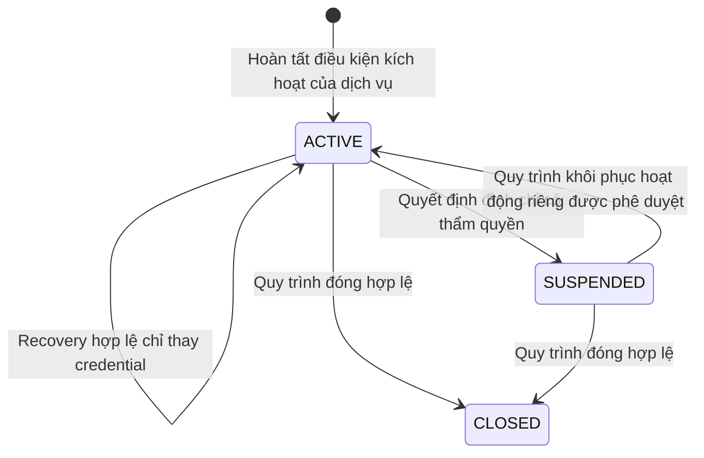

# Trạng thái tài khoản đang hoạt động trong mô hình khôi phục tài khoản

Trong chương **Account State Model**, trạng thái **ACTIVE**, hay **đang hoạt động**, mô tả vị trí của tài khoản trong vòng đời mà dịch vụ quản lý. Đây là trạng thái nền để xét đăng nhập, sử dụng chức năng và khôi phục quyền truy cập. Tuy nhiên, một tài khoản đang hoạt động không đồng nghĩa mọi người đang yêu cầu truy cập đều hợp lệ, mọi credential đều còn dùng được hoặc mọi session đều đáng tin.

Khi người dùng quên mật khẩu, mất MFA, passkey hoặc thiết bị xác thực, tài khoản có thể vẫn ở `ACTIVE`. Điều đã thay đổi là khả năng chứng minh quyền truy cập của người dùng, hoặc mức rủi ro mà hệ thống cần xử lý. Hiểu đúng sự khác biệt này giúp thiết kế recovery mà không vô tình gỡ MFA, cấp session quá rộng hoặc kích hoạt lại tài khoản đã bị đình chỉ.

Bài học này xây dựng ý nghĩa của `ACTIVE`, các điều kiện đi kèm, những bất biến cần giữ và cách xử lý một yêu cầu khôi phục trong khi tài khoản vẫn đang hoạt động.

## 1. Định nghĩa ACTIVE bằng một hợp đồng rõ ràng

Một định nghĩa hữu ích cho mô hình minh họa trong bài là:

> `ACTIVE` nghĩa là tài khoản chưa bị chặn bởi trạng thái vòng đời đối với các hoạt động mà chính sách cho phép. Mỗi thao tác vẫn phải vượt qua các kiểm tra xác thực, cấp quyền, rủi ro và điều kiện nghiệp vụ liên quan.

Định nghĩa này cần được cụ thể hóa theo sản phẩm. Ví dụ, có dịch vụ chỉ kích hoạt tài khoản sau bước xác minh kênh bắt buộc; dịch vụ khác cho phép tài khoản hoạt động với một tập chức năng hạn chế trong khi chờ hoàn tất hồ sơ. Không tồn tại một bộ điều kiện `ACTIVE` duy nhất áp dụng cho mọi ứng dụng.

Điều quan trọng là `ACTIVE` không được dùng như một bằng chứng thay cho các điều kiện còn lại.

| Khi thấy `ACTIVE`, có thể kết luận | Chưa thể kết luận |
| --- | --- |
| Tài khoản đáp ứng định nghĩa vòng đời đang hoạt động của dịch vụ tại thời điểm đọc trạng thái | Người đang gửi request là chủ tài khoản. |
| Các thao tác đủ điều kiện có thể tiếp tục được xét theo chính sách | Một token hoặc session bất kỳ có quyền dùng tài khoản. |
| Nhánh recovery dành cho tài khoản đang hoạt động có thể được đánh giá | Recovery đã được cấp quyền hoặc đã hoàn tất. |
| Tài khoản chưa ở trạng thái đình chỉ hoặc đóng trong mô hình minh họa | Không có rủi ro chiếm đoạt, không có credential bị lộ, không có hạn chế bổ sung. |

Vì vậy, điều kiện `account.status == ACTIVE` thường là một điều kiện cần của một số hành động, không phải điều kiện đủ để cho phép hành động đó.

## 2. Phân biệt các chiều trạng thái

Một trường `status` duy nhất khó diễn đạt đầy đủ mọi tình huống bảo mật. Cần phân biệt ít nhất các chiều sau về mặt khái niệm, dù cách lưu trữ thực tế có thể khác.

| Chiều trạng thái | Câu hỏi được trả lời | Ví dụ giá trị hoặc dữ liệu |
| --- | --- | --- |
| Vòng đời tài khoản | Tài khoản còn được phép hoạt động theo quan hệ với dịch vụ không? | `ACTIVE`, `SUSPENDED`, `CLOSED`. |
| Credential và yếu tố xác thực | Phương thức nào đã đăng ký, còn hiệu lực hoặc đã bị thu hồi? | Mật khẩu hiện hành, TOTP đã đăng ký, passkey đã thu hồi. |
| Chính sách xác thực | Mức bằng chứng nào bắt buộc cho từng hành động? | Đăng nhập cần MFA; thay kênh recovery cần xác thực lại. |
| Session và ngữ cảnh xác thực | Request hiện tại có quyền gì và đã đáp ứng mức xác thực nào? | Chưa đăng nhập, session đủ yếu tố, session bị hạn chế, session đã thu hồi. |
| Yêu cầu recovery | Một lần khôi phục cụ thể đã đi tới bước nào? | Đang chờ bằng chứng, đã cấp grant, đã hoàn tất, hết hạn. |
| Rủi ro và hạn chế bổ sung | Có dấu hiệu hoặc chính sách nào làm thay đổi cách xét quyền không? | Nghi thiết bị bị mất, chặn thay email tạm thời, yêu cầu kiểm tra bổ sung. |
| Điều kiện nghiệp vụ | Người dùng được sử dụng tính năng nào theo vai trò hoặc quan hệ sản phẩm? | Quyền quản trị, quyền giao dịch, phạm vi tổ chức. |

Các giá trị trong bảng là tên minh họa. Dịch vụ cần công bố ý nghĩa và quy tắc phối hợp của mô hình mà mình sử dụng.

### 2.1. Tài khoản ACTIVE nhưng người dùng chưa xác thực

Một người nhập email của tài khoản đang hoạt động vào màn hình đăng nhập. Máy chủ tìm thấy tài khoản `ACTIVE`, nhưng chưa có bằng chứng hợp lệ rằng request đến từ người được phép truy cập.

Ngay cả khi mật khẩu đúng, session vẫn có thể chưa đủ điều kiện nếu chính sách yêu cầu MFA. Không được biến kết quả tìm thấy tài khoản hoạt động thành session đầy đủ.

### 2.2. Tài khoản ACTIVE nhưng credential không còn dùng được

Một tài khoản có thể có nhiều phương thức xác thực. Một passkey đã bị thu hồi không làm mọi credential khác bị thu hồi theo, trừ khi chính sách có quy định tương ứng. Tương tự, mật khẩu đã được thay không khiến tài khoản phải đổi sang một trạng thái vòng đời khác.

Việc người dùng không nhớ mật khẩu cũng không có nghĩa bản ghi mật khẩu tự mất hiệu lực. Nếu mật khẩu cũ còn hợp lệ, một người khác biết mật khẩu đó vẫn có thể tìm cách sử dụng nó theo các điều kiện đăng nhập hiện hành.

### 2.3. Tài khoản ACTIVE nhưng session bị hạn chế

Sau khi xác minh một bằng chứng recovery, hệ thống có thể tạo một quyền hoặc session chỉ dùng để đặt mật khẩu mới. Tài khoản vẫn `ACTIVE`, nhưng ngữ cảnh đó không có quyền xem dữ liệu riêng tư, thay email hay gỡ MFA nếu chưa được cấp quyền tương ứng.

Quyền của session phải được kiểm tra riêng ở từng điểm truy cập. Không dựa vào trạng thái tài khoản hoặc việc giao diện đã mở trang recovery để suy ra đầy đủ quyền đăng nhập.

### 2.4. Tài khoản ACTIVE nhưng có yêu cầu recovery đang chờ

Yêu cầu recovery là một đối tượng có vòng đời riêng. Nó có thể hết hạn, bị hủy hoặc bị từ chối trong khi tài khoản vẫn hoạt động bình thường.

Nếu mọi lần có người bấm “quên mật khẩu” đều đổi trạng thái toàn tài khoản thành một trạng thái cấm đăng nhập, người lạ chỉ cần biết email là có thể gây gián đoạn. Việc tạo yêu cầu chưa đủ để thực hiện thay đổi bảo mật có tác động lên tài khoản.

## 3. Một ảnh chụp trạng thái minh họa

Ví dụ sau là dữ liệu khái niệm phía máy chủ, không phải cấu trúc bắt buộc và không phải dữ liệu do trình duyệt được phép tự khai:

```json
{
  "accountId": "acct_A",
  "lifecycleState": "ACTIVE",
  "securityVersion": 42,
  "sessionEpoch": 7,
  "authenticationPolicy": {
    "mfaRequiredForLogin": true
  },
  "credentials": [
    { "id": "pwd_9", "type": "PASSWORD", "state": "ENABLED" },
    { "id": "totp_3", "type": "TOTP", "state": "ENABLED" },
    { "id": "pk_2", "type": "PASSKEY", "state": "REVOKED" }
  ],
  "recoveryRestriction": "NONE",
  "pendingRecoveryRequestIds": ["req_18"]
}
```

Cách đọc ảnh chụp này:

- Tài khoản đang hoạt động theo chiều vòng đời.
- Chính sách vẫn yêu cầu MFA cho đăng nhập; yêu cầu recovery đang chờ không tự xóa yêu cầu ấy.
- Passkey `pk_2` đã bị thu hồi, dù tài khoản vẫn `ACTIVE`.
- Một yêu cầu `req_18` tồn tại nhưng chưa đủ thông tin để kết luận đã xác minh hay đã cấp quyền.
- Không có trường nào trong ảnh chụp chứng minh request hiện tại thuộc về chủ tài khoản.

`securityVersion` và `sessionEpoch` có mục đích khác nhau trong mô hình này. Phiên bản bảo mật hỗ trợ phát hiện bằng chứng hoặc grant dựa trên trạng thái đã cũ. Epoch của session có thể được dùng để vô hiệu hóa cả một thế hệ session khi chính sách yêu cầu thu hồi toàn bộ. Nếu chỉ thu hồi một số session, cần một mô hình thu hồi phù hợp hơn thay vì tăng epoch toàn tài khoản một cách máy móc.

Các số phiên bản chỉ hữu ích nếu những thành phần liên quan cập nhật và kiểm tra chúng nhất quán. Thêm một trường vào cơ sở dữ liệu chưa tự tạo ra bảo đảm thu hồi hay chống dùng lại.

## 4. Những điều kiện đi kèm trước khi cho phép hành động

Một quyết định truy cập có thể được xem là sự kết hợp của nhiều nhóm điều kiện:

```text
Cho phép hành động khi:
    vòng đời tài khoản cho phép hành động đó
    VÀ bằng chứng hoặc session hợp lệ cho tài khoản đích
    VÀ mức xác thực đáp ứng chính sách hiện hành
    VÀ quyền được cấp bao phủ đúng hành động
    VÀ hạn chế bảo mật hiện hành không ngăn hành động
    VÀ điều kiện nghiệp vụ liên quan được đáp ứng
```

Đây là cách diễn đạt logic, không phải yêu cầu mọi API phải có cùng thứ tự truy vấn dữ liệu. Cần phân biệt kết quả quyết định nội bộ với phản hồi công khai để không vô tình làm lộ tài khoản có tồn tại hoặc đang ở trạng thái nào.

| Hành động | Vai trò của ACTIVE | Điều kiện còn phải kiểm tra |
| --- | --- | --- |
| Bắt đầu đăng nhập | Cho phép tiếp tục xét trong nhánh thông thường của mô hình | Credential, yếu tố bổ sung, giới hạn thử và chính sách rủi ro. |
| Đọc dữ liệu riêng tư | Chỉ xác nhận điều kiện vòng đời | Session, tài khoản đích, quyền đọc, hạn chế hiện hành. |
| Khởi tạo recovery | Cho phép đánh giá nhánh recovery phù hợp | Chống spam, phản hồi công khai, kênh đủ điều kiện; chưa thay credential. |
| Đặt mật khẩu mới qua recovery | Không cho phép bỏ qua cấp quyền | Grant đúng tài khoản và hành động, còn hạn, chưa dùng, trạng thái nền còn phù hợp. |
| Thay hoặc gỡ MFA | Không chứng minh claimant đủ quyền | Bằng chứng phù hợp mức tác động, chính sách thay yếu tố và xử lý credential cũ. |
| Đăng ký passkey mới | Không tự cho phép thêm phương thức đăng nhập | Quyền đăng ký, kiểm tra giao thức và liên kết credential với đúng tài khoản. |
| Đổi kênh recovery | Không chứng minh địa chỉ mới đáng tin | Quyền thay đổi, xác minh kênh mới, xử lý kênh cũ và tín hiệu rủi ro. |

### 4.1. Không dùng ACTIVE để bỏ qua MFA

Giả sử claimant nhận được token đặt lại mật khẩu qua email. Nếu chính sách chỉ chấp nhận token ấy cho việc đổi mật khẩu, tài khoản `ACTIVE` không làm token có thêm quyền gỡ TOTP hoặc cấp session đã đáp ứng MFA.

Mất mật khẩu và mất MFA là những tình huống khác nhau. Chọn nhầm phạm vi quyền ở đây có thể biến recovery thành một cách né yêu cầu xác thực mà tài khoản đang sử dụng.

### 4.2. Không dùng ACTIVE để khẳng định không có xâm nhập

Kẻ tấn công có thể đang giữ một session hợp lệ của tài khoản `ACTIVE`. Khi có bằng chứng về sự cố, hệ thống cần xử lý session, credential và quyền liên quan theo chính sách, thay vì coi trạng thái vòng đời là tín hiệu rằng mọi thứ đều an toàn.

Một tài khoản chưa bị phát hiện xâm nhập vẫn có thể đang bị tấn công. Ngược lại, một tín hiệu rủi ro chưa được xác minh cũng không nên tự động trao cho người ngoài khả năng đình chỉ tài khoản.

## 5. Bất biến của nhánh recovery cho tài khoản ACTIVE

Các bất biến sau giúp định nghĩa nhánh này rõ hơn:

| Bất biến | Ý nghĩa thực tế |
| --- | --- |
| Khởi tạo recovery không chứng minh quyền sở hữu | Không đổi mật khẩu, gỡ yếu tố hoặc thu hồi session chỉ vì đã nhận yêu cầu công khai. |
| ACTIVE không phải bằng chứng xác thực | Mọi quyền thay đổi vẫn phải dựa trên bằng chứng và chính sách thích hợp. |
| Đích và hành động được ràng buộc phía máy chủ | Grant của A không được sửa B; grant reset mật khẩu không được thay email. |
| Chính sách MFA tồn tại độc lập với yêu cầu recovery | Không tự xóa yếu tố hoặc yêu cầu bổ sung khi chuyển qua màn hình khôi phục. |
| Quyền dùng một lần chỉ tạo tối đa một thay đổi thành công | Kiểm tra và cập nhật cần nhất quán trước cạnh tranh, không chỉ ẩn nút trên giao diện. |
| Hoàn tất recovery không mặc nhiên sửa trạng thái vòng đời | Một nhánh chỉ đổi credential phải giữ nguyên quyết định vòng đời hiện hành. |
| Điều kiện bảo mật có thể thay đổi phải được xét lại lúc commit | Không hoàn tất bằng một ảnh chụp ACTIVE đã lỗi thời. |
| Session cũ được xử lý bằng chính sách cụ thể | Chỉ cam kết loại quyền và độ trễ thu hồi mà kiến trúc thực thi được. |

Bất biến không nhất thiết là một cột dữ liệu. Nó là thuộc tính mà mọi đường có thể thực hiện cùng hành động phải giữ, bao gồm giao diện người dùng, API nội bộ, tác vụ nền và quy trình hỗ trợ.

## 6. Sự kiện nào giữ nguyên ACTIVE, sự kiện nào cần quyết định vòng đời?

Người thiết kế nên mô tả sự kiện và hiệu ứng thay vì gộp mọi vấn đề truy cập thành một trạng thái tài khoản mới.

| Sự kiện | Chiều trạng thái thường bị tác động | Cách hiểu trong mô hình minh họa |
| --- | --- | --- |
| Người dùng quên mật khẩu | Khả năng cung cấp bằng chứng của người dùng; yêu cầu recovery | Tài khoản có thể giữ `ACTIVE`; mật khẩu cũ không tự bị vô hiệu hóa. |
| Người lạ gửi yêu cầu reset | Bộ đếm và vòng đời của yêu cầu | Chưa đủ căn cứ đổi trạng thái tài khoản hoặc credential. |
| Token recovery hết hạn | Grant hoặc yêu cầu recovery | Không làm tài khoản tự hết hiệu lực. |
| Đặt mật khẩu mới được cấp quyền và commit | Credential, phiên bản bảo mật, session theo chính sách | Có thể giữ `ACTIVE`; phải xét hiệu lực của quyền cũ. |
| Mất một thiết bị có passkey | Credential, session thiết bị và đánh giá rủi ro | Không đồng nghĩa mọi passkey hoặc mọi phương thức đều mất hiệu lực. |
| Có bằng chứng về xâm nhập | Hạn chế bảo mật, credential, session; có thể cả vòng đời | Phạm vi ứng phó phải do chính sách và thẩm quyền thích hợp quyết định. |
| Đình chỉ bởi quyết định quản trị hợp lệ | Vòng đời tài khoản | Chuyển sang trạng thái như `SUSPENDED`; recovery thông thường không được đảo ngược. |
| Đóng tài khoản | Vòng đời và chính sách lưu dữ liệu | Không coi một token reset còn hạn là quyền mở lại tài khoản. |

Ví dụ vòng đời tối giản:



Sơ đồ cố ý không dùng token recovery làm điều kiện chuyển từ `SUSPENDED` sang `ACTIVE`. Khôi phục một credential và khôi phục quyền hoạt động của tài khoản là hai quyết định khác nhau.

Một dịch vụ có thể cho phép một số bước xác minh hoặc thay credential ngay cả khi tài khoản bị đình chỉ. Nếu chọn như vậy, cần định nghĩa một nhánh riêng với quyền hạn rõ ràng; việc đó vẫn không mặc nhiên gỡ đình chỉ hoặc cấp quyền sử dụng dịch vụ thông thường.

### 6.1. Tách trạng thái yêu cầu khỏi trạng thái tài khoản

Một ví dụ diễn tiến:

```text
Tài khoản:          ACTIVE ------------------------------------ ACTIVE
Yêu cầu recovery:  REQUESTED -> EVIDENCE_VERIFIED -> GRANTED -> COMPLETED
Credential:        mật khẩu cũ ------------------------------ mật khẩu mới
Session:           áp dụng quyết định giữ hoặc thu hồi theo chính sách
```

Nếu yêu cầu thất bại, diễn tiến có thể là:

```text
Tài khoản:          ACTIVE ------------------------- ACTIVE
Yêu cầu recovery:  REQUESTED -> EXPIRED
Credential:        không thay đổi bởi yêu cầu này
Session:           không thay đổi chỉ vì yêu cầu hết hạn
```

Các bước trong hai dòng thời gian là minh họa trách nhiệm, không bắt buộc có đúng từng giá trị trạng thái như vậy trong cơ sở dữ liệu. Điểm cần giữ là thất bại của một yêu cầu không tự quyết định toàn bộ vòng đời tài khoản.

## 7. Hạn chế bảo mật khi tài khoản vẫn ACTIVE

Một tài khoản có thể cần hạn chế một số hành động trong khi vẫn được xem là đang hoạt động. Ví dụ, sau một nhánh recovery rủi ro cao đã được xác minh, hệ thống cho đổi mật khẩu nhưng tạm yêu cầu kiểm tra bổ sung trước khi thay kênh liên lạc hoặc thực hiện thao tác có tác động lớn.

Có thể biểu diễn điều này bằng một chế độ như `RECOVERY_RESTRICTED` ở chiều bảo mật. Cần công bố rõ:

- Hành động nào bị chặn, hành động nào cần xác thực thêm và hành động nào còn được phép.
- Điều kiện vào chế độ, ai có quyền thiết lập và bằng chứng nào làm căn cứ.
- Điều kiện thoát, thời hạn nếu có và hành vi khi kiểm tra bổ sung thất bại.
- Quan hệ với trạng thái đình chỉ, quyền quản trị và các giới hạn nghiệp vụ khác.
- Session nào nhận hạn chế và việc thực thi xảy ra ở đâu.

Không chỉ thêm một cờ `restricted=true` rồi để từng API tự hiểu. Một API quên kiểm tra cờ có thể trở thành đường bỏ qua hạn chế.

### 7.1. Hạn chế không được bị ACTIVE ghi đè

Một quy tắc như sau là không đủ:

```text
if account.lifecycleState == ACTIVE:
    allowChangeRecoveryEmail()
```

Nó bỏ qua quyền của request, độ mới của xác thực, hạn chế sau recovery và việc xác minh địa chỉ mới.

Trong mô hình có nhiều chiều trạng thái, cần có quy tắc phối hợp rõ ràng. Một hạn chế đang có hiệu lực không được biến mất chỉ vì một nhánh xử lý nhìn thấy `ACTIVE`. Tương tự, một grant recovery không được dùng để vượt quyết định đình chỉ nếu nhánh ấy không có thẩm quyền xử lý đình chỉ.

### 7.2. Phân biệt hạn mức, khóa thử và đình chỉ

Giới hạn gửi email recovery, giới hạn thử một mã hoặc tạm làm chậm nguồn gửi là các kiểm soát chống lạm dụng. Chúng không nhất thiết là trạng thái vòng đời của tài khoản.

Nếu sản phẩm dùng từ “khóa”, cần giải thích cụ thể đang khóa điều gì: thử mật khẩu, một token, một session, thao tác nhạy cảm hay toàn bộ tài khoản. Sự mơ hồ có thể làm recovery vô tình mở khóa một giới hạn không thuộc phạm vi của nó, hoặc cho người lạ khả năng gây khóa toàn tài khoản bằng cách thử sai liên tục.

## 8. Hoàn tất recovery trong khi giữ đúng trạng thái vòng đời

Giả sử nhánh minh họa chỉ cho phép đặt lại mật khẩu khi tài khoản vẫn `ACTIVE`. Grant đã được cấp cho đúng tài khoản và hành động qua một quy trình kiểm tra bằng chứng trước đó.

Mã giả dưới đây tập trung vào ranh giới cập nhật trạng thái, chưa phải mã sản phẩm hoàn chỉnh:

```text
completePasswordRecovery(grantHandle, proposedPassword):
    validatePasswordPolicy(proposedPassword)
    newPasswordHash = hashWithApprovedPasswordHasher(proposedPassword)
    grantReference = resolveProtectedGrantReference(grantHandle)

    begin transaction
        account = lockAccount(grantReference.accountId)
        grant = lockRecoveryGrant(grantReference.grantId)

        require grant.accountId == account.id
        require account.lifecycleState == ACTIVE
        require grant.action == RESET_PASSWORD
        require grant.usedAt is null and grant.revokedAt is null
        require grant.expiresAt > trustedCurrentTime()
        require grant.expectedSecurityVersion == account.securityVersion
        require currentPolicyAllowsRecoveryCommit(account, grant)

        account.passwordHash = newPasswordHash
        account.securityVersion = account.securityVersion + 1
        grant.usedAt = trustedCurrentTime()

        invalidateRelatedGrantsAccordingToPolicy(account)
        applyTransactionalSessionPolicy(account, grant)
        markRecoveryRequestCompleted(grant.requestId)
        appendSecurityEventWithoutSecrets(account, grant)
        enqueueExternalEffectsThroughTransactionalOutbox(account)
    commit transaction

    return passwordChangedWithoutImplicitFullLogin
```

Những điểm cần đọc từ ví dụ:

1. Tài khoản đích được ràng buộc bởi grant và trạng thái phía máy chủ, không lấy tùy ý từ tham số của claimant ở bước cuối.
2. `ACTIVE` được kiểm tra trong lần quyết định commit, không chỉ ở bước gửi email trước đó.
3. Điều kiện trạng thái và cập nhật phải có cơ chế nhất quán trước cạnh tranh. Các đường cập nhật vòng đời hoặc trạng thái bảo mật liên quan cũng phải phối hợp qua cùng cơ chế khóa, phiên bản hoặc cập nhật có điều kiện phù hợp.
4. Không có lệnh `account.lifecycleState = ACTIVE`. Nhánh này không có nhiệm vụ kích hoạt lại tài khoản.
5. Không xóa chính sách MFA, yếu tố đã đăng ký hoặc hạn chế khác trừ khi một hành động riêng đã được cấp quyền rõ ràng.
6. Mã giả bắt đầu từ grant đã được cấp. Thiết kế trước đó vẫn phải bảo đảm bằng chứng dùng một lần không bị tái sử dụng để sinh nhiều quyền ngoài chính sách.
7. Các hiệu ứng ngoài giao dịch, như gửi thông báo hoặc thu hồi quyền ở dịch vụ khác, cần cơ chế chuyển giao đáng tin cậy và theo dõi hoàn tất.

`resolveProtectedGrantReference` chỉ giúp tìm quyền theo cơ chế đã được bảo vệ của hệ thống. Việc tìm thấy một ID chưa đủ: grant vẫn phải được xác thực và kiểm tra đầy đủ trong bước quyết định. Không đưa raw token, mật khẩu mới hoặc mã dự phòng vào nhật ký để hỗ trợ tra cứu.

### 8.1. Khi trạng thái thay đổi giữa lúc phát hành và sử dụng token

Xét trình tự:

```text
T0: Tài khoản A là ACTIVE; hệ thống cấp một quyền reset có hạn.
T1: Một quyết định hợp lệ đình chỉ A.
T2: Claimant dùng quyền reset còn hạn.
```

Nếu bước T2 chỉ kiểm tra chữ ký hoặc thời hạn token, nó có thể dựa trên một trạng thái đã không còn đúng. Trong nhánh minh họa, lần hoàn tất phải bị từ chối vì tài khoản hiện không đáp ứng điều kiện `ACTIVE`.

Không được sửa bằng cách đặt lại `ACTIVE` ở cuối hàm recovery. Quyết định đình chỉ ở T1 thuộc một ranh giới thẩm quyền khác. Nếu sau đó tài khoản được cho hoạt động lại, các grant cũ có được giữ hay không vẫn phải theo quy tắc vô hiệu hóa đã thiết kế; đừng mặc nhiên cho rằng mọi quyền cũ lại có hiệu lực.

### 8.2. Khi máy chủ đã commit nhưng người dùng không nhận được phản hồi

Trạng thái yêu cầu và bằng chứng hoàn tất cần giúp hệ thống phân biệt “chưa thực hiện” với “đã thực hiện nhưng phản hồi bị mất”. Thử lại không được tạo một lần đổi mật khẩu khác từ quyền đã dùng.

Có thể hỗ trợ một kết quả hoàn tất gắn với thao tác theo cơ chế thích hợp hoặc hướng người dùng quay lại đăng nhập. Dù chọn cách nào, chỉ hiển thị chi tiết trong phạm vi đã được cấp quyền. Không lưu raw password hay raw token làm dữ liệu chống lặp.

## 9. Session, token và ý nghĩa của ACTIVE sau recovery

Một tài khoản có thể giữ `ACTIVE` trong cả trước và sau recovery nhưng tập quyền truy cập đã thay đổi đáng kể.

Ví dụ, với một lần xử lý nghi bị chiếm đoạt, chính sách có thể yêu cầu:

- Thu hồi session và refresh token cũ thuộc phạm vi đã xác định.
- Hủy các grant recovery còn chờ có cùng trạng thái nền không còn phù hợp.
- Thu hồi credential bị mất hoặc bị lộ khi đã đủ căn cứ và có quyền thực hiện.
- Chỉ cấp ngữ cảnh bị hạn chế cho bước tiếp theo nếu bằng chứng chưa đủ để đăng nhập bình thường.
- Thông báo qua kênh đủ điều kiện và ghi sự kiện phục vụ điều tra.

Không phải mọi lần quên mật khẩu đều phải có cùng chính sách. Cần nối quyết định với dấu hiệu sự cố, loại bằng chứng và tác động của quyền được cấp lại.

### 9.1. Trạng thái tài khoản không thay thế cơ chế thu hồi

Nếu access token được xác minh độc lập và không kiểm tra trạng thái thu hồi, việc đổi mật khẩu hoặc tăng một phiên bản trong cơ sở dữ liệu không tự chặn token ấy tại API. Thu hồi refresh token ngăn cấp mới theo cơ chế tương ứng, nhưng access token đã phát hành có thể còn dùng được tới khi hết hạn nếu không có kiểm tra bổ sung.

Muốn dùng `sessionEpoch` hoặc một cơ chế phiên bản để chặn session cũ, điểm thực thi quyền phải kiểm tra nó bằng nguồn trạng thái đáng tin cậy, với chính sách cache và độ trễ rõ ràng. Điều tương tự áp dụng nếu dịch vụ cần chặn request khi tài khoản không còn `ACTIVE`.

Một lời cam kết có thể đánh giá là: “các loại session X và Y bị thu hồi khi hoàn tất; API áp dụng hiệu lực thu hồi trong khoảng trễ tối đa Z theo cơ chế đã thiết kế”. Câu “tài khoản ACTIVE với mật khẩu mới nên an toàn” không mô tả được quyền cũ nào đã bị chặn.

### 9.2. Không tự nâng ngữ cảnh recovery thành đăng nhập đầy đủ

Nếu chỉ chứng minh quyền tiếp cận token email đủ cho việc reset mật khẩu, một session recovery không nên tự được gắn nhãn đã hoàn tất MFA. Sau khi đổi mật khẩu, luồng có thể yêu cầu đăng nhập và đáp ứng yếu tố còn hiệu lực, hoặc tiếp tục một nhánh recovery khác đã được cấp quyền thích hợp.

Quyền truy cập sau khôi phục phải phản ánh bằng chứng thực tế và chính sách, không phản ánh việc tài khoản có cùng một giá trị `ACTIVE` trước và sau thay đổi.

## 10. Ba tình huống thực tế

### 10.1. Quên mật khẩu nhưng vẫn còn MFA

Mai không nhớ mật khẩu, còn truy cập hộp thư đã xác minh và còn ứng dụng TOTP.

- Tài khoản có thể giữ `ACTIVE`; một yêu cầu reset được tạo riêng.
- Token email được kiểm tra và chỉ cấp quyền đặt mật khẩu mới theo chính sách.
- Khi commit, hệ thống kiểm tra lại trạng thái vòng đời và quyền sử dụng grant.
- Yêu cầu MFA không bị gỡ. Bước đăng nhập tiếp theo vẫn đáp ứng chính sách hiện hành.
- Session cũ được xử lý theo chính sách đã chọn cho tình huống này.

Ở đây, trạng thái vòng đời không cần chuyển qua lại chỉ để thể hiện người dùng đã quên rồi nhớ lại một credential.

### 10.2. Mất điện thoại có MFA và session email

Nam báo mất điện thoại chứa TOTP, session email và một passkey. Tài khoản hiện vẫn `ACTIVE`.

Yêu cầu công khai của Nam chưa đủ để tự động thu hồi tất cả quyền. Nhưng nếu bằng chứng và đánh giá sự cố xác nhận rủi ro thiết bị, hệ thống cần xét từng credential và session thuộc phạm vi ảnh hưởng.

Email và TOTP cùng có thể truy cập từ điện thoại bị mất không nên được đếm máy móc là hai nguồn tin cậy độc lập trước mối đe dọa kiểm soát thiết bị. Một bằng chứng dự phòng còn được bảo vệ ở nơi khác có thể hỗ trợ nhánh riêng, tùy chính sách.

`ACTIVE` không trả lời Nam còn kiểm soát bằng chứng nào, kẻ nhặt được thiết bị có thể làm gì hoặc có đủ quyền gỡ MFA chưa. Những câu hỏi đó thuộc bằng chứng, rủi ro và cấp quyền. Dịch vụ cũng cần hiểu khả năng nhận diện và thu hồi credential passkey của mình, thay vì mặc nhiên cho rằng một passkey tương ứng duy nhất với một thiết bị vật lý.

### 10.3. Token hợp lệ nhưng tài khoản đã bị đình chỉ

Lan nhận liên kết reset trong lúc tài khoản `ACTIVE`. Trước khi dùng liên kết, tài khoản bị đình chỉ bởi một quyết định quản trị hợp lệ.

Trong nhánh chỉ cho tài khoản đang hoạt động, token chưa hết hạn không đủ để hoàn tất. Hệ thống phải dùng trạng thái hiện tại và không cấp session bình thường. Việc cho hoạt động lại, nếu có, thuộc một quy trình riêng.

Phản hồi cho claimant cần theo chính sách hiển thị của dịch vụ. Lý do chi tiết có thể được ghi nhận nội bộ mà không nhất thiết công khai trạng thái tài khoản cho mọi người nhập email.

## 11. Các lỗi mô hình thường gặp

| Lỗi | Vì sao sai | Hướng sửa |
| --- | --- | --- |
| `ACTIVE` được dùng đồng nghĩa với “đã đăng nhập” | Trạng thái của tài khoản và ngữ cảnh request là hai đối tượng khác nhau | Kiểm tra session, bằng chứng và quyền riêng. |
| Đặt tài khoản không hoạt động ngay khi có yêu cầu reset | Người lạ có thể tạo yêu cầu mà chưa có bằng chứng | Theo dõi yêu cầu recovery riêng và giới hạn tác động trước xác minh. |
| Hoàn tất reset luôn gán `status = ACTIVE` | Có thể đảo ngược đình chỉ hoặc đóng tài khoản ngoài thẩm quyền | Giữ nguyên trạng thái vòng đời trong nhánh chỉ thay credential; kiểm tra điều kiện commit. |
| Tài khoản ACTIVE nên mọi credential đều hợp lệ | Credential có trạng thái và phạm vi riêng | Kiểm tra credential cụ thể và chính sách hiện hành. |
| Token đã kiểm tra một lần nên không cần xem lại trạng thái | Grant có thể hết hạn, bị thu hồi hoặc dựa trên trạng thái cũ | Kiểm tra và cập nhật nhất quán tại thời điểm thực thi. |
| Session recovery được dùng như session đầy đủ | Bằng chứng có thể chỉ đủ cho một thay đổi hẹp | Ràng buộc quyền và kiểm tra tại từng API. |
| Tăng phiên bản nhưng các API không đọc phiên bản | Dữ liệu nguồn chưa được nối tới nơi thực thi quyền | Thiết kế cơ chế kiểm tra và giới hạn trễ cụ thể. |
| Hỗ trợ được tự kích hoạt lại khi đã reset được mật khẩu | Quyền thay credential bị mở rộng thành quyền thay vòng đời | Tách chính sách và thẩm quyền; ghi nhận quyết định tương ứng. |

## 12. Tiêu chí kiểm tra mô hình

Các tình huống sau là đầu vào cho quá trình xác minh triển khai; chúng không khẳng định một hệ thống cụ thể đã đạt yêu cầu.

| Tình huống | Thuộc tính cần quan sát |
| --- | --- |
| Người không đăng nhập gửi yêu cầu reset cho tài khoản ACTIVE | Không tự đổi credential, gỡ MFA hoặc tạo session đầy đủ. |
| Một yêu cầu recovery hết hạn | Tài khoản và các quyền khác không bị đổi chỉ vì yêu cầu này hết hạn. |
| Dùng grant của A với account ID của B | Không thay đổi B; đích do trạng thái đáng tin ràng buộc. |
| Dùng grant reset mật khẩu để gọi thao tác thay MFA | Bị từ chối do sai phạm vi quyền. |
| Hai request hoàn tất cùng grant | Tối đa một thay đổi bảo mật được commit. |
| Đình chỉ tài khoản sau khi phát hành grant nhưng trước commit | Nhánh chỉ cho ACTIVE không hoàn tất và không đảo ngược đình chỉ. |
| Một credential bị thu hồi khi tài khoản vẫn ACTIVE | Credential đó không được chấp nhận chỉ vì tài khoản còn hoạt động. |
| Một session bị hạn chế trong tài khoản ACTIVE | Không dùng được các quyền nằm ngoài phạm vi session. |
| Recovery đã commit nhưng dịch vụ thông báo tạm lỗi | Sự kiện cần thiết được chuyển giao lại, không làm mất dấu thay đổi. |
| Chính sách yêu cầu thu hồi session cũ | Điểm kiểm tra truy cập thực thi đúng phạm vi và giới hạn trễ đã công bố. |
| Quy trình hỗ trợ thực hiện cùng hành động | Không bỏ qua ràng buộc vòng đời, bằng chứng và thẩm quyền. |

Nhật ký cần đủ để biết tài khoản nào, yêu cầu nào, hành động nào và chính sách nào dẫn tới quyết định. Trạng thái trước và sau, phiên bản liên quan cùng kết quả áp dụng session giúp điều tra cạnh tranh hoặc thay đổi bất thường. Không ghi mật khẩu, raw token, OTP hoặc mã dự phòng.

## 13. Bài tập áp dụng

Một tài khoản có `lifecycleState = ACTIVE`, bắt buộc MFA và có một session đăng nhập cũ. Người dùng đã nhận token reset mật khẩu. Trong lúc chờ hoàn tất, hệ thống nhận hai sự kiện: một báo cáo mất điện thoại chưa được xác minh và một quyết định đình chỉ hợp lệ từ bộ phận có thẩm quyền.

Hãy mô tả:

1. Sự kiện nào chỉ nên được ghi vào yêu cầu hoặc đánh giá rủi ro, sự kiện nào thực sự thay đổi vòng đời?
2. Một request đã đọc `ACTIVE` trước đó có được commit reset mà không kiểm tra lại không?
3. Tại sao token reset không tự có quyền gỡ MFA hoặc gỡ đình chỉ?
4. Session cũ cần được xử lý ở thành phần nào, theo quyết định nào?
5. Sau một quy trình cho hoạt động lại, grant cũ có còn dùng được không và quy tắc nào quyết định điều đó?

Một hướng trả lời phù hợp là giữ riêng lời báo mất chưa xác minh với quyết định đình chỉ đã có thẩm quyền; đọc trạng thái đáng tin khi thực thi; không cho reset tự gán lại `ACTIVE`; và xét hiệu lực grant cùng session bằng chính sách vô hiệu hóa cụ thể. Nếu mọi sự kiện đều chỉ ghi đè một trường `status`, hệ thống sẽ khó giữ được các ranh giới này.

Khi thiết kế nhánh recovery cho tài khoản đang hoạt động, hãy luôn chỉ ra ba thứ: ý nghĩa vòng đời của `ACTIVE`, bằng chứng và quyền cần cho hành động, cùng trạng thái phải được kiểm tra lại khi thay đổi được commit. Nhờ đó, việc lấy lại quyền truy cập có thể diễn ra mà không biến một trạng thái nền thành giấy phép vượt mọi kiểm soát bảo mật.
