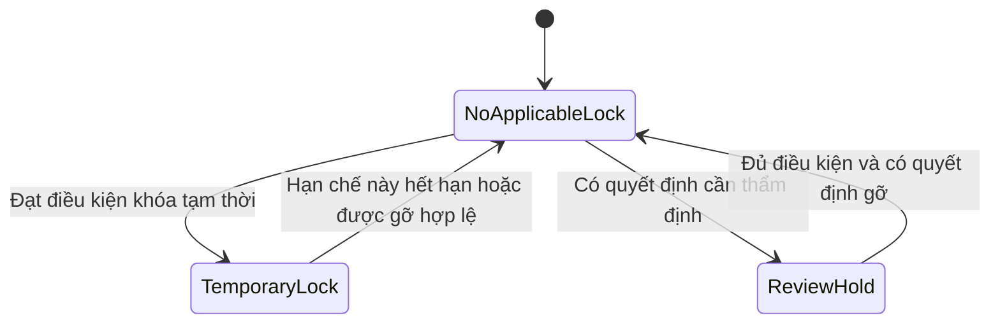

# Trạng thái tài khoản bị khóa

## 1. “Bị khóa” cần có ý nghĩa cụ thể

**Trạng thái bị khóa — locked account state — thể hiện việc hệ thống đang chặn một hoặc nhiều khả năng truy cập của tài khoản theo một quyết định có lý do, phạm vi và điều kiện kết thúc rõ ràng.** Khóa có thể nhằm làm chậm việc đoán bí mật, ngăn tiếp tục sử dụng một đường xác thực đáng ngờ hoặc giữ tài khoản trong trạng thái hạn chế để thẩm định.

Từ “khóa” đứng một mình chưa đủ để triển khai. Cần xác định đang chặn đăng nhập mới bằng mật khẩu, chặn một yếu tố MFA, chặn mọi lần xác thực mới hay chặn cả việc sử dụng session đã tồn tại. Những phạm vi này dẫn đến hành vi bảo mật khác nhau.

Trong module `SECURITY_AUTHENTICATION_ACCOUNT_RECOVERY`, tài khoản có thể cần phục hồi khi người dùng mất mật khẩu, MFA, passkey hoặc thiết bị xác thực. Mô hình khóa phải giúp bảo vệ tài khoản trong những tình huống đó, đồng thời không tạo một lối tắt để người ngoài tự khóa nạn nhân hoặc dùng khôi phục để vượt qua hạn chế đang có hiệu lực.

Ví dụ, Hà nhập sai mật khẩu nhiều lần và đường đăng nhập bằng mật khẩu bị tạm khóa. Việc này không tự chứng minh tài khoản đã bị chiếm đoạt, không tự thu hồi session trên máy tính của Hà và cũng không có nghĩa mọi passkey dự phòng đều đã bị vô hiệu hóa. Mỗi tác động phải được chính sách nêu rõ và backend thực thi.

## 2. Phân biệt khóa với các trạng thái liên quan

| Khái niệm | Ý nghĩa | Điểm khác với khóa đăng nhập tạm thời |
| --- | --- | --- |
| Giới hạn tốc độ — throttling | Giới hạn số lần hoặc tần suất yêu cầu trong một phạm vi | Có thể làm chậm nguồn gửi mà chưa khóa tài khoản |
| Khóa do thử sai — authentication lockout | Ngừng chấp nhận các lần thử thuộc phạm vi bị khóa | Thường có cửa sổ đếm, thời hạn hoặc đường mở khóa cụ thể |
| Khóa chờ thẩm định — review hold | Giữ một hạn chế cho đến khi có quyết định được phép | Không nhất thiết tự hết hạn khi bộ đếm thử sai được đặt lại |
| Vô hiệu hóa tài khoản — disabled | Không cho phép tài khoản hoạt động theo chính sách vòng đời hoặc quản trị | Đặt lại mật khẩu không tự đưa tài khoản về hoạt động |
| Thu hồi phương tiện xác thực — revoked authenticator | Một phương tiện cụ thể không còn được chấp nhận | Các phương tiện hợp lệ khác có thể vẫn sử dụng được |
| Thu hồi session — session revocation | Quyền truy cập duy trì từ một lần xác thực trước bị chấm dứt | Khóa đăng nhập mới chưa chắc tác động tới session cũ |
| Đang khôi phục — recovery pending | Một hồ sơ phục hồi chưa hoàn tất | Mở hồ sơ không tự đồng nghĩa tài khoản bị khóa |
| Hết hiệu lực phương tiện — expired authenticator | Phương tiện không còn dùng được vì hết hiệu lực | Không phải kết luận người dùng đã thử sai hoặc bị nghi ngờ |

Một phản hồi như “tài khoản tạm thời không thể đăng nhập” có thể che các chi tiết nhạy cảm ở giao diện công khai. Bên trong hệ thống, các nguyên nhân vẫn phải được phân biệt để chọn đúng cách xử lý.

Đặc biệt, **mở khóa không đồng nghĩa khôi phục tài khoản, và khôi phục thành công không mặc nhiên gỡ mọi loại khóa**. Người dùng có thể chỉ cần chờ hết thời gian khóa do thử sai; ngược lại, người vừa đặt lại mật khẩu vẫn có thể phải chờ thẩm định một hạn chế bảo mật khác.

## 3. Đặt khóa trong mô hình nhiều chiều

### 3.1. Tránh một trường trạng thái gánh mọi ý nghĩa

Một thiết kế chỉ có các giá trị `ACTIVE`, `LOCKED`, `RECOVERING`, `DISABLED` thường gặp khó khi nhiều sự kiện cùng xảy ra. Ví dụ, một tài khoản đang được khôi phục vẫn có thể bị vô hiệu hóa theo quyết định quản trị. Nếu thay `DISABLED` bằng `RECOVERING`, hệ thống có thể làm mất thông tin hạn chế quan trọng.

Có thể tách các chiều khái niệm sau:

```text
Vòng đời tài khoản         : đang hoạt động / bị vô hiệu hóa
Hạn chế truy cập           : không có / có một hoặc nhiều hạn chế
Trạng thái từng phương tiện: hợp lệ / tạm khóa / bị thu hồi
Trạng thái hồ sơ khôi phục : chưa có / đang xác minh / đã hoàn tất / kết thúc khác
Trạng thái từng session   : còn hiệu lực / cần xác thực lại / đã bị thu hồi
```

Đây là mô hình khái niệm, không yêu cầu mọi hệ thống tạo đúng năm bảng hoặc năm trường. Điều cần giữ là một thay đổi ở chiều này không tự xóa điều kiện ở chiều khác.

### 3.2. Quyết định truy cập phải xét các điều kiện đang có hiệu lực

Một quy tắc tổng quát cho đăng nhập mới có thể diễn đạt như sau:

```text
Cho phép tiếp tục đăng nhập
    = vòng đời cho phép
      AND không có hạn chế còn hiệu lực áp dụng cho đường đăng nhập này
      AND phương tiện được phép sử dụng
      AND các yêu cầu xác thực còn lại đều đạt
```

Vượt qua một điều kiện không làm các điều kiện khác tự đạt. Ví dụ, mật khẩu đúng không vô hiệu hóa khóa thẩm định; khóa tạm thời hết hạn cũng không làm tài khoản đang bị vô hiệu hóa trở thành hoạt động.

### 3.3. Phạm vi có thể là tài khoản, phương tiện hoặc nguồn gửi

NIST SP 800-63B-4 mô tả giới hạn số lần xác thực thất bại gắn với một phương tiện cụ thể trên một tài khoản và việc vô hiệu hóa phương tiện khi đạt giới hạn áp dụng. Vì vậy, không nên mặc định mọi cơ chế giới hạn thử sai đều phải vô hiệu hóa toàn bộ tài khoản và mọi phương thức đăng nhập. [Nguồn: NIST, Rate Limiting](https://pages.nist.gov/800-63-4/sp800-63b/authenticators/#throttle).

Khóa PIN ngay trên thiết bị chứa passkey cũng không nhất thiết là trạng thái khóa tài khoản phía dịch vụ. Người dùng có thể còn một thiết bị khác hoặc phương tiện dự phòng. Backend cần hiểu trạng thái mà mình thực sự quản lý, thay vì suy đoán trạng thái nội bộ của mọi thiết bị xác thực.

## 4. Mô tả một quyết định khóa

### 4.1. Các thuộc tính cần diễn đạt

Một quyết định khóa có thể được thể hiện bằng các thông tin sau:

| Thuộc tính | Mục đích |
| --- | --- |
| Định danh hạn chế | Xác định chính xác hạn chế đang được tạo hoặc gỡ |
| Tài khoản và phạm vi tổ chức | Áp dụng cho đúng đối tượng, tránh ảnh hưởng tài khoản khác |
| Lý do khóa | Phân biệt thử sai, dấu hiệu bị chiếm đoạt hoặc quyết định quản trị |
| Phạm vi tác động | Đường đăng nhập, phương tiện, thao tác hoặc session nào bị chặn |
| Thời điểm bắt đầu | Xác định khi nào hạn chế có hiệu lực |
| Thời điểm hết hạn, nếu có | Cho biết hạn chế có tự hết hiệu lực theo thời gian không |
| Điều kiện gỡ khóa | Chờ hết hạn, xác minh phù hợp hoặc cần phê duyệt cụ thể |
| Nguồn quyết định | Chính sách tự động, nhân viên được phép hoặc quy trình an ninh |
| Phiên bản và dấu vết thay đổi | Kiểm soát cập nhật đồng thời và giải thích kết quả sau này |

Ví dụ khái niệm cho một hạn chế do thử sai:

```text
lock_id             : L-104
target_account_id   : U-287
reason              : FAILED_PASSWORD_ATTEMPTS
scope               : PASSWORD_LOGIN
started_at          : thời điểm quyết định có hiệu lực
expires_at          : started_at cộng thời gian khóa theo chính sách
release_policy      : EXPIRE_OR_VERIFIED_UNLOCK
version             : 3
```

Các giá trị chỉ minh họa. Không được lấy trực tiếp `reason`, `scope` hoặc `release_policy` do client gửi rồi coi đó là quyết định có thẩm quyền.

### 4.2. Không gộp mọi lý do thành một thời điểm hết hạn

Một tài khoản có thể đồng thời có khóa thử sai và khóa chờ thẩm định. Nếu cả hai bị gộp vào một cặp `locked=true` và `locked_until`, tác vụ hết hạn khóa thử sai có thể vô tình gỡ cả khóa thẩm định.

Thiết kế cần giữ được từng hạn chế độc lập hoặc một cấu trúc có khả năng biểu diễn tương đương. Khi gỡ một hạn chế, backend phải tính lại quyền thực tế từ các hạn chế còn hiệu lực.

Một giá trị thời gian rỗng cũng cần có nghĩa rõ ràng. Nó có thể biểu thị hạn chế không tự hết hạn, thay vì biểu thị không bị khóa. Không nên để các thành phần hệ thống diễn giải khác nhau về cùng một dữ liệu.

## 5. Khóa do thử sai và nguy cơ gây từ chối dịch vụ

### 5.1. Ba tham số nền tảng

Đối với khóa do thử sai, cần định nghĩa:

- **Ngưỡng khóa:** bao nhiêu lần thất bại làm phát sinh hành động hạn chế.
- **Cửa sổ quan sát:** các thất bại được tính liên tiếp hay trong khoảng thời gian nào.
- **Thời gian hoặc điều kiện khóa:** khi nào đường xác thực được phép hoạt động trở lại.

OWASP nhấn mạnh các tham số này và cảnh báo rằng cơ chế khóa có thể bị lợi dụng để gây từ chối dịch vụ cho người dùng khác. Do đó, thiết kế phải cân bằng việc cản đoán bí mật với khả năng truy cập của chủ tài khoản. [Nguồn: OWASP, Account Lockout](https://cheatsheetseries.owasp.org/cheatsheets/Authentication_Cheat_Sheet.html#account-lockout).

Không có một bộ số dùng chung cho mọi dịch vụ. Giá trị cần phù hợp loại phương tiện, khả năng thử tự động, tác động tài khoản, yêu cầu tiêu chuẩn áp dụng và các lớp bảo vệ khác. Những số minh họa trong thiết kế không nên được xem là chuẩn bảo mật chỉ vì dễ nhớ.

### 5.2. Xác định thế nào là một lần thất bại

Một lỗi nhập mật khẩu, lỗi kiểm tra OTP, việc nhà cung cấp xác thực không phản hồi và việc client mất kết nối là những sự kiện khác nhau. Không nên tự động tăng cùng một bộ đếm thử sai cho mọi lỗi kỹ thuật.

Cần quy định bộ đếm thuộc tài khoản, phương tiện hay luồng nào; sự kiện nào làm tăng; sự kiện nào đặt lại; và kết quả nào được coi là xác thực đầy đủ. Chỉ nhập đúng mật khẩu trong khi bước MFA bắt buộc chưa đạt không nên vô tình xóa mọi dấu vết thử sai ở các bước khác.

Nếu dùng sự kiện xử lý bất đồng bộ, cùng một lần thử không được bị tính nhiều lần do thông điệp được gửi lại. Ngược lại, việc nhận diện trùng lặp phải do hệ thống kiểm soát để người tấn công không tự tái sử dụng một mã yêu cầu nhằm che các lần đoán mới.

### 5.3. Khóa tài khoản không thay thế giới hạn theo nguồn và toàn hệ thống

Chỉ giới hạn theo IP dễ bỏ sót tấn công phân tán. Chỉ khóa theo định danh tài khoản lại cho phép người ngoài gửi nhiều lần sai để làm nạn nhân mất khả năng đăng nhập.

Một thiết kế có thể phối hợp giới hạn theo nguồn, tài khoản đích, phương tiện, hồ sơ khôi phục và toàn hệ thống. Trì hoãn tăng dần hoặc yêu cầu bước chống tự động hóa có thể là những thành phần bổ sung, nhưng không được thay thế điều kiện xác minh danh tính.

Đặc biệt, không nên kéo dài khóa vô hạn chỉ vì người ngoài tiếp tục gửi yêu cầu trong lúc tài khoản bị khóa. Chính sách phải nêu yêu cầu bị chặn có gia hạn khóa hay không, mức kéo dài tối đa và đường tiếp cận phù hợp cho người dùng hợp lệ.

### 5.4. Không khóa chỉ vì có yêu cầu khôi phục chưa xác thực

Nếu nhập email vào biểu mẫu “Quên mật khẩu” làm tài khoản lập tức bị khóa, bất kỳ ai biết email cũng có thể gây gián đoạn. Việc tiếp nhận một hồ sơ khôi phục nên được tách khỏi quyết định thay đổi trạng thái bảo mật của tài khoản.

Nếu cần khóa vì có bằng chứng sự cố, quyết định đó phải đi qua cơ chế đánh giá hoặc báo cáo được chính sách cho phép. Không được coi một lời khai chưa xác minh là bằng chứng đủ để vô hiệu hóa mọi quyền của nạn nhân.

## 6. Chuyển trạng thái và mở khóa

### 6.1. Luồng minh họa theo từng hạn chế



Sơ đồ biểu diễn hai loại hạn chế ở mức khái niệm. Trong mô hình cho phép nhiều hạn chế đồng thời, `TemporaryLock` và `ReviewHold` có thể cùng tồn tại trên một tài khoản. Gỡ một hạn chế không có nghĩa tài khoản không còn hạn chế nào.

### 6.2. Các đường mở khóa có điều kiện khác nhau

| Đường mở khóa | Điều cần kiểm tra | Điều không được tự thực hiện |
| --- | --- | --- |
| Hết thời gian khóa | Đúng hạn chế, đúng thời hạn phía máy chủ và không còn điều kiện giữ khóa của hạn chế đó | Xóa khóa thẩm định hoặc trạng thái vô hiệu hóa khác |
| Xác minh bằng phương tiện thay thế | Phương tiện được phép, còn hiệu lực, đạt yêu cầu cho hành động gỡ khóa | Giảm mức xác thực bắt buộc cho đăng nhập sau đó |
| Đặt lại mật khẩu | Chính sách có cho phép gỡ loại khóa này không; token có đúng phạm vi không | Xóa MFA hoặc bỏ qua mọi khóa an ninh |
| Nhân viên hỗ trợ xử lý | Có thẩm quyền, có căn cứ xác minh và phê duyệt cần thiết | Gỡ khóa theo lời khẩn cầu hoặc chức danh tự khai |
| Thẩm định an ninh | Điều kiện xử lý nguyên nhân đã đạt và quyết định được ghi nhận | Coi việc chờ đủ lâu là đã xử lý nguy cơ bị chiếm đoạt |

Mở khóa chỉ khôi phục khả năng thử hoặc sử dụng một đường truy cập theo chính sách. Nó không chứng minh lần đăng nhập mới đã thành công và không tự cấp một session đầy đủ.

### 6.3. Hết hạn cần được thực thi ở điểm quyết định

Nếu hệ thống dùng tác vụ định kỳ để dọn khóa hết hạn, tác vụ chạy chậm không nên làm một khóa tạm thời tồn tại lâu hơn ý nghĩa đã công bố. Điểm kiểm tra quyền có thể đánh giá hiệu lực theo thời gian máy chủ và thực hiện chuyển trạng thái nhất quán khi cần.

Ngược lại, một job mở khóa đã được lên lịch trước không được xóa hạn chế mới được tạo sau đó. Nó cần gắn với đúng định danh và phiên bản hoặc điều kiện tương đương của hạn chế đang xử lý.

Thời gian do trình duyệt gửi không được quyết định khóa đã hết hạn. Các thành phần backend cần cách hiểu nhất quán về thời điểm và hiệu lực, nhất là khi dữ liệu được cache hoặc sao chép.

## 7. Quan hệ giữa khóa, khôi phục và session

### 7.1. Tài khoản bị khóa vẫn cần một đường xử lý hợp lệ

Một khóa do thử sai có thể cho phép người dùng dùng phương tiện khác hoặc thực hiện khôi phục với bằng chứng phù hợp. Đường này phải được chính sách xác định trước và có giới hạn lạm dụng riêng.

Nếu yêu cầu khôi phục buộc phải đăng nhập qua chính đường đang bị khóa mà không có lựa chọn khác, hệ thống có thể tạo vòng lặp không thể thoát. Tuy nhiên, tránh vòng lặp không có nghĩa hạ yêu cầu bằng chứng hoặc mở một endpoint bỏ qua khóa vô điều kiện.

Ví dụ, liên kết đặt lại mật khẩu có thể được phép gỡ một khóa thử sai mật khẩu sau khi người dùng hoàn thành quy trình được duyệt. Cùng liên kết đó không tự được phép gỡ khóa chờ thẩm định dấu hiệu chiếm đoạt.

### 7.2. Khóa đăng nhập mới không tự chấm dứt session cũ

Nếu kiểm tra khóa chỉ nằm ở endpoint đăng nhập, session đã tồn tại có thể vẫn gọi API. Điều này có thể phù hợp với một khóa chống đoán mật khẩu, nhưng có thể không đủ khi cần ngăn thiết bị bị mất tiếp tục truy cập.

Thiết kế phải quyết định riêng việc duy trì, yêu cầu xác thực lại hoặc thu hồi các session. Với access token được kiểm tra độc lập, cần xác định cách thực thi hạn chế tại các dịch vụ chấp nhận token; thay đổi một trường khóa trong cơ sở dữ liệu không tự tác động đến mọi token đã cấp.

Ngược lại, một session còn hiệu lực không mặc nhiên đủ quyền gỡ khóa. Nếu session đó chính là thứ bị đánh cắp, cho phép nó xóa mọi hạn chế sẽ làm mất tác dụng của khóa bảo vệ.

### 7.3. Hoàn tất khôi phục không xóa trạng thái vòng đời

Giả sử tài khoản công việc bị vô hiệu hóa do kết thúc tư cách thành viên. Người dùng vẫn nhận được email đặt lại mật khẩu. Thay mật khẩu thành công không được tự biến tài khoản thành đang hoạt động nếu quyết định quản trị vẫn còn hiệu lực.

Tương tự, một yếu tố bị thu hồi vì lộ bí mật không được hoạt động trở lại chỉ vì bộ đếm thử sai đã được đặt lại. Cần xử lý từng trạng thái theo nguyên nhân và thẩm quyền của nó.

## 8. Đồng thời, tính nhất quán và lỗi phụ thuộc

### 8.1. Bộ đếm và chuyển trạng thái cần nhất quán

Khi nhiều instance cùng xử lý đăng nhập, thao tác đọc bộ đếm, tăng và quyết định khóa có thể xung đột. Nếu chỉ đọc rồi ghi lại không có bảo vệ, một số thất bại có thể bị mất hoặc nhiều quyết định trái nhau có thể được tạo.

Cần cơ chế cập nhật nguyên tử, kiểm soát phiên bản hoặc thiết kế tương đương phù hợp với kho dữ liệu. Việc gỡ khóa cũng phải kiểm tra điều kiện tại thời điểm cập nhật, không chỉ dựa vào dữ liệu đã đọc từ trước.

### 8.2. Gỡ đúng hạn chế, rồi tính lại quyền thực tế

Một trình tự khái niệm có thể như sau:

```text
1. Xác định hạn chế và tài khoản đích.
2. Kiểm tra thẩm quyền, thời hạn và điều kiện gỡ hạn chế đó.
3. Gỡ hoặc kết thúc đúng hạn chế với kiểm soát cập nhật đồng thời.
4. Ghi dấu vết quyết định và các tác động cần thiết một cách nhất quán.
5. Tính lại quyền từ vòng đời, các hạn chế còn hiệu lực và trạng thái phương tiện.
6. Trả kết quả đúng phạm vi; không tự chuyển tài khoản thành có toàn quyền.
```

Giao dịch dữ liệu và cơ chế phân phối tác động sang dịch vụ khác cần được lựa chọn phù hợp với kiến trúc. Điều cần bảo đảm là thông báo thành công không đi trước một thay đổi bắt buộc mà hệ thống chưa thực sự thực thi.

### 8.3. Không biết trạng thái không có nghĩa không bị khóa

Nếu kho hạn chế hoặc dịch vụ quyết định quyền bị lỗi, việc mặc định mọi tài khoản đều không bị khóa có thể mở đường truy cập đang phải chặn. Chính sách xử lý lỗi cần được xác định cho từng loại thao tác và mức rủi ro.

Đồng thời, sự cố của luồng khôi phục không nên tự gây mất hiệu lực mọi phương tiện hoặc session vốn đang hợp lệ. Cần tách lỗi phụ thuộc, dữ kiện thử sai và quyết định bảo mật để vừa giữ điều kiện truy cập vừa hạn chế tác động lan rộng.

## 9. Ví dụ: khóa tạm thời hết hạn nhưng khóa thẩm định còn hiệu lực

Giả sử tài khoản `U-287` đang hoạt động và có hai hạn chế độc lập:

```text
L-104: thử sai mật khẩu; chỉ chặn PASSWORD_LOGIN; có thời điểm hết hạn.
L-205: nghi có thay đổi bảo mật trái phép; chặn các thao tác theo chính sách;
       cần thẩm định, không tự hết hạn theo bộ đếm thử sai.
```

| Bước | Sự kiện | Trạng thái và kết quả đúng |
| --- | --- | --- |
| 1 | Đạt điều kiện khóa thử sai | Tạo L-104; chưa tự kết luận tài khoản đã bị chiếm đoạt |
| 2 | Có bằng chứng bổ sung đủ để áp dụng thẩm định | Tạo L-205 với phạm vi và căn cứ riêng |
| 3 | Người dùng hoàn thành đặt lại mật khẩu theo quy trình được phép | Lưu mật khẩu mới; chỉ gỡ hạn chế mà quyết định này được phép xử lý |
| 4 | L-104 hết hạn và tác vụ cũ chạy | Kết thúc L-104; L-205 vẫn tồn tại |
| 5 | Người dùng thử đăng nhập hoặc thực hiện thao tác còn bị L-205 chặn | Backend tiếp tục thực thi L-205 theo phạm vi của nó |
| 6 | Thẩm định đạt, có quyết định gỡ L-205 và các biện pháp bắt buộc đã thực hiện | Kết thúc L-205; tính lại quyền từ các điều kiện còn lại |

Lỗi thiết kế phổ biến là ở bước 4 thực hiện `locked=false` trên toàn tài khoản. Khi đó một timer được tạo cho lý do cũ vô tình xóa hạn chế mới có tác động bảo mật lớn hơn.

Một lỗi khác là bước 3 luôn đặt tài khoản thành `ACTIVE` và xóa mọi hạn chế. Việc đổi mật khẩu chỉ nên tạo tác động được chính sách cho phép; nó không thể tự thay thế quyết định thẩm định.

Nếu L-205 yêu cầu thu hồi session, hồ sơ phải theo dõi việc thu hồi thực sự có hiệu lực. Chỉ ghi sự kiện yêu cầu thu hồi không đủ để khẳng định thiết bị không đáng tin đã ngừng truy cập.

## 10. Phản hồi và dấu vết vận hành

### 10.1. Cung cấp hướng xử lý mà không tiết lộ quá mức

Trước khi người dùng chứng minh được ngữ cảnh phù hợp, phản hồi cần tránh để người ngoài phân biệt tài khoản tồn tại, bị khóa hoặc không có trong hệ thống qua thông điệp, mã phản hồi hay khác biệt thời gian quá rõ.

Trong ngữ cảnh đã có quyền xem, có thể cung cấp thông tin hữu ích hơn: đường xác thực nào đang hạn chế, có thể thử lại khi nào, có phương án dự phòng nào được phép và khi nào cần hỗ trợ. Không cần công khai mọi tín hiệu phát hiện hoặc chi tiết giúp đối thủ điều chỉnh tấn công.

Thông điệp nên phản ánh đúng phạm vi. “Đăng nhập bằng mật khẩu đang tạm bị hạn chế” chính xác hơn “mọi thiết bị đã bị khóa” khi session cũ vẫn hoạt động theo thiết kế.

### 10.2. Ghi đủ để giải thích quyết định

Nhật ký nên giúp trả lời được tài khoản nào bị ảnh hưởng, hạn chế nào được tạo hoặc gỡ, vì lý do gì, trong phạm vi nào, theo chính sách nào và do chủ thể có thẩm quyền nào thực hiện.

Các sự kiện mở khóa cần gắn với đúng hạn chế, kết quả kiểm tra điều kiện và trạng thái còn lại. Không ghi mật khẩu đã thử, OTP, token khôi phục nguyên vẹn hoặc dữ liệu nhạy cảm không cần thiết vào log.

Về vận hành, có thể theo dõi tỷ lệ khóa theo lý do, số người dùng hợp lệ bị gián đoạn, thời gian mở khóa, tỷ lệ phải chuyển hỗ trợ và các mẫu khóa lặp lại do nguồn tấn công. Không nên coi số tài khoản bị khóa càng cao là hệ thống càng an toàn.

## 11. Các thuộc tính cần giữ trong đặc tả

| Tình huống | Hành vi cần bảo đảm |
| --- | --- |
| Người ngoài gửi yêu cầu quên mật khẩu | Không tự khóa tài khoản hoặc vô hiệu hóa phương tiện hợp lệ |
| Đạt ngưỡng thử sai của một phạm vi | Áp dụng đúng hạn chế theo chính sách; không làm mất thông tin trạng thái khác |
| Hai lần thử được xử lý đồng thời | Bộ đếm và quyết định khóa không bị ghi đè làm mất tác dụng bảo vệ |
| Khóa tạm thời hết hạn | Không giữ khóa chỉ vì job dọn dữ liệu chạy chậm; không gỡ các hạn chế độc lập |
| Nhân viên hỗ trợ mở khóa | Có căn cứ và quyền cho đúng loại hạn chế; kết quả được ghi nhận |
| Đặt lại mật khẩu thành công | Chỉ gỡ các khóa được chính sách cho phép; tiếp tục giữ yêu cầu MFA và trạng thái vòng đời liên quan |
| Có session cũ trên thiết bị mất | Xử lý session theo quyết định riêng; không mặc định khóa đăng nhập đã thu hồi phiên |
| Tài khoản bị vô hiệu hóa | Khôi phục hoặc mở khóa thử sai không tự kích hoạt lại tài khoản |
| Dịch vụ trạng thái lỗi | Không diễn giải việc không đọc được dữ liệu thành không còn hạn chế |

Một mô hình khóa có ích khi trả lời rõ bốn câu hỏi: đang chặn điều gì, vì sao phải chặn, ai hoặc điều kiện nào được phép gỡ, và những hạn chế nào vẫn còn sau đó. Trong khôi phục tài khoản, sự rõ ràng này giúp ngăn cả việc cấp lại quyền quá sớm lẫn việc giữ người dùng hợp lệ trong một vòng khóa không có đường xử lý.
