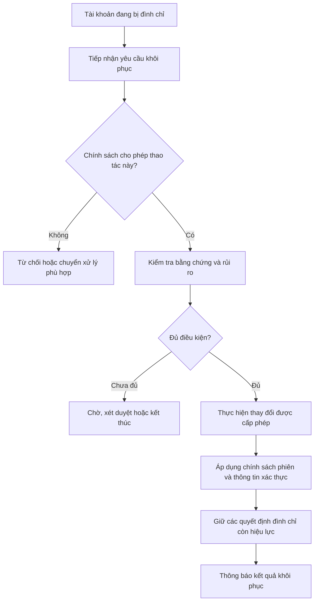

# Trạng thái tài khoản bị tạm đình chỉ

## 1. Suspended account state nghĩa là gì?

**Suspended — tạm đình chỉ — là trạng thái mà quyền sử dụng tài khoản bị hạn chế bởi một quyết định còn hiệu lực của hệ thống hoặc người có thẩm quyền.** Người dùng có thể vẫn nhớ mật khẩu, sở hữu passkey và chứng minh được quyền kiểm soát tài khoản, nhưng chưa được phép sử dụng tài khoản như bình thường.

Điểm cốt lõi là tách hai câu hỏi:

1. Người yêu cầu có đủ bằng chứng để được coi là bên có quyền kiểm soát tài khoản không?
2. Tài khoản hiện có được phép thực hiện hành động đang yêu cầu không?

Xác thực hoặc khôi phục thành công có thể trả lời câu hỏi thứ nhất trong phạm vi của quy trình. Nó không tự xóa quyết định đình chỉ để trả lời câu hỏi thứ hai.

Ví dụ, tài khoản bị tạm đình chỉ do nghi bị chiếm đoạt. Chủ tài khoản nhận mã dự phòng và đặt mật khẩu mới thành công. Hệ thống vẫn có thể cần hoàn tất xử lý yếu tố bị lộ, phiên cũ hoặc một bước xét duyệt trước khi cho truy cập đầy đủ. Nếu đồng thời có một quyết định đình chỉ khác do quản trị tổ chức, việc xử lý sự cố bảo mật không tự gỡ quyết định đó.

Bài học thuộc chương **Account State Model**, trong phạm vi thiết kế khôi phục tài khoản khi mất mật khẩu, MFA, passkey hoặc thiết bị xác thực. Trọng tâm là mô hình hóa `SUSPENDED` sao cho khôi phục giúp người dùng hợp lệ lấy lại khả năng xác thực mà vẫn giữ đúng các hạn chế đang có hiệu lực.

Sau bài học, bạn cần có thể:

- Phân biệt đình chỉ tài khoản với khóa đăng nhập, mất yếu tố xác thực và hết hạn phiên.
- Xác định thao tác nào bị chặn, thao tác nào có thể được phép trong lúc đình chỉ.
- Tách trạng thái tài khoản khỏi trạng thái yêu cầu khôi phục và thông tin xác thực.
- Mô tả điều kiện vào, điều kiện ra và thẩm quyền gỡ đình chỉ.
- Giải thích vì sao đổi mật khẩu hoặc thu hồi phiên riêng lẻ chưa đủ để thực thi trạng thái này.

## 2. Phân biệt với các trạng thái dễ nhầm

Tên trạng thái có thể khác giữa các sản phẩm. Vì vậy, cần định nghĩa hành vi thay vì chỉ chọn một từ trong enum.

| Tình huống hoặc trạng thái | Ý nghĩa thường gặp | Quan hệ với khôi phục tài khoản |
| --- | --- | --- |
| Không nhớ mật khẩu | Người dùng thiếu một thông tin xác thực có thể sử dụng | Có thể cần đặt lại mật khẩu; tài khoản chưa chắc bị đình chỉ |
| Mất MFA hoặc thiết bị | Người dùng không hoàn tất được phương thức xác thực thông thường | Có thể cần thay yếu tố; không tự làm tài khoản bị đình chỉ |
| Login locked hoặc rate limited | Một đường đăng nhập bị khóa hoặc giới hạn do thử sai hay tín hiệu lạm dụng | Có điều kiện mở khóa riêng; không nhất thiết thay đổi trạng thái toàn tài khoản |
| Suspended | Có một quyết định hạn chế sử dụng tài khoản còn hiệu lực | Khôi phục phải tôn trọng quyết định này và không tự mở lại quyền |
| Disabled hoặc deactivated | Tài khoản bị vô hiệu hóa theo mô hình quản trị hoặc lựa chọn người dùng | Cần quy tắc kích hoạt lại riêng; không suy ra từ tên gọi rằng giống `SUSPENDED` |
| Deleted | Tài khoản đã đi vào trạng thái xóa theo vòng đời dữ liệu | Quyền khôi phục thông tin xác thực không được tự làm sống lại tài khoản |
| Session expired | Một phiên hết hiệu lực | Có thể chỉ cần đăng nhập lại nếu tài khoản và các điều kiện khác cho phép |
| Recovery pending | Một yêu cầu khôi phục đang được xử lý | Là trạng thái của yêu cầu; không mặc nhiên là trạng thái đình chỉ của tài khoản |

Chữ “tạm” không có nghĩa mọi đình chỉ đều có thời hạn cố định hoặc tự hết sau một khoảng thời gian. Một quyết định có thể kéo dài đến khi đủ điều kiện xem xét. Nếu sản phẩm hỗ trợ tự hết hạn, thời điểm và điều kiện áp dụng phải được mô tả rõ.

Ngược lại, không nên dùng `SUSPENDED` như một tên chung cho mọi lỗi không đăng nhập được. Làm vậy khiến nhóm phát triển không biết người dùng cần lấy lại mật khẩu, chờ giới hạn tần suất hay giải quyết một quyết định quản trị.

## 3. Tách những trục trạng thái khác nhau

### 3.1. Bốn đối tượng cần phân biệt

Một tài khoản bị đình chỉ vẫn có thể có mật khẩu hợp lệ và một yêu cầu khôi phục đang chờ. Các trạng thái này cùng tồn tại vì chúng mô tả những đối tượng khác nhau.

| Đối tượng | Trạng thái minh họa | Câu hỏi được trả lời |
| --- | --- | --- |
| Tài khoản và chính sách truy cập | Bình thường, bị đình chỉ, bị vô hiệu hóa, đã xóa | Tài khoản được sử dụng trong phạm vi nào? |
| Thông tin xác thực | Còn hiệu lực, bị thu hồi, cần thay thế | Có được chấp nhận để xác thực không? |
| Yêu cầu khôi phục | Đã tạo, đang xác minh, được cho phép, hoàn tất, hết hạn | Quy trình khôi phục đã đến đâu và được thực hiện thao tác nào? |
| Phiên hoặc token truy cập | Hợp lệ theo cơ chế, bị hạn chế, bị thu hồi, hết hạn | Quyền truy cập đã cấp còn được sử dụng thế nào? |

`recovery_request.status = COMPLETED` không kéo theo `account.state = ACTIVE`. Hai thay đổi chỉ được liên kết nếu một chính sách riêng cho phép, với điều kiện được kiểm tra rõ ràng.

### 3.2. Một tài khoản có thể chịu nhiều quyết định hạn chế

Một cờ `suspended = true` có thể cho biết cần chặn truy cập, nhưng không giải thích ai được phép bỏ chặn và vì sao. Khi có nhiều lý do, thao tác đặt cờ thành `false` dễ xóa nhầm hạn chế của bên khác.

Một cách mô hình hóa là giữ các **hold — quyết định hạn chế** còn hiệu lực và suy ra trạng thái truy cập từ chúng:

```text
account_id: A-EXAMPLE-73
lifecycle_state: ENABLED
effective_access_state: SUSPENDED

active_holds:
  - hold_id: H-SECURITY-11
    reason: SUSPECTED_ACCOUNT_TAKEOVER
    owner: SECURITY_REVIEW
  - hold_id: H-ORG-08
    reason: ORGANIZATION_ADMIN_SUSPENSION
    owner: ORGANIZATION_ADMIN
```

Đây là mô hình khái niệm, không phải cấu trúc bắt buộc. `ENABLED` mô tả vòng đời nền của tài khoản; `SUSPENDED` là trạng thái truy cập hiệu lực do các hạn chế đang tồn tại. Nếu chọn một cột trạng thái duy nhất, hệ thống vẫn cần lưu đủ lý do và thẩm quyền để tránh gỡ nhầm.

Trong ví dụ, nhóm bảo mật xử lý xong sự cố chỉ được giải phóng hạn chế thuộc thẩm quyền của mình. Hạn chế của quản trị tổ chức còn hiệu lực thì tài khoản vẫn chưa trở lại sử dụng bình thường.

## 4. Lý do đình chỉ và phạm vi hạn chế

### 4.1. Lý do là đầu vào cho chính sách

Các lý do minh họa có thể gồm nghi chiếm đoạt tài khoản, phát hiện hành vi lạm dụng, yêu cầu quản trị tổ chức hoặc chờ một bước xem xét. Mỗi dịch vụ cần định nghĩa lý do phù hợp với mô hình của mình.

Lý do không chỉ dùng để hiển thị thông báo. Nó ảnh hưởng đến:

- Thao tác nào còn được phép trong khi đình chỉ.
- Bằng chứng nào cần để thực hiện khôi phục.
- Kênh liên hệ nào còn đáng tin nếu có dấu hiệu xâm nhập.
- Ai được phép xét duyệt hoặc gỡ hạn chế.
- Điều kiện xử lý phiên, yếu tố cũ và quyền sau đó.

Không nên trả toàn bộ mã rủi ro, tín hiệu phát hiện hoặc ghi chú điều tra cho người chưa xác thực. Giao diện cần cung cấp hướng xử lý phù hợp mà không tiết lộ dữ liệu tài khoản hoặc cách né kiểm soát.

### 4.2. Ma trận hành động cho một chính sách minh họa

Ví dụ sau giả định đình chỉ chặn sử dụng nghiệp vụ bình thường, nhưng dịch vụ vẫn có một đường hỗ trợ và khôi phục giới hạn. Đây không phải cấu hình mặc định cho mọi sản phẩm.

| Hành động | Khi tài khoản bị đình chỉ | Điều kiện cần làm rõ |
| --- | --- | --- |
| Dùng phiên thường để đọc hoặc sửa dữ liệu nghiệp vụ | Bị chặn theo chính sách đình chỉ của ví dụ | Kiểm tra ở nơi phục vụ tài nguyên, không chỉ tại màn hình đăng nhập |
| Xin một phiên truy cập đầy đủ mới | Không được cấp | Mật khẩu hoặc passkey đúng chưa đủ để vượt trạng thái tài khoản |
| Gửi yêu cầu khôi phục | Có thể được tiếp nhận theo chính sách | Phản hồi tránh dò tài khoản; tiếp nhận chưa phải cho phép thay đổi |
| Xác minh bằng chứng cho khôi phục | Có thể cho phép trong phạm vi giới hạn | Không tự tạo phiên thường hoặc gỡ các hạn chế |
| Đặt mật khẩu mới | Có thể cho phép nếu chính sách của các hạn chế cho phép | Đổi thông tin xác thực, giữ nguyên các quyết định đình chỉ |
| Thay MFA hoặc đăng ký passkey mới | Không mặc nhiên được phép | Cần quyền riêng cho đúng thao tác và bằng chứng tương ứng |
| Đổi email khôi phục | Thao tác nhạy cảm, không tự được cấp theo quyền đổi mật khẩu | Cần xét khả năng kênh cũ bị chiếm và quyền gắn kênh mới |
| Xem thông báo trạng thái hoặc gửi đề nghị xem xét | Có thể qua đường hạn chế | Chỉ tiết lộ thông tin mà chủ thể hiện tại được phép biết |
| Tạo khóa API hoặc cấp quyền quản trị | Bị chặn trong ví dụ | Đường khôi phục không được trở thành cách tăng quyền |
| Gỡ đình chỉ | Chỉ người hoặc cơ chế có thẩm quyền | Cần điều kiện và dấu vết quyết định riêng |

Một sản phẩm có thể cho tài khoản bị đình chỉ truy cập một số dữ liệu ở chế độ chỉ đọc. Khi đó, phải chỉ rõ tài nguyên và hành động được phép. Từ “chỉ đọc” không tự bảo đảm an toàn nếu API xuất dữ liệu nhạy cảm vẫn mở rộng hơn dự định.

## 5. Khi nào tài khoản đi vào trạng thái đình chỉ?

### 5.1. Quyết định vào trạng thái phải có căn cứ và thẩm quyền

Đình chỉ có thể được áp dụng bởi một cơ chế phát hiện đáp ứng điều kiện chính sách hoặc bởi một chủ thể quản trị có quyền. Bản ghi quyết định cần đủ để biết tài khoản nào bị tác động, lý do, phạm vi, bên ra quyết định và thời điểm.

Nếu có thời điểm xem xét hoặc hết hạn, chúng cần được lưu và diễn giải nhất quán. Thời điểm “cần xem xét lại” khác với thời điểm “tự động bỏ hạn chế”. Không nên dùng cùng một trường rồi để các thành phần hiểu khác nhau.

### 5.2. Yêu cầu khôi phục không tự là căn cứ đình chỉ

Người chưa xác thực có thể biết định danh và khởi tạo yêu cầu khôi phục cho tài khoản của người khác. Nếu mỗi yêu cầu tự đình chỉ tài khoản hoặc thu hồi toàn bộ phiên, kẻ tấn công có thể gây mất truy cập cho nạn nhân mà không có bằng chứng sở hữu.

Tín hiệu lạm dụng có thể dẫn tới giới hạn tần suất, kiểm tra bổ sung hoặc một quyết định bảo vệ theo chính sách. Tuy nhiên, cần phân biệt việc tiếp nhận yêu cầu với căn cứ đủ để hạn chế tài khoản. Không được mặc định rằng người bắt đầu khôi phục có quyền điều khiển trạng thái của tài khoản đích.

### 5.3. Đình chỉ có hiệu lực với quyền đã cấp

Thay một trường dữ liệu chưa đủ nếu các API tiếp tục chấp nhận phiên đã phát hành mà không kiểm tra hạn chế hiện tại. Cần xác định cách thực thi với phiên trình duyệt, ứng dụng di động, token dài hạn và các đường truy cập khác trong phạm vi tài khoản.

Nếu có độ trễ truyền trạng thái, đặc tả phải nêu rõ giới hạn đó. Không tuyên bố tài khoản đã bị chặn ở mọi nơi ngay lập tức khi các dịch vụ vẫn có thể dùng dữ liệu trạng thái cũ.

## 6. Luồng khôi phục trong lúc tài khoản bị đình chỉ

### 6.1. Mục tiêu: khôi phục đúng khả năng, giữ đúng hạn chế

Giả sử chính sách cho phép tài khoản đang bị đình chỉ đặt lại mật khẩu để giảm nguy cơ từ mật khẩu bị lộ. Kết quả đúng là mật khẩu được thay, token khôi phục được xử lý và các chính sách phiên tương ứng được áp dụng. Không có bước ngầm chuyển tài khoản về hoạt động bình thường.



Việc xem xét gỡ đình chỉ là một quyết định riêng sau hoặc bên cạnh luồng trên. Không phải mọi yêu cầu đều phải xét duyệt thủ công; điều đó phụ thuộc chính sách.

### 6.2. Mất mật khẩu, MFA và passkey có phạm vi khác nhau

| Sự cố | Thao tác có thể cần | Điều không được tự suy ra |
| --- | --- | --- |
| Quên mật khẩu | Đặt mật khẩu mới sau khi đủ bằng chứng | Mật khẩu mới làm mất hiệu lực lý do đình chỉ |
| Mất ứng dụng MFA | Thay yếu tố theo quy trình được phép | Biết mật khẩu là đủ gỡ MFA và mở lại tài khoản |
| Mất thiết bị có passkey | Dùng khóa khác hoặc quy trình khôi phục phù hợp để đăng ký lại | Đăng ký passkey mới đồng nghĩa được bỏ mọi hạn chế |
| Thiết bị có thể bị người khác sử dụng | Xử lý thông tin xác thực và phiên liên quan | Chỉ thêm yếu tố mới là đã loại bỏ mọi quyền truy cập cũ |
| Email khôi phục có thể bị chiếm | Xét đường chứng minh và liên hệ khác theo chính sách | Gửi thêm mã vào cùng email tạo bằng chứng độc lập |

Ngay cả khi bằng chứng đủ cho một thao tác, các quyết định đình chỉ vẫn có thể không cho phép thao tác ấy ở thời điểm hiện tại. Điều kiện hoàn tất là sự kết hợp của quyền khôi phục và chính sách tài khoản hiện hành.

### 6.3. Phiên khôi phục là quyền giới hạn

Một dịch vụ có thể dùng phiên riêng cho việc nhập bằng chứng, đặt mật khẩu hoặc đăng ký lại yếu tố. Phiên này phải được ràng buộc với tài khoản, mục đích và hành động cụ thể. Nó không được kế thừa toàn bộ quyền nghiệp vụ chỉ vì người dùng đã hoàn tất một bước xác minh.

Nếu tài khoản bị đình chỉ chỉ được mở trang trạng thái và đặt mật khẩu, các API tương ứng phải kiểm tra giới hạn đó. Ẩn menu hoặc đưa người dùng đến một trang đặc biệt không tạo ra ranh giới phân quyền.

## 7. Điều kiện gỡ đình chỉ

### 7.1. Khôi phục thành công có thể là điều kiện cần trong một chính sách

Đối với hạn chế do nghi bị chiếm đoạt, chính sách có thể yêu cầu xác minh quyền kiểm soát, thay thông tin xác thực bị ảnh hưởng và xử lý các phiên liên quan. Hoàn tất các việc đó có thể làm đủ một phần hoặc toàn bộ điều kiện để cơ chế có thẩm quyền xem xét gỡ hạn chế bảo mật.

Tuy nhiên, nếu lý do đình chỉ là một quyết định quản trị tổ chức hoặc hành vi lạm dụng còn chưa được giải quyết, đặt lại mật khẩu không trả lời câu hỏi đó. Người dùng cũng không được đổi đường xác thực để né quyết định đang áp dụng cho tài khoản.

### 7.2. Gỡ đúng quyết định thuộc thẩm quyền

Một thao tác gỡ hạn chế cần xác định:

- Quyết định nào đang được giải phóng và chủ thể nào có quyền làm việc đó.
- Điều kiện nào đã được đáp ứng, dựa trên bằng chứng hoặc kết quả xử lý nào.
- Có hạn chế khác, trạng thái vô hiệu hóa hoặc trạng thái xóa nào vẫn ngăn truy cập không.
- Chính sách cho lần đăng nhập tiếp theo và hành động nhạy cảm sau đó là gì.

Không nên thực hiện lệnh chung “đặt tài khoản thành ACTIVE” sau mỗi lần hỗ trợ người dùng. Cần đánh giá trạng thái hiệu lực từ những điều kiện hiện còn đúng.

### 7.3. Không hồi sinh bí mật hoặc phiên đã bị thu hồi

Gỡ đình chỉ không tự làm mật khẩu cũ, passkey đã vô hiệu hóa, mã dự phòng đã dùng hoặc token đã thu hồi hợp lệ trở lại. Các đối tượng đó có vòng đời riêng.

Nếu chính sách yêu cầu đăng nhập lại bằng phương thức hiện còn hợp lệ, việc mở lại tài khoản chỉ cho phép bắt đầu quá trình ấy. Không nhất thiết chuyển phiên khôi phục thành phiên đầy đủ hoặc khôi phục mọi phiên trước khi đình chỉ.

## 8. Thực thi trạng thái ở nơi cấp và sử dụng quyền

### 8.1. Kiểm tra tại đăng nhập chưa đủ

Một người có thể đã có phiên trước khi tài khoản bị đình chỉ. Nếu chỉ chặn màn hình đăng nhập, họ vẫn có thể gọi API bằng phiên đó.

Các điểm cần áp dụng chính sách có thể gồm:

- Cấp phiên hoặc token mới.
- Làm mới quyền truy cập bằng refresh token.
- Xử lý yêu cầu nghiệp vụ bằng phiên hoặc access token hiện có.
- Hoàn tất thao tác khôi phục hoặc thay thông tin xác thực.
- Các đường truy cập đại diện cho tài khoản như khóa API, nếu thuộc phạm vi đình chỉ.

Không phải mọi hệ thống có cùng kiến trúc. Điều quan trọng là các đường sử dụng quyền trong phạm vi đình chỉ đều phải tuân theo cùng một quyết định hiệu lực.

### 8.2. Thu hồi và kiểm tra trạng thái bổ trợ cho nhau

Thu hồi refresh token ngăn việc xin token mới theo cơ chế đó, nhưng không nhất thiết vô hiệu hóa ngay access token đã cấp. Với token tự chứa, chữ ký hợp lệ chỉ cho biết token đáp ứng kiểm tra mật mã tương ứng, chưa bảo đảm tài khoản hiện được phép sử dụng mọi quyền trong token.

Hệ thống có thể kết hợp trạng thái phiên ở máy chủ, kiểm tra trạng thái tài khoản, phiên bản bảo mật, danh sách thu hồi hoặc thời hạn phù hợp. Lựa chọn cụ thể cần nêu được phạm vi và độ trễ thực thi.

Một trường phiên bản bảo mật chỉ có tác dụng nếu nơi chấp nhận quyền thực sự so sánh nó với trạng thái có thẩm quyền hoặc một cơ chế đồng bộ đáp ứng yêu cầu. Thêm số phiên bản vào token rồi không kiểm tra không làm đình chỉ có hiệu lực.

### 8.3. Đăng nhập liên kết không vượt trạng thái cục bộ

Người dùng có thể xác thực thành công tại nhà cung cấp danh tính bên ngoài. Ứng dụng vẫn cần kiểm tra trạng thái tài khoản và chính sách cục bộ trước khi cấp hoặc cho sử dụng quyền.

Ngược lại, đình chỉ một tài khoản cục bộ không có nghĩa ứng dụng đã đình chỉ toàn bộ tài khoản tại nhà cung cấp danh tính hoặc các dịch vụ khác. Phạm vi trách nhiệm phải được xác định rõ.

## 9. Tính nhất quán khi trạng thái thay đổi giữa chừng

### 9.1. Quyền được xem xét hôm trước chưa chắc còn đủ hôm nay

Một yêu cầu khôi phục có thể được khởi tạo khi tài khoản hoạt động bình thường, nhưng trước lúc hoàn tất, tài khoản bị đình chỉ. Nếu bước cuối chỉ tin quyết định cũ, nó có thể cấp quyền trái với chính sách hiện tại.

Trường hợp ngược lại cũng cần xử lý: tài khoản vừa được gỡ một hạn chế nhưng lại có hạn chế mới từ một nguồn khác. Một bản ghi xét duyệt cũ không được ghi đè trạng thái mới hơn.

Vì vậy, bước thực hiện thay đổi phải kiểm tra lại điều kiện hiện hành và xử lý cạnh tranh nhất quán. Giao diện đã hiển thị nút “Hoàn tất” không chứng minh các điều kiện vẫn còn đúng.

### 9.2. Minh họa quyết định hoàn tất một thao tác

```text
begin transaction
    đọc và bảo vệ tính nhất quán của tài khoản, yêu cầu và quyền khôi phục
    kiểm tra tài khoản đích và mục đích của yêu cầu
    kiểm tra token chưa hết hạn, chưa dùng và chưa bị vô hiệu hóa
    đánh giá các hạn chế hiện hành cho đúng hành động đang yêu cầu
    nếu không được phép: không thực hiện thay đổi
    nếu được phép:
        thực hiện đúng thay đổi thông tin xác thực đã cấp quyền
        tiêu thụ quyền dùng một lần trong cùng ranh giới nhất quán
        giữ nguyên các quyết định đình chỉ chưa được giải phóng
        ghi sự kiện và công việc xử lý phiên theo chính sách
commit
```

Đây là mã giả mô tả yêu cầu, không phải triển khai giao dịch cho mọi kiến trúc. Có thể dùng khóa, điều kiện cập nhật theo phiên bản hoặc cơ chế tương đương. Thao tác gỡ đình chỉ cần kiểm tra thẩm quyền và điều kiện riêng, không được gộp vào nhánh đổi mật khẩu chỉ vì tiện.

Với các hệ thống tách dịch vụ, thay đổi thông tin xác thực, thu hồi phiên và gửi thông báo có thể không nằm trong cùng một giao dịch dữ liệu. Khi đó cần cơ chế giao việc bền vững, xử lý lặp an toàn và trạng thái trung gian phù hợp. Chỉ thông báo hoàn tất những cam kết mà hệ thống đã thực sự đáp ứng.

## 10. Ví dụ xuyên suốt: hai lý do đình chỉ cùng tồn tại

### 10.1. Bối cảnh

Tài khoản của Hương bị đặt hai hạn chế. Nhóm bảo mật đình chỉ do nghi điện thoại bị người khác sử dụng. Quản trị tổ chức cũng đang đình chỉ quyền sử dụng ứng dụng của tài khoản theo một quyết định riêng. Hương mất thiết bị chứa OTP nhưng còn mã dự phòng được lưu riêng.

Chính sách của ví dụ cho phép Hương đi qua đường khôi phục giới hạn, thay thông tin xác thực bị ảnh hưởng và không sử dụng dữ liệu nghiệp vụ trong lúc đình chỉ.

### 10.2. Diễn biến mong đợi

| Mốc | Sự kiện | Trạng thái và kết quả đúng |
| --- | --- | --- |
| T0 | Hai hạn chế còn hiệu lực | Trạng thái truy cập là `SUSPENDED`; các đường nghiệp vụ thuộc phạm vi bị chặn |
| T1 | Hương tạo yêu cầu thay OTP | Yêu cầu ở trạng thái đang xác minh; không tự gỡ hoặc tạo thêm đình chỉ chỉ vì có yêu cầu |
| T2 | Bằng chứng đáp ứng chính sách | Cấp quyền giới hạn cho thao tác thay OTP, chưa cấp phiên thường |
| T3 | Thay OTP và xử lý yếu tố, phiên liên quan | Yêu cầu khôi phục hoàn tất theo điều kiện; các hạn chế tài khoản vẫn được giữ |
| T4 | Nhóm bảo mật xác nhận đủ điều kiện xử lý sự cố | Chỉ giải phóng hạn chế bảo mật thuộc thẩm quyền của nhóm |
| T5 | Hạn chế quản trị tổ chức vẫn tồn tại | Tài khoản vẫn `SUSPENDED`, dù Hương đã có OTP mới |
| T6 | Quản trị tổ chức giải phóng hạn chế theo quy trình | Nếu không còn điều kiện chặn khác, tài khoản có thể được phép đăng nhập lại theo chính sách |

Tại T3, thông báo phù hợp là “Đã thay phương thức xác thực; tài khoản vẫn đang bị hạn chế sử dụng” nếu chủ thể được phép biết thông tin này. Thông báo “Tài khoản đã được mở lại” sẽ mô tả sai kết quả.

Nếu trong lúc T2 đến T3 xuất hiện một hạn chế mới không cho phép thay yếu tố, bước cuối phải xét chính sách mới. Không được chỉ dựa vào quyền tạm thời đã tạo trước đó để bỏ qua quyết định hiện hành.

### 10.3. Sai lầm cần tránh trong ví dụ

Một đoạn xử lý “đổi OTP thành công thì đặt `suspended = false`” sẽ vô tình bỏ cả hạn chế quản trị. Lỗi này xuất phát từ việc coi hoàn tất khôi phục và được phép sử dụng tài khoản là cùng một sự kiện.

Tương tự, gỡ đình chỉ rồi tái kích hoạt mọi phiên cũ có thể đưa thiết bị bị mất trở lại sử dụng. Cần giữ trạng thái thu hồi của các phiên và thông tin xác thực đã xử lý trước đó.

## 11. Những lỗi mô hình hóa thường gặp

| Lỗi | Hệ quả | Nguyên tắc xử lý |
| --- | --- | --- |
| Một cờ đình chỉ không lưu lý do hoặc thẩm quyền | Không biết ai được gỡ, dễ xóa nhầm hạn chế | Lưu quyết định và điều kiện giải phóng đủ rõ |
| Mọi yêu cầu quên mật khẩu đều đình chỉ tài khoản | Người ngoài có thể gây mất truy cập cho nạn nhân | Tách tiếp nhận yêu cầu khỏi quyết định hạn chế tài khoản |
| Hoàn tất đặt mật khẩu tự chuyển tài khoản thành hoạt động | Khôi phục trở thành đường vượt quyết định đình chỉ | Tách thay thông tin xác thực khỏi gỡ hạn chế |
| Chỉ chặn lần đăng nhập mới | Phiên và token cũ vẫn dùng được ngoài dự định | Thực thi tại các nơi cấp và sử dụng quyền liên quan |
| Gỡ một lý do là xóa mọi lý do | Một bên giải phóng hạn chế ngoài thẩm quyền | Đánh giá tất cả quyết định còn hiệu lực |
| Tin quyết định được lưu từ đầu luồng | Thay đổi trạng thái giữa chừng bị bỏ qua | Kiểm tra điều kiện hiện tại khi thực hiện thao tác |
| Cho phiên khôi phục gọi mọi API | Người có quyền hẹp được quyền sử dụng đầy đủ | Ràng buộc tài khoản, mục đích và phạm vi tại máy chủ |
| Gỡ đình chỉ làm token đã dùng hợp lệ trở lại | Bí mật cũ có thể được tái sử dụng | Giữ vòng đời độc lập của token, phiên và thông tin xác thực |
| Gửi toàn bộ lý do nội bộ cho bên chưa xác thực | Lộ trạng thái tài khoản hoặc tín hiệu phát hiện | Cung cấp thông tin theo mức xác thực và quyền hiện có |

## 12. Đặc tả cần trả lời được những gì?

Một đặc tả tốt không dừng ở câu “tài khoản suspended thì không đăng nhập được”. Cần làm rõ:

1. **Ý nghĩa:** những quyết định nào tạo trạng thái này, chúng chặn toàn tài khoản hay một phạm vi cụ thể?
2. **Điểm thực thi:** phiên cũ, refresh token, API và đường truy cập liên kết được xử lý ra sao?
3. **Ngoại lệ được phép:** trang trạng thái, đề nghị xem xét hoặc thao tác khôi phục nào có thể tiếp tục?
4. **Bằng chứng:** điều gì đủ để thực hiện từng thao tác khôi phục trong lúc bị đình chỉ?
5. **Thẩm quyền:** ai được giải phóng từng hạn chế và điều kiện nào phải đáp ứng?
6. **Tính nhất quán:** xử lý thế nào nếu tài khoản thay đổi trạng thái khi yêu cầu còn đang chạy?
7. **Kết quả:** khi nào được coi là hoàn tất khôi phục, khi nào mới được sử dụng tài khoản bình thường?
8. **Truy vết:** ghi sự kiện đình chỉ, khôi phục, giải phóng và xử lý phiên thế nào mà không lưu bí mật?

Các tình huống cần được dự liệu bao gồm mật khẩu đúng nhưng tài khoản bị đình chỉ, liên kết khôi phục được phát hành trước một hạn chế mới, nhiều hạn chế cùng tồn tại và yêu cầu hoàn tất được gửi lại sau lỗi mạng. Đây là các tình huống giúp làm rõ hành vi mong đợi, không phải tên trạng thái mới cần thêm một cách máy móc.

## 13. Tự kiểm tra hiểu biết

### Tình huống 1: Đặt mật khẩu mới thành công

Tài khoản bị đình chỉ bởi quản trị tổ chức. Người dùng đặt mật khẩu mới thành công qua đường được phép. Có nên tự chuyển tài khoản về `ACTIVE` không?

**Gợi ý trả lời:** Không. Quyền đặt lại mật khẩu không đồng nghĩa quyền gỡ quyết định quản trị. Tài khoản chỉ được sử dụng theo chính sách sau khi hạn chế tương ứng được giải phóng bởi cơ chế có thẩm quyền.

### Tình huống 2: Phiên được tạo trước đình chỉ

Hệ thống từ chối mọi đăng nhập mới, nhưng token được cấp trước đó vẫn gọi được API nghiệp vụ. Có thể nói trạng thái đình chỉ đã được thực thi đầy đủ theo chính sách chặn nghiệp vụ không?

**Gợi ý trả lời:** Chưa thể. Cần kiểm tra các nơi sử dụng quyền đã cấp, cơ chế thu hồi và độ trễ cập nhật. Chặn cấp phiên mới chỉ xử lý một phần đường truy cập.

### Tình huống 3: Gỡ một trong hai hạn chế

Nhóm bảo mật giải quyết xong sự cố, còn hạn chế của quản trị vẫn hiệu lực. Trạng thái truy cập có nên trở lại bình thường không?

**Gợi ý trả lời:** Không. Gỡ một quyết định không làm mất hiệu lực quyết định khác. Cần tính trạng thái truy cập dựa trên các điều kiện còn tồn tại.

### Tình huống 4: Tài khoản bị đình chỉ giữa luồng

Người dùng đã nhận token thay MFA, nhưng trước lúc hoàn tất xuất hiện một hạn chế không cho phép thay yếu tố. Token còn hạn có đủ để tiếp tục không?

**Gợi ý trả lời:** Không tự động đủ. Còn hạn chỉ là một điều kiện. Bước thực hiện phải áp dụng chính sách hiện tại cho đúng hành động và tài khoản.

### Tình huống 5: Người ngoài gửi yêu cầu khôi phục

Một người biết email nạn nhân và gửi nhiều yêu cầu quên mật khẩu. Có nên mỗi lần đều đình chỉ tài khoản và thu hồi mọi phiên không?

**Gợi ý trả lời:** Không nên coi việc gửi yêu cầu là quyền gây thay đổi đó. Cần kiểm soát lạm dụng và đánh giá rủi ro theo chính sách, tránh tạo công cụ gây mất truy cập cho người dùng hợp lệ.

## 14. Những điểm cần ghi nhớ

- `SUSPENDED` nói về quyền sử dụng tài khoản đang bị hạn chế; người dùng vẫn có thể có thông tin xác thực hợp lệ.
- Tài khoản, yêu cầu khôi phục, thông tin xác thực và phiên có các trục trạng thái riêng.
- Khôi phục thành công không tự gỡ đình chỉ, thay đổi vai trò hoặc mở lại toàn bộ quyền nghiệp vụ.
- Mỗi quyết định hạn chế cần có lý do, phạm vi, thẩm quyền và điều kiện giải phóng rõ ràng.
- Kiểm soát phải có hiệu lực tại các đường cấp và sử dụng quyền, kể cả quyền đã cấp trước đình chỉ.
- Bước hoàn tất khôi phục phải xét trạng thái hiện hành và không ghi đè quyết định mới hơn.
- Gỡ đình chỉ không làm sống lại token, phiên hoặc thông tin xác thực đã bị thu hồi.
