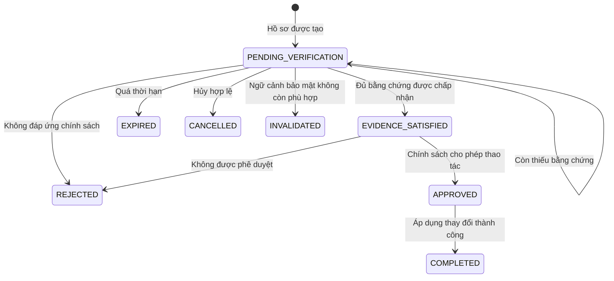

# Pending verification state: Trạng thái chờ xác minh trong khôi phục tài khoản

Trong chương **Account State Model**, trạng thái **pending verification** mô tả một giai đoạn mà hệ thống đã tiếp nhận yêu cầu nhưng chưa có đủ bằng chứng được chấp nhận để cho phép bước tiếp theo. Với khôi phục tài khoản, đây là ranh giới quan trọng: **có yêu cầu khôi phục không đồng nghĩa người yêu cầu đã được xác minh hoặc đã được phép thay đổi phương thức đăng nhập**.

Bài học thuộc phạm vi `SECURITY_AUTHENTICATION_ACCOUNT_RECOVERY`: thiết kế khôi phục an toàn khi mất mật khẩu, MFA, passkey hoặc thiết bị xác thực. Trọng tâm là cách biểu diễn, duy trì và kết thúc trạng thái chờ xác minh để giảm nguy cơ chiếm đoạt tài khoản, phát lại token và lạm dụng luồng khôi phục.

Sau bài học, bạn có thể:

- Xác định đối tượng nào đang chờ xác minh: hồ sơ khôi phục, challenge hay kênh liên lạc.
- Tách trạng thái hồ sơ khôi phục khỏi trạng thái hoạt động của tài khoản và session.
- Mô tả điều kiện chuyển trạng thái khi bằng chứng hợp lệ, không hợp lệ, hết hạn hoặc bị thu hồi.
- Xử lý gửi lại mã, nhiều request đồng thời và số lần thử mà không mở rộng quyền ngoài ý muốn.
- Thiết kế phản hồi, log và giao diện phù hợp khi người yêu cầu chưa được xác minh.

## 1. Pending verification có nghĩa chính xác là gì?

Giả sử An quên mật khẩu và nhập email trên trang khôi phục. Dịch vụ tìm được tài khoản phù hợp, tạo một hồ sơ và gửi hướng dẫn tới kênh đã đăng ký.

Ở thời điểm này, máy chủ có thể biết tài khoản nào là đích của hồ sơ, nhưng chưa biết người đang thao tác có đủ bằng chứng để đặt lại mật khẩu hay không. Hồ sơ đó đang **chờ xác minh**.

Một định nghĩa thực dụng là:

> `PENDING_VERIFICATION` là trạng thái của một hồ sơ khôi phục còn hiệu lực, đang chờ hoàn tất các kiểm tra bằng chứng theo chính sách, chưa đủ điều kiện chuyển sang bước được phê duyệt tiếp theo.

Tên trạng thái là lựa chọn mô hình của ứng dụng, không phải yêu cầu rằng mọi hệ thống phải có một enum giống hệt. Điều quan trọng là ý nghĩa và các điều kiện chuyển trạng thái phải rõ ràng.

### Trạng thái này xác nhận điều gì?

- Có một hồ sơ được hệ thống quản lý cho mục đích khôi phục cụ thể.
- Hệ thống biết các kiểm tra còn thiếu hoặc đang chờ kết quả.
- Hồ sơ chưa kết thúc do hết hạn, hủy bỏ, từ chối hoặc bị vô hiệu hóa.
- Quyền thay đổi credential chưa được suy ra chỉ từ việc hồ sơ tồn tại.

### Trạng thái này không xác nhận điều gì?

- Người khởi tạo là chủ tài khoản hợp lệ.
- Email, điện thoại hoặc thiết bị hiện tại vẫn an toàn.
- MFA đã hoàn tất.
- Yêu cầu đã được phê duyệt để thay mọi phương thức xác thực.
- Tài khoản phải bị khóa hoặc mọi session phải bị thu hồi ngay.

Một kẻ tấn công cũng có thể khởi tạo yêu cầu khôi phục cho người khác. Vì vậy, đưa hồ sơ vào trạng thái chờ xác minh là bước tổ chức xử lý, không phải kết luận về danh tính.

## 2. Phân biệt trạng thái tài khoản, hồ sơ và challenge

Cụm từ “tài khoản đang pending verification” dễ gây hiểu nhầm nếu không nói rõ đang chờ xác minh điều gì. Trong khôi phục, nên tách ít nhất các đối tượng sau:

| Đối tượng | Câu hỏi mà trạng thái trả lời | Ví dụ trạng thái | Ý nghĩa trong khôi phục |
|---|---|---|---|
| Tài khoản | Tài khoản có được hoạt động theo chính sách không? | `ACTIVE`, `SUSPENDED`, `CLOSED` | Một tài khoản đang hoạt động vẫn có thể có hồ sơ khôi phục chờ xử lý |
| Hồ sơ khôi phục | Yêu cầu khôi phục đã đi tới đâu? | `PENDING_VERIFICATION`, `APPROVED`, `COMPLETED` | Điều phối các bước và kiểm tra cần thực hiện |
| Challenge | Một thử thách hoặc mã cụ thể còn dùng được không? | `ISSUED`, `CONSUMED`, `EXPIRED`, `REVOKED` | Quản lý thời hạn và vòng đời của một bằng chứng dùng một lần |
| Kênh liên lạc | Địa chỉ hoặc số điện thoại đã được xác minh theo mục đích nào? | Chưa xác minh, đã xác minh | Tránh coi địa chỉ mới nhập là kênh đáng tin đã đăng ký |
| Credential | Phương tiện xác thực nào còn được chấp nhận? | Đang dùng, bị thu hồi | Việc mở hồ sơ không tự thay đổi toàn bộ credential |
| Session | Phiên này được làm gì và còn hiệu lực không? | Phiên thường, phiên khôi phục giới hạn, bị thu hồi | Không cấp quyền nghiệp vụ từ một hồ sơ chưa xác minh |

Ví dụ trạng thái hợp lệ của cùng một người dùng:

```json
{
  "account": {
    "id": "acct_42",
    "lifecycle": "ACTIVE"
  },
  "recoveryCase": {
    "id": "rc_81",
    "operation": "password.reset",
    "state": "PENDING_VERIFICATION"
  },
  "challenge": {
    "kind": "email_token",
    "state": "ISSUED"
  }
}
```

Đây chỉ là dữ liệu minh họa mô hình nội bộ, không phải payload cần công khai. Người dùng có thể vẫn đăng nhập bằng passkey còn hoạt động trong khi một hồ sơ đặt lại mật khẩu đang chờ xác minh.

### Vì sao không dùng một cờ `verified` chung?

Một cờ như `account.verified = true` không cho biết đã xác minh email lúc đăng ký, kiểm tra recovery code hay phê duyệt thay MFA. Những kết quả này khác nhau về đối tượng, mục đích và thời điểm.

Tốt hơn là ghi nhận kết quả theo ngữ cảnh: bằng chứng nào được chấp nhận, cho hồ sơ nào, với thao tác nào và còn giá trị trong điều kiện nào. Việc xác minh một kênh mới cũng không tự cho phép dùng kênh đó để phê duyệt việc thay kênh khôi phục cũ.

## 3. Những bất biến cần giữ khi đang chờ xác minh

**Bất biến** là điều kiện hệ thống phải luôn duy trì dù người dùng gửi yêu cầu sai thứ tự, gọi API trực tiếp hoặc có nhiều request chạy đồng thời.

### Bất biến 1: Chưa đủ bằng chứng thì chưa có quyền áp dụng thay đổi

Hồ sơ `PENDING_VERIFICATION` không được dùng trực tiếp để đặt lại mật khẩu, tắt MFA, đăng ký passkey thay thế hoặc đổi email khôi phục.

Nếu cần recovery session để tiếp tục, phiên đó chỉ cho phép những thao tác phục vụ xác minh đã được thiết kế, chẳng hạn gửi bằng chứng hoặc xem trạng thái được phép xem. Nó chưa phải phiên đăng nhập toàn quyền.

### Bất biến 2: Mọi bằng chứng phải gắn với đúng ngữ cảnh

Challenge cần được ràng buộc với đúng hồ sơ, tài khoản đích, mục đích và tenant khi ứng dụng có nhiều tenant. Máy chủ lấy các ràng buộc đó từ dữ liệu đáng tin, không cho client tự thay bằng `userId` hoặc `operation` khác.

Mã đặt lại mật khẩu không tự dùng để thay MFA. Kết quả xác minh ở hồ sơ A cũng không tự làm hồ sơ B đủ điều kiện.

### Bất biến 3: Tồn tại trạng thái chưa đủ, còn phải còn hiệu lực

Một bản ghi vẫn mang nhãn `PENDING_VERIFICATION` có thể đã vượt thời hạn nếu tác vụ dọn dẹp chưa chạy. Mỗi request cần kiểm tra điều kiện hiệu lực ở thời điểm quyết định.

```text
Có thể tiếp tục xác minh khi:
  hồ sơ đang ở trạng thái cho phép
  VÀ chưa vượt thời hạn hồ sơ
  VÀ challenge còn hiệu lực và chưa bị tiêu thụ
  VÀ chưa vượt giới hạn thử
  VÀ các ràng buộc bảo mật vẫn phù hợp
```

Không được dựa vào việc cron job chưa đổi nhãn trạng thái để chấp nhận một token đã hết hạn.

### Bất biến 4: Gửi yêu cầu khôi phục không tự khóa nạn nhân

Một yêu cầu chưa được xác minh thường không nên tự làm tài khoản chuyển sang bị đình chỉ, xóa credential hoặc thu hồi mọi session. Nếu không, người ngoài có thể liên tục mở hồ sơ để gây từ chối dịch vụ cho chủ tài khoản.

Nếu hệ thống có tín hiệu độc lập cho thấy tài khoản đang bị chiếm quyền, chính sách có thể áp dụng hạn chế hoặc thu hồi session. Quyết định đó cần dựa trên cơ sở riêng và được ghi nhận, không phải hệ quả mặc định của việc bất kỳ ai nhập email vào biểu mẫu.

### Bất biến 5: Chuyển trạng thái không được bỏ qua kiểm tra quyền

Đọc được `caseId` không đồng nghĩa được xem mọi thông tin của hồ sơ hoặc gửi lệnh phê duyệt. Mã hồ sơ là định danh, không mặc nhiên là bí mật ủy quyền.

Nếu thiết kế dùng một token bí mật làm quyền tiếp tục, cần xác định rõ phạm vi, thời hạn và điều kiện sử dụng của nó. Định danh khó đoán giúp giảm dò tìm nhưng không thay thế kiểm tra quyền truy cập.

## 4. Vào trạng thái pending verification bằng cách nào?

Một luồng phổ biến có các bước:

1. Tiếp nhận thông tin tra cứu và loại vấn đề người yêu cầu khai báo.
2. Áp dụng kiểm soát lạm dụng và phản hồi hạn chế dò tài khoản.
3. Xác định tài khoản đích ở phía máy chủ nếu có tài khoản phù hợp.
4. Chọn chính sách xác minh tương ứng với thao tác, loại tài khoản và ngữ cảnh.
5. Tạo hồ sơ có thời hạn, cùng challenge hoặc yêu cầu bằng chứng cần thiết.
6. Đưa hồ sơ vào `PENDING_VERIFICATION` và gửi hướng dẫn qua kênh phù hợp.

Ở giai đoạn này, thông tin tra cứu chưa phải bằng chứng. Kênh nhận token phải đến từ cấu hình đã được chấp nhận của tài khoản, không từ một địa chỉ tùy ý vừa được người yêu cầu cung cấp.

### Phản hồi cho người chưa được xác minh

Thông báo khởi tạo có thể mang dạng:

```text
Nếu thông tin phù hợp với một tài khoản có thể khôi phục,
hướng dẫn sẽ được gửi tới kênh đã đăng ký.
```

Cần xem xét cả mã HTTP, thời gian xử lý và phản hồi phụ, thay vì chỉ làm giống câu chữ. Không trả về đầy đủ email, số điện thoại, danh sách passkey hoặc trạng thái nội bộ của tài khoản cho người chỉ biết định danh tra cứu.

Giao diện có thể hiển thị hướng dẫn chung hoặc thông tin che bớt theo chính sách, nhưng phải đánh giá lượng dữ liệu bị lộ. Một địa chỉ chỉ che vài ký tự vẫn có thể tiết lộ thông tin đáng kể trong một số bối cảnh.

## 5. Một mô hình chuyển trạng thái có thể sử dụng

Mô hình sau tách việc nhận đủ bằng chứng khỏi phê duyệt và áp dụng thay đổi:



Đây là sơ đồ minh họa, không phải toàn bộ mọi chuyển tiếp của sản phẩm. Chẳng hạn, quyền đã được phê duyệt vẫn cần thời hạn và khả năng thu hồi; các nhánh đó cũng phải được thiết kế trong hệ thống thực tế.

`EVIDENCE_SATISFIED` có thể được gộp với bước phê duyệt tự động nếu chính sách đơn giản. Với quy trình có người xét duyệt, việc tách hai trạng thái giúp diễn đạt rằng đã đủ dữ liệu nhưng chưa có quyết định cho phép thay đổi.

| Sự kiện khi đang chờ | Điều kiện cần kiểm tra | Kết quả điển hình |
|---|---|---|
| Nhập sai mã | Đúng ngữ cảnh hồ sơ, còn quyền thử | Giữ trạng thái và ghi nhận thất bại, hoặc từ chối hồ sơ khi hết ngân sách thử |
| Hoàn tất một trong nhiều bằng chứng | Bằng chứng đúng mục đích, còn hiệu lực, được chấp nhận | Lưu kết quả; vẫn chờ nếu chính sách còn thiếu bằng chứng khác |
| Đủ mọi bằng chứng bắt buộc | Các kết quả còn phù hợp và thuộc cùng hồ sơ | Chuyển sang trạng thái đủ bằng chứng hoặc phê duyệt theo thiết kế |
| Gửi lại mã | Được phép gửi lại và chưa vượt thời hạn tổng thể | Quản lý challenge mới mà không tự coi là đã xác minh |
| Hết hạn | Thời gian máy chủ đã vượt giới hạn | Từ chối tiếp tục và chuyển hoặc ghi nhận hết hạn |
| Chủ thể có quyền hủy | Kiểm tra quyền hủy đúng hồ sơ | Chuyển `CANCELLED`, vô hiệu hóa quyền tiếp tục liên quan |
| Tài khoản có thay đổi bảo mật quan trọng | Kiểm tra phiên bản và điều kiện chính sách | Vô hiệu hóa hoặc đánh giá lại hồ sơ cũ |

Một bằng chứng hợp lệ không nhất thiết kết thúc chờ xác minh. Ví dụ, hồ sơ thay MFA có thể yêu cầu recovery code và một bước phê duyệt độc lập. Hoàn tất recovery code chỉ thỏa một phần điều kiện.

## 6. Dữ liệu tối thiểu để quản lý trạng thái rõ ràng

Một mô hình hồ sơ tham khảo:

```text
RecoveryCase:
  id
  subject_id
  tenant_id
  operation
  state
  created_at
  expires_at
  policy_reference
  security_version_at_creation
  accepted_evidence
  failed_attempts
  resend_count
  row_version
```

Một challenge tương ứng có thể gồm:

```text
RecoveryChallenge:
  id
  recovery_case_id
  purpose
  secret_verifier
  generation
  state
  issued_at
  expires_at
  consumed_at
```

Các trường chỉ minh họa trách nhiệm dữ liệu; không có yêu cầu phải dùng đúng tên hoặc đúng hai bảng này.

| Nhóm dữ liệu | Mục đích |
|---|---|
| Định danh và thao tác | Ngăn trộn tài khoản, tenant, hồ sơ và mục đích |
| Thời gian | Giới hạn thời gian của hồ sơ và từng challenge |
| Bằng chứng đã chấp nhận | Biết chính xác điều kiện nào đã đạt, điều kiện nào còn thiếu |
| Ngân sách thử và gửi lại | Hạn chế dò mã, spam và kéo dài hồ sơ vô hạn |
| Tham chiếu chính sách | Biết hồ sơ được đánh giá theo bộ điều kiện nào |
| Phiên bản bảo mật | Phát hiện ngữ cảnh tài khoản đã thay đổi đáng kể |
| Phiên bản bản ghi | Phối hợp cập nhật và tránh ghi đè do request đồng thời |

Bí mật không được lưu nguyên văn chỉ để tiện đối chiếu. Token ngẫu nhiên có entropy đủ lớn thường có thể lưu giá trị băm để kiểm tra; mã ngắn cần thêm kiểm soát phù hợp với không gian đoán nhỏ, cách bảo vệ dữ liệu và giới hạn thử. Cơ chế lưu mật khẩu lại có yêu cầu khác với việc lưu token ngẫu nhiên.

Không đưa mã, token, mật khẩu mới hoặc dữ liệu xác minh nhạy cảm vào log. Audit nên ghi loại sự kiện, định danh hồ sơ, kết quả và lý do ở mức phù hợp, cùng chính sách truy cập và lưu giữ dữ liệu rõ ràng.

## 7. Thời hạn, số lần thử và gửi lại mã

### Hai thời hạn có thể cùng tồn tại

**Thời hạn hồ sơ** giới hạn tổng thời gian một yêu cầu được tiếp tục. **Thời hạn challenge** giới hạn hiệu lực của một mã hoặc token cụ thể.

Ví dụ minh họa, một hồ sơ có thể hết hạn trước khi một challenge phát hành muộn đạt hết thời hạn danh nghĩa của nó. Khi đó hiệu lực thực tế phải bị chặn bởi thời hạn hồ sơ. Không dùng việc gửi lại để gia hạn vô hạn toàn bộ yêu cầu.

```text
Thời điểm cuối được chấp nhận cho challenge
    không muộn hơn thời hạn của hồ sơ chứa nó.
```

Không có một bộ số phút hoặc số lần thử đúng cho mọi sản phẩm. Giá trị cụ thể cần xét entropy của mã, kênh nhận, tác động của thao tác, khả năng chống lạm dụng và nhu cầu của người dùng hợp lệ.

### Ghi nhận thất bại phải tồn tại sau request

Nếu nhập sai mã làm phát sinh exception và toàn bộ giao dịch rollback, bộ đếm thất bại cũng có thể bị rollback theo. Khi đó hệ thống tưởng có giới hạn nhưng kẻ tấn công vẫn thử mã liên tục.

Cần thiết kế để các thất bại cần tính ngân sách được lưu bền vững. Một request chỉ được tính và chuyển trạng thái theo quy tắc đã chọn, kể cả khi nhiều request đến đồng thời.

Hết ngân sách thử của một hồ sơ không nên mặc nhiên khóa toàn bộ tài khoản của nạn nhân. Có thể kết thúc hồ sơ, thu hồi challenge và áp dụng giới hạn bổ sung đối với nguồn lạm dụng mà vẫn giữ đường đăng nhập hợp lệ theo chính sách.

### Gửi lại không làm tăng mức tin cậy

Gửi lại mã chỉ phát hành hoặc phân phối lại bằng chứng theo chính sách. Nó không chứng minh người nhận là chủ tài khoản và không chuyển hồ sơ thành đã xác minh.

Có thể chọn một trong các cách quản lý challenge:

- Chỉ challenge mới nhất còn hiệu lực; khi phát hành mới thì thu hồi challenge cũ.
- Cho phép một số challenge cùng tồn tại trong giới hạn rõ ràng; thành công của một challenge sẽ tiêu thụ hoặc vô hiệu hóa các quyền liên quan theo chính sách.

Cách thứ nhất đơn giản hóa một số ràng buộc nhưng cần tránh việc người ngoài liên tục gửi lại để làm mã của chủ tài khoản mất hiệu lực. Cách thứ hai cần kiểm soát kỹ phát lại và tổng số lần đoán trên tất cả challenge. Trong cả hai cách, phải chống spam và không tạo ngân sách thử mới vô hạn sau mỗi lần gửi lại.

Bộ đếm giao diện chỉ giúp trải nghiệm. Máy chủ mới là nơi quyết định thời hạn, tần suất và hiệu lực thực tế.

## 8. Xử lý đồng thời và tính nguyên tử

Một lỗi phổ biến có trình tự:

```text
Request A đọc: challenge chưa dùng
Request B đọc: challenge chưa dùng
Request A đánh dấu hợp lệ và tạo quyền tiếp tục
Request B cũng đánh dấu hợp lệ và tạo thêm quyền tiếp tục
```

Token được gọi là “dùng một lần” nhưng thực tế đã tạo hai quyền. Để tránh điều đó, kiểm tra trạng thái, tiêu thụ bằng chứng và cập nhật hồ sơ cần được đồng bộ bằng giao dịch, khóa hoặc thao tác có điều kiện tương đương.

Pseudocode sau minh họa một lần nộp mã trong mô hình có ngữ cảnh tiếp tục giới hạn. Nó không phải mã triển khai hoàn chỉnh:

```text
submit_evidence(request, continuation_context):
    validate_request_shape_and_size(request)
    enforce_endpoint_abuse_limits(request.context)
    reference = find_challenge_reference(request.challenge_selector)

    transaction:
        account = lock_target_account(reference)
        recovery_case = lock_recovery_case(reference.recovery_case_id)
        challenge = lock_challenge(reference.challenge_id)

        require continuation_context may_submit_to recovery_case
        require challenge belongs_to recovery_case
        require challenge.purpose matches recovery_case.operation
        require recovery_case.state == PENDING_VERIFICATION

        if account_security_context_no_longer_matches(recovery_case, account):
            recovery_case.state = INVALIDATED
            revoke_challenges(recovery_case)
            outcome = NOT_ACCEPTED

        else if server_time_now() >= recovery_case.expires_at:
            recovery_case.state = EXPIRED
            revoke_challenges(recovery_case)
            outcome = NOT_ACCEPTED

        else if not challenge_is_currently_usable(challenge):
            outcome = NOT_ACCEPTED

        else if not evidence_matches(request.code, challenge.secret_verifier):
            record_persistent_failed_attempt(recovery_case, challenge)
            if retry_budget_exhausted(recovery_case):
                recovery_case.state = REJECTED
                revoke_challenges(recovery_case)
            outcome = NOT_ACCEPTED

        else:
            consume_challenge(challenge)
            record_accepted_evidence(recovery_case, challenge)
            if all_required_evidence_is_satisfied(recovery_case):
                recovery_case.state = EVIDENCE_SATISFIED
            outcome = EVIDENCE_ACCEPTED

        append_event_without_secrets(recovery_case, outcome)
    commit

    return response_allowed_for(continuation_context, outcome)
```

Trong ví dụ, nhánh mã sai được commit cùng bộ đếm thất bại. Các điều kiện `require` không phải nơi tăng bộ đếm rồi ném lỗi làm mất cập nhật. Hệ thống thực tế còn cần xử lý định danh không tồn tại, cạnh tranh khóa, lỗi giao dịch và các giới hạn lạm dụng khác.

`continuation_context` chỉ cho phép tiếp tục đúng hồ sơ, không chứng minh toàn bộ danh tính. Nếu cần chuyển từ email sang trình duyệt khác hoặc tiếp tục trên thiết bị khác, phải thiết kế cơ chế thiết lập ngữ cảnh tương ứng; không bỏ qua kiểm tra chỉ vì người dùng đổi thiết bị.

Ví dụ chọn thứ tự khóa tài khoản, hồ sơ rồi challenge. Các luồng khác tác động cùng dữ liệu cần dùng thứ tự tương thích để giảm nguy cơ deadlock. Nếu dùng optimistic locking, cần kiểm tra kết quả cập nhật và xử lý xung đột thay vì coi thao tác cập nhật không tác động bản ghi nào là thành công.

### Retry và idempotency không thay thế xác minh

Khi người dùng gửi lại request do mất kết nối, hệ thống có thể trả trạng thái đã ghi nhận cho đúng ngữ cảnh được phép. Nhưng không nên coi mã đã dùng là mã còn hợp lệ cho một ngữ cảnh khác.

Một idempotency key giúp nhận diện thao tác lặp lại, không tự là bằng chứng danh tính. Quyền tiếp tục hoặc quyền áp dụng thay đổi không được cấp lại tùy ý chỉ vì client gửi cùng một khóa.

## 9. Thay đổi tài khoản trong lúc hồ sơ đang chờ

Thời gian chờ tạo khoảng cách giữa lúc khởi tạo hồ sơ và lúc bằng chứng được nộp. Trong khoảng đó, có thể xảy ra:

- Người dùng đổi mật khẩu bằng đường đăng nhập khác.
- Một hồ sơ khôi phục khác đã hoàn tất.
- Kênh khôi phục được thay đổi hợp lệ.
- Quản trị viên đình chỉ tài khoản.
- Hệ thống phát hiện credential hoặc session bị xâm phạm.

Không nên tiếp tục dùng mọi giả định ban đầu mà không kiểm tra lại. Một phiên bản bảo mật hoặc cơ chế tương đương có thể giúp phát hiện hồ sơ đã cũ, nhưng phải xác định thay đổi nào làm tăng phiên bản và hậu quả đối với hồ sơ.

`policy_reference` cũng không có nghĩa hồ sơ được miễn các thay đổi chính sách khẩn cấp. Hệ thống cần biết khi nào giữ bộ điều kiện ban đầu, khi nào yêu cầu thêm bằng chứng và khi nào vô hiệu hóa hồ sơ để bắt đầu lại.

Tài khoản bị đình chỉ bởi quản trị không được tự trở về hoạt động chỉ vì xác minh mã khôi phục thành công. Khôi phục credential và gỡ đình chỉ là hai quyết định khác nhau.

## 10. Giao diện và vận hành khi đang chờ xác minh

Giao diện nên trả lời ba câu hỏi cho người dùng được phép tiếp tục:

1. Đang chờ bước nào?
2. Người dùng có thể làm gì tiếp theo?
3. Khi không còn bằng chứng hoặc hết hạn thì đi theo đường nào?

Một thông báo phù hợp có thể là:

```text
Yêu cầu khôi phục đang chờ xác minh.
Hãy làm theo hướng dẫn trên kênh đã đăng ký.
Hoàn tất bước này chưa đồng nghĩa mọi phương thức đăng nhập đã được thay đổi.
```

Với ngữ cảnh đã được cho phép xem chi tiết, giao diện có thể hiển thị trạng thái như “đã nhận bằng chứng thứ nhất, còn thiếu bước phê duyệt”. Không để endpoint tra cứu công khai làm lộ hồ sơ, thông tin liên lạc hoặc tiến độ của người khác.

Nếu token được gửi bằng liên kết, mở trang qua `GET` không nên tự áp dụng thay đổi bảo mật. Cần xét trình quét liên kết email, referrer, tài nguyên bên thứ ba và nguy cơ token xuất hiện trong log. Thao tác thay đổi trạng thái phải được bảo vệ phù hợp; nếu dựa vào cookie thì cần xét CSRF.

### Theo dõi trạng thái mà không lưu bí mật

Các chỉ số hữu ích có thể gồm số hồ sơ đang chờ theo tuổi, tỷ lệ hết hạn, thất bại xác minh, số lần gửi lại và lỗi chuyển trạng thái. Chúng giúp phát hiện thư đến chậm, lỗi hệ thống hoặc hoạt động dò mã.

Khi điều tra, cần phân biệt:

- Hệ thống đã tạo challenge.
- Tác vụ gửi hướng dẫn đã được đưa vào hàng đợi.
- Nhà cung cấp đã nhận yêu cầu gửi.
- Người dùng đã nộp và được chấp nhận bằng chứng.

“Đã gửi email” không đồng nghĩa người dùng đã đọc, còn nhãn `PENDING_VERIFICATION` không tự cho biết thư đã được chuyển thành công.

Tác vụ dọn dẹp có thể cập nhật nhãn hết hạn và xử lý dữ liệu theo chính sách lưu giữ. Nó hỗ trợ vận hành, nhưng không phải lớp kiểm tra hiệu lực duy nhất ở endpoint.

## 11. Tình huống thực tế: Mất thiết bị MFA nhưng còn mật khẩu

Bình nhớ mật khẩu nhưng mất điện thoại chứa ứng dụng MFA. Tài khoản còn hoạt động và có recovery code đã cấp trước đó.

1. Bình khởi tạo hồ sơ `mfa.replace`. Hồ sơ vào `PENDING_VERIFICATION`; tài khoản vẫn `ACTIVE`.
2. Hệ thống chỉ cho phép tiếp tục luồng xác minh, chưa tắt MFA và chưa cấp phiên sử dụng thông thường chỉ từ việc mở hồ sơ.
3. Bình nhập recovery code. Máy chủ kiểm tra mã gắn với đúng tài khoản, còn sử dụng được và phù hợp với chính sách thay MFA.
4. Nếu chính sách còn yêu cầu bằng chứng hoặc phê duyệt bổ sung, hồ sơ vẫn chờ. Kết quả recovery code đã được chấp nhận phải được lưu riêng, không mất đi trong một cờ mơ hồ.
5. Khi đủ điều kiện, hồ sơ chuyển sang trạng thái tiếp theo và quyền thay MFA được cấp theo phạm vi đã phê duyệt.
6. Việc đăng ký yếu tố mới, xử lý yếu tố cũ và session diễn ra ở bước áp dụng thay đổi, không được giả định đã hoàn tất ngay khi rời trạng thái chờ.

Nếu kẻ tấn công mở một hồ sơ khác cho Bình, điều đó không được tự khóa tài khoản hoặc làm Bình mất mọi đường đăng nhập. Giới hạn lạm dụng và chính sách quan hệ giữa các hồ sơ cần ngăn việc tạo yêu cầu trở thành công cụ gây gián đoạn.

Nếu Bình dùng hết số lần thử của một hồ sơ, việc từ chối hồ sơ đó cần được phân biệt với đình chỉ tài khoản. Bình có thể còn đường đăng nhập hợp lệ khác hoặc quy trình hỗ trợ theo chính sách.

## 12. Tự kiểm tra mô hình

| Câu hỏi | Dấu hiệu cần xem lại thiết kế |
|---|---|
| Trạng thái chờ thuộc đối tượng nào? | Một cột trạng thái chung đang gánh cả tài khoản, challenge và session |
| Hết hạn được kiểm tra ở đâu? | Endpoint chỉ tin nhãn trong cơ sở dữ liệu và chờ job dọn dẹp |
| Một bằng chứng thành công cho phép làm gì? | Tự động cấp mọi quyền sửa bảo mật hoặc phiên toàn quyền |
| Gửi lại mã ảnh hưởng ra sao? | Làm mới vô hạn thời hạn và ngân sách thử |
| Có request đồng thời thì thế nào? | Hai request có thể cùng tiêu thụ một mã và tạo hai quyền |
| Nhập sai có được lưu bền vững không? | Bộ đếm thất bại bị rollback cùng exception |
| Người ngoài tạo hồ sơ gây ảnh hưởng gì? | Tự khóa tài khoản hoặc thu hồi session của nạn nhân |
| Hồ sơ cũ gặp thay đổi bảo mật thì sao? | Vẫn dùng giả định ban đầu mà không kiểm tra lại |

### Bài tập ngắn

**Đề bài:** Một dịch vụ đặt `account.status = PENDING_VERIFICATION` ngay khi bất kỳ ai nhập email vào biểu mẫu khôi phục. Gửi lại mã làm đặt lại toàn bộ thời hạn và số lần thử. Khi mã đúng, dịch vụ chuyển tài khoản sang `ACTIVE` và cấp access token, kể cả trước đó tài khoản bị đình chỉ bởi quản trị.

**Phân tích gợi ý:**

- Trạng thái tài khoản bị trộn với tiến độ của một hồ sơ chưa được xác minh.
- Người ngoài có thể thay đổi trạng thái truy cập của nạn nhân chỉ bằng yêu cầu khởi tạo.
- Gửi lại mã tạo khả năng kéo dài hồ sơ và ngân sách đoán mã không giới hạn.
- Một bằng chứng đúng bị dùng để suy ra quyền đăng nhập đầy đủ mà chưa xét thao tác, MFA và chính sách session.
- Việc đặt về `ACTIVE` bỏ qua quyết định đình chỉ độc lập của quản trị.

**Hướng sửa:** Tách hồ sơ khôi phục, challenge, tài khoản và session. Giữ giới hạn tổng thể của hồ sơ, quản lý lần thử bền vững, kiểm tra ngữ cảnh hiện tại và chỉ chuyển sang bước được bằng chứng cùng chính sách cho phép. Việc gỡ đình chỉ và cấp phiên phải có điều kiện riêng.

## 13. Điều cần ghi nhớ

`PENDING_VERIFICATION` diễn đạt **một yêu cầu khôi phục chưa đủ điều kiện xác minh để đi tiếp**, không phải lời khẳng định người yêu cầu là chủ tài khoản và cũng không phải lệnh khóa toàn bộ tài khoản.

Một mô hình rõ ràng cần giữ riêng đối tượng, thời hạn, bằng chứng, quyền tiếp tục và các điều kiện chuyển trạng thái. Khi đó, hệ thống có thể xử lý mất mật khẩu, MFA, passkey hoặc thiết bị mà không biến khoảng thời gian chờ thành cơ hội vượt quyền, dò mã hay gây gián đoạn cho người dùng hợp lệ.
