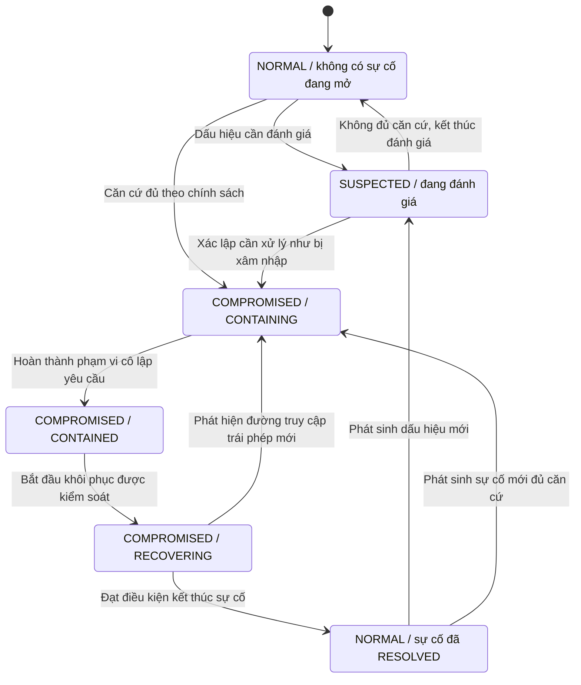

# Trạng thái tài khoản bị xâm nhập

Trong chương **Account State Model** của module **SECURITY_AUTHENTICATION_ACCOUNT_RECOVERY**, **compromised account state** là trạng thái biểu thị hệ thống đã có đủ căn cứ theo chính sách để xử lý tài khoản như một tài khoản bị xâm nhập. Trạng thái này phải có ý nghĩa đối với quyền truy cập, credential, phiên đăng nhập và quy trình khôi phục; một nhãn cảnh báo trên giao diện chưa tạo ra sự bảo vệ đó.

Khi người dùng mất mật khẩu, MFA, passkey hoặc thiết bị xác thực, có thể chỉ xảy ra mất khả năng đăng nhập. Nhưng cũng có thể kẻ khác đang giữ phiên, đã thay kênh liên lạc hoặc đã đăng ký yếu tố mới. Mô hình trạng thái cần phân biệt những tình huống này để vừa giúp chủ tài khoản trở lại, vừa ngăn luồng khôi phục củng cố quyền của đối thủ.

## 1. Mục tiêu học tập

Sau bài học, bạn có thể:

- Giải thích ý nghĩa của trạng thái `COMPROMISED` và phân biệt nó với nghi ngờ, khóa đăng nhập, đình chỉ và đang khôi phục.
- Tách trạng thái bảo mật khỏi vòng đời tài khoản, tiến độ cô lập và trạng thái của từng giao dịch khôi phục.
- Xác định các thay đổi về quyền, phiên và credential khi tài khoản được đánh dấu bị xâm nhập.
- Mô tả điều kiện chuyển trạng thái, xử lý sự kiện trùng và ngăn quyết định khôi phục cũ tiếp tục có hiệu lực.
- Xác định điều kiện để kết thúc sự cố và trả tài khoản về chế độ hoạt động phù hợp.

## 2. Compromised không chỉ có nghĩa là lộ mật khẩu

Một tài khoản bị xâm nhập khi bên không có quyền đã có được khả năng sử dụng hoặc thay đổi một phần quyền kiểm soát tài khoản. Phạm vi có thể nằm ở mật khẩu, authenticator, kênh khôi phục, phiên đăng nhập hoặc quyền đã được cấp cho ứng dụng tích hợp.

Các ví dụ gồm:

- Mật khẩu đã bị lấy cắp và được dùng để truy cập trái phép.
- Cookie phiên hoặc refresh token bị đánh cắp, trong khi mật khẩu và MFA vẫn chưa thay đổi.
- Kẻ tấn công dùng một phiên có sẵn để đăng ký passkey của họ.
- Kênh email khôi phục bị thay trái phép, tạo đường quay lại tài khoản.
- Quyền quản trị hoặc credential tích hợp được tạo ra trong thời gian tài khoản bị chiếm.

Trong thiết kế, `COMPROMISED` là một **quyết định vận hành bảo mật** dựa trên căn cứ được ghi nhận, không phải lời khẳng định rằng hệ thống đã biết chính xác mọi hành vi của đối thủ. Cần lưu riêng phạm vi đã biết, điều còn chưa rõ và lý do quyết định.

Ví dụ, nếu mới xác nhận một phiên bị lấy cắp, không nên ghi như thể đã chứng minh mọi khóa xác thực đều bị lộ. Tuy nhiên, tác động của phiên đó có thể khiến dịch vụ cần cô lập rộng hơn phạm vi bí mật đã được xác nhận mất.

### Mất yếu tố và bị chiếm quyền là hai vấn đề khác nhau

Người dùng quên mật khẩu hoặc làm mất thiết bị không tự động đồng nghĩa có người khác đã chiếm tài khoản. Ngược lại, người dùng vẫn đăng nhập bình thường cũng không chứng minh tài khoản chưa bị xâm nhập: đối thủ có thể đang giữ một phiên khác.

Vì vậy, trạng thái cần dựa trên sự kiện và căn cứ phù hợp, thay vì suy ra từ việc người dùng có hay không có khả năng đăng nhập lúc này.

## 3. Phân biệt các trạng thái gần nhau

| Khái niệm | Ý nghĩa | Điều không được mặc định |
| --- | --- | --- |
| `NORMAL` | Chưa có tình trạng bảo mật đang mở buộc áp dụng chế độ xử lý đặc biệt theo mô hình | Không có cuộc tấn công nào mà hệ thống chưa phát hiện |
| `SUSPECTED` | Có dấu hiệu cần điều tra hoặc kiểm tra bổ sung | Đã xác nhận chiếm đoạt hoặc phải tự động khóa toàn bộ |
| `COMPROMISED` | Đã có đủ căn cứ theo chính sách để xử lý như bị xâm nhập | Đã biết hết phạm vi, đã cô lập xong hoặc đã khôi phục xong |
| Khóa đăng nhập tạm thời | Một cơ chế hạn chế thử đăng nhập hoặc truy cập trong khoảng thời gian hay điều kiện nhất định | Mật khẩu đã bị lộ hoặc tài khoản đã an toàn sau khi hết khóa |
| Đình chỉ tài khoản | Hạn chế theo vòng đời hoặc chính sách dịch vụ | Có thể tự bỏ đình chỉ chỉ vì người dùng hoàn thành khôi phục |
| Đang khôi phục | Có một quy trình lấy lại quyền đang diễn ra | Tài khoản chắc chắn bị chiếm hoặc người yêu cầu đã được xác minh đầy đủ |
| Đã cô lập | Các biện pháp hạn chế đã được áp dụng đạt phạm vi yêu cầu | Nguyên nhân đã được xử lý và có thể cấp lại toàn bộ quyền |

Một tài khoản có thể đồng thời còn tồn tại ở vòng đời `ACTIVE`, có tình trạng bảo mật `COMPROMISED`, đang bị hạn chế quyền và có một hồ sơ khôi phục đang mở. Đây không phải mâu thuẫn; các trường đang mô tả các chiều khác nhau.

Nếu chỉ dùng một trường `status`, đội phát triển dễ tạo quy tắc sai như “khôi phục xong thì đặt `ACTIVE`”, vô tình bỏ cả hạn chế bảo mật lẫn đình chỉ nghiệp vụ.

## 4. Tách các chiều của mô hình trạng thái

Một mô hình minh họa có thể tách các thành phần sau:

| Chiều trạng thái | Câu hỏi được trả lời | Ví dụ giá trị |
| --- | --- | --- |
| Vòng đời tài khoản | Tài khoản còn được phép tồn tại và hoạt động về mặt dịch vụ không? | `ACTIVE`, `SUSPENDED`, `DELETED` |
| Tình trạng bảo mật | Hệ thống đang đánh giá tài khoản ở mức nào? | `NORMAL`, `SUSPECTED`, `COMPROMISED` |
| Tiến độ xử lý sự cố | Đang điều tra, cô lập, khôi phục hay đã kết thúc? | `TRIAGE`, `CONTAINING`, `CONTAINED`, `RECOVERING`, `RESOLVED` |
| Chế độ truy cập | Những nhóm hành động nào hiện được chấp nhận? | `STANDARD`, `RESTRICTED`, `RECOVERY_ONLY` |
| Giao dịch khôi phục | Một yêu cầu cụ thể đã đi đến đâu? | `REQUESTED`, `PROVING`, `AUTHORIZED`, `COMPLETED`, `CANCELLED` |
| Trạng thái credential hoặc phiên | Một phương thức hay quyền truy cập cụ thể còn hiệu lực không? | `VALID`, `SUSPECTED`, `REVOKED`, `REPLACED` |

Tên gọi là lựa chọn thiết kế của bài học, không phải bộ enum bắt buộc. Các chiều cũng không hoàn toàn độc lập: cần quy tắc để cấm tổ hợp không hợp lệ. Chẳng hạn, tài khoản đã xóa không được trở lại hoạt động chỉ vì một giao dịch khôi phục báo hoàn tất.

Một bản chụp trạng thái có thể như sau:

```text
AccountSecuritySnapshot
  account_id: account_example_05
  lifecycle: ACTIVE
  security_posture: COMPROMISED
  incident_ref: incident_example_09
  incident_phase: CONTAINING
  access_mode: RECOVERY_ONLY
  security_version: 51
  session_epoch: 9
  detected_at: server_recorded_time
  compromise_scope: SESSION_AND_UNRECOGNIZED_AUTHENTICATOR
```

Trong ví dụ, tài khoản vẫn tồn tại nhưng đang bị cô lập và chỉ được dùng các đường xử lý sự cố, khôi phục có kiểm soát. `detected_at` là lúc hệ thống phát hiện hoặc ghi nhận; không nhất thiết là lúc cuộc xâm nhập bắt đầu. Nếu có ước lượng thời điểm bắt đầu, cần lưu riêng cùng độ chắc chắn của ước lượng.

`security_version` giúp phát hiện quyết định dựa trên bối cảnh bảo mật cũ. `session_epoch` có thể dùng để làm mất hiệu lực các phiên thuộc thế hệ trước nếu các điểm chấp nhận phiên thực thi kiểm tra này. Hai trường có mục đích khác nhau và không nhất thiết phải tăng cùng lúc trong mọi sự kiện.

## 5. Điều gì cho phép chuyển sang COMPROMISED?

### 5.1. Phân biệt tín hiệu, căn cứ và quyết định

Một IP mới, thiết bị lạ hoặc lỗi xác thực là tín hiệu. Tùy bối cảnh, nó có thể dẫn đến kiểm tra bổ sung hoặc điều tra. Chỉ một tín hiệu như vậy thường không mô tả đầy đủ việc tài khoản đã bị chiếm.

Căn cứ mạnh hơn có thể gồm kết quả điều tra xác nhận phiên bị đánh cắp, thay đổi yếu tố trái phép được đối chiếu qua quy trình phù hợp, hoặc một sự kiện bảo mật có nguồn gốc và nội dung đủ để áp dụng chính sách xử lý tài khoản bị xâm nhập.

Không có một ngưỡng chung cho mọi dịch vụ. Chính sách cần nêu:

- Loại sự kiện và nguồn nào được dùng để xét duyệt.
- Điều kiện nào chỉ tạo nghi ngờ, điều kiện nào cho phép cô lập ngay.
- Tác động của tài khoản và phạm vi hạn chế tương ứng.
- Ai hoặc thành phần nào được quyết định, cùng lý do phải ghi nhận.

### 5.2. Báo cáo của người dùng cần có đường xử lý riêng

Cần cho người dùng báo sự cố ngay cả khi họ không thể đăng nhập. Tuy nhiên, một yêu cầu công khai chỉ chứa email không nên mặc nhiên có quyền thu hồi mọi phiên hoặc khóa tài khoản đích.

Có thể tiếp nhận báo cáo, đánh giá mức tin cậy của kênh và đối chiếu thêm tín hiệu để lựa chọn hành động theo chính sách. Với tình huống cần can thiệp khẩn cấp, cơ chế hạn chế vẫn phải xét nguy cơ đối thủ dùng báo cáo giả để gây gián đoạn cho nạn nhân.

Một người còn phiên hợp lệ có thể cung cấp căn cứ hữu ích, nhưng phiên đó cũng có thể nằm trong phạm vi bị xâm nhập. Quyền báo cáo, quyền yêu cầu khôi phục và quyền gỡ bỏ hạn chế cần được phân biệt.

### 5.3. Ghi rõ phạm vi đã biết và phạm vi chưa biết

Thông tin sự cố nên mô tả các đối tượng liên quan: phiên nào, yếu tố nào, kênh nào, thay đổi bảo mật nào và khoảng thời gian nào đang được xem xét. “Không rõ” là một trạng thái thông tin có ích, không nên bị che bằng một nhãn chung.

Nếu chưa biết đối thủ đã tạo thêm passkey hay chưa, điều kiện kết thúc sự cố phải xử lý được khoảng trống đó. Chỉ thay mật khẩu rồi giả định mọi thứ khác còn nguyên có thể để lại một đường truy cập lâu dài.

## 6. Vòng đời xử lý một tài khoản bị xâm nhập

Sơ đồ sau là hình chiếu của tình trạng bảo mật và tiến độ sự cố, không phải đề xuất gộp mọi chiều thành một enum duy nhất:



Các bước có thể được thực hiện nhanh hoặc cần xử lý lâu hơn tùy hệ thống. Điều quan trọng là trạng thái phải phản ánh việc đã thực hiện, không chỉ ý định thực hiện.

- **`CONTAINING`:** đang áp dụng biện pháp hạn chế và thu hồi; có thể còn điểm thực thi chưa xác nhận.
- **`CONTAINED`:** phạm vi cô lập được yêu cầu đã đạt, nhưng chưa đủ điều kiện cấp lại quyền đầy đủ.
- **`RECOVERING`:** đang xác minh quyền khôi phục và sửa các thành phần liên quan.
- **`RESOLVED`:** các điều kiện kết thúc đã đạt và kết quả được ghi nhận; lịch sử sự cố vẫn được giữ theo chính sách.

Nếu phạm vi sự cố mở rộng sau khi đã cô lập, hệ thống cần quay lại xử lý phần mới. Không nên để trạng thái `CONTAINED` cố định trong khi vừa phát hiện một credential độc lập chưa bị thu hồi.

### Chuyển trạng thái phải có điều kiện

| Chuyển trạng thái | Điều kiện cần có | Tác động cần xem xét |
| --- | --- | --- |
| `NORMAL` sang `SUSPECTED` | Tín hiệu phù hợp và quyết định đánh giá | Kiểm tra bổ sung, theo dõi hoặc hạn chế theo rủi ro |
| `NORMAL` hoặc `SUSPECTED` sang `COMPROMISED` | Căn cứ và chủ thể có quyền theo chính sách | Tạo hoặc gắn sự cố, hạn chế quyền, thu hồi truy cập liên quan |
| `CONTAINING` sang `CONTAINED` | Biện pháp đã được áp dụng đạt phạm vi yêu cầu | Ghi nhận phần nào đã bị vô hiệu hóa, phần nào còn phụ thuộc hệ thống ngoài |
| `CONTAINED` sang `RECOVERING` | Đường khôi phục phù hợp được mở có kiểm soát | Cấp quyền khôi phục giới hạn, không tạo phiên đủ quyền mặc định |
| `RECOVERING` sang kết thúc sự cố | Đạt các điều kiện về chủ thể, credential, phiên và đường truy cập còn lại | Đánh giá lại quyền truy cập dựa trên vòng đời và chính sách hiện hành |
| Đang xử lý sang đánh giá lại | Có căn cứ mới hoặc ràng buộc bảo mật thay đổi | Hủy quyết định cũ liên quan, cô lập bổ sung hoặc yêu cầu bằng chứng mới |

Một giao dịch đặt lại mật khẩu hoàn tất không đồng nghĩa toàn bộ sự cố chuyển sang `RESOLVED`. Giao dịch và sự cố có mục tiêu, phạm vi và vòng đời khác nhau.

## 7. Trạng thái COMPROMISED phải thay đổi quyền thực tế

Khi tài khoản bị xâm nhập, credential đang hợp lệ về mặt kỹ thuật có thể thuộc về đối thủ. Do đó, kiểm tra chữ ký token hoặc mật khẩu đúng là chưa đủ để cho phép hành động.

Có thể mô tả điều kiện cho phép như sau:

```text
Cho phép hành động =
  credential hoặc quyền khôi phục hợp lệ
  AND vòng đời tài khoản cho phép
  AND chế độ bảo mật cho phép hành động này
  AND phạm vi quyền đáp ứng yêu cầu
  AND điều kiện xác minh hoặc xét duyệt tương ứng còn hiệu lực
```

Bảng dưới minh họa một chính sách chọn chế độ `RECOVERY_ONLY` trong sự cố. Đây là ví dụ để làm rõ ý nghĩa trạng thái; dịch vụ cần xác định chính sách cụ thể cho mô hình của mình.

| Nhóm hành động | Khi tài khoản đang COMPROMISED theo chính sách ví dụ |
| --- | --- |
| Gửi báo cáo sự cố hoặc yêu cầu trợ giúp | Có đường tiếp nhận được kiểm soát, chống lạm dụng và tránh tiết lộ dữ liệu |
| Đăng nhập thông thường | Không tự cấp phiên đầy đủ quyền chỉ vì credential đúng |
| Dùng phiên cũ để đọc dữ liệu riêng tư | Không chấp nhận nếu phiên đã bị thu hồi hoặc chế độ hiện tại cấm truy cập |
| Cung cấp bằng chứng trong luồng khôi phục | Cho phép trong phạm vi giao dịch, với kiểm tra phía máy chủ |
| Đổi email hoặc thêm authenticator qua API cài đặt thông thường | Chặn; nếu cần thay, phải đi qua hành động khôi phục được xét duyệt riêng |
| Tạo API key, cấp quyền quản trị, thay đổi bên nhận tiền | Chặn cho đến khi đạt điều kiện chính sách tương ứng |
| Xem chi tiết kết quả điều tra | Chỉ cung cấp cho chủ thể có quyền và mức xác minh phù hợp |
| Hoàn tất thay yếu tố trong một giao dịch khôi phục hợp lệ | Cho phép đúng hành động, đúng tài khoản và đúng bối cảnh bảo mật |

Không chỉ giao diện web cần áp dụng chính sách. API, ứng dụng di động, endpoint cũ, tác vụ nền mang quyền người dùng và dịch vụ nhận token cũng cần có điểm kiểm soát phù hợp.

Một trang cài đặt bị ẩn nhưng endpoint vẫn nhận yêu cầu thay email là một khoảng trống thực thi, dù giao diện đã hiển thị đúng trạng thái bị xâm nhập.

## 8. Cô lập phiên và credential theo phạm vi sự cố

### 8.1. Tránh coi đổi mật khẩu là thu hồi mọi quyền

Đổi mật khẩu có thể chặn lần đăng nhập tiếp theo bằng mật khẩu cũ. Nó không tự hủy cookie phiên, refresh token, access token tự chứa, khóa API hoặc passkey mà đối thủ đã thêm trước đó.

Cần lập danh mục các đường truy cập liên quan:

- Phiên đăng nhập và thiết bị đang có phiên.
- Refresh token và khả năng tiếp tục phát hành access token.
- Authenticator đã đăng ký, gồm yếu tố vừa được thêm hoặc thay.
- Token và quyết định khôi phục còn hiệu lực.
- Credential tích hợp hoặc quyền ứng dụng có liên quan đến khoảng thời gian xâm nhập.
- Quyền quản trị hoặc thay đổi phân quyền có thể đã được tạo trái phép.

Không phải mọi mục đều luôn bị thu hồi giống nhau. Chính sách phải cân nhắc bằng chứng, tác động và khả năng tiếp tục duy trì quyền của đối thủ. Với credential tích hợp, cũng cần xét ảnh hưởng nghiệp vụ và cơ chế thay thế an toàn.

### 8.2. Làm rõ hiệu lực của session epoch

Nếu phiên mang giá trị `session_epoch = 8`, còn tài khoản đã chuyển sang thế hệ `9`, hệ thống có thể từ chối phiên cũ. Điều này chỉ có tác dụng nếu điểm chấp nhận phiên thực sự so sánh với trạng thái đủ mới của tài khoản.

Với access token tự chứa, kiểm tra chữ ký và thời hạn không tự phát hiện thế hệ phiên đã thay đổi. Cần thiết kế kiểm tra trạng thái, cơ chế thu hồi hoặc thời gian sống cùng giới hạn phơi lộ đã được xác định. Cache có thể làm việc thu hồi có độ trễ; phải hiểu và kiểm soát độ trễ đó.

Sau khi kết thúc sự cố, không giảm thế hệ phiên để làm sống lại phiên cũ. Chủ tài khoản và đối thủ có thể cùng đang giữ credential thuộc thế hệ đó. Quyền truy cập mới phải được cấp theo quyết định mới.

### 8.3. Phân biệt hạn chế cục bộ và thu hồi ở hệ thống ngoài

Nếu ứng dụng dùng nhà cung cấp danh tính hoặc nhiều dịch vụ nhận token, cập nhật một hàng dữ liệu cục bộ chưa bảo đảm mọi nơi đã chặn quyền cũ.

Trong khi đang thực hiện thu hồi bên ngoài, trạng thái có thể vẫn là `CONTAINING`. Hệ thống cần ghi nhận kết quả thực thi, thử lại an toàn và đối soát. Với hành động nhạy cảm, điểm thực thi cục bộ có thể cần từ chối theo trạng thái sự cố trước khi việc thu hồi từ xa hoàn tất.

Không nên báo “đã đăng xuất mọi nơi” chỉ vì đã đưa một công việc vào hàng đợi. Đưa vào hàng đợi là ý định thực thi; xác nhận hiệu lực cần cơ chế phù hợp với kiến trúc.

## 9. Ghi nhận trạng thái và tác động theo cách nhất quán

Mã giả dưới đây minh họa lần chuyển đầu tiên sang `COMPROMISED`, với chính sách thu hồi toàn bộ phiên hiện có. Các thay đổi cục bộ có thể được ghi cùng một transaction; thao tác hệ thống ngoài cần cơ chế thực thi bền vững riêng.

```text
handle_first_compromise_event(trusted_event):
    verify_event_source_and_actor_permissions(trusted_event)
    determine_target_account_and_policy(trusted_event)

    begin database transaction
        lock account row

        if trusted_event.id was already applied:
            return recorded result without new effects

        assert account.security_posture in [NORMAL, SUSPECTED]
        assert event_has_required_basis_for_policy(trusted_event)

        create incident with reason and known scope
        account.security_posture = COMPROMISED
        account.incident_phase = CONTAINING
        account.access_mode = RECOVERY_ONLY
        account.security_version += 1
        account.session_epoch += 1

        revoke locally managed refresh credentials under policy
        invalidate affected preexisting recovery permissions
        record audit event without secrets
        enqueue remote revocation and notification in outbox
        record trusted_event.id as applied
    commit database transaction
```

Đoạn mã nhấn mạnh các điểm sau:

- Nguồn sự kiện và quyền của chủ thể thực hiện phải được kiểm tra. Không để client tự gửi `security_posture = NORMAL` hoặc gọi một API đổi trạng thái chung mà không có điều kiện.
- Trạng thái hạn chế, mốc bảo mật và thông tin thực thi cần được ghi nhất quán. Không phát hành phản hồi thành công trước khi commit dữ liệu cần thiết.
- Sự kiện trùng không được liên tục tăng thế hệ phiên hoặc tạo lại sự cố. Cần nhận diện trùng bằng dữ liệu bền vững và xử lý cạnh tranh thích hợp.
- Nếu tài khoản đã `COMPROMISED`, căn cứ mới đi qua đường cập nhật sự cố. Đường này đánh giá phần phạm vi mới cần cô lập, thay vì bỏ qua mọi sự kiện sau lần đầu hoặc khởi động lại toàn bộ một cách máy móc.
- Outbox giúp không mất ý định thu hồi hoặc thông báo khi có lỗi sau commit. Bên xử lý cần chịu được giao lại sự kiện và ghi kết quả thực thi.

Các đường ghi cùng một tài khoản cần có quy tắc khóa hoặc cập nhật phiên bản nhất quán. Nếu việc đổi yếu tố và việc đánh dấu bị xâm nhập có thể cạnh tranh, kết quả cuối không được để lại một quyết định cũ có quyền vượt qua hạn chế mới.

## 10. Ngăn quyền khôi phục cũ vượt qua trạng thái mới

Giả sử một giao dịch khôi phục được xét duyệt khi tài khoản ở `security_version = 50`. Trước khi người yêu cầu hoàn tất, hệ thống xác nhận sự cố và tăng phiên bản lên `51`. Giao dịch cũ không được tiếp tục chỉ vì token vẫn đúng và chưa hết hạn.

Tại bước hoàn tất cần đối chiếu:

1. Giao dịch còn ở trạng thái được phép hoàn tất hay không.
2. Quyền được cấp có đúng tài khoản và đúng hành động không.
3. Thời hạn và trạng thái thu hồi có còn hợp lệ không.
4. Bối cảnh bảo mật hiện tại có còn phù hợp với quyết định trước không.
5. Điều kiện bổ sung cho tài khoản bị xâm nhập đã được đáp ứng chưa.

Nếu bối cảnh liên quan đã thay đổi, quyết định cần bị hủy hoặc được xét lại theo chính sách. Điều đó không nhất thiết có nghĩa mọi bằng chứng cũ đều vô giá trị; nó có nghĩa quyền hoàn tất phải được đánh giá lại với thông tin mới.

Tương tự, một API nhạy cảm có thể đọc tài khoản ở trạng thái bình thường rồi chậm ghi thay đổi trong lúc sự cố đã được mở. Điểm ghi cần có kiểm tra phiên bản hoặc cơ chế tuần tự hóa thích hợp, không chỉ dựa vào kết quả kiểm tra từ đầu request.

Không cần tăng phiên bản bảo mật chỉ vì một ghi chú vận hành không ảnh hưởng điều kiện cho phép. Cần định nghĩa rõ những thay đổi về credential, kênh, quyền và sự cố nào làm quyết định đang tồn tại không còn phù hợp.

## 11. Điều kiện kết thúc trạng thái bị xâm nhập

Không nên định nghĩa điều kiện kết thúc bằng một câu như “người dùng đổi mật khẩu thành công”. Cần xác định những đường kiểm soát nào đã bị ảnh hưởng và điều gì chứng minh chúng không còn cho phép đối thủ duy trì quyền theo phạm vi xử lý.

| Nhóm điều kiện | Câu hỏi cần trả lời trước khi kết thúc |
| --- | --- |
| Quyền của người khôi phục | Người đang được cấp lại quyền đã đáp ứng đường xác minh phù hợp với tài khoản và hành động chưa? |
| Credential bị ảnh hưởng | Những mật khẩu, authenticator hoặc bí mật được xác định liên quan đã bị thay, gỡ hoặc thu hồi theo chính sách chưa? |
| Phiên và khả năng phát hành token | Quyền truy cập cũ đã bị xử lý đạt phạm vi yêu cầu; các điểm thực thi có hiệu lực phù hợp chưa? |
| Kênh khôi phục | Kênh dùng về sau có ràng buộc đáng tin không; thay đổi trái phép đã được xử lý chưa? |
| Cơ chế duy trì quyền khác | Passkey lạ, API credential, quyền ứng dụng hoặc thay đổi phân quyền liên quan đã được xem xét chưa? |
| Trạng thái sự cố | Còn phát hiện mới, phần cô lập chưa hoàn tất hoặc sự cố khác đang ngăn trả quyền không? |
| Kết quả và khả năng theo dõi | Có bản ghi quyết định, thông báo cần thiết và cơ chế xử lý nếu phát hiện truy cập trái phép tiếp diễn không? |

### 11.1. Xử lý nguyên nhân trong phạm vi có thể kiểm chứng

Nếu hộp thư là đường bị xâm nhập, chỉ gửi thêm một email rồi nhận phản hồi không chứng minh hộp thư đã hết bị chiếm. Nếu thiết bị đang nhiễm mã độc, tạo lại bí mật trên chính thiết bị đó có thể làm bí mật mới tiếp tục bị lấy.

Dịch vụ không phải lúc nào cũng quan sát được trạng thái an toàn của thiết bị hoặc hộp thư bên ngoài. Cần nêu rõ giới hạn và chọn đường xử lý phù hợp: bằng chứng khác, một kênh được thiết lập lại có căn cứ, bước hỗ trợ hoặc hạn chế tạm thời theo chính sách. Không ghi “nguyên nhân đã được loại bỏ” chỉ từ một bước mà hệ thống không có khả năng kiểm chứng kết luận đó.

### 11.2. Trả quyền theo vòng đời và mức bảo đảm hiện tại

Kết thúc sự cố bảo mật không tự gỡ đình chỉ nghiệp vụ, thay đổi vai trò tổ chức hoặc khôi phục tài khoản đã xóa. Quyền truy cập cuối cần được tính lại từ các điều kiện hiện hành.

Phiên mới chỉ được tạo khi đã có quyết định cho phép phù hợp. Không chuyển một phiên khôi phục giới hạn thành phiên đầy đủ quyền chỉ vì tiến độ sự cố được sửa thành `RESOLVED`.

Nếu chính sách áp dụng hạn chế một số thao tác nhạy cảm sau khôi phục, cần mô tả rõ phạm vi, điều kiện gỡ và thời điểm đánh giá lại. Không dùng một trạng thái mơ hồ khiến người dùng bị hạn chế vô thời hạn mà không có đường xử lý.

### 11.3. Hết thời gian chờ không đồng nghĩa hết sự cố

Token khôi phục hết hạn có thể làm một giao dịch thành `EXPIRED`; nó không làm tài khoản tự chuyển từ `COMPROMISED` về `NORMAL`. Tương tự, vài ngày không thấy cảnh báo mới chưa đủ chứng minh đối thủ đã mất mọi đường truy cập.

Bộ đếm thời gian có thể kích hoạt nhắc việc, đánh giá lại hoặc kết thúc một hạn chế có phạm vi đã được định nghĩa. Việc kết thúc sự cố vẫn cần điều kiện có căn cứ, không chỉ một tác vụ đặt lại trạng thái theo lịch.

### 11.4. Nếu kết luận ban đầu là dương tính giả

Có thể sau điều tra, căn cứ ban đầu được xác định là sai hoặc không còn hỗ trợ kết luận bị xâm nhập. Khi đó, chủ thể có quyền có thể điều chỉnh trạng thái theo quy trình, ghi lý do và giữ lịch sử quyết định.

Không khôi phục hiệu lực của token đã thu hồi hoặc giảm phiên bản bảo mật để trở về một bản chụp cũ. Thay vào đó, cấp quyền mới khi đủ điều kiện. Điều chỉnh kết luận và phục hồi bí mật cũ là hai việc khác nhau.

## 12. Ví dụ xuyên suốt: đối thủ thêm passkey từ phiên bị đánh cắp

Giả sử tài khoản của Hương có mật khẩu, TOTP và một số phiên đang hoạt động. Đối thủ lấy được một phiên; qua đường cài đặt có kiểm soát chưa đầy đủ, họ đăng ký thêm passkey. Kết quả kiểm tra nội bộ sau đó xác nhận thay đổi này là trái phép và có liên quan đến phiên bị đánh cắp.

Đây là giả định đã có căn cứ xác nhận trong ví dụ. Chỉ nhìn thấy một passkey mới trong hệ thống thật chưa tự chứng minh nó thuộc về đối thủ.

| Thời điểm | Sự kiện | Ý nghĩa đối với trạng thái và quyền |
| --- | --- | --- |
| T0 | Tài khoản có `security_version = 50`, `session_epoch = 8` | Một yêu cầu khôi phục cũ đã được duyệt trong bối cảnh này |
| T1 | Hệ thống xác lập sự cố theo chính sách | Chuyển sang `COMPROMISED / CONTAINING`, hạn chế quyền, tăng phiên bản lên `51` và thế hệ phiên lên `9` |
| T2 | Đối thủ dùng lại phiên thế hệ `8` | Điểm thực thi từ chối theo chính sách thu hồi, dù credential phiên có thể chưa hết hạn tự nhiên |
| T3 | Yêu cầu khôi phục cũ gửi lệnh hoàn tất | Quyết định ở phiên bản `50` không tự vượt qua bối cảnh mới; cần bị hủy hoặc xét lại |
| T4 | Hương đi qua đường khôi phục phù hợp với sự cố | Được cấp quyền giới hạn cho hành động cụ thể, không mặc định có toàn bộ quyền tài khoản |
| T5 | Mật khẩu đã được đổi nhưng passkey lạ chưa bị xử lý | Sự cố chưa đạt điều kiện kết thúc; đối thủ vẫn có thể giữ một đường truy cập |
| T6 | Các đường truy cập liên quan được xử lý và điều kiện kết thúc đều đạt | Kết thúc sự cố, tính lại quyền và cấp phiên mới theo chính sách hiện hành |

Ở T5, giao diện “đặt lại mật khẩu thành công” có thể hoàn toàn đúng, nhưng tài khoản vẫn chưa đủ điều kiện trở lại chế độ bình thường. Mô hình trạng thái tốt cho phép biểu diễn chính xác hai sự thật đó.

Cũng cần xem thay đổi phân quyền trong khoảng thời gian xâm nhập. Nếu đối thủ đã tạo API key hoặc cấp vai trò cho một tài khoản khác, xóa passkey lạ chưa chắc xử lý hết cơ chế duy trì quyền. Việc điều tra và sửa những thay đổi này phải dựa trên căn cứ, tránh hoàn tác mù quáng cả thay đổi hợp lệ của người dùng.

## 13. Các tình huống vận hành dễ làm sai trạng thái

### 13.1. Tác vụ thu hồi đến muộn

Một tác vụ thu hồi có thể được giao lại sau khi người dùng đã hoàn tất khôi phục. Tác vụ cần mang tham chiếu sự cố, phạm vi credential hoặc thế hệ phiên mục tiêu, cùng thông tin cần thiết để xử lý đúng bối cảnh.

Nếu chỉ lưu lệnh chung “thu hồi mọi phiên ngay khi chạy”, tác vụ đến muộn có thể thu hồi cả phiên mới vừa được cấp hợp lệ. Nếu dịch vụ ngoài chỉ hỗ trợ thu hồi toàn bộ, quy trình phải sắp xếp thời điểm thực thi và xác nhận trước khi trả quyền, hoặc có cách xử lý tác động đó rõ ràng.

Một phản hồi cũ cũng không được tự ghi `CONTAINED` hoặc `RESOLVED` cho một sự cố mới. Chuyển trạng thái cần đối chiếu mã sự cố, phiên bản và điều kiện hiện tại, thay vì tin rằng mọi kết quả thành công đều còn phù hợp.

### 13.2. Một phần dịch vụ chưa nhận được trạng thái mới

Nếu dịch vụ A từ chối phiên cũ nhưng dịch vụ B vẫn dùng cache không được cập nhật, đối thủ có thể đi qua B. Mô hình cần xác định những điểm nào phải thực thi hạn chế, thời gian lan truyền và cách xử lý khi không đọc được trạng thái đủ mới.

Với thao tác nhạy cảm, thiếu thông tin bắt buộc để quyết định không nên tự chuyển thành cho phép. Có thể trì hoãn thao tác hoặc dùng đường kiểm tra khác đã được thiết kế, đồng thời giữ các chức năng trợ giúp phù hợp hoạt động.

### 13.3. Nhân viên hỗ trợ bỏ hạn chế trực tiếp

Một nút “mở khóa” chỉ sửa `access_mode` có thể làm tài khoản đủ quyền trở lại trong khi tình trạng bảo mật vẫn là `COMPROMISED`. Ngược lại, sửa mỗi nhãn trạng thái mà quên xử lý phiên cũng tạo kết quả không nhất quán.

Các thao tác hỗ trợ nên là hành động nghiệp vụ có điều kiện: ghi nhận căn cứ, xác định quyền của người xử lý, kiểm tra phạm vi và ghi nhật ký. Với trường hợp đặc quyền, dịch vụ có thể yêu cầu xét duyệt tách nhiệm vụ theo chính sách.

Không dùng việc nhân viên đã tiếp nhận cuộc gọi hoặc người yêu cầu tạo áp lực làm điều kiện tự bỏ mọi kiểm soát. Cũng không yêu cầu người dùng gửi mật khẩu, OTP hay mã khôi phục vào cuộc trò chuyện để nhân viên nhập thay.

### 13.4. Chỉ sửa sự cố đầu tiên khi còn sự cố khác

Nếu hệ thống cho phép nhiều hồ sơ điều tra hoặc sự cố cùng liên quan một tài khoản, việc đóng một hồ sơ chưa đủ để trả trạng thái về bình thường. Cần đánh giá các điều kiện ngăn trả quyền còn lại.

Một thiết kế dùng một tham chiếu sự cố đang hoạt động cần quy tắc gộp hoặc liên kết phát hiện mới. Một thiết kế nhiều hồ sơ cần quy tắc tổng hợp tình trạng bảo mật và hạn chế hiệu lực. Cả hai cách đều phải tránh để một quyết định cũ kết thúc nhầm sự cố mới.

## 14. Nhật ký, thông báo và theo dõi trạng thái

Mỗi chuyển trạng thái quan trọng nên ghi được:

- Tài khoản và sự cố liên quan bằng tham chiếu nội bộ.
- Trạng thái trước, trạng thái sau và thời điểm máy chủ ghi nhận.
- Nguồn sự kiện, chủ thể quyết định, mã lý do và chính sách áp dụng.
- Phiên bản bảo mật, phạm vi thu hồi cùng kết quả thực thi liên quan.
- Điều kiện còn thiếu trước khi cô lập hoặc khôi phục được coi là hoàn tất.

Không ghi token, cookie, OTP, mật khẩu hoặc URL khôi phục chứa bí mật. Thông tin điều tra và dữ liệu cá nhân cần giới hạn quyền xem cùng thời hạn lưu phù hợp.

Thông báo cho người dùng nên phân biệt “đã nhận báo cáo”, “đang hạn chế truy cập”, “đã hoàn tất thay yếu tố” và “sự cố đã được kết thúc”. Chỉ thông báo kết quả thực tế, đặc biệt khi thu hồi ở nhiều hệ thống còn đang chờ.

Kênh cảnh báo cần được lựa chọn theo bối cảnh trước thay đổi và mức tin cậy hiện có. Nếu kênh đó có thể đã bị chiếm, việc gửi thông báo đến nó không đủ làm cơ chế xác minh duy nhất để kết thúc sự cố.

Các số liệu có ích gồm thời gian từ phát hiện đến hạn chế có hiệu lực, số điểm thu hồi còn chờ, thời gian hoàn tất khôi phục, tỷ lệ kết luận sai và trường hợp truy cập trái phép tiếp diễn sau khôi phục. Chúng giúp nhận ra mô hình đã ghi trạng thái nhưng biện pháp thực tế chưa theo kịp.

## 15. Các bất biến cần giữ trong mô hình

1. Yêu cầu khôi phục hoặc báo cáo chưa được chứng minh không tự tạo quyền khóa tùy ý tài khoản khác.
2. Tài khoản `COMPROMISED` không được tiếp tục có quyền thông thường chỉ vì credential hoặc token có chữ ký hợp lệ.
3. Đổi mật khẩu không tự kết thúc sự cố có phạm vi rộng hơn mật khẩu.
4. Một quyết định hoàn tất phải phù hợp với phiên bản và trạng thái bảo mật tại điểm thay đổi có hiệu lực.
5. Sự kiện trùng và kết quả đến muộn không tạo thêm quyền, làm sống lại phiên cũ hoặc kết thúc nhầm sự cố mới.
6. `CONTAINED` phản ánh phạm vi cô lập đã đạt; `RESOLVED` phản ánh các điều kiện kết thúc đã đạt.
7. Kết thúc sự cố không gỡ các hạn chế độc lập của vòng đời tài khoản và không khôi phục credential đã thu hồi.
8. Luồng khôi phục vẫn có đường tiếp tục được kiểm soát cho chủ tài khoản, cùng thông tin rõ về bước còn thiếu.

Trạng thái tài khoản bị xâm nhập có giá trị khi nó nối được căn cứ phát hiện với hạn chế thực tế, tiến độ xử lý và điều kiện trả quyền. Khi các chiều trạng thái được tách rõ và các chuyển trạng thái được kiểm soát, hệ thống có thể vừa cô lập đối thủ vừa hỗ trợ chủ tài khoản lấy lại quyền một cách có căn cứ.
