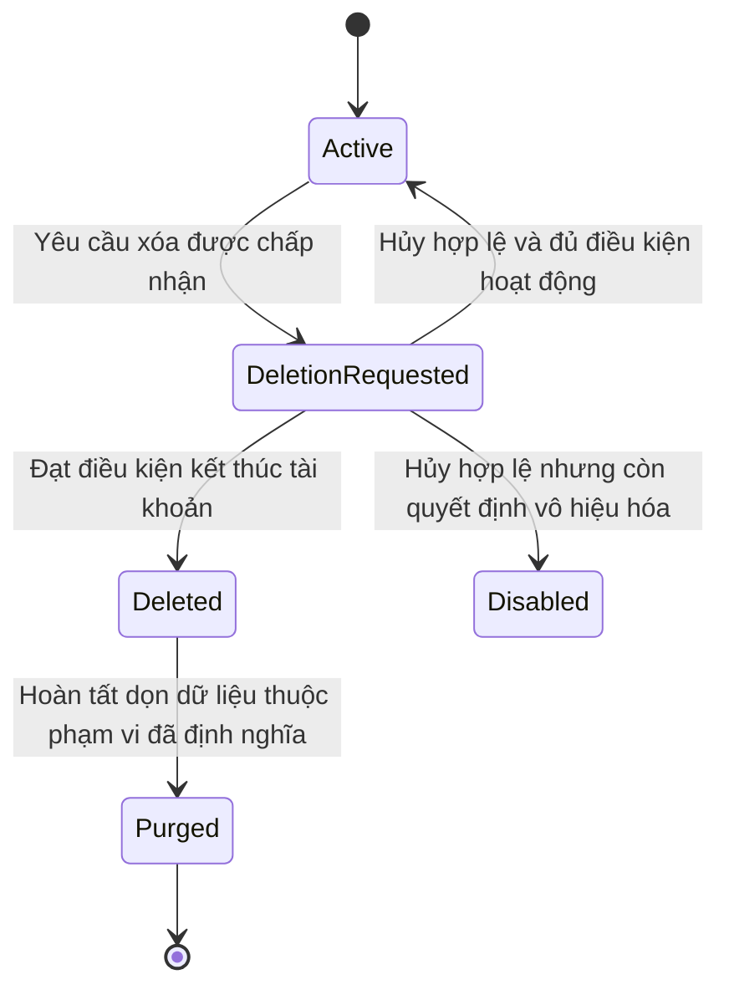

# Trạng thái tài khoản đã xóa

## 1. Định nghĩa và ranh giới của trạng thái đã xóa

**Trạng thái tài khoản đã xóa — deleted account state — biểu thị rằng quan hệ tài khoản đã kết thúc theo quy trình vòng đời của dịch vụ và tài khoản đó không còn được sử dụng qua các đường truy cập thông thường.** Trạng thái này cần được backend thực thi, ngay cả khi một phần dữ liệu vẫn còn trong kho lưu trữ hoặc người dùng vẫn giữ phương tiện xác thực cũ.

Trong mô hình của bài này, `DELETED` chặn đăng nhập, sử dụng quyền truy cập thông thường và khôi phục phương tiện xác thực theo luồng thông thường. Nếu sản phẩm hỗ trợ phục hồi một tài khoản đã xóa, đó phải là một chuyển trạng thái riêng, có điều kiện và thẩm quyền rõ ràng.

Trạng thái đã xóa không tự trả lời dữ liệu đã bị loại bỏ vật lý đến đâu. Một hệ thống có thể xóa quyền sử dụng trước, rồi thực hiện các tác vụ dọn dữ liệu theo chính sách. Ngược lại, việc còn một hàng dữ liệu không chứng minh tài khoản được phép đăng nhập hoặc được phép phục hồi.

Trong module `SECURITY_AUTHENTICATION_ACCOUNT_RECOVERY`, người dùng cần được hỗ trợ khi mất mật khẩu, MFA, passkey hoặc thiết bị xác thực. Tuy nhiên, **mất phương tiện xác thực khác với kết thúc vòng đời tài khoản**. Một luồng đặt lại mật khẩu không được tự diễn giải tài khoản đã xóa thành tài khoản đang hoạt động.

Ví dụ, Bình đã xóa tài khoản nhưng vẫn giữ passkey trên điện thoại. Việc tạo được một phản hồi mật mã hợp lệ bằng khóa cũ chưa đủ để cho phép sử dụng tài khoản: điều kiện vòng đời của tài khoản vẫn phải được kiểm tra.

## 2. Phân biệt các trạng thái thường bị gộp chung

| Trạng thái hoặc khái niệm | Ý nghĩa chính | Quan hệ với khôi phục tài khoản |
| --- | --- | --- |
| Đang hoạt động — active | Tài khoản còn trong vòng đời sử dụng | Có thể khôi phục nếu đáp ứng các điều kiện tương ứng |
| Bị khóa — locked | Một hoặc nhiều đường truy cập đang bị hạn chế | Có thể cần mở khóa hoặc thay phương tiện theo phạm vi được phép |
| Bị vô hiệu hóa — disabled | Tài khoản bị ngừng hoạt động theo quyết định quản trị hoặc chính sách | Đổi mật khẩu không mặc nhiên kích hoạt lại |
| Đã yêu cầu xóa — deletion requested | Đã có một ý định xóa hợp lệ nhưng còn bước xử lý hoặc khoảng chờ nếu sản phẩm có hỗ trợ | Có thể có đường hủy yêu cầu riêng; chưa đồng nghĩa được phục hồi bằng quên mật khẩu |
| Đã xóa về mặt nghiệp vụ — deleted | Tài khoản không còn được sử dụng thông thường | Luồng khôi phục thông thường phải từ chối tạo lại quyền truy cập |
| Đã dọn dữ liệu theo phạm vi — purged | Các dữ liệu thuộc phạm vi dọn đã được xử lý theo chính sách | Không được hứa lấy lại dữ liệu đã không còn khả năng phục hồi |
| Còn bản sao lưu hoặc bản ghi lưu giữ | Một số dữ liệu còn tồn tại trong phạm vi vận hành được xác định | Không tự tạo quyền sử dụng hoặc quyền phục hồi tài khoản |

Các nhãn trong bảng là quy ước minh họa. Sản phẩm cần định nghĩa nghĩa chính xác của từng nhãn thay vì giả định từ “xóa” luôn có cùng tác động ở mọi hệ thống.

Một ví dụ chuẩn hóa ở phạm vi giao thức là SCIM: RFC 7644 cho phép nhà cung cấp chưa loại bỏ vĩnh viễn tài nguyên, nhưng tài nguyên đã xóa phải bị loại khỏi kết quả truy vấn và các thao tác gắn với tài nguyên đó nhận phản hồi không tìm thấy theo quy tắc của giao thức. Điều này minh họa sự tách biệt giữa trạng thái hiển thị, khả năng thao tác và việc giữ dữ liệu bên trong. Quy tắc HTTP cụ thể này áp dụng cho SCIM, không phải yêu cầu chung cho mọi biểu mẫu khôi phục. [Nguồn: RFC 7644, Deleting Resources](https://www.rfc-editor.org/rfc/rfc7644.html#section-3.6).

## 3. Tách vòng đời tài khoản khỏi tiến độ dọn dữ liệu

### 3.1. Một trường `deleted=true` chưa diễn đạt đủ

Nếu cùng một cờ vừa biểu thị chặn truy cập, vừa biểu thị dữ liệu đã xóa xong, các thành phần dễ hiểu sai. Một worker dọn dữ liệu thất bại có thể khiến hệ thống vô tình giữ tài khoản ở trạng thái còn được dùng; một tác vụ đổi mật khẩu có thể xóa cờ và làm sống lại tài khoản.

Có thể phân biệt các chiều khái niệm:

```text
account_lifecycle       : ACTIVE / DISABLED / DELETE_REQUESTED / DELETED
ordinary_access        : quyết định truy cập được suy ra từ vòng đời và chính sách
recovery_eligibility   : có được thực hiện loại khôi phục đang yêu cầu không
deletion_cleanup       : NOT_STARTED / RUNNING / PARTIAL / COMPLETED
restoration_eligibility: không hỗ trợ / còn đủ điều kiện / hết điều kiện
```

Đây là cách diễn đạt mô hình, không phải yêu cầu phải tạo đúng các cột trên. Nếu lưu các giá trị suy ra, hệ thống cần bảo đảm chúng không mâu thuẫn với vòng đời có thẩm quyền.

Ví dụ, `account_lifecycle=DELETED` và `deletion_cleanup=PARTIAL` có thể là trạng thái hợp lệ: truy cập đã bị chặn nhưng công việc dọn dữ liệu chưa xong. Trong mô hình này, `DELETED` đi cùng quyền khôi phục mật khẩu thông thường vẫn còn hiệu lực là một mâu thuẫn cần xử lý.

### 3.2. Có thời gian giữ dữ liệu không đồng nghĩa có thời gian phục hồi

Một số dữ liệu có thể được giữ cho mục đích vận hành riêng theo chính sách và yêu cầu áp dụng. Việc giữ đó không bảo đảm hệ thống còn đầy đủ dữ liệu, bí mật hoặc quyền để tái lập tài khoản.

Nếu sản phẩm cung cấp một thời hạn phục hồi, cần định nghĩa rõ mốc bắt đầu, mốc kết thúc, dữ liệu còn có thể lấy lại và điều kiện chuyển trạng thái. Không suy thời hạn phục hồi từ thời gian giữ bản sao lưu.

Tương tự, việc dọn một tập dữ liệu hoàn tất không có nghĩa mọi bản sao ở mọi hệ thống đã biến mất. Trạng thái và thông điệp cần nêu đúng phạm vi đã được xử lý.

## 4. Chuyển trạng thái xóa và hủy yêu cầu xóa

### 4.1. Luồng vòng đời minh họa



Sơ đồ không khẳng định mọi sản phẩm phải có khoảng chờ hoặc cho phép hủy. Nếu xóa có hiệu lực ngay và không thể phục hồi theo chính sách, không được tự tạo đường quay lại chỉ vì có thể sửa một trường trong cơ sở dữ liệu.

Trạng thái `Purged` ở đây mô tả một mốc xử lý dữ liệu của mô hình minh họa; nó không khẳng định mọi nhật ký hoặc bản sao lưu đều đã bị xóa cùng lúc.

### 4.2. Yêu cầu xóa cần có thẩm quyền phù hợp

Địa chỉ email công khai không đủ để tạo một quyết định xóa tài khoản. Cần kiểm tra danh tính, quyền thực hiện và các điều kiện xác nhận tương ứng với tác động của thao tác.

Nếu người dùng mất phương tiện xác thực nhưng muốn xóa tài khoản, hệ thống cần đường xử lý có kiểm chứng phù hợp. Không nên chấp nhận một lời khai chưa xác minh rồi xóa tài khoản để tránh phải xử lý khôi phục.

### 4.3. Hủy yêu cầu xóa phải là một quyết định rõ ràng

Nếu cho phép hủy trong khoảng chờ, cần xác minh đúng người, đúng yêu cầu và còn trong thời hạn cho phép. Một lần truy cập bằng session cũ không nên âm thầm hủy ý định xóa nếu người dùng chưa được thông báo và chưa thực hiện hành động xác nhận phù hợp.

Sau khi hủy, hệ thống cần tính lại trạng thái từ các chính sách đang có hiệu lực. Nếu tài khoản đồng thời bị vô hiệu hóa hoặc có hạn chế an ninh độc lập, hủy xóa không được tự đưa tài khoản về toàn quyền.

## 5. Các đường truy cập phải tôn trọng trạng thái đã xóa

### 5.1. Kiểm tra vòng đời tại điểm cấp và sử dụng quyền

Chặn đăng nhập trên giao diện chưa đủ nếu API di động, refresh token hoặc endpoint khôi phục vẫn tạo quyền truy cập. Trạng thái đã xóa phải được xét ở các điểm quyết định có liên quan.

OWASP khuyến nghị mặc định từ chối và kiểm tra quyền trên mọi yêu cầu thích hợp, thay vì dựa vào một lần xác thực trước đó. Áp dụng vào bài này, bằng chứng xác thực hợp lệ không được bỏ qua điều kiện vòng đời của tài khoản đích. [Nguồn: OWASP, Authorization Cheat Sheet](https://cheatsheetseries.owasp.org/cheatsheets/Authorization_Cheat_Sheet.html#validate-the-permissions-on-every-request).

| Đường truy cập | Hành vi cần có khi tài khoản đã xóa |
| --- | --- |
| Đăng nhập bằng mật khẩu | Không cấp phiên sử dụng thông thường dù mật khẩu khớp |
| Đăng nhập bằng passkey | Không cấp quyền chỉ vì phản hồi mật mã hợp lệ |
| Refresh token | Không tiếp tục phát hành quyền truy cập cho tài khoản đã kết thúc |
| Session và access token cũ | Bị chặn theo cơ chế thực thi trạng thái và thu hồi được thiết kế |
| Liên kết hoặc mã khôi phục cũ | Không được thay phương tiện rồi kích hoạt lại tài khoản |
| Khóa API và quyền truy cập được cấp cho tài khoản | Được xử lý theo phạm vi kết thúc tài khoản; không bỏ sót đường truy cập ngoài trình duyệt |
| Công cụ hỗ trợ hoặc quản trị | Chỉ thực hiện các thao tác có thẩm quyền riêng, không có nút kích hoạt lại vô điều kiện |

Các thao tác phục vụ quản trị việc xóa, báo cáo hoặc xử lý một yêu cầu phục hồi riêng có thể có thẩm quyền khác. Chúng không nên dùng session thông thường của tài khoản đã xóa như thể tài khoản vẫn hoạt động.

### 5.2. Session không tự biến mất khi một hàng dữ liệu đổi trạng thái

Nếu API chỉ kiểm tra chữ ký và thời hạn của access token, token đã phát hành có thể tiếp tục được chấp nhận dù tài khoản đã đổi trạng thái ở một dịch vụ khác.

Thiết kế cần cơ chế thực thi phù hợp, như kiểm tra trạng thái, phiên bản bảo mật hoặc cơ chế thu hồi được các điểm truy cập chấp nhận. Nếu quá trình có độ trễ, hợp đồng sản phẩm phải thể hiện đúng bảo đảm thực tế và các biện pháp giới hạn rủi ro trong khoảng chuyển tiếp.

Không nên tuyên bố “tài khoản đã ngừng mọi truy cập” khi mới gửi một thông điệp yêu cầu các dịch vụ thu hồi session. Nghĩa vụ chặn truy cập cần được xác nhận theo mô hình thực thi đã chọn.

### 5.3. Tác vụ nền cũng là một đường sử dụng quyền

Các tác vụ xuất dữ liệu, gửi webhook, tạo báo cáo hoặc xử lý thông điệp có thể chạy sau thời điểm xóa. Cần xác định tác vụ nào phải dừng và tác vụ nào tiếp tục chỉ để hoàn tất nghĩa vụ quản trị việc xóa.

Worker không nên tiếp tục sử dụng một ảnh chụp quyền cũ mà không xét trạng thái mới khi hành động còn nhạy cảm. Các liên kết tải dữ liệu được cấp trước đó cũng cần được xem xét trong phạm vi kết thúc quyền truy cập.

## 6. Token khôi phục cũ và cập nhật đồng thời

### 6.1. Token từng hợp lệ chưa chắc còn được phép sử dụng

Giả sử một token đặt lại mật khẩu được cấp khi tài khoản đang hoạt động. Sau đó, yêu cầu xóa được hoàn tất. Token còn thời hạn về mặt thời gian không có nghĩa vẫn được dùng để đổi mật khẩu hoặc mở phiên.

Ở thời điểm sử dụng token, backend phải kiểm tra tài khoản đích, mục đích, trạng thái hiện tại, hiệu lực quyền khôi phục và các điều kiện liên quan. Không chỉ kiểm tra chữ ký hoặc thời điểm hết hạn của chuỗi token.

Một quy tắc khái niệm cho luồng đặt lại mật khẩu thông thường có thể là:

```text
Trong phạm vi cập nhật có kiểm soát đồng thời:
    đọc trạng thái tài khoản và quyền khôi phục có thẩm quyền
    yêu cầu tài khoản không ở trạng thái DELETED
    yêu cầu vòng đời cho phép đúng loại đặt lại đang thực hiện
    yêu cầu token gắn đúng account_id và mục đích
    yêu cầu token còn hiệu lực, chưa dùng và chưa bị vô hiệu hóa
    yêu cầu phiên bản liên quan còn phù hợp nếu thiết kế sử dụng phiên bản
    tiêu thụ quyền một lần và lưu thay đổi được phép một cách nhất quán
    không tự ghi account_lifecycle = ACTIVE
```

Đây là đặc tả hành vi, không phải mã triển khai hoàn chỉnh. Cơ chế khóa, điều kiện cập nhật hoặc giao dịch cần bảo đảm việc xóa và việc thay phương tiện không cùng vượt qua các kiểm tra đã lỗi thời.

### 6.2. Kết quả phải có một thứ tự nhất quán

Nếu thay mật khẩu được ghi trước, việc xóa sau đó vẫn phải kết thúc quyền truy cập và các quyền khôi phục liên quan. Nếu xóa đã có hiệu lực trước, lần thay mật khẩu thông thường sau đó phải bị từ chối.

Lỗi nguy hiểm là cả hai thao tác đọc `ACTIVE`, rồi một thao tác ghi `DELETED` còn thao tác kia ghi lại toàn bộ bản ghi cũ thành `ACTIVE`. Cần giới hạn trường được cập nhật và kiểm tra điều kiện vòng đời tại lúc ghi, không chỉ lúc đọc ban đầu.

Với hệ thống phân tán, một giao dịch cục bộ không tự giải quyết việc API khác dùng cache cũ. Cần kết hợp tính nhất quán của thay đổi trạng thái với cơ chế thực thi quyền trên các dịch vụ liên quan.

## 7. Phục hồi tài khoản đã xóa, nếu sản phẩm có hỗ trợ

### 7.1. Đây là một loại thao tác riêng

Phục hồi một tài khoản đã xóa không nên là tác dụng phụ của đặt lại mật khẩu. Nó cần một yêu cầu có mục đích rõ ràng, kiểm tra điều kiện phục hồi và thẩm quyền cho việc chuyển trạng thái.

Các điều kiện có thể bao gồm:

- Sản phẩm thực sự cho phép phục hồi loại tài khoản này.
- Yêu cầu còn trong thời hạn được công bố, nếu có.
- Dữ liệu cần thiết vẫn còn và có thể được sử dụng cho mục đích phục hồi theo chính sách.
- Có đủ bằng chứng liên kết người yêu cầu với đúng tài khoản và quyền yêu cầu phục hồi.
- Không có quyết định quản trị hoặc hạn chế độc lập ngăn tài khoản hoạt động.
- Các bước tái lập phương tiện xác thực và quyền truy cập được thực hiện theo chính sách hiện tại.

Có đầy đủ dữ liệu không thay thế các điều kiện còn lại. Xác minh được chủ thể cũng không tự làm một thao tác phục hồi bị chính sách cấm trở nên được phép.

### 7.2. Không phục hồi các bí mật và quyền cũ một cách máy móc

Một luồng phục hồi được cho phép cần xét phương tiện nào đã bị thu hồi, có dấu hiệu bị lộ hoặc không còn đáp ứng yêu cầu. Không được tự làm sống lại các session, token khôi phục và khóa API cũ chỉ vì tài khoản quay lại một trạng thái có thể sử dụng.

Tương tự, vai trò quản trị, tư cách thành viên và quyền ủy quyền cần được đánh giá theo trạng thái hiện tại. Một người từng có quyền tháng trước có thể không còn được tổ chức cấp quyền hôm nay.

Nếu cần gắn mật khẩu, MFA hoặc passkey mới, hãy cấp khả năng thiết lập có phạm vi hẹp. Chỉ mở phiên sử dụng khi các yêu cầu xác thực và cấp quyền tương ứng đã đạt.

### 7.3. Không hứa phục hồi phần đã không còn

Một tài khoản có thể còn thông tin tối thiểu để xác định sự kiện xóa nhưng không còn dữ liệu cần thiết để tái lập trải nghiệm cũ. Hệ thống phải nói rõ giới hạn đó.

Nếu tài khoản không còn đủ điều kiện phục hồi, việc đăng ký mới — nếu được cho phép — là một quan hệ tài khoản mới. Không được dùng danh nghĩa đăng ký lại để âm thầm gắn dữ liệu hoặc quyền của tài khoản cũ cho người đang giữ cùng địa chỉ liên hệ.

## 8. Tái sử dụng email, định danh và đăng nhập liên kết

### 8.1. Cùng email không đồng nghĩa cùng tài khoản

Giả sử tài khoản cũ có `account_id=U-410` đã bị xóa. Sau đó, dịch vụ cho phép một đăng ký mới với cùng email và cấp `account_id=U-963`.

Hai mã này phải đại diện cho hai quan hệ tài khoản riêng. Token cũ của U-410 không được dùng với U-963; dữ liệu và quyền cũ không được tự nối sang tài khoản mới chỉ vì chuỗi email trùng nhau.

Trong SCIM, RFC 7643 quy định thuộc tính `id` phải ổn định và không được cấp lại cho một tài nguyên khác. Đây là một ví dụ chuẩn hóa về việc tách định danh tài nguyên khỏi các thuộc tính có thể được tái sử dụng. [Nguồn: RFC 7643, Common Attributes](https://www.rfc-editor.org/rfc/rfc7643.html#section-3.1).

Việc một dịch vụ có cho phép dùng lại email hoặc tên đăng nhập hay không là chính sách riêng. Dù chọn phương án nào, không nên tái sử dụng định danh tài khoản theo cách làm token, liên kết hoặc tác vụ cũ tác động nhầm chủ thể mới.

### 8.2. Đăng nhập liên kết không tự ghi đè quyết định xóa

Người dùng có thể tiếp tục đăng nhập được ở nhà cung cấp danh tính bên ngoài trong khi tài khoản ứng dụng đã bị xóa. Kết quả xác thực ở nhà cung cấp chứng minh một sự kiện danh tính; nó không tự cho phép tài khoản ứng dụng cũ hoạt động lại.

Cần định nghĩa hành vi của đăng ký tự động khi đăng nhập liên kết: từ chối, tạo tài khoản mới theo chính sách hoặc chuyển sang quy trình được cho phép. Không được tự xóa dấu vết đã kết thúc tài khoản rồi tái gắn mọi quyền cũ.

Tương tự, một thông điệp đồng bộ danh tính đến muộn không nên làm sống lại tài nguyên đã xóa mà không có quyết định cấp lại phù hợp. Ánh xạ định danh và thứ tự sự kiện phải được kiểm soát theo ngữ cảnh tích hợp.

## 9. Dữ liệu còn giữ, bản sao lưu và dấu vết đã xóa

### 9.1. Dữ liệu còn lại cần có mục đích và phạm vi

Sau khi ngừng quyền sử dụng, hệ thống có thể còn bản ghi vận hành, thông tin phục vụ dọn dữ liệu hoặc dữ liệu dùng chung với chủ thể khác. Cần phân loại và xử lý theo chính sách, thay vì xóa mọi hàng có liên quan một cách mù quáng hoặc giữ vô thời hạn để tiện hỗ trợ.

Xóa một tài khoản thành viên cũng không mặc nhiên xóa toàn bộ workspace, dữ liệu chung hoặc tài khoản của người khác. Mô hình quyền và trách nhiệm đối với các tài nguyên đó cần được xác định riêng.

Không nên coi việc thay tên bằng một mã giả hoặc băm email là đã loại bỏ mọi khả năng liên kết với một người. Khả năng liên kết còn phụ thuộc dữ liệu và ngữ cảnh khác mà hệ thống giữ.

### 9.2. Dấu vết tài khoản đã kết thúc không phải tài khoản hoạt động

Một bản ghi tối thiểu về tài khoản đã xóa, thường được gọi là *tombstone* trong một số thiết kế, có thể giúp ngăn xử lý lại sự kiện cũ hoặc tái sử dụng sai định danh. Nó không nên chứa đầy đủ bí mật và dữ liệu hồ sơ chỉ để thay cho việc dọn dữ liệu.

Phạm vi dữ liệu và thời gian giữ dấu vết này phải được xác định theo mục đích được chấp nhận. Việc cần ngăn sống lại tài khoản không có nghĩa phải giữ toàn bộ danh tính và thông tin nhạy cảm của người dùng.

### 9.3. Khôi phục bản sao lưu không được đảo ngược việc xóa ngoài ý muốn

Một bản sao lưu được tạo trước thời điểm xóa có thể chứa trạng thái tài khoản còn hoạt động. Nếu dùng bản sao đó để phục hồi hệ thống, cần có cơ chế áp lại các quyết định kết thúc tài khoản và trạng thái quyền có liên quan trước khi mở truy cập.

Nếu không, quy trình phục hồi hạ tầng có thể vô tình làm tài khoản đã xóa, session cũ hoặc thông tin khôi phục cũ xuất hiện trở lại như đang hợp lệ.

Việc dữ liệu còn trong backup cũng không phải một tính năng phục hồi tài khoản cho người dùng. Quyền truy cập backup, mục đích sử dụng và vòng đời của các bản sao cần được quản lý riêng.

## 10. Ví dụ: token cũ, xóa tài khoản và đăng ký lại

Giả sử dịch vụ cho phép đăng ký mới bằng email đã từng được sử dụng, nhưng không cho phép luồng quên mật khẩu phục hồi tài khoản đã xóa.

| Bước | Sự kiện | Kết quả cần bảo đảm |
| --- | --- | --- |
| 1 | Tài khoản U-410 đang hoạt động, được cấp token đặt lại mật khẩu R-12 | Token gắn với U-410 và đúng mục đích |
| 2 | Một quyết định xóa hợp lệ được hoàn tất | U-410 ngừng được sử dụng; quyền truy cập và khôi phục liên quan được xử lý |
| 3 | Người giữ R-12 mở liên kết trước khi chuỗi token hết hạn | Backend từ chối khôi phục thông thường vì trạng thái tài khoản và quyền đã thay đổi |
| 4 | Một tài khoản mới U-963 được tạo bằng cùng email | Không kế thừa dữ liệu, vai trò hoặc bí mật của U-410 |
| 5 | Tác vụ dọn dữ liệu cho U-410 được gửi lại | Chỉ tác động phạm vi của U-410; không tìm theo email rồi xóa dữ liệu của U-963 |
| 6 | Một sự kiện đăng nhập hoặc đồng bộ cũ của U-410 đến muộn | Không tự kích hoạt lại U-410 và không tự gắn nó với U-963 |

Ví dụ có hai nhóm rủi ro đối xứng. Một bên là làm sống lại tài khoản cũ bằng bằng chứng hoặc sự kiện cũ. Bên kia là để tác vụ xóa cũ ảnh hưởng tài khoản mới vì dùng email làm khóa nhận diện thay cho định danh nội bộ phù hợp.

Nếu có quy trình phục hồi tài khoản đã xóa được cho phép, người yêu cầu phải đi qua quy trình đó. Không nên đổi kết quả của bước 3 thành “đặt mật khẩu và kích hoạt lại” chỉ để giảm số màn hình hoặc số bước xử lý.

## 11. Thông điệp và các điều kiện cần giữ trong đặc tả

### 11.1. Phản hồi theo quyền được biết

Trước khi xác minh được ngữ cảnh phù hợp, biểu mẫu khôi phục nên tránh tiết lộ một địa chỉ từng có tài khoản, đã xóa hay chưa từng đăng ký. Thông điệp công khai có thể thống nhất trong khi backend lưu lý do xử lý cụ thể.

Trong ngữ cảnh được phép xem, cần phân biệt: yêu cầu xóa đang chờ, tài khoản đã ngừng được sử dụng, dữ liệu đang được dọn, có đủ điều kiện phục hồi hay không và những dữ liệu nào không thể lấy lại. Không nên nói “đã xóa toàn bộ dữ liệu” khi chỉ mới đặt trạng thái vòng đời.

Nhật ký vận hành nên ghi định danh nội bộ, quyết định và phiên bản trạng thái, phạm vi dọn, kết quả thu hồi và các công việc còn lại. Không đưa token, mật khẩu hoặc dữ liệu nhạy cảm không cần thiết vào log để chứng minh việc xóa đã diễn ra.

### 11.2. Các thuộc tính hành vi

| Tình huống | Thuộc tính cần bảo đảm |
| --- | --- |
| Tài khoản đã xóa nhưng còn mật khẩu hoặc passkey hợp lệ về mặt kỹ thuật | Không cấp quyền sử dụng thông thường |
| Token khôi phục được cấp trước quyết định xóa | Không dùng token để kích hoạt lại tài khoản qua luồng thông thường |
| Xóa và đặt lại phương tiện xảy ra đồng thời | Có thứ tự và điều kiện cập nhật nhất quán; không ghi đè vòng đời bằng dữ liệu cũ |
| Dọn dữ liệu thất bại một phần | Tài khoản vẫn bị chặn theo vòng đời; công việc dọn được theo dõi riêng |
| Hủy yêu cầu xóa trong khoảng chờ được phép | Không tự xóa hạn chế hoặc quyết định vô hiệu hóa độc lập |
| Đăng ký mới với email cũ nếu chính sách cho phép | Định danh và quan hệ tài khoản mới tách biệt; không kế thừa quyền cũ |
| Tác vụ hoặc thông điệp cũ được xử lý lại | Không làm sống lại tài khoản cũ hoặc tác động nhầm tài khoản mới |
| Phục hồi hạ tầng từ backup | Không mở lại tài khoản và quyền đã bị kết thúc ngoài ý muốn |
| Nhân viên hỗ trợ muốn phục hồi | Có thao tác, thẩm quyền và điều kiện riêng; không chỉ đặt lại mật khẩu |

Trạng thái đã xóa phải được xem là một quyết định vòng đời có tác động tới quyền truy cập. Việc còn dữ liệu, còn nhận được email hoặc còn giữ phương tiện xác thực không tự tạo quyền quay lại tài khoản. Khi có khả năng phục hồi, khả năng đó cần được mô hình hóa riêng và chỉ cấp lại những quyền đã được chính sách hiện tại cho phép.
