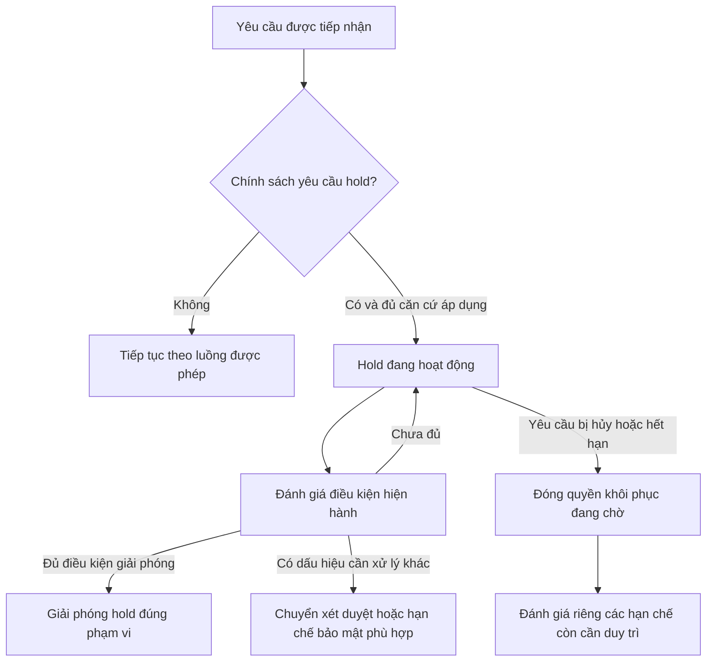

# Trạng thái giữ an toàn trong quá trình khôi phục tài khoản

## 1. Recovery hold state là gì?

**Recovery hold — trạng thái giữ an toàn khi khôi phục — là một hạn chế tạm thời được áp dụng theo chính sách để chưa cho thực hiện một số thay đổi hoặc cấp lại quyền truy cập, trong khi các điều kiện khôi phục chưa hoàn tất.** Điều kiện còn thiếu có thể là thời gian chờ, bằng chứng bổ sung, xét duyệt hoặc việc xử lý các phương thức và phiên có thể đã bị chiếm quyền.

Ví dụ, một người yêu cầu thay MFA vì mất điện thoại. Hệ thống chấp nhận một phần bằng chứng nhưng chưa cho phép gỡ yếu tố cũ và cấp phiên đầy đủ ngay. Yêu cầu được tiếp tục xử lý trong một ngữ cảnh giới hạn; các thao tác nhạy cảm liên quan vẫn bị giữ lại cho đến khi đủ điều kiện.

Khoảng chờ có thể cho chủ tài khoản thời gian phát hiện thay đổi trái phép hoặc cho dịch vụ thời gian kiểm tra thêm. Tuy nhiên, chờ đủ lâu không tự tạo ra bằng chứng sở hữu tài khoản. Nếu quyền kiểm soát email đang thuộc kẻ tấn công, việc đợi thêm không tự làm kênh đó đáng tin trở lại.

Tên và hành vi của recovery hold khác nhau giữa các sản phẩm. Bài học dùng thuật ngữ này cho một quyết định hạn chế có đối tượng, phạm vi và điều kiện giải phóng rõ ràng, không mặc định rằng mọi dịch vụ đều có cùng một trạng thái chuẩn.

Bài thuộc chương **Account State Model**, trong phạm vi khôi phục tài khoản an toàn khi mất mật khẩu, MFA, passkey hoặc thiết bị xác thực. Trọng tâm là mô hình hóa trạng thái giữ sao cho giúp giảm nguy cơ chiếm đoạt mà vẫn cho người dùng hợp lệ một đường xử lý thực tế.

Sau bài học, bạn cần có khả năng:

- Phân biệt recovery hold với yêu cầu đang chờ, token còn hạn, khóa đăng nhập và đình chỉ tài khoản.
- Xác định thời điểm nào đủ căn cứ áp dụng hạn chế và thao tác nào bị tác động.
- Tách thời gian chờ tối thiểu khỏi thời hạn tối đa của một yêu cầu.
- Mô tả điều kiện giải phóng mà không tự mở toàn bộ quyền truy cập.
- Xử lý thay đổi trạng thái, yêu cầu lặp và tranh chấp đồng thời một cách nhất quán.

## 2. Những khái niệm không nên dùng thay thế cho nhau

| Khái niệm | Câu hỏi nó trả lời | Khác recovery hold ở đâu? |
| --- | --- | --- |
| Recovery request pending | Yêu cầu khôi phục đang ở bước nào? | Một yêu cầu đang chờ chưa chắc đã tạo hạn chế lên tài khoản hoặc phiên |
| Recovery hold | Những hành động nào tạm chưa được phép và vì sao? | Là một quyết định kiểm soát quyền trong bối cảnh khôi phục |
| Token expiration | Giá trị dùng để xác minh hoặc cấp quyền còn hạn không? | Token còn hạn không làm các điều kiện giải phóng hold tự hoàn tất |
| Rate limiting | Có được tiếp tục gửi hoặc thử thao tác với tần suất hiện tại không? | Giới hạn lạm dụng khác với giữ quyền thay yếu tố hoặc cấp phiên |
| Login lock | Một đường đăng nhập có đang bị khóa không? | Có thể chỉ liên quan lần thử sai, không phải quá trình khôi phục |
| Suspended account | Tài khoản có bị hạn chế sử dụng bởi một quyết định quản trị hoặc bảo mật không? | Có thể tồn tại độc lập và không được tự gỡ khi recovery hold kết thúc |
| Restricted recovery session | Người đang tham gia khôi phục có thể làm gì trong phiên giới hạn? | Là một cơ chế thực thi quyền; không phải toàn bộ quyết định hold |
| Recovery completed | Các điều kiện và thay đổi của yêu cầu đã hoàn tất chưa? | Không đồng nghĩa mọi hạn chế tài khoản đều biến mất |

Một tài khoản có thể đồng thời hoạt động bình thường đối với một số chức năng, đang có recovery hold chặn thay MFA và có một yêu cầu khôi phục ở bước chờ xét duyệt. Ba mô tả này không mâu thuẫn nếu phạm vi được định nghĩa rõ.

Ngược lại, nếu chính sách yêu cầu hạn chế toàn bộ quyền nghiệp vụ do nghi chiếm đoạt, đó cần được diễn đạt và thực thi như một quyết định rộng hơn. Không nên dùng một nhãn hold chung để người đọc tự đoán tài khoản bị chặn đến đâu.

## 3. Mô hình hóa hold như một quyết định riêng

### 3.1. Gắn hold với tài khoản, yêu cầu và hành động

Một cờ `on_hold = true` không cho biết ai được phép giải phóng, cần chờ gì hoặc thao tác nào bị chặn. Có thể mô hình hóa các thông tin cần thiết như sau:

```text
hold_id: H-EXAMPLE-62
account_id: A-EXAMPLE-29
recovery_request_id: R-EXAMPLE-47
purpose: REPLACE_LOST_MFA
state: ACTIVE
reason: ADDITIONAL_RECOVERY_CONDITIONS_REQUIRED
blocked_actions:
  - COMMIT_MFA_REPLACEMENT
  - ISSUE_FULL_SESSION_FROM_RECOVERY
not_before: thời điểm sớm nhất được xem xét giải phóng
request_expires_at: thời điểm yêu cầu không còn đủ hiệu lực để tiếp tục
required_conditions:
  - ACCEPTED_EVIDENCE
  - REVIEW_APPROVAL
  - CURRENT_ACCOUNT_POLICY_ALLOWS_ACTION
policy_version: phiên bản chính sách được tham chiếu
```

Đây là mô hình minh họa, không phải schema bắt buộc. Các điều kiện cụ thể phụ thuộc loại sự cố và rủi ro. Ví dụ không chứa mật khẩu, token thô, mã dự phòng hoặc giấy tờ nhận dạng.

`blocked_actions` cần có ý nghĩa ở phía máy chủ. Nếu chỉ lưu danh sách để hiển thị trên giao diện, hold chưa tạo ra ranh giới quyền thực tế.

### 3.2. Phân biệt trạng thái của hold với điều kiện sẵn sàng

Một hold đang `ACTIVE` có thể còn chờ thời gian, chờ bằng chứng hoặc chờ xét duyệt. Các điều kiện này nên được lưu hoặc suy ra rõ ràng, thay vì chỉ có một trạng thái mơ hồ là “đang chờ”.

Tùy thiết kế, có thể dùng các trạng thái chi tiết hoặc một trạng thái đang hoạt động kèm tập điều kiện. Điều quan trọng là hệ thống biết chính xác điều kiện nào đã đủ và điều kiện nào vẫn thiếu.

### 3.3. Không ghi đè các hạn chế khác

Recovery hold có thể cùng tồn tại với một quyết định đình chỉ của quản trị tổ chức hoặc một hạn chế do điều tra sự cố. Giải phóng hold chỉ bỏ phần hạn chế thuộc đúng quyết định đó.

Không nên thực hiện chuỗi thao tác “hold kết thúc, đặt tài khoản thành ACTIVE”. Trạng thái truy cập hiệu lực phải tiếp tục xét vòng đời tài khoản, các hạn chế khác và chính sách của hành động được yêu cầu.

## 4. Điều kiện đưa một yêu cầu vào recovery hold

### 4.1. Chỉ áp dụng khi có căn cứ phù hợp

Những tình huống có thể cần hold gồm mất nhiều phương thức cùng lúc, yêu cầu thay một yếu tố quan trọng, thay đổi kênh khôi phục gần đây hoặc bằng chứng cần được xem xét thêm. Tài khoản có quyền quản trị có thể cần chính sách chặt hơn tài khoản có tác động thấp.

Tín hiệu rủi ro là đầu vào cho quyết định, không tự chứng minh người yêu cầu là kẻ tấn công. Thiết bị mới và mạng mới có thể là hệ quả bình thường của việc mất điện thoại. Quy trình cần có hướng xử lý cho người dùng hợp lệ thay vì chỉ thêm bước chờ vô hạn.

Không phải mọi lần quên mật khẩu đều cần recovery hold. Nếu người dùng còn phương thức đã đăng ký đáp ứng chính sách đăng nhập hoặc thay đổi thông tin xác thực, họ có thể đi qua đường thông thường phù hợp.

### 4.2. Người chưa xác thực không được tự điều khiển hạn chế tài khoản

Một người biết email nạn nhân có thể bắt đầu yêu cầu khôi phục. Nếu mỗi lần bắt đầu đều khóa toàn bộ tài khoản, gỡ phiên hoặc chặn mọi thay đổi bảo mật, kẻ tấn công đã có một công cụ gây mất truy cập.

Cần tách các giai đoạn:

1. **Tiếp nhận:** ghi nhận yêu cầu và áp dụng kiểm soát chống lạm dụng phù hợp.
2. **Kiểm tra điều kiện áp dụng:** xét bằng chứng, rủi ro và thẩm quyền của cơ chế quyết định.
3. **Áp dụng hold:** tạo hạn chế đúng phạm vi khi chính sách thực sự yêu cầu.

Một hold chỉ giới hạn quyền phát sinh từ yêu cầu chưa hoàn tất có tác động khác với hold chặn các phiên hợp lệ của tài khoản. Nếu muốn tác động đến quyền sẵn có, cần căn cứ và chính sách riêng tương xứng với tác động đó.

### 4.3. Chống kéo dài bằng yêu cầu lặp

Quy tắc phát hành lại và gộp yêu cầu cần rõ ràng. Không nên mặc định rằng mỗi yêu cầu mới từ bên chưa xác thực đều đặt lại thời gian chờ của yêu cầu đang được người dùng thật thực hiện.

Hệ thống có thể cần nhận diện cùng một quy trình, giới hạn số yêu cầu và chỉ cho chủ thể đủ quyền thay đổi quyết định đang có. Cách chọn phải ngăn cả lạm dụng lẫn việc người dùng hợp lệ bị mắc kẹt vì nhấp gửi lại sau lỗi mạng.

## 5. Phạm vi hành động trong lúc hold còn hiệu lực

Ví dụ sau giả định hold đang chặn việc chốt thay MFA và cấp phiên đầy đủ từ yêu cầu khôi phục. Các quyền khác vẫn do chính sách tài khoản quyết định.

| Hành động | Cách xử lý trong ví dụ | Lý do |
| --- | --- | --- |
| Xem tiến độ yêu cầu | Có thể cho phép qua ngữ cảnh được bảo vệ | Hỗ trợ người dùng theo dõi mà không cấp quyền nghiệp vụ |
| Nộp bằng chứng bổ sung | Có thể cho phép trong phạm vi yêu cầu | Giúp hoàn tất điều kiện còn thiếu |
| Chốt thay MFA | Bị giữ lại đến khi đủ điều kiện | Đây là một hành động đang được hold bảo vệ |
| Tạo phiên truy cập đầy đủ từ luồng khôi phục | Bị giữ lại | Chưa được phép chuyển quyền hẹp thành quyền rộng |
| Đổi email khôi phục | Không tự được cấp | Là hành động nhạy cảm riêng, có thể làm thay đổi người nhận bí mật |
| Đăng ký passkey mới | Chỉ khi có quyền phù hợp và chính sách cho phép | Không được dùng đường đăng ký khóa để né hold thay yếu tố |
| Sử dụng phiên đã có trước | Theo chính sách phiên và các hạn chế liên quan | Hold không tự nói mọi phiên cũ phải giữ hay thu hồi |
| Báo cáo yêu cầu không do mình tạo | Có đường xử lý được kiểm soát | Cho phép phát hiện lạm dụng mà không trao quyền hủy tùy ý cho người ngoài |
| Tạo khóa API hoặc xuất dữ liệu bằng phiên khôi phục | Không được cấp trong ví dụ | Tránh vượt phạm vi quyền khôi phục |

Khi nghi thiết bị đã bị chiếm quyền, giữ nguyên mọi phiên cũ có thể nguy hiểm. Nhưng việc thu hồi phiên phải là quyết định được thực thi theo chính sách, không được giả định từ tên hold. Thu hồi refresh token cũng không tự bảo đảm access token đã cấp lập tức mất hiệu lực.

Phiên khôi phục giới hạn cần được ràng buộc với tài khoản, yêu cầu và mục đích. Mọi API liên quan phải kiểm tra quyền và trạng thái hiện tại; chỉ ẩn nút trên giao diện không ngăn được gọi trực tiếp.

## 6. Thời gian chờ tối thiểu và thời hạn tối đa

### 6.1. `not_before`: chưa được giải phóng sớm hơn

`not_before` là mốc sớm nhất mà chính sách cho phép xem xét giải phóng hoặc thực hiện hành động. Nó có thể tạo khoảng thời gian để thông báo, phát hiện bất thường hoặc hoàn tất một bước xử lý.

Khi đến mốc này, hệ thống vẫn cần kiểm tra các điều kiện khác. Một tác vụ định kỳ không được chỉ so sánh đồng hồ rồi cấp phiên đầy đủ nếu bằng chứng, phê duyệt hoặc trạng thái tài khoản chưa đạt yêu cầu.

### 6.2. `expires_at`: quyền hoặc yêu cầu không được tiếp tục sau mốc này

Thời hạn tối đa của yêu cầu hoặc token có mục đích khác. Nó giới hạn khả năng sử dụng một quyền đang chờ. Hết hạn thường dẫn tới từ chối tiếp tục hoặc yêu cầu một quy trình mới phù hợp, không phải cho qua.

| Mốc hoặc điều kiện | Khi đạt đến | Không nên suy ra |
| --- | --- | --- |
| Đến `not_before` | Có thể đánh giá các điều kiện giải phóng còn lại | Người yêu cầu đã đủ bằng chứng |
| Token hết hạn | Token không còn được chấp nhận theo chính sách | Hold được giải phóng và tài khoản được mở lại |
| Yêu cầu hết hạn | Yêu cầu không được tiếp tục hoàn tất theo quyền cũ | Thay yếu tố đang chờ tự được chốt |
| Đến ngày xem xét | Cần tiến hành đánh giá theo quy trình | Quyết định phê duyệt đã tồn tại |
| Chưa nhận phản đối | Không có phản đối được ghi nhận qua cơ chế đang theo dõi | Chủ tài khoản đã đọc và đồng ý |

Không có thời gian chờ cố định phù hợp cho mọi tài khoản. Cần cân nhắc rủi ro, giá trị tài sản, khả năng phản hồi và tác động lên người dùng đang mất truy cập. Các khoảng thời gian chỉ có ý nghĩa khi được thực thi bằng thời gian do máy chủ kiểm soát, cùng quy tắc rõ cho lỗi xử lý và độ trễ.

## 7. Vòng đời và các cách kết thúc hold

### 7.1. Các nhánh khái niệm



Sơ đồ thể hiện sự khác nhau giữa giải phóng hold để tiếp tục thao tác và đóng một yêu cầu không còn được phép thực hiện. Các trạng thái lưu trữ cụ thể có thể khác nhau.

### 7.2. Giải phóng theo điều kiện được định nghĩa

Một chính sách minh họa có thể yêu cầu đồng thời:

```text
được_phép_giải_phóng =
    hold_đang_hoạt_động
    AND yêu_cầu_còn_hiệu_lực
    AND đã_đạt_mốc_chờ_tối_thiểu
    AND bằng_chứng_đáp_ứng_chính_sách_hiện_hành
    AND có_phê_duyệt_hợp_lệ_nếu_chính_sách_yêu_cầu
    AND không_có_điều_kiện_hiện_tại_ngăn_hành_động
```

Đây là ví dụ cho một chính sách, không khẳng định mọi luồng đều phải xét duyệt hoặc chờ thời gian. Các điều kiện phải được kiểm tra tại nơi thực thi. Phê duyệt cần đúng tài khoản, mục đích và trạng thái liên quan; không nên tái sử dụng một quyết định cũ cho thay đổi mới ngoài phạm vi.

Giải phóng hold có thể chỉ cho phép bước tiếp theo, chẳng hạn đăng ký MFA mới. Nó chưa nhất thiết là hoàn tất khôi phục hoặc cấp phiên thường. Nếu thiết kế tách các bước, quyền sau giải phóng vẫn cần có thời hạn và phạm vi phù hợp.

### 7.3. Hủy hoặc hết hạn không phải phê duyệt

Khi yêu cầu bị hủy, quyền thay thông tin xác thực đang chờ phải bị đóng theo chính sách. Không được chuyển nó sang hoàn tất chỉ để dọn dẹp trạng thái.

Việc có bỏ hạn chế trên tài khoản hay không cần được xét riêng. Nếu hold chỉ bảo vệ một thay đổi chưa xảy ra, đóng yêu cầu có thể kết thúc nhu cầu giữ thay đổi đó. Nếu đã phát hiện xâm nhập, hạn chế bảo mật có thể vẫn cần tồn tại hoặc được thay thế bằng quyết định khác. Không tạo khoảng trống truy cập giữa lúc bỏ hold cũ và áp dụng kiểm soát mới.

Liên kết báo cáo “không phải tôi” cũng không nên cấp quyền rộng hơn mục đích đã thiết kế. Cần tránh để một người ngoài có thể hủy vô hạn quy trình của chủ tài khoản hoặc tự gỡ các hạn chế đang bảo vệ tài khoản.

## 8. Thực thi nhất quán và xử lý đồng thời

### 8.1. Kiểm tra ở thời điểm hành động có hiệu lực

Một yêu cầu có thể đủ điều kiện ở thời điểm hiển thị màn hình, nhưng ngay sau đó xuất hiện hạn chế mới hoặc bằng chứng bị vô hiệu hóa. Bước chốt thay đổi phải xét lại trạng thái có thẩm quyền, không chỉ tin một cờ “đã kiểm tra” từ đầu luồng.

Các điểm cần kiểm tra có thể gồm hoàn tất thay yếu tố, đổi kênh, cấp phiên, làm mới token và gọi API nhạy cảm. Nếu chính sách giới hạn cả quyền đã cấp trước đó, các nơi sử dụng quyền cũng phải nhận biết hạn chế ấy.

### 8.2. Hai yêu cầu không được cùng tiêu thụ một quyền dùng một lần

Khi hold được giải phóng, người dùng có thể bấm lại sau lỗi mạng hoặc một bên khác có thể gửi yêu cầu đồng thời. Việc kiểm tra, chuyển trạng thái và sử dụng token cần được tổ chức sao cho không tạo hai lần thay đổi trái phép.

```text
begin transaction
    đọc tài khoản, yêu cầu, hold và quyền khôi phục
    bảo vệ tính nhất quán bằng cơ chế phù hợp
    kiểm tra tài khoản đích, mục đích và trạng thái hiện hành
    kiểm tra thời gian, bằng chứng, phê duyệt và các hạn chế còn hiệu lực
    nếu chưa đủ điều kiện: không cấp quyền hoặc chốt thay đổi
    nếu đủ điều kiện:
        chuyển đúng hold sang trạng thái được phép theo thiết kế
        thực hiện đúng hành động đã được cấp quyền trong bước này
        tiêu thụ quyền dùng một lần nếu hành động yêu cầu
        ghi kết quả, sự kiện và công việc tiếp theo một cách bền vững
commit
```

Mã giả mô tả một ranh giới nhất quán, không bắt buộc mọi hệ thống dùng cùng loại giao dịch. Nếu giải phóng hold và chốt thông tin xác thực là hai bước, bước sau phải kiểm tra lại quyền được cấp và các điều kiện hiện tại.

### 8.3. Tác vụ nền và sự kiện có thể bị xử lý lại

Tác vụ đánh giá hold cần xử lý lặp an toàn. Nhận cùng một sự kiện hai lần không được cấp hai quyền độc lập hoặc mở lại một yêu cầu đã hủy. Sự kiện cũ cũng không được ghi đè một quyết định mới hơn.

Nếu trạng thái được sao chép giữa nhiều dịch vụ, cần xác định nguồn có thẩm quyền, cách phát hiện phiên bản cũ và giới hạn độ trễ. Khi không xác định được điều kiện cho một thao tác nhạy cảm, không nên tự nâng quyền chỉ để quy trình tiếp tục; cần trạng thái chờ hoặc cách xử lý lỗi đã được thiết kế.

## 9. Thông báo, bằng chứng và khả năng hỗ trợ

### 9.1. Cho người dùng biết đang chờ điều gì

Sau khi đủ điều kiện để xem tiến độ, giao diện nên phân biệt:

- Đang chờ đến mốc sớm nhất được xem xét.
- Cần người dùng hoàn tất một bước cụ thể.
- Đang chờ xét duyệt hoặc xử lý hệ thống.
- Yêu cầu đã hết hạn, bị hủy hoặc không thể tiếp tục.

Không nên hiển thị bộ đếm kết thúc bằng lời hứa “sẽ truy cập được” nếu còn điều kiện khác. Có thể diễn đạt “sớm nhất có thể được xem xét từ…” và nêu bước tiếp theo phù hợp với chính sách.

Ở giai đoạn chưa xác thực, thông báo phải tránh xác nhận quá mức sự tồn tại của tài khoản, các yếu tố hoặc địa chỉ nhận. Sự thuận tiện của màn hình tiến độ không được làm lộ thông tin cho bất kỳ ai biết mã yêu cầu công khai.

### 9.2. Thông báo không tự thay thế bằng chứng

Gửi cảnh báo đến kênh đã thiết lập có thể giúp chủ tài khoản phát hiện yêu cầu lạ. Tuy nhiên, gửi thành công không chứng minh người nhận đã đọc, và không phản đối chưa chắc là đồng ý. Kênh cũ cũng có thể đã bị chiếm quyền hoặc không còn truy cập được do chính sự cố đang xử lý.

Quyết định cần xác định vai trò cụ thể của phản hồi, nếu có. Không được biến việc chờ một email không có phản hồi thành bằng chứng đủ cho mọi loại tài khoản.

### 9.3. Hỗ trợ không phải đường bỏ qua hold

Nhân viên cần có quyền và quy trình rõ cho việc xem tiến độ, bổ sung thông tin, chuyển xét duyệt hoặc giải phóng một hold. Cuộc gọi khẩn cấp và thông tin cá nhân dễ biết không tự tạo quyền bỏ qua điều kiện.

Nếu sản phẩm có ngoại lệ, ngoại lệ phải có điều kiện, thẩm quyền và dấu vết quyết định. Nhật ký nên ghi ai làm gì, với yêu cầu nào và kết quả nào; không ghi token, mã dự phòng hoặc dữ liệu nhận dạng vượt nhu cầu.

## 10. Ví dụ xuyên suốt: giữ quyền thay MFA sau khi mất thiết bị

### 10.1. Bối cảnh và chính sách giả định

Tú mất điện thoại chứa ứng dụng OTP và passkey. Tú vẫn nhớ mật khẩu và còn một đường bằng chứng dự phòng mà dịch vụ chấp nhận để bắt đầu quy trình thay MFA. Dịch vụ xác định tình huống này cần kiểm tra bổ sung và một mốc chờ trước khi chốt thay yếu tố.

Trong chính sách của ví dụ, quyền từ yêu cầu khôi phục chỉ cho nộp bằng chứng và xem tiến độ. Thay MFA, đổi kênh và cấp phiên thường đều chưa được tự động cho phép.

### 10.2. Diễn biến trạng thái

| Mốc | Diễn biến | Hành vi mong đợi |
| --- | --- | --- |
| T0 | Yêu cầu được tiếp nhận | Chưa tạo quyền truy cập đầy đủ; kiểm soát lạm dụng vẫn có hiệu lực |
| T1 | Đủ căn cứ đưa quy trình vào hold | Tạo hold đúng mục đích, ghi điều kiện và phạm vi |
| T2 | Tú hoàn tất bằng chứng bổ sung | Đánh dấu kết quả phù hợp; nếu chưa đến mốc chờ thì vẫn giữ hành động bị chặn |
| T3 | Đến mốc chờ nhưng phê duyệt chưa hoàn tất | Không chốt MFA và không cấp phiên thường |
| T4 | Có phê duyệt hợp lệ, yêu cầu còn hạn và chính sách hiện tại cho phép | Giải phóng đúng hold hoặc cấp quyền giới hạn cho bước chốt theo thiết kế |
| T5 | Đăng ký yếu tố mới và xử lý yếu tố, phiên liên quan theo chính sách | Hoàn tất đúng phạm vi; không làm sống lại thông tin xác thực đã thu hồi |
| T6 | Đánh giá quyền truy cập sau khôi phục | Chỉ cấp quyền khi các hạn chế tài khoản khác cũng cho phép |

Nếu tại T3 có một yêu cầu mới từ người ngoài, hệ thống không nên tự đặt lại toàn bộ thời gian chờ của Tú. Nếu tại T4 xuất hiện đình chỉ quản trị không cho phép hành động, việc mốc chờ đã qua không đủ để tiếp tục.

### 10.3. Hai nhánh kết thúc khác

Nếu yêu cầu hết hạn trước T4, quyền cũ không được dùng để hoàn tất. Hệ thống giải thích bước tiếp theo theo chính sách, đồng thời đánh giá riêng những hạn chế nào vẫn cần giữ.

Nếu chủ tài khoản báo yêu cầu là trái phép qua cơ chế đủ tin cậy, hệ thống đóng hoặc chuyển xử lý yêu cầu theo quy trình. Dấu hiệu tài khoản bị xâm nhập có thể cần một quyết định bảo vệ khác; không đơn giản gỡ mọi hold rồi mở lại mọi phiên.

## 11. Những lỗi thiết kế thường gặp

| Lỗi | Nguy cơ | Nguyên tắc xử lý |
| --- | --- | --- |
| Hết giờ là tự động mở tài khoản | Thời gian bị coi như bằng chứng sở hữu | Kết hợp thời gian với bằng chứng và chính sách hiện hành |
| Tạo yêu cầu là khóa mọi phiên | Người ngoài gây mất truy cập cho nạn nhân | Tách tiếp nhận khỏi quyết định hạn chế quyền sẵn có |
| Mỗi lần gửi lại đều đặt lại thời gian chờ | Người dùng có thể bị giữ vô hạn do lạm dụng hoặc lỗi mạng | Có chính sách yêu cầu lặp và thẩm quyền sửa thời gian |
| Chỉ ẩn nút thay MFA | API vẫn có thể chốt thay đổi trực tiếp | Thực thi hold tại nơi kiểm tra quyền và cập nhật trạng thái |
| Giải phóng hold chuyển mọi trạng thái về hoạt động | Bỏ nhầm đình chỉ hoặc hạn chế khác | Chỉ giải phóng đúng quyết định và đánh giá trạng thái hiệu lực |
| Yêu cầu hết hạn được xử lý như phê duyệt | Quyền cũ tiếp tục được sử dụng | Đóng quyền đang chờ; không tự chốt thay đổi |
| Tin một phê duyệt không ràng buộc mục đích | Dùng quyết định cũ cho tài khoản hoặc hành động khác | Gắn phê duyệt với đúng yêu cầu và phạm vi |
| Tác vụ nền dùng trạng thái cũ | Mở lại yêu cầu đã hủy hoặc bỏ qua hạn chế mới | Kiểm tra phiên bản và trạng thái hiện tại khi thực thi |
| Nhân viên có thể bỏ hold không cần căn cứ | Lừa đảo xã hội vượt kiểm soát kỹ thuật | Giới hạn thẩm quyền và ghi nhận quyết định |

## 12. Tự kiểm tra hiểu biết

### Tình huống 1: Bộ đếm đã về không

Người dùng đã chờ đến mốc sớm nhất, nhưng bước xét duyệt vẫn chưa có kết quả. Hệ thống có được tự cho thay MFA không?

**Gợi ý trả lời:** Không nếu chính sách yêu cầu xét duyệt. Đạt mốc thời gian chỉ làm đủ một điều kiện; các điều kiện còn lại phải được đáp ứng trước khi thực hiện hành động.

### Tình huống 2: Token còn hạn nhưng tài khoản vừa bị đình chỉ

Một token cho bước khôi phục vẫn còn hạn. Trước lúc chốt, xuất hiện hạn chế mới không cho phép thay yếu tố. Có thể dựa vào token để tiếp tục không?

**Gợi ý trả lời:** Không tự động. Token còn hạn không thay thế chính sách tài khoản hiện tại. Cần kiểm tra đúng quyền và trạng thái tại thời điểm thay đổi có hiệu lực.

### Tình huống 3: Người ngoài gửi lại yêu cầu liên tục

Mỗi yêu cầu mới lại kéo dài thời gian hold của chủ tài khoản. Thiết kế này có vấn đề gì?

**Gợi ý trả lời:** Bên chưa xác thực có thể gây mất khả dụng hoặc khiến khôi phục không bao giờ hoàn tất. Cần giới hạn lạm dụng và quy tắc rõ về gộp yêu cầu, gửi lại và thay đổi hold đang tồn tại.

### Tình huống 4: Yêu cầu đã hủy

Một sự kiện cũ đến muộn báo rằng đã đủ thời gian chờ, trong khi yêu cầu đã bị hủy. Có nên chuyển hold sang giải phóng và cấp quyền không?

**Gợi ý trả lời:** Không. Cần kiểm tra trạng thái và phiên bản hiện hành. Một tác vụ cũ không được mở lại quyền đã bị đóng.

### Tình huống 5: Hold kết thúc nhưng còn hạn chế khác

Recovery hold đã được giải phóng, còn quyết định đình chỉ của tổ chức vẫn hiệu lực. Người dùng đã có MFA mới có được truy cập đầy đủ không?

**Gợi ý trả lời:** Chưa. Giải phóng hold và hoàn tất phương thức xác thực không tự gỡ quyết định của bên khác. Trạng thái truy cập vẫn phụ thuộc tất cả điều kiện còn hiệu lực.

## 13. Những điểm cần ghi nhớ

- Recovery hold là một quyết định hạn chế có phạm vi trong quá trình khôi phục, không phải tên chung cho mọi trạng thái chờ.
- Cần chỉ rõ đối tượng, lý do, hành động bị chặn, điều kiện và thẩm quyền giải phóng.
- Chờ đủ thời gian không tự chứng minh quyền kiểm soát tài khoản; hết hạn cũng không phải phê duyệt.
- Yêu cầu chưa xác thực không được tự trở thành công cụ khóa tài khoản hoặc kéo dài hold vô hạn.
- Giải phóng hold chỉ bỏ đúng hạn chế đó và có thể chỉ cho phép một bước tiếp theo có quyền hẹp.
- Mọi bước nhạy cảm phải kiểm tra trạng thái hiện hành và xử lý yêu cầu lặp, đồng thời, sự kiện đến muộn một cách nhất quán.
- Thông báo và hỗ trợ giúp người dùng hoàn tất quy trình, nhưng không thay thế căn cứ xác minh và phân quyền.
