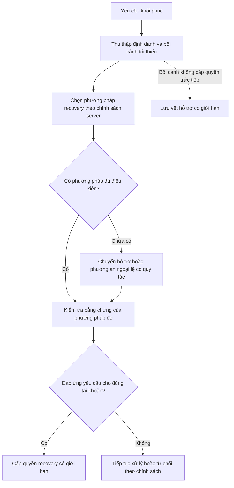

# Knowledge proofing scope — Phạm vi của thông tin người dùng biết trong khôi phục tài khoản

Một người yêu cầu khôi phục tài khoản có thể biết ngày sinh, địa chỉ cũ, tên trường học hoặc chi tiết đơn hàng gần nhất. Những thông tin này giúp cuộc trao đổi với bộ phận hỗ trợ có vẻ thuyết phục. Tuy nhiên, việc biết một điều về chủ tài khoản không tự chứng minh người đang yêu cầu là chủ tài khoản.

**Knowledge proofing scope** là việc xác định các thông tin đó được sử dụng cho mục đích nào, có thể hỗ trợ kết luận gì và tuyệt đối không được trao quyền gì. Trong luồng khôi phục khi mất mật khẩu, MFA, passkey hoặc thiết bị xác thực, ranh giới này ngăn một tập câu hỏi dễ trả lời trở thành đường vòng chiếm đoạt tài khoản.

## 1. Hiểu đúng tên gọi và mục tiêu

Trong bài này, knowledge-based proofing là tên gọi để thảo luận về các cách hỏi và đối chiếu thông tin mà người yêu cầu được cho là biết. Tên gọi không có nghĩa các cách đó đều là phương pháp xác minh danh tính được chấp nhận.

Hai thuật ngữ thường gặp là:

- **Knowledge-based authentication — KBA:** dùng câu trả lời về thông tin cá nhân hoặc thông tin riêng để cố xác thực người yêu cầu. Câu hỏi bảo mật đăng ký trước là ví dụ thường thấy.
- **Knowledge-based verification — KBV:** kiểm tra kiến thức về một người để cố xác minh danh tính được khai báo, chẳng hạn hỏi những địa chỉ từng cư trú theo một nguồn dữ liệu bên ngoài.

Các hệ thống có thể dùng tên gọi khác nhau cho cùng một cơ chế. Khi thiết kế, cần xem **dữ liệu nào được hỏi và kết quả cho phép làm gì**, thay vì dựa vào nhãn “verification”, “trusted” hay “advanced proofing”.

Theo NIST SP 800-63A-4, KBV/KBA không được dùng cho identity verification trong phạm vi hướng dẫn đó. Đây là ràng buộc của bộ hướng dẫn, không phải khẳng định mọi dịch vụ trên thế giới cùng chịu một quy định pháp lý. [NIST SP 800-63A-4, Identity Verification Methods](https://pages.nist.gov/800-63-4/sp800-63a.html#identity-verification-methods)

Mục tiêu học tập ở đây là nhận diện đúng cơ chế, xác định giới hạn của bằng chứng và đặt nó vào luồng recovery mà không hạ yêu cầu bảo vệ tài khoản.

## 2. Phân biệt những việc thường bị gộp chung

Một luồng recovery thường có nhiều câu hỏi cần trả lời. Chúng không tương đương nhau.

| Việc cần làm | Câu hỏi của hệ thống | Vai trò có thể có của thông tin được khai báo |
| --- | --- | --- |
| Định vị hồ sơ | Người này đang muốn khôi phục tài khoản nào? | Cung cấp định danh tối thiểu để xử lý nội bộ |
| Thu thập bối cảnh | Người yêu cầu mất phương tiện nào và còn phương tiện nào? | Giúp chọn nhánh recovery khả dụng |
| Xác minh danh tính thực | Người đang tham gia có phải cá nhân mang danh tính được khai báo không? | Thông tin cá nhân tự khai không đủ cho kết luận này |
| Chứng minh liên kết tài khoản | Người này có quyền đối với tài khoản cụ thể không? | Tên hoặc tiểu sử giống hồ sơ không tự tạo liên kết sở hữu |
| Cấp quyền recovery | Được phép thực hiện thao tác nào, trong bao lâu? | Phải dựa vào chính sách và bằng chứng recovery được chấp nhận |

Ví dụ, nhập email để tìm hồ sơ nội bộ là một bước định vị. Server tìm thấy bản ghi không có nghĩa người nhập kiểm soát email đó. Tương tự, cung cấp ngày sinh để phân biệt các hồ sơ có tên giống nhau không biến ngày sinh thành bí mật xác thực.

NIST cũng phân biệt việc thu thập thuộc tính để phân giải danh tính với KBV. Vì vậy, không nên gọi mọi biểu mẫu hỏi họ tên hoặc ngày sinh là một bước xác minh bằng kiến thức. Mục đích sử dụng mới quyết định ý nghĩa của thao tác. [NIST SP 800-63A-4, thuật ngữ KBV](https://pages.nist.gov/800-63-4/sp800-63a.html#knowledge-based-verification-kbv)

### 2.1. Mật khẩu không đồng nghĩa với câu hỏi tiểu sử

Mật khẩu và passphrase là các bí mật được thiết lập để xác thực theo một cơ chế quản lý riêng. Câu trả lời như “thành phố nơi bạn sinh ra” là một sự kiện về cuộc đời, có thể được người khác biết hoặc tìm thấy.

Việc cả hai đều được gõ từ bàn phím không làm chúng có cùng thuộc tính bảo mật. Đồng thời, mật khẩu cũng có thể yếu hoặc bị lộ; sự phân biệt này không phải khẳng định mọi mật khẩu đều an toàn.

Một mã khôi phục ngẫu nhiên được cấp từ trước cũng khác câu trả lời tiểu sử. Người dùng có thể đọc lại mã từ nơi lưu an toàn, nhưng bằng chứng nằm ở bí mật recovery được cấp và kiểm tra theo giao thức, không nằm ở việc họ nhớ một sự kiện cá nhân.

### 2.2. Nhiều câu hỏi không tạo ra MFA

Hỏi ngày sinh, tên trường và địa chỉ cũ là ba câu hỏi. Chúng không tự trở thành ba yếu tố xác thực độc lập. Một người thân, một hồ sơ bị rò rỉ hoặc một hộp thư bị chiếm có thể cung cấp đồng thời tất cả câu trả lời.

Không được diễn giải “mật khẩu cộng hai câu hỏi bảo mật” thành việc đã thay thế được yêu cầu đối với phương tiện MFA bị mất. Hình thức nhập nhiều màn hình không quyết định mức đảm bảo của luồng.

## 3. Phạm vi cần bắt đầu từ quyền có thể bị trao

Khi đánh giá một bước hỏi đáp, hãy xác định thao tác cuối cùng mà nó có thể mở ra:

- Đặt lại mật khẩu của tài khoản.
- Đổi email hoặc số điện thoại nhận recovery.
- Gỡ yếu tố MFA đang có.
- Đăng ký một passkey, khóa bảo mật hoặc thiết bị xác thực mới.
- Thu hồi hoặc duy trì các session đang tồn tại.
- Truy cập lại dữ liệu, quyền quản trị hoặc chức năng nhạy cảm của tài khoản.

Đây là những thay đổi có thể chuyển quyền kiểm soát tài khoản sang người khác. Vì vậy, một nhánh “không còn phương tiện nào, hãy trả lời vài câu hỏi” phải được đánh giá như một nhánh cấp lại quyền kiểm soát, kể cả khi giao diện chỉ gọi nó là “hỗ trợ đăng nhập”.

Một đặc tả phạm vi cần nêu ít nhất bốn nội dung:

1. **Mục đích thu thập:** chọn phương án liên hệ, phân tuyến hồ sơ hay một mục đích cụ thể khác.
2. **Nguồn và giới hạn của dữ liệu:** do người dùng tự khai, có thể xuất hiện ở đâu, có thể sai hoặc đã cũ không.
3. **Ý nghĩa đầu ra:** chỉ là bối cảnh, dấu hiệu cần xem xét hoặc kết quả đối chiếu hỗ trợ.
4. **Quyền bị loại trừ:** không phát hành token recovery, không gỡ MFA và không sửa kênh liên hệ chỉ từ kết quả hỏi đáp.

Nếu nhóm phát triển không thể mô tả mục đích ngoài việc “hỏi cho chắc”, nên xem lại nhu cầu thu thập thay vì mặc định thêm câu hỏi.

## 4. Nguồn câu trả lời quyết định giới hạn bằng chứng

“Không công khai” không đồng nghĩa với “chỉ chủ tài khoản biết”. Dữ liệu có thể tồn tại trong email, ảnh chụp màn hình, hồ sơ gia đình, tài liệu doanh nghiệp hoặc một hệ thống đã bị xâm nhập.

| Loại thông tin | Ví dụ | Ai khác có thể biết? | Kết luận cần tránh |
| --- | --- | --- | --- |
| Tiểu sử dễ tìm | Ngày sinh, quê quán, trường học | Bạn bè, người thân, người xem hồ sơ công khai | Người trả lời đúng là chủ tài khoản |
| Dữ liệu thường có trong nhiều hồ sơ | Địa chỉ cũ, số điện thoại trước đây | Đơn vị giao hàng, bên cung cấp dịch vụ, người có dữ liệu rò rỉ | Dữ liệu riêng tư là bí mật xác thực |
| Thông tin tài khoản | Ngày tạo, tên hiển thị, tên nhóm | Thành viên cùng nhóm, người nhìn thấy hồ sơ hoặc lịch sử | Biết lịch sử nghĩa là đang kiểm soát tài khoản |
| Lịch sử hoạt động | Đơn hàng, số tiền, tên gói dịch vụ | Người dùng chung, nhân viên hỗ trợ, người đọc được email | Một câu trả lời chính xác là bằng chứng độc lập mạnh |
| Kết quả từ nhà cung cấp hỏi đáp | Điểm khớp theo dữ liệu bên ngoài | Người sở hữu cùng nguồn dữ liệu hoặc có thể suy đoán | Nhãn “provider verified” tự đủ cho recovery |

### 4.1. Câu hỏi tĩnh và câu hỏi động

**Câu hỏi tĩnh** dùng nội dung được chọn hoặc đăng ký từ trước, chẳng hạn tên thú cưng đầu tiên. Chúng thường ít thay đổi và khó thu hồi theo cách một mã recovery có thể được thay thế.

**Câu hỏi động** được tạo tại thời điểm yêu cầu từ dữ liệu hồ sơ hoặc lịch sử. Chúng có thể tránh việc lặp nguyên một bộ câu hỏi, nhưng không tự khắc phục vấn đề nguồn dữ liệu bị biết bởi người khác.

Một câu hỏi về hóa đơn tháng trước vẫn yếu nếu kịch bản cần chống là kẻ tấn công đã chiếm hộp thư chứa hóa đơn. Tính mới của câu hỏi không tạo ra tính độc lập với tài nguyên bị xâm nhập.

### 4.2. Đối chiếu dữ liệu cũ và kiểm tra quyền kiểm soát mới

Hỏi “số tiền giao dịch tháng trước là bao nhiêu?” kiểm tra kiến thức về một sự kiện đã xảy ra. Một thử thách mới theo giao thức, được gửi qua một kênh đã liên kết và đủ điều kiện, có thể nhằm kiểm tra quyền kiểm soát hiện tại của kênh đó.

Hai cơ chế không nên được gom chung chỉ vì cùng yêu cầu nhập một giá trị. Cơ chế thứ hai vẫn cần được đánh giá về liên kết tài khoản, mức an toàn của kênh và chính sách recovery; không phải mọi OTP hay thử thách mới đều tự đủ cho mọi tài khoản.

## 5. Ranh giới sử dụng trong một thiết kế recovery

Với một thiết kế mới trong module này, có thể đặt nguyên tắc: **không dùng câu trả lời cá nhân để thay thế bằng chứng recovery được chấp nhận; chỉ giữ thông tin bối cảnh thực sự cần thiết cho quá trình hỗ trợ**.

Đây là lựa chọn thiết kế của ví dụ. OWASP cảnh báo không dùng câu hỏi bảo mật làm cơ chế duy nhất để reset mật khẩu vì câu trả lời thường có thể bị đoán hoặc thu thập. Bài này chọn phạm vi hẹp hơn cho thông tin hỏi đáp nhằm tránh tạo thêm đường cấp quyền. [OWASP Forgot Password Cheat Sheet, Security Questions](https://cheatsheetseries.owasp.org/cheatsheets/Forgot_Password_Cheat_Sheet.html#security-questions)

| Mục đích | Phạm vi có thể xem xét | Giới hạn bắt buộc của thiết kế minh họa |
| --- | --- | --- |
| Chọn nhánh recovery | Hỏi còn mã recovery, thiết bị khác hoặc phương tiện đã đăng ký không | Lời khai “tôi còn mã” chưa phải là kiểm tra mã |
| Thu thập hoàn cảnh | Ghi nhận mất thiết bị, nghi lộ email, đang di chuyển | Không biến lý do khẩn cấp thành quyền bỏ qua bằng chứng |
| Hỗ trợ tìm hồ sơ | Thu thập định danh tối thiểu | Không hiển thị hồ sơ hoặc thông tin liên hệ để xác nhận cho người chưa được phép |
| Phân tuyến hỗ trợ | Ghi nhận cần trợ giúp ngôn ngữ hoặc kênh tiếp cận khác | Không yêu cầu trả lời đúng tiểu sử như điều kiện bắt buộc để được hỗ trợ |
| Xem xét rủi ro | Ghi nhận mâu thuẫn có ý nghĩa cùng độ tin cậy của nguồn | Không khóa tài khoản nạn nhân chỉ từ khai báo của người ngoài |
| Phát hành quyền khôi phục | Yêu cầu bằng chứng và chính sách riêng | Kết quả hỏi đáp không được đáp ứng thay yêu cầu đó |

Nếu một câu trả lời không phục vụ mục đích đã định, không nên thu thập chỉ vì hệ thống có thể lưu nó. Không hỏi mật khẩu đang dùng, OTP hiện tại, toàn bộ thông tin thẻ hoặc dữ liệu nhạy cảm không cần thiết trong một cuộc trao đổi hỗ trợ thông thường.

## 6. Tách bối cảnh hỗ trợ khỏi bằng chứng cấp quyền

Một lỗi kiến trúc phổ biến là dùng cùng một cờ `verified` cho mọi loại kiểm tra. Nhà cung cấp hỏi đáp trả về “khớp”, nhân viên đánh dấu “đã xem”, rồi bộ cấp token hiểu rằng người dùng đã hoàn thành recovery.

Nên có hai miền dữ liệu riêng về ý nghĩa:

- **Bối cảnh hỗ trợ:** những điều người yêu cầu nói, kết quả đối chiếu hỗ trợ, hạn chế của nguồn và nhu cầu trợ giúp.
- **Bằng chứng recovery:** kết quả kiểm tra phương pháp được chính sách chấp nhận, liên kết với đúng tài khoản, đúng hồ sơ và điều kiện sử dụng.

Việc chia hai miền không yêu cầu hai cơ sở dữ liệu khác nhau. Điều cần bảo đảm là một kết quả ở miền thứ nhất không tự biến thành một bằng chứng hợp lệ ở miền thứ hai.



Nhánh ngoại lệ trong sơ đồ không mặc định tồn tại cho mọi dịch vụ. Nếu có, nó phải có yêu cầu bằng chứng được xác định; không phải quyền tùy ý của nhân viên để cho qua một người trả lời đúng nhiều câu hỏi.

### 6.1. Ví dụ hợp đồng dữ liệu bối cảnh

Ví dụ sau là một bản ghi nội bộ dùng định danh hư cấu. Nó mô tả phạm vi sử dụng, không phải token hay thông điệp cấp quyền.

```json
{
  "attemptId": "recovery-demo-21",
  "contextId": "support-context-demo-08",
  "contextType": "CLAIMANT_REPORTED_INFORMATION",
  "purpose": "ROUTE_TO_RECOVERY_METHOD",
  "reportedSituation": "LOST_AUTHENTICATOR_DEVICE",
  "reportedAvailableMethods": ["SAVED_RECOVERY_CODE"],
  "sourceAssurance": "SELF_ASSERTED",
  "permittedUses": ["SUPPORT_ROUTING"],
  "authorizationEffect": "NONE",
  "policyVersion": "recovery-scope-demo-v1"
}
```

Server vẫn phải kiểm tra mã recovery bằng cơ chế riêng. Không cho client tự gửi `authorizationEffect`, `sourceAssurance` hoặc `policyVersion` rồi dùng các trường đó như kết quả đáng tin cậy. Trong ví dụ, chúng do server gắn để diễn giải và kiểm soát dữ liệu nội bộ.

Không cần lưu toàn bộ câu trả lời cá nhân để có bản ghi trên. Ví dụ này chỉ giữ loại tình huống và phương pháp người dùng cho biết còn có thể sử dụng.

### 6.2. Ràng buộc ở nơi cấp quyền

Bộ phận cấp quyền recovery cần kiểm tra bằng chứng từ đúng thành phần xác minh, gắn với đúng hồ sơ và còn giá trị theo chính sách. Không đọc một trường điểm hỏi đáp rồi suy ra rằng các yêu cầu khác đã được đáp ứng.

Ràng buộc kiến trúc có thể diễn đạt như sau:

```text
Thông tin hỗ trợ phù hợp
    -> có thể giúp phân tuyến hoặc làm rõ hồ sơ

Thông tin hỗ trợ phù hợp + chưa có bằng chứng recovery đủ điều kiện
    -> chưa được cấp quyền recovery

Bằng chứng recovery đủ điều kiện
    -> tiếp tục kiểm tra chính sách, trạng thái hồ sơ và phạm vi thao tác
    -> chỉ sau đó mới có thể cấp quyền giới hạn
```

Không dùng phép cộng điểm để bù cho bằng chứng bắt buộc còn thiếu. Chẳng hạn, thêm nhiều điểm “biết ngày sinh”, “biết đơn hàng” và “biết email cũ” không thay thế việc kiểm tra phương pháp recovery mà tài khoản yêu cầu.

## 7. Ranh giới khi không còn phương tiện xác thực

Người dùng thật có thể mất đồng thời điện thoại, mã recovery và quyền truy cập email. Đây là tình huống khó, nhưng mức độ khó không làm thông tin tiểu sử trở thành bí mật tốt hơn.

Một dịch vụ cần quyết định từ trước những phương án phù hợp với tài khoản và rủi ro của mình: phương tiện đã đăng ký còn dùng được, mã recovery, recovery contact đã thiết lập hoặc quy trình chứng minh lại danh tính khi đủ điều kiện. Mỗi phương án cần yêu cầu riêng; danh sách này không có nghĩa chúng có thể thay thế lẫn nhau tùy ý.

NIST SP 800-63B-4 phân biệt recovery dựa vào các phương pháp đã thiết lập với reproofing. Với tài khoản chưa từng được identity-proofed, không có liên kết danh tính đã xác minh để đơn giản thực hiện lại reproofing cho mục đích recovery. [NIST SP 800-63B-4, Account Recovery](https://pages.nist.gov/800-63-4/sp800-63b.html#account-recovery)

Trong thiết kế minh họa, tài khoản chỉ có bí danh không được chuyển sang người cầm giấy tờ có tên giống tên hiển thị. Nếu dịch vụ muốn hỗ trợ ngoại lệ, cần quy trình chứng minh liên kết với chính tài khoản đó; hỏi thêm quê quán hoặc lịch sử học tập không giải quyết được thiếu hụt liên kết.

Nếu chưa đủ bằng chứng, hệ thống có thể giữ hồ sơ ở trạng thái chưa hoàn tất và đưa ra phương án hợp lệ còn lại. Không nên hứa chắc “mọi người trả lời đủ thông tin đều lấy lại được tài khoản”, vì lời hứa đó có thể buộc bộ phận hỗ trợ vượt qua ranh giới bảo vệ.

## 8. Các tình huống áp dụng

### 8.1. Mất mật khẩu nhưng còn phương tiện đã đăng ký

Anh Bình quên mật khẩu nhưng vẫn có thể dùng một phương tiện xác thực khác đã liên kết và được chính sách cho phép dùng trong tình huống này.

Hệ thống cần đánh giá phương tiện đó và thao tác đăng ký bí mật mới theo chính sách. Không cần thêm câu hỏi tiểu sử chỉ để luồng có vẻ nghiêm ngặt hơn. Nếu vẫn thu thập bối cảnh phục vụ hỗ trợ, kết quả đó không được tăng phạm vi quyền của phương tiện đã kiểm tra.

### 8.2. Mất điện thoại MFA và email đã bị xâm nhập

Chị Chi biết số tiền và ngày của ba hóa đơn gần nhất. Kẻ tấn công kiểm soát email của chị cũng có thể đọc chính các hóa đơn ấy.

Nếu recovery dùng câu hỏi hóa đơn để gỡ MFA, nó phụ thuộc vào cùng nguồn dữ liệu đã bị xâm nhập. Trong tình huống này, thông tin hóa đơn không tạo được một lớp bảo vệ độc lập. Quy trình phải tìm phương pháp recovery phù hợp với kịch bản nghi email bị chiếm.

### 8.3. Tài khoản có nhiều người dùng chung thông tin

Một thành viên gia đình biết địa chỉ, ngày sinh và các đơn hàng của chủ tài khoản. Một đồng nghiệp cũng có thể biết tên dự án, thời điểm gia nhập và gói dịch vụ của tài khoản doanh nghiệp.

Biết thông tin không đồng nghĩa được ủy quyền thay chủ tài khoản. Đối với tài khoản tổ chức, quyền của quản trị viên hoặc người đại diện phải được xác định qua cơ chế ủy quyền của tổ chức, không qua khả năng trả lời câu hỏi về đồng nghiệp.

### 8.4. Chủ tài khoản thật không nhớ dữ liệu cũ

Anh Dũng không nhớ chính xác địa chỉ đã nhập nhiều năm trước và không thể trả lời một câu hỏi về hoạt động cũ. Điều này chưa chứng minh anh là kẻ gian.

Một nhánh hỏi đáp bắt buộc có thể loại nhầm người dùng thật, đặc biệt khi dữ liệu cũ sai, ngôn ngữ khác hoặc thông tin đã thay đổi. Thiết kế minh họa không dùng việc nhớ tiểu sử làm điều kiện để tiếp cận hỗ trợ; nó tiếp tục tìm phương pháp recovery đủ điều kiện.

### 8.5. Người yêu cầu trả lời đúng mọi câu hỏi

Người yêu cầu cung cấp được đầy đủ thông tin hồ sơ và lịch sử thanh toán. Nhân viên có thể ghi nhận những điều này nếu chúng phục vụ một mục đích hợp lệ, nhưng chưa được kết luận rằng người đó có quyền đăng ký passkey mới.

Kết luận có thể đưa ra ở bước này chỉ là các thông tin được nêu phù hợp với một số bản ghi. Nó không chứng minh bí mật xác thực, quyền kiểm soát hiện tại hay liên kết sở hữu mà chính sách recovery còn yêu cầu.

## 9. Giới hạn của hỗ trợ thủ công và hệ thống legacy

Một dịch vụ cũ có thể đã tích hợp nhà cung cấp KBA hoặc có màn hình câu hỏi bảo mật. Việc tồn tại lâu không làm kết quả đó mạnh hơn, và đổi tên trường `kbaPassed` thành `identityVerified` không thay đổi bản chất bằng chứng.

Khi xác định phạm vi cho hệ thống như vậy, cần làm rõ:

- Thành phần nào đọc kết quả hỏi đáp và có thể phát hành token hoặc sửa tài khoản?
- Có nhánh nào bỏ qua phương pháp recovery bắt buộc khi điểm hỏi đáp cao không?
- Nhân viên có thể thay đổi email, gỡ MFA hoặc đánh dấu hoàn thành chỉ từ cuộc gọi không?
- Khi nhà cung cấp không có dữ liệu, người dùng có được chuyển sang phương án phù hợp khác không?
- Câu trả lời có bị giữ lại, xuất báo cáo hoặc đưa vào công cụ hỗ trợ ngoài mục đích ban đầu không?

Đây là các câu hỏi để xác định phạm vi và phụ thuộc thiết kế, không phải khẳng định chỉ cần sửa một tên trường là xử lý xong hệ thống cũ. Việc chuyển đổi thực tế cần bảo đảm người dùng có phương án recovery phù hợp và xử lý các tích hợp đang tồn tại.

Với hỗ trợ thủ công, “người gọi nói rất thuyết phục” hoặc “biết nhiều chi tiết” không phải quyền ngoại lệ. Nhân viên cần cùng một ranh giới về bằng chứng và thao tác được phép; trường hợp đặc biệt phải đi theo quy trình đã định và có lưu vết.

## 10. Quyền riêng tư, khả năng tiếp cận và chống lạm dụng

Mỗi câu hỏi cá nhân bổ sung đều tạo thêm dữ liệu cần bảo vệ. Chỉ thu thập điều cần cho mục đích đã xác định, hạn chế người có quyền đọc và đặt thời hạn lưu phù hợp. Không mặc định chép toàn bộ câu trả lời vào log, ticket hoặc công cụ phân tích.

Một phần thông tin cá nhân có thể đúng nhưng không còn mới. Người dùng có thể đổi tên, chuyển chỗ ở hoặc có nhiều cách ghi tên theo ngôn ngữ. Chênh lệch dữ liệu cần được diễn giải theo chất lượng nguồn, không tự động gắn nhãn gian lận.

Giao diện không nên tiết lộ “địa chỉ nào sau đây là của tài khoản” kèm những địa chỉ thật cho một người chưa được phép xem. Cũng không trả về dữ liệu tài khoản để hướng người yêu cầu sửa câu trả lời cho khớp. Thông điệp trước khi có đủ quyền phải tránh xác nhận thông tin hồ sơ không cần thiết.

Giới hạn tần suất và ngân sách xử lý áp dụng cho recovery session, hồ sơ và nguồn yêu cầu theo thiết kế dịch vụ. Chúng giảm khả năng dò dữ liệu hoặc tạo nhiều yêu cầu hỗ trợ, nhưng không biến câu trả lời dễ đoán thành bằng chứng mạnh.

Ngược lại, không để người ngoài gửi nhiều câu trả lời sai rồi khiến tài khoản nạn nhân bị khóa vĩnh viễn. Phản ứng chống lạm dụng cần phân biệt hạn chế yêu cầu chưa xác minh với việc ảnh hưởng quyền truy cập của chủ tài khoản.

## 11. Một mô tả phạm vi mẫu

Nhóm phát triển có thể viết rõ hợp đồng của thành phần thu thập bối cảnh như sau:

| Nội dung | Phạm vi trong ví dụ |
| --- | --- |
| Mục đích | Xác định phương tiện recovery người yêu cầu còn có thể sử dụng và nhu cầu hỗ trợ |
| Dữ liệu nhận | Định danh tối thiểu, loại phương tiện đã mất, loại phương tiện được khai là còn có |
| Mức tin cậy ban đầu | Lời khai chưa được xác minh |
| Đầu ra | Bối cảnh và phương án để kiểm tra tiếp theo |
| Điều không kết luận | Danh tính đã xác minh, quyền sở hữu tài khoản hoặc quyền kiểm soát email |
| Quyền không được cấp | Reset mật khẩu, đổi kênh recovery, gỡ MFA, thêm passkey, cấp session đăng nhập |
| Khi thiếu dữ liệu | Chuyển phương án hỗ trợ phù hợp, không bịa câu trả lời và không tự hạ yêu cầu bằng chứng |
| Nơi quyết định recovery | Thành phần thực thi chính sách dựa trên bằng chứng đủ điều kiện cho đúng tài khoản |

Một câu hỏi hỗ trợ chỉ có giá trị khi mục đích và giới hạn của nó rõ ràng. Ranh giới quan trọng nhất của knowledge proofing là không để điều người yêu cầu biết bị hiểu thành quyền kiểm soát mà người đó chưa chứng minh được.
