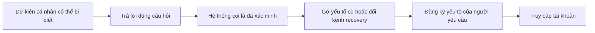

# Public knowledge risk — Rủi ro từ thông tin cá nhân có thể bị biết

Một luồng khôi phục hỏi ngày sinh, trường từng học và quê quán có thể tạo cảm giác người yêu cầu đang chứng minh danh tính. Tuy nhiên, những câu trả lời đúng chỉ cho thấy người đó biết các dữ kiện tương ứng. Nếu dữ kiện đã được công khai, có thể suy ra hoặc đã đến tay người khác, kẻ tấn công cũng có thể trả lời đúng.

**Public knowledge risk** trong bài này là rủi ro khi hệ thống dùng thông tin có thể bị người khác biết như thể đó là bí mật xác thực. Phạm vi không chỉ gồm dữ liệu trên một trang web công khai. Thông tin do gia đình, đồng nghiệp, đối tác, bên nhận hóa đơn hoặc người đã truy cập tài khoản biết cũng có thể làm mất giả định “chỉ chủ tài khoản mới trả lời được”.

Trong module khôi phục tài khoản, hậu quả quan trọng là người dùng mất mật khẩu, MFA, passkey hoặc thiết bị xác thực nhưng hệ thống lại cho thay thế các yếu tố đó bằng vài dữ kiện tiểu sử. Một đường recovery như vậy có thể trở thành lối chiếm tài khoản dù cơ chế đăng nhập thông thường rất mạnh.

## 1. Biết dữ kiện khác với chứng minh quyền sở hữu

Cần phân biệt ba mục đích xử lý:

| Mục đích | Ví dụ | Điều có thể kết luận |
| --- | --- | --- |
| Tìm hồ sơ | Dùng mã khách hàng để định vị yêu cầu hỗ trợ | Đã tìm được hồ sơ phù hợp với giá trị nhập |
| Đối chiếu thuộc tính | So sánh họ tên trong hồ sơ với nguồn được phép sử dụng | Các dữ liệu được đối chiếu có thể nhất quán |
| Chứng minh quyền khôi phục | Xác minh bằng chứng đáp ứng chính sách recovery của tài khoản | Có cơ sở quyết định người yêu cầu được tiếp tục theo phạm vi đã cho phép |

Một thuộc tính có thể hữu ích để tìm hồ sơ mà không phù hợp làm bằng chứng khôi phục. Ngay cả khi đối chiếu với nguồn chính xác cho thấy người yêu cầu biết đúng ngày sinh, hệ thống vẫn chưa biết người đang tham gia có phải chủ tài khoản hay không.

NIST SP 800-63A-4 phân biệt xác minh người sở hữu danh tính với kiểm tra thuộc tính và không cho dùng KBV/KBA để thực hiện identity verification trong phạm vi hướng dẫn đó. Không nên diễn giải việc khớp dữ kiện thành “đã xác minh danh tính theo NIST”. [NIST SP 800-63A-4, mục 2.5.1](https://pages.nist.gov/800-63-4/sp800-63a.html#identity-verification-methods)

Trong thiết kế bài học, các dữ kiện tiểu sử có thể giúp định tuyến hồ sơ khi thực sự cần. Chúng không được tự tạo quyền đổi mật khẩu, gỡ MFA, thêm passkey hoặc thay địa chỉ nhận recovery.

## 2. “Thông tin cá nhân” không đồng nghĩa với “bí mật”

Một dữ kiện liên quan đến một người không mặc nhiên chỉ được người đó biết. Có ít nhất năm cách làm giả định bí mật trở nên sai:

1. **Chủ thể từng công khai:** hồ sơ nghề nghiệp, nội dung chia sẻ hoặc bài giới thiệu có thể chứa thông tin trùng câu hỏi.
2. **Người khác công khai:** một người thân hoặc tổ chức có thể nhắc đến dữ kiện mà chủ tài khoản không trực tiếp đăng.
3. **Suy luận từ thông tin khác:** dữ kiện chưa xuất hiện nguyên văn vẫn có thể có rất ít đáp án hợp lý.
4. **Chia sẻ trong hoạt động thường ngày:** người cùng nhà, đồng nghiệp hoặc bên xử lý chứng từ có thể biết đáp án.
5. **Đã bị tiết lộ ngoài ý muốn:** dữ liệu có thể nằm trong ảnh chụp, tài liệu thất lạc, thư bị chuyển tiếp hoặc một sự cố lộ dữ liệu.

Không tìm thấy dữ kiện trên công cụ tìm kiếm chỉ cho biết quá trình tìm kiếm đó không thấy nó. Kết quả ấy không chứng minh dữ kiện chưa từng bị chia sẻ hoặc chưa nằm trong tay đối tượng đang tấn công.

Tính bí mật cũng thay đổi theo thời gian. Câu trả lời được chọn lúc đăng ký có thể xuất hiện trong một bài viết nhiều năm sau. Hệ thống không thể thu hồi mọi bản sao của ngày sinh hoặc trường từng học bằng cách yêu cầu người dùng đổi mật khẩu.

### Đối thủ cần biết đáp án của một tài khoản

Không cần giả định mọi người dùng Internet biết đáp án. Đối với một tài khoản bị nhắm đến, chỉ một đối tượng có đủ thông tin là đã tạo ra rủi ro.

Ví dụ, câu hỏi về tên thú cưng có thể khó đối với người lạ nhưng dễ với người từng sống cùng chủ tài khoản. Câu hỏi về công ty đầu tiên có thể khó với người ngoài nhưng dễ với đồng nghiệp lâu năm.

Vì vậy, đánh giá rủi ro không nên dùng duy nhất hình mẫu “người hoàn toàn xa lạ và không biết gì về nạn nhân”.

## 3. Các nhóm câu hỏi dễ tạo cảm giác an toàn sai

Bảng dưới minh họa các giả định thường gặp; không phải danh sách câu hỏi nên triển khai:

| Loại dữ kiện | Giả định dễ mắc | Vì sao giả định không đủ |
| --- | --- | --- |
| Ngày sinh, quê quán | Đây là dữ liệu cá nhân nên bí mật | Có thể đã được chia sẻ, suy ra hoặc biết bởi người quen |
| Trường học, năm tốt nghiệp | Hỏi chuyện cũ sẽ khó nhớ với người ngoài | Lịch sử học tập có thể gắn với nhiều nguồn cùng lúc |
| Tên người thân | Người lạ không thể biết quan hệ gia đình | Đối tượng có quan hệ gần lại có lợi thế |
| Tên thú cưng, đội thể thao yêu thích | Chủ tài khoản tự chọn nên khó đoán | Câu trả lời có thể phổ biến hoặc từng xuất hiện trong nội dung chia sẻ |
| Địa chỉ cũ | Không phải địa chỉ hiện tại nên an toàn | Địa chỉ cũ vẫn có thể nằm trong hồ sơ hoặc chứng từ |
| Mã đơn hàng, số tiền giao dịch | Đây là dữ liệu bên trong dịch vụ | Người nhận chung hóa đơn hoặc người đã truy cập email có thể biết |
| Bốn số cuối của một định danh | Định danh là duy nhất nên câu trả lời mạnh | Một phần định danh có ít khả năng và có thể đã được hiển thị ở nơi khác |

**Tính duy nhất trong cơ sở dữ liệu không phải độ khó đoán.** Mã khách hàng có thể định vị đúng một hồ sơ nhưng vẫn được in trên mọi hóa đơn. Ngược lại, một bí mật ngẫu nhiên không cần mô tả con người để có giá trị bảo mật.

Thông tin giao dịch chưa công khai cũng không tự trở thành bí mật recovery. Cần xem ai đã được phép biết nó, nó xuất hiện ở đâu và liệu người đã xâm nhập một kênh khác có thể đọc được không.

## 4. Câu hỏi động không tự loại bỏ rủi ro công khai

Có hai kiểu thường gặp:

- **Câu hỏi tĩnh:** người dùng đăng ký trước câu hỏi và câu trả lời.
- **Câu hỏi động:** hệ thống chọn câu hỏi từ dữ liệu đã có về người dùng hoặc từ một nguồn dữ liệu khác.

Câu hỏi động làm câu hỏi thay đổi, nhưng có thể vẫn dùng cùng những dữ kiện có thể bị biết. Nếu hệ thống chọn ngẫu nhiên giữa năm trường dữ liệu đã bị lộ, việc chọn ngẫu nhiên không khôi phục tính bí mật của các trường đó.

Nguồn cung cấp dữ liệu đáng tin có thể giúp xác nhận dữ kiện là chính xác. Nó không chứng minh chỉ chủ tài khoản biết dữ kiện ấy.

Ví dụ, một nguồn xác nhận địa chỉ X thực sự thuộc lịch sử của người dùng giúp giảm sai sót dữ liệu. Khi người yêu cầu gõ đúng X, kết luận vẫn chỉ là họ biết X, trừ khi quy trình còn có bằng chứng khác về quyền kiểm soát hoặc liên kết danh tính.

Không đổi tên một cơ chế hỏi đáp tiểu sử thành “xác minh thông minh” hoặc thêm mô hình dự đoán rồi coi cơ chế đó đã có mức bảo đảm mới. Cần đánh giá bằng chứng thực tế và khả năng của đối thủ.

## 5. Đánh giá theo kiến thức của đối thủ

### 5.1. Số lượng đáp án có thể có chưa đủ

Giả sử một câu hỏi có mười đáp án khả dĩ. Chỉ khi các đáp án có xác suất như nhau đối với đối thủ, xác suất đúng của một lần đoán mới là 1/10.

Trong ví dụ giả định khác, sau khi biết thông tin nền về tài khoản, đối thủ đánh giá:

| Đáp án ứng viên | Xác suất giả định |
| --- | --- |
| A | 0,70 |
| B | 0,20 |
| C | 0,10 |

Đoán A có xác suất thành công 70%, dù giao diện không trực tiếp cho biết A là đúng. Nếu hệ thống cho thử lần lượt ba đáp án khác nhau và không có kiểm soát bổ sung, ví dụ này đã bao phủ toàn bộ tập đáp án.

Các con số chỉ dùng để giải thích mô hình, không phải số liệu đo từ một dịch vụ thực tế.

Có thể biểu diễn xác suất đoán tốt nhất trong một bối cảnh đã biết:

```text
E = những thông tin đối thủ đã biết
A = câu trả lời được hệ thống chấp nhận

p_guess(E) = max_a P(A = a | E)
```

Điểm cần chú ý là điều kiện E. Dữ kiện tưởng khó với người chưa biết gì có thể rất dễ với người đã có một hồ sơ thông tin về nạn nhân.

### 5.2. Nhiều lần thử không luôn độc lập

Nếu đối thủ thử các đáp án có thứ tự ưu tiên, xác suất đúng sau r lần thử là tổng xác suất của những đáp án khác nhau đã thử trong mô hình này. Không nên mặc định mỗi lần thử giống một lần tung đồng xu độc lập.

Nếu đáp án đã biết chắc từ trước, cho phép đúng một lần thử cũng có thể đủ để tấn công thành công. Giới hạn tốc độ giúp giảm việc đoán hàng loạt nhưng không làm một đáp án đã công khai trở thành bí mật.

### 5.3. Nhiều câu hỏi có thể phụ thuộc nhau

Giả sử hệ thống hỏi nơi lớn lên, trường học và năm tốt nghiệp. Biết một phần lịch sử học tập có thể làm cả ba đáp án dễ hơn cùng lúc.

Với ba câu trả lời A, B, C và thông tin nền E:

```text
P(A, B, C | E)
  = P(A | E)
    × P(B | A, E)
    × P(C | A, B, E)
```

Chỉ được thay các xác suất có điều kiện bằng tích các xác suất riêng khi có cơ sở về tính độc lập phù hợp. “Ba câu hỏi” không tự có nghĩa “ba lớp bảo vệ độc lập”.

Một lỗi thiết kế khác là cộng điểm cho nhiều dữ kiện cùng nguồn. Nếu một chứng từ chứa tên, địa chỉ và mã khách hàng, việc trả lời đúng cả ba có thể chỉ phản ánh quyền đọc một chứng từ.

## 6. Vì sao một số biện pháp thường dùng không chữa được gốc rễ

| Biện pháp | Có thể giúp điều gì | Điều không giải quyết được |
| --- | --- | --- |
| CAPTCHA | Giảm một số hình thức tự động hóa | Người thật hoặc đối thủ có đáp án vẫn trả lời được |
| Giới hạn số lần thử | Giảm ngân sách đoán trực tuyến | Không chống được một lần trả lời đã biết đúng |
| Băm câu trả lời | Giảm lộ trực tiếp khi kho lưu bị truy cập | Không thay đổi việc đối thủ đã biết đáp án từ nguồn khác |
| Mã hóa dữ liệu | Bảo vệ khi truyền hoặc lưu theo mô hình khóa | Không khiến dữ kiện công khai trở thành bí mật |
| Yêu cầu câu trả lời dài | Có thể tránh một số giá trị quá ngắn | Một tên trường dài vẫn có thể được biết nguyên văn |
| Thêm nhiều câu hỏi | Buộc nhập thêm dữ liệu | Những dữ kiện liên quan có thể cùng bị biết |
| Đổi câu hỏi định kỳ | Thay trường dữ liệu được hỏi | Câu hỏi mới vẫn có thể dựa trên thông tin đã lộ |
| Chờ trước khi cấp quyền | Tạo thời gian phát hiện hoặc phản đối | Không tự chứng minh người đang chờ là chủ tài khoản |

Các biện pháp phòng vệ vẫn có ích khi phục vụ đúng mục tiêu. Vấn đề là không dùng chúng để tuyên bố câu hỏi tiểu sử đã trở thành bằng chứng đủ mạnh.

OWASP cảnh báo không dựa vào security questions làm cơ chế duy nhất để reset mật khẩu vì đáp án thường dễ đoán hoặc có thể thu được. [OWASP Forgot Password Cheat Sheet](https://cheatsheetseries.owasp.org/cheatsheets/Forgot_Password_Cheat_Sheet.html#security-questions)

Nếu người dùng nhập một chuỗi ngẫu nhiên riêng cho câu hỏi “tên thú cưng”, chuỗi đó thực tế đang được vận hành như một bí mật bổ sung. Điều này đòi hỏi quản lý, lưu giữ và sử dụng bí mật; nó không chứng minh dữ kiện tiểu sử tự nhiên là một lựa chọn tốt. Dịch vụ có thể thiết kế recovery code rõ mục đích thay vì yêu cầu người dùng nhớ một câu trả lời giả.

## 7. Tác động đặc biệt khi tài khoản có MFA hoặc passkey

Một tài khoản có passkey có thể chống nhiều hình thức đánh cắp mật khẩu. Tuy nhiên, nếu một endpoint cho phép đổi sang passkey của người yêu cầu sau khi trả lời đúng ngày sinh và tên trường, kẻ tấn công có thể đi qua endpoint recovery thay vì vượt cơ chế đăng nhập.

Một chuỗi chuyển quyền nguy hiểm có dạng:



Sai lầm nằm ở bước B sang C: hệ thống nâng kiến thức về hồ sơ thành quyền thay thế yếu tố xác thực.

Đặc biệt cần chú ý các thao tác:

- Gửi mã xác nhận đến email hoặc số điện thoại vừa được khai trong cùng yêu cầu.
- Cho phép tắt MFA bằng câu trả lời khớp.
- Cho thêm passkey mới trước khi bằng chứng recovery đáp ứng chính sách.
- Cho phiên hỗ trợ quyền đọc dữ liệu tài khoản để “tìm thêm câu hỏi”.
- Giữ nguyên các phiên cũ sau một sự cố mà không đánh giá nguy cơ đã bị chiếm quyền.

Một mã gửi đến địa chỉ mới chứng minh khả năng nhận ở địa chỉ mới. Nó không tự chứng minh địa chỉ ấy đã thuộc chủ tài khoản trước sự cố. Ghép bước này với dữ kiện công khai vẫn cần được đánh giá theo đúng liên kết mà từng bằng chứng thực sự tạo ra.

Mật khẩu và câu hỏi bảo mật cũng không tạo ra hai loại yếu tố chỉ vì chúng nằm trên hai màn hình. OWASP nêu rõ cả hai đều thuộc nhóm kiến thức và không cấu thành MFA. [OWASP Choosing and Using Security Questions](https://cheatsheetseries.owasp.org/cheatsheets/Choosing_and_Using_Security_Questions_Cheat_Sheet.html#when-to-use-security-questions)

## 8. Chính giao diện recovery có thể làm lộ thêm dữ liệu

Một dịch vụ không chỉ nhận dữ kiện; nó có thể vô tình trở thành nguồn cung cấp dữ kiện.

Ví dụ:

| Hành vi giao diện | Rủi ro |
| --- | --- |
| Hiện tên câu hỏi riêng ngay sau khi nhập email | Tiết lộ tài khoản có tồn tại hoặc loại dữ kiện người dùng từng chọn |
| Hiện danh sách địa chỉ cũ và yêu cầu chọn một | Cung cấp thông tin lịch sử cho người chưa được phép xem |
| Trả “hai trên ba câu đã đúng” | Giúp người thử biết phần nào cần điều chỉnh |
| Chỉ rõ một giá trị là sai | Biến từng câu hỏi thành kênh xác nhận dữ liệu |
| Hiện gợi ý hoặc một phần câu trả lời | Thu hẹp tập đáp án |
| Trả kết quả khác nhau rõ rệt giữa tài khoản có và không có | Có thể giúp dò tài khoản |

Lộ thông tin có thể diễn ra qua JSON response, mã lỗi, log trình duyệt hoặc dữ liệu do công cụ analytics thu thập, ngay cả khi UI không hiển thị trực tiếp.

Thiết kế minh họa sử dụng phản hồi công khai có phạm vi hẹp và không trả kết quả từng trường. Nhân viên được phân quyền có thể xem trạng thái nghiệp vụ cần thiết trong công cụ nội bộ, nhưng không được tiết lộ đáp án cho người đang yêu cầu.

Thông báo chung và hạn chế phản hồi chỉ giảm rò rỉ; chúng không biến dữ kiện yếu thành bằng chứng mạnh. Khi cần giúp người dùng sửa sai, nên dùng kênh và quy trình phù hợp với loại dữ liệu, tránh ép họ đoán lại vô hạn.

## 9. Đặt ranh giới trong mô hình dữ liệu và quyết định cấp quyền

Không nên để mọi loại thông tin cùng đi vào một trường `verificationScore` rồi cộng đến khi vượt ngưỡng. Cách làm này có thể cho phép nhiều dữ kiện công khai bù cho việc thiếu bằng chứng bắt buộc.

Một mô hình minh họa tách hai nhóm:

| Nhóm | Ví dụ trường | Quyền ảnh hưởng |
| --- | --- | --- |
| Ngữ cảnh hỗ trợ | `caseRoutingContext`, `reportedProfileFacts` | Tìm hoặc phân loại hồ sơ trong phạm vi được phép |
| Bằng chứng recovery đã kiểm tra | `verifiedRecoveryEvidence` | Được policy đánh giá theo loại, nguồn, liên kết và hiệu lực |

Việc máy chủ xác nhận một trường khớp không được tự chuyển trường đó sang nhóm bằng chứng. Người dùng cũng không được tự khai `evidenceType=STRONG` hoặc `identityVerified=true` trong payload rồi được tin.

Quy tắc nghiệp vụ minh họa:

```text
evaluateRecoveryCase(case):
    context = readRoutingContext(case)

    evidence = loadServerVerifiedRecoveryEvidence(case)
    policy = loadPolicyForAccountAndRequestedAction(case)

    require case is still active
    require evidence belongs to this account and this recovery case
    require evidence is current and has not been consumed

    # Dữ kiện tiểu sử không thỏa điều kiện bằng chứng bắt buộc.
    decision = policy.evaluateRequiredEvidence(evidence)

    if decision lacks required evidence:
        return NEED_APPROVED_RECOVERY_METHOD

    return READY_FOR_AUTHORIZED_RECOVERY_STEP
```

Đây là pseudocode thể hiện ranh giới, không phải bộ tiêu chí recovery hoàn chỉnh. Biến `context` không được dùng để bỏ qua các `require`, thay đổi tài khoản đích hoặc làm hài lòng điều kiện bằng chứng.

Ngay cả trạng thái `READY_FOR_AUTHORIZED_RECOVERY_STEP` cũng chưa phải access token đăng nhập. Bước thực thi tiếp theo còn cần kiểm tra hồ sơ hiện tại, giới hạn hành động, chống sử dụng lặp và áp dụng chính sách session.

### Bằng chứng phải được xem trong bối cảnh có thể bị chiếm quyền

Nếu nghi email đã bị xâm nhập, dữ liệu đọc từ email và mã mới gửi vào chính email đó có thể cùng phụ thuộc một điểm đã bị chiếm. Không nên đếm chúng như hai nguồn độc lập chỉ vì một bên là mã, một bên là hóa đơn.

Tương tự, một thiết bị “đã từng được dùng” cần được phân biệt với thiết bị hiện còn có thể chứng minh quyền kiểm soát một authenticator đã đăng ký. Dấu vết trình duyệt hoặc IP quen thuộc không tự thay thế bằng chứng đó.

## 10. Hỗ trợ thủ công không được biến thành cuộc thi nhớ tiểu sử

Nhân viên hỗ trợ có thể bị thuyết phục bởi một người kể đúng nhiều chi tiết. Câu chuyện càng mạch lạc càng dễ tạo cảm giác người kể là chủ tài khoản, dù các chi tiết có thể đến từ một nguồn dữ liệu chung.

Một quy trình thủ công cần xác định trước:

- Nhân viên được dùng dữ kiện nào để tìm hồ sơ và vì sao cần dữ kiện đó.
- Loại bằng chứng nào mới cho phép yêu cầu khôi phục tiến triển.
- Ai được phê duyệt ngoại lệ và giới hạn của ngoại lệ.
- Cách xử lý khi người dùng không còn phương thức recovery phù hợp.
- Cách thông báo và tiếp nhận phản đối khi có thay đổi nhạy cảm.

Không cho phép quy tắc “nhân viên thấy đáng tin thì bỏ qua MFA”. Nếu có ngoại lệ, ngoại lệ phải là một quy trình có bằng chứng và thẩm quyền cụ thể, không phải cơ hội đặt thêm câu hỏi tiểu sử cho đến khi người yêu cầu trả lời được.

Một chỉ dẫn nghiệp vụ tốt có thể là: “Thông tin về lịch sử tài khoản chỉ phục vụ tìm hồ sơ; không xác nhận quyền thay đổi yếu tố xác thực từ những câu trả lời này.”

Cũng cần bảo vệ người dùng khỏi việc thu thêm dữ liệu không cần thiết. Khi thiếu bằng chứng, hỏi thêm tên người thân hoặc nhiều địa chỉ cũ có thể làm tăng lượng dữ liệu nhạy cảm mà vẫn không tạo ra liên kết xác thực cần thiết.

## 11. Phân biệt câu trả lời sai với dấu hiệu tấn công

Chủ tài khoản thật có thể không nhớ:

- Đã dùng tên trường trước hay sau khi đổi tên.
- Đã gõ tên có dấu, không dấu hoặc viết tắt.
- Đã khai địa chỉ tại thời điểm nào.
- Giá trị nào được một dịch vụ khác tự động đồng bộ vào hồ sơ.

Người thật cũng có thể thay đổi họ tên, quan hệ gia đình, nơi ở hoặc cách diễn đạt. Vì thế:

- Trả lời đúng không tự chứng minh quyền sở hữu.
- Trả lời sai không tự chứng minh gian lận.
- Không có dữ kiện trong một nguồn không đồng nghĩa người dùng không tồn tại.
- Người có ít dấu vết công khai không nên bị buộc tạo thêm dấu vết để được hỗ trợ.

Đối với dữ kiện chỉ phục vụ định tuyến, có thể thiết kế cơ chế sửa sai phù hợp. Nhưng thêm so khớp gần đúng vào một cơ chế cấp quyền bằng câu hỏi tiểu sử có thể mở rộng tập đáp án được chấp nhận. Cần bỏ giả định dữ kiện ấy là bằng chứng đủ mạnh, thay vì chỉ tìm cách làm câu trả lời dễ khớp hơn.

Một dịch vụ có trách nhiệm cần đường hỗ trợ cho người quên dữ liệu cũ, đồng thời không hạ chính sách bảo vệ tài khoản chỉ vì quy trình thông thường khó hoàn thành.

## 12. Xử lý hệ thống đang có câu hỏi bảo mật

Mục tiêu là chuyển khỏi quyết định cấp quyền dựa trên dữ kiện có thể bị biết, không chỉ thay danh sách câu hỏi.

Một lộ trình minh họa:

1. **Chặn việc thêm phụ thuộc mới:** không xây tính năng recovery mới mà chỉ yêu cầu câu trả lời tiểu sử.
2. **Xác định nơi dữ kiện đang tạo quyền:** bao gồm API, công cụ hỗ trợ, quy trình đổi email, reset MFA và thêm passkey.
3. **Cấu hình phương thức thay thế khi người dùng còn xác thực được:** cho đăng ký lựa chọn dự phòng phù hợp trong một phiên đã được xác minh đủ mức.
4. **Bỏ vai trò cấp quyền của câu trả lời cũ:** không giữ một endpoint ít được nhắc đến vẫn reset tài khoản bằng cùng dữ kiện.
5. **Xử lý người dùng chưa có phương án mới:** áp dụng quy trình hỗ trợ được phê duyệt, thông báo rõ thay vì tự đăng ký một kênh mới chỉ nhờ câu hỏi cũ.
6. **Dọn dữ liệu theo chính sách:** xem xét câu trả lời, bản sao, log và dữ liệu của bên xử lý khi không còn mục đích sử dụng.

Không dùng chính câu hỏi yếu để cho phép người yêu cầu đăng ký recovery code hoặc passkey mới. Làm vậy chỉ chuyển hậu quả chiếm quyền sang một màn hình khác.

Các lựa chọn thay thế có thể gồm recovery code đã cấp trước, authenticator khác đã đăng ký hoặc một quy trình xác minh lại danh tính phù hợp với tài khoản đã được liên kết danh tính. Không phải lựa chọn nào cũng hợp lệ cho mọi loại tài khoản hoặc mọi mức bảo đảm. Trong hướng dẫn của NIST, recovery có các yêu cầu riêng theo bối cảnh tài khoản và phương thức được sử dụng. [NIST SP 800-63B-4, mục 4.2](https://pages.nist.gov/800-63-4/sp800-63b.html#account-recovery)

## 13. Tình huống minh họa: biết đúng lịch sử vẫn chưa đủ

Giả sử Linh mất điện thoại chứa yếu tố MFA và không còn passkey trên thiết bị cũ. Tài khoản có thông tin nơi học, tên công ty và một địa chỉ liên hệ cũ.

### Thiết kế dễ bị lạm dụng

Dịch vụ hỏi ba dữ kiện trên. Đúng cả ba thì cho nhập email mới, gửi mã đến email ấy, rồi cho gỡ yếu tố cũ.

Một người từng nhận hồ sơ nghề nghiệp và chứng từ của Linh có thể biết cả ba câu trả lời. Mã gửi vào email mới chỉ xác nhận người đó đang kiểm soát email mới. Hai bước không khôi phục được liên kết với chủ tài khoản.

### Thiết kế giữ ranh giới bằng chứng

Dịch vụ dùng thông tin cần thiết để mở đúng hồ sơ hỗ trợ, nhưng chưa cho đổi thông tin đăng nhập. Máy chủ đánh giá các phương thức recovery đã được chính sách cho phép và còn áp dụng cho tài khoản.

Nếu có recovery code hợp lệ đã cấp trước, dịch vụ kiểm tra code theo quy trình tương ứng. Nếu cần hỗ trợ khác, hồ sơ đi theo đường đã được phê duyệt. Không đủ bằng chứng thì chưa được gỡ MFA, dù câu chuyện và dữ kiện đều khớp.

Khi recovery thực sự được phê duyệt và thực thi, hệ thống mới áp dụng kế hoạch thay yếu tố, thông báo và quản lý session. Không nên dùng nhãn “đã xác minh” chung cho cả việc tìm đúng hồ sơ và việc cho phép thay đổi quyền truy cập.

## 14. Các nguyên tắc cốt lõi

- Dữ kiện nói về một người không tự trở thành bí mật của người đó.
- Khớp thuộc tính, tìm hồ sơ và chứng minh quyền khôi phục là những kết luận khác nhau.
- Mức khó cần xem theo thông tin đối thủ có thể đã biết, không chỉ theo số đáp án trên lý thuyết.
- Nhiều câu hỏi cùng dựa trên một nguồn thông tin không tạo ra nhiều lớp bảo vệ độc lập.
- Rate limit, CAPTCHA, băm và mã hóa không khắc phục việc đáp án đã được biết.
- Một luồng recovery không được biến dữ kiện công khai thành quyền thay mật khẩu, MFA, passkey hoặc kênh liên hệ.
- Đường hỗ trợ thủ công cần giữ cùng ranh giới bằng chứng, đồng thời có cách xử lý người dùng thật không nhớ dữ liệu cũ.

Thiết kế recovery cần chứng minh liên kết phù hợp giữa người yêu cầu và tài khoản. Biết nhiều điều về chủ tài khoản chỉ là một dữ kiện về kiến thức của người yêu cầu.