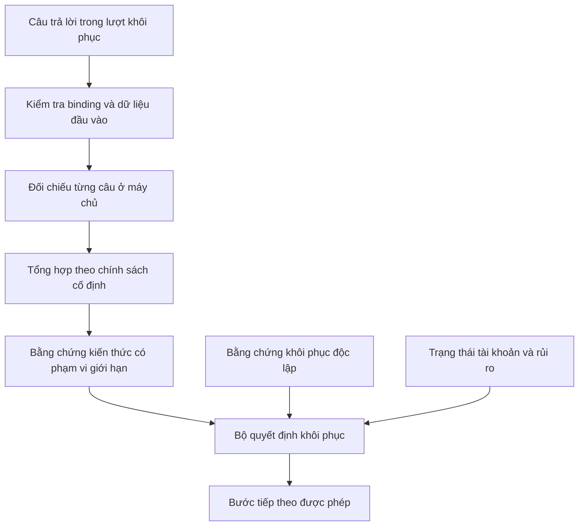

# Knowledge answer scoring

## 1. Điểm câu trả lời cho biết điều gì trong khôi phục tài khoản?

**Knowledge answer scoring** là quá trình đối chiếu câu trả lời với dữ liệu tham chiếu, sau đó biểu diễn mức phù hợp theo một chính sách đã xác định. Trong khôi phục tài khoản, dữ liệu được hỏi có thể là thông tin người dùng từng khai báo hoặc sự kiện sử dụng dịch vụ trong quá khứ.

Một người trả lời đúng không nhất thiết là chủ tài khoản. Người đó có thể đã đọc hộp thư bị chiếm, hóa đơn bị lộ hoặc dữ liệu hồ sơ công khai. Ngược lại, chủ tài khoản có thể nhớ sai một sự kiện cũ. Vì vậy, điểm số mô tả **mức phù hợp của câu trả lời với dữ liệu tham chiếu**, không tự chứng minh danh tính hay quyền khôi phục.

Ví dụ, người dùng mất thiết bị MFA và được hỏi một thông tin lịch sử thanh toán để hỗ trợ phân luồng xử lý. Một hệ thống yếu có thể suy luận “đúng ba trên bốn câu thì cho đăng ký MFA mới”. Một thiết kế thận trọng hơn giữ kết quả này như tín hiệu bổ sung; việc thay MFA còn phụ thuộc bằng chứng khôi phục độc lập và chính sách của tài khoản.

Cần đặt giới hạn của phương pháp ngay từ đầu:

- NIST SP 800-63A-4 không cho phép dùng KBV hoặc KBA cho bước **identity verification** trong phạm vi tuân thủ tài liệu đó. [Nguồn: NIST, Identity Verification Methods](https://pages.nist.gov/800-63-4/sp800-63a/proofing/#identity-verification-methods).
- NIST vẫn cho phép KBV là một phần của chương trình quản lý gian lận. Điều này không biến nó thành phương thức xác minh danh tính được chấp nhận. [Nguồn: NIST, CSP Fraud Management](https://pages.nist.gov/800-63-4/sp800-63a/ial-general/#csp-fraud-management).
- OWASP khuyến cáo không dùng câu hỏi bảo mật làm cơ chế duy nhất để đặt lại mật khẩu vì câu trả lời thường có thể đoán hoặc thu thập được. [Nguồn: OWASP, Security Questions](https://cheatsheetseries.owasp.org/cheatsheets/Forgot_Password_Cheat_Sheet.html#security-questions).

Bài học này trình bày cách hiểu và xử lý điểm kiến thức trong một hệ thống đang sử dụng tín hiệu đó, kể cả hệ thống kế thừa. Những trọng số, ngưỡng và trạng thái bên dưới là thiết kế minh họa, không phải giá trị chuẩn do NIST hoặc OWASP quy định.

## 2. Tách ba lớp: đối chiếu, tổng hợp và quyết định

Một cấu trúc dễ kiểm soát gồm ba lớp:



**Lớp đối chiếu** xác định một câu trả lời có khớp tham chiếu hợp lệ hay không. Nó không tự phát token hoặc đổi trạng thái MFA.

**Lớp tổng hợp** áp dụng trọng số, giới hạn theo nhóm, điều kiện dữ liệu đầy đủ và phiên bản chính sách. Nó không tự suy ra rằng điểm cao tương đương một danh tính đã được xác minh.

**Lớp quyết định** xét tất cả bằng chứng cần thiết và quyền của thao tác đang yêu cầu. Thay mật khẩu, thay MFA và thêm passkey có thể có điều kiện khác nhau; không dùng một điểm chung để mặc nhiên cho phép tất cả.

Việc tách lớp giúp tránh một lỗi phổ biến: hàm có tên `checkAnswers()` trả về `true` rồi được tái sử dụng làm điều kiện cấp một phiên đăng nhập đầy đủ.

## 3. Đối chiếu từng câu cần nhiều trạng thái hơn đúng và sai

Một hệ thống chỉ lưu `correct = false` sẽ không phân biệt được người trả lời sai với trường hợp nguồn tham chiếu bị lỗi.

| Kết quả từng câu | Ý nghĩa | Cách nhìn khi tổng hợp |
| --- | --- | --- |
| `MATCH` | Câu trả lời khớp theo quy tắc đã định | Có thể nhận điểm nếu nguồn đủ điều kiện |
| `NO_MATCH` | Có tham chiếu hợp lệ nhưng câu trả lời không khớp | Không nhận điểm |
| `UNANSWERED` | Người dùng bỏ trống hoặc chọn không nhớ | Không nhận điểm; không tự thu nhỏ mẫu số |
| `REFERENCE_UNAVAILABLE` | Không lấy được tham chiếu cần dùng | Chưa có cơ sở đối chiếu; không quy kết người dùng trả lời sai |
| `INELIGIBLE_REFERENCE` | Tham chiếu không đáp ứng điều kiện tin cậy hoặc phạm vi | Không dùng làm bằng chứng hỗ trợ |
| `INVALID_INPUT` | Đầu vào không đúng kiểu hoặc vượt giới hạn | Xử lý theo hợp đồng đầu vào, không coi là một câu đúng |

Các lỗi kỹ thuật như timeout của dịch vụ tham chiếu cần được giữ riêng với kết quả người dùng. Nếu một lần thử bị timeout, không nên ghi nhận nó như một hành vi trả lời sai rồi cộng vào hồ sơ nghi ngờ gian lận.

Ngược lại, không đổi `REFERENCE_UNAVAILABLE` thành “bỏ câu này và tính tỷ lệ đúng trên các câu còn lại”. Cách làm đó có thể khiến một bộ câu trả lời yếu được điểm cao hơn chỉ vì hệ thống thiếu dữ liệu.

Cần phân biệt hai thời điểm:

- **Trước khi phát bộ câu hỏi:** chỉ chọn nguồn và câu hỏi đáp ứng chính sách. Nếu không tạo được bộ đủ điều kiện, chuyển sang đường khác.
- **Sau khi phát bộ câu hỏi:** nếu một nguồn trở nên không dùng được, giữ dấu vết phiên bản và trả kết quả chưa kết luận được hoặc tạo lượt mới theo quy trình. Không sửa thang điểm âm thầm.

## 4. Chuẩn hóa câu trả lời mà không mở rộng quá mức tập đáp án

Chuẩn hóa giải quyết khác biệt biểu diễn, chẳng hạn khoảng trắng thừa hoặc dạng Unicode tương đương. Nó không nên biến một câu trả lời gần giống thành bằng chứng đúng một cách tùy ý.

| Loại dữ liệu | Quy tắc có thể phù hợp khi đã quy định trước | Điều cần tránh |
| --- | --- | --- |
| Nhãn văn bản ngắn | Chuẩn hóa Unicode và khoảng trắng; quy định rõ có phân biệt hoa thường không | Xóa mọi dấu, mọi ký tự đặc biệt cho tất cả loại câu hỏi |
| Ngày hoặc tháng | Phân tích theo định dạng hiển thị rõ; đối chiếu đúng độ chính xác được hỏi | Tự đoán `03/04` là ngày 3 tháng 4 hay ngày 4 tháng 3 |
| Số tiền lịch sử | Đối chiếu số và đơn vị tiền tệ theo kiểu dữ liệu xác định | Dùng số thực nhị phân hoặc tự nới dung sai |
| Mã tham chiếu | Giữ ký tự và số 0 đầu nếu chúng thuộc định danh | Cắt bớt còn vài ký tự cuối mà vẫn cho điểm đầy đủ |
| Lựa chọn trong danh sách | Đối chiếu ID lựa chọn thuộc bộ đã phát | Tin nhãn hoặc chỉ số lựa chọn do client tự tạo |

Nếu câu hỏi chỉ yêu cầu **tháng** của một sự kiện, câu trả lời đúng tháng là khớp theo hợp đồng của câu hỏi. Đó không phải điểm một phần của câu hỏi yêu cầu ngày đầy đủ.

Trong tiếng Việt, bỏ dấu có thể làm nhiều chuỗi khác nhau nhập thành một. Với dữ liệu tên riêng hoặc địa chỉ, chính sách cần xác định rõ biến thể được chấp nhận và tác động của chúng. Không lấy một hàm “làm sạch văn bản” dùng cho tìm kiếm rồi dùng nguyên xi làm bộ xác minh.

So khớp mờ theo khoảng cách ký tự hoặc dùng mô hình ngôn ngữ để nhận định “ý người dùng có vẻ đúng” làm thay đổi tập đáp án được chấp nhận. Trong khôi phục tài khoản, sự linh hoạt này có thể đồng thời tăng khả năng đoán trúng. Nếu thật sự cần, phải định nghĩa phạm vi, quản lý phiên bản và xem xét ảnh hưởng trước khi sử dụng; không bật như một cải tiến trải nghiệm mặc định.

Mô hình minh họa trong bài dùng khớp hoặc không khớp sau chuẩn hóa xác định, không cho điểm một phần.

## 5. Độ tin cậy của tham chiếu đứng trước phép cộng điểm

Một câu trả lời khớp hoàn hảo với tham chiếu không đáng tin vẫn là bằng chứng yếu.

Ví dụ, kẻ đang giữ một phiên bị chiếm có thể đổi địa chỉ hồ sơ rồi bắt đầu khôi phục. Nếu hệ thống lấy ngay địa chỉ mới làm đáp án, kẻ đó đang được hỏi chính thông tin mình vừa cung cấp.

Mỗi tham chiếu nên có ngữ cảnh phục vụ quyết định:

- Nguồn dữ liệu và quan hệ của nó với tài khoản đích.
- Thời điểm sự kiện xảy ra và thời điểm dữ liệu được ghi nhận.
- Mức độ người yêu cầu hoặc một phiên bị nghi chiếm có thể sửa dữ liệu.
- Lý do nguồn được chấp nhận trong phiên bản chính sách hiện tại.
- Dấu hiệu dữ liệu đã lộ hoặc đã xuất hiện trong một kênh bị nghi chiếm.

Không lấy câu trả lời hoặc tệp đính kèm vừa gửi trong yêu cầu làm “đáp án chuẩn” cho chính yêu cầu đó. Cũng không coi dữ liệu lịch sử là bí mật chỉ vì nó cũ.

Các câu hỏi có thể phụ thuộc lẫn nhau: số tiền, ngày hóa đơn và tên gói dịch vụ đều có thể nằm trong cùng một email. Đúng cả ba có thể chỉ chứng minh người yêu cầu đọc được một email, không phải có ba nguồn hiểu biết độc lập.

Nếu hộp thư đang bị nghi chiếm, những câu hỏi lấy toàn bộ đáp án từ hộp thư đó không nên được cộng dồn thành bằng chứng mạnh để khôi phục MFA. Độ tin cậy nguồn cần có thể chặn việc dùng dữ liệu, thay vì luôn được quy đổi thành một khoản trừ điểm nhỏ.

## 6. Mô hình tổng hợp điểm có giới hạn theo nhóm

Đếm số câu đúng là cách dễ hiểu nhưng có nhược điểm: câu hỏi dễ đoán và câu hỏi ít lộ hơn được tính ngang nhau; nhiều câu về cùng sự kiện có thể bị cộng lặp.

Một mô hình minh họa có thể sử dụng trọng số và trần nhóm.

Gọi:

- `m_i = 1` nếu câu `i` khớp với tham chiếu đủ điều kiện; ngược lại `m_i = 0`.
- `w_i` là trọng số đã được máy chủ gán trước khi nhận câu trả lời.
- `B_g` là điểm tối đa của nhóm `g`.
- `S_g = min(B_g, tổng w_i × m_i trong nhóm g)`.
- `S = tổng S_g` và `W = tổng B_g` là điểm tối đa của bộ đã phát.

Khi `W > 0`, có thể biểu diễn mức điểm chuẩn hóa là `S / W`. Không diễn giải nó thành xác suất người yêu cầu là chủ tài khoản.

Ví dụ một bộ giả định:

| Nhóm | Câu hỏi minh họa | Trọng số từng câu | Trần nhóm |
| --- | --- | --- | --- |
| A: một hóa đơn lịch sử | Số tiền và tháng phát hành | 20 và 10 | 20 |
| B: một địa chỉ giao hàng lịch sử | Thành phố và mã bưu chính | 5 và 5 | 10 |
| C: một giai đoạn thuê bao lịch sử | Tháng bắt đầu và tên gói | 15 và 5 | 20 |

Điểm tối đa của bộ là `W = 20 + 10 + 20 = 50`. Nhóm A không thể nhận 30 điểm chỉ vì hai trường của cùng hóa đơn đều khớp.

Ví dụ này minh họa phép tính, không khuyến nghị các dữ kiện trên là bí mật đủ mạnh để khôi phục tài khoản. Một dịch vụ thực tế có thể phải loại cả nhóm nếu thông tin công khai, nguồn bị lộ hoặc người yêu cầu có khả năng sửa dữ liệu.

Trần nhóm giúp hạn chế cộng dồn nhưng không chứng minh các nhóm độc lập. Nếu cả A, B và C đều dễ lấy từ cùng một hộp thư, việc đặt chúng vào ba nhóm khác tên không tạo ra ba yếu tố xác thực.

Các ràng buộc cần được giữ:

1. Không để client gửi trọng số, trần nhóm hoặc điểm tổng.
2. Không bỏ câu sai rồi tính lại mẫu số.
3. Không thay trọng số theo câu trả lời vừa nhận để giúp lượt đó vượt ngưỡng.
4. Không dùng số câu hỏi nhiều để tự suy ra entropy hoặc mức bảo đảm danh tính.
5. Nếu `W = 0` hoặc bộ không đủ điều kiện, không tính một tỷ lệ giả định là đạt.

## 7. Điểm, độ đầy đủ và ngưỡng là ba đại lượng khác nhau

Ngoài `S`, hệ thống cần biết có đủ dữ liệu tham chiếu để diễn giải điểm hay không.

Trong mô hình minh họa, gọi `A` là tổng khả năng cho điểm của các tham chiếu còn hợp lệ và sẵn dùng, có áp dụng cùng trần nhóm. Khi đó `A / W` biểu diễn độ đầy đủ của nguồn tham chiếu.

`A` được xác định từ khả năng sử dụng nguồn, không phải từ việc người dùng có trả lời hay không. Người dùng bỏ trống một câu không làm nguồn tham chiếu của câu đó biến mất.

Giả sử một chính sách minh họa quy định:

- Bộ câu hỏi có `W = 50` và không thay đổi trong lượt.
- Chỉ phân loại khi mọi tham chiếu cần thiết còn đủ điều kiện: `A = W`.
- Điểm hỗ trợ tối thiểu là `S = 40`.
- Cần có ít nhất hai nhóm nhận điểm.
- Kết quả chỉ là tín hiệu bổ sung để phân luồng; không tự cấp quyền khôi phục.

| Tình huống | Điểm A / B / C | Tổng S | Khả năng tham chiếu A | Cách diễn giải |
| --- | --- | --- | --- | --- |
| Tất cả câu khớp | 20 / 10 / 20 | 50 | 50 | Tín hiệu hỗ trợ |
| Nhóm B mất nguồn tham chiếu | 20 / 0 / 20 | 40 | 40 | Chưa kết luận được dù điểm đạt 40 |
| Chỉ nhóm A và B có câu khớp | 20 / 10 / 0 | 30 | 50 | Không đủ tín hiệu hỗ trợ |
| Nguồn đầy đủ, nhóm B trả lời sai | 20 / 0 / 20 | 40 | 50 | Tín hiệu hỗ trợ theo đúng ngưỡng minh họa |

Ký hiệu `A` cho độ đầy đủ không phải tên nhóm A trong bảng. Có thể đặt tên rõ hơn trong phần mềm, chẳng hạn `availableReferencePoints`.

Hai dòng có cùng 40 điểm nhưng ý nghĩa khác nhau. Một dòng không thể kết luận vì nguồn bị thiếu; dòng kia có thể phân loại vì toàn bộ tham chiếu đã được kiểm tra theo chính sách.

Kết quả “không đủ hỗ trợ” cũng không đồng nghĩa “chắc chắn là kẻ tấn công”. Người thật có thể nhớ sai hoặc không có dữ liệu tương ứng. Cần có đường khôi phục khác phù hợp với trường hợp đó.

## 8. Vì sao 80% câu trả lời không tương đương 80% tin cậy?

Tỷ lệ đúng là phép tính trên bộ câu hỏi. Xác suất người yêu cầu là chủ tài khoản còn phụ thuộc ít nhất vào cách chọn câu hỏi, kiến thức sẵn có của đối phương, dữ liệu đã lộ, tương quan giữa các câu và tần suất tấn công trong tập yêu cầu.

Một mô hình trả `score = 0.8` có thể chỉ có nghĩa “đạt 40 trên 50 điểm”. Không nên hiển thị hoặc lưu nó như `identityConfidence = 0.8` nếu chưa có cơ sở hiệu chỉnh xác suất thích hợp. Ngay cả một mô hình xác suất được hiệu chỉnh cũng không thay thế được điều kiện bằng chứng bắt buộc.

Nếu theo dõi hiệu quả của tín hiệu, cần định nghĩa mẫu số rõ ràng:

- **Tỷ lệ hỗ trợ nhầm:** tỷ lệ yêu cầu do đối phương thực hiện nhưng được phân loại là có tín hiệu hỗ trợ.
- **Tỷ lệ thiếu hỗ trợ với người thật:** tỷ lệ yêu cầu hợp lệ nhưng bị phân loại không đủ hỗ trợ.
- **Tỷ lệ chưa kết luận được:** tỷ lệ không thể phân loại vì nguồn, đầu vào hoặc điều kiện kỹ thuật.
- **Rủi ro cấp quyền cuối cùng:** phụ thuộc cả những bước còn lại của luồng khôi phục, không đồng nhất với tỷ lệ hỗ trợ nhầm.

Chỉ nhìn số người hoàn tất khôi phục không cho biết chất lượng của phép chấm điểm. Một hệ thống có thể trông rất thuận tiện vì đã vô tình cho qua nhiều đối phương, hoặc trông ít có sự cố vì người thật không thể đi tới cuối quy trình.

Ngưỡng cũng phải gắn với phiên bản câu hỏi và nguồn. Thay nguồn dữ liệu hoặc thay cách chuẩn hóa có thể làm cùng một điểm mang ý nghĩa khác trước. Không kế thừa ngưỡng chỉ vì thang hiển thị vẫn từ 0 đến 100.

## 9. Ngân sách thử và phản hồi ảnh hưởng trực tiếp đến độ an toàn

Một phép chấm hợp lý trên từng lượt vẫn có thể yếu nếu cho thử vô hạn hoặc tiết lộ từng câu đúng.

Ví dụ toán học giả định: ba câu trắc nghiệm độc lập, mỗi câu có bốn lựa chọn có xác suất như nhau, yêu cầu đúng cả ba. Đoán ngẫu nhiên một lượt có xác suất `p = 1/64`. Nếu cho mười lượt độc lập cùng xác suất đó, khả năng có ít nhất một lượt trúng là:

```text
1 - (1 - p)^10
= 1 - (63/64)^10
≈ 14,6%
```

Đây chỉ là mô hình đơn giản để thấy ảnh hưởng của số lượt. Trong thực tế, đáp án thường không đều và đối phương có thể học từ phản hồi; không lấy 14,6% làm số đo của một hệ thống cụ thể.

Để tránh tạo một bộ dò đáp án:

- Không trả “câu 1 đúng, câu 2 sai” hoặc điểm chi tiết cho người chưa được xác minh.
- Không cho sửa một câu liên tục sau khi biết các câu còn lại đã đúng.
- Không để tạo case mới hoặc đổi thiết bị là tự động có lại toàn bộ ngân sách thử.
- Phân biệt gửi lại cùng một request với một bộ câu trả lời mới.
- Giới hạn và ghi nhận lượt thử theo tài khoản đích, case và các chiều chống lạm dụng phù hợp.

Độ trễ phản hồi và các nhánh lỗi cũng có thể trở thành tín hiệu. Tránh dừng ở câu sai đầu tiên rồi trả về nhanh hơn hẳn so với khi đúng nhiều câu. Không cần khẳng định toàn bộ dịch vụ chạy thời gian hằng; mục tiêu là tránh những khác biệt dễ khai thác ở mức giao thức và xử lý.

Hạn mức cần bảo vệ được luồng khôi phục mà không tạo công cụ khóa tài khoản từ bên ngoài. Một người lạ thử sai không nên mặc nhiên làm mọi phiên hợp lệ của chủ tài khoản bị vô hiệu hóa. Có thể tạm ngừng nhánh kiến thức hoặc chuyển hỗ trợ thay vì khóa toàn bộ tài khoản.

## 10. Ví dụ phân loại ở phía máy chủ

Máy chủ nên giữ quan hệ giữa case, bộ câu hỏi và chính sách trước khi chấm:

```json
{
  "caseId": "recovery_example",
  "attemptId": "knowledge_attempt_example",
  "questionSetId": "question_set_example",
  "policyVersion": "knowledge-scoring-v2",
  "referenceSnapshotId": "reference_snapshot_example",
  "purpose": "ACCOUNT_RECOVERY_SUPPLEMENTAL_SIGNAL",
  "maxPoints": 50
}
```

Câu trả lời được gắn với những định danh do máy chủ đã tạo. Client không được tự khai `referenceSnapshotId` khác để chọn đáp án dễ hơn, hoặc gửi một kết quả điểm từ lượt trước cho case mới.

Đoạn dưới là **mã giả theo cú pháp Java**, chỉ minh họa phân loại sau khi máy chủ đã kiểm tra quyền gửi, binding, thời hạn, ngân sách thử, tập câu hỏi và tham chiếu. Các kiểu dữ liệu là mô hình minh họa, không phải API thư viện.

```java
enum KnowledgeSignal {
    SUPPORTIVE,
    NOT_SUPPORTIVE,
    INCONCLUSIVE
}

KnowledgeSignal classify(
        ServerScoredSummary summary,
        ScoringPolicy policy) {

    // Summary is produced by the server scorer, never accepted from a browser.
    if (!summary.policyVersion().equals(policy.version())
            || summary.maxPoints() != policy.maxPoints()
            || summary.maxPoints() <= 0
            || summary.points() < 0
            || summary.points() > summary.maxPoints()) {
        throw new IllegalStateException("Invalid scoring summary");
    }

    if (summary.hasTechnicalError()
            || summary.hasIneligibleReference()
            || summary.availableReferencePoints() != summary.maxPoints()) {
        return KnowledgeSignal.INCONCLUSIVE;
    }

    if (summary.points() < policy.minimumSupportingPoints()
            || summary.groupsWithCredit()
                < policy.minimumGroupsWithCredit()) {
        return KnowledgeSignal.NOT_SUPPORTIVE;
    }

    return KnowledgeSignal.SUPPORTIVE;
}
```

Hàm phân loại không xác minh trực tiếp đáp án và không cấp access token. Một lớp chấm điểm khác phải bảo đảm mỗi câu chỉ xuất hiện một lần, thuộc đúng bộ đã phát, có kết quả đối chiếu hợp lệ và được tổng hợp theo trần nhóm. Tóm tắt thiếu hoặc mâu thuẫn phải bị chặn trước khi dùng.

Khi lưu kết quả lượt, cần cập nhật ngân sách thử và trạng thái bằng giao dịch hoặc cơ chế đồng bộ tương đương. Hai request đồng thời không được cùng tiêu thụ “lượt cuối” rồi đều được xử lý như còn hạn mức.

Một request gửi lại với cùng khóa idempotency và cùng nội dung có thể nhận kết quả đã lưu. Nếu cùng khóa nhưng câu trả lời khác, không coi là retry kỹ thuật. Mỗi bộ câu trả lời thực sự mới phải được xử lý theo ngân sách thử hiện hành.

Đối với một lượt đã được áp dụng hoặc case đã kết thúc, không chấm lại bằng phiên bản chính sách mới để vô tình mở lại quyền. Bản ghi lịch sử cần giữ phiên bản dùng tại thời điểm quyết định.

## 11. Bảo vệ câu trả lời và bản ghi giải thích

Câu trả lời kiến thức thường chứa dữ liệu cá nhân hoặc lịch sử sử dụng dịch vụ. Log toàn bộ nội dung để “dễ giải thích điểm” có thể tạo ra một kho đáp án mới cho các cuộc chiếm đoạt sau này.

Một bản ghi phục vụ truy vết có thể giữ:

- ID case, attempt, bộ câu hỏi và phiên bản chính sách.
- ID nguồn hoặc snapshot tham chiếu, thay vì dữ liệu cá nhân đầy đủ.
- Kết quả chuẩn hóa từng câu ở mức mã trạng thái.
- Điểm theo nhóm, điểm tổng, mức đầy đủ và lý do phân loại.
- Thời điểm nhận, số lượt đã tiêu thụ và ID quyết định liên quan.

Không đưa đáp án đúng, câu trả lời thô hoặc token khôi phục vào URL, analytics, thông báo lỗi hoặc log hỗ trợ thông thường.

Lưu một hàm băm đơn giản không tự bảo vệ được câu trả lời ít khả năng như tên thành phố hoặc tháng. Người đọc được dữ liệu có thể thử một tập giá trị nhỏ. Mặt khác, hệ thống phải tính toán số tiền hoặc ngày từ dữ liệu nghiệp vụ có thể cần một mô hình lưu trữ khác với kiểm tra một bí mật do người dùng tự đặt.

Vì vậy, thiết kế lưu trữ cần phân biệt dữ liệu nghiệp vụ, câu trả lời bí mật và kết quả chấm. Áp dụng giảm thiểu lưu trữ, bảo vệ mật mã thích hợp, tách quyền truy cập và thời hạn lưu theo mục đích. Không gọi mọi câu trả lời là “đã mã hóa” chỉ vì đã qua hàm băm.

Nhân viên hỗ trợ có thể cần xem lý do chuyển nhánh nhưng không nhất thiết cần thấy tất cả đáp án đúng. Nếu có quyền ghi đè phân loại, phạm vi quyền, lý do và dấu vết quyết định phải rõ ràng; không biến hỗ trợ thành đường bỏ qua bằng chứng độc lập.

## 12. Đặt kết quả chấm vào đúng vị trí của luồng khôi phục

Kết quả `SUPPORTIVE` trong mô hình này có thể giúp chọn bước tiếp theo hoặc bổ sung thông tin cho xử lý gian lận. Nó không có nghĩa `RECOVERY_APPROVED`.

Khi người dùng mất mật khẩu, MFA hoặc passkey, bộ quyết định tổng thể vẫn phải xác định phương thức khôi phục được phép và bằng chứng tương ứng. Có thể có mã khôi phục đã cấp trước, một yếu tố xác thực còn sử dụng được hoặc quy trình xác minh khác phù hợp với dịch vụ. Độ mạnh của mỗi phương thức phải được xem xét theo thao tác cần cho phép.

Nếu cả bằng chứng kiến thức và một bước khác đều lấy từ cùng hộp thư bị chiếm, không coi chúng là hai nguồn độc lập. Tương tự, mật khẩu cộng với câu hỏi bảo mật vẫn cùng dựa trên điều người dùng biết; số bước không tự tạo ra tính đa yếu tố.

Một quyền dùng để hoàn tất khôi phục nên có phạm vi hẹp, thời hạn và cách chống sử dụng lặp phù hợp. Việc cập nhật MFA hoặc passkey cũng cần đi cùng chính sách thông báo, xử lý phiên cũ và thao tác nhạy cảm. Không phát một phiên đăng nhập đầy đủ chỉ vì hàm chấm trả về điểm cao.

Ba tình huống cho thấy giới hạn đó:

**Điểm cao nhưng nguồn đã lộ:** cần xem nguồn có còn được dùng hay không. Việc tăng ngưỡng từ 80 lên 90 không sửa được một bộ câu hỏi mà đối phương biết mọi đáp án.

**Điểm thấp do không nhớ lịch sử:** không kết luận chắc chắn là gian lận. Chuyển sang phương thức khác phù hợp thay vì tiếp tục hỏi nhiều dữ kiện cá nhân hơn một cách tùy ý.

**Điểm đủ nhưng thiếu bằng chứng khôi phục bắt buộc:** giữ hồ sơ ở bước cần bổ sung bằng chứng. Không cho điểm kiến thức bù vào một điều kiện mà chính sách yêu cầu phải có.

Phép chấm có ích khi nó phản ánh trung thực chất lượng dữ liệu, giữ được sự không chắc chắn và tạo ra một tín hiệu có giới hạn. An toàn của khôi phục tài khoản phụ thuộc vào cách sử dụng tín hiệu đó trong toàn bộ chuỗi quyết định.
