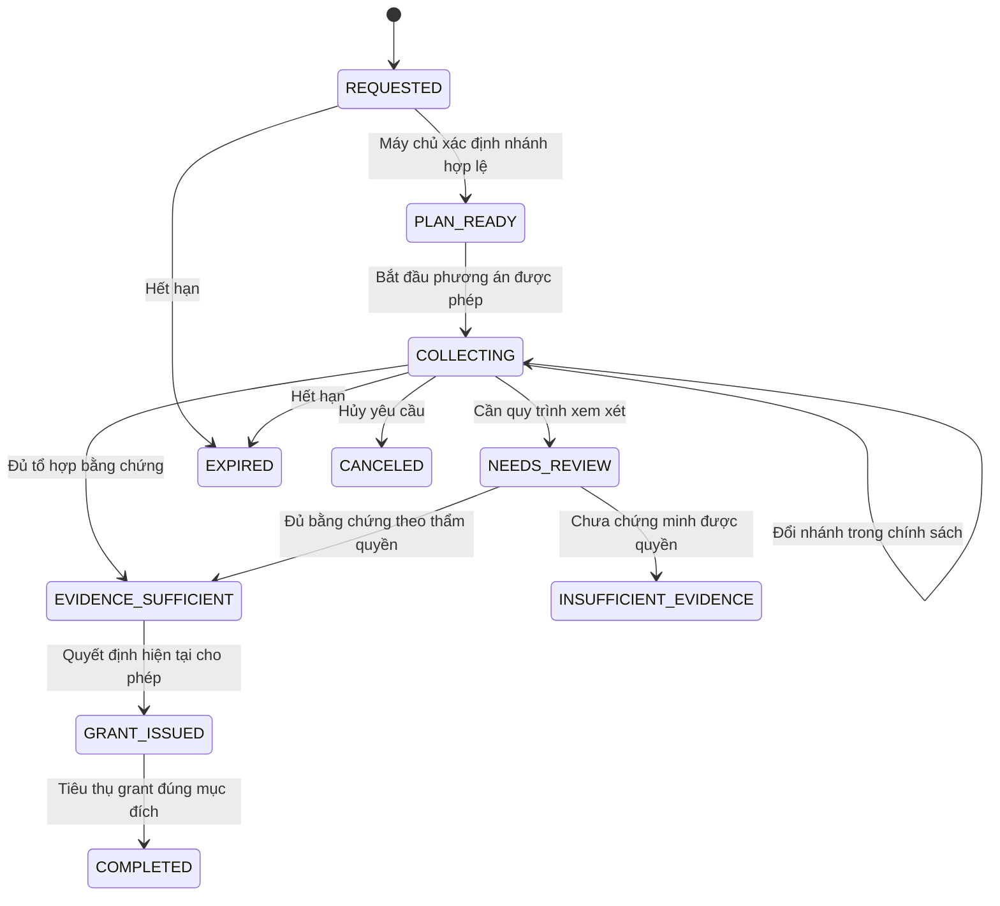

# Knowledge proofing fallback

Knowledge proofing fallback là việc đưa kiểm tra kiến thức vào nhánh dự phòng khi người dùng không hoàn thành được phương án xác minh hoặc khôi phục ban đầu. Ví dụ thường gặp là yêu cầu trả lời câu hỏi cá nhân sau khi mất điện thoại MFA, không nhận được mã email hoặc không thể dùng passkey.

Nhánh dự phòng có ảnh hưởng trực tiếp đến độ an toàn của toàn bộ tài khoản. Nếu người tấn công có thể bỏ qua passkey bằng cách trả lời thông tin cá nhân dễ tìm, bảo vệ của tài khoản bị giới hạn bởi nhánh đó. Vì vậy, thiết kế fallback cần xác định bằng chứng nào thực sự đủ để tiếp tục, thay vì tìm một bộ câu hỏi dễ hoàn thành hơn.

Bài học phân tích vai trò và giới hạn của kiểm tra kiến thức, cách xử lý hệ thống cũ đang có nhánh này và cách thiết kế luồng chuyển phương án khôi phục. Các tên trạng thái, mô hình dữ liệu và pseudocode dưới đây là ví dụ thiết kế của nền tảng, không phải một giao thức hay tuyên bố đáp ứng mức đảm bảo cụ thể.

## 1. Phân biệt các loại thông tin trong luồng dự phòng

Không phải mọi thứ người dùng nhập từ trí nhớ đều có cùng giá trị bảo mật.

| Loại thông tin hoặc bằng chứng | Ví dụ | Điều có thể suy ra |
| --- | --- | --- |
| Thuộc tính cá nhân | Ngày sinh, địa chỉ cũ, tên trường học | Người yêu cầu biết một số thông tin; chưa chứng minh quyền sở hữu tài khoản |
| Thông tin lịch sử tài khoản | Tháng mở tài khoản, đơn hàng gần đây, người thường liên hệ | Có sự hiểu biết về tài khoản; nguồn biết có thể là email bị lộ hoặc dữ liệu bị đánh cắp |
| Câu trả lời bí mật đã đăng ký | Tên thú cưng, nơi gặp người thân | Khả năng biết câu trả lời đã lưu; có rủi ro đoán, chia sẻ hoặc tìm kiếm |
| Recovery code được phát hành trước | Một mã ngẫu nhiên dành cho khôi phục | Có một bí mật được hệ thống cấp cho mục đích đã xác định, nếu mã còn hợp lệ |
| Chứng minh kiểm soát authenticator đã gắn | Thực hiện xác thực bằng một phương tiện còn sử dụng được | Có khả năng điều khiển authenticator đó trong lần kiểm tra, theo tính chất của cơ chế |
| Bằng chứng xác minh danh tính | Kiểm tra danh tính theo quy trình phù hợp và đối chiếu hồ sơ đã thiết lập | Có bằng chứng về danh tính và sự liên kết được kiểm tra; vẫn cần quyết định quyền khôi phục |

Một recovery code ngẫu nhiên không trở thành câu hỏi kiến thức cá nhân chỉ vì người dùng gõ hoặc nhớ mã. Nguồn phát hành, độ khó đoán, cách lưu, phạm vi sử dụng và hiệu lực của mã khác với thông tin tiểu sử. Tuy nhiên, mã vẫn có thể bị đánh cắp hoặc bị lừa cung cấp; không mặc định mọi recovery code đều chống phishing.

Cũng cần phân biệt **tìm đúng hồ sơ** và **chứng minh quyền với hồ sơ**. Hỏi mã khách hàng để định vị tài khoản có thể là một bước tra cứu. Coi việc biết mã đó là quyền thay MFA lại là một quyết định xác thực cần bằng chứng khác.

## 2. Vì sao nhánh knowledge fallback dễ thành đường chiếm đoạt?

### 2.1. Người tấn công có thể chủ động chọn nhánh yếu

Một luồng có thể bắt đầu bằng passkey hoặc MFA nhưng hiển thị nút “Tôi không còn phương thức này”. Nếu nút đó dẫn đến vài câu hỏi cá nhân rồi cho phép đặt lại mọi yếu tố, kẻ tấn công không cần vượt qua phương thức chính.

Việc chỉ mở câu hỏi sau nhiều lần thất bại cũng không giải quyết vấn đề. Người tấn công có thể chủ động gây thất bại để đạt điều kiện mở nhánh. Thất bại trước một phương thức mạnh không phải bằng chứng người yêu cầu là chủ tài khoản.

### 2.2. Câu trả lời có thể cùng đến từ một nguồn bị lộ

Biết địa chỉ, ngày sinh và một giao dịch không nhất thiết là ba bằng chứng độc lập. Cả ba có thể xuất hiện trong cùng một hộp thư, hồ sơ bị rò rỉ hoặc thiết bị đã bị xâm nhập.

Không nên cộng số câu trả lời đúng như cộng các yếu tố xác thực độc lập. Mười thông tin lấy từ một nguồn bị chiếm quyền vẫn có thể chỉ phản ánh quyền truy cập vào nguồn đó.

### 2.3. Khó với người thật không đồng nghĩa khó với kẻ tấn công

Người dùng có thể không nhớ cách viết câu trả lời từ nhiều năm trước, địa chỉ đã dùng hoặc mốc giao dịch. Người tấn công có hồ sơ thu thập sẵn lại có thể trả lời chính xác hơn.

Tăng độ khó của câu hỏi có thể làm tăng số người hợp lệ bị từ chối mà không tạo thêm bằng chứng sở hữu đáng tin cậy. Chấp nhận gần đúng để giảm khó khăn cũng có thể mở rộng tập câu trả lời được chấp nhận.

### 2.4. Nhân viên hỗ trợ có thể vô tình làm yếu cùng một cổng

Một hệ thống có thể bỏ câu hỏi khỏi website nhưng vẫn cho nhân viên reset MFA sau khi khách đọc ngày sinh và vài đơn hàng. Khi đó nhánh yếu chuyển sang tổng đài hoặc chat.

Giọng nói tự tin, câu chuyện khẩn cấp, tên người quen trong công ty hoặc mức độ chi tiết của lời kể không thay thế bằng chứng quyền sở hữu. Quy trình fallback phải bao phủ cả ứng dụng, hỗ trợ và công cụ quản trị.

## 3. Đặt đúng giới hạn cho KBA và KBV

KBA thường chỉ cơ chế xác thực bằng kiến thức, chẳng hạn câu hỏi bảo mật đã đăng ký. KBV thường chỉ việc kiểm tra thông tin cá nhân để xác minh danh tính. Hai cách gọi có thể xuất hiện khác nhau trong tài liệu sản phẩm, nên cần nhìn vào cách kết quả được sử dụng.

Trong phạm vi hướng dẫn NIST SP 800-63A-4, KBV hoặc KBA không được dùng để thực hiện identity verification. Không nên lấy hướng dẫn của phiên bản cũ hoặc lời quảng cáo “xác minh danh tính bằng câu hỏi” làm cơ sở cho một thiết kế theo khung hiện hành này. [NIST SP 800-63A-4 — Identity Verification](https://pages.nist.gov/800-63-4/sp800-63a.html).

OWASP cũng nêu câu hỏi bảo mật không nên là cơ chế duy nhất để đặt lại mật khẩu vì câu trả lời thường dễ đoán hoặc thu thập. Điều này không tạo căn cứ để cho câu hỏi bảo mật tự gỡ MFA hoặc thay passkey. [OWASP Forgot Password Cheat Sheet — Security Questions](https://cheatsheetseries.owasp.org/cheatsheets/Forgot_Password_Cheat_Sheet.html#security-questions).

Trong thiết kế minh họa của bài, dữ liệu tự khai có thể giúp định vị hồ sơ hoặc chuyển đúng nhóm hỗ trợ khi cần thiết. Nó không được tạo quyền khôi phục, bù cho một bằng chứng bắt buộc còn thiếu hoặc được đổi tên thành “xem xét thủ công” để né giới hạn trên.

Không cần thu thập thêm câu trả lời cá nhân chỉ để tạo cảm giác quy trình có nhiều bước. Nếu một trường không có mục đích rõ ràng và không giúp xử lý đúng yêu cầu, nên loại bỏ khỏi trải nghiệm và kế hoạch lưu giữ.

## 4. Chọn phương án dự phòng từ bằng chứng thực sự còn dùng được

Fallback là chuyển sang một tổ hợp bằng chứng phù hợp khác. Nó không phải quy tắc tự động hạ yêu cầu sau mỗi lần người dùng báo không thực hiện được.

NIST SP 800-63B-4 mô tả các nhóm phương thức khôi phục gồm mã đã lưu, mã được cấp khi khôi phục, người liên hệ khôi phục và thực hiện lại phần xác minh danh tính. Yêu cầu và tổ hợp được chấp nhận phụ thuộc mức đảm bảo cùng bối cảnh tài khoản. [NIST SP 800-63B-4 — Account Recovery](https://pages.nist.gov/800-63-4/sp800-63b.html#account-recovery).

Bảng dưới đây là các ứng viên cần đánh giá trong một chính sách của sản phẩm; không khẳng định mỗi dòng riêng lẻ đủ để khôi phục mọi tài khoản.

| Tình trạng | Phương án có thể xem xét | Điều phải kiểm tra |
| --- | --- | --- |
| Còn authenticator khác đã gắn | Xác thực bằng phương tiện còn sử dụng được và thực hiện quy trình thay thế phù hợp | Tính hợp lệ, mức đảm bảo, dấu hiệu bị chiếm quyền và yêu cầu của hành động |
| Có recovery code đã cấp trước | Trình mã qua kênh bảo vệ | Liên kết tài khoản, hiệu lực, chống đoán, dùng một lần và tổ hợp bằng chứng cần thiết |
| Còn địa chỉ khôi phục đã xác lập | Cấp mã hoặc liên kết theo chính sách | Kênh có bị xâm nhập, mới thay đổi, dùng chung điểm lỗi hoặc không còn thuộc người dùng không |
| Có người liên hệ khôi phục đã thiết lập | Thực hiện quy trình cho người liên hệ | Cấu hình trước sự cố, phạm vi ủy quyền và cách xác nhận theo chính sách |
| Có hồ sơ danh tính đáng tin đã thiết lập | Lặp lại phần proofing thích hợp và kiểm tra liên kết với tài khoản | Chất lượng bằng chứng, sự nhất quán với hồ sơ cũ và các kiểm tra bắt buộc |
| Chưa có đủ phương án nào | Hỗ trợ theo quy trình đã xác định hoặc giữ trạng thái chưa đủ bằng chứng | Không cấp quyền chỉ vì đã hỏi hết câu hỏi hoặc đã chờ lâu |

Một passkey khác còn dùng được có thể giúp người dùng xác thực trước khi thay yếu tố. Không nên coi cookie phiên cũ hoặc nhãn “thiết bị quen” là tương đương với một lần xác thực mới đáp ứng yêu cầu.

Địa chỉ email hoặc số điện thoại mới do người đang xin khôi phục cung cấp chưa phải kênh khôi phục đã được xác lập. Nếu được phép dùng địa chỉ mới để liên lạc về tiến độ, cần phân biệt rõ vai trò liên lạc với vai trò nhận quyền khôi phục.

Nếu tài khoản chỉ có tên hiển thị tự khai, một giấy tờ có tên giống nhau không tự tạo liên kết sở hữu. Việc yêu cầu người dùng bất ngờ nộp giấy tờ khi không có nền tảng đối chiếu cũng không phải một phương án dự phòng mặc nhiên an toàn.

## 5. Thiết kế lựa chọn nhánh ở phía máy chủ

Frontend có thể cho người dùng khai báo còn sử dụng phương tiện nào, nhưng máy chủ quyết định những nhánh nào được phép và bằng chứng nào đủ. Tham số `fallback=true`, `lostMfa=true` hoặc `knowledgePassed=true` từ client không mang quyền phê duyệt.

Một cấu trúc minh họa:

```text
RecoveryRequest
  requestId
  accountId
  attemptVersion
  requestedAction
  createdAt
  expiresAt
  state

RecoveryPlan
  planId
  requestId
  policyVersion
  eligibleRoutes
  requiredEvidenceCombinations
  evidenceFreshnessRules
  riskRestrictions
  planVersion

EvidenceReceipt
  receiptId
  requestId
  attemptVersion
  evidenceType
  sourceReference
  verifiedAt
  expiresAt
  verificationState
```

Kế hoạch phải xác định hành động đang xin thực hiện. Đặt mật khẩu mới khi vẫn còn yếu tố mạnh khác có thể khác với gỡ toàn bộ MFA, thay email khôi phục hoặc đăng ký passkey mới sau khi mất tất cả thiết bị.

Biên nhận bằng chứng được backend tạo từ kết quả kiểm tra đáng tin, không nhận nguyên trạng từ frontend. Bản ghi người yêu cầu đã cung cấp một thuộc tính cá nhân cũng không được gắn nhãn giống biên nhận chứng minh kiểm soát authenticator.

Khi đổi nhánh, máy chủ cần kiểm tra lại trạng thái tài khoản, tính hợp lệ của bằng chứng đã có và phiên bản kế hoạch. Không tự cộng dồn mọi kết quả cũ nếu khác mục đích, hết hạn hoặc thuộc một lần thử đã bị hủy.

### 5.1. Phân biệt lý do không hoàn thành

| Lý do | Cách xử lý phù hợp về kiến trúc | Suy luận không hợp lệ |
| --- | --- | --- |
| Người dùng không còn thiết bị | Tìm một nhánh khác đã được chính sách cho phép | Không còn thiết bị nên câu hỏi cá nhân trở thành đủ |
| Kênh gửi mã bị lỗi | Giữ trạng thái chờ, retry có giới hạn hoặc dùng nhánh khác đủ điều kiện | Dịch vụ lỗi nên bỏ kiểm tra quyền sở hữu |
| Bằng chứng không đạt | Xử lý theo lý do, rủi ro và quyền thử lại | Thử lại nhiều lần thì giảm yêu cầu |
| Cần hỗ trợ tiếp cận | Chuyển sang phương thức hoặc người hỗ trợ phù hợp | Nhu cầu hỗ trợ cho phép bỏ mọi bằng chứng bắt buộc |
| Có tín hiệu chiếm đoạt | Áp dụng hạn chế và quy trình xử lý sự cố phù hợp | Người kể đúng lịch sử tài khoản thì tín hiệu bị xâm nhập không còn quan trọng |

Không nên gom lỗi kỹ thuật, người dùng thiếu phương tiện và kết quả xác minh thất bại thành một mã lỗi rồi dùng cùng một fallback yếu.

## 6. Giữ cổng bằng chứng khi chuyển nhánh

Sơ đồ minh họa không có cạnh từ “trả lời câu hỏi đúng” đến “được khôi phục”:



Thời gian chờ, CAPTCHA, xác nhận đã đọc hướng dẫn hoặc số lần trao đổi với hỗ trợ có thể phục vụ vận hành và chống lạm dụng. Chúng không tự bổ sung bằng chứng sở hữu còn thiếu.

Pseudocode sau minh họa việc giữ ranh giới đó:

```text
requestRouteChange(requestId, candidateRoute, continuationSession):
    transaction:
        request = lock current recovery request
        require continuationSession is authorized for this request
        require request is active and not expired
        plan = load current server policy and account restrictions
        require candidateRoute is eligible under plan
        update active route and plan version
        preserve request-level abuse history
        return only the next permitted step

considerRecovery(requestId):
    transaction:
        request = lock current recovery request
        require request is active and not expired
        plan = load current authoritative recovery plan
        evidence = load verified receipts for this request and attempt
        evidence = exclude stale, revoked and inapplicable receipts

        if required evidence combination is not satisfied:
            keep request pending or route to permitted review
            do not issue a recovery grant
            return

        require current risk restrictions allow the requested action
        issue one scoped recovery grant for this decision version
        mark its issuance idempotently
```

Các cuộc gọi xác minh bên ngoài nên được xử lý ngoài transaction dài. Khi lưu kết quả hoặc cấp quyền, backend kiểm tra lại phiên bản yêu cầu và điều kiện hiện tại để tránh dùng kết quả đến muộn cho một kế hoạch đã thay đổi.

Không đưa câu trả lời kiến thức vào tập bằng chứng đủ điều kiện chỉ bằng cách đổi tên trường thành `identityScore`, `supportVerified` hoặc `confidence`. Ý nghĩa và nguồn của bằng chứng phải được giữ xuyên suốt bộ quyết định.

### 6.1. Không dùng điểm rủi ro để che việc thiếu bằng chứng

Thiết bị quen, vị trí gần đây hoặc ít dấu hiệu gian lận có thể góp phần xác định cách xử lý theo chính sách. Chúng không tự chứng minh ai đang yêu cầu thao tác. “Không tìm thấy tín hiệu xấu” khác với “đã có bằng chứng quyền sở hữu”.

Trong thiết kế này, câu trả lời đúng không làm giảm các bằng chứng bắt buộc. Tín hiệu rủi ro cao có thể khiến hệ thống hạn chế hoặc yêu cầu xử lý thêm; tín hiệu thấp không mở một đường knowledge-only ngoài kế hoạch đã xác định.

## 7. Xử lý nhánh hỗ trợ thủ công

Một nhánh hỗ trợ cần có đầu vào được phép, bằng chứng cần thu thập, thẩm quyền phê duyệt và điều kiện từ chối rõ ràng. Nhân viên không được tự tạo bộ câu hỏi rồi đánh dấu người gọi là chủ tài khoản chỉ vì câu chuyện khớp.

Phân biệt các nhiệm vụ trong quá trình hỗ trợ:

| Nhiệm vụ | Dữ liệu có thể cần | Quyền không tự phát sinh |
| --- | --- | --- |
| Tìm đúng yêu cầu | Mã yêu cầu hoặc định danh tra cứu | Quyền thay yếu tố xác thực |
| Hướng dẫn dùng phương tiện còn lại | Tình trạng thiết bị, khả năng truy cập | Quyền bỏ qua phương tiện đó |
| Thu thập bằng chứng theo quy trình | Các nguồn và kiểm tra đã được cho phép | Quyền dùng dữ liệu tự khai thay cho bằng chứng bắt buộc |
| Xem xét ngoại lệ | Hồ sơ, lý do, kết quả kiểm tra và thẩm quyền | Quyền gỡ mọi kiểm soát chỉ do có ngoại lệ |
| Cập nhật tiến độ | Trạng thái được phép công bố | Quyền tiết lộ kênh, danh tính hoặc nội dung nhạy cảm cho người chưa đủ quyền |

Một người hỗ trợ thứ hai có thể giảm lạm dụng nội bộ hoặc sai sót phê duyệt, nhưng hai người cùng đọc một bộ thông tin bị lộ không tạo thêm bằng chứng sở hữu. Việc phân công nhiều người là kiểm soát thẩm quyền; chất lượng bằng chứng vẫn cần được bảo đảm riêng.

Đối với tài khoản tổ chức, có thể có quy trình quản trị viên được ủy quyền xác nhận hoặc khôi phục thành viên. Cần kiểm tra phạm vi tenant, vai trò, mức xác thực của người quản trị và quyền được ủy quyền. Một đồng nghiệp tự xưng quen người dùng chưa phải quản trị viên có thẩm quyền.

Nếu chưa đủ bằng chứng, kết quả hợp lệ có thể là giữ yêu cầu chờ hoặc chưa thể phê duyệt, kèm hướng dẫn cụ thể về những lựa chọn còn lại. Không nên ép nhân viên kết thúc mọi ticket bằng một lần reset.

## 8. Chống lạm dụng xuyên suốt các nhánh

### 8.1. Không đặt lại lịch sử khi đổi phương án

Giới hạn cần xét ở cấp yêu cầu và tài khoản, đồng thời cân nhắc nguồn truy cập, phiên và kênh. Nếu mỗi nhánh có bộ đếm riêng hoàn toàn, người tấn công có thể luân phiên email, SMS, hỗ trợ và nhánh cũ để tăng tổng số lần thử.

Đổi trình duyệt hoặc bắt đầu lại yêu cầu không nên tự xóa mọi dấu hiệu lạm dụng đã có. Tuy nhiên, cũng không nên khóa đăng nhập của nạn nhân chỉ vì một người lạ liên tục gọi chức năng khôi phục. Hạn chế cần áp dụng đúng thao tác và có đường xử lý cho người dùng hợp lệ.

### 8.2. Không biến giao diện thành công cụ khai thác hồ sơ

Tránh hiển thị toàn bộ câu hỏi cá nhân, danh sách địa chỉ cũ hoặc giao dịch của một tài khoản trước khi người yêu cầu có quyền biết. Một câu hỏi trắc nghiệm có các phương án thật cũng có thể tiết lộ dữ liệu, kể cả khi người đó không trả lời đúng.

Giao diện không nên cho biết câu nào đúng, mức điểm thiếu bao nhiêu hoặc gợi ý sửa từng ký tự trong một nhánh cũ. Phản hồi cần đủ để người hợp lệ hiểu bước tiếp theo nhưng không trở thành công cụ dò thông tin.

Kết quả nhận yêu cầu nên tránh tiết lộ tài khoản có tồn tại hay không. Những thông tin về phương thức đã đăng ký chỉ được công bố trong ngữ cảnh được phép, với mức chi tiết thích hợp.

### 8.3. Cân nhắc điểm lỗi chung của các kênh

Mã email và SMS không mặc nhiên độc lập nếu cả hai đều hiển thị trên điện thoại đã bị mất hoặc cùng phụ thuộc một tài khoản bị xâm nhập. Mật khẩu cũ và lịch sử giao dịch cũng có thể cùng bị lấy từ một trình quản lý mật khẩu hoặc hộp thư.

Kế hoạch fallback cần xét nguồn kiểm soát và giả định bị xâm nhập. Không chỉ đếm số màn hình, số câu hỏi hoặc số mã đã nhập.

### 8.4. Lỗi dịch vụ không mở chế độ cho qua

Khi dịch vụ gửi mã, nhà cung cấp proofing hoặc hệ thống hỗ trợ gián đoạn, giữ yêu cầu ở trạng thái chưa được phê duyệt. Có thể chuyển sang nhánh đã được chính sách cho phép và đủ điều kiện; không tự bật câu hỏi bảo mật như công tắc duy trì dịch vụ.

Thông báo tiến độ, thời gian chờ dự kiến và retry có giới hạn giúp người dùng hiểu tình trạng. Việc chờ cần có giới hạn vận hành và người chịu trách nhiệm, nhưng thời gian chờ không tự hoàn thành cổng bằng chứng.

## 9. Sau fallback: cấp đúng quyền và kiểm soát session

Đủ bằng chứng khôi phục chưa nhất thiết có nghĩa cấp ngay một phiên đăng nhập đầy đủ. Có thể cấp recovery grant chỉ cho hành động đã được phê duyệt, chẳng hạn đăng ký yếu tố thay thế theo kế hoạch.

Grant cần được ràng buộc với tài khoản, yêu cầu, lần thử, quyết định và mục đích cụ thể; có thời hạn và cơ chế dùng một lần. Một grant cho đặt mật khẩu không tự cho phép đổi email khôi phục hoặc tắt mọi MFA.

Việc tiêu thụ grant và cập nhật yếu tố phải có kiểm soát đồng thời để hai request không dùng cùng một quyền. Khi tài khoản có thay đổi bảo mật hoặc yêu cầu đã bị hủy, cần kiểm tra lại tính hợp lệ theo phiên bản và chính sách trước khi áp dụng.

Sau thao tác được phép, hệ thống xử lý các session, refresh token, recovery token và authenticator liên quan theo chính sách bảo mật. Nếu có dấu hiệu bị chiếm quyền, cần xử lý các yếu tố hoặc kênh bị xâm nhập và tránh để token cũ khôi phục lại quyền của người tấn công.

Thông báo bảo mật nên được gửi qua các kênh đã xác lập và phù hợp với tình trạng sự cố. Thông báo giúp phát hiện và phản ứng với khôi phục trái phép; nó không thay cho bằng chứng phải có trước khi cấp quyền.

Một địa chỉ mới dùng để theo dõi ticket không được tự động trở thành kênh nhận mọi quyền tiếp theo. Nếu thay đổi địa chỉ khôi phục nằm trong phạm vi hành động được cho phép, thay đổi đó phải đi qua kiểm soát riêng đã được xác định.

## 10. Chuyển hệ thống cũ khỏi knowledge-only fallback

Hệ thống đang có câu hỏi bảo mật thường còn nhiều đường sử dụng ngoài giao diện chính: API cũ, script hỗ trợ, quy trình tổng đài hoặc công cụ quản trị. Kế hoạch chuyển đổi cần kiểm kê các đường có thể cấp quyền bằng câu trả lời.

Một trình tự triển khai minh họa:

1. Xác định chính xác những hành động mà kết quả câu hỏi hiện đang cho phép.
2. Ngừng tạo cấu hình knowledge-only mới và xác định chính sách thay thế cho từng nhóm tài khoản.
3. Khuyến khích người đang xác thực hợp lệ thiết lập phương tiện dự phòng phù hợp trước khi họ mất quyền truy cập.
4. Cập nhật backend, công cụ nhân viên và các phiên bản client còn được hỗ trợ để cùng tuân thủ chính sách mới.
5. Có phương án hỗ trợ cho người đã bị mất quyền, thay vì ép họ đăng ký một phương tiện mới khi chưa chứng minh được quyền sở hữu.
6. Loại bỏ dữ liệu câu hỏi và câu trả lời cũ theo kế hoạch vòng đời đã xác định; giữ dấu vết tối thiểu cần thiết cho vận hành trong thời hạn phù hợp.

Không cho phép người chưa có bằng chứng tự thêm email mới hoặc tự phát recovery code rồi dùng chính dữ liệu vừa thêm để hoàn thành yêu cầu đang chờ. Đó là vòng lặp tự tạo bằng chứng từ quyền chưa được chứng minh.

Hash câu trả lời cũ có thể hỗ trợ giảm một số rủi ro khi lưu trữ, nhưng không sửa được vấn đề câu trả lời dễ đoán hoặc dễ thu thập. Chuyển từ so sánh bản rõ sang so sánh hash không biến nhánh đó thành phương án khôi phục đủ mạnh.

Nếu cần theo dõi việc chuyển đổi, có thể dùng dữ liệu vận hành được phép và đã giảm thông tin. Không cần đưa thêm người dùng qua các câu hỏi cá nhân chỉ để thu thập số liệu cho một nhánh đang loại bỏ.

## 11. Theo dõi chất lượng fallback mà không tối ưu nhầm mục tiêu

Tỷ lệ hoàn thành cao có thể đến từ việc hạ yêu cầu bằng chứng. Vì vậy, cần xem cả khả năng tiếp cận của người thật và nguy cơ phê duyệt sai.

| Chỉ số | Điều giúp quan sát | Cách diễn giải cần tránh |
| --- | --- | --- |
| Tỷ lệ người dùng có phương tiện dự phòng đã thiết lập | Mức chuẩn bị trước sự cố | Có cấu hình nghĩa là phương tiện vẫn còn dùng được và an toàn |
| Tỷ lệ đổi nhánh theo lý do | Các điểm gây khó khăn hoặc lỗi kỹ thuật | Mọi lần đổi nhánh đều là gian lận |
| Thời gian chờ theo trạng thái | Tồn đọng và trách nhiệm xử lý | Chờ đủ lâu nghĩa là bằng chứng đã đủ |
| Tỷ lệ yêu cầu chưa đủ bằng chứng | Mức thiếu phương án và khó khăn thực tế | Phải giảm cổng kiểm tra để số này về không |
| Khiếu nại hoặc sự cố sau khôi phục | Hậu quả của quyết định toàn luồng | Không có khiếu nại nghĩa là không có chiếm đoạt |
| Số lần nhân viên yêu cầu ngoại lệ | Áp lực vận hành hoặc thiếu hướng dẫn | Ngoại lệ được nhiều người dùng yêu cầu thì tự trở thành hợp lệ |

Nên tách theo nhóm người dùng và khả năng tiếp cận khi có mục đích phù hợp, đồng thời kiểm soát dữ liệu phân tích. Log không nên chứa nguyên câu trả lời bí mật, mã khôi phục, token hoặc nội dung hồ sơ nhạy cảm.

Cần ghi được phiên bản chính sách, nhánh đã chọn, loại bằng chứng thực tế và lý do quyết định. Điều này giúp phân biệt yêu cầu được chấp nhận nhờ phương tiện dự phòng hợp lệ với yêu cầu bị cho qua bằng một dấu xác nhận hỗ trợ không có căn cứ.

## 12. Ví dụ xử lý ba trường hợp

### Trường hợp A: mất điện thoại nhưng còn phương tiện dự phòng

Người dùng mất điện thoại chứa ứng dụng MFA, vẫn còn recovery code đã được phát hành trước. Backend xác định tổ hợp bằng chứng cần cho hành động và chỉ cho phép nhánh dùng mã khi đáp ứng chính sách của tài khoản. Nếu còn cần bằng chứng khác, việc nhập đúng mã không làm hệ thống bỏ phần còn thiếu.

Sau khi đủ điều kiện, hệ thống cấp quyền giới hạn để thay yếu tố theo kế hoạch, xử lý grant dùng một lần và quản lý session. Không cần hỏi tên thú cưng hoặc lịch sử địa chỉ để làm cho quy trình có vẻ chắc chắn hơn.

### Trường hợp B: chỉ biết thông tin cá nhân và lịch sử giao dịch

Người yêu cầu trả lời chính xác ngày sinh, địa chỉ và một số đơn hàng nhưng không còn phương tiện dự phòng nào. Những thông tin này có thể giúp đội hỗ trợ tìm đúng hồ sơ trong phạm vi được phép, nhưng không đủ để tự cho phép gỡ MFA.

Nếu tài khoản có hồ sơ danh tính đáng tin và có nhánh proofing phù hợp, hệ thống có thể hướng dẫn theo nhánh đó. Nếu chưa có liên kết hoặc bằng chứng cần thiết, yêu cầu tiếp tục ở trạng thái chưa đủ điều kiện. Nhân viên không biến số lượng thông tin kể đúng thành một recovery grant.

### Trường hợp C: phương án chính bị gián đoạn

Dịch vụ gửi mã gặp lỗi. Người dùng chọn “thử cách khác”. Backend phân biệt đây là lỗi kênh, giữ lịch sử yêu cầu và chỉ đưa ra các nhánh khác đang đủ điều kiện theo kế hoạch hiện tại.

Nếu không có nhánh khả dụng, hệ thống thông báo trạng thái và hỗ trợ xử lý theo quy trình, không tự bật một bộ câu hỏi dễ trả lời hơn. Khi dịch vụ hoạt động trở lại, kết quả đến muộn vẫn phải gắn với đúng yêu cầu, lần thử và thời hạn; một yêu cầu đã hủy không được mở lại chỉ vì sau đó có mã hoặc kết quả hợp lệ.
