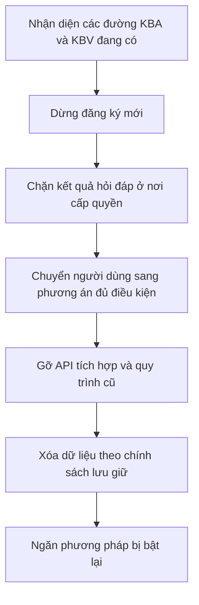

# Knowledge proofing deprecation — Ngừng sử dụng hỏi đáp cá nhân để khôi phục tài khoản

Một dịch vụ cũ cho phép người dùng trả lời tên trường học, địa chỉ trước đây hoặc chi tiết hóa đơn để đặt lại mật khẩu và gỡ MFA. Khi dịch vụ bổ sung passkey hay mã recovery, đường hỏi đáp cũ có thể vẫn tồn tại trong ứng dụng di động, API hoặc quy trình hỗ trợ. Kẻ tấn công chỉ cần tìm được một đường còn chấp nhận câu trả lời để tiếp tục vượt qua các phương tiện bảo vệ mới.

**Knowledge proofing deprecation** là quá trình có kiểm soát để ngừng sử dụng bằng chứng hỏi đáp cá nhân, chuyển người dùng sang phương án phù hợp và loại bỏ khả năng cấp quyền còn sót lại. Công việc bao gồm chính sách, backend, hồ sơ đang xử lý, công cụ hỗ trợ, dữ liệu lưu trữ và trải nghiệm người dùng.

## 1. Phân biệt ngừng khuyến nghị, ngừng chấp nhận và xóa bỏ

Trong vòng đời phần mềm, một chức năng có thể được đánh dấu deprecated nhưng vẫn chạy. Đối với recovery, trạng thái đó chưa đủ nếu chức năng vẫn có thể cấp quyền kiểm soát tài khoản.

| Khái niệm | Ý nghĩa trong bài | Điều chưa được bảo đảm |
| --- | --- | --- |
| Deprecate | Công bố ngừng sử dụng, dừng triển khai mới và xác định lộ trình chuyển đổi | Đường cấp quyền cũ đã bị chặn |
| Disable authorization | Kết quả hỏi đáp không còn đáp ứng yêu cầu cấp quyền recovery | Mã nguồn, tích hợp và dữ liệu cũ đã được dọn hết |
| Retire | Gỡ khỏi các luồng sử dụng, ngắt tích hợp và chấm dứt hỗ trợ phương pháp | Mọi bản sao dữ liệu đã hết thời hạn lưu |
| Delete data | Xóa dữ liệu không còn mục đích lưu theo chính sách đã xác định | Người dùng đã có phương án recovery mới phù hợp |

Ví dụ, ẩn mục “câu hỏi bảo mật” khỏi trang cài đặt chỉ thay đổi giao diện. Nếu endpoint cũ vẫn nhận câu trả lời rồi phát hành reset token, cơ chế chưa được ngừng chấp nhận.

Phạm vi bài này là KBA/KBV dựa trên tri thức về đời tư hoặc lịch sử của người dùng. Việc ngừng cơ chế đó không có nghĩa xóa mật khẩu, mã recovery ngẫu nhiên hay mọi thuộc tính hồ sơ đang có mục đích sử dụng hợp lệ.

## 2. Vì sao cần chuyển khỏi cơ chế hỏi đáp

Câu trả lời cá nhân thường có các giới hạn khó khắc phục bằng thay đổi giao diện:

- Có thể được biết bởi người thân, đồng nghiệp hoặc người dùng chung dịch vụ.
- Có thể xuất hiện trong dữ liệu rò rỉ, thư điện tử và hồ sơ đã bị xâm nhập.
- Có thể có ít khả năng trả lời, dù câu hỏi nghe rất riêng tư.
- Khó thay đổi khi bị lộ: người dùng không thể thay quê quán như thay một mã recovery.
- Có thể được dùng lại giữa nhiều dịch vụ.
- Có thể bị người dùng thật nhớ sai hoặc ghi khác sau nhiều năm.

Hỏi thêm nhiều câu không tự tạo các yếu tố xác thực độc lập. Hỏi một chi tiết mới từ hóa đơn cũng không độc lập với hộp thư nếu kẻ tấn công đã đọc được chính hóa đơn ấy.

NIST SP 800-63-4 không coi KBA dựa trên câu trả lời được giả định chỉ người dùng biết là một bí mật chấp nhận được cho digital authentication trong phạm vi hướng dẫn. [NIST SP 800-63-4, Authenticators](https://pages.nist.gov/800-63-4/sp800-63.html#authenticators)

Đối với identity verification, NIST SP 800-63A-4 không cho phép dùng KBV hoặc KBA. Khi tham chiếu tài liệu cũ, cần kiểm tra phiên bản thay vì mang điều kiện của phiên bản trước sang phiên bản hiện hành. Đây là yêu cầu của bộ hướng dẫn, không phải tuyên bố mọi dịch vụ đều chịu cùng một nghĩa vụ pháp lý. [NIST SP 800-63A-4, Identity Verification Methods](https://pages.nist.gov/800-63-4/sp800-63a.html#identity-verification-methods)

OWASP ghi rõ hướng dẫn chọn câu hỏi bảo mật phục vụ mục đích legacy. Các ví dụ “câu hỏi tốt hơn” trong tài liệu đó không nên được diễn giải thành lý do để triển khai một hệ thống KBA mới. [OWASP Choosing and Using Security Questions](https://cheatsheetseries.owasp.org/cheatsheets/Choosing_and_Using_Security_Questions_Cheat_Sheet.html)

## 3. Kiểm kê tất cả nơi bằng chứng cũ có thể cấp quyền

Lộ trình chuyển đổi cần bắt đầu từ tác động của kết quả hỏi đáp. Đừng chỉ tìm bảng lưu câu hỏi hoặc trang thiết lập tài khoản.

| Bề mặt | Ví dụ cần nhận diện | Quyền có thể bị ảnh hưởng |
| --- | --- | --- |
| Web và ứng dụng di động | Màn hình quên mật khẩu, mất điện thoại, không còn passkey | Reset mật khẩu, mở nhánh đăng ký yếu tố mới |
| API cũ | Endpoint nhận câu trả lời, SDK cũ, route còn được gateway chuyển tiếp | Phát hành recovery token dù giao diện đã bị gỡ |
| Bộ quyết định recovery | Quy tắc cộng điểm hoặc cờ `verified` từ KBA | Bù cho bằng chứng bắt buộc đang thiếu |
| Hỗ trợ thủ công | Kịch bản cuộc gọi và nút duyệt hồ sơ | Đổi email, gỡ MFA hoặc đặt lại phương tiện recovery |
| Nhà cung cấp bên ngoài | Challenge, callback và kết quả lưu đệm | Ghi nhận một kết quả cũ thành bằng chứng hợp lệ |
| Xử lý bất đồng bộ | Job chờ, retry, sự kiện trong hàng đợi | Hoàn thành một hồ sơ sau thời điểm ngừng chấp nhận |
| Token và session | Reset token đã cấp, phiên hạn chế hoặc phiên đăng nhập từ recovery | Tiếp tục sử dụng quyền bắt nguồn từ phương pháp đã loại bỏ |
| Quy trình dự phòng | Fallback khi nhà cung cấp hoặc phương pháp mới gặp lỗi | Tự bật lại KBA trong lúc vận hành gặp sự cố |

Mỗi đường nên có người chịu trách nhiệm, nơi kiểm tra chính sách và hành động cuối cùng có thể thực hiện. Một câu hỏi quan trọng là: “Nếu người yêu cầu trả lời đúng, thành phần nào được phép thay đổi tài khoản?”

Lưu ý những tên trường chung như `identityVerified`, `supportApproved` hoặc `riskPassed`. Nếu chúng có thể nhận giá trị từ nhiều nguồn, cần xác định nguồn thật trước khi coi một hồ sơ đã đáp ứng yêu cầu recovery.

## 4. Chọn phương án thay thế trước khi chuyển người dùng

Không có một phương án thay thế duy nhất phù hợp với mọi tài khoản. Mức rủi ro, phương tiện đã đăng ký, danh tính đã được xác minh trước đây và tình huống mất quyền truy cập đều ảnh hưởng đến quyết định.

| Tình trạng | Hướng chuyển đổi có thể xem xét | Giới hạn cần giữ |
| --- | --- | --- |
| Người dùng còn phương tiện xác thực đủ điều kiện | Yêu cầu xác thực phù hợp để thiết lập thêm phương tiện hoặc mã recovery | Một session đang mở chưa mặc nhiên đủ cho thao tác nhạy cảm |
| Người dùng có mã recovery đã cấp trước | Dùng quy trình kiểm tra mã theo chính sách của tài khoản | Không chỉ hỏi người dùng có nhớ rằng từng nhận mã hay không |
| Có recovery contact đã được thiết lập | Dùng cơ chế đã xác định cho loại contact đó | Không chấp nhận một địa chỉ mới do người yêu cầu tùy ý cung cấp |
| Tài khoản đã được identity-proofed | Xem xét chứng minh lại danh tính và đối chiếu liên kết có từ trước | Giấy tờ có tên giống nhau không tự chứng minh sở hữu tài khoản |
| Người dùng chưa còn phương án đủ điều kiện | Chuyển quy trình hỗ trợ hoặc ngoại lệ có bằng chứng và phạm vi rõ ràng | Không dùng câu hỏi cá nhân làm đường đi thay thế mặc định |

NIST SP 800-63B-4 mô tả các nhóm recovery như mã lưu trước, mã được cấp, recovery contact và repeated identity proofing. Điều kiện sử dụng phụ thuộc tài khoản và mức đảm bảo; chúng không phải các lựa chọn luôn thay thế được cho nhau. [NIST SP 800-63B-4, Account Recovery](https://pages.nist.gov/800-63-4/sp800-63b.html#account-recovery)

Một rủi ro chuyển đổi đặc biệt là cho phép người chỉ vượt qua KBA đăng ký ngay một passkey mới. Khi đó, bí mật mới có thể được liên kết với chính kẻ tấn công. Từ thời điểm ấy, dịch vụ nhìn thấy một phương tiện mật mã hợp lệ nhưng chủ thể được cấp phương tiện ban đầu đã sai.

Vì vậy, **thiết lập phương án thay thế phải được bảo vệ bằng bằng chứng độc lập, đủ điều kiện**. Không dùng cơ chế đang loại bỏ để phê duyệt việc thay thế chính nó.

## 5. Lộ trình chuyển đổi có các trạng thái rõ ràng

Mô hình dưới đây là ví dụ thiết kế, không phải tên trạng thái bắt buộc của một tiêu chuẩn:



Các bước có thể triển khai đan xen. Nếu đã xác định đường KBA đang cho phép reset mật khẩu hoặc gỡ MFA một cách không đủ bảo đảm, không chờ tỷ lệ chuyển đổi người dùng đạt một con số đẹp mới chặn đường cấp quyền đó.

### 5.1. Dừng tạo nghĩa vụ mới

Dừng yêu cầu người dùng mới đăng ký câu hỏi bảo mật. Ngừng hiển thị chúng như một cách tăng bảo vệ tài khoản. Dừng tạo mới challenge bên nhà cung cấp cho những mục đích đã được loại khỏi chính sách.

Người dùng đang đăng nhập có thể được hướng dẫn thiết lập thêm phương án recovery. Việc thiết lập phải yêu cầu xác thực phù hợp với thao tác, xử lý nguy cơ session bị chiếm và thông báo thay đổi qua kênh đã thiết lập theo chính sách.

Không yêu cầu nhập lại câu trả lời cũ để “xác nhận xóa câu hỏi”. Nếu người dùng đã hoàn thành một bước xác thực đủ điều kiện, câu hỏi cũ không cần được phục hồi vai trò kiểm soát chỉ để hoàn tất chuyển đổi.

### 5.2. Chặn ở ranh giới cấp quyền

Backend phải loại KBA/KBV khỏi các loại bằng chứng được chấp nhận cho thao tác recovery đã xác định. Giao diện và API trả về hướng dẫn chuyển đổi, nhưng ràng buộc cuối cùng phải nằm ở nơi phát hành hoặc sử dụng quyền nhạy cảm.

Không chấp nhận các cách đi vòng như:

- Điểm KBA cao làm giảm yêu cầu đối với bằng chứng khác.
- Nhân viên hỗ trợ chọn “đã xác minh” sau khi hỏi đúng bộ câu hỏi cũ.
- Ứng dụng di động dùng endpoint phiên bản trước để hoàn tất recovery.
- Nhà cung cấp trả về `PASS` và callback tự kích hoạt đăng ký passkey.
- Một nhánh timeout hoặc fallback trả về trạng thái cho phép mặc định.

### 5.3. Chuyển đổi theo nhóm mà không giữ đường yếu

Có thể triển khai hướng dẫn, giao diện và hỗ trợ theo từng nhóm người dùng để kiểm soát tải. Tuy nhiên, việc chia nhóm không nên duy trì khả năng cấp quyền bằng KBA cho nhóm chưa chuyển đổi.

Nhóm chưa có phương án phù hợp cần được chuyển tới nhánh hỗ trợ đã thiết kế. Họ có thể phải chờ hoặc bổ sung bằng chứng; đây là điều cần được giải thích rõ, không được giải quyết bằng một ngoại lệ hỏi đáp không có giới hạn.

## 6. Phiên bản chính sách và hồ sơ đang xử lý

Một thay đổi chính sách không chỉ ảnh hưởng yêu cầu tạo sau thời điểm triển khai. Hồ sơ, callback và token được tạo trước đó có thể vẫn còn hoạt động.

Mỗi hồ sơ recovery nên ghi nhận phương pháp, nguồn bằng chứng, thời điểm và phiên bản chính sách đã áp dụng. Những thông tin này cho phép dịch vụ đánh giá lại hồ sơ khi phương pháp bị loại bỏ.

| Đối tượng đang tồn tại | Cách xử lý trong thiết kế minh họa |
| --- | --- |
| Challenge hỏi đáp chưa trả lời | Đóng challenge và hướng tới phương pháp còn được hỗ trợ |
| Challenge đã trả lời nhưng chưa cấp quyền | Không dùng kết quả đó để đáp ứng yêu cầu recovery mới |
| Callback trả về muộn | Xác thực nguồn để xử lý an toàn, nhưng không cấp quyền từ phương pháp đã tắt |
| Token chưa dùng, chỉ dựa trên KBA | Hủy hoặc từ chối khi tiêu thụ; yêu cầu phương pháp đủ điều kiện |
| Hồ sơ có cả KBA và bằng chứng khác | Đánh giá bằng chứng còn lại theo chính sách, không kết luận cả hồ sơ tự động hợp lệ hoặc vô hiệu |
| Kết quả cũ chỉ có cờ `verified` | Không suy đoán nguồn; bổ sung căn cứ trước thao tác nhạy cảm |
| Session đã được cấp qua recovery yếu | Xử lý theo nguồn gốc session và đánh giá rủi ro, kể cả khả năng đã bị chiếm |

Không cần hủy mọi token hoặc đăng xuất mọi người dùng chỉ vì tên phiên bản chính sách thay đổi. Phạm vi tác động cần dựa vào phương pháp, nguồn bằng chứng và rủi ro thật. Ngược lại, không được coi session do KBA tạo ra trước đây là đủ mạnh để tự phê duyệt chuyển đổi sang phương tiện mới.

Nếu một thay đổi tài khoản đã hoàn tất trước khi chặn phương pháp, không thể giải quyết chỉ bằng việc hủy token chưa dùng. Khi có dấu hiệu chiếm đoạt, cần xử lý sự cố, các phương tiện đã đăng ký và session liên quan theo quy trình thích hợp.

### 6.1. Tránh tranh chấp tại thời điểm chuyển chính sách

Ví dụ:

1. Một job KBA đang xử lý theo chính sách cũ.
2. Dịch vụ ngừng chấp nhận KBA để gỡ MFA.
3. Job cũ trả về thành công.
4. Nếu worker chỉ nhìn kết quả thành công, nó có thể cấp token sau thời điểm ngừng chấp nhận.

Để tránh tình huống này, thành phần cấp quyền phải kiểm tra lại phương pháp theo chính sách hiệu lực tại thời điểm cấp. Thành phần tiêu thụ quyền cũng cần có khả năng từ chối quyền đã bị thu hồi hoặc không còn đủ điều kiện.

Việc kiểm tra và ghi thay đổi nhạy cảm cần có ràng buộc giao dịch hoặc cơ chế kiểm soát đồng thời tương đương. Chỉ kiểm tra một cờ từ lâu trong cache rồi tiếp tục ghi tài khoản có thể để lại khoảng trống khi chính sách vừa thay đổi.

### 6.2. Ví dụ chính sách ngừng chấp nhận

Khối JSON sau là cấu hình minh họa do server quản lý, không phải payload được phép nhận từ client:

```json
{
  "policyVersion": "recovery-demo-v8",
  "legacyKnowledgeProofing": {
    "allowNewEnrollment": false,
    "allowNewChallenge": false,
    "acceptAsRecoveryEvidence": false,
    "acceptLateResultForAuthorization": false
  },
  "migration": {
    "requireIndependentEvidenceForNewMethod": true,
    "fallbackToKnowledgeProofing": false
  }
}
```

Không nên chỉ tắt `allowNewChallenge` rồi để `acceptLateResultForAuthorization` tiếp tục hoạt động. Những challenge đã tạo vẫn có thể trở thành đường cấp quyền. Tương tự, cấu hình đúng chưa đủ nếu một service cũ không đọc cấu hình hoặc có quyền sửa tài khoản trực tiếp.

## 7. Chuyển đổi người dùng và quy trình hỗ trợ

Thông báo cần mô tả thay đổi, hành động có thể làm và đường hỗ trợ hợp lệ. Không đưa câu trả lời cũ vào email để “nhắc người dùng thông tin đã đăng ký”.

Ví dụ thông báo trong tài khoản sau khi đã đăng nhập:

> Dịch vụ đã ngừng dùng câu hỏi bảo mật để khôi phục tài khoản. Hãy thiết lập phương án khôi phục được hỗ trợ trong phần Bảo mật. Việc thiết lập có thể yêu cầu xác thực lại. Nếu đã mất phương tiện đăng nhập, hãy dùng quy trình Khôi phục tài khoản của dịch vụ.

Đây là lời nhắn mẫu của bài, không phải thông báo đã gửi cho người dùng thực tế.

Những điểm cần giữ trong trải nghiệm chuyển đổi:

- Chỉ rõ phương án nào phù hợp với tình trạng tài khoản hiện tại.
- Phân biệt người còn đăng nhập được với người đã mất toàn bộ phương tiện.
- Không yêu cầu gửi mật khẩu, OTP hoặc câu trả lời cũ cho nhân viên hỗ trợ.
- Cung cấp hướng dẫn dễ tiếp cận khi người dùng không thể dùng một thiết bị hoặc kênh nhất định.
- Tránh thông báo trước xác minh làm lộ tài khoản có tồn tại hay đang cấu hình phương án nào.

Kịch bản hỗ trợ cũng phải thay đổi. Một nhân viên không được thay câu hỏi có sẵn bằng các câu hỏi tự nghĩ ra như nơi làm việc hoặc tên người thân rồi duyệt hồ sơ theo cảm tính.

Nếu có quy trình ngoại lệ, nêu rõ loại bằng chứng, phạm vi thao tác, người có thẩm quyền và cách lưu vết. “Khách hàng rất gấp” không phải một phương pháp recovery mới.

## 8. Ngắt tích hợp và xử lý dữ liệu câu trả lời

Ngừng sử dụng bằng chứng không đồng nghĩa cần giữ lại dữ liệu vô thời hạn. Câu trả lời có thể tiếp tục gây hại nếu bị lộ, vì người dùng có thể đã sử dụng cùng dữ liệu ở nơi khác.

### 8.1. Xác định những gì phải dọn

Danh mục dữ liệu cần xem xét gồm:

- Câu hỏi, câu trả lời, biến thể chuẩn hóa và gợi ý trả lời.
- Hash, salt và dữ liệu so sánh phục vụ cơ chế cũ.
- Challenge đang mở, kết quả cache và token chỉ phục vụ KBA.
- Nội dung trong ticket, bản ghi trao đổi hoặc tệp xuất dữ liệu.
- Bản sao lưu, bản sao phân tích và dữ liệu do nhà cung cấp giữ.

Hash không tự làm dữ liệu trở thành vô hại. Một đáp án có miền giá trị nhỏ vẫn có thể bị thử đoán nếu kẻ tấn công lấy được hash. Không cần giải mã hay khôi phục câu trả lời để xóa chúng khỏi nơi lưu đã hết mục đích.

Việc bỏ KBA không mặc định yêu cầu xóa ngày sinh hoặc địa chỉ khỏi mọi hệ thống nếu các thuộc tính đó còn một mục đích nghiệp vụ hợp lệ khác. Phải phân biệt dữ liệu dùng cho cơ chế hỏi đáp với thuộc tính hồ sơ đang có chính sách riêng.

### 8.2. Giữ bằng chứng vận hành tối thiểu

Có thể cần lưu rằng một tài khoản đã được chuyển đổi, thời điểm ngừng chấp nhận, phương pháp đã loại bỏ và mã lý do. Thông thường không cần giữ nguyên đáp án để chứng minh sự kiện chuyển đổi.

Nếu một hồ sơ có yêu cầu giữ dữ liệu được xác định riêng, giới hạn dữ liệu, người được truy cập và thời hạn tương ứng. Ngoại lệ lưu giữ không được biến thành ngoại lệ tiếp tục dùng đáp án để cấp quyền.

Với backup chưa thể sửa riêng từng bản ghi, cần lịch hết hạn và cơ chế áp dụng lại trạng thái xóa khi phục hồi. Một lần khôi phục cơ sở dữ liệu cũ không được làm sống lại câu hỏi, endpoint hoặc quyền recovery đã loại bỏ.

### 8.3. Kết thúc tích hợp nhà cung cấp

Dừng tạo challenge mới, thu hồi quyền tích hợp không còn cần và xác định việc xóa dữ liệu ở bên nhận. Trong giai đoạn đóng kết nối, callback muộn cần được xử lý có giới hạn và không ghi toàn bộ câu trả lời vào log lỗi.

Không giữ nhà cung cấp như fallback âm thầm khi phương pháp mới bị lỗi. Nếu dịch vụ thay thế không khả dụng, chuyển sang phương án dự phòng đã được chấp nhận hoặc thông báo chưa thể hoàn tất; không tự bật lại đường yếu.

## 9. Đo lường để phát hiện đường cấp quyền còn sót

Tỷ lệ người dùng xóa câu hỏi khỏi hồ sơ không chứng minh KBA đã mất quyền cấp recovery. Cần có tín hiệu ở nơi phát hành quyền, nơi tiêu thụ quyền và các đường hỗ trợ.

| Chỉ số hoặc bằng chứng | Điều cần hiểu đúng |
| --- | --- |
| Số recovery grant có nguồn KBA/KBV sau thời điểm ngừng chấp nhận | Phải không còn trong phạm vi đã cấm; một trường hợp phát sinh cần được điều tra |
| Yêu cầu tới endpoint cũ | Có thể vẫn đến từ client cũ hoặc người dò API; cần biết chúng không còn cấp quyền |
| Callback hoặc job KBA bị từ chối | Cho thấy lưu lượng cũ còn tồn tại, không nên đồng nghĩa mọi request là tấn công |
| Người dùng có phương án recovery đủ điều kiện | Phân biệt có cấu hình với phương án còn khả dụng và đúng yêu cầu |
| Hồ sơ cần hỗ trợ sau chuyển đổi | Dùng để cải thiện hướng dẫn và năng lực hỗ trợ, không để tự hạ yêu cầu bằng chứng |
| Dữ liệu KBA còn trong các kho | Theo dõi phạm vi lưu giữ thực tế, kể cả bên cung cấp và backup |

Không đưa đáp án hoặc nội dung câu hỏi vào nhãn metric. Chỉ cần mã phương pháp, phiên bản chính sách, loại client và kết quả được thiết kế không làm lộ dữ liệu cá nhân.

Nếu hệ thống không ghi nguồn của quyền recovery, số đếm bằng không có thể chỉ phản ánh thiếu khả năng quan sát. Khi đó cần giải quyết khoảng trống về nguồn gốc thay vì tuyên bố đã hoàn tất.

## 10. Tình huống minh họa quá trình ngừng sử dụng

Giả sử một dịch vụ có ba đường dùng KBA: web quên mật khẩu, API di động cũ và công cụ hỗ trợ. Đây là tình huống hư cấu để phân tích thiết kế.

### Giai đoạn đầu: giao diện mới nhưng quyền cũ còn tồn tại

Web đã bỏ màn hình câu hỏi và khuyến khích tạo passkey. API di động vẫn cấp reset token khi câu trả lời đúng. Nhân viên hỗ trợ cũng có nút gỡ MFA sau cuộc gọi.

Dịch vụ chưa ngừng chấp nhận KBA. Người dùng có passkey vẫn có thể bị chiếm tài khoản qua nhánh recovery cũ.

### Giai đoạn chặn cấp quyền

Bộ cấp quyền ngừng nhận KBA làm bằng chứng. Endpoint cũ không còn phát hành token; công cụ hỗ trợ không thể dùng kết quả hỏi đáp để gỡ MFA. Các token chưa dùng chỉ dựa trên KBA được hủy hoặc bị chặn khi tiêu thụ.

Một callback thành công đến muộn chỉ được xử lý theo chính sách đóng tích hợp. Nó không làm hồ sơ chuyển sang trạng thái được phép cấp quyền.

### Giai đoạn chuyển người dùng

Người còn phương tiện đủ điều kiện được hướng dẫn xác thực lại để thiết lập phương án recovery. Người đã mất quyền truy cập chuyển tới phương pháp được hỗ trợ hoặc quy trình ngoại lệ có căn cứ.

Không cho phép người vượt qua câu hỏi cũ tự đăng ký passkey ngay. Nếu làm vậy, quá trình chuyển đổi sẽ đóng gói một lần phê duyệt yếu thành một phương tiện mới có vẻ đáng tin cậy.

### Giai đoạn kết thúc

Dịch vụ gỡ route và tích hợp không còn dùng, cập nhật tài liệu hỗ trợ, hoàn tất xử lý dữ liệu theo chính sách và giữ ràng buộc để phiên bản phần mềm cũ không bật lại phương pháp.

Tỷ lệ hoàn tất recovery có thể thay đổi trong giai đoạn chuyển đổi. Nhóm vận hành cần tìm nguyên nhân như hướng dẫn khó hiểu, thiếu phương án hoặc tải hỗ trợ tăng; không dùng việc giảm tỷ lệ làm lý do tự động phục hồi KBA.

## 11. Điều kiện chốt và nguyên tắc rollback

Một kế hoạch ngừng sử dụng có thể được xem là hoàn tất trong phạm vi đã xác định khi:

1. Không còn đăng ký mới hoặc challenge mới cho mục đích đã loại bỏ.
2. Kết quả KBA/KBV không thể cấp quyền, bù bằng chứng thiếu hoặc đi qua nhánh hỗ trợ để thay đổi tài khoản.
3. Hồ sơ, token, callback và session chịu ảnh hưởng đã được xử lý theo nguồn gốc và rủi ro.
4. Người dùng có hướng dẫn và phương án xử lý phù hợp với tình trạng tài khoản.
5. Tích hợp, quyền truy cập và dữ liệu cũ đã được dọn hoặc có phạm vi lưu giữ được xác định.
6. Việc phục hồi backup, rollback phần mềm hoặc sự cố nhà cung cấp không tự bật lại phương pháp.

Rollback có thể sửa một giao diện gây nhầm lẫn, mở rộng hỗ trợ hoặc khắc phục lỗi của phương pháp mới. Nó không nên khôi phục khả năng cấp quyền bằng KBA chỉ để đưa tỷ lệ thành công về mức cũ.

Nếu một phiên bản ứng dụng cũ được triển khai lại, ràng buộc ngừng chấp nhận cần vẫn được thực thi ở tầng kiểm soát quyền. Cấu hình bảo vệ đó phải có quyền quản lý và theo dõi thay đổi phù hợp; không chỉ tồn tại như một cờ tạm trên frontend.

Ngừng knowledge proofing thành công nghĩa là mọi quyền khôi phục đều dựa trên phương pháp còn được chấp nhận và có nguồn gốc rõ ràng. Việc bỏ màn hình câu hỏi chỉ là một phần của kết quả đó.
