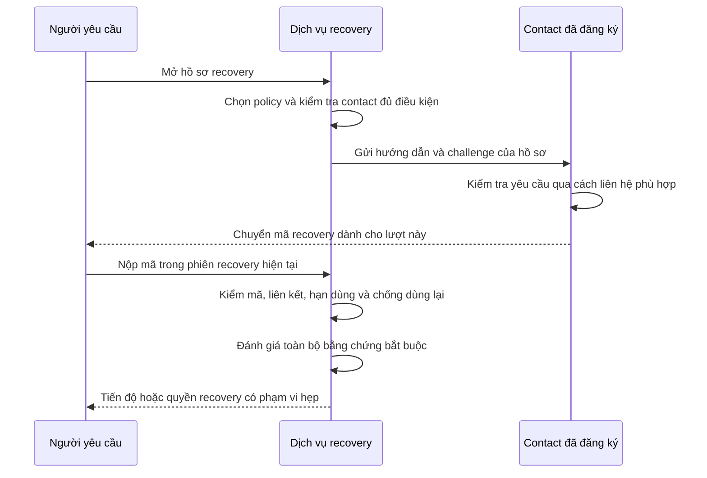

# Trusted contact recovery — Khôi phục tài khoản qua người liên hệ tin cậy

**Trusted contact recovery** là cơ chế cho phép người dùng chỉ định trước một hoặc nhiều người có thể hỗ trợ khi họ mất khả năng đăng nhập. Người liên hệ có thể nhận mã recovery để chuyển lại cho chủ tài khoản, hoặc thực hiện một thao tác xác nhận có phạm vi hẹp trong một thiết kế khác.

Giá trị của cơ chế nằm ở một quan hệ hỗ trợ được thiết lập trước sự cố và được hệ thống quản lý. Việc một người có nhiều bạn chung, biết tên người thân hoặc xuất hiện trong danh bạ không tự cho họ quyền tham gia recovery.

Một thiết kế an toàn cần trả lời được ba câu hỏi: ai đã được chỉ định, họ đang xác nhận yêu cầu cụ thể nào, và bằng chứng đó cho phép hệ thống làm gì. Người liên hệ hỗ trợ một bước khôi phục; họ không mặc nhiên trở thành người quản trị hoặc người đồng sở hữu tài khoản.

## 1. Phân biệt người liên hệ tin cậy với tín hiệu xã hội

| Khái niệm | Ý nghĩa | Giới hạn |
| --- | --- | --- |
| Tín hiệu xã hội | Bạn chung, quan hệ công khai hoặc dữ kiện về một mối quan hệ | Có thể bị biết, giả mạo hoặc suy diễn |
| Người liên hệ recovery đã đăng ký | Một người hoặc địa chỉ được chủ tài khoản chỉ định qua quy trình có kiểm soát | Chỉ có vai trò recovery mà chính sách cấp |
| Quản trị viên được ủy quyền | Chủ thể có quyền quản trị theo mô hình phân quyền riêng | Không nên phát sinh từ vai trò recovery contact |
| Người được thừa kế dữ liệu | Chủ thể tham gia quy trình sau khi chủ tài khoản qua đời | Là mục đích và quy trình khác |

NIST mô tả recovery contacts là những người tin cậy có địa chỉ được người dùng chỉ định để nhận issued recovery codes. Đây là một phương thức recovery, không phải cơ chế nhận diện bạn bè tự động. [NIST SP 800-63B-4, Recovery Contacts](https://pages.nist.gov/800-63-4/sp800-63b.html#recovery-contacts)

Một ví dụ sản phẩm là recovery contact của Apple: người liên hệ có thể cung cấp mã hỗ trợ khôi phục nhưng không được cấp quyền truy cập tài khoản chỉ vì có vai trò đó. [Apple Support: Set up a recovery contact](https://support.apple.com/en-us/102641)

Bài học này dùng các mô hình và API minh họa cho dịch vụ account recovery. Các lựa chọn về thời gian chờ, số người liên hệ và chính sách bằng chứng phải được xác định theo rủi ro của dịch vụ; chúng không tự tạo chứng nhận đạt một mức bảo đảm xác thực.

## 2. Chọn rõ mô hình trước khi thiết kế luồng

Ba mô hình dưới đây có thể cùng được gọi là “social recovery”, nhưng không cung cấp cùng loại bằng chứng:

| Mô hình | Người liên hệ làm gì? | Hệ thống nhận được gì? |
| --- | --- | --- |
| Mã qua người liên hệ | Nhận hoặc lấy mã được cấp cho một lượt recovery, rồi chuyển cho người yêu cầu sau khi kiểm tra phù hợp | Bằng chứng về việc có mã thuộc lượt recovery đó |
| Xác nhận trong ứng dụng | Đăng nhập vào tài khoản của mình và xác nhận một yêu cầu có ngữ cảnh | Một xác nhận được gắn với chủ thể, hồ sơ và hành động |
| Chia sẻ vật liệu khóa | Giữ hoặc sử dụng một phần vật liệu khôi phục theo giao thức mật mã | Khả năng phục hồi khóa khi đủ điều kiện của giao thức |

Mô hình mã không nhất thiết chứng minh người liên hệ đã xác thực mạnh trong một ứng dụng. Mô hình phê duyệt không nên chỉ là một liên kết bearer được chuyển tiếp rồi được coi như chữ ký của một người đã đăng nhập.

Mô hình chia sẻ khóa cần thiết kế mật mã riêng. Đếm hai nút “đồng ý” trong cơ sở dữ liệu không phải chia sẻ bí mật theo ngưỡng. Ngược lại, một hệ thống có các mảnh khóa thực sự cần xem xét vòng đời và thu hồi vật liệu khóa, chứ không chỉ đổi trạng thái một hàng dữ liệu.

Cũng cần phân biệt:

- **Khôi phục quyền vào tài khoản:** cho phép ràng buộc yếu tố xác thực mới theo chính sách.
- **Khôi phục khóa giải mã:** cần có vật liệu hoặc cơ chế mật mã cho phép lấy lại khóa.
- **Khôi phục passkey bị mất:** không tự xảy ra khi người liên hệ cung cấp một mã của dịch vụ.

Nếu private key không còn ở đâu và không có cơ chế backup phù hợp, một phiếu xác nhận xã hội không thể tái tạo nó. Dịch vụ có thể cho đăng ký authenticator mới sau recovery, nhưng đó là thao tác khác.

## 3. Thiết lập quan hệ trước khi mất quyền truy cập

### 3.1. Chủ tài khoản phải được xác minh đủ mức khi thay cấu hình

Thêm hoặc đổi recovery contact là thay đổi nhạy cảm. Một người đã chiếm được session yếu không nên có thể âm thầm thêm chính họ làm contact rồi dùng quan hệ đó để giữ quyền truy cập lâu dài.

Trong thiết kế minh họa, hệ thống yêu cầu xác thực lại phù hợp với tài khoản và hành động trước khi:

- Thêm người liên hệ.
- Đổi địa chỉ hoặc tài khoản nhận yêu cầu.
- Thay ngưỡng chấp thuận.
- Xóa một người liên hệ làm thay đổi mức bảo vệ.
- Bật một phương thức recovery mới.

Cần đánh giá tín hiệu sự cố và gửi thông báo qua kênh đã thiết lập phù hợp. Một session tồn tại lâu không mặc nhiên đủ để thay đổi cấu hình recovery.

OWASP nhấn mạnh cơ chế lấy lại MFA phải tránh trở thành đường vượt MFA; phương án phù hợp phụ thuộc vào bối cảnh ứng dụng. [OWASP Multifactor Authentication Cheat Sheet](https://cheatsheetseries.owasp.org/cheatsheets/Multifactor_Authentication_Cheat_Sheet.html#resetting-mfa)

### 3.2. Xác nhận đúng nơi nhận và giải thích đúng vai trò

Một quy trình đăng ký minh họa:

1. Chủ tài khoản chọn người liên hệ trong giao diện đã xác thực.
2. Máy chủ tạo lời mời gắn với tài khoản, người nhận và vai trò giới hạn.
3. Người nhận xác nhận nơi nhận hoặc tài khoản của mình theo mô hình được chọn.
4. Giao diện giải thích họ có thể hỗ trợ điều gì, không được làm gì và cách từ chối.
5. Sau khi hoàn tất điều kiện kích hoạt, quan hệ chuyển sang hoạt động.
6. Hai bên có cách xem lại và chấm dứt vai trò theo chính sách.

Xác minh một địa chỉ email chỉ chứng minh quyền nhận tại địa chỉ đó trong bối cảnh xác minh. Nó chưa chứng minh tên hiển thị là danh tính thật của người quen mà chủ tài khoản định chọn.

Vì vậy, chủ tài khoản cần có cách nhận biết và kiểm tra đúng người, không chỉ thấy một nhãn “đã xác minh” chung chung.

### 3.3. Không dùng quan hệ mới tạo để cứu chính lượt đang mở

Nếu người đang xin recovery có thể khai một địa chỉ mới làm “bạn tin cậy” rồi yêu cầu địa chỉ đó xác nhận ngay, hệ thống chưa có quan hệ được thiết lập trước sự cố.

Thiết kế có thể áp dụng thời điểm đủ điều kiện hoặc thời gian chờ kích hoạt dựa trên chính sách. Quan hệ mới chưa đủ điều kiện không được tính vào hồ sơ recovery đang cần nó.

Không cho phép bộ phận hỗ trợ bỏ qua ràng buộc này chỉ vì người yêu cầu kể đúng thông tin tiểu sử.

## 4. Chọn người liên hệ theo khả năng hỗ trợ và rủi ro

Một người phù hợp thường là người mà chủ tài khoản có thể liên hệ lại, nhận diện được trong thực tế và hiểu trách nhiệm hỗ trợ. Mối quan hệ gần không đồng nghĩa mọi tình huống đều an toàn.

Cần cân nhắc:

- Hai người có cùng mất thiết bị hoặc cùng mất truy cập email trong một sự cố không?
- Người liên hệ có tài khoản và thiết bị được bảo vệ phù hợp không?
- Có nguy cơ ép buộc, bạo lực trong quan hệ hoặc xung đột lợi ích không?
- Người đó có thể không còn liên lạc được trong tương lai không?
- Nhiều contact có thực chất cùng dùng một hộp thư, thiết bị hoặc người quản lý không?

Không nên buộc người dùng khai “bố”, “vợ”, “chồng” hoặc quan hệ pháp lý nếu hệ thống chỉ cần một người hỗ trợ. Các nhãn quan hệ có thể tạo dữ liệu nhạy cảm mà không cải thiện bằng chứng.

Không suy ra contact từ người nhắn tin nhiều nhất hoặc tự động nâng bạn chung thành người có quyền recovery. Gợi ý lựa chọn, nếu có, phải được phân biệt với việc người dùng chủ động chỉ định.

Người không có mạng lưới xã hội phù hợp cần một phương án recovery khác được thiết kế trước. Thiếu contact không nên buộc họ chọn một người không an toàn.

## 5. Mô hình dữ liệu để tránh nhầm chủ thể và phạm vi

Một mô hình minh họa có thể gồm:

| Thực thể | Thuộc tính quan trọng |
| --- | --- |
| `RecoveryContact` | ID nội bộ, tài khoản chủ, nơi nhận hoặc tài khoản contact, trạng thái, phiên bản quan hệ, thời điểm đủ điều kiện |
| `RecoveryCase` | Tài khoản đích, hành động cần thực hiện, thời hạn, trạng thái, thế hệ recovery |
| `ContactChallenge` | Hồ sơ, contact, purpose, phiên bản quan hệ, hạn dùng, trạng thái và số lượt thử |
| `ContactEvidence` | Challenge đã kiểm tra, contact tương ứng, thời điểm chấp nhận, loại bằng chứng |
| `RecoveryGrant` | Quyền hẹp để thực hiện một bước recovery, thời hạn, phạm vi, trạng thái sử dụng |

Một trạng thái quan hệ có thể là `INVITED`, `PENDING_ACTIVATION`, `ACTIVE`, `SUSPENDED` hoặc `REVOKED`. Chỉ quan hệ đủ điều kiện theo chính sách mới được phát challenge.

Các ràng buộc cần nằm ở máy chủ:

- Contact chỉ hỗ trợ tài khoản mà quan hệ đã được thiết lập.
- Challenge chỉ thuộc một hồ sơ và một mục đích cụ thể.
- Thay email, số điện thoại hoặc tài khoản contact tạo thay đổi phiên bản có kiểm soát.
- Bằng chứng của hồ sơ này không được áp dụng sang hồ sơ khác.
- Một lần gửi lại hoặc callback lặp không được tính thành hai bằng chứng.
- Quyền contact không cho xem dữ liệu tài khoản hoặc sửa danh sách contact.

ID khó đoán giúp giảm khả năng dò tìm nhưng không thay thế kiểm tra quyền. Máy chủ không tin `contactId`, `accountId` hoặc trạng thái “đã xác nhận” chỉ vì chúng xuất hiện trong JSON do client gửi.

## 6. Luồng recovery dùng mã qua contact



### 6.1. Mở hồ sơ không được làm lộ mạng lưới contact

Người chưa xác thực không nên nhận toàn bộ tên, email và số điện thoại contact sau khi nhập tên tài khoản.

Thiết kế có thể dùng tham chiếu hoặc gợi ý che một phần khi chính sách cho phép, nhưng cần đánh giá rò rỉ và khả năng đoán. Phản hồi cũng không nên trở thành công cụ xác nhận tài khoản có tồn tại.

Địa chỉ nhận mã lấy từ quan hệ đã lưu. Không gửi đến email hoặc số điện thoại mới mà người đang xin recovery tự nhập thay thế contact cũ.

### 6.2. Mã phải thuộc đúng hồ sơ và mục đích

Đối với mô hình minh họa, mỗi challenge gắn với:

```text
accountId
recoveryCaseId
recoveryGeneration
contactId
contactRelationshipVersion
purpose
requestedActionReference
expiresAt
challengeId
```

Mã là bí mật của challenge. Dùng mã đúng với một `recoveryCaseId` khác vẫn phải thất bại.

Máy chủ sinh mã bằng nguồn ngẫu nhiên mật mã, kiểm soát thời hạn và số lần thử. Với mã ngắn, chỉ lưu một hash thông thường không ngăn người đọc được cơ sở dữ liệu thử toàn bộ không gian mã ngoại tuyến. Một thiết kế có thể dùng HMAC với khóa được quản lý tách biệt cùng dữ liệu ngữ cảnh, bên cạnh bảo vệ truy cập và giới hạn thử trực tuyến.

Độ dài mã và thời gian có hiệu lực phải được chọn theo chính sách cùng kênh chuyển. Không tăng hạn dùng vô điều kiện chỉ vì người liên hệ có thể trả lời chậm.

### 6.3. Gửi lại và dùng một lần phải có quy tắc rõ

Trong phương án mỗi challenge chỉ có một mã còn hiệu lực:

- Phát mã mới làm mã cũ hết hiệu lực.
- Giới hạn gửi được tính riêng với giới hạn thử mã.
- Tạo hồ sơ mới không tự xóa mọi ngân sách chống lạm dụng của tài khoản.
- Nộp đúng mã phải tiêu thụ mã bằng thao tác nguyên tử.
- Request trùng hợp lệ có thể trả kết quả cũ, nhưng không tạo thêm quyền.
- Sau hủy hoặc hết hạn, mã không được làm sống lại hồ sơ.

Các giới hạn cần giảm spam và đoán mã mà không cho người ngoài dễ dàng khóa toàn bộ đăng nhập hợp lệ của chủ tài khoản.

## 7. Contact cần biết mình đang giúp ai và giúp việc gì

Một thông điệp recovery nên giải thích:

- Tên dịch vụ và cách tự mở kênh chính thức.
- Tài khoản hoặc chủ thể ở mức thông tin tối thiểu đủ nhận biết.
- Việc đang được yêu cầu, chẳng hạn hỗ trợ lấy lại khả năng đăng nhập.
- Thời điểm và tham chiếu để hai bên đối chiếu.
- Cách từ chối hoặc báo yêu cầu không nhận ra.
- Cảnh báo rằng việc hỗ trợ có thể dẫn đến thay thế yếu tố xác thực.

Không gắn nhãn mơ hồ như “mã xác minh thông thường” nếu mã thực tế phục vụ recovery.

### Không đánh đồng mã recovery contact với OTP đăng nhập

Trong mô hình này, một loại mã được thiết kế để contact chuyển lại cho người đang cần hỗ trợ. Vì thế, hướng dẫn “không bao giờ chia sẻ bất kỳ mã nào” có thể mâu thuẫn với chính luồng sản phẩm.

Cần nói rõ loại mã nào có thể chuyển, chuyển cho ai, trong hồ sơ nào và sau khi kiểm tra gì. Contact không được chuyển mật khẩu, OTP đăng nhập của chính mình hoặc mã xác nhận một thao tác khác.

Khi nhận lời nhắn bất ngờ, contact nên xác nhận lại qua cách liên hệ đã biết trước thay vì chỉ trả lời tài khoản đang yêu cầu gửi mã. Giọng nói quen, ảnh đại diện hoặc thông tin tiểu sử đều không phải bằng chứng chắc chắn về người bên kia.

Việc đối chiếu một mã tham chiếu cũng chỉ liên kết hai bên với cùng hồ sơ. Nếu đối thủ là người mở hồ sơ, họ có thể biết mã tham chiếu ấy; nó không tự chứng minh họ là chủ tài khoản.

Không ép contact chấp thuận vì thông báo khẩn cấp hoặc gửi nhắc liên tục. Phải có lựa chọn “Tôi không nhận ra yêu cầu này” dễ tìm và không phát sinh quyền recovery.

## 8. Nếu dùng xác nhận trong ứng dụng

Một mô hình khác cho phép contact đăng nhập vào tài khoản riêng rồi phê duyệt. Hệ thống cần kiểm soát phiên của contact, không chỉ tin việc họ mở một liên kết.

Một luồng minh họa:

1. Contact tự mở ứng dụng hoặc trang chính thức.
2. Dịch vụ xác thực họ theo mức phù hợp với hành động.
3. Máy chủ tải hồ sơ đang chờ dựa trên quyền của contact.
4. UI hiển thị hành động sẽ được hỗ trợ và ngữ cảnh đã biết.
5. Contact chủ động xác nhận hoặc từ chối.
6. Máy chủ ghi bằng chứng cho đúng hồ sơ, challenge và phiên bản quan hệ.

Một request GET dùng để xem trang không nên đồng thời phê duyệt. Công cụ xem trước liên kết hoặc bộ quét email có thể truy cập URL mà người nhận chưa chủ động hành động.

Nếu liên kết tự nó mang quyền phê duyệt, phải đánh giá nó như bearer capability có thể bị chuyển tiếp. Không ghi nhận bằng chứng đó như một hành động đã được xác thực mạnh từ tài khoản contact.

Khi hành động yêu cầu thay đổi — ví dụ từ đăng ký yếu tố mới sang đổi email và tắt MFA — cần đánh giá lại bằng chứng và xin xác nhận lại khi phạm vi thay đổi. Không giữ nguyên các phiếu đồng ý cho một ý định đã bị sửa.

## 9. Nhiều contact và ngưỡng chấp thuận

Một chính sách ứng dụng có thể yêu cầu m trong n contact đủ điều kiện tham gia. Đây là lựa chọn thiết kế cần phân tích riêng, không phải mặc định “càng đông càng an toàn”.

| Tình huống | Sai lầm khi đếm | Điều cần xem xét |
| --- | --- | --- |
| Một người có hai email | Tính thành hai người độc lập | Hai địa chỉ có thể cùng một chủ thể |
| Hai contact dùng cùng hộp thư hoặc thiết bị | Xem là hai nguồn tách biệt | Một sự cố có thể chiếm cả hai |
| Contact thông đồng | Tin rằng đủ ngưỡng là chắc chắn đúng | Ngưỡng chỉ bảo vệ trong mô hình đối thủ đã giả định |
| Một contact bận hoặc mất tài khoản | Tự động hạ ngưỡng | Tạo đường yếu hơn vào đúng lúc recovery |
| Contact bị thu hồi giữa hồ sơ | Vẫn tính phiếu cũ mà không đánh giá | Cần chính sách hiệu lực và kiểm tra lại |
| Một phiếu được gửi nhiều lần | Mỗi callback cộng một điểm | Cần ràng buộc duy nhất theo contact và hồ sơ |

Máy chủ phải có định nghĩa rõ về chủ thể contact và điều kiện được tính. Đồng thời cần thừa nhận giới hạn: hai tài khoản khác ID không chứng minh hai con người độc lập.

Cũng không được coi “hai contact” là “hai phương thức recovery khác nhau”. Với AAL2 trong hướng dẫn NIST, một lựa chọn là hai recovery code từ các phương thức khác nhau; lựa chọn khác là một recovery code kết hợp một authenticator một yếu tố đã ràng buộc với tài khoản. Hai mã cùng loại từ hai contact không tự thỏa yêu cầu về phương thức khác nhau. [NIST SP 800-63B-4, Recovery at AAL2](https://pages.nist.gov/800-63-4/sp800-63b.html#recovery-at-aal2)

Một mô hình phê duyệt theo ngưỡng do ứng dụng thiết kế cần đánh giá theo chính sách riêng; không lấy số phiếu làm bằng chứng tự động đạt AAL.

## 10. Trạng thái bằng chứng phải tách khỏi quyền truy cập

Một luồng trạng thái minh họa:

```text
REQUESTED
    -> CONTACT_EVIDENCE_PENDING
    -> REQUIRED_EVIDENCE_SATISFIED
    -> SAFETY_WAIT_OR_REVIEW       (nếu policy yêu cầu)
    -> READY_TO_EXECUTE
    -> COMPLETED

Bất kỳ giai đoạn chưa hoàn tất nào:
    -> CANCELLED / EXPIRED / REJECTED
```

`CONTACT_EVIDENCE_PENDING` có thể đã chứa một số bằng chứng hợp lệ. Có mã đúng chưa chắc đã đủ mọi điều kiện của policy.

Thời gian chờ tạo cơ hội phát hiện hoặc phản đối, nhưng không tự xác minh danh tính. Đến hạn chờ cũng không được tự hoàn tất nếu bằng chứng đã hết hiệu lực hoặc hồ sơ bị thay đổi.

Các điều kiện cần kiểm lại trước khi tạo grant và trước khi dùng grant:

- Hồ sơ còn hiệu lực và thuộc đúng tài khoản.
- Thế hệ recovery chưa thay đổi.
- Quan hệ contact vẫn đủ điều kiện theo chính sách hiệu lực.
- Hành động được phép vẫn khớp phạm vi đã xác nhận.
- Bằng chứng bắt buộc còn hợp lệ.
- Không có trạng thái hủy, thu hồi hoặc chặn cần xử lý.

Một thay đổi cấu hình có thể làm chính sách mới nghiêm hơn. Không cho người yêu cầu chọn phiên bản policy cũ dễ hơn để tiếp tục.

### Ví dụ xử lý bằng chứng đã được bộ kiểm tra nội bộ xác nhận

```text
acceptVerifiedContactArtifact(internalArtifact):
    # Không nhận cờ verified=true từ client làm bằng chứng.
    artifact = loadArtifactVerifiedByServer(internalArtifact.id)

    begin transaction
        case = lockRecoveryCase(artifact.caseId)
        contact = lockRecoveryContact(artifact.contactId)
        challenge = lockChallenge(artifact.challengeId)

        require case is active and not expired
        require case.accountId == contact.ownerAccountId
        require case.generation == artifact.recoveryGeneration
        require contact is eligible for this case
        require challenge is current, unexpired and unconsumed
        require artifact matches challenge purpose and relationship version
        require artifact action reference matches the current requested action

        if evidence for this contact and case already exists:
            return previous result without adding another vote

        store contact evidence with a uniqueness constraint
        mark challenge consumed

        evaluate all required evidence under applicable server policy
        record the resulting recovery state
        append required notifications to transactional outbox
    commit
```

Pseudocode chỉ minh họa việc áp dụng kết quả. Bước kiểm mã hoặc xác thực contact cần xử lý riêng việc đếm thử sai, khóa quản lý secret và xác thực request. Trước khi tiêu thụ grant, hệ thống còn phải kiểm lại trạng thái có thể đã đổi sau transaction này.

## 11. Chỉ cấp quyền hẹp để hoàn tất recovery

Bằng chứng contact không nên trực tiếp tạo session có đầy đủ quyền tài khoản.

Một `RecoveryGrant` minh họa chỉ cho phép hành động đã xác định, chẳng hạn tiếp tục đăng ký authenticator thay thế. Grant gắn với hồ sơ, tài khoản, thế hệ recovery, phiên tiếp tục và mục đích; có hạn dùng và được tiêu thụ một lần.

Đối với passkey mới, người yêu cầu vẫn phải hoàn thành ceremony đăng ký và chứng minh kiểm soát khóa mới theo giao thức. Không chỉ lưu một public key tự khai vì contact đã đồng ý.

Đối với tài khoản nghi bị chiếm quyền, kế hoạch hoàn tất recovery cần xử lý các yếu tố và phiên có thể đã bị lộ, các token recovery đang chờ và việc thông báo. Không vô hiệu hóa toàn bộ yếu tố ngay từ lúc một người chưa xác thực mở hồ sơ, vì điều đó có thể tạo từ chối dịch vụ.

Thông báo nên đi qua các kênh đã thiết lập và phù hợp với tình huống. Không chỉ gửi thông báo tới email mới do người đang recovery vừa khai. NIST yêu cầu sự kiện recovery phát sinh thông báo cho người dùng hoặc người được chỉ định. [NIST SP 800-63B-4, Account Recovery Notification](https://pages.nist.gov/800-63-4/sp800-63b.html#account-recovery-notification)

Không thay danh sách contact trong cùng một thao tác ngầm với việc đăng ký authenticator mới. Mỗi thay đổi có phạm vi và thẩm quyền riêng.

## 12. Chống lạm dụng và xử lý trường hợp không còn contact

### 12.1. Những rủi ro cần đưa vào mô hình

| Rủi ro | Ví dụ | Biện pháp thiết kế |
| --- | --- | --- |
| Giả danh chủ tài khoản | Người nhắn tin biết nhiều chi tiết nhưng không phải chủ tài khoản | Hướng dẫn kiểm tra qua cách liên hệ đã biết và giữ yêu cầu bằng chứng của dịch vụ |
| Chiếm tài khoản contact | Kẻ tấn công đọc mã hoặc xác nhận thay contact | Bảo vệ kênh contact, giới hạn vai trò và đánh giá bằng chứng bổ sung |
| Cài contact của đối thủ | Session bị chiếm được dùng để thêm contact mới | Xác thực lại, thông báo và điều kiện kích hoạt |
| Spam yêu cầu | Nhiều hồ sơ làm contact mệt mỏi rồi đồng ý | Giới hạn phát yêu cầu, gom thông báo và dễ từ chối |
| Thông đồng hoặc ép buộc | Nhiều contact cùng hỗ trợ chiếm tài khoản | Mô hình ngưỡng có giả định rõ và phương án an toàn khác |
| Tráo hồ sơ | Mã của yêu cầu này được dùng cho yêu cầu khác | Ràng buộc challenge, hồ sơ, purpose và hành động |
| Dùng lại sau thu hồi | Mã cũ đến muộn khi quan hệ đã bị xóa | Kiểm phiên bản và trạng thái hiện tại |
| Vượt qua bằng support | Nhân viên tự hạ yêu cầu khi contact không phản hồi | Quy trình ngoại lệ có bằng chứng và thẩm quyền cụ thể |

Một yêu cầu bị contact từ chối là tín hiệu cần xử lý, nhưng không tự chứng minh người dùng thật đã gian lận. Có thể contact không nhận ra yêu cầu hoặc đang gặp sự cố.

Tương tự, không phản hồi không có nghĩa đồng ý. Thời gian chờ hết cũng không nên tự giảm số bằng chứng bắt buộc.

### 12.2. Khi người liên hệ không còn dùng được

Contact có thể đổi số, mất tài khoản, chấm dứt quan hệ hoặc không còn khả năng hỗ trợ. Chủ tài khoản cần có cách xem, thay và thu hồi quan hệ khi vẫn còn xác thực được.

Khi recovery đã bắt đầu và thiếu contact, hệ thống chuyển sang phương thức thay thế đã được phê duyệt nếu có. Không cho tự thêm một người mới bằng lời khai tiểu sử, không tự hạ ngưỡng và không coi người hỗ trợ mới là contact cũ.

Cũng cần tránh phụ thuộc vòng: A chỉ có thể recovery qua B, trong khi B lại chỉ có thể recovery qua A. Nên khuyến khích phương thức dự phòng độc lập phù hợp với dịch vụ.

Nếu thật sự không có bằng chứng đủ theo chính sách, trạng thái đúng là chưa thể hoàn tất recovery. Không hứa bộ phận hỗ trợ luôn có thể khôi phục mọi tài khoản hoặc mọi khóa mã hóa.

## 13. Quyền riêng tư và vòng đời dữ liệu

Danh sách contact thể hiện quan hệ giữa con người và có thể nhạy cảm. Thiết kế nên lưu những gì cần cho vai trò recovery, không thu toàn bộ danh bạ hoặc lịch sử trao đổi để “đánh giá độ thân”.

Contact chỉ cần thấy ngữ cảnh tối thiểu để thực hiện nhiệm vụ. Họ không cần đọc thư, xem ảnh, lịch sử giao dịch hoặc danh sách các contact khác của chủ tài khoản.

Audit có thể ghi:

```json
{
  "event": "recovery.contact_evidence_accepted",
  "caseRef": "rc_example_opaque",
  "contactRef": "ct_example_opaque",
  "challengeRef": "cc_example_opaque",
  "method": "CONTACT_CODE",
  "result": "ACCEPTED"
}
```

Không ghi mã, secret của grant, URL chứa quyền, nội dung hội thoại hoặc đầy đủ nơi nhận vào sự kiện này. Các tham chiếu vẫn có thể liên kết với dữ liệu cá nhân nên cần quyền đọc và thời hạn lưu phù hợp.

Khi quan hệ bị thu hồi, lớp ứng dụng cần chặn challenge và bằng chứng không còn đủ điều kiện theo chính sách. Việc xóa vật lý bản ghi, dữ liệu audit và bản sao lưu tuân theo mục đích lưu tương ứng; không mô tả đổi trạng thái là đã xóa mọi bản sao.

Với người có nguy cơ bị ép buộc trong quan hệ, việc gửi thông báo hoặc hiển thị chi tiết cho contact cũ cần được thiết kế cẩn thận. Không phát tán thông tin hỗ trợ nhạy cảm chỉ vì người đó từng có vai trò recovery.

## 14. Ví dụ xuyên suốt: mất điện thoại chứa MFA

Giả sử Mai đăng nhập bằng mật khẩu và MFA trên điện thoại. Mai vẫn nhớ mật khẩu nhưng mất điện thoại. Trước sự cố, Mai đã đăng ký An làm recovery contact và quan hệ đã đủ điều kiện.

Chính sách minh họa của dịch vụ yêu cầu xác minh mật khẩu còn ràng buộc với tài khoản cùng bằng chứng contact hợp lệ, sau đó áp dụng các bước bảo vệ bổ sung theo rủi ro.

1. Mai mở hồ sơ recovery và xác minh phương thức còn dùng được theo luồng của dịch vụ.
2. Máy chủ tạo challenge cho An bằng địa chỉ đã đăng ký, không dùng một nơi nhận mới do Mai nhập.
3. An tự kiểm tra yêu cầu với Mai qua cách liên hệ phù hợp rồi chuyển mã recovery của hồ sơ.
4. Mai nộp mã trong đúng phiên tiếp tục recovery.
5. Máy chủ tiêu thụ challenge, đánh giá toàn bộ bằng chứng và trạng thái hiện tại.
6. Nếu đủ điều kiện, Mai nhận quyền hẹp để đăng ký yếu tố thay thế.
7. Dịch vụ hoàn tất kế hoạch xử lý yếu tố bị mất, session và thông báo.

Nếu người khác biết tên An và gửi đúng thông tin tiểu sử của Mai, điều đó chưa cho phép họ thay An bằng một contact mới.

Nếu An nhận hai thông báo, hai lần nhập cùng mã không tạo hai bằng chứng. Nếu quan hệ bị thu hồi trong lúc đang xử lý, bước cấp hoặc dùng grant phải đánh giá lại theo chính sách.

Nếu Mai cũng quên mật khẩu và không còn authenticator nào, dịch vụ phải chọn phương án khác đáp ứng chính sách. Không giữ nguyên kết luận đủ bằng chứng của tình huống chỉ mất một yếu tố.

## 15. Các nguyên tắc cần giữ

- Contact phải được chỉ định qua quy trình có kiểm soát trước khi cần dùng.
- Quyền hỗ trợ recovery khác với quyền truy cập dữ liệu hoặc quản trị tài khoản.
- Mã, phiếu phê duyệt và mảnh khóa là những loại bằng chứng khác nhau.
- Challenge gắn với đúng contact, hồ sơ, mục đích, phiên bản quan hệ và hành động.
- Một mã hợp lệ hoặc một phiếu đồng ý chưa chắc đủ toàn bộ chính sách recovery.
- Nhiều contact không tự tạo các nguồn độc lập hoặc các phương thức khác nhau.
- Thu hồi, hết hạn, gửi lặp và thay đổi hành động phải được kiểm ở phía máy chủ.
- Hoàn tất recovery cần quyền hẹp, kiểm soát session và thông báo phù hợp.

Một quan hệ xã hội chỉ giúp bảo vệ tài khoản khi được chuyển thành vai trò và bằng chứng có phạm vi rõ ràng. Hệ thống vẫn chịu trách nhiệm quyết định bằng chứng nào đủ để cho phép khôi phục.