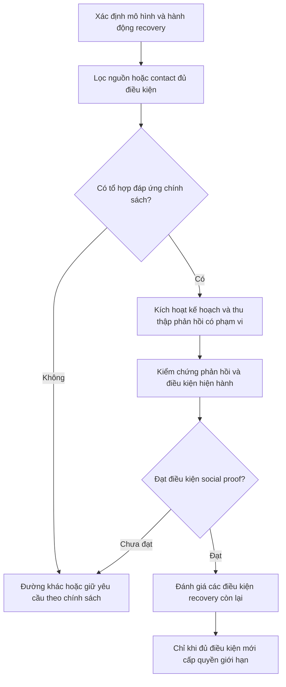

# Social proof selection

## 1. Chọn đúng bằng chứng xã hội cho đúng câu hỏi

Trong khôi phục tài khoản, **social proof** là thông tin hoặc lời xác nhận dựa trên quan hệ giữa người yêu cầu và những người khác. Ví dụ: một người liên hệ khôi phục đã được đăng ký từ trước xác nhận yêu cầu, hoặc một người có vai trò phù hợp cung cấp thông tin về danh tính của người yêu cầu.

**Social proof selection** là quá trình chọn loại bằng chứng và người cung cấp phù hợp với chính sách. Nó cần trả lời: ai được xác nhận, họ xác nhận điều gì, vì sao lời xác nhận có giá trị và điều kiện nào vẫn phải đạt trước khi cho phép khôi phục?

Một tài khoản có nhiều bạn bè, nhiều người theo dõi hoặc nhiều ảnh được gắn thẻ không tự có bằng chứng quyền sở hữu mạnh. Những dấu hiệu đó có thể công khai, bị sao chép hoặc được tạo bởi các tài khoản cùng một người kiểm soát.

Ví dụ, người dùng mất điện thoại chứa MFA. Hệ thống cho phép hai người liên hệ khôi phục đã thiết lập trước đó tham gia một yêu cầu. Nếu người gửi được tự nhập hai địa chỉ email mới rồi nhận xác nhận từ chúng, cơ chế không còn dựa trên quan hệ tin cậy đã có. Nó chỉ chứng minh người gửi có thể tìm được hai tài khoản sẵn sàng trả lời.

OWASP nêu việc nhờ một người dùng đáng tin cậy xác nhận như một phương án có thể xem xét khi khôi phục MFA, đồng thời nhấn mạnh phương án phù hợp phụ thuộc bối cảnh ứng dụng. Đây không phải sự bảo đảm rằng mọi lời xác nhận từ người quen đều đủ an toàn. [OWASP — Resetting MFA](https://cheatsheetseries.owasp.org/cheatsheets/Multifactor_Authentication_Cheat_Sheet.html#resetting-mfa)

Bài học này tập trung vào cách lựa chọn nguồn social proof khi người dùng mất mật khẩu, MFA, passkey hoặc thiết bị xác thực. Các chính sách và ví dụ bên dưới là thiết kế minh họa, không phải một ngưỡng chung áp dụng cho mọi dịch vụ.

## 2. Phân biệt dấu hiệu quan hệ với thẩm quyền khôi phục

Có thể nhìn social proof thành ba lớp:

| Lớp | Ví dụ | Giá trị có thể có | Giới hạn |
| --- | --- | --- | --- |
| Dấu hiệu quan hệ | Có kết nối trên mạng xã hội, từng trao đổi tin nhắn | Hỗ trợ hiểu ngữ cảnh | Không chứng minh quan hệ còn tin cậy hoặc tài khoản chưa bị chiếm |
| Lời xác nhận về người yêu cầu | Một người quen xác nhận họ biết người này | Hỗ trợ một nhận định cụ thể về danh tính hoặc hoàn cảnh | Không tự tạo quyền quản trị tài khoản |
| Vai trò recovery được thiết lập | Một contact đã chấp nhận vai trò hỗ trợ khôi phục từ trước | Có thể tham gia đúng hành động được chính sách cho phép | Vẫn cần kiểm chứng contact, nội dung xác nhận và ngữ cảnh hiện hành |

Các lớp không được tự nâng cấp cho nhau. Người có mặt trong danh bạ không mặc nhiên là recovery contact. Recovery contact cũng không mặc nhiên được đọc dữ liệu, nhận mật khẩu hoặc đăng nhập thay chủ tài khoản.

Cần phân biệt thêm:

- **Xác thực người xác nhận:** hệ thống có biết ai đang gửi phản hồi không?
- **Thẩm quyền của người xác nhận:** người đó có được tham gia yêu cầu này không?
- **Giá trị của nội dung:** họ có đủ cơ sở để xác nhận điều đang được hỏi không?
- **Quyết định khôi phục:** tập bằng chứng có đủ cho đúng hành động trên đúng tài khoản không?

Một người đăng nhập thành công vào tài khoản của họ chỉ giải quyết câu hỏi thứ nhất. Nó không tự chứng minh ba câu hỏi còn lại.

## 3. Xác định mô hình trước khi chọn người

### 3.1. Recovery contact đã đăng ký từ trước

Trong mô hình này, chủ tài khoản thiết lập người hỗ trợ khi còn có khả năng xác thực hợp lệ. Người được mời hiểu và chấp nhận vai trò. Hệ thống giữ quan hệ đó với phạm vi rõ ràng.

Một ví dụ sản phẩm là recovery contact trong Google Account: một người đáng tin có thể hỗ trợ khi chủ tài khoản không đăng nhập được, và việc thêm contact có quy trình mời, chấp nhận hoặc từ chối. Các điều kiện cụ thể thuộc chính sách của sản phẩm đó. [Google Account Help — Recovery contacts](https://support.google.com/accounts/answer/16590793?hl=en)

Khi thiết kế dịch vụ riêng, cần quyết định:

1. Chủ tài khoản phải xác thực ra sao khi thêm hoặc thay contact?
2. Contact có cần chấp nhận và chứng minh kiểm soát tài khoản của họ không?
3. Vai trò bắt đầu có hiệu lực khi nào?
4. Vai trò hỗ trợ những hành động nào?
5. Khi bị thu hồi, những yêu cầu đang mở được xử lý ra sao?

Danh sách mới thay đổi ngay trước sự cố có thể cần thời gian chờ hoặc đánh giá thêm theo chính sách. Một session đang tồn tại không đủ để coi việc thêm contact mới là an toàn trong mọi tình huống.

### 3.2. Người giới thiệu trong quy trình xác minh danh tính

Một người giới thiệu có thể cung cấp thông tin về danh tính, thuộc tính hoặc hoàn cảnh của người yêu cầu. Đây là một mô hình khác với việc đã được chủ tài khoản ủy nhiệm hỗ trợ recovery.

NIST SP 800-63A-4 có yêu cầu riêng đối với applicant references, bao gồm chính sách sử dụng, việc xác minh người giới thiệu và ghi nhận vai trò của họ. Các yêu cầu đó thuộc quy trình identity proofing; không được tự diễn giải thành quyền đặt lại một tài khoản bất kỳ. [NIST — Requirements for Applicant References](https://pages.nist.gov/800-63-4/sp800-63a/ial-general/#requirements-for-applicant-references)

Nếu dịch vụ chấp nhận người giới thiệu được cung cấp trong lúc recovery, họ cần đi qua quy trình riêng phù hợp. Không nhập họ vào danh sách đã ủy nhiệm từ trước rồi coi hai mô hình là tương đương.

### 3.3. Vai trò trong tổ chức

Trong ứng dụng doanh nghiệp, quản trị viên được ủy quyền có thể có quyền xử lý tài khoản thuộc tổ chức. Quyền đó đến từ chính sách và phân quyền của tổ chức, không chỉ từ việc họ biết nhân viên.

Một quản lý xác nhận “đây là nhân viên của tôi” chưa chắc có quyền bỏ MFA cho người đó. Quyền quản trị tài khoản công việc cũng không mở rộng sang tài khoản cá nhân của nhân viên.

Trước khi chọn nguồn social proof, phải xác định tài khoản và hành động thuộc mô hình nào.

## 4. Đặt điều kiện bắt buộc trước khi xếp hạng

Một lỗi phổ biến là chọn người theo tổng điểm: quen lâu, tương tác nhiều, trả lời nhanh. Tổng điểm có thể che mất một điều kiện bắt buộc như contact chưa từng được chấp nhận hoặc không có thẩm quyền cho hành động đang yêu cầu.

Nên tách thành hai bước:

```text
Tập ứng viên
    ↓
Lọc theo điều kiện bắt buộc
    ↓
Tập đủ điều kiện
    ↓
Chọn tổ hợp đáp ứng chính sách
    ↓
Ưu tiên khả năng liên lạc và trải nghiệm trong các tổ hợp hợp lệ
```

Các điều kiện có thể cần kiểm tra:

| Nhóm điều kiện | Câu hỏi thiết kế |
| --- | --- |
| Nguồn gốc quan hệ | Quan hệ được thiết lập từ khi nào và bởi thao tác nào? |
| Trạng thái vai trò | Đã chấp nhận, đang chờ, bị thu hồi hay hết hiệu lực? |
| Danh tính kỹ thuật | Có định danh nội bộ ổn định, hay chỉ có tên và ảnh đại diện? |
| Phạm vi | Contact có được hỗ trợ hành động và loại tài khoản này không? |
| Khả năng xác thực | Contact có thể thực hiện bước xác thực được yêu cầu không? |
| Dấu hiệu bị chiếm | Tài khoản contact có đang bị hạn chế hoặc có rủi ro cần xử lý không? |
| Độc lập | Nhiều contact có cùng nguồn kiểm soát hoặc cùng điểm thất bại không? |
| Đồng thuận và an toàn | Người tham gia có còn muốn và có thể hỗ trợ một cách an toàn không? |

Chỉ sau khi đáp ứng điều kiện bắt buộc mới cân nhắc yếu tố như thời gian phản hồi dự kiến. Một người trả lời nhanh không thể bù cho việc không có thẩm quyền.

Không cần thu thập vô hạn lịch sử quan hệ để lấp mọi ô trong bảng. Chính sách phải xác định bằng chứng tối thiểu cần dùng và cách xử lý phần chưa biết.

## 5. Đếm nguồn độc lập, không chỉ đếm tài khoản

### 5.1. Nhiều địa chỉ không chắc là nhiều người

Các trường hợp làm phép đếm sai gồm:

- Hai địa chỉ chỉ là bí danh của cùng một hộp thư.
- Một người kiểm soát nhiều tài khoản được chọn.
- Nhiều tài khoản contact cùng dùng một tài khoản khôi phục đã bị chiếm.
- Các phản hồi được chuyển tiếp về cùng một người quyết định.
- Hai contact thực sự khác nhau nhưng đang chịu cùng một áp lực hoặc cùng thông đồng.

Tài khoản do một người tạo để giả nhiều người thường được gọi là tài khoản Sybil. Việc có các định danh khác nhau không đủ để chứng minh có các bên độc lập.

### 5.2. Tìm điểm thất bại chung theo mô hình đe dọa

Giả sử A và B đều có tài khoản riêng nhưng cùng khôi phục qua một hộp thư gia đình. Nếu hộp thư đó bị chiếm, một sự cố có thể ảnh hưởng cả A lẫn B.

Ngược lại, hai contact cùng dùng một nhà cung cấp email lớn chưa đủ để kết luận chúng cùng bị một người kiểm soát. Chọn theo tên miền email đơn thuần có thể tạo cảm giác độc lập giả hoặc loại nhầm ứng viên.

Cần xem **nguồn kiểm soát chung có liên quan**, không dùng một dấu hiệu tiện đo làm kết luận tuyệt đối.

Một mô hình minh họa có thể nhóm các contact theo điểm thất bại đã biết:

```text
Nhóm kiểm soát G1: A và B cùng phụ thuộc một hộp thư khôi phục
Nhóm kiểm soát G2: C có phương thức riêng, chưa biết phụ thuộc G1

Đếm phản hồi:
- A + B: hai tài khoản, nhưng cùng một nhóm rủi ro đã biết.
- A + C: hai tài khoản thuộc hai nhóm theo thông tin hiện có.
```

“Chưa biết phụ thuộc” không đồng nghĩa đã chứng minh độc lập hoàn toàn. Hệ thống cần ghi nhận giới hạn và không đưa ra mức bảo đảm vượt dữ liệu mình có.

### 5.3. Không biến việc kiểm tra độc lập thành giám sát quan hệ

Thu thập toàn bộ danh bạ, tin nhắn hoặc mạng quan hệ để chấm điểm có thể gây hại riêng tư và vẫn không phát hiện được mọi thông đồng.

Ưu tiên các căn cứ có mục đích rõ ràng: vai trò đã thiết lập, định danh được kiểm chứng, trạng thái tài khoản và điểm phụ thuộc đã biết. Khi không đủ căn cứ cho tổ hợp yêu cầu, có thể cần đường recovery khác thay vì thu thập thêm đời tư.

## 6. Chọn ngưỡng và tổ hợp theo rủi ro

Một chính sách có thể yêu cầu `k` xác nhận trong `n` contact đủ điều kiện. Hai đại lượng cần được hiểu riêng:

- `n` là số contact trong phạm vi được chính sách cho phép xét.
- `k` là số xác nhận hợp lệ cần có, kèm các ràng buộc khác.
- Số phản hồi nhận được không tự bằng số xác nhận hợp lệ.
- Điều kiện về vai trò, độc lập, thời hạn và rủi ro vẫn phải đạt.

Ví dụ giả định: một dịch vụ cho phép **hai trong ba** contact đã đăng ký, với ít nhất hai nhóm kiểm soát đủ điều kiện theo chính sách.

| Kết quả | Diễn giải |
| --- | --- |
| Hai contact hợp lệ từ hai nhóm phù hợp đồng ý | Có thể đạt phần điều kiện social proof; chưa tự cấp quyền recovery |
| Hai contact đồng ý nhưng cùng thuộc một nhóm bị chính sách hạn chế | Chưa đạt yêu cầu về tổ hợp |
| Một contact đồng ý, một contact không phản hồi | Chưa đủ xác nhận; không tự giảm ngưỡng |
| Một contact đã bị thu hồi vẫn gửi phản hồi | Không dùng phản hồi đó cho quyết định hiện hành |
| Một contact báo yêu cầu giả mạo | Xử lý theo quy tắc tranh chấp hoặc rủi ro; không chỉ lấy số “đồng ý” lấn át |
| Không còn tổ hợp đáp ứng điều kiện | Chuyển phương án khác hoặc giữ yêu cầu theo chính sách |

Ngưỡng hai trong ba không phải cấu hình mặc định được khuyến nghị cho mọi hệ thống. Nó cũng không chống được trường hợp hai contact thông đồng hoặc cùng bị chiếm. Khi chọn ngưỡng, cần xét năng lực đối thủ và hậu quả của hành động.

Không đặt ngưỡng theo số người đang online rồi gọi đó là mức bảo đảm tương đương. Nếu một contact không thể tham gia, có thể chọn người khác trong tập đã đủ điều kiện theo quy trình, nhưng không tự thêm một người mới do bên yêu cầu vừa giới thiệu.

**Từ chối xác nhận**, **không thể xác nhận**, **không phản hồi** và **báo nghi giả mạo** cần là các kết quả khác nhau. Chính sách phải quy định tác động của từng kết quả.

## 7. Thuật toán lựa chọn cần giữ các ràng buộc

Mã giả sau minh họa bước chọn contact trong mô hình đăng ký trước. Nó chưa xác thực contact, chưa thu thập lời xác nhận và chưa cấp quyền khôi phục.

```text
function selectSocialProofPlan(case, requestedAction):
    policy = loadSocialRecoveryPolicy(requestedAction)

    if not policy.allowsSocialRecovery(case.accountType):
        return NEED_ALTERNATIVE_PATH("METHOD_NOT_ALLOWED")

    roster = loadAuthoritativeContactRoster(case.accountRef)

    if roster.version != case.contactRosterVersion:
        return REPLAN_REQUIRED("ROSTER_CHANGED")

    candidates = roster.contacts.filter(contact =>
        contact.status == ACTIVE
        and contact.acceptedRole
        and contact.scopeIncludes(requestedAction)
        and policy.activationConditionsMet(contact)
        and policy.currentContactRiskAcceptable(contact)
    )

    candidateSets = buildSetsSatisfying(
        candidates,
        policy.allowedSetSizes,
        policy.roleConstraints,
        policy.independenceConstraints
    )

    if candidateSets.isEmpty:
        return NEED_ALTERNATIVE_PATH("NO_ELIGIBLE_SET")

    selected = chooseByAvailabilityAndUserPreference(candidateSets)

    return PROPOSED_PLAN(
        caseId = case.id,
        accountRef = case.accountRef,
        requestedAction = requestedAction,
        selectedContactRefs = selected.refs,
        rosterVersion = roster.version,
        policyVersion = policy.version
    )
```

Điểm quan trọng:

1. Danh sách có thẩm quyền được nạp từ phía máy chủ; tên hoặc email tự khai không tạo vai trò.
2. Lọc điều kiện bắt buộc diễn ra trước khi tối ưu khả năng phản hồi.
3. Tổ hợp được xét theo ràng buộc, không chỉ lấy vài người có điểm cao nhất.
4. Không tìm được tổ hợp không có nghĩa người dùng là kẻ gian.
5. Kế hoạch được đề xuất chưa cho phép gửi yêu cầu hoặc dùng phản hồi một cách không kiểm soát.

Trước khi kích hoạt kế hoạch, hệ thống phải kiểm tra lại phiên bản và trạng thái để tránh thay đổi đồng thời. Nếu thay tổ hợp trong lúc xử lý, cần quản lý phiên bản kế hoạch và hiệu lực các lời mời, phản hồi liên quan. Không âm thầm trộn xác nhận của nhiều kế hoạch khác nhau.

## 8. Lời xác nhận phải có phạm vi cụ thể

Chọn đúng người chưa đủ nếu họ không biết mình đang xác nhận điều gì.

Một lời mời nên cho người tham gia hiểu ở mức tối thiểu cần thiết:

- Tài khoản hoặc người mà họ đã nhận vai trò hỗ trợ.
- Yêu cầu hiện tại có phải một sự kiện mới không.
- Hành động đang được xét, chẳng hạn khôi phục quyền thiết lập yếu tố xác thực.
- Cách xác nhận, từ chối, báo không chắc hoặc báo nghi giả mạo.
- Giới hạn vai trò: họ không nhận quyền đăng nhập hay đọc dữ liệu của chủ tài khoản.

Không hỏi chung chung “Bạn có biết người này không?” rồi dùng câu trả lời để cho phép bỏ MFA. Biết một người và xác nhận một yêu cầu cụ thể có ý nghĩa khác nhau.

Trong thiết kế minh họa, phản hồi được ràng buộc với:

```text
caseId
accountRef
requestedAction
contactRef
contactRoleVersion
selectionPlanVersion
challengeRef
expiresAt
decision
```

Kết quả cần đến từ luồng xác thực và xác nhận được hệ thống kiểm chứng. Một ảnh chụp tin nhắn hoặc trường `approved: true` do phía yêu cầu gửi không tương đương phản hồi đã xác thực.

Mỗi contact chỉ được tính theo vai trò và quyết định hợp lệ hiện hành. Callback trùng, gửi lại hoặc tải lại trang không làm tăng số người xác nhận. Phản hồi hết hạn hoặc thuộc yêu cầu khác không được chuyển sang sử dụng.

Người tham gia không nên được yêu cầu gửi mật khẩu, OTP đăng nhập cá nhân hay mã khôi phục tài khoản của họ cho bên yêu cầu. Nếu có bước đối chiếu mã để nhận biết đúng sự kiện, phải phân biệt rõ mã ngữ cảnh với bí mật cấp quyền; không dạy người dùng chuyển tiếp mọi mã nhận được.

## 9. Ví dụ lựa chọn một tổ hợp

Giả sử tài khoản đã thiết lập các contact từ trước. Chính sách minh họa yêu cầu hai xác nhận hợp lệ, thuộc hai nhóm kiểm soát phù hợp.

| Ứng viên | Trạng thái | Điều cần xem xét | Kết quả lựa chọn |
| --- | --- | --- | --- |
| A | Đã chấp nhận, đúng phạm vi | Có điểm phụ thuộc chung với B | Có thể chọn nếu tổ hợp đáp ứng chính sách |
| B | Đã chấp nhận, đúng phạm vi | Cùng phụ thuộc hộp thư khôi phục với A | Không coi A và B là hai nhóm độc lập |
| C | Đã chấp nhận, đúng phạm vi | Có phương thức riêng theo thông tin đang có | Có thể tham gia tổ hợp với A hoặc B |
| D | Được thêm ngay trước yêu cầu, chưa đạt điều kiện kích hoạt | Vai trò chưa có hiệu lực cho recovery này | Chưa đủ điều kiện |
| E | Là quản lý công việc của người dùng | Không có vai trò recovery trên tài khoản cá nhân | Không đủ điều kiện trong mô hình này |

Trong ví dụ, chọn A và B chỉ vì họ trả lời nhanh là sai điều kiện về nhóm. Chọn A và C có thể phù hợp hơn **nếu các điều kiện còn lại đều đạt**.

Nếu A không thể hỗ trợ, hệ thống có thể xét B và C nếu chính sách cho phép và việc thay kế hoạch được quản lý đúng. Không thay A bằng D chỉ để đủ số, cũng không dùng chức danh của E để tạo quyền chưa từng được cấp.

Nếu C sau đó báo tài khoản của mình có thể đã bị chiếm, cần đánh giá lại tổ hợp và hiệu lực phản hồi. Kết quả được tính trước đó không được giữ chỉ vì hệ thống đã gần hoàn tất.

Ví dụ cho thấy việc lựa chọn là một quyết định có vòng đời. Nó phụ thuộc dữ liệu hiện hành và phải được kiểm tra lại tại điểm dùng kết quả.

## 10. Chống lạm dụng mà vẫn có đường cho người dùng thật

### 10.1. Không tự suy ra người tin cậy từ mức độ nổi tiếng

Số bạn bè, tuổi tài khoản, lượt tương tác hay dấu xác minh trên nền tảng khác có thể bị hiểu sai hoặc không liên quan đến quyền recovery.

Nếu dùng chúng làm tín hiệu hỗ trợ, cần ghi rõ độ tin cậy và giới hạn. Không chuyển một điểm xã hội cao thành quyền bỏ qua điều kiện vai trò hoặc bằng chứng bắt buộc.

### 10.2. Tính đến phishing, thông đồng và ép buộc

Contact có thể bị thuyết phục xác nhận một yêu cầu giả, hoặc tài khoản của họ đã bị chiếm. Giao diện cần hỗ trợ họ nhận ra đúng sự kiện và chủ động báo không chắc.

Không tạo áp lực kiểu “xác nhận ngay để bạn của bạn không mất tài khoản”. Cho phép từ chối hoặc ngừng tham gia, đồng thời hạn chế việc gửi đi gửi lại gây mệt mỏi.

Với rủi ro ép buộc, việc bắt buộc phải chọn người thân hoặc cùng nhà có thể không an toàn. Chủ tài khoản cần có quyền chọn quan hệ phù hợp khi thiết lập, và dịch vụ nên có phương án khác cho người không có mạng hỗ trợ an toàn.

Không phản hồi khác nhau đến mức để người yêu cầu suy ra chi tiết ai đã báo nghi giả mạo nếu thông tin đó có thể gây hại cho người xác nhận.

### 10.3. Hạn chế dò danh sách và làm phiền contact

Danh sách contact có thể tiết lộ quan hệ riêng tư. Không trả toàn bộ danh sách và thông tin liên hệ cho bất kỳ ai nhập đúng username.

Lời mời cần có giới hạn tần suất, thời hạn và phạm vi. Gửi yêu cầu nhiều lần không làm tăng độ tin cậy, và mở ticket mới không nên tự làm mất lịch sử lạm dụng liên quan.

Việc hạn chế yêu cầu recovery cũng không nên tự khóa đăng nhập hợp lệ của chủ tài khoản. Nếu không, người ngoài có thể cố tình kích hoạt nhiều yêu cầu để gây từ chối dịch vụ.

### 10.4. Không đủ contact không đồng nghĩa không đủ tư cách dùng dịch vụ

Người ít quan hệ xã hội, vừa chuyển nơi sống hoặc có quan hệ không an toàn có thể không có contact phù hợp.

Thiết kế nên đưa ra đường khôi phục khác được chấp nhận, nếu dịch vụ hỗ trợ, thay vì buộc họ cung cấp một người không đáng tin. Không giảm ngưỡng bảo vệ theo từng trường hợp chỉ để mọi hồ sơ đều hoàn tất.

## 11. Kết quả lựa chọn chưa phải quyền truy cập

Luồng tổng thể có thể được mô tả như sau:



Sau khi đạt phần social proof, hệ thống vẫn cần bảo đảm:

- Yêu cầu thuộc đúng tài khoản và chưa bị hủy hoặc hết hạn.
- Hành động được phép nằm trong phạm vi chính sách.
- Danh sách vai trò, kế hoạch lựa chọn và các phản hồi còn hiệu lực.
- Các kiểm tra rủi ro hoặc bằng chứng khác mà phương án recovery yêu cầu đã đạt.
- Bước cấp quyền chống sử dụng lại và cập nhật đồng thời.

Nếu dùng token tiếp tục recovery, token phải có mục đích, thời hạn và điều kiện tiêu thụ rõ ràng. Một token đặt lại mật khẩu không tự cho phép đổi email, bỏ mọi MFA hoặc đăng ký passkey tùy ý.

Contact không nhận session của chủ tài khoản. Người yêu cầu cũng không tự có session đầy đủ chỉ vì đủ số phản hồi. Việc thiết lập yếu tố mới, xử lý session cũ và gửi thông báo bảo mật diễn ra theo chính sách của hành động thực sự được thực hiện.

Không thu hồi tất cả session chỉ vì một yêu cầu chưa được xác minh hoặc một contact không trả lời. Cần tránh biến cơ chế bảo vệ thành công cụ phá quyền truy cập của người dùng thật.

## 12. Bảo toàn căn cứ quyết định và giảm dữ liệu nhạy cảm

Để giải thích một lựa chọn, hệ thống có thể cần giữ:

```text
caseRef
requestedAction
contactRosterVersion
selectionPlanVersion
selectedContactRefs
policyVersion
eligibilityReasonCodes
independenceAssessmentRef
createdAt
expiresAt
```

Bản ghi phản hồi là phần riêng, liên kết với kế hoạch và contact tương ứng. Dữ liệu cần đủ để biết vì sao một người được chọn, vì sao một phản hồi được tính và chính sách nào đã áp dụng.

Không cần lưu toàn bộ tin nhắn, danh bạ hoặc các câu chuyện đời tư để chứng minh có một quan hệ. Tên, thông tin liên hệ, lời xác nhận và tham chiếu quan hệ vẫn cần kiểm soát truy cập và thời hạn lưu giữ phù hợp.

Khi thay hoặc thu hồi contact, cần cập nhật trạng thái và xử lý bằng chứng đang chờ theo chính sách. Không để lời mời cũ tiếp tục tạo xác nhận cho vai trò đã hết hiệu lực.

Lựa chọn social proof an toàn bắt đầu từ phạm vi và thẩm quyền. Người phù hợp là người đủ điều kiện cho nhận định cụ thể trong mô hình recovery đã thiết kế, chứ không đơn giản là người quen lâu, phản hồi nhanh hoặc có nhiều kết nối.

Một tổ hợp có giá trị cần giữ được nguồn gốc vai trò, hạn chế điểm thất bại chung và có lời xác nhận gắn với đúng sự kiện. Khi không có tổ hợp đáp ứng yêu cầu, hệ thống cần dùng quy trình khác đã được chấp nhận thay vì tự làm yếu điều kiện để đủ số người xác nhận.
