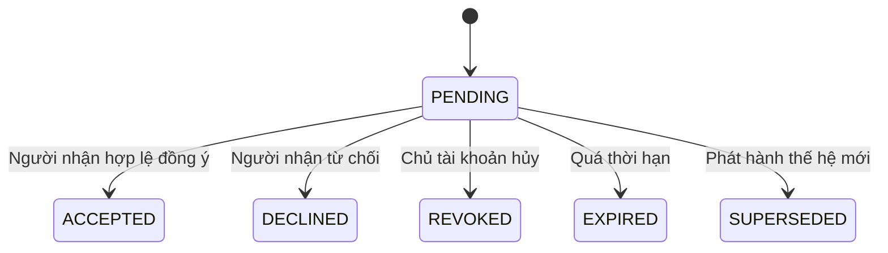
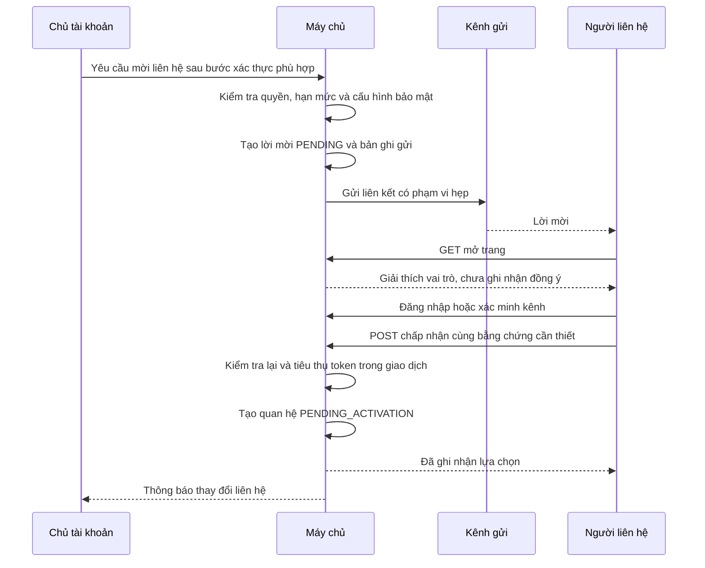

# Contact invitation security

## 1. Lời mời liên hệ khôi phục là một thao tác bảo mật

Trong khôi phục tài khoản, **recovery contact** là người liên hệ được thiết lập trước để hỗ trợ chủ tài khoản khi mất mật khẩu, MFA, passkey hoặc thiết bị xác thực. Trước khi người đó có thể hỗ trợ, hệ thống cần xác định ai được mời, lời mời do ai tạo và người nhận có thực sự đồng ý với vai trò hay không.

**Contact invitation security** là việc bảo vệ quá trình thiết lập quan hệ này. Một lời mời bị chiếm hoặc gắn nhầm người có thể tạo ra đường khôi phục do đối phương kiểm soát, dù luồng đăng nhập thông thường vẫn dùng MFA.

Ví dụ, Lan muốn mời Minh làm liên hệ khôi phục. Nếu kẻ đang giữ một phiên của Lan có thể thay địa chỉ người nhận bằng địa chỉ của mình rồi tự chấp nhận, hệ thống có thể vô tình biến quyền truy cập tạm thời thành khả năng chiếm lại tài khoản về sau.

NIST SP 800-63B-4 mô tả recovery contacts như các địa chỉ của người quen đáng tin được chỉ định để nhận mã khôi phục. Tài liệu cũng yêu cầu khả năng xem và quản lý các liên hệ này. [Nguồn: NIST, Recovery Contacts](https://pages.nist.gov/800-63-4/sp800-63b.html#recovery-contacts).

Bài học xây dựng một mô hình lời mời có xác nhận rõ ràng để phân tích các rủi ro triển khai. Các trạng thái, cấu trúc dữ liệu và điều kiện kích hoạt bên dưới là thiết kế minh họa. Chúng không phải giao thức lời mời bắt buộc của NIST, cũng không có nghĩa mọi dịch vụ phải triển khai khôi phục bằng người liên hệ.

## 2. Phân biệt ba sự kiện dễ bị đánh đồng

| Sự kiện | Ý nghĩa | Quyền chưa được suy ra |
| --- | --- | --- |
| Gửi lời mời | Dịch vụ đã tạo yêu cầu tới một người nhận dự kiến | Người nhận đã thấy, đã đồng ý hoặc đang là liên hệ có hiệu lực |
| Chấp nhận lời mời | Người nhận được xác định theo chính sách đã đồng ý tham gia | Một yêu cầu khôi phục cụ thể đã được phê duyệt |
| Hỗ trợ khôi phục | Liên hệ đủ điều kiện tham gia một case khôi phục riêng | Liên hệ có quyền đăng nhập, đọc dữ liệu hoặc thay MFA tùy ý |

Không dùng chung một token cho ba sự kiện. Token chấp nhận lời mời chỉ nên cho phép hoàn tất một bước thiết lập quan hệ xác định. Nó không phải recovery code, access token hay phiếu chấp thuận cho mọi lần khôi phục tương lai.

Một phản hồi “email đã gửi thành công” cũng không phải bằng chứng người nhận kiểm soát địa chỉ. Ngay cả khi xác minh được quyền truy cập hộp thư, hệ thống vẫn chưa tự chứng minh được quan hệ ngoài đời giữa hai người.

Số lượng liên hệ không tự tạo ra nhiều nguồn độc lập. Ba địa chỉ cùng được một người hoặc một hộp thư quản lý không mặc nhiên tương đương ba người xác nhận.

## 3. Những rủi ro cần xử lý ngay từ lúc tạo lời mời

| Rủi ro | Ví dụ | Điểm kiểm soát chính |
| --- | --- | --- |
| Phiên chủ tài khoản bị chiếm | Đối phương thêm chính mình làm liên hệ | Xác thực lại phù hợp, kiểm tra quyền đổi cấu hình và trạng thái rủi ro |
| Lời mời tới sai người | Gõ nhầm địa chỉ hoặc gắn nhầm tenant | Xác nhận đích gửi và ràng buộc người nhận ở máy chủ |
| Liên kết bị chuyển tiếp | Một người khác mở link rồi nhận vai trò | Kiểm tra người đang chấp nhận có đúng chủ thể dự kiến không |
| Token bị dùng sai mục đích | Link mời được đưa vào endpoint hoàn tất khôi phục | Phân tách purpose, endpoint và quyền |
| Tự chấp nhận khi quét link | Bộ kiểm tra email truy cập URL trước người dùng | Không thay đổi quan hệ qua GET hoặc HEAD |
| Gửi lại làm sống link cũ | Hai email khác nhau cùng kích hoạt được vai trò | Thế hệ lời mời và thu hồi token trước đó |
| Tranh chấp với thu hồi | Nhấn chấp nhận đồng thời với chủ tài khoản hủy | Giao dịch và kiểm tra trạng thái hiện tại |
| Lạm dụng gửi thư | Một tài khoản gửi hàng nghìn lời mời | Hạn mức theo người gửi, người nhận và quan hệ |
| Mạo danh trong nội dung | Tên hiển thị khiến người nhận tưởng là người quen | Hiển thị ngữ cảnh đáng tin và hướng dẫn từ chối |

Không có một thuộc tính như “token đủ dài” giải quyết được toàn bộ bảng. Token chống đoán vẫn có thể bị chuyển tiếp; chữ ký hợp lệ vẫn có thể đi kèm một lời mời do phiên bị chiếm tạo ra.

## 4. Cho phép ai tạo và thay đổi lời mời?

Việc thêm liên hệ khôi phục là thay đổi cấu hình bảo mật. Máy chủ cần xác định người gọi có quyền thực hiện thao tác đó cho đúng tài khoản và phạm vi tổ chức hay không.

Một chính sách có thể yêu cầu xác thực lại gần thời điểm tạo lời mời, bằng phương thức phù hợp với mức rủi ro. Không chỉ dựa vào việc trình duyệt đang có một cookie phiên lâu ngày. Đặc biệt, quyền hạn chế của một phiên khôi phục chưa hoàn tất không nên tự cho phép thiết lập một liên hệ mới rồi dùng chính liên hệ đó để vượt qua bước đang thiếu.

Các ràng buộc có ích gồm:

- Lấy ID chủ tài khoản từ ngữ cảnh đã được máy chủ xác thực và cho phép, không tin `ownerUserId` tùy ý trong body.
- Kiểm tra tenant, loại tài khoản và chính sách liên hệ khôi phục tương ứng.
- Không để trạng thái “đang khôi phục” tự mở rộng quyền quản lý liên hệ.
- Không coi liên hệ vừa thêm là bằng chứng đã được thiết lập trước cho một case đang mở.
- Tách quyền gửi lời mời khỏi quyền thay đổi các điều kiện khôi phục khác.

Nếu dịch vụ cho phép thiết lập liên hệ trong một quy trình hỗ trợ đặc biệt, quyền đó phải đến từ bằng chứng độc lập và một bước cấp phép riêng. Lập luận “cần khôi phục để thêm người giúp khôi phục” không được biến thành vòng tròn tự xác nhận.

Khi tài khoản có dấu hiệu bị chiếm, dữ liệu khôi phục vừa thay đổi cần được xem xét thận trọng. OWASP nhấn mạnh việc sử dụng bằng chứng khôi phục độc lập đã được thiết lập trước trong tình huống nghi ngờ chiếm đoạt. [Nguồn: OWASP, Account Recovery After Suspected Compromise](https://cheatsheetseries.owasp.org/cheatsheets/Forgot_Password_Cheat_Sheet.html#account-recovery-after-suspected-compromise).

## 5. Ràng buộc đúng người nhận và đúng quan hệ

### 5.1. Địa chỉ gửi không phải định danh bất biến của một con người

Email hoặc số điện thoại có thể thay đổi chủ sở hữu, dùng chung hoặc chuyển tiếp. Tên hiển thị cũng không phải khóa định danh an toàn.

Một lời mời nên giữ quan hệ rõ ràng:

```text
invitation_id
    ├── tenant_id
    ├── owner_user_id
    ├── intended_recipient_binding
    ├── relationship_id
    ├── purpose = RECOVERY_CONTACT_ENROLLMENT
    ├── generation
    ├── owner_security_epoch
    ├── issued_at / expires_at
    └── status
```

`intended_recipient_binding` là tham chiếu do máy chủ quản lý tới đích nhận hoặc chủ thể dự kiến, không phải chuỗi client được tự đổi khi chấp nhận.

Nếu người nhận đã có tài khoản trong dịch vụ, có thể yêu cầu đăng nhập và đối chiếu với định danh đã được xác minh theo chính sách. Không chỉ so tên hiển thị hoặc địa chỉ email do người nhận tự nhập ở màn hình chấp nhận.

Trong hệ thống liên kết danh tính, một subject cần được hiểu cùng issuer và phạm vi tenant phù hợp. Không coi hai subject giống chuỗi ở hai nhà cung cấp khác nhau là một người.

### 5.2. Người nhận chưa có tài khoản

Dịch vụ có thể thiết kế xác nhận qua kênh liên hệ thay vì bắt mọi người đăng ký tài khoản. Khi đó cần ghi rõ mức bảo đảm: hệ thống xác nhận quyền truy cập kênh và sự đồng ý theo quy trình, không tự xác minh danh tính ngoài đời.

Một link dạng bearer có thể được người nhận chuyển tiếp. Nếu chính sách yêu cầu chống việc người khác nhận vai trò qua link chuyển tiếp, chỉ nắm token là chưa đủ; cần thêm bước ràng buộc với đúng chủ thể hoặc xác nhận kênh dự kiến theo thiết kế.

Nếu hộp thư đã bị chiếm hoặc chủ hộp thư chủ động chuyển tiếp mọi mã, kiểm tra email bổ sung không tạo ra một nguồn bảo đảm độc lập. Phải nhận biết giới hạn này khi quyết định liên hệ được quyền hỗ trợ đến mức nào.

Không tùy tiện hợp nhất các địa chỉ bằng cách xóa dấu chấm, phần sau dấu cộng hoặc áp dụng quy tắc riêng của một nhà cung cấp cho mọi domain. Định tuyến nhầm do chuẩn hóa sai có thể trở thành gắn nhầm quyền.

## 6. Token lời mời chỉ mang quyền chấp nhận lời mời

Token nên được tạo bằng bộ sinh ngẫu nhiên mật mã, đủ khó đoán, có thời hạn và bị vô hiệu hóa khi đã dùng. Đây cũng là các nguyên tắc OWASP nêu cho token trong luồng đặt lại mật khẩu; áp dụng chúng cho lời mời là một lựa chọn thiết kế ở đây. [Nguồn: OWASP, General Security Practices](https://cheatsheetseries.owasp.org/cheatsheets/Forgot_Password_Cheat_Sheet.html#general-security-practices).

Một thiết kế minh họa dùng token opaque sinh từ 32 byte ngẫu nhiên, mã hóa Base64url. Con số này là ví dụ triển khai cho lời mời, không phải yêu cầu riêng của NIST về invitation token.

Máy chủ cần kiểm tra đồng thời:

1. Token khớp bản ghi lời mời.
2. Purpose là `RECOVERY_CONTACT_ENROLLMENT`.
3. Tenant, chủ tài khoản, quan hệ và người nhận đúng với bản ghi.
4. Thế hệ lời mời còn hiện hành.
5. Trạng thái vẫn cho phép chấp nhận và chưa hết hạn theo giờ máy chủ.
6. Các điều kiện bảo mật của chủ tài khoản chưa làm lời mời mất hiệu lực.
7. Người đang chấp nhận đáp ứng chính sách ràng buộc người nhận.

Chỉ lưu `expires_at` trong token có chữ ký không đủ để thu hồi trước hạn. JWT có thể dùng trong một thiết kế phù hợp, nhưng yêu cầu thu hồi, dùng một lần và chống thế hệ cũ vẫn cần trạng thái hoặc cơ chế tương đương ở phía máy chủ.

Với token ngẫu nhiên có entropy cao, kho lời mời có thể lưu digest để đối chiếu thay vì lưu token thô. Điều này khác với xử lý mật khẩu hoặc câu trả lời ít khả năng đoán. Digest không giảm trách nhiệm bảo vệ các bản sao token trong hệ thống gửi thư, log và hàng đợi.

Nếu hàng đợi cần chứa liên kết đầy đủ để gửi, phải bảo vệ dữ liệu đó, giới hạn quyền truy cập và vòng đời lưu trữ. Không tuyên bố “chỉ lưu hash” trong khi một bảng outbox giữ link thô vô thời hạn.

Thời hạn lời mời, thời gian chờ kích hoạt và thời hạn mã khôi phục là ba tham số khác nhau. Không lấy thời hạn của recovery code rồi mặc nhiên áp dụng cho mọi invitation link.

## 7. Mở liên kết không đồng nghĩa đồng ý

Hệ thống kiểm tra email, trình xem trước tin nhắn hoặc trình duyệt có thể tự truy cập liên kết. Nếu `GET /contact-invitations/accept?token=...` trực tiếp kích hoạt quan hệ, một yêu cầu xem trước có thể bị hiểu nhầm là sự đồng ý của người nhận.

RFC 9110 xác định GET và HEAD là các phương thức có ngữ nghĩa an toàn, phục vụ truy xuất thay vì yêu cầu thay đổi trạng thái. [Nguồn: RFC 9110, Safe Methods](https://www.rfc-editor.org/rfc/rfc9110.html#section-9.2.1).

Một luồng phù hợp hơn là:

1. GET mở trang giải thích lời mời và kiểm tra khả năng sử dụng ở mức cần thiết.
2. Người nhận đăng nhập hoặc xác minh kênh theo chính sách.
3. Trang hiển thị vai trò, người mời và các lựa chọn chấp nhận hoặc từ chối.
4. Người nhận chủ động gửi POST có bảo vệ CSRF.
5. Máy chủ kiểm tra lại toàn bộ điều kiện trước khi ghi nhận sự đồng ý.

GET hoặc HEAD không được tiêu thụ token, chấp nhận lời mời, từ chối thay người dùng hay kích hoạt liên hệ. Việc tạo ngữ cảnh trình bày ngắn hạn hoặc ghi log truy cập cần được phân biệt với thay đổi trạng thái quan hệ bảo mật.

Không chỉ đổi GET thành POST rồi tự động gửi form ngay khi trang tải. Cách đó vẫn thiếu thao tác đồng ý rõ ràng và có thể bị tác vụ tự động kích hoạt.

POST cũng không tự chống CSRF. Khi dùng cookie phiên, cần cơ chế bảo vệ phù hợp như token CSRF gắn với phiên và kiểm tra nguồn yêu cầu theo kiến trúc ứng dụng. Trang xác nhận cũng cần được bảo vệ khỏi việc nhúng giao diện để đánh lừa thao tác.

### Bảo vệ liên kết trong quá trình điều hướng

Một số biện pháp triển khai cần được thiết kế cùng nhau:

- Dùng HTTPS và domain gửi liên kết được cấu hình tin cậy.
- Không để input của người gọi quyết định host hoặc redirect tới domain tùy ý.
- Hạn chế nội dung bên thứ ba trên trang chứa token.
- Áp dụng chính sách referrer phù hợp, chẳng hạn `Referrer-Policy: no-referrer`, và tránh cache trang chứa bí mật.
- Loại token khỏi access log, analytics, báo lỗi và dữ liệu theo dõi phiên.
- Không đưa toàn bộ URL chứa token vào tham số chuyển sang trang đăng nhập hoặc nhà cung cấp danh tính.

Có thể lưu ngữ cảnh lời mời ở máy chủ và chuyển tiếp bằng một tham chiếu opaque có phạm vi hẹp. Việc điều hướng trở lại phải gắn với đúng luồng và phiên, không dùng tham số `returnTo` tùy ý để chuyển token sang website khác.

Việc làm sạch URL sau khi mở không xóa được các bản sao đã vào log hoặc hạ tầng trung gian. Phải giảm rò rỉ ngay từ nơi nhận yêu cầu.

## 8. Tách trạng thái lời mời khỏi trạng thái liên hệ

Một mô hình lời mời có thể gồm:



`ACCEPTED` ghi nhận sự kiện chấp nhận. Quan hệ liên hệ có vòng đời riêng:

```text
PENDING_ACTIVATION -> ACTIVE -> SUSPENDED hoặc REVOKED
```

Trong mô hình này, chấp nhận tạo quan hệ `PENDING_ACTIVATION`. Quan hệ chỉ chuyển `ACTIVE` khi các điều kiện kích hoạt của dịch vụ được đáp ứng. Tùy chính sách, các điều kiện có thể gồm thông báo qua kênh đã có, xác nhận bổ sung hoặc một khoảng chờ được xác định trước.

Không có một khoảng chờ chung phù hợp cho mọi dịch vụ. Quan trọng là máy chủ thi hành điều kiện đó và không để client tự gửi `active=true`.

Nếu dịch vụ cho kích hoạt ngay sau chấp nhận, vẫn phải thể hiện rõ đó là quyết định của chính sách; không để việc “đã mở email” vô tình đóng vai trò quyết định kích hoạt.

Một invitation đã chấp nhận không nên là công cụ quản lý quan hệ vĩnh viễn. Khi liên hệ muốn rút khỏi vai trò, hệ thống dùng một thao tác được cấp phép riêng để thu hồi quan hệ. Không cho người giữ link cũ tùy ý bật, tắt hoặc đổi người nhận sau này.

## 9. Luồng tham khảo từ gửi đến chấp nhận



Thông báo cho chủ tài khoản nên đi tới các kênh thông báo phù hợp đã được thiết lập, thay vì chỉ gửi cho địa chỉ mới vừa được nhập. Nội dung cần có cách xem và báo cáo thay đổi không được phép.

Không đưa mật khẩu, mã MFA, recovery code hoặc dữ liệu nhạy cảm của chủ tài khoản vào email mời. Người nhận cần hiểu mình được mời hỗ trợ khôi phục, nhưng không cần quyền xem nội dung riêng tư của tài khoản.

Tên người mời do người dùng tự đặt phải được hiển thị an toàn và không tạo cảm giác dịch vụ đã xác thực quan hệ ngoài đời. Lời mời cũng nên giải thích rằng dịch vụ không yêu cầu người nhận cung cấp mật khẩu của người mời.

## 10. Gửi lại, thu hồi và xử lý đồng thời

### 10.1. Gửi lại không tạo nhiều token có hiệu lực

Một cách triển khai là tăng `generation` khi phát hành lại, chuyển lời mời trước sang `SUPERSEDED` và chỉ cho phép thế hệ hiện hành được chấp nhận.

Phải xử lý cả bản ghi gửi đang nằm trong hàng đợi. Một email cũ có thể đến sau email mới. Máy chủ vẫn từ chối token cũ, dù thứ tự nhận thư khiến người dùng nghĩ đó là link mới nhất.

Worker gửi thư nên đối chiếu trạng thái và thế hệ trước khi gửi khi có thể. Tuy nhiên, một email đã được chuyển tới nhà cung cấp vẫn có thể đến sau thu hồi. Vì vậy, tính an toàn không được phụ thuộc vào việc có thu hồi được email khỏi hộp thư hay không.

Không tự đổi đích nhận của một token cũ khi người mời sửa địa chỉ. Đổi người nhận phải được xử lý như một lời mời mới, có binding và token mới theo chính sách.

### 10.2. Thu hồi phải thắng các thao tác đến muộn theo một thứ tự nhất quán

Nếu chủ tài khoản thu hồi lời mời và người nhận chấp nhận gần như cùng lúc, hai thao tác phải được tuần tự hóa bằng khóa hoặc cập nhật có điều kiện thích hợp.

- Nếu thu hồi có hiệu lực trước, thao tác chấp nhận không được kích hoạt lại.
- Nếu chấp nhận đã hoàn tất trước, yêu cầu hủy cần xử lý quan hệ vừa tạo theo chính sách thu hồi, không chỉ tìm một invitation còn `PENDING`.
- Nếu tác vụ kích hoạt chạy sau một lần thu hồi quan hệ, nó phải đọc trạng thái hiện tại và không khôi phục quan hệ đó.

Một phiên bản cấu hình bảo mật, chẳng hạn `owner_security_epoch`, có thể giúp vô hiệu hóa các lời mời đang chờ khi cấu hình thay đổi hoặc xảy ra sự kiện rủi ro. Việc so sánh phiên bản cần nằm trong cùng cơ chế đồng bộ với thao tác ghi; đọc một lần trước giao dịch rồi dùng mãi không giải quyết được tranh chấp.

### 10.3. Dùng một lần vẫn cần hành vi retry rõ ràng

Hai lần POST giống nhau do mạng gửi lại không nên tạo hai liên hệ. Máy chủ có thể trả trạng thái hiện tại cho đúng người nhận sau khi xác minh binding, nhưng không phát sinh thêm tác dụng bảo mật.

Nếu lời mời từng được chấp nhận rồi quan hệ đã bị thu hồi, retry phải phản ánh việc đã thu hồi. Không trả một kết quả lịch sử rồi khiến client hiểu quan hệ vẫn đang hoạt động.

## 11. Ví dụ ghi nhận sự đồng ý phía máy chủ

Đoạn sau là **mã giả theo cú pháp Java**. Nó minh họa thứ tự kiểm tra, không phải một triển khai đầy đủ hay API của thư viện.

Trước khi gọi hàm, lớp xử lý HTTP phải kiểm tra CSRF, xác thực phiên hoặc bằng chứng người nhận, giới hạn đầu vào và hạn mức phù hợp. `actor` là ngữ cảnh do máy chủ xác minh, không phải đối tượng client được tự khai.

```java
ContactState acceptContactInvitation(
        String invitationId,
        String rawToken,
        VerifiedActor actor,
        Instant now) {

    // Lock both invitation and relevant owner policy/relationship state.
    return repository.inEnrollmentTransaction(invitationId, tx -> {
        var invitation = tx.invitation();
        var ownerPolicy = tx.ownerSecurityPolicy();

        tokenVerifier.requireMatch(rawToken, invitation.tokenDigest());

        if (!invitation.purpose().equals("RECOVERY_CONTACT_ENROLLMENT")
                || !recipientBinding.matches(invitation, actor)
                || !ownerPolicy.belongsTo(invitation.ownerUserId(),
                                         invitation.tenantId())) {
            throw new InvitationNotUsable();
        }

        // A retry reports current state; it never recreates a revoked relation.
        if (invitation.acceptedBySameActor(actor)) {
            return tx.currentRelationshipState();
        }

        if (!invitation.pending()
                || !now.isBefore(invitation.expiresAt())
                || !tx.isCurrentGeneration(invitation)
                || invitation.ownerSecurityEpoch() != ownerPolicy.epoch()
                || !ownerPolicy.contactEnrollmentAllowed()) {
            throw new InvitationNotUsable();
        }

        var relationship = tx.createPendingContactIfAbsent(
            invitation.relationshipId(),
            invitation.ownerUserId(),
            actor.verifiedRecipientBinding()
        );

        tx.markInvitationAccepted(invitation.id(), actor.id(), now);
        tx.enqueueBoundedNotification(relationship.id());
        tx.recordConsentEvent(invitation.id(), relationship.id(), actor.id());

        return relationship.state(); // PENDING_ACTIVATION in this example
    });
}
```

Giao dịch cần bảo đảm tạo quan hệ, tiêu thụ token và ghi nhận sự đồng ý không bị tách thành các bước có thể hoàn tất một phần. Bản ghi quan hệ cũng cần ràng buộc duy nhất phù hợp để xử lý request đồng thời hoặc gửi lại.

Bản ghi gửi thông báo có thể dùng transactional outbox. Thành phần phát thông báo cần chống xử lý lặp và không làm sống lại một lời mời bị thu hồi. Thông báo gửi thất bại phải được theo dõi, còn việc quan hệ có được kích hoạt khi chưa thông báo thành công hay không cần thuộc điều kiện kích hoạt rõ ràng của dịch vụ.

Đừng chỉ kiểm tra token rồi tin các ID còn lại trong body. Người nhận có thể giữ token hợp lệ của một invitation nhưng cố áp dụng nó cho tài khoản khác. Mọi binding phải được lấy từ hoặc đối chiếu với bản ghi lời mời ở máy chủ.

## 12. Chống lạm dụng, bảo vệ riêng tư và giới hạn quyền

### 12.1. Hạn chế gửi mời như một kênh quấy rối

Có thể giới hạn tần suất theo người gửi, tài khoản đích, địa chỉ nhận và cặp quan hệ. Chỉ giới hạn IP dễ gây ảnh hưởng người dùng chung mạng mà vẫn bỏ sót nguồn gửi phân tán.

Gửi lại không được liên tục gia hạn một lời mời vô thời hạn hoặc vượt qua lựa chọn từ chối của người nhận. Cần có cách bỏ qua, báo cáo hoặc chặn lời mời theo phạm vi phù hợp.

Người gọi API không nên nhận thông tin thừa như “địa chỉ này có tài khoản”, “đang bị đình chỉ” hoặc “đã làm liên hệ cho ba người khác”. Dù người nhận có cần đăng nhập, quy trình gửi lời mời vẫn nên tránh trở thành công cụ dò tài khoản.

### 12.2. Chỉ lưu và hiển thị dữ liệu cần thiết

Một bản ghi truy vết có thể gồm ID invitation, ID quan hệ, người tạo, người chấp nhận, thế hệ, phiên bản chính sách và thời điểm chuyển trạng thái. Không cần ghi token thô hay toàn bộ nội dung hộp thư.

Người mời cần quản lý được các liên hệ của mình. Người nhận cũng cần biết vai trò, cách rút khỏi vai trò và phạm vi thông tin được chia sẻ. Không hiển thị danh bạ của chủ tài khoản hoặc các liên hệ khác chỉ vì người nhận mở một lời mời.

Mời một người làm recovery contact không tự cho phép nhập hoặc đọc danh bạ của họ. Nếu có tích hợp bên ngoài, quyền truy cập cần đúng mục đích và giới hạn dữ liệu cần dùng.

### 12.3. Điều kiện tham gia một case khôi phục được kiểm tra riêng

Khi có yêu cầu khôi phục về sau, máy chủ cần xác định quan hệ có đủ điều kiện cho chính case đó hay không: đã được thiết lập đúng thời điểm, còn hiệu lực, không bị thu hồi và đáp ứng chính sách hiện hành.

Snapshot quan hệ dùng cho case giúp xác định nguồn bằng chứng dự kiến, nhưng không nên là lý do bỏ qua một lần thu hồi hoặc dấu hiệu chiếm đoạt mới. Điều kiện lịch sử và điều kiện hiện tại cần được xét cùng nhau.

Ba tình huống điển hình:

**Người nhận mở link nhưng chưa nhấn đồng ý:** quan hệ vẫn chưa được chấp nhận. Không gửi yêu cầu hỗ trợ khôi phục như thể người đó đã đăng ký.

**Link được chuyển tiếp cho người khác:** máy chủ kiểm tra binding người nhận; token hợp lệ không tự cho phép đổi người tham gia.

**Liên hệ vừa được thêm trong lúc đang khôi phục:** không tự dùng quan hệ mới để chứng minh quyền cho case đang thiếu bằng chứng. Cần xử lý theo quy trình được phép, tránh tự tạo nguồn xác nhận.

Lời mời an toàn thiết lập một quan hệ có chủ thể, sự đồng ý, phạm vi và vòng đời rõ ràng. Việc khôi phục tài khoản vẫn là một quyết định riêng, dựa trên toàn bộ bằng chứng và chính sách cần thiết.
