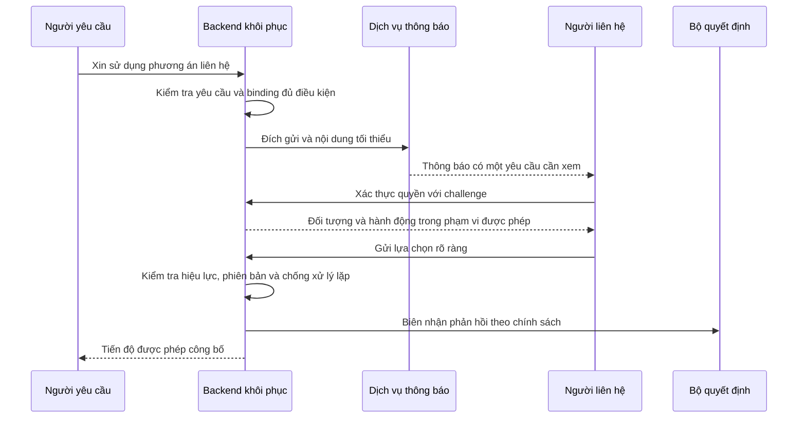

# Contact privacy boundaries

Ranh giới riêng tư của người liên hệ là tập quy tắc xác định ai được biết một quan hệ liên hệ có tồn tại, ai được xem thông tin liên lạc, khi nào được gửi yêu cầu hỗ trợ và phản hồi được dùng cho mục đích gì. Trong khôi phục tài khoản, dữ liệu cần bảo vệ không chỉ thuộc về người mất mật khẩu, MFA, passkey hoặc thiết bị xác thực. Người được nhờ hỗ trợ cũng có thông tin, lựa chọn và mức độ an toàn riêng.

Ví dụ, việc hệ thống gửi một tin nhắn cho Mai để hỗ trợ Linh có thể tiết lộ rằng Linh dùng dịch vụ, Linh đang mất quyền truy cập và hai người có quan hệ tin cậy. Cho phép người lạ tra danh sách người hỗ trợ của Linh còn có thể biến chức năng khôi phục thành công cụ lập bản đồ quan hệ xã hội.

Bài học tập trung vào cách giới hạn thu thập, hiển thị và sử dụng thông tin liên hệ trong luồng khôi phục. Các trạng thái, API, mô hình dữ liệu và cách phân quyền bên dưới là thiết kế minh họa; chúng không phải một giao thức khôi phục chuẩn hay khẳng định rằng một xác nhận xã hội riêng lẻ đủ để cấp lại quyền tài khoản.

## 1. Phân biệt tín hiệu xã hội và quyền khôi phục đã được thiết lập

Không nên gom mọi quan hệ vào một khái niệm “người quen đáng tin”.

| Loại quan hệ hoặc hành vi | Điều có thể biết | Quyền không tự phát sinh |
| --- | --- | --- |
| Hai người theo dõi nhau công khai | Có một liên kết hiển thị trên nền tảng | Quyền xem hồ sơ riêng hoặc khôi phục tài khoản của nhau |
| Một địa chỉ nằm trong danh bạ | Một thiết bị đã lưu địa chỉ đó | Sự đồng ý tham gia khôi phục hoặc quyền tiết lộ địa chỉ cho bên khác |
| Một người nói rằng quen chủ tài khoản | Có một lời khai về quan hệ | Bằng chứng chắc chắn về danh tính hoặc quyền sở hữu tài khoản |
| Một người đã nhận lời làm liên hệ khôi phục | Có một cấu hình và phạm vi tham gia được thiết lập | Quyền đọc dữ liệu tài khoản hoặc tự đặt mật khẩu mới |
| Quản trị viên có ủy quyền trong tổ chức | Có một vai trò và phạm vi quản trị được xác lập | Quyền vượt tenant hoặc xem mọi quan hệ xã hội của thành viên |

Trong NIST SP 800-63B-4, recovery contact được mô tả qua địa chỉ của người tin cậy do người dùng chỉ định để nhận mã khôi phục. Đây là một phương thức được thiết lập, khác với suy đoán quyền từ danh bạ hoặc mạng xã hội. Điều kiện khôi phục còn phụ thuộc bối cảnh và mức đảm bảo. [NIST SP 800-63B-4 — Recovery Contacts](https://pages.nist.gov/800-63-4/sp800-63b.html).

Nếu sản phẩm dùng cơ chế người liên hệ xác nhận trực tiếp qua cổng riêng, cần đánh giá và mô tả đúng cơ chế đó. Không mặc định nó tương đương hoàn toàn với phương thức mã khôi phục của một tiêu chuẩn chỉ vì đều có người thứ ba tham gia.

Tín hiệu xã hội có thể hỗ trợ đánh giá rủi ro trong phạm vi được phép. Một liên kết công khai hoặc lời xác nhận “tôi biết người này” không nên tự biến thành quyền gỡ MFA, thay passkey hoặc đọc thông tin riêng tư của tài khoản.

## 2. Những thông tin có thể bị lộ từ một yêu cầu liên hệ

Một trường dữ liệu nhỏ có thể tiết lộ nhiều hơn nội dung trực tiếp của nó:

- **Sự hiện diện trên dịch vụ:** địa chỉ nhận được lời nhờ có thể biết một người đang sử dụng một nền tảng cụ thể.
- **Quan hệ giữa hai người:** danh sách liên hệ khôi phục có thể cho thấy gia đình, đồng nghiệp hoặc người được tin cậy.
- **Tình trạng tài khoản:** thông báo có thể tiết lộ mất thiết bị, thay yếu tố xác thực hoặc nghi ngờ bị chiếm quyền.
- **Hành vi phản hồi:** việc một người đã đọc, từ chối hoặc không trả lời có thể tạo áp lực trong quan hệ cá nhân.
- **Thông tin liên lạc hiện tại:** email, số điện thoại mới hoặc thời điểm còn sử dụng có thể giúp người khác theo dõi một người.
- **Các quan hệ gián tiếp:** biết ai cùng tham gia một yêu cầu có thể làm lộ nhóm bạn, thành viên tổ chức hoặc hoàn cảnh riêng.

Không thể hứa rằng một người được gửi yêu cầu hỗ trợ sẽ hoàn toàn không biết sự kiện đó. Một số thông tin là cần thiết để họ hiểu mình được yêu cầu làm gì. Mục tiêu là công bố đúng phần cần thiết, vào đúng thời điểm, cho đúng người và phù hợp với những gì đã giải thích khi thiết lập.

W3C Privacy Principles nêu nguyên tắc giới hạn dữ liệu được truyền và thiết kế API để giảm lượng dữ liệu phải yêu cầu. Áp dụng vào bài toán này, không nên gửi toàn bộ hồ sơ hoặc danh bạ khi một yêu cầu hỗ trợ giới hạn đã đủ. [W3C Privacy Principles — Data Minimization](https://www.w3.org/TR/privacy-principles/#data-minimization).

## 3. Xác định ai được xem thông tin nào

Cần tách chủ tài khoản đã xác thực hợp lệ với người đang tự nhận là chủ trong luồng mất quyền truy cập. Cùng nhập một email không khiến hai vai trò này có cùng quyền.

| Chủ thể | Phạm vi có thể cần | Phần cần hạn chế |
| --- | --- | --- |
| Chủ tài khoản đã xác thực ở mức phù hợp | Quản lý những liên hệ khôi phục của chính tài khoản | Các tài khoản khác mà một người liên hệ đang hỗ trợ |
| Người yêu cầu khôi phục trong phiên hạn chế | Bước tiếp theo và tiến độ được chính sách cho phép công bố | Danh sách đầy đủ, địa chỉ đầy đủ, lý do phản hồi riêng của từng contact |
| Người liên hệ đã được xác nhận | Yêu cầu dành cho chính họ, thông tin cần để hiểu đối tượng và hành động | Dữ liệu tài khoản, các contact khác, kết quả chi tiết của người khác |
| Nhân viên hỗ trợ | Thông tin phục vụ đúng vụ việc và nhiệm vụ | Toàn bộ đồ thị quan hệ, bí mật khôi phục và dữ liệu ngoài phạm vi |
| Dịch vụ gửi thông báo | Địa chỉ nhận, nội dung tối thiểu và thông tin vận hành cần thiết | Lịch sử đăng nhập, giấy tờ, danh sách liên hệ của cả tài khoản |
| Người ngoài hoặc phiên chưa có quyền | Thông báo tiếp nhận chung thích hợp | Tài khoản có tồn tại, đã có contact nào hoặc contact còn hoạt động không |

Che một phần email hoặc số điện thoại không thay cho phân quyền. Chỉ vài ký tự cũng có thể đủ để suy ra người nhận trong một nhóm nhỏ. Giao diện cần quyết định có được hiển thị một gợi ý hay không trước khi quyết định cách che.

Mã tham chiếu ngẫu nhiên giúp giảm khả năng đoán tài nguyên nhưng không phải quyền truy cập. API vẫn phải kiểm tra người gọi được phép xem yêu cầu hoặc quan hệ cụ thể đó.

## 4. Thiết lập quan hệ trước sự cố và giới hạn sự tham gia

Một thiết kế có thể tách quá trình thiết lập thành các bước sau:

1. Chủ tài khoản xác thực với mức phù hợp trước khi thêm hoặc thay liên hệ khôi phục.
2. Hệ thống giải thích cho chủ tài khoản dữ liệu nào sẽ được tiết lộ khi mời và khi có sự cố.
3. Lời mời được gửi với nội dung tối thiểu, có giới hạn gửi và cơ chế từ chối.
4. Người nhận được xác nhận quyền kiểm soát kênh hoặc tài khoản theo cơ chế đã chọn, rồi được giải thích phạm vi tham gia.
5. Chỉ khi đủ điều kiện, quan hệ chuyển sang trạng thái có thể dùng cho khôi phục.
6. Cả hai bên có cách quản lý phần tham gia của mình theo quyền tương ứng.

Các trạng thái minh họa có thể là `PENDING`, `ACTIVE`, `SUSPENDED` và `REVOKED`. Một lời mời đang chờ không phải một liên hệ khôi phục đủ điều kiện. Việc thư gửi thành công cũng không có nghĩa người nhận đã đồng ý.

### 4.1. Nói rõ người liên hệ sẽ được biết gì

Giải thích khi thiết lập nên trả lời được:

- Người liên hệ có thể nhận thông báo cho loại sự kiện nào?
- Họ có được biết tên dịch vụ và tài khoản nào đang cần hỗ trợ không?
- Họ được thực hiện hành động gì và không có quyền gì?
- Họ có phải cung cấp hoặc chuyển tiếp một loại mã cụ thể theo giao thức không?
- Phản hồi của họ có được hiện cho người yêu cầu không, ở mức chi tiết nào?
- Họ ngừng tham gia bằng cách nào và dấu vết nào còn được giữ?

Chủ tài khoản chọn một người không tự trao cho nền tảng quyền sử dụng địa chỉ của người đó để quảng cáo, tìm bạn hoặc đề xuất kết nối. Mục đích khôi phục cần được tách khỏi những mục đích khác.

### 4.2. Xác nhận kênh không xác nhận mọi khía cạnh của quan hệ

Một người nhận được email chỉ chứng minh khả năng truy cập địa chỉ đó theo cơ chế kiểm tra. Điều này không tự xác nhận quan hệ gia đình, sự tự nguyện trong mọi tình huống hoặc việc địa chỉ sẽ mãi thuộc cùng một người.

Số điện thoại có thể được cấp lại; hộp thư hoặc tài khoản của contact có thể bị chiếm quyền. Hệ thống cần có cách xem xét cấu hình cũ, thay đổi địa chỉ và xử lý dấu hiệu kênh không còn an toàn. Không tái kích hoạt một quan hệ đã thu hồi chỉ vì địa chỉ vẫn nhận được tin.

## 5. Thu thập tối thiểu và tránh xây dựng đồ thị quan hệ ngoài mục đích

Nếu chức năng chỉ cần một người liên hệ cụ thể, có thể cho chủ tài khoản nhập hoặc chọn người đó, thay vì tải toàn bộ danh bạ lên máy chủ. Quyền truy cập danh bạ ở thiết bị không tự chứng minh mọi người trong danh bạ muốn tham gia dịch vụ.

Không cần yêu cầu lịch sử chat, ảnh chụp nhóm, danh sách người thường gọi hoặc toàn bộ bạn bè để thiết lập một quan hệ hỗ trợ có phạm vi rõ ràng. Những dữ liệu đó có thể chứa thông tin của nhiều người không có vai trò trong yêu cầu.

Nếu có tích hợp với nền tảng xã hội, cần đánh giá dữ liệu thực sự nhận được, quyền truy cập, thời hạn lưu và khả năng thu hồi. Dữ liệu nhìn thấy công khai ở nơi khác vẫn có thể trở nên nhạy cảm khi được ghép với thông tin khôi phục.

Một mã băm thông thường của số điện thoại hoặc email không bảo đảm ẩn danh: tập giá trị có thể đoán hoặc liệt kê được, và giá trị ổn định có thể giúp liên kết qua nhiều tập dữ liệu. Nếu cần đối chiếu cho một mục đích cụ thể, phải đánh giá kỹ thuật và quản lý vòng đời phù hợp; không gọi toàn bộ danh bạ đã băm là dữ liệu vô danh.

Cũng không nên cung cấp API kiểu “địa chỉ này đang làm contact cho những tài khoản nào” cho người dùng thông thường. Người liên hệ có thể quản lý các quan hệ của chính mình trong ngữ cảnh được phép, nhưng phản hồi đó không trở thành một dịch vụ tra cứu công khai.

## 6. Tách thông tin định tuyến khỏi nội dung quyết định

Một mô hình dữ liệu minh họa:

```text
ContactBinding
  bindingId
  ownerAccountId
  contactPrincipalReference
  deliveryAddressReference
  purpose
  enrollmentState
  enrollmentVersion
  acceptedAt
  revokedAt

ContactChallenge
  challengeId
  recoveryRequestId
  recoveryAttemptVersion
  bindingId
  bindingVersion
  permittedAction
  createdAt
  expiresAt
  state

ContactResponseReceipt
  receiptId
  challengeId
  respondingPrincipalReference
  responseType
  verifiedAt
  policyVersion
```

Địa chỉ gửi có thể nằm trong một kho riêng mà chỉ dịch vụ định tuyến được đọc. Các thành phần chỉ cần đánh giá kết quả có thể sử dụng tham chiếu mờ, thay vì giữ thêm bản sao email hoặc số điện thoại.

`contactPrincipalReference` thể hiện người hoặc chủ thể được phép phản hồi theo cơ chế đã chọn. Nếu sản phẩm không yêu cầu contact có tài khoản trên nền tảng, vẫn cần một cơ chế xác nhận kênh và quyền đối với challenge cụ thể; không giả định họ đã có một tài khoản xác thực đầy đủ.

Quan hệ có phiên bản giúp phân biệt cấu hình hiện tại với một địa chỉ cũ. Challenge cần gắn với đúng yêu cầu, lần thử, quan hệ và hành động. Thay một contact không nên khiến liên kết cũ tự chuyển quyền cho contact mới.

### 6.1. Mỗi quyền chỉ phục vụ một mục đích

Một token nhận lời mời không được dùng làm token chấp thuận khôi phục. Token xem yêu cầu cũng không tự mang quyền xem hồ sơ hoặc quản lý các contact khác.

Nếu dùng quyền dạng bearer, người có token có thể sử dụng quyền trong phạm vi token cho phép. Vì vậy, cần giảm phạm vi, thời hạn, khả năng tái sử dụng và nguy cơ lộ token. Không đặt địa chỉ liên hệ, tên tài khoản hoặc dữ liệu nhạy cảm vào URL chỉ để tiện định tuyến.

Một mô hình chọn xác thực thêm cho contact có thể giảm rủi ro liên kết bị chuyển tiếp. Mức xác thực và quan hệ giữa phiên contact với challenge cần được xác định rõ; không thể thay thế bằng một cờ `approved=true` từ client.

## 7. Luồng phản hồi với thông tin giới hạn

Sơ đồ sau minh họa cơ chế contact phản hồi qua cổng riêng. Cơ chế này cần chính sách quyết định phù hợp; sơ đồ không khẳng định một phản hồi là đủ khôi phục tài khoản.



Backend chỉ chọn binding đã được thiết lập và đủ điều kiện. Người đang mất quyền không được tự thêm một email mới rồi gửi challenge cho chính người tấn công và dùng phản hồi đó làm bằng chứng.

Pseudocode xử lý phản hồi:

```text
respondToContactChallenge(challengeId, choice, contactSession):
    transaction:
        challenge = lock current challenge
        request = load current recovery request
        binding = load authoritative contact binding

        require contactSession is authorized for this challenge
        require contactSession matches the permitted contact principal
        require challenge, request and attempt are active
        require challenge has not expired
        require binding remains eligible under the current policy
        require binding version matches challenge binding version
        require choice is an allowed action

        record the response idempotently for this challenge
        create minimal receipt with its source and scope
        enqueue policy evaluation using a transactional outbox

    return only the contact's own action result
```

Các bước xác minh bên ngoài được xử lý theo kiến trúc phù hợp, tránh giữ transaction dài trong lúc chờ mạng. Khi lưu kết quả, cần kiểm tra lại trạng thái để phản hồi đến muộn không áp dụng cho yêu cầu đã hủy hoặc một quan hệ đã bị thay thế.

Lần tải trang bằng `GET` không nên tự chấp thuận hoặc từ chối yêu cầu. Trình quét liên kết của email và ứng dụng có thể tự mở URL. Hành động cần một lựa chọn rõ ràng, với bảo vệ request phù hợp nếu dùng phiên cookie và cơ chế chống áp dụng lặp ở phía máy chủ.

## 8. Thiết kế nội dung thông báo và trang xác nhận

### 8.1. Thông báo ban đầu chỉ đưa dữ liệu cần thiết

Một mẫu thông báo có thể là:

> Có một yêu cầu hỗ trợ khôi phục trong phạm vi bạn đã nhận tham gia. Hãy mở ứng dụng hoặc cổng chính thức để xem chi tiết và lựa chọn. Nếu bạn không muốn tiếp tục tham gia, bạn có thể quản lý lựa chọn của mình tại đó.

Mẫu này chỉ phù hợp khi người nhận đã được giải thích bối cảnh từ trước. Trang sau khi xác nhận quyền vẫn cần cung cấp đủ thông tin để họ biết mình đang hỗ trợ tài khoản nào và hành động có ý nghĩa gì. Một lời yêu cầu quá mơ hồ có thể khiến họ chấp thuận nhầm.

Đối với một dịch vụ nhạy cảm, tên người gửi hoặc tên miền của liên kết cũng có thể tiết lộ việc sử dụng dịch vụ. Không thể chỉ giấu tên tài khoản trong nội dung rồi tuyên bố thông báo hoàn toàn kín đáo. Những giới hạn đó cần được giải thích khi thiết lập và cân nhắc trong lựa chọn kênh.

### 8.2. Trang contact không phải bản sao hồ sơ người dùng

Thông tin có thể cần gồm một nhãn nhận diện đã được thiết lập phù hợp, loại hành động được yêu cầu, thời hạn và ý nghĩa của từng lựa chọn. Không cần hiển thị giấy tờ, ngày sinh, địa chỉ, lịch sử giao dịch, địa chỉ IP hoặc lý do rủi ro chi tiết của chủ tài khoản.

Các tên hoặc đoạn văn do người yêu cầu nhập không được trình bày như thông báo xác nhận của hệ thống. Cần xử lý dữ liệu hiển thị an toàn và tránh cho phép người yêu cầu chèn hướng dẫn gây hiểu lầm vào thông báo gửi contact.

Trang nhạy cảm nên tránh thành phần bên thứ ba không cần thiết, ghi lại phiên người dùng và phân tích hành vi có thể thu token hoặc nội dung. Cần kiểm soát cache, referrer và log để liên kết không lan sang những nơi ngoài phạm vi.

### 8.3. Phân biệt loại mã và quyền được chuyển tiếp

Có cơ chế recovery contact được thiết kế để người liên hệ nhận một mã khôi phục rồi chuyển mã đó cho người cần hỗ trợ. Nếu sản phẩm dùng cách này, phải giải thích rõ mã dành cho yêu cầu nào, mục đích gì, hiệu lực và cách sử dụng an toàn theo giao thức.

Mã đăng nhập, OTP MFA, mật khẩu hoặc mã khôi phục của chính tài khoản contact không được coi là mã để chuyển cho người đang nhờ. Một cơ chế chuyển mã khôi phục có chủ đích không tạo quyền yêu cầu contact chia sẻ mọi bí mật xác thực của họ.

Trong mô hình phản hồi trực tiếp ở phần trước, contact gửi lựa chọn cho backend; người yêu cầu không cần thu thập mã đăng nhập của contact hay yêu cầu ảnh chụp toàn bộ thông báo của họ.

## 9. Bảo vệ lựa chọn riêng và tránh gây áp lực cho contact

Người liên hệ có thể không muốn tham gia một yêu cầu cụ thể hoặc muốn dừng vai trò hỗ trợ. Giao diện cần có cách từ chối, báo nghi ngờ và quản lý phần tham gia của chính họ theo chính sách sản phẩm.

Không nên mặc định cho người yêu cầu thấy “Mai từ chối vì không còn tin bạn” hoặc thời điểm Mai vừa mở thông báo. Có thể chỉ công bố trạng thái tiến độ ở mức được phép, chẳng hạn yêu cầu chưa đủ điều kiện hoặc cần phương án khác.

Tuy nhiên, nếu chỉ có một contact, ngay cả trạng thái tổng hợp cũng có thể cho phép suy ra phần nào phản hồi. Không nên hứa rằng lựa chọn luôn ẩn danh. Cần giảm tiết lộ, giải thích giới hạn và tránh hiển thị những chi tiết không phục vụ việc hoàn thành quy trình.

Contact cũng không cần biết ai khác đã đồng ý, đang chờ hay từ chối. Tự động tạo nhóm chat chứa tất cả contact vừa tiết lộ quan hệ giữa họ vừa có thể tạo áp lực đạt đủ số xác nhận.

Một phản hồi từ chối không tự chứng minh người yêu cầu là kẻ gian. Tương tự, số lượng phản hồi đồng ý không mặc nhiên là các bằng chứng độc lập nếu các địa chỉ cùng bị kiểm soát, cùng thuộc một người hoặc cùng chịu tác động xã hội.

Đối với người không có mạng lưới hỗ trợ an toàn, cần có những lựa chọn khôi phục phù hợp khác theo mô hình tài khoản. Không ép họ phải mời người thân hoặc tải danh bạ chỉ để sử dụng dịch vụ.

## 10. Giới hạn quyền của nhân viên, dịch vụ gửi tin và hệ thống phân tích

Nhân viên hỗ trợ thường cần biết một challenge đã gửi hay chưa, còn hiệu lực hay không và bước tiếp theo là gì. Họ không nhất thiết cần xem địa chỉ đầy đủ hoặc mọi quan hệ của contact.

Có thể tách quyền xem thông tin định tuyến, quyền quản lý yêu cầu và quyền quyết định ngoại lệ. Việc mở dữ liệu chi tiết khi thật sự cần nên được gắn với vụ việc, lý do và dấu vết truy cập. Tài khoản hỗ trợ không được trở thành công cụ tìm quan hệ xã hội tùy ý.

Dịch vụ gửi thông báo chỉ nên nhận dữ liệu phục vụ gửi và xử lý vận hành tương ứng. Cần đánh giá log, webhook, thời hạn lưu và những bên tham gia vào đường gửi. Callback gửi tin thành công không phải một phản hồi đồng ý của contact.

Log hoặc metric có thể dùng mã binding và mã sự kiện nội bộ thay vì địa chỉ hoặc tên người. Không dùng email, số điện thoại, token hoặc lời giải thích cá nhân làm nhãn metric. Một mã mờ vẫn có thể liên kết được với người thật qua bảng ánh xạ nên cần quyền truy cập phù hợp.

Không dùng dữ liệu người liên hệ khôi phục để chạy gợi ý kết bạn, phân khúc quảng cáo hoặc suy luận quan hệ cho sản phẩm khác chỉ vì dữ liệu đó đã có trong hệ thống. Mỗi mục đích bổ sung cần được xem xét riêng, thay vì tự mở rộng phạm vi của một lựa chọn hỗ trợ bảo mật.

## 11. Thu hồi, hết hạn và lưu giữ dữ liệu

Chủ tài khoản có thể thay đổi cấu hình của mình qua quy trình được bảo vệ. Người liên hệ có thể ngừng phần tham gia của họ. Hai hành động này không trao quyền xóa quan hệ của người khác hoặc thay đổi yếu tố xác thực của tài khoản được hỗ trợ.

Khi một binding bị thu hồi, cần xử lý challenge đang chờ và biên nhận đã có theo chính sách rõ ràng. Trước khi cấp quyền khôi phục, bộ quyết định kiểm tra xem bằng chứng có còn đủ điều kiện không. Không áp dụng mọi xác nhận lịch sử vô thời hạn.

Dữ liệu cần được chia theo vòng đời:

| Loại dữ liệu | Định hướng quản lý |
| --- | --- |
| Lời mời chưa được chấp nhận | Hết hạn, giới hạn nhắc lại và loại dữ liệu không còn cần |
| Binding đang hoạt động | Giữ thông tin tối thiểu để thực hiện mục đích và cho các bên quản lý phần của mình |
| Binding đã thu hồi | Ngừng dùng để gửi yêu cầu; chỉ giữ phần cần thiết trong thời hạn đã xác định |
| Challenge đã hủy hoặc hết hạn | Không cho phản hồi mới tạo quyền; giảm dữ liệu theo vòng đời |
| Biên nhận phục vụ quyết định | Giữ phạm vi và nguồn đủ để giải trình, không giữ toàn bộ nội dung trao đổi nếu không cần |
| Dữ liệu chống lạm dụng | Mục đích, quyền và hạn lưu riêng; không giữ toàn bộ đồ thị vô thời hạn |

Xóa một bản ghi giao diện chưa bảo đảm địa chỉ biến mất khỏi hàng đợi, nhà cung cấp gửi tin, log hoặc backup. Cần xác định phạm vi thực tế và tránh tuyên bố đã xóa mọi bản sao khi còn những phần chưa được xử lý.

Hệ thống không thể xóa một email mà người nhận đã lưu ngoài phạm vi kiểm soát. OWASP nhấn mạnh việc giải thích rõ những giới hạn bảo vệ để người dùng có thể lựa chọn dựa trên thông tin đúng. Trong ngữ cảnh này, không nên hứa rằng thu hồi vai trò sẽ làm mọi thông báo đã nhận biến mất. [OWASP User Privacy Protection — Honesty & Transparency](https://cheatsheetseries.owasp.org/cheatsheets/User_Privacy_Protection_Cheat_Sheet.html#honesty--transparency).

## 12. Chống dò tìm và quấy rối qua yêu cầu liên hệ

Chức năng liên hệ có thể bị lạm dụng để gửi nhiều tin, thử xem một địa chỉ có được đăng ký hay không hoặc buộc người khác phản hồi. Cần giới hạn theo nhiều chiều: yêu cầu, tài khoản mục tiêu, người gửi, binding và đích nhận phù hợp với thiết kế.

Đổi trình duyệt, tạo yêu cầu mới hoặc chuyển kênh không nên đặt lại mọi giới hạn. Tuy nhiên, chỉ khóa tài khoản mục tiêu khi có nhiều yêu cầu từ người ngoài có thể trở thành cách gây gián đoạn cho nạn nhân. Hạn chế cần gắn đúng hành vi đang bị lạm dụng.

Người liên hệ nên có cách ngừng lời mời hoặc yêu cầu không mong muốn mà không cần cung cấp thêm dữ liệu nhạy cảm. Nếu contact báo nghi ngờ, hệ thống có thể đưa thông tin đó vào quy trình rủi ro phù hợp, nhưng không công bố nguyên nội dung riêng cho người yêu cầu.

Các API trước khi đủ quyền cần tránh phân biệt công khai địa chỉ không tồn tại, chưa chấp nhận, đã thu hồi hoặc thuộc một quan hệ khác. Nội dung, thời gian phản hồi và các thông báo ngoài băng đều cần được cân nhắc vì có thể tạo tín hiệu suy ra trạng thái.

Việc gửi thông báo cũng là một tác động bên ngoài có thể làm lộ sự kiện. Vì vậy, không nên tự động gửi tới toàn bộ danh bạ ngay khi một người nhập email tài khoản. Backend chỉ kích hoạt thông báo khi yêu cầu và nhánh khôi phục đáp ứng điều kiện đã xác định.

Nếu không thể dùng phương án contact vì kênh không an toàn, người liên hệ rút lui hoặc thiếu bằng chứng, hệ thống cần chuyển sang phương án khác được cho phép hoặc giữ trạng thái chưa đủ điều kiện. Không bù bằng cách công bố thêm thông tin cá nhân hoặc giảm yêu cầu sở hữu tài khoản.

## 13. Ví dụ ranh giới thông tin trong một yêu cầu

Linh đã thiết lập Mai làm người liên hệ khôi phục trước khi mất điện thoại MFA. Mai đã được giải thích phạm vi và nhận lời theo quy trình của sản phẩm. Tài khoản có thể có những contact khác, nhưng Mai không cần biết danh sách đó.

Khi có yêu cầu khôi phục, luồng minh họa được xử lý như sau:

1. Backend xác định yêu cầu và nhánh contact đủ điều kiện; người đang xin khôi phục không nhận toàn bộ danh sách địa chỉ.
2. Dịch vụ gửi thông báo cho Mai chỉ nhận thông tin định tuyến cùng nội dung tối thiểu. Tin nhắn không chứa hồ sơ, OTP đăng nhập của Mai hoặc dữ liệu giao dịch của Linh.
3. Mai xác nhận quyền truy cập challenge qua cơ chế phù hợp rồi xem thông tin đủ để nhận biết đối tượng và hành động đang được yêu cầu.
4. Mai gửi lựa chọn. Backend kiểm tra binding, lần thử và thời hạn; việc mở link trước đó không được tính là chấp thuận.
5. Bộ quyết định sử dụng biên nhận theo chính sách, cùng những bằng chứng khác nếu cần. Mai không trực tiếp đặt mật khẩu hoặc nhận phiên đăng nhập của Linh.
6. Người yêu cầu chỉ nhận tiến độ được phép; không nhận thời điểm Mai đọc, lý do riêng hoặc kết quả của từng contact khác.
7. Nếu Mai ngừng tham gia trước khi quyết định được áp dụng, backend xử lý hiệu lực bằng chứng theo chính sách hiện tại. Một callback cũ không tự khôi phục binding đã bị thu hồi.
8. Sau khi kết thúc, challenge, thông tin định tuyến và biên nhận tiếp tục theo vòng đời riêng đã xác định; dữ liệu không được chuyển sang mục đích tìm bạn hoặc quảng cáo.

Nếu người tấn công chỉ biết email của Linh, họ không được dùng giao diện để tra xem Mai có phải contact hay không. Nếu họ tự nhập một địa chỉ khác trong lúc khôi phục, địa chỉ mới không trở thành binding đủ điều kiện. Nếu Mai không muốn tiếp tục hỗ trợ, hệ thống xử lý lựa chọn đó mà không trao cho Mai quyền quản lý tài khoản của Linh hoặc trao cho người yêu cầu quyền đọc thêm dữ liệu riêng của Mai.
